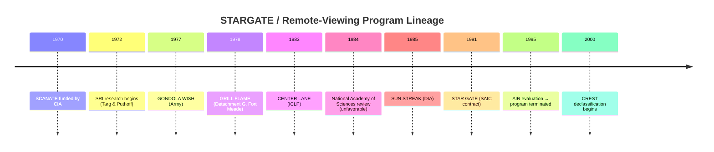

# 🛰️ CIA Remote Viewing / STARGATE — Complete Declassified Archive

> **1,809 declassified documents** from the CIA's Freedom of Information Act Electronic Reading Room (CREST),
> covering the entire **STARGATE** program (1972–1995) and related remote-viewing research.
> Every document is indexed with its title, document ID, a short description pulled from the released text,
> and direct links to both the Internet Archive mirror and the original CIA PDF.

---

## 📑 Table of Contents

- [Overview](#overview)
- [The Story](#the-story)
- [Program Lineage](#program-lineage)
- [Key Figures](#key-figures)
- [Techniques](#techniques)
- [Featured Documents](#featured-documents)
- [Canonical Works & Projects](#canonical-works--projects)
- [Notable Sessions](#notable-sessions)
- [Evaluations](#evaluations)
- [Legacy](#legacy)
- [How to Browse](#how-to-browse)
- [Full Index](#full-index)
- [Methodology](#methodology)
- [Sources & References](#sources--references)
- [Disclaimer](#disclaimer)

---

## 🔭 Overview

Between **1972 and 1995**, the United States intelligence community ran a series of programs —
**SCANATE, GRILL FLAME, CENTER LANE, SUN STREAK, and STAR GATE** — that investigated whether
human beings could use psychic "remote viewing" to gather intelligence on distant or hidden targets.
The effort spanned roughly **23 years**, cost on the order of **$20 million**, and involved dozens of
viewers, analysts, and support personnel.

When the program was terminated in 1995, its records were eventually declassified and released through
the CIA's **CREST** (CIA Records Search Tool) collection. This repository is a complete, searchable
index of every one of those released documents that touches on remote viewing or STARGATE,
so researchers, historians, and the curious can find and read the originals without hunting through
thousands of PDFs by hand.

---

## 📖 The Story

### The Soviet scare (1969–1975)

The program's origin lies in Cold War anxiety. Between 1969 and 1971, U.S. intelligence sources concluded
that the Soviet Union was engaged in "psychotronic" research — the study of psychic phenomena for military
and intelligence purposes. Reported Soviet spending rose from roughly **60 million rubles per year by 1970**
to over **300 million by 1975**, with hundreds of personnel involved. The scale suggested to some U.S.
analysts that the Soviets might have achieved a breakthrough, even though the subject was regarded as
speculative, controversial, and "fringy." The CIA, concerned about a possible intelligence gap, funded the
first U.S. research into the phenomenon.

### SRI research (1972–1986)

The initial research program, **SCANATE** ("scan by coordinate"), was funded by the CIA beginning in 1970.
Remote-viewing research proper began in **1972 at the Stanford Research Institute (SRI)** in Menlo Park,
California, led by physicists **Russell Targ** and **Harold Puthoff** (Puthoff, a former NSA officer and
Scientologist). The work focused on a few "gifted individuals," notably the New York artist **Ingo Swann**
(an OT Level VII Scientologist) and **Pat Price**. Many of SRI's early "empaths" came from the Church of
Scientology. Hundreds of experiments were carried out at SRI through 1986, with a cited minimum client
accuracy threshold of 65%.

### From research to operations (1977–1983)

In 1977 the Army's Assistant Chief of Staff for Intelligence ran **GONDOLA WISH**, an effort to evaluate
potential adversary applications of remote viewing. Building on it, an operational collection project was
formalized as **GRILL FLAME** in mid-1978 — "Detachment G" of INSCOM, housed in buildings 2560 and 2561
at Fort Meade, Maryland, staffed by soldiers and a few civilians believed to possess natural psychic ability.
The SRI research program was integrated into GRILL FLAME in early 1979.

In 1983 the program was redesignated the **INSCOM CENTER LANE Project (ICLP)**. Swann and Puthoff at SRI
developed a set of instructions that theoretically allowed anyone to be trained to produce accurate, detailed
target data — the **Controlled Remote Viewing (CRV)** methodology. The existence of this highly classified
program was leaked by columnist **Jack Anderson in April 1984**.

### The Mars session (May 22, 1984)

One of the most famous documents in the entire corpus is the transcript `CIA-RDP96-00788R001900760001-9`,
titled "MARS EXPLORATION." In a training session, a remote viewer was cued only by geographic coordinates
and a sealed envelope revealing, after the session, the target: **the planet Mars, approximately 1 million
years B.C.** The subject described pyramids, tall thin inhabitants, ancient cities, a catastrophic
environmental collapse, and a group that departed in a "boat" with "rounded walls and shiny metal." The
session is widely circulated online as evidence of a Martian civilization; in context it was a **training
exercise** testing the sealed-envelope + coordinate protocol, not an operational intelligence requirement.

### Critical scrutiny (1984–1985)

In **1984 the National Academy of Sciences' National Research Council** evaluated the remote-viewing
program for the Army Research Institute; the results were **unfavorable**. When Army funding ended in late 1985,
the unit was redesignated **SUN STREAK** and transferred to DIA's Scientific and Technical Intelligence
Directorate (office code DT-S).

### DIA and SAIC era (1985–1995)

Under DIA, the program transitioned to **Science Applications International Corporation (SAIC) in 1991** and
was renamed **STAR GATE**. It changed from a Special Access Program (SAP) to a limited-dissemination (LIMDIS)
program. Physicist **Edwin May** presided over roughly **70% of the total contractor budget and 85% of the
program's data collection**. By the early 1990s the program suffered from uneven management, poor morale,
internal divisiveness, and few accurate results.

### Termination (1995)

The FY 1995 Defense Appropriations bill directed that the program be transferred to the CIA, which was
instructed to conduct a retrospective review. The CIA contracted the **American Institutes for Research (AIR)**
to evaluate the program. Their **September 29, 1995 final report** was released to the public on
November 28, 1995. Statistician **Jessica Utts** argued a statistically significant effect had been
demonstrated in the laboratory (psychics accurate roughly **15% of the time**); psychologist **Ray Hyman**
(a prominent CSICOP debunker) disagreed. **AIR's final recommendation was to terminate STAR GATE**, and the
CIA concluded that **there was no case in which ESP had provided data used to guide intelligence operations**.

### Declassification and afterlife (2000–present)

Documents were released via **CREST** starting in 2000. The Mars transcript, released 2000/08/08, became a
viral internet artifact. The program's legacy is methodological (structured RV protocols, coordinate cueing,
transcript-based evaluation) rather than intelligence product. Commercial "remote viewing" training and
parapsychology research continue outside government.

---

## 🧬 Program Lineage

| Era | Code name | Owning org | Notes |
|---|---|---|---|
| 1970– | SCANATE | CIA | Earliest funded research ("scan by coordinate") |
| 1972–1986 | SRI research | CIA contract | Targ & Puthoff, Menlo Park; gifted subjects |
| 1977 | GONDOLA WISH | Army ACSI SED | Adversary-application evaluation |
| 1978–1983 | GRILL FLAME | Army INSCOM | Detachment G, Fort Meade bldgs 2560/2561 |
| 1983–1985 | CENTER LANE | Army INSCOM | Swann/Puthoff "train anyone" (CRV) methodology |
| 1985–1991 | SUN STREAK | DIA (DT-S) | After Army funding ended |
| 1991–1995 | STAR GATE | DIA → SAIC | SAP → LIMDIS; Edwin May directed ~70% of budget |

---

## 👤 Key Figures

| Person | Role |
|---|---|
| **Ingo Swann** | OT VII Scientologist, artist; co-developed CRV with Puthoff; primary early subject |
| **Harold Puthoff** | Physicist, ex-NSA; SRI program lead |
| **Russell Targ** | Physicist; SRI co-lead |
| **Pat Price** | Early gifted subject; Semipalatinsk viewing |
| **Joe McMoneagle** | Retired MI officer; claims 150 targets unavailable elsewhere; Legion of Merit; left 1984 |
| **Edwin May** | Directed SAIC-era program (1991–1995) |
| **Paul H. Smith** | Viewer; author of *Reading the Enemy's Mind* (2005) |
| **Sen. Claiborne Pell** (D-RI) | Political patron, convinced of effectiveness |
| **Rep. Charles Rose** (D-NC) | Political patron |
| **Jessica Utts** | Statistician; AIR evaluation (positive) |
| **Ray Hyman** | Psychologist, CSICOP; AIR evaluation (negative) |
| **Jack Anderson** | Columnist who leaked program existence, April 1984 |

---

## 🧠 Techniques

| Technique | Description |
|---|---|
| **Coordinate Remote Viewing (CRV)** | Original SRI technique. Viewer given geographic coordinates (or a sealed envelope with target) and reports raw perceptions. The Mars session is pure CRV. |
| **Extended Remote Viewing (ERV)** | Hybrid relaxation/meditative method. |
| **Written Remote Viewing (WRV)** | Hybrid of channeling + automatic writing (introduced 1988); controversial, regarded by some as much less reliable. |

A typical session: the **monitor** cues the subject, records perceptions, moves the subject in time/space, and keeps the subject "deep." The subject reports raw sensory impressions (shapes, colors, textures, structures), not analysis. Transcripts are matched to targets post-hoc by analysts.

---

## ⭐ Featured Documents

| Document | ID | Why it matters |
|---|---|---|
| **MARS EXPLORATION** (May 22, 1984) | `cia-rdp96-00788r001900760001-9` | The famous "Mars 1 million BC" remote-viewing transcript. Released 2000/08/08. |
| **TAPE F — Remote Viewing of Semipalatinsk (PNUTS)** | `cia-rdp79-00999a000400040012-4` | Pat Price's 1974 viewing of a Soviet nuclear test site — one of the program's most-cited "hits." |
| **TAPE E — Remote Viewing of Semipalatinsk (PNUTS)** | `cia-rdp79-00999a000400040011-5` | Companion tape to the Semipalatinsk session. |
| **AIR 1995 Final Evaluation** | `cia-rdp96-00791r000200030015-8` | The terminating report. |
| **STAR GATE — Program Status** | `cia-rdp96-00789r002900010002-8` | Status briefing on STAR GATE. |
| **GRILL FLAME — Mission & Objectives** | `cia-rdp96-00788r001200020003-5` | Foundational mission statement. |
| **Coordinate Remote Viewing, Stages I–VI** | `cia-rdp96-00788r001000400001-7` | The CRV training manual (Feb 1985). |
| **Remote Viewing of Natural Targets (SRI)** | `cia-rdp96-00787r000500410001-3` | Targ & Puthoff SRI study. |

---

## 📚 Canonical Works & Projects

### Books

- **Paul H. Smith**, *Reading the Enemy's Mind: Inside Star Gate — America's Psychic Espionage Program* (2005).
- **Joseph McMoneagle**, *The Stargate Chronicles: Memoirs of a Psychic Spy* (2002) and *Mind Trek* (1997).
- **Jim Schnabel**, *Remote Viewers: The Secret History of America's Psychic Spies* (1997).
- **Russell Targ & Harold Puthoff**, *Mind-Reach: Scientists Look at Psychic Ability* (1977).
- **Ingo Swann**, *Penetration: The Question of Extraterrestrial and Human Telepathy* (1998).
- **Annie Jacobsen**, *Phenomena: The Secret History of the U.S. Government's Investigations into Extrasensory Perception and Psychokinesis* (2017).

### Reports & evaluations

- **AIR (1995)**, *An Evaluation of Remote Viewing: Research and Applications* (final report, Sep 29, 1995).
- **National Academy of Sciences / NRC (1984)**, evaluation for the Army Research Institute (unfavorable).
- **National Academy Press (1988)**, *Enhancing Human Performance*.

### Films & media

- **The Men Who Stare at Goats** (2009) — comedy inspired by the program (Jon Ronson's book).
- **Third Eye Spies** (2019) — documentary on SRI remote viewing (Russell Targ).

### Related programs & institutions

- **Monroe Institute** — Gateway Process / hemi-sync (related declassified doc: `CIA-RDP96-00788R001700210016-5`).
- **SRI International** — research contractor.
- **SAIC** — operational contractor (1991–1995).

---

## 🎯 Notable Sessions & Claims

Reported (mostly unverified) intelligence results attributed to the program:

- **1974** — Pat Price described an airfield with a gantry/crane at given coordinates; the location was the
  Soviet nuclear test site at **Semipalatinsk** (PNUTS). Most other data in the session were incorrect or
  unevaluable.
- **Tu-95 crash in Africa** — a viewer allegedly located the wreckage within several miles.
- **1979** — Soviet submarine under construction: predicted 18–20 missile tubes + flat aft; later sighted with
  24 and 20 tubes + flat deck (120 days).
- **1981** — Kidnapping of BG James L. Dozier (Red Brigades, Italy); freed by Italian police; psychics not credited.
- **1986** — Hunt for Gadhafi before the Libya bombing; Gadhafi not injured.
- **1988** — COL William Higgins in Lebanon; viewer named a building/village; a released hostage later said
  Higgins had probably been there.
- **1989** — Libyan chemical weapons: viewer named ship *Patua/Potua*; actual ship *Batato* loaded cargo
  Tripoli → eastern port.
- **KGB colonel in South Africa** — pocket-calculator communications device (claimed to have aided cooperation).
- **Gulf War** — Saddam Hussein whereabouts (never independently verified).
- **1994** — Plutonium in North Korea: no notable success.
- **SCUD missiles, bio/chem programs, underground tunnels** (claimed).

"**Eight martini**" results = so mind-boggling everyone drinks eight martinis to recover.

---

## ⚖️ Evaluations

- **1984 — NAS/NRC** (for Army Research Institute): unfavorable.
- **1988 — *Enhancing Human Performance*** (National Academy Press): reviewed human-performance enhancement
  including RV.
- **1995 — AIR** (contracted by CIA after FY95 transfer):
  - **Jessica Utts** (statistician): statistically significant effect demonstrated in lab; psychics ~15% accurate.
  - **Ray Hyman** (psychologist, CSICOP): negative assessment.
  - **Final AIR recommendation: terminate STAR GATE.**
  - **CIA conclusion: no case in which ESP provided data used to guide intelligence operations.**

---

## 🌍 Legacy

- **No verified intelligence product** credited by CIA/DIA.
- **Methodological legacy:** structured RV protocols, coordinate cueing, transcript-based evaluation.
- **Cultural legacy:** internet folklore (Mars session), commercial RV training (Farsight Institute, RVIS),
  skepticism (CSICOP/CSI).
- **Academic:** parapsychology lab studies (Ganzfeld, etc.) continue; mainstream science treats RV as unproven.

---

## 🗂️ How to Browse

- **By document ID** — every ID maps directly to a CIA PDF:
  `https://www.cia.gov/readingroom/docs/<ID>.pdf`
- **By Internet Archive mirror** — full text + PDF:
  `https://archive.org/details/<archive-id>`
- **By keyword** — use your browser's find (Ctrl/Cmd+F) or search the full index below.
- **By program era** — see the Program Lineage table, then filter the index.

---

## 📚 Full Index

<b>Expand all 1809 documents</b> (title · id · description · links)

- **(SANITIZED) STAR GATE**  
  `id: cia-readingroom-document-0001281091`  
  (b)(3) (b)(6) 116 JAN 16 All Q(, oCd/S& December 25, 2005 Information and Privacy Coordinator i:enirai inieiigence Agency Washington, DC 20505 Dear Sir: relating to the Star Gate/remote viewing…  
  [archive.org](https://archive.org/details/cia-readingroom-document-0001281091) · [CIA PDF](https://www.cia.gov/readingroom/docs/cia-readingroom-document-0001281091.pdf)
- **(SANITIZED)FINAL RESPONSE**  
  `id: cia-readingroom-document-0001299750`  
  APPROVED FOR RELEASE^ DATE: 08-25-2010 wasntngton, 16 March 2006 Reference: F-2006-00488 This is further to our 2 February 2006 letter concerning your 25 December 2005 Freedom of Information Act…  
  [archive.org](https://archive.org/details/cia-readingroom-document-0001299750) · [CIA PDF](https://www.cia.gov/readingroom/docs/cia-readingroom-document-0001299750.pdf)
- **REVIEW AND APPRAISAL OF STAR GATE COLLECTION**  
  `id: cia-readingroom-document-0005284228`  
  APPROVED FOR RELEASEfI DATE: 25-Oct-2011 CIO/IM 07.-0614 aFC u ~ zoos MEMORANDUM FOR: Mr, David LangbarL- Life Cycle Management llivisioh National Archives and Records Administration ~~ 12.r17./G 1…  
  [archive.org](https://archive.org/details/cia-readingroom-document-0005284228) · [CIA PDF](https://www.cia.gov/readingroom/docs/cia-readingroom-document-0005284228.pdf)
- **INFORMATION REVIEW & RELEASE (IRR) NEWS FOR 10 - 14 FEBRUARY 2003**  
  `id: cia-readingroom-document-01247760`  
  Approved for Release: 2019/03/27 C01247760 SEGRE�T--_ Information Review &amp; Release (IRR) News for 10- 14 February 2003 Executive Summary Immediate Calendar: (UHAIU0) 12 March 2003: Interagency…  
  [archive.org](https://archive.org/details/cia-readingroom-document-01247760) · [CIA PDF](https://www.cia.gov/readingroom/docs/cia-readingroom-document-01247760.pdf)
- **GEOPHYSICAL EFFECTS STUDY (REDACTED VERSION)**  
  `id: cia-readingroom-document-02574264`  
  Approved for Release: 2017/09/11 CO2574264--------Final Report December 1984 Covering the Period 15 November 1983 to 15 December 1984 GEOPHYSICAL EFFECTS STUDY (U) SRI Project 6600 Copy This document…  
  [archive.org](https://archive.org/details/cia-readingroom-document-02574264) · [CIA PDF](https://www.cia.gov/readingroom/docs/cia-readingroom-document-02574264.pdf)
- **INFORMATION REVIEW & RELEASE (IRR) NEWS FOR 21 JANUARY 2002 - 25 JANUARY 2002 EXECUTIVE SUMMARY**  
  `id: cia-readingroom-document-05578070`  
  Approved for Release: 2019/03/27 C05578070 UNCLASSIFIED Information Review &amp; Release (IRR) News for 21 January 2002 - 25 January 2002 Executive Summary Immediate Calendar: (b)(3) (b)(3) (b)(5)…  
  [archive.org](https://archive.org/details/cia-readingroom-document-05578070) · [CIA PDF](https://www.cia.gov/readingroom/docs/cia-readingroom-document-05578070.pdf)
- **INFORMATION REVIEW & RELEASE (IRR) NEWS FOR 1-5 SEPTEMBER 2003 EXECUTIVE SUMMARY**  
  `id: cia-readingroom-document-05578120`  
  Approved for Release: 2019/03/27 C05578120 UNCLASSIFIED Information Review &amp; Release (IRR) News for 1-5 September 2003 Executive Summary Future Plannin2 Calendar: (U//-*1438) 17 September 2003:…  
  [archive.org](https://archive.org/details/cia-readingroom-document-05578120) · [CIA PDF](https://www.cia.gov/readingroom/docs/cia-readingroom-document-05578120.pdf)
- **INFORMATION REVIEW & RELEASE (IRR) NEWS FOR 20 - 24 JANUARY 2003 EXECUTIVE SUMMARY**  
  `id: cia-readingroom-document-05578135`  
  Approved for Release: 2019/03/27 C05578135 UNCLASSIFIED (b)(3) (b)(5) (b)(3) (b)(5) (b)(3) (b)(5) Information Review &amp; Release (IRR) News for 20 - 24 January 2003 Executive Summary Immediate…  
  [archive.org](https://archive.org/details/cia-readingroom-document-05578135) · [CIA PDF](https://www.cia.gov/readingroom/docs/cia-readingroom-document-05578135.pdf)
- **INFORMATIN REVIEW & RELEASE (IRR) NEWS FOR 17-21 MAY 2004 EXECUTIVE SUMMARY**  
  `id: cia-readingroom-document-05578235`  
  1 Approved for Release: 2019/03/27 C05578235 �AVIVIVITT-E1RMAL-119C�(5t*L-Y�Information Review &amp; Release (IRR) News for 17-21 May 2004 Executive Summary Future Planning Calendar (U/f7tft70) 25…  
  [archive.org](https://archive.org/details/cia-readingroom-document-05578235) · [CIA PDF](https://www.cia.gov/readingroom/docs/cia-readingroom-document-05578235.pdf)
- **INFORMATION REVIEW & RELEASE (IRR) NEWS FOR 28 OCTOBER - 1 NOVEMBER 2002 EXECUTIVE SUMMARY**  
  `id: cia-readingroom-document-05578262`  
  Approved for Release: 2019/03/27 C05578262 MUIVIIIII0 I TVA I IVC - IIN I CTNINHL USE OINL T Information Review &amp; Release (IRR) News for 28 October - 1 November 2002 Executive Summary Immediate…  
  [archive.org](https://archive.org/details/cia-readingroom-document-05578262) · [CIA PDF](https://www.cia.gov/readingroom/docs/cia-readingroom-document-05578262.pdf)
- **INFORMATION REVIEW & RELEASE (IRR) NEWS FOR 28 MAY - 1 JUNE 2001 EXECUTIVE SUMMARY**  
  `id: cia-readingroom-document-05578279`  
  Approved for Release: 2019/03/27 C05578279 re - I NIL T (b)(3) (b)(5) Information Review &amp; Release (IRR) News for 28 May - 1 June 2001 Executive Summary Immediate Calendar: (U/rAlt+14)-17 June…  
  [archive.org](https://archive.org/details/cia-readingroom-document-05578279) · [CIA PDF](https://www.cia.gov/readingroom/docs/cia-readingroom-document-05578279.pdf)
- **CY 2006 CASE LOG**  
  `id: cia-readingroom-document-06741356`  
  Approved for Release: 2020/10/07 006741356 CY 2006 Case Log Creation Date I Case Number Case Subject January 4, 2006 F-2006-00385 CH-47 TANDEM ROTOR HELICOPTERS MISSIONS &amp; US ARMY PERSONNEL…  
  [archive.org](https://archive.org/details/cia-readingroom-document-06741356) · [CIA PDF](https://www.cia.gov/readingroom/docs/cia-readingroom-document-06741356.pdf)
- **CY 2010 FOIA CASE LOG**  
  `id: cia-readingroom-document-06741381`  
  Approved for Release: 2020/10/07 006741381 Unclassified CY 2010 FOIA CASE LOG Case Opened Case Number , Subject 1/5/2010 F-2010-00429 Albert Julius Meyer 1/5/2010 F-2010-00430 Philip Burnett Franklin…  
  [archive.org](https://archive.org/details/cia-readingroom-document-06741381) · [CIA PDF](https://www.cia.gov/readingroom/docs/cia-readingroom-document-06741381.pdf)
- **RDP WEEKLY REPORT, 6-10 JANUARY 1997**  
  `id: cia-readingroom-document-06775919`  
  Approved for Release: 2021/03/22 C06775919 FOR OFFICIAL USE ONLY NOTE FOR: FROM: DATE: SUBJECT: 01/12/97 05:03:00 PM -641{7ttal RDP Report, 6-10 January 1997 (U) Activities and Accomplishments (U)…  
  [archive.org](https://archive.org/details/cia-readingroom-document-06775919) · [CIA PDF](https://www.cia.gov/readingroom/docs/cia-readingroom-document-06775919.pdf)
- **4X5 CHIP PROCESSOR EVALUATION PROGRAM**  
  `id: cia-readingroom-document-cia-rdp78b04747a001300020002-4`  
  Sanitized Copy Approved for Release 2011/06/09: CIA-RDP78BO4747AO01300020002-4 SUBJECT 4x5 Chip Processor COPIES Evaluation Program In response to several questions posed by our customer concerning…  
  [archive.org](https://archive.org/details/cia-readingroom-document-cia-rdp78b04747a001300020002-4) · [CIA PDF](https://www.cia.gov/readingroom/docs/cia-readingroom-document-cia-rdp78b04747a001300020002-4.pdf)
- **TECHNICAL REVIEW (Sanitized) 'CHANGE DETECTOR'**  
  `id: cia-readingroom-document-cia-rdp78b04747a002600010036-4`  
  CET Approved For Fjase 2002/01/10: CIA-RDP78B047472600010036-4 MEMORANDUM FOR: Assistant for Plans and Development THROUGH Chief, Development Branch SUBJECT : Technical Review 1. The twelve-month…  
  [archive.org](https://archive.org/details/cia-readingroom-document-cia-rdp78b04747a002600010036-4) · [CIA PDF](https://www.cia.gov/readingroom/docs/cia-readingroom-document-cia-rdp78b04747a002600010036-4.pdf)
- **STANFORD RESEARCH INSTITUTE (SRI) INVESTIGATION INTO PARAPSYCHOLOGY**  
  `id: cia-readingroom-document-cia-rdp79-00498a000200120047-5`  
  Approved- For Release 2002/10/31 : CIA-RDP79-00498A000200120047-5 SENDER WILL CHECK CLASSIFICATION TOP AND BOTTOM UNCLASSIF~IED CONFIDENTIAL SECRET OFFICIAL ROUTING SLIP TO NAME AND ADDRESS DATE…  
  [archive.org](https://archive.org/details/cia-readingroom-document-cia-rdp79-00498a000200120047-5) · [CIA PDF](https://www.cia.gov/readingroom/docs/cia-readingroom-document-cia-rdp79-00498a000200120047-5.pdf)
- **INFORMATION TRANSMISSION UNDER CONDITIONS OF SENSORY SHIELDING**  
  `id: cia-readingroom-document-cia-rdp79-00999a000200010002-3`  
  Declassified and Approved For Release 2014/01/09 CIA-RDP79-00999A000200010002-3 e ? Arvi-Declassified and Approved For Release 2014/01/09: CIA-RDP79-00999A000200010002-3 Declassified and Approved For…  
  [archive.org](https://archive.org/details/cia-readingroom-document-cia-rdp79-00999a000200010002-3) · [CIA PDF](https://www.cia.gov/readingroom/docs/cia-readingroom-document-cia-rdp79-00999a000200010002-3.pdf)
- **INFORMATION TRANSMISSION UNDER CONDITIONS OF SENSORY SHIELDING**  
  `id: cia-readingroom-document-cia-rdp79-00999a000200010008-7`  
  # Declassified in Part - Sanitized Copy Approved for Release 2014/01/09: KAN5MITTAL SLIP CIA-RDP79-00999A000200010008-7 DATE 7 TO: Af PAO' ROOM NO. BUIL ING 259,4 4,f;i* REMARKS: load be ea..67 *71-…  
  [archive.org](https://archive.org/details/cia-readingroom-document-cia-rdp79-00999a000200010008-7) · [CIA PDF](https://www.cia.gov/readingroom/docs/cia-readingroom-document-cia-rdp79-00999a000200010008-7.pdf)
- **SPECIFIC TEST REQUESTED BY SOVIET EUROPEAN DIVISION TO BE COMPLETED AT STANFORD RESEARCH INSTITUTE**  
  `id: cia-readingroom-document-cia-rdp79-00999a000200010015-9`  
  nnalPIIPPiumurwatir Declassified in Part - Sanitized Copy Approved for Release 2014/01/09: CIA-RDP79-00999A000200010015-9 LI SENSITIVE' 12 February 1975 MEMORANDUM FOR THE RECORD SUBJECT: Specific…  
  [archive.org](https://archive.org/details/cia-readingroom-document-cia-rdp79-00999a000200010015-9) · [CIA PDF](https://www.cia.gov/readingroom/docs/cia-readingroom-document-cia-rdp79-00999a000200010015-9.pdf)
- **CONTRACT NO. (SANITIZED) (PROJECT ISH-3138)**  
  `id: cia-readingroom-document-cia-rdp79-00999a000200010048-3`  
  Declassified in Part- Sanitized Copy Approved for Release 2014/01/09: CIA-RDP79-00999A000200010048-3 IstMiZet;+:?:?;..Me/MWAVZ149,,X9M4inelan'AMMKNVIVSVANINtataigt. 2454"655R4,…  
  [archive.org](https://archive.org/details/cia-readingroom-document-cia-rdp79-00999a000200010048-3) · [CIA PDF](https://www.cia.gov/readingroom/docs/cia-readingroom-document-cia-rdp79-00999a000200010048-3.pdf)
- **HERE ARE INSTRUCTIONS FOR REMOTE VIEWING EXPERIMENT THAT WE WILL BE CARRYING OUT DURING THE WEEK OF JUNE 9 PERHAPS LASTING....THE EXPERIMENT WILL START SUNDAY.**  
  `id: cia-readingroom-document-cia-rdp79-00999a000200010050-0`  
  Declassified in Part - Sanitized Copy Approved for Release 2014/01/09: CIA-RDP79-00999A000200010050-0 ADDENDUM THE DATE IS JUNE 6, NOT JUNE 7. HERE ARE INSTRUCTIONS FOR REMOTE VIEWING EXPERIMENT THAT…  
  [archive.org](https://archive.org/details/cia-readingroom-document-cia-rdp79-00999a000200010050-0) · [CIA PDF](https://www.cia.gov/readingroom/docs/cia-readingroom-document-cia-rdp79-00999a000200010050-0.pdf)
- **PROPOSED WORK STATEMENT**  
  `id: cia-readingroom-document-cia-rdp79-00999a000200010068-1`  
  Declassified and Approved For Release 2014/01/09: CIA-RDP79-00999A000200010068-1 - PROPOSED WORK STATEMENT Introduction The general goals of this project may be divided into two categories of…  
  [archive.org](https://archive.org/details/cia-readingroom-document-cia-rdp79-00999a000200010068-1) · [CIA PDF](https://www.cia.gov/readingroom/docs/cia-readingroom-document-cia-rdp79-00999a000200010068-1.pdf)
- **PROGRESS REPORT NO. 2 COVERING THE PERIOD 1 MARCH TO 1 APRIL 1974 STANFORD RESEARCH INSTITUTE PROJECT 3183 CONTRACT 8681/160681-74WR PERCEPTUAL AUGMENTATION TECHNIQUES**  
  `id: cia-readingroom-document-cia-rdp79-00999a000200010095-1`  
  Declassified in Part - Sanitized Copy Approved for Release 2014/01/09: CIA-RDP79-00999A000200010095-1 ? ...e.a14101.-... ,AIAIWAINIML\ ? ,4iiitiNARD RESEARCH INSTITUTE 'iti:enaPirk, California 94025…  
  [archive.org](https://archive.org/details/cia-readingroom-document-cia-rdp79-00999a000200010095-1) · [CIA PDF](https://www.cia.gov/readingroom/docs/cia-readingroom-document-cia-rdp79-00999a000200010095-1.pdf)
- **PROGRAM CHARTER: REMOTE SENSING**  
  `id: cia-readingroom-document-cia-rdp79-00999a000300060001-5`  
  Approved For Release 2003/06/24: CIA-RDP79-00999A000300060001-5 S NFORD RESEARCH INSTITUTE. Menlo Park, California. R04, SECRET- TENTATIVE Il August 1976 PROGRAM CHARTER: CONTROL NO. _SRI -6-4451…  
  [archive.org](https://archive.org/details/cia-readingroom-document-cia-rdp79-00999a000300060001-5) · [CIA PDF](https://www.cia.gov/readingroom/docs/cia-readingroom-document-cia-rdp79-00999a000300060001-5.pdf)
- **VISIT WITH DR. H. PUTHOFF AND MR. R. TARG, STANFORD RESEARCH INSTITUTE (SRI, 12 AUGUST 1976),**  
  `id: cia-readingroom-document-cia-rdp79-00999a000300100002-9`  
  Approved For Release 2003/08/08 : CIA-RDP79-00999A,000300100002-9 OTS/CB Memo #760150 19 August 1976 MEMORANDUM FOR THE RECORD SUBJECT: Visit with Dr. H. Puthoff and 'fir. R. Targ, Stanford Research…  
  [archive.org](https://archive.org/details/cia-readingroom-document-cia-rdp79-00999a000300100002-9) · [CIA PDF](https://www.cia.gov/readingroom/docs/cia-readingroom-document-cia-rdp79-00999a000300100002-9.pdf)
- **DISCUSSIONS WITH DALE GRAFF OF THE FOREIGN TECHNOLOGY DIVISION (FTD) OF THE WRIGHT PATTERSON AFB, DAYTON, OHIO, 20 APRIL 1976**  
  `id: cia-readingroom-document-cia-rdp79-00999a000300100006-5`  
  Approved Folease 2003/06/24: CIA-RDP79-009900300100006-5 OTS/CB Memo #76-75 23 April 1976 SUBJECT: Discussions with Mr. Dale Graff. of the Foreign Technology Division (FTD) of the Wright Patterson…  
  [archive.org](https://archive.org/details/cia-readingroom-document-cia-rdp79-00999a000300100006-5) · [CIA PDF](https://www.cia.gov/readingroom/docs/cia-readingroom-document-cia-rdp79-00999a000300100006-5.pdf)
- **STANFORD RESEARCH INSTITUTE (SRI) INVESTIGATION INTO PARAPSYCHOLOGY**  
  `id: cia-readingroom-document-cia-rdp79-00999a000300100007-4`  
  Approved For Release 2003/06/24,': CIA-RDP79-00999A000300100007-4 OTS/CB Memo #76-18 4 February 1976 11IL,MORA DUM FOR THE RECORD SUBJECT: Stanford Research Institute (SRI) Investigation into…  
  [archive.org](https://archive.org/details/cia-readingroom-document-cia-rdp79-00999a000300100007-4) · [CIA PDF](https://www.cia.gov/readingroom/docs/cia-readingroom-document-cia-rdp79-00999a000300100007-4.pdf)
- **PERCEPTUAL AUGUMENTATION TECHNIQUE**  
  `id: cia-readingroom-document-cia-rdp79-00999a000300100017-3`  
  SG1A Approved For Release 2003/06/24: CIA-RDP79-00999A000300100017-3 Next 1 Page(s) In Document Exempt Approved For Release 2003/06/24: CIA-RDP79-00999A000300100017-3 Approved For Release…  
  [archive.org](https://archive.org/details/cia-readingroom-document-cia-rdp79-00999a000300100017-3) · [CIA PDF](https://www.cia.gov/readingroom/docs/cia-readingroom-document-cia-rdp79-00999a000300100017-3.pdf)
- **PREPARATION FOR THE SRI REMOTE VIEWING EXPERIMENT ARRANGEMENTS WITH NPIC AND NED**  
  `id: cia-readingroom-document-cia-rdp79-00999a000300100021-8`  
  Approved For Release 2003/06/24: CIA-RDP79-00999A,00300100021-8 SUBJECT: Preparation for the SRI Remote Viewing Experiment Arrangements with NPIC and NED 1. While preparing for a remote viewing…  
  [archive.org](https://archive.org/details/cia-readingroom-document-cia-rdp79-00999a000300100021-8) · [CIA PDF](https://www.cia.gov/readingroom/docs/cia-readingroom-document-cia-rdp79-00999a000300100021-8.pdf)
- **SRI PARANORMAL INVESTIGATION TRIP REPORT 23-25 JANUARY 1974**  
  `id: cia-readingroom-document-cia-rdp79-00999a000300100026-3`  
  Approved For Release 2003/06/24: CIA-RDP79-00999A000300100026-3 7 February 1974 MEMORANDUM FOR THE R}JCORD SUBJECT: SRI Paranormal Investigation Trip Report 23 . 25 January 1974 1. Most of the…  
  [archive.org](https://archive.org/details/cia-readingroom-document-cia-rdp79-00999a000300100026-3) · [CIA PDF](https://www.cia.gov/readingroom/docs/cia-readingroom-document-cia-rdp79-00999a000300100026-3.pdf)
- **LETTER TO (Sanitized) FROM H.E. PUTHOFF**  
  `id: cia-readingroom-document-cia-rdp79-00999a000300100034-4`  
  r't SG1A SG1A SG1A SG1A Approved For Reletqw2003/06/24 : CIA-RDP79-00999A0 March 7, 1978 Dear - 00300100034-4 SG1A I am writing to request that you return to us the original tape casettes of the…  
  [archive.org](https://archive.org/details/cia-readingroom-document-cia-rdp79-00999a000300100034-4) · [CIA PDF](https://www.cia.gov/readingroom/docs/cia-readingroom-document-cia-rdp79-00999a000300100034-4.pdf)
- **TAPE E: PROJECT ATLAS REMOTE VIEWING OF SEMI PALATINSK (PNUTS); HAL PUTHOFF AND RUSS TARG; VIEWER - PAT PRICE**  
  `id: cia-readingroom-document-cia-rdp79-00999a000400040011-5`  
  Approved For Release 2003/03/28 : CIA-RDP79-00999A000400040011-5 CASSETTE TAPE TITLE: TAPE E PROJECT "ATLAS" REMOTE VIEWING OF SEMI PALATINSK (PNUTS); HAL PUTHOFF AND RUSS TARG; VIEWER - PAT PRICE…  
  [archive.org](https://archive.org/details/cia-readingroom-document-cia-rdp79-00999a000400040011-5) · [CIA PDF](https://www.cia.gov/readingroom/docs/cia-readingroom-document-cia-rdp79-00999a000400040011-5.pdf)
- **TAPE F PROJECT ATLAS REMOTE VIEWING OF SEMI PALATINSK (PNUTS); HAL PUTHOFF AND RUSS TARG; VIEWER PAT PRICE**  
  `id: cia-readingroom-document-cia-rdp79-00999a000400040012-4`  
  Approved For Release 2003/03/28 : CIA-RDP79-00999A000400040012-4 CASSETTE TAPE TITLE: TAPE "F" PROJECT "ATLAS" REMOTE VIEWING OF SEMI PALATINSK (PNUTS); HAL PUTHOFF AND RUSS TARG; VIEWER PAT PRICE…  
  [archive.org](https://archive.org/details/cia-readingroom-document-cia-rdp79-00999a000400040012-4) · [CIA PDF](https://www.cia.gov/readingroom/docs/cia-readingroom-document-cia-rdp79-00999a000400040012-4.pdf)
- **PROJECT SCANATE EXPLORATORY RESEARCH IN REMOTE VIEWING**  
  `id: cia-readingroom-document-cia-rdp79-00999a000400050002-4`  
  No Description  
  [archive.org](https://archive.org/details/cia-readingroom-document-cia-rdp79-00999a000400050002-4) · [CIA PDF](https://www.cia.gov/readingroom/docs/cia-readingroom-document-cia-rdp79-00999a000400050002-4.pdf)
- **REMOTE VIEWING EXPERIMENT COLONEL MORGAN**  
  `id: cia-readingroom-document-cia-rdp79-00999a000400050004-2`  
  Approved For Release 2002/11/13: CIA-RDP79-00999A000400050004-2 MEMORANDUM FOR THE RECORD SUBJECT: Remote Viewing Experiment Colonel Morgan In early July 1975 Col. Morgan, an American A.ir Farce…  
  [archive.org](https://archive.org/details/cia-readingroom-document-cia-rdp79-00999a000400050004-2) · [CIA PDF](https://www.cia.gov/readingroom/docs/cia-readingroom-document-cia-rdp79-00999a000400050004-2.pdf)
- **PROPOSED REMOTE-VIEWING EXPERIMENT AT SRI**  
  `id: cia-readingroom-document-cia-rdp79-00999a000400050005-1`  
  No Description  
  [archive.org](https://archive.org/details/cia-readingroom-document-cia-rdp79-00999a000400050005-1) · [CIA PDF](https://www.cia.gov/readingroom/docs/cia-readingroom-document-cia-rdp79-00999a000400050005-1.pdf)
- **INTERVIEW WITH MR. PATRICK H. PRICE RE GRID COORDINATES**  
  `id: cia-readingroom-document-cia-rdp79-00999a000400050006-0`  
  Approved For Release 2002/11/13 : CIA-RDP79-00999A000400050006- OTS /BAB MEMO # 163-75 29 April 1975 MEMORANDUM FOR: ATTENTION SUBJECT : Interview with Mr. Patrick H. Price re Grid Coordinates The…  
  [archive.org](https://archive.org/details/cia-readingroom-document-cia-rdp79-00999a000400050006-0) · [CIA PDF](https://www.cia.gov/readingroom/docs/cia-readingroom-document-cia-rdp79-00999a000400050006-0.pdf)
- **SUMMARY OF RESULTS SRI REPORT FOR JANUARY 74 THROUGH FEBRUARY 75 ON ESP**  
  `id: cia-readingroom-document-cia-rdp79-00999a000400050010-5`  
  Approved For Release 2002/11/13 : CIA-RDP79-00999A000400050010-5 Summary of Results SRI Report for January 74 through February 75 on E S P Page 1 Abstract Remote Viewing West Virginia 2 subjects get…  
  [archive.org](https://archive.org/details/cia-readingroom-document-cia-rdp79-00999a000400050010-5) · [CIA PDF](https://www.cia.gov/readingroom/docs/cia-readingroom-document-cia-rdp79-00999a000400050010-5.pdf)
- **BRIEFING FOR HOUSE PERMANENT SELECT COMMITTEE RE OTS INVOLVEMENT IN ESP RESEARCH (Sanitized)**  
  `id: cia-readingroom-document-cia-rdp79-00999a000400050014-1`  
  Approved For Release 2004/07/07: CIA-RDP79-00999A000400050014-1 OTS/BAB MEMO ~~287-77 17 November 1977 SUBJECT: Briefing for House Permanent Select Committee re OTS Involvement in ESP Research 1. In…  
  [archive.org](https://archive.org/details/cia-readingroom-document-cia-rdp79-00999a000400050014-1) · [CIA PDF](https://www.cia.gov/readingroom/docs/cia-readingroom-document-cia-rdp79-00999a000400050014-1.pdf)
- **AUTOMATION INFORMATION**  
  `id: cia-readingroom-document-cia-rdp80b01139a000200010006-5`  
  Approved ForRNiettee ibind/htr&nielp801301139A90200010006-5 INTELLIGENCE ADVISORY COMMITTEE CODIAC-D-9 1 Jkal,y? 1958 MEIVRANDAVM IAC Committee on Documentation stsarz Automation Information The…  
  [archive.org](https://archive.org/details/cia-readingroom-document-cia-rdp80b01139a000200010006-5) · [CIA PDF](https://www.cia.gov/readingroom/docs/cia-readingroom-document-cia-rdp80b01139a000200010006-5.pdf)
- **(Sanitized)**  
  `id: cia-readingroom-document-cia-rdp81b00401r002600010013-2`  
  Approved For Release 2007/04/02 : CIA-RDP81 800401 R002600010013-2 Next 11 Page(s) In Document Exempt Approved For Release 2007/04/02 : CIA-RDP81 800401 R002600010013-2 Approved For Release…  
  [archive.org](https://archive.org/details/cia-readingroom-document-cia-rdp81b00401r002600010013-2) · [CIA PDF](https://www.cia.gov/readingroom/docs/cia-readingroom-document-cia-rdp81b00401r002600010013-2.pdf)
- **DO STAFF COMMUNICATIONS REQUIREMENTS FOR FY-1981 THRU 1985(Sanitized)**  
  `id: cia-readingroom-document-cia-rdp83-00156r000200030037-3`  
  Approved For Release M 0c, M9?_ZI~6 uy) IC's MEMORANDUM FOR: Chief, Information Managemeht Staff, DO THROUGH : 25X1 FROM: Deputy Director for Administration Director of Communications DO Staff…  
  [archive.org](https://archive.org/details/cia-readingroom-document-cia-rdp83-00156r000200030037-3) · [CIA PDF](https://www.cia.gov/readingroom/docs/cia-readingroom-document-cia-rdp83-00156r000200030037-3.pdf)
- **PARAPSYCHOLOGY AND PERSONALOGY**  
  `id: cia-readingroom-document-cia-rdp88g01116r000600690003-8`  
  Sanitized Copy Approved for Release 2011/06/23: CIA-RDP88GO1116R000600690003-8 DATE JAN 1*7 TRANSMITTAL SLIP TO: THE RECORD ROOM NO. BUILDING REMARKS: Per Genna (D/ExecStaff's Office), action on ER…  
  [archive.org](https://archive.org/details/cia-readingroom-document-cia-rdp88g01116r000600690003-8) · [CIA PDF](https://www.cia.gov/readingroom/docs/cia-readingroom-document-cia-rdp88g01116r000600690003-8.pdf)
- **ABC NIGHTLINE**  
  `id: cia-readingroom-document-cia-rdp90-00552r000606540004-8`  
  Sanitized Copy Approved for Release 2010/08/24: CIA-RDP90-00552R000606540004-8 ABC NIGHTLINE 15 February 1984 ANNOUNCER: This is ABC News Nightline. Reporting from Washington, Ted Koppel. KOPPEL: It…  
  [archive.org](https://archive.org/details/cia-readingroom-document-cia-rdp90-00552r000606540004-8) · [CIA PDF](https://www.cia.gov/readingroom/docs/cia-readingroom-document-cia-rdp90-00552r000606540004-8.pdf)
- **PENTAGON, CIA COOPERATING ON PSYCHIC SPYING**  
  `id: cia-readingroom-document-cia-rdp90-00806r000200970097-7`  
  STAT Sanitized Copy Approved for Release 2010/07/30 :CIA-RDP90-008068000200970097-7 ART? ClE A~Pi.~riED ,~Z~] PAGE - ~,~ ~'entagon, ~IA~.~ . ~oopera tin ~ oFi ' ps~~e~ipe ~p~~in~'~ In past columns, I…  
  [archive.org](https://archive.org/details/cia-readingroom-document-cia-rdp90-00806r000200970097-7) · [CIA PDF](https://www.cia.gov/readingroom/docs/cia-readingroom-document-cia-rdp90-00806r000200970097-7.pdf)
- **THIS IS ABC NEWS NIGHTLINE.**  
  `id: cia-readingroom-document-cia-rdp90-00806r000200970098-6`  
  STAT Sanitized Copy Approved for Release 2010/07/30: CIA- ABC NIGHTLINE 15 February 1984 R D P90-00806 R000200970098-6 ANNOUNCER: This is ABC News Nightline. Reporting fr~ 0M as ington, Ted Koppel.…  
  [archive.org](https://archive.org/details/cia-readingroom-document-cia-rdp90-00806r000200970098-6) · [CIA PDF](https://www.cia.gov/readingroom/docs/cia-readingroom-document-cia-rdp90-00806r000200970098-6.pdf)
- **PENTAGON, CIA COOPERATING ON PSYCHIC SPYING**  
  `id: cia-readingroom-document-cia-rdp90-00965r000100130107-2`  
  Declassified in Part - Sanitized Copy Approved for Release 2012/01/10: CIA-RDP90-00965R000100130107-2 r ARTICLE APPEARED ;ON PAGE_., -/11 - Pentagon, CIA Cooperating on Psychic Spying' In past…  
  [archive.org](https://archive.org/details/cia-readingroom-document-cia-rdp90-00965r000100130107-2) · [CIA PDF](https://www.cia.gov/readingroom/docs/cia-readingroom-document-cia-rdp90-00965r000100130107-2.pdf)
- **PSYCHIC STUDIES MIGHT HELP U.S. EXPLORE SOVIETS**  
  `id: cia-readingroom-document-cia-rdp90-00965r000100130111-7`  
  Declassified in Part - Sanitized Copy Approved for Release 2012/01/10: CIA-RDP90-00965R000100130111-7 AR T I CL? w A-PE .0 PAGE_ Psychic Studies Alight Help U.S. Explore Soviets U.S. intelligence…  
  [archive.org](https://archive.org/details/cia-readingroom-document-cia-rdp90-00965r000100130111-7) · [CIA PDF](https://www.cia.gov/readingroom/docs/cia-readingroom-document-cia-rdp90-00965r000100130111-7.pdf)
- **PSYCHIC**  
  `id: cia-readingroom-document-cia-rdp90-00965r000402720004-6`  
  STAT Declassified in Part - Sanitized Copy Approved for Release 2012/01/11: CIA-RDP90-00965R000402720004-6 ntUlr~nv 10 November 1985 PSYCHIC BY CHRISTOPHER HANSON WASHINGTON Military agents with…  
  [archive.org](https://archive.org/details/cia-readingroom-document-cia-rdp90-00965r000402720004-6) · [CIA PDF](https://www.cia.gov/readingroom/docs/cia-readingroom-document-cia-rdp90-00965r000402720004-6.pdf)
- **NATIONAL ACADEMY TO ASSESS POTENTIAL FOR 'PSYCHWARS'**  
  `id: cia-readingroom-document-cia-rdp90-00965r000605540005-0`  
  STAT y Declassified in Part -Sanitized Copy Approved for Release 2012/07/03 :CIA-RDP90-009658000605540005-0 ARTICL[ R. i- ~.., ,. ON PAGE WASHINGTON TIP~ES 3 ~~arch X9$6 .National academ to assess y…  
  [archive.org](https://archive.org/details/cia-readingroom-document-cia-rdp90-00965r000605540005-0) · [CIA PDF](https://www.cia.gov/readingroom/docs/cia-readingroom-document-cia-rdp90-00965r000605540005-0.pdf)
- **SPYING IN THE TWILIGHT ZONE**  
  `id: cia-readingroom-document-cia-rdp90-00965r000807500006-9`  
  Declassified and Approved For Release 2012/01/24: CIA-RDP90-00965R000807500006-9 ?' WASHINGTON POST . A, &amp;E-ILI ~CWC'99) ? 2 6 April 19 8 7 Spying in the Twilight Zone THE SAMARKAND DIMENSION By…  
  [archive.org](https://archive.org/details/cia-readingroom-document-cia-rdp90-00965r000807500006-9) · [CIA PDF](https://www.cia.gov/readingroom/docs/cia-readingroom-document-cia-rdp90-00965r000807500006-9.pdf)
- **KGB MAY HAVE TAKEN SOVIET WRITER OUT OF LONDON, EX-CIA DIRECTOR SAYS**  
  `id: cia-readingroom-document-cia-rdp91-00901r000600420023-4`  
  F_ Approved For Release 2007/09/10: CIA-RDP91-00901 R000600420023-4 ARTICLE APPEARED PHILADELPHIA INQUIRER ON PAGE 20 September 1984 .GB may hake. taken Soviet writer - L o os- a network that feeds…  
  [archive.org](https://archive.org/details/cia-readingroom-document-cia-rdp91-00901r000600420023-4) · [CIA PDF](https://www.cia.gov/readingroom/docs/cia-readingroom-document-cia-rdp91-00901r000600420023-4.pdf)
- **MONTHLY REPORT - OKINAWA BUREAU - OCTOBER 1988**  
  `id: cia-readingroom-document-cia-rdp91-01355r000400110003-1`  
  Declassified in Part - Sanitized Copy Approved for Release 2013/07/08: CIA-RDP91-01355R000400110003-1 ROUTiNG AND RECORD SHEET tO ttt, I SUBJECT: (Optional) Monthly Report Report -- Okinawa Bureau…  
  [archive.org](https://archive.org/details/cia-readingroom-document-cia-rdp91-01355r000400110003-1) · [CIA PDF](https://www.cia.gov/readingroom/docs/cia-readingroom-document-cia-rdp91-01355r000400110003-1.pdf)
- **MONTHLY REPORT -- PANAMA BUREAU -- MARCH 1988**  
  `id: cia-readingroom-document-cia-rdp91-01355r000400120009-4`  
  Declassified in Part - Sanitized Copy Approved for Release 2013/06/18: CIA-RDP91-01355R000400120009-4 ROUTING AND RECORD SHEET SUBJECT: (Optional) Monthly Report -- Panama Bureau FROM: EXTENSION NO.…  
  [archive.org](https://archive.org/details/cia-readingroom-document-cia-rdp91-01355r000400120009-4) · [CIA PDF](https://www.cia.gov/readingroom/docs/cia-readingroom-document-cia-rdp91-01355r000400120009-4.pdf)
- **USER REQUIREMENTS FOR AN AGENCY STANDARD SOFT COPY COMPUTER TERMINAL**  
  `id: cia-readingroom-document-cia-rdp95-00972r000100170013-9`  
  Declassified in Part - Sanitized Copy Approved for Release 2012/08/27: CIA-RDP95-00972R000100170013-9 ^ UNCLASSIFIED' ^ IN USE TERNAL ^ CONFIDENTIAL ^ SECRET STAT STAT STAT STAT ROUTING AND RECORD…  
  [archive.org](https://archive.org/details/cia-readingroom-document-cia-rdp95-00972r000100170013-9) · [CIA PDF](https://www.cia.gov/readingroom/docs/cia-readingroom-document-cia-rdp95-00972r000100170013-9.pdf)
- **PROGRESS REPORT NO. 1 PERCEPTUAL AUGMENTATION TECHNIQUES 12 MARCH 1974**  
  `id: cia-readingroom-document-cia-rdp96-00787r000100010001-1`  
  Progress Report No. 1 Covering the Period 28 January to 1 March 1974 Stanford Research Institute Project 3183 by Harold E. Puthoff Client Private .Approved For Release 2000/08/10…  
  [archive.org](https://archive.org/details/cia-readingroom-document-cia-rdp96-00787r000100010001-1) · [CIA PDF](https://www.cia.gov/readingroom/docs/cia-readingroom-document-cia-rdp96-00787r000100010001-1.pdf)
- **SRI/GALE COMMITTEE MEETING OF 24-25 JULY**  
  `id: cia-readingroom-document-cia-rdp96-00787r000100060001-6`  
  Approved For Release 2000/08/10 : CIA-RDP96-00787R000100060001-6 Mr. Manfred Gale (HQDA, DAMA-ZD) SUBJECT SRI/Gale Committee Meeting of 24-25 July Gu DATE 3 August 1979 LOCATION Bid. 44 cc We…  
  [archive.org](https://archive.org/details/cia-readingroom-document-cia-rdp96-00787r000100060001-6) · [CIA PDF](https://www.cia.gov/readingroom/docs/cia-readingroom-document-cia-rdp96-00787r000100060001-6.pdf)
- **RESEARCH ON PARANORMAL PHENOMENA**  
  `id: cia-readingroom-document-cia-rdp96-00787r000100210002-8`  
  Approved For Release 2003/0 -RDP96-00787R000100210002-8 ORD BASIC RESEARCH (VSK) OTS APPLIED RESEARCH ($75K) RESEARCH ON PARANORMAL PHENOMENA Research Tasks Purpose -MEDICAL EXAMINATIONS 1. Identify…  
  [archive.org](https://archive.org/details/cia-readingroom-document-cia-rdp96-00787r000100210002-8) · [CIA PDF](https://www.cia.gov/readingroom/docs/cia-readingroom-document-cia-rdp96-00787r000100210002-8.pdf)
- **ATTACHMENT 1. ANALYSIS AND REVIEW OF REMOTE VIEWING PARANORMAL RESEARCH**  
  `id: cia-readingroom-document-cia-rdp96-00787r000100250002-4`  
  ApprovedtFQ R 1 se O???Bf?n: C1R D90O7R000100450QD-2-4 Analysis and Review of Remote Viewing Paranormal Research E=. =f Upon receipt of contract, Systemetrics, Inc. personnel will meet with…  
  [archive.org](https://archive.org/details/cia-readingroom-document-cia-rdp96-00787r000100250002-4) · [CIA PDF](https://www.cia.gov/readingroom/docs/cia-readingroom-document-cia-rdp96-00787r000100250002-4.pdf)
- **TASK I PROGRESS REPORT CONTRACT 77F 104420**  
  `id: cia-readingroom-document-cia-rdp96-00787r000100250011-4`  
  SECRET REPORT RV-78--1 COPY NO. 1A TASK I PROGRESS REPORT CONTRACT 77F 104420 28 FEBRUARY 1978 PREPARED BY-/ Arlene G. Snyder Harry'L. Snyder, Ph.D. Research Associate Corporate Scientist SECRET…  
  [archive.org](https://archive.org/details/cia-readingroom-document-cia-rdp96-00787r000100250011-4) · [CIA PDF](https://www.cia.gov/readingroom/docs/cia-readingroom-document-cia-rdp96-00787r000100250011-4.pdf)
- **SUMMARY OF KNOWN REMOTE-VIEWING EXPERIMENTS**  
  `id: cia-readingroom-document-cia-rdp96-00787r000100250013-2`  
  4/18: CIA-RDP SUMMARY OF KNOWN REMOTE-VIEWING EXPERIMENTS The following very brief summaries describe those remote viewing experiments, or series of experiments, published (or submitted for…  
  [archive.org](https://archive.org/details/cia-readingroom-document-cia-rdp96-00787r000100250013-2) · [CIA PDF](https://www.cia.gov/readingroom/docs/cia-readingroom-document-cia-rdp96-00787r000100250013-2.pdf)
- **ADMINISTRATIVE SUMMARY (OF FINAL TECHNICAL REPORT CONTRACT 77F 104420)**  
  `id: cia-readingroom-document-cia-rdp96-00787r000100260002-3`  
  t 11 Approved For Re~"ease 2000/08/101 007878000100260002-3 ADMINISTRATIVE SUMMARY The purpose of this report was to provide a stringent analysis of the experimental methods-and procedures used by…  
  [archive.org](https://archive.org/details/cia-readingroom-document-cia-rdp96-00787r000100260002-3) · [CIA PDF](https://www.cia.gov/readingroom/docs/cia-readingroom-document-cia-rdp96-00787r000100260002-3.pdf)
- **SUMMARY AND CRITICAL EVALUATION OF RESEARCH IN REMOTE VIEWING (PART 2)**  
  `id: cia-readingroom-document-cia-rdp96-00787r000100260003-2`  
  No Description  
  [archive.org](https://archive.org/details/cia-readingroom-document-cia-rdp96-00787r000100260003-2) · [CIA PDF](https://www.cia.gov/readingroom/docs/cia-readingroom-document-cia-rdp96-00787r000100260003-2.pdf)
- **HUMAN RESOURCES COMMITTEE, RESEARCH AND DEVELOPMENT SUBCOMMITTEE, MINUTES OF THE TWELFTH MEETING, 20 SEPTEMBER 1976**  
  `id: cia-readingroom-document-cia-rdp96-00787r000200020018-1`  
  Approved For Rise 2003/09/10: CIA-RDP96-00 DIRECTOR OF CENTRAL INTELLIGENCE Human Resources Committee RESEARCH AND DEVELOPMENT SUBCOMMITTEE HRC-R&D-M-012 23 September 1976 Minutes of the Twelfth…  
  [archive.org](https://archive.org/details/cia-readingroom-document-cia-rdp96-00787r000200020018-1) · [CIA PDF](https://www.cia.gov/readingroom/docs/cia-readingroom-document-cia-rdp96-00787r000200020018-1.pdf)
- **LETTER (Sanitized)**  
  `id: cia-readingroom-document-cia-rdp96-00787r000200020030-7`  
  Approved Forease 2003/09/10 : CIA-RDP96-0078780 0200020030-7 -VW August 4, 1978 SGFOIA3 SG1I Enclosed is an address by the Dean of the Engineering Department at Princeton. He references our work…  
  [archive.org](https://archive.org/details/cia-readingroom-document-cia-rdp96-00787r000200020030-7) · [CIA PDF](https://www.cia.gov/readingroom/docs/cia-readingroom-document-cia-rdp96-00787r000200020030-7.pdf)
- **THE ROLE OF CONSCIOUSNESS IN THE PHYSICAL WORLD**  
  `id: cia-readingroom-document-cia-rdp96-00787r000200020033-4`  
  Approved For ase 2003109/10 : CIA-RDP96-00787 200020033=4 Abstract of Invited Paper k"1 M 67e-r&4a ,t~_3~a'r197 Titleof The Role of Conciousness in the Physical World Symposium Name(s) of Robert. G.…  
  [archive.org](https://archive.org/details/cia-readingroom-document-cia-rdp96-00787r000200020033-4) · [CIA PDF](https://www.cia.gov/readingroom/docs/cia-readingroom-document-cia-rdp96-00787r000200020033-4.pdf)
- **LETTER (Sanitized)**  
  `id: cia-readingroom-document-cia-rdp96-00787r000200020034-3`  
  Approved For Rely: 2003/09/10 : CIA-RDP96-00787R000020034-3 March 7, 1978 SG1I SGFOIA3 SG1I I am writing to request that you return to us the original tape casettes of the Price-crane experiment.…  
  [archive.org](https://archive.org/details/cia-readingroom-document-cia-rdp96-00787r000200020034-3) · [CIA PDF](https://www.cia.gov/readingroom/docs/cia-readingroom-document-cia-rdp96-00787r000200020034-3.pdf)
- **SRI/DIA REQUEST FOR PARAPSYCHOLOGICAL DATA**  
  `id: cia-readingroom-document-cia-rdp96-00787r000200020040-6`  
  Approved For Release 2003/09/10 : CIA-RDP96-00787R000200020040-6 16 July 1986 MEMORANDUM TO: Director of Research and Development ACS/ORD SUBJECT SRI/DIA Request for Parapsychological Data Attached…  
  [archive.org](https://archive.org/details/cia-readingroom-document-cia-rdp96-00787r000200020040-6) · [CIA PDF](https://www.cia.gov/readingroom/docs/cia-readingroom-document-cia-rdp96-00787r000200020040-6.pdf)
- **LETTER SRI INTERNATIONAL**  
  `id: cia-readingroom-document-cia-rdp96-00787r000200020041-5`  
  Approved For Release 2003/09/10 : CIA-RDP96-00787R000200020041 18 July 1986 SRI International 333 Ravenswood Avenue Menlo Park, CA 94025 FOR SG1J Dear Ms. Humphrey and I am pleased the information…  
  [archive.org](https://archive.org/details/cia-readingroom-document-cia-rdp96-00787r000200020041-5) · [CIA PDF](https://www.cia.gov/readingroom/docs/cia-readingroom-document-cia-rdp96-00787r000200020041-5.pdf)
- **LETTER HAL PUTHOFF AND RUSS TARG**  
  `id: cia-readingroom-document-cia-rdp96-00787r000200020045-1`  
  Approved For Release 2006/12/19: CIA-RDP96-00787R000200020045-1 STAT September 23, 1977 Hal Puthoff and Russ Targ SRI Menlo Park, CA 94025 Dear Hal and Russ, I finally received a reply from Senator…  
  [archive.org](https://archive.org/details/cia-readingroom-document-cia-rdp96-00787r000200020045-1) · [CIA PDF](https://www.cia.gov/readingroom/docs/cia-readingroom-document-cia-rdp96-00787r000200020045-1.pdf)
- **LETTER (Sanitized)**  
  `id: cia-readingroom-document-cia-rdp96-00787r000200020049-7`  
  Approved For Release se 2003/09 9td~ffP96-00787RQ0000200020049-7 6 STANFORD RESEARCH INSTITUTE MENLO PARK, CALIFORNIA 94025 (415) 326-6200 January 20, 1977 -Is duaxtricrtt consis's of…  
  [archive.org](https://archive.org/details/cia-readingroom-document-cia-rdp96-00787r000200020049-7) · [CIA PDF](https://www.cia.gov/readingroom/docs/cia-readingroom-document-cia-rdp96-00787r000200020049-7.pdf)
- **LETTER (Sanitized)**  
  `id: cia-readingroom-document-cia-rdp96-00787r000200020050-5`  
  roved For Release 2003/09/10 : CIA-RDP96-00787R000 00020050-5 mope SG1I SG1I STANFORD RESEARCH INSTITUTE MENLO PARK, CALIFORNIA 94025 (415) 326-6200 May 5, 1977 First, I want to express my…  
  [archive.org](https://archive.org/details/cia-readingroom-document-cia-rdp96-00787r000200020050-5) · [CIA PDF](https://www.cia.gov/readingroom/docs/cia-readingroom-document-cia-rdp96-00787r000200020050-5.pdf)
- **CONTENTS - CIA BOX B**  
  `id: cia-readingroom-document-cia-rdp96-00787r000200020058-7`  
  Approved For Release 2003/09/10 CIA-RDP96-00787R000200020058-7 CONTENTS - CIA. BOX B 1. Large file folder containing: SG1I - Memos to/from ORD regarding paranormal studies, et al, some with…  
  [archive.org](https://archive.org/details/cia-readingroom-document-cia-rdp96-00787r000200020058-7) · [CIA PDF](https://www.cia.gov/readingroom/docs/cia-readingroom-document-cia-rdp96-00787r000200020058-7.pdf)
- **PROPOSAL FOR RESEARCH SRI ISU 75-241 MAGNETOMETER STABILITY STUDIES**  
  `id: cia-readingroom-document-cia-rdp96-00787r000200050002-5`  
  Proposal for Research SRI No. ISU 75-241 Prepared for: ELEX 03X Naval Electronics Systems Command Washington, D.C. 20360 Approved by: Earle D. Jones, Di"fector Prepared by: H. E. Puthoff Russell Targ…  
  [archive.org](https://archive.org/details/cia-readingroom-document-cia-rdp96-00787r000200050002-5) · [CIA PDF](https://www.cia.gov/readingroom/docs/cia-readingroom-document-cia-rdp96-00787r000200050002-5.pdf)
- **OBJECTIVE ASSESSMENT OF SRI VISIT NOVEMBER, 1974**  
  `id: cia-readingroom-document-cia-rdp96-00787r000200070001-4`  
  Approved For Release 2003/09/10 : CIA-RDP96-00787R000200070001-4 OBJECTIVE ASSESSMENT OF SRI VISIT November, 1974 The trip to SRI was in support of CB's contract on enhancement of human perception.…  
  [archive.org](https://archive.org/details/cia-readingroom-document-cia-rdp96-00787r000200070001-4) · [CIA PDF](https://www.cia.gov/readingroom/docs/cia-readingroom-document-cia-rdp96-00787r000200070001-4.pdf)
- **EXPERIMENT WITH HELLA HAMMID**  
  `id: cia-readingroom-document-cia-rdp96-00787r000200070002-3`  
  Approved For Release 2001/03/07 : CIA-RDP96-00787R000200070002-3 1. Experiments With Hella Hammid My assessment of Hella, based on my reading of her earlier results and an observation of those…  
  [archive.org](https://archive.org/details/cia-readingroom-document-cia-rdp96-00787r000200070002-3) · [CIA PDF](https://www.cia.gov/readingroom/docs/cia-readingroom-document-cia-rdp96-00787r000200070002-3.pdf)
- **SUBJECTIVE CRITIQUE OF SRI VISIT, NOVEMBER, 1974**  
  `id: cia-readingroom-document-cia-rdp96-00787r000200070003-2`  
  Approved For Re~~~~~~~1~~:~~~-FPIOd'~T$~1~000200070003-2 ovemb~:r, 7 INTRODUCT'14N The following pages include a schedule of my activities at SRI, a report on each of those seven activities, and an…  
  [archive.org](https://archive.org/details/cia-readingroom-document-cia-rdp96-00787r000200070003-2) · [CIA PDF](https://www.cia.gov/readingroom/docs/cia-readingroom-document-cia-rdp96-00787r000200070003-2.pdf)
- **OBJECTIVE ASSESSMENT OF SRI VISIT, NOVEMBER, 1974**  
  `id: cia-readingroom-document-cia-rdp96-00787r000200070005-0`  
  OBJECTIVE ASSES,-:` =NT OF SRI VISIT Approved For Release ~600949 : 6fA71 DP96-00787R000200070005-0 INTRODUCT10 The trip to SRI was in support of CB's contract on enhancement of human perception. The…  
  [archive.org](https://archive.org/details/cia-readingroom-document-cia-rdp96-00787r000200070005-0) · [CIA PDF](https://www.cia.gov/readingroom/docs/cia-readingroom-document-cia-rdp96-00787r000200070005-0.pdf)
- **PROCEEDINGS INTERNATIONAL CONFERENCE ON CYBERNETICS & SOCIETY**  
  `id: cia-readingroom-document-cia-rdp96-00787r000200080004-0`  
  Approved For Release;?,p01/03/26 : CIA-RDP96-00787RWO200080004-0 PROCEEDINGS INTERNATIONAL CONFERENCE CYBERNETICS AND SOCIETY September 19-21, 1977 Sponsored by: IEEE. Syrte.ms, Man and. Cybernetics…  
  [archive.org](https://archive.org/details/cia-readingroom-document-cia-rdp96-00787r000200080004-0) · [CIA PDF](https://www.cia.gov/readingroom/docs/cia-readingroom-document-cia-rdp96-00787r000200080004-0.pdf)
- **PSYCHIC STUDIES MIGHT HELP U.S. EXPLORE SOVIETS - JACK ANDERSON**  
  `id: cia-readingroom-document-cia-rdp96-00787r000200080006-8`  
  Approved For Release 2001/03/26 : CIA-RDP96-00787R000200080006-8 P "'Studies mind. One of the most promising is least two tests that produced aston- sy Cis the testing of "remote viewing"-the ishing…  
  [archive.org](https://archive.org/details/cia-readingroom-document-cia-rdp96-00787r000200080006-8) · [CIA PDF](https://www.cia.gov/readingroom/docs/cia-readingroom-document-cia-rdp96-00787r000200080006-8.pdf)
- **A PERCEPTUAL CHANNEL FOR INFORMATION TRANSFER OVER KILOMETER DISTANCES: HISTORICAL PERSPECTIVE AND RECENT RESEARCH**  
  `id: cia-readingroom-document-cia-rdp96-00787r000200080007-7`  
  Approved For Releasi;001/03/26 : CIA-RDP96-007870200080007-7 A Perceptual Channel for Information Transfer over Kilometer Distances: Historical Perspective and Recent Research HAROLD E. PUTHOFF,…  
  [archive.org](https://archive.org/details/cia-readingroom-document-cia-rdp96-00787r000200080007-7) · [CIA PDF](https://www.cia.gov/readingroom/docs/cia-readingroom-document-cia-rdp96-00787r000200080007-7.pdf)
- **DIRECT PERCEPTION OF REMOTE GEOGRAPHICAL LOCATIONS**  
  `id: cia-readingroom-document-cia-rdp96-00787r000200080008-6`  
  Approved For ReleaSp 2001/03/26 CIA-RDP96-0078000200080008-6 DIRECT PERCEPTION OF REMOTE GEOGRAPHICAL LOCATIONS Harold E. Puthoff and Russell Tara STANFORD RESEARCH INSTITUTE MENLO PARK, CALIFORNIA…  
  [archive.org](https://archive.org/details/cia-readingroom-document-cia-rdp96-00787r000200080008-6) · [CIA PDF](https://www.cia.gov/readingroom/docs/cia-readingroom-document-cia-rdp96-00787r000200080008-6.pdf)
- **BULLETIN OF THE AMERICAN PHYSICAL SOCIETY**  
  `id: cia-readingroom-document-cia-rdp96-00787r000200080009-5`  
  Approved For Release 2001/03/26 : CIA-RDP96-0078000200080009-5 7je OF THE AMERICAN PHYSICAL SOCIETY 1 DECEMBER 1976 INCLUDING THE PROGRAM OF THE 1976 WINTER MEETING AT STANFORD UNIVERSITY 20-22…  
  [archive.org](https://archive.org/details/cia-readingroom-document-cia-rdp96-00787r000200080009-5) · [CIA PDF](https://www.cia.gov/readingroom/docs/cia-readingroom-document-cia-rdp96-00787r000200080009-5.pdf)
- **NEWS REPORT ON RESEARCH PERFORMED BY STANFORD RESEARCH INSTITUTE ON ABILITY TO VIEW LOCATIONS REMOTELY**  
  `id: cia-readingroom-document-cia-rdp96-00787r000200080011-2`  
  Approved For Release4001/03/26 CIA-RDP96-00787RO200080011-2 Menlo Park, CA--The ability to view remote geographical locations by means of an unknown perceptual channel may be widespread in the…  
  [archive.org](https://archive.org/details/cia-readingroom-document-cia-rdp96-00787r000200080011-2) · [CIA PDF](https://www.cia.gov/readingroom/docs/cia-readingroom-document-cia-rdp96-00787r000200080011-2.pdf)
- **COINCIDENCE: PARANORMAL EVENT OR JUST THE LUCK OF THE THROW?**  
  `id: cia-readingroom-document-cia-rdp96-00787r000200080017-6`  
  Approved For Release 2=~/~A~ L CIA-RDP96-00 Coincidence: paranormal eve? t or just the luck of the throw? Things that happen at the same time have a special relationship to each other; researchers…  
  [archive.org](https://archive.org/details/cia-readingroom-document-cia-rdp96-00787r000200080017-6) · [CIA PDF](https://www.cia.gov/readingroom/docs/cia-readingroom-document-cia-rdp96-00787r000200080017-6.pdf)
- **CLOSING THE PSYCHIC GAP**  
  `id: cia-readingroom-document-cia-rdp96-00787r000200080020-2`  
  App;r s, famous ciairvoyaylte, By James cook Madame Sosostris, a bad cold, nevertheless.... ~choIRVOYakineticist, Uri Geller TELEPATHIST, has pSy- a ld hi self and warns d -TS. Eliot, The Waste Land…  
  [archive.org](https://archive.org/details/cia-readingroom-document-cia-rdp96-00787r000200080020-2) · [CIA PDF](https://www.cia.gov/readingroom/docs/cia-readingroom-document-cia-rdp96-00787r000200080020-2.pdf)
- **PRECOGNITIVE REMOTE VIEWING IN THE CHICAGO AREA: A REPLICATION OF THE STANFORD EXPERIMENT**  
  `id: cia-readingroom-document-cia-rdp96-00787r000200080023-9`  
  Approved For Release 2001/03/26 : CIA The Journa of Parapsychology RAO, K. R. Studies in the preferential effect. IV. The role of key cards in preferential response situations. Journal of…  
  [archive.org](https://archive.org/details/cia-readingroom-document-cia-rdp96-00787r000200080023-9) · [CIA PDF](https://www.cia.gov/readingroom/docs/cia-readingroom-document-cia-rdp96-00787r000200080023-9.pdf)
- **IN SEARCH OF MODERN MERLINS: PSYCHICS GAIN WIDER CREDIBILITY**  
  `id: cia-readingroom-document-cia-rdp96-00787r000200080027-5`  
  Approved For Release 2001/03/26 : CIA-RDP 0OQ06080'27-5 Advice: Lipstick at the table?/7 Gardens: The joys of greenhouses/8 In search of mode sychics gaol wider creai Belief in psychic phenom- ena,…  
  [archive.org](https://archive.org/details/cia-readingroom-document-cia-rdp96-00787r000200080027-5) · [CIA PDF](https://www.cia.gov/readingroom/docs/cia-readingroom-document-cia-rdp96-00787r000200080027-5.pdf)
- **PSI ON CAPITOL HILL**  
  `id: cia-readingroom-document-cia-rdp96-00787r000200080031-0`  
  PSI ~1 CAPITOL HIf1 Ely V`Ji!Ija'n }C. Stucky t cs rct c:ear arhathar Charlie Rose seeks thy ever-growing Mind-Over- Far-Out (Moto) vote- Governor Jerry Qrq?,vn of California certainly does-as what…  
  [archive.org](https://archive.org/details/cia-readingroom-document-cia-rdp96-00787r000200080031-0) · [CIA PDF](https://www.cia.gov/readingroom/docs/cia-readingroom-document-cia-rdp96-00787r000200080031-0.pdf)
- **PSYCHICS AND SCIENTISTS: 'MIND-REACH' AND REMOTE VIEWING**  
  `id: cia-readingroom-document-cia-rdp96-00787r000200080037-4`  
  Approved For Reles 2001/03/26 : CIA-RDP96-0078?000200080037-4 disIpr~fI claim s that here is strong In a new book, Mind Reach, Russell Targ and laroldl'u evidence for "remote viewing .'" Here, Ray…  
  [archive.org](https://archive.org/details/cia-readingroom-document-cia-rdp96-00787r000200080037-4) · [CIA PDF](https://www.cia.gov/readingroom/docs/cia-readingroom-document-cia-rdp96-00787r000200080037-4.pdf)
- **LETTER TO MR. ROBERT W. LUCKY FROM JAMES L. CALKINS**  
  `id: cia-readingroom-document-cia-rdp96-00787r000200080043-7`  
  \:,-. tppro ev d 'lFor~ fea a X1/03/26: CIA-RD~bt`-& dYft ~'bC~ ~ '3=~1j` "nwyl :.tt-:.t 1 WAY (.(illc~~,t~ 01 I IU11),111it ieS & Soci .iI Sciences I )t'ImItIllent- of I'tiv( hology .. tilrrinllt);y…  
  [archive.org](https://archive.org/details/cia-readingroom-document-cia-rdp96-00787r000200080043-7) · [CIA PDF](https://www.cia.gov/readingroom/docs/cia-readingroom-document-cia-rdp96-00787r000200080043-7.pdf)
- **REMOTE VIEWING: A LOOK INTO THE UNKNOWN**  
  `id: cia-readingroom-document-cia-rdp96-00787r000200080048-2`  
  - Apgroved Fockelease;001/03/ 6 : CI -RDP9 0787Ip00200080048-2 )-------,--- - Remote viewing: look into the unknown By NED MacKAY Mental ability to view a distant location through someone else's…  
  [archive.org](https://archive.org/details/cia-readingroom-document-cia-rdp96-00787r000200080048-2) · [CIA PDF](https://www.cia.gov/readingroom/docs/cia-readingroom-document-cia-rdp96-00787r000200080048-2.pdf)
- **STANFORD RESEARCH INSTITUTE (SRI) INVESTIGATION INTO PARAPSYCHOLOGY**  
  `id: cia-readingroom-document-cia-rdp96-00787r000200090006-7`  
  Approved For Release 2003/090BPJU DP96-00787R000200090006-7 OTS/CB Memo #76-18 4 February 1976 MEMORANDUM FOR THE RECORD SUBJECT: Stanford Research Institute (SRI) Investigation into Parapsychology…  
  [archive.org](https://archive.org/details/cia-readingroom-document-cia-rdp96-00787r000200090006-7) · [CIA PDF](https://www.cia.gov/readingroom/docs/cia-readingroom-document-cia-rdp96-00787r000200090006-7.pdf)
- **9/15 9/28/76 - AS I TOLD YOU, IT GOT LOST N THE SHUFFLE J.F.**  
  `id: cia-readingroom-document-cia-rdp96-00787r000200090014-8`  
  Approved For Releas6W000/08/10 : CIA-RDP9 02W6`0' 0(T`141-8 J~ J~c1 1~si Fh Ken f. As der your request, here is the draft of my paranormal criteria thoughts. I have Xeroxed your copy so that your…  
  [archive.org](https://archive.org/details/cia-readingroom-document-cia-rdp96-00787r000200090014-8) · [CIA PDF](https://www.cia.gov/readingroom/docs/cia-readingroom-document-cia-rdp96-00787r000200090014-8.pdf)
- **INFORMATION TRANSMISSION IN REMOTE VIEWING EXPERIMENTS: II**  
  `id: cia-readingroom-document-cia-rdp96-00787r000200090017-5`  
  Approved For Release 2000/08/10 : CIA-RDP96-00787ROO0200090017-5 January 1979 Submitted for Publication to NATURE: INFORMATION TRANSMISSION IN REMOTE VIEWING EXPERIMENTS: II H. E. Puthoff Russell…  
  [archive.org](https://archive.org/details/cia-readingroom-document-cia-rdp96-00787r000200090017-5) · [CIA PDF](https://www.cia.gov/readingroom/docs/cia-readingroom-document-cia-rdp96-00787r000200090017-5.pdf)
- **SRI STUDIES IN REMOTE VIEWING: A PROGRAM REVIEW**  
  `id: cia-readingroom-document-cia-rdp96-00787r000200090018-4`  
  Approved For Release 20980 'IIA-RDP96-00787R000200090018-4 SRI STUDIES IN REMOTE VIEWING: A PROGRAM REVIEW For the past eleven years, a small group headed by Dr. H. Puthoff has sought evidence that…  
  [archive.org](https://archive.org/details/cia-readingroom-document-cia-rdp96-00787r000200090018-4) · [CIA PDF](https://www.cia.gov/readingroom/docs/cia-readingroom-document-cia-rdp96-00787r000200090018-4.pdf)
- **23RD ANNUAL INTERNATIONAL CONFERENCE LA RESERVE, GENEVA, SWITZERLAND**  
  `id: cia-readingroom-document-cia-rdp96-00787r000200090020-1`  
  Approved For Rele 2000/08/10 : CIA-RDP96-00787R00c090020, .=' TED BASTIN, Cambridge Language Research Unit Cambridge, England C. T. K. CHART, Madras .Christian College Madras, India 0. COSTA DE…  
  [archive.org](https://archive.org/details/cia-readingroom-document-cia-rdp96-00787r000200090020-1) · [CIA PDF](https://www.cia.gov/readingroom/docs/cia-readingroom-document-cia-rdp96-00787r000200090020-1.pdf)
- **PREPARATION FOR THE SRI REMOTE VIEWING EXPERIMENT ARRANGEMENTS WITH NPIC AND NED**  
  `id: cia-readingroom-document-cia-rdp96-00787r000200130006-2`  
  Approved For Releasee,2003/09/04 CIA-RDP96-00787R000200130006-2 17 June 1974 RAI'dQ1 FR:* ` RE SUBJECT: Prep atioi for the SRI Remote V .ewi g E t Arrangements with NPIC and ~ oED SG1I SG1I 1. While…  
  [archive.org](https://archive.org/details/cia-readingroom-document-cia-rdp96-00787r000200130006-2) · [CIA PDF](https://www.cia.gov/readingroom/docs/cia-readingroom-document-cia-rdp96-00787r000200130006-2.pdf)
- **SUGGESTED PROTOCOL FOR OPERATIONAL REMOTE-VIEWING EXERCISE**  
  `id: cia-readingroom-document-cia-rdp96-00787r000200130008-0`  
  SG1A--,Oe. K - APPENDIX T tir re- cr.( ~e .te,~ /~~ ? Day a~ccZS+t G / 'i1 yGt e~v~L . ~i a e~ a~(~t, yte?.k A44,--L, e r u est d P t i f O ,,~-T gg oco or peratjo al emot -viewing Exercise SG1I N~'…  
  [archive.org](https://archive.org/details/cia-readingroom-document-cia-rdp96-00787r000200130008-0) · [CIA PDF](https://www.cia.gov/readingroom/docs/cia-readingroom-document-cia-rdp96-00787r000200130008-0.pdf)
- **QUANTUM PHYSICS AND PARAPSYCHOLOGY**  
  `id: cia-readingroom-document-cia-rdp96-00787r000200180002-1`  
  .Approved For Release 2000/08/10 : CIA-RDP96-00787R000200180002-1 QUANTM4 PHYSICS AND PARAPSYCHOLOGY The 23rd Annual International Conference of the Parapsycholo r Foundation, Inc. Hotel La Reserve,…  
  [archive.org](https://archive.org/details/cia-readingroom-document-cia-rdp96-00787r000200180002-1) · [CIA PDF](https://www.cia.gov/readingroom/docs/cia-readingroom-document-cia-rdp96-00787r000200180002-1.pdf)
- **PHYSICS, ENTROPY AND PSYCHOKINESIS**  
  `id: cia-readingroom-document-cia-rdp96-00787r000200190001-1`  
  STANFORD RESEARCH INSTITUTE Menlo Park, California 94025 ? y.s.A. PHYSICS, ENTROPY, AND PSYCHOKINESIS Harold Puthoff and Russell Targ Stanford Research Institute Electronics and Bioengineering…  
  [archive.org](https://archive.org/details/cia-readingroom-document-cia-rdp96-00787r000200190001-1) · [CIA PDF](https://www.cia.gov/readingroom/docs/cia-readingroom-document-cia-rdp96-00787r000200190001-1.pdf)
- **PERCEPTUAL AUGMENTATION TECHNIQUES PART ONE--TECHNICAL PROPOSAL**  
  `id: cia-readingroom-document-cia-rdp96-00787r000200210001-8`  
  Proposal for Research Prepared by: Harold E. Puthoff S~;nior Research Engineer Russell Targ Senior Research Physicist Electronics and Bioengineering Laboratory Earle D. Jones Dire~t6r Information…  
  [archive.org](https://archive.org/details/cia-readingroom-document-cia-rdp96-00787r000200210001-8) · [CIA PDF](https://www.cia.gov/readingroom/docs/cia-readingroom-document-cia-rdp96-00787r000200210001-8.pdf)
- **Forced-Choice Remote Viewing**  
  `id: cia-readingroom-document-cia-rdp96-00787r000300010001-9`  
  No Description  
  [archive.org](https://archive.org/details/cia-readingroom-document-cia-rdp96-00787r000300010001-9) · [CIA PDF](https://www.cia.gov/readingroom/docs/cia-readingroom-document-cia-rdp96-00787r000300010001-9.pdf)
- **A SUGGESTED REMOTE VIEWING TRAINING PROCEDURE**  
  `id: cia-readingroom-document-cia-rdp96-00787r000300110001-8`  
  No Description  
  [archive.org](https://archive.org/details/cia-readingroom-document-cia-rdp96-00787r000300110001-8) · [CIA PDF](https://www.cia.gov/readingroom/docs/cia-readingroom-document-cia-rdp96-00787r000300110001-8.pdf)
- **CO-ORDINATE REMOTE VIEWING (CRV) TECHNOLOGY 1981-1983 THREE-YEAR PROJECT - DRAFT REPORT**  
  `id: cia-readingroom-document-cia-rdp96-00787r000300140001-5`  
  No Description  
  [archive.org](https://archive.org/details/cia-readingroom-document-cia-rdp96-00787r000300140001-5) · [CIA PDF](https://www.cia.gov/readingroom/docs/cia-readingroom-document-cia-rdp96-00787r000300140001-5.pdf)
- **AN APPLICATION ORIENTED REMOTE VIEWING EXPERIMENT**  
  `id: cia-readingroom-document-cia-rdp96-00787r000300150001-4`  
  No Description  
  [archive.org](https://archive.org/details/cia-readingroom-document-cia-rdp96-00787r000300150001-4) · [CIA PDF](https://www.cia.gov/readingroom/docs/cia-readingroom-document-cia-rdp96-00787r000300150001-4.pdf)
- **AN EFFORT TO IMPROVE REMOTE VIEWING QUALITY USING HYPNOSIS**  
  `id: cia-readingroom-document-cia-rdp96-00787r000300180001-1`  
  No Description  
  [archive.org](https://archive.org/details/cia-readingroom-document-cia-rdp96-00787r000300180001-1) · [CIA PDF](https://www.cia.gov/readingroom/docs/cia-readingroom-document-cia-rdp96-00787r000300180001-1.pdf)
- **FEASIBILITY STUDY ON THE USE OF RV DETECTION TECHNIQUES TO DETERMINE LOCATION OF MILITARY TARGETS**  
  `id: cia-readingroom-document-cia-rdp96-00787r000300190001-0`  
  [-Appr r For Release 2000/08/10 : CIA-RDP96-00787R000300190001-0 11 FEASIBILITY STUDY ON THE USE OF RV DETECTION TECHNIQUES TO DETERMINE LOCATION OF MILITARY TARGETS E. C. May, Ph.D. H. E. Puthoff,…  
  [archive.org](https://archive.org/details/cia-readingroom-document-cia-rdp96-00787r000300190001-0) · [CIA PDF](https://www.cia.gov/readingroom/docs/cia-readingroom-document-cia-rdp96-00787r000300190001-0.pdf)
- **PHENOMENOLOGICAL RESEARCH AND ANALYSIS**  
  `id: cia-readingroom-document-cia-rdp96-00787r000300230001-5`  
  Ap SeQpF-c Rel a 2000/08/10 : CIA-RDP96-00787R0003W2-30000D5O1O Phenomenological Research and Analysis Edwin C. May, Ph.D., Wanda L. W. Luke, and Nevin D. Lantz, Ph.D. AEIWWAF~_ ME 0 Science…  
  [archive.org](https://archive.org/details/cia-readingroom-document-cia-rdp96-00787r000300230001-5) · [CIA PDF](https://www.cia.gov/readingroom/docs/cia-readingroom-document-cia-rdp96-00787r000300230001-5.pdf)
- **AN APPLICATION ORIENTED REMOTE VIEWING EXPERIMENT**  
  `id: cia-readingroom-document-cia-rdp96-00787r000300290001-9`  
  No Description  
  [archive.org](https://archive.org/details/cia-readingroom-document-cia-rdp96-00787r000300290001-9) · [CIA PDF](https://www.cia.gov/readingroom/docs/cia-readingroom-document-cia-rdp96-00787r000300290001-9.pdf)
- **SRI BRIEFING: RESEARCH ON PARANORMAL PHENOMENA**  
  `id: cia-readingroom-document-cia-rdp96-00787r000400100007-2`  
  Approved For Release 2001/03/07 : CIA-RDP96-00787R000400100007-2 SRI BRIEFING: RESEARCH ON PARANORMAL PHENOMENA September 24, 1974 Harold Puthoff and Russell Targ 1. Introduction and description of…  
  [archive.org](https://archive.org/details/cia-readingroom-document-cia-rdp96-00787r000400100007-2) · [CIA PDF](https://www.cia.gov/readingroom/docs/cia-readingroom-document-cia-rdp96-00787r000400100007-2.pdf)
- **A PERCEPTUAL CHANNEL FOR INFORMATION TRANSFER OVER KILOMETER DISTANCES. HISTORICAL PERSPECTIVE AND RECENT RESEARCH**  
  `id: cia-readingroom-document-cia-rdp96-00787r000500020001-6`  
  0 m, reim:Fn won [HI a A PERCEPTUAL CHANNEL FOR INFORMATION TRANSFER OVER KILOMETER DISTANCES: HISTORICAL PERSPECTIVE AND RECENT RESEARCH by Harold E. Puthoff and Russell Targ Electronics and…  
  [archive.org](https://archive.org/details/cia-readingroom-document-cia-rdp96-00787r000500020001-6) · [CIA PDF](https://www.cia.gov/readingroom/docs/cia-readingroom-document-cia-rdp96-00787r000500020001-6.pdf)
- **THE STATE OF THE ART IN PSYCHIC RESEARCH. ELECTRO/77 SPECIAL SESSION**  
  `id: cia-readingroom-document-cia-rdp96-00787r000500060001-2`  
  Approved For Release 2002/05/17 :CIA-RDP96-007878000500060001-2 Electrol77 Special Session The State of the Art in Psychic Research *j~ EI@CtC077 Professional Program New York, April 19-21, 1977…  
  [archive.org](https://archive.org/details/cia-readingroom-document-cia-rdp96-00787r000500060001-2) · [CIA PDF](https://www.cia.gov/readingroom/docs/cia-readingroom-document-cia-rdp96-00787r000500060001-2.pdf)
- **PSYCHIC PROCESS, ENERGY TRANSFER, AND THINGS THAT GO BUMP IN THE NIGHT. ROBERT G. JAHN '51**  
  `id: cia-readingroom-document-cia-rdp96-00787r000500070001-1`  
  Approved For Release 2000/08/07 CIA-RDP96-00787R000500070001-1 A PAW pecial Report WOOFT HF most celebrated joys of the academic lifestyle are the freedom to pursue any scholarly problem, no matter…  
  [archive.org](https://archive.org/details/cia-readingroom-document-cia-rdp96-00787r000500070001-1) · [CIA PDF](https://www.cia.gov/readingroom/docs/cia-readingroom-document-cia-rdp96-00787r000500070001-1.pdf)
- **PSYCHOENERGETIC RESEARCH: SUGGESTED APPROACHES. SRI INTERNATIONAL**  
  `id: cia-readingroom-document-cia-rdp96-00787r000500070002-0`  
  Olffpfted For Release 2000/08/07 : CIAR96-00787R000500070002-0 1 May 1978 PSYCHOENERGETIC RESEARCH: SUGGESTED APPROACHES Harold E. Puthoff Russell Targ Edwin C. May Radio Physics Laboratory ed 333…  
  [archive.org](https://archive.org/details/cia-readingroom-document-cia-rdp96-00787r000500070002-0) · [CIA PDF](https://www.cia.gov/readingroom/docs/cia-readingroom-document-cia-rdp96-00787r000500070002-0.pdf)
- **CONTINUATION OF DOCUMENT 2: PSYCHOENERGETIC RESEARCH: SUGGESTED APPROACHES. SRI**  
  `id: cia-readingroom-document-cia-rdp96-00787r000500070004-8`  
  Approved For Release 2000/08/07 :CIA-RDP96-007878000500070004-8 This technique provides an additional benefit for the transmission of messages. With judicial assignment of the attributes in terms of…  
  [archive.org](https://archive.org/details/cia-readingroom-document-cia-rdp96-00787r000500070004-8) · [CIA PDF](https://www.cia.gov/readingroom/docs/cia-readingroom-document-cia-rdp96-00787r000500070004-8.pdf)
- **SENSORY TECHNOLOGY ASSESSMENT**  
  `id: cia-readingroom-document-cia-rdp96-00787r000500120001-5`  
  Ilikpproved For Release 2002/11/18 : CIA-RDP96-00787RO005001200Qj.5_ SEC R E T TENTATIVE l ff .NOT RELEASABLE TO FOREIGN NATIONALS I R 14 November 1978 Monthly Progress Letters 5 and 6 (combined)…  
  [archive.org](https://archive.org/details/cia-readingroom-document-cia-rdp96-00787r000500120001-5) · [CIA PDF](https://www.cia.gov/readingroom/docs/cia-readingroom-document-cia-rdp96-00787r000500120001-5.pdf)
- **SUBJECT: BRIEFING FOR HOUSE PERMANENT SELECT COMMITTEE RE OTS INVOLVEMENT IN ESP RESEARCH (Sanitized)**  
  `id: cia-readingroom-document-cia-rdp96-00787r000500170001-0`  
  Approved For Release 2005%03/24 .:'CIA-RDP91-0d787R000500170 SECRET SG1I OTS/BAB MEMO #287-77 17 November 1977 SG1A SG1I MEMORANDUM FOR THE RECORD SUBJECT: Briefing for House Permanent Select mittee…  
  [archive.org](https://archive.org/details/cia-readingroom-document-cia-rdp96-00787r000500170001-0) · [CIA PDF](https://www.cia.gov/readingroom/docs/cia-readingroom-document-cia-rdp96-00787r000500170001-0.pdf)
- **MEMORANDUM: SUBJECT: 'REMOTE VIEWING' PROJECT**  
  `id: cia-readingroom-document-cia-rdp96-00787r000500240017-5`  
  FOR OFE"(;IAL WE UNIJ Y pproved For Release 2004/09/09 : CIA-RDP96-00787R000500240017-5 OFFICE OF THE UNDER SECRETARY OF DEFENSE WASHINGTON, D.C. 20301 RESEARCH AND ENGINEERING 20 November 1978…  
  [archive.org](https://archive.org/details/cia-readingroom-document-cia-rdp96-00787r000500240017-5) · [CIA PDF](https://www.cia.gov/readingroom/docs/cia-readingroom-document-cia-rdp96-00787r000500240017-5.pdf)
- **LETTER FROM DR. H.E. PUTHOFF AND R. TARG. SUBJECT: ORNSTEIN BOOK REVIEW**  
  `id: cia-readingroom-document-cia-rdp96-00787r000500240022-9`  
  Approved For Release 2003/09/16 : CIA-RDP96-00787R000500240022-9 STANFORD RESEARCH INSTITUTE MENLO PARK, CALIFORNIA 94025 (415) 326-6200 MEMO SG1 I TO: FROM: March 15, 1977 1. 1 wish to bring to your…  
  [archive.org](https://archive.org/details/cia-readingroom-document-cia-rdp96-00787r000500240022-9) · [CIA PDF](https://www.cia.gov/readingroom/docs/cia-readingroom-document-cia-rdp96-00787r000500240022-9.pdf)
- **COPY OF NY TIMES BOOK REVIEW. 'A CASE FOR PARAPSYCHOLOGY, MIND-REACH'.**  
  `id: cia-readingroom-document-cia-rdp96-00787r000500240023-8`  
  W Y Fl mc- , 1 Sooe 1c c- v, r f..d A case for many, if people can influence action and/or events at a distance greater than the range of normal influence, then perhaps we need dramatically to revise…  
  [archive.org](https://archive.org/details/cia-readingroom-document-cia-rdp96-00787r000500240023-8) · [CIA PDF](https://www.cia.gov/readingroom/docs/cia-readingroom-document-cia-rdp96-00787r000500240023-8.pdf)
- **COPY OF BOOK COVER. 'MIND-REACH. SCIENTISTS LOOK AT PSYCHIC ABILITY' BY RUSSEL TARG AND HAROLD E. PUTHOFF**  
  `id: cia-readingroom-document-cia-rdp96-00787r000500240025-6`  
  LNc Approved For Release 2003/09/16 : CIA-RDP96-00787R000500240025-6 ..u...wn.., .,,.w.?t~W wuw,..wn.........a.. - ...,.. ......... ,.r.. .---- r..ru.:s...uw.w.._y..~ ....-i_ _ 5cietsts Look at Psywh…  
  [archive.org](https://archive.org/details/cia-readingroom-document-cia-rdp96-00787r000500240025-6) · [CIA PDF](https://www.cia.gov/readingroom/docs/cia-readingroom-document-cia-rdp96-00787r000500240025-6.pdf)
- **SUMMARY OF KNOWN REMOTE-VIEWING EXPERIMENTS.**  
  `id: cia-readingroom-document-cia-rdp96-00787r000500250015-6`  
    
  [archive.org](https://archive.org/details/cia-readingroom-document-cia-rdp96-00787r000500250015-6) · [CIA PDF](https://www.cia.gov/readingroom/docs/cia-readingroom-document-cia-rdp96-00787r000500250015-6.pdf)
- **SOVIET PARAPSYCHOLOGY RESEARCH.**  
  `id: cia-readingroom-document-cia-rdp96-00787r000500250019-2`  
  .. SG11 Approved For Release 2000/08/07 CIA-RDP96-00787a00050025001~-2 ME T)D:I: /0 I: x4035 blac x1269 red S ~CI~,1sT P~01'`C)RN Sovict 1?ara os 'cij olocI I., nese arch 1. Mr. President, because…  
  [archive.org](https://archive.org/details/cia-readingroom-document-cia-rdp96-00787r000500250019-2) · [CIA PDF](https://www.cia.gov/readingroom/docs/cia-readingroom-document-cia-rdp96-00787r000500250019-2.pdf)
- **TABLE 1. DISTRIBUTION OF RANKINGS ASSIGNED TO SUBJECT RESPONSE PACKETS**  
  `id: cia-readingroom-document-cia-rdp96-00787r000500250020-0`  
  Approved For ReleasU20,01 L iQ- S 51 F I E D-007878000500250020-0 DISTRIBUTION OF RANKINGS ASSIGNED TO SUBJECT RESPONSE PACKETS ASSOCIATED WITH EACH TARGET Transcript Can Number Letter 3 4 7 8 9 A (…  
  [archive.org](https://archive.org/details/cia-readingroom-document-cia-rdp96-00787r000500250020-0) · [CIA PDF](https://www.cia.gov/readingroom/docs/cia-readingroom-document-cia-rdp96-00787r000500250020-0.pdf)
- **LETTER FROM H.E. PUTHOFF TO (Sanitized)**  
  `id: cia-readingroom-document-cia-rdp96-00787r000500250023-7`  
  .. Approved For Release 2000/08&EC IEN~787R000500250023-7 r March 10, 1978 SG1I SG1J Since you will be keeping track of program, I thought I would send you copies of a series of memos on my ideas…  
  [archive.org](https://archive.org/details/cia-readingroom-document-cia-rdp96-00787r000500250023-7) · [CIA PDF](https://www.cia.gov/readingroom/docs/cia-readingroom-document-cia-rdp96-00787r000500250023-7.pdf)
- **REMOTE VIEWING OF NATURAL TARGETS***  
  `id: cia-readingroom-document-cia-rdp96-00787r000500360001-9`  
  IV I Harold Puthoff and Russell Targ Electronics and Bioengineering Laboratory. Stanford Research Institute Menlo Park, California 94025 * Presented at the annual meeting of the Parapsychological…  
  [archive.org](https://archive.org/details/cia-readingroom-document-cia-rdp96-00787r000500360001-9) · [CIA PDF](https://www.cia.gov/readingroom/docs/cia-readingroom-document-cia-rdp96-00787r000500360001-9.pdf)
- **PSYCHIC PROCESS, ENERGY TRANSFER, AND THINGS THAT GO BUMP IN THE NIGHT**  
  `id: cia-readingroom-document-cia-rdp96-00787r000500380004-4`  
  Approved For Release 2002/11/18 : CIA-RDP96-00787R000500380004-4 A PAW Special Report Psychic Process, Energy Transfer, and Things That Go Bump in the Night Two OF THE most celebrated joys of the…  
  [archive.org](https://archive.org/details/cia-readingroom-document-cia-rdp96-00787r000500380004-4) · [CIA PDF](https://www.cia.gov/readingroom/docs/cia-readingroom-document-cia-rdp96-00787r000500380004-4.pdf)
- **STANDARD REMOTE-VIEWING PROTOCOL (LOCAL TARGETS). SRI. HAROLD E. PUTHOFF AND RUSSELL TARG.**  
  `id: cia-readingroom-document-cia-rdp96-00787r000500400001-4`  
  No Description  
  [archive.org](https://archive.org/details/cia-readingroom-document-cia-rdp96-00787r000500400001-4) · [CIA PDF](https://www.cia.gov/readingroom/docs/cia-readingroom-document-cia-rdp96-00787r000500400001-4.pdf)
- **REMOTE VIEWING OF NATURAL TARGETS. SRI. RUSSELL TARG AND HAROLD PUTHOFF**  
  `id: cia-readingroom-document-cia-rdp96-00787r000500410001-3`  
  REMOTE VIEWING OF NATURAL TARGETS Russell Targ and Harold Puthoff Stanford Research Institute Electronics and Bioengineering Laboratory To be presented at the Conference on Quantum Physics and…  
  [archive.org](https://archive.org/details/cia-readingroom-document-cia-rdp96-00787r000500410001-3) · [CIA PDF](https://www.cia.gov/readingroom/docs/cia-readingroom-document-cia-rdp96-00787r000500410001-3.pdf)
- **STANFORD RESEARCH INSTITUTE (SRI) INVESTIGATION INTO PARAPSYCHOLOGY**  
  `id: cia-readingroom-document-cia-rdp96-00787r000700020003-2`  
  Approved For Release 2000/ RDP96-00787R000700020003-2 OTS/CB Memo 1#76-18 4 February 1976 MEMORANDUM FOR THE RECORD SUBJECT: Stanford Research Institute (SRI) Investigation into Parapsychology 1.…  
  [archive.org](https://archive.org/details/cia-readingroom-document-cia-rdp96-00787r000700020003-2) · [CIA PDF](https://www.cia.gov/readingroom/docs/cia-readingroom-document-cia-rdp96-00787r000700020003-2.pdf)
- **SUMMARY OF REMOTE-VIEWING OF URDF-3**  
  `id: cia-readingroom-document-cia-rdp96-00787r000700050003-9`  
  No Description  
  [archive.org](https://archive.org/details/cia-readingroom-document-cia-rdp96-00787r000700050003-9) · [CIA PDF](https://www.cia.gov/readingroom/docs/cia-readingroom-document-cia-rdp96-00787r000700050003-9.pdf)
- **A PERCEPTUAL CHANNEL FOR INFORMATION TRANSFER OVER KILOMETER DISTANCES: HISTORICAL PERSPECTIVE AND RECENT RESEARCH**  
  `id: cia-readingroom-document-cia-rdp96-00787r000700070001-9`  
  PROCEEDINGS OF IT 7E9 2 ~.?4 NtSegVA?t9913I9 I10 : CIA-RDP96-00787R000700070001-9 A Perceptual Channel for Information Transfer .over Kilometer Distances: Historical Perspective and Recent Research…  
  [archive.org](https://archive.org/details/cia-readingroom-document-cia-rdp96-00787r000700070001-9) · [CIA PDF](https://www.cia.gov/readingroom/docs/cia-readingroom-document-cia-rdp96-00787r000700070001-9.pdf)
- **QUANTUM PHYSICS AND PARAPSYCHOLOGY**  
  `id: cia-readingroom-document-cia-rdp96-00787r000700090006-2`  
  Approved For Release 200/08/07 :CIA-RDP96-007$7R000~00090006-2 PARTICIPANTS TED BASTIN, Cambridge Language Research Unit Cambridge, England C. T. K. CHART, Madras Christian College Madras, India 0.…  
  [archive.org](https://archive.org/details/cia-readingroom-document-cia-rdp96-00787r000700090006-2) · [CIA PDF](https://www.cia.gov/readingroom/docs/cia-readingroom-document-cia-rdp96-00787r000700090006-2.pdf)
- **PHYSICS, ENTROPY, AND PSYCHOKINESIS**  
  `id: cia-readingroom-document-cia-rdp96-00787r000700090007-1`  
  PHYSICS, ENTROPY, AND PSYCHOKINESIS Harold Puthoff and Russell Targ Stanford Research Institute Electronics and Bioengineering Laboratory To be presented at the Conference on Quantum Physics and…  
  [archive.org](https://archive.org/details/cia-readingroom-document-cia-rdp96-00787r000700090007-1) · [CIA PDF](https://www.cia.gov/readingroom/docs/cia-readingroom-document-cia-rdp96-00787r000700090007-1.pdf)
- **OBJECTIVE ASSESSMENT OF SRI VISIT**  
  `id: cia-readingroom-document-cia-rdp96-00787r000700090008-0`  
  OBJECTIVE ASS1?:S!TENT OF SRI VISIT Approved For Release 2000/08/07 : CIIA %-g07.187RQ00700090008-0 The trip to SRI was in support of CB's contract on enhancement of human perception. The purpose was…  
  [archive.org](https://archive.org/details/cia-readingroom-document-cia-rdp96-00787r000700090008-0) · [CIA PDF](https://www.cia.gov/readingroom/docs/cia-readingroom-document-cia-rdp96-00787r000700090008-0.pdf)
- **STANFORD RESEARCH INSTITUTE PARAPSYCHOLOGY RESEARCH**  
  `id: cia-readingroom-document-cia-rdp96-00787r000700090012-5`  
  Approved For Release 2000/08/07 : CI I 6-00787R000700090012-5 M R P 20 February 1976 MEMORANDUM FOR: Director of Research and Development SUBJECT: Stanford Research Institute Parapsychology Research…  
  [archive.org](https://archive.org/details/cia-readingroom-document-cia-rdp96-00787r000700090012-5) · [CIA PDF](https://www.cia.gov/readingroom/docs/cia-readingroom-document-cia-rdp96-00787r000700090012-5.pdf)
- **PERCEPTUAL AUGMENTATION TECHNIQUES, PART ONE--TECHNICAL PROPOSAL**  
  `id: cia-readingroom-document-cia-rdp96-00787r000700100001-5`  
  Appr6 or Release 2041/03/07: CIA-RDP96-00787RO00700100001-5 Harold E. Puthoff Senior Research Engineer Russell Targ Senior Research Physicist Earle D. Jones, Dire-fir Electronics and Bioengineering…  
  [archive.org](https://archive.org/details/cia-readingroom-document-cia-rdp96-00787r000700100001-5) · [CIA PDF](https://www.cia.gov/readingroom/docs/cia-readingroom-document-cia-rdp96-00787r000700100001-5.pdf)
- **PROPOSAL FOR RESEARCH, TECHNICAL SERVICES**  
  `id: cia-readingroom-document-cia-rdp96-00787r000700100003-3`  
  Proposal. For Research SRI No. 1SII 74-266 TECHNICAL SERVICES Part One--Technical Proposal. Prepared by: Harold E. Puthoff Senior Research Engineer Russell Targ Senior Research Physicist Lade D.…  
  [archive.org](https://archive.org/details/cia-readingroom-document-cia-rdp96-00787r000700100003-3) · [CIA PDF](https://www.cia.gov/readingroom/docs/cia-readingroom-document-cia-rdp96-00787r000700100003-3.pdf)
- **PERCEPTUAL AUGMENTATION TECHNIQUES, PROGRESS REPORT NO. 1**  
  `id: cia-readingroom-document-cia-rdp96-00787r000700100004-2`  
  ' r :sus .. entlls-~ .iriL. S+?L1J4""EYt3lYllLi.~:.c~iu3'sy.C~l Progress Report No. 1 Covering the Period 28 January to 1 March 1974 Stanford Research Institute Project 3183 PERCEPTUAL AUGMENTATION…  
  [archive.org](https://archive.org/details/cia-readingroom-document-cia-rdp96-00787r000700100004-2) · [CIA PDF](https://www.cia.gov/readingroom/docs/cia-readingroom-document-cia-rdp96-00787r000700100004-2.pdf)
- **SUGGESTED PROTOCOL FOR OPERATIONAL REMOTE-VIEWING EXERCISE**  
  `id: cia-readingroom-document-cia-rdp96-00787r000700110017-7`  
  S G 1 I 4 Gt Jt L~ C` `~ CC GUG ~~k Gy //A /C G `! zCt //rc rG~ y...Ct f .~'/'DMZ[, a ~zG6t c< J ~~c41xGa  
  [archive.org](https://archive.org/details/cia-readingroom-document-cia-rdp96-00787r000700110017-7) · [CIA PDF](https://www.cia.gov/readingroom/docs/cia-readingroom-document-cia-rdp96-00787r000700110017-7.pdf)
- **SRI PARANORMAL RESEARCH: 15-18 OCTOBER 1974 TRIP REPORT**  
  `id: cia-readingroom-document-cia-rdp96-00787r000700110021-2`  
  Approved For Release 2000108/07 : CIA-RDP96-00787R0007001100~1- 7 Cctc:~er 1971- -JC J it a -n, no- al itesea rc-.- 1 3 r 5 lc October 1971. Tr^i er~br l? ~itrr^^l^zrSG11 spent a total of t,wrent:r…  
  [archive.org](https://archive.org/details/cia-readingroom-document-cia-rdp96-00787r000700110021-2) · [CIA PDF](https://www.cia.gov/readingroom/docs/cia-readingroom-document-cia-rdp96-00787r000700110021-2.pdf)
- **INSCOM, GRILL FLAME PROJECT SESSION REPORT, SESSIONS C-51 AND C-57**  
  `id: cia-readingroom-document-cia-rdp96-00788r000100040001-7`  
  Approved For Release 2000/SEC RE1146-00788R000100040001:7 ORCON/NOFORN INS COM GRILL FLAME PROJECT SESSION REPORT Approved For Release 2000/18 CLASSIFIED BY: Director, DIA REVi5W ON: 30 Sep 99…  
  [archive.org](https://archive.org/details/cia-readingroom-document-cia-rdp96-00788r000100040001-7) · [CIA PDF](https://www.cia.gov/readingroom/docs/cia-readingroom-document-cia-rdp96-00788r000100040001-7.pdf)
- **INSCOM, GRILL FLAME, PROJECT SESSION REPORT, REMOTE VIEWING (RV) SESSION C-60**  
  `id: cia-readingroom-document-cia-rdp96-00788r000100050001-6`  
  Approved For Release 2000/08/07 : 88R000100050001-6 ORCON/NOFORN INSCOM GRILL FLAME PROJECT SESSION REPORT CLASSIFIED BY: Director, DIA REVIEW ON: 31 Oct 99 EXTENDED BY: Director, DIA REASON: 2-301-C…  
  [archive.org](https://archive.org/details/cia-readingroom-document-cia-rdp96-00788r000100050001-6) · [CIA PDF](https://www.cia.gov/readingroom/docs/cia-readingroom-document-cia-rdp96-00788r000100050001-6.pdf)
- **INSCOM, GRILL FLAME, PROJECT SESSION REPORT, REMOTE VIEWING (RV) SESSION C-62**  
  `id: cia-readingroom-document-cia-rdp96-00788r000100060001-5`  
  Approved For Release 200 WMk N'oFOR RDP96-OO788ROOO1 OOO6OOO1-5 INSCOM GRILL FLAME PROJECT SESSION REPORT CLASSIFIED BY: Director, DIA REVIEW ON: 31 Oct 99 EXTENDED BY: Director, DIA REASON: 2-301-C…  
  [archive.org](https://archive.org/details/cia-readingroom-document-cia-rdp96-00788r000100060001-5) · [CIA PDF](https://www.cia.gov/readingroom/docs/cia-readingroom-document-cia-rdp96-00788r000100060001-5.pdf)
- **INSCOM, GRILL FLAME, PROJECT SESSION REPORT, SUMMARY ANALYSIS, REMOTE VIEWING (RV) SESSION C-64**  
  `id: cia-readingroom-document-cia-rdp96-00788r000100080001-3`  
  No Description  
  [archive.org](https://archive.org/details/cia-readingroom-document-cia-rdp96-00788r000100080001-3) · [CIA PDF](https://www.cia.gov/readingroom/docs/cia-readingroom-document-cia-rdp96-00788r000100080001-3.pdf)
- **INSCOM, GRILL FLAME, PROJECT SESSION REPORT, REMOTE VIEWING (RV) SESSIONS C-65 AND C-66**  
  `id: cia-readingroom-document-cia-rdp96-00788r000100090001-2`  
  No Description  
  [archive.org](https://archive.org/details/cia-readingroom-document-cia-rdp96-00788r000100090001-2) · [CIA PDF](https://www.cia.gov/readingroom/docs/cia-readingroom-document-cia-rdp96-00788r000100090001-2.pdf)
- **INSCOM, GRILL FLAME PROJECT SESSION REPORT, SUMMARY ANALYSIS REMOTE VIEWING (RV) SESSION C-68.**  
  `id: cia-readingroom-document-cia-rdp96-00788r000100100001-0`  
  No Description  
  [archive.org](https://archive.org/details/cia-readingroom-document-cia-rdp96-00788r000100100001-0) · [CIA PDF](https://www.cia.gov/readingroom/docs/cia-readingroom-document-cia-rdp96-00788r000100100001-0.pdf)
- **INSCOM, GRILL FLAME, PROJECT SESSION REPORT, SESSION C-71A AND C-71B.**  
  `id: cia-readingroom-document-cia-rdp96-00788r000100110001-9`  
  Approved For Release 2000/08/07 : Ci 8R000100110001-9 ORCON/NOFORN INSCOM GRILL FLAME PROJECT SESSION REPORT Approved For Release 2000/08/07 :SE CLASSIFIED BY: Director, DIA REMIN ON: 31 Oct 99…  
  [archive.org](https://archive.org/details/cia-readingroom-document-cia-rdp96-00788r000100110001-9) · [CIA PDF](https://www.cia.gov/readingroom/docs/cia-readingroom-document-cia-rdp96-00788r000100110001-9.pdf)
- **INSCOM, GRILL FLAME, PROJECT SESSION REPORT, REMOTE VIEWING (RV) SESSIONS C-73 AND C-74.**  
  `id: cia-readingroom-document-cia-rdp96-00788r000100120001-8`  
  Approved For Release 2000/08/SECIRETP96-00788R000100120001-8 ORCON/NOFORN INSCOM GRILL FLAME PROJECT SESSION REPORT Approved For Release 200N8fth abigi CLASSIFIED BY: Director, DIA REVIEW ON: 1 Nov…  
  [archive.org](https://archive.org/details/cia-readingroom-document-cia-rdp96-00788r000100120001-8) · [CIA PDF](https://www.cia.gov/readingroom/docs/cia-readingroom-document-cia-rdp96-00788r000100120001-8.pdf)
- **INSCOM, GRILL FLAME PROJECT, SESSION REPORT, REMOTE VIEWING (RV) SESSION C-75**  
  `id: cia-readingroom-document-cia-rdp96-00788r000100130001-7`  
  No Description  
  [archive.org](https://archive.org/details/cia-readingroom-document-cia-rdp96-00788r000100130001-7) · [CIA PDF](https://www.cia.gov/readingroom/docs/cia-readingroom-document-cia-rdp96-00788r000100130001-7.pdf)
- **INSCOM, GRILL FLAME, PROJECT SESSION REPORT, REMOTE VIEWING (RV) SESSION C-77**  
  `id: cia-readingroom-document-cia-rdp96-00788r000100140001-6`  
  Approved For Release 200 wR u R0001001M160asable to Foreign Nationa1S CLASSIFIED BY: Director, DIA REVIEW ON: 27 Nov 1999 EXTENDED BY: Director, DIA REASON: 2-301-C (3) (6) Approved For Release…  
  [archive.org](https://archive.org/details/cia-readingroom-document-cia-rdp96-00788r000100140001-6) · [CIA PDF](https://www.cia.gov/readingroom/docs/cia-readingroom-document-cia-rdp96-00788r000100140001-6.pdf)
- **INSCOM, GRILL FLAME PROJECT SESSION REPORT, REMOTE VIEWING (RV) SESSION C-79**  
  `id: cia-readingroom-document-cia-rdp96-00788r000100150001-5`  
  No Description  
  [archive.org](https://archive.org/details/cia-readingroom-document-cia-rdp96-00788r000100150001-5) · [CIA PDF](https://www.cia.gov/readingroom/docs/cia-readingroom-document-cia-rdp96-00788r000100150001-5.pdf)
- **GRILL FLAME, PROGRAM SESSION REPORT, REMOTE VIEWING (RV) SESSION DC-59.**  
  `id: cia-readingroom-document-cia-rdp96-00788r000100210001-8`  
  Approved For Release 2000/08/Qg7rAk%P96-00788R000100210001-8 CLASSIFIED OY:MSG,DAMI-ISH DATED:051630ZJUL78 REVIEW ON: gC,.. r9oce / GRILL FLME- NOT RELEASA Approved For Release 2000/08/0 NALS )…  
  [archive.org](https://archive.org/details/cia-readingroom-document-cia-rdp96-00788r000100210001-8) · [CIA PDF](https://www.cia.gov/readingroom/docs/cia-readingroom-document-cia-rdp96-00788r000100210001-8.pdf)
- **GRILL FLAME, PROGRAM SESSION REPORT, REMOTE VIEWING (RV) SESSION DC-63.**  
  `id: cia-readingroom-document-cia-rdp96-00788r000100220001-7`  
  No Description  
  [archive.org](https://archive.org/details/cia-readingroom-document-cia-rdp96-00788r000100220001-7) · [CIA PDF](https://www.cia.gov/readingroom/docs/cia-readingroom-document-cia-rdp96-00788r000100220001-7.pdf)
- **TRANSCRIPT REMOTE VIEWING SESSION 841 (DESCRIPTION AND DRAWINGS)**  
  `id: cia-readingroom-document-cia-rdp96-00788r000100240008-8`  
  Approved For Release 2001/03/26 :CIA-RDP96-007888000100240008-8 TRANSCRIPT REMOTE VIEWING SESSION 841 .2/ Dt=G `TL (Description of Drawings) ~~06 . Okay. Page 1 is a large. topographic map type…  
  [archive.org](https://archive.org/details/cia-readingroom-document-cia-rdp96-00788r000100240008-8) · [CIA PDF](https://www.cia.gov/readingroom/docs/cia-readingroom-document-cia-rdp96-00788r000100240008-8.pdf)
- **TRANSCRIPT REMOTE VIEWING SESSION 842. (DESCRIPTION AND DRAWINGS)**  
  `id: cia-readingroom-document-cia-rdp96-00788r000100240009-7`  
  Approved For Release 2001/03/26 : CIA-RDP96-00788R000100240069'='7 -`--~V TRANSCRIPT R E ' 1 BTE VIEWING SESSION 842 ,S j i ) fi 2 (Description of Drawings) We will now continue the session with a…  
  [archive.org](https://archive.org/details/cia-readingroom-document-cia-rdp96-00788r000100240009-7) · [CIA PDF](https://www.cia.gov/readingroom/docs/cia-readingroom-document-cia-rdp96-00788r000100240009-7.pdf)
- **REMOTE VIEWING SESSION 849 (DISCUSSION)**  
  `id: cia-readingroom-document-cia-rdp96-00788r000100240010-5`  
  Approved For Release 2001/03/26 CIA-RDP96-00788R000100240010-5 REMOTE VIEWING SESSION #849 (DISCUSSION) #72: We'll now continue this session with a description of some of the drawings from the…  
  [archive.org](https://archive.org/details/cia-readingroom-document-cia-rdp96-00788r000100240010-5) · [CIA PDF](https://www.cia.gov/readingroom/docs/cia-readingroom-document-cia-rdp96-00788r000100240010-5.pdf)
- **TRANSCRIPT REMOTE VIEWING SESSION 851. DESCRIPTION OF DRAWING.**  
  `id: cia-readingroom-document-cia-rdp96-00788r000100240011-4`  
  TRANSCRIPT REMOTE VIEWING SESSION 851 .26JA--1 $2-- DESCRIPTION OF DRAWING #72: We will now continue with the description of the drawing. #06: Okay. I'll describe the drawing first, and I'l.l talk a…  
  [archive.org](https://archive.org/details/cia-readingroom-document-cia-rdp96-00788r000100240011-4) · [CIA PDF](https://www.cia.gov/readingroom/docs/cia-readingroom-document-cia-rdp96-00788r000100240011-4.pdf)
- **GRILL FLAME PROGRAM, SESSION REPORT, SUMMARY ANALYSIS, REMOTE VIEWING SESSION 851**  
  `id: cia-readingroom-document-cia-rdp96-00788r000100310001-7`  
  No Description  
  [archive.org](https://archive.org/details/cia-readingroom-document-cia-rdp96-00788r000100310001-7) · [CIA PDF](https://www.cia.gov/readingroom/docs/cia-readingroom-document-cia-rdp96-00788r000100310001-7.pdf)
- **INSCOM GRILL FLAME SESSION REPORT**  
  `id: cia-readingroom-document-cia-rdp96-00788r000200010002-8`  
  Approved For Release 2000/08/^''? gi-A IOUR M788R00020001 Q0028 ORCON/NOT RELEASABLE TO FOREIGN NATIONALS INSCOM GRILL FLAME .PROGRAM SESSION REPORT CLASSIFIED BY: DIRECTORDIA REVIEW ON: 3/ 3c ml…  
  [archive.org](https://archive.org/details/cia-readingroom-document-cia-rdp96-00788r000200010002-8) · [CIA PDF](https://www.cia.gov/readingroom/docs/cia-readingroom-document-cia-rdp96-00788r000200010002-8.pdf)
- **TRANSCRIPT REMOTE VIEWING (RV) SESSION CC63**  
  `id: cia-readingroom-document-cia-rdp96-00788r000200010003-7`  
  No Description  
  [archive.org](https://archive.org/details/cia-readingroom-document-cia-rdp96-00788r000200010003-7) · [CIA PDF](https://www.cia.gov/readingroom/docs/cia-readingroom-document-cia-rdp96-00788r000200010003-7.pdf)
- **TARGET CUING INFORMATION**  
  `id: cia-readingroom-document-cia-rdp96-00788r000200010005-5`  
  Approved For Release 2000/08/ ? E RE 8IR000200010005-5 1. (S) Th viewer has been previously directed to view these REMOTE VIEWING (RV) SESSION CC84 TARGET CUING INFORMATION Session CC68). At that…  
  [archive.org](https://archive.org/details/cia-readingroom-document-cia-rdp96-00788r000200010005-5) · [CIA PDF](https://www.cia.gov/readingroom/docs/cia-readingroom-document-cia-rdp96-00788r000200010005-5.pdf)
- **INSCOM GRILL FLAME PROGRAM SESSION REPORT**  
  `id: cia-readingroom-document-cia-rdp96-00788r000200060001-4`  
  Approved For Release 2000/08/07*: 788R000200060001-4 ORCON/NOT RELEASABLE TO FOREIGN NATIONALS INSCOM GRILL FLAME PROGRAM CLASSIFIED BY: DIRECTOR, DIA REVIEW ON: z EXTENDED BY-7 DIRECTOR, DIA REASON:…  
  [archive.org](https://archive.org/details/cia-readingroom-document-cia-rdp96-00788r000200060001-4) · [CIA PDF](https://www.cia.gov/readingroom/docs/cia-readingroom-document-cia-rdp96-00788r000200060001-4.pdf)
- **INSCOM GRILL FLAME PROGRAM SESSION REPORT SUMMARY ANALYSIS REMOTE VIEWING(RV) SESSION CC87**  
  `id: cia-readingroom-document-cia-rdp96-00788r000200110001-8`  
  No Description  
  [archive.org](https://archive.org/details/cia-readingroom-document-cia-rdp96-00788r000200110001-8) · [CIA PDF](https://www.cia.gov/readingroom/docs/cia-readingroom-document-cia-rdp96-00788r000200110001-8.pdf)
- **SUMMARY ANALYSIS REMOTE VIEWING SESSION CC90**  
  `id: cia-readingroom-document-cia-rdp96-00788r000200120004-4`  
  'Approved For Release 2000/08/0 6-00788 R000200120004-4 SUMMARY ANALYSIS REMOTE VIEWING (RV) SESSION CC9O 1. (S) This report documents a remote viewing session conducted in compliance with a request…  
  [archive.org](https://archive.org/details/cia-readingroom-document-cia-rdp96-00788r000200120004-4) · [CIA PDF](https://www.cia.gov/readingroom/docs/cia-readingroom-document-cia-rdp96-00788r000200120004-4.pdf)
- **SUMMARY ANALYSIS REMOTE VIEWING SESSION CC91**  
  `id: cia-readingroom-document-cia-rdp96-00788r000200130001-6`  
  Approved For Release 2000/08/n SUMMARY ANALYSIS CAI REMOTE VIEWING (RV) SESSION CC91 1. (S) This report documents a remote viewing session conducted in compliance with a request for information on a…  
  [archive.org](https://archive.org/details/cia-readingroom-document-cia-rdp96-00788r000200130001-6) · [CIA PDF](https://www.cia.gov/readingroom/docs/cia-readingroom-document-cia-rdp96-00788r000200130001-6.pdf)
- **TRANSCRIPT REMOTE VIEWING SESSION CC91**  
  `id: cia-readingroom-document-cia-rdp96-00788r000200130002-5`  
  No Description  
  [archive.org](https://archive.org/details/cia-readingroom-document-cia-rdp96-00788r000200130002-5) · [CIA PDF](https://www.cia.gov/readingroom/docs/cia-readingroom-document-cia-rdp96-00788r000200130002-5.pdf)
- **SUMMARY ANALYSIS REMOTE VIEWING SESSION CC94**  
  `id: cia-readingroom-document-cia-rdp96-00788r000200140001-5`  
  Approved For Release 2000/ c 00788R000200140001-96 REMOTE VIEWING (RV) SESSION CC 94 1. (S) This report documents a remote viewing session conducted in compliance with a request for information on a…  
  [archive.org](https://archive.org/details/cia-readingroom-document-cia-rdp96-00788r000200140001-5) · [CIA PDF](https://www.cia.gov/readingroom/docs/cia-readingroom-document-cia-rdp96-00788r000200140001-5.pdf)
- **TRANSCRIPT REMOTE VIEWING SESSION CC94**  
  `id: cia-readingroom-document-cia-rdp96-00788r000200140002-4`  
  No Description  
  [archive.org](https://archive.org/details/cia-readingroom-document-cia-rdp96-00788r000200140002-4) · [CIA PDF](https://www.cia.gov/readingroom/docs/cia-readingroom-document-cia-rdp96-00788r000200140002-4.pdf)
- **SUMMARY ANALYSIS REMOTE VIEWING SESSION CC96**  
  `id: cia-readingroom-document-cia-rdp96-00788r000200150001-4`  
  i Approved For Release 2000/08/0 ~: ~ - 788R00020015000T~- ~ SUMMARY ANALYSIS REMOTE VIEWING (RV) SESSION CC 96 1. (S) This report documents a remote viewing session conducted in compliance with a…  
  [archive.org](https://archive.org/details/cia-readingroom-document-cia-rdp96-00788r000200150001-4) · [CIA PDF](https://www.cia.gov/readingroom/docs/cia-readingroom-document-cia-rdp96-00788r000200150001-4.pdf)
- **TRANSCRIPT REMOTE VIEWING SESSION CC96**  
  `id: cia-readingroom-document-cia-rdp96-00788r000200150002-3`  
  No Description  
  [archive.org](https://archive.org/details/cia-readingroom-document-cia-rdp96-00788r000200150002-3) · [CIA PDF](https://www.cia.gov/readingroom/docs/cia-readingroom-document-cia-rdp96-00788r000200150002-3.pdf)
- **SUMMARY ANALYSIS REMOTE VIEWING SESSION CC98**  
  `id: cia-readingroom-document-cia-rdp96-00788r000200160001-3`  
  Approved For Release 2 Grp / ?~, I -RDP96-00788R000200160Qbd-3`~gf l SUMMARY ANALYSIS REMOTE VIEWING (RU) SESSION CC '38 1. (S) This session documents a remote viewing session conducted in compliance…  
  [archive.org](https://archive.org/details/cia-readingroom-document-cia-rdp96-00788r000200160001-3) · [CIA PDF](https://www.cia.gov/readingroom/docs/cia-readingroom-document-cia-rdp96-00788r000200160001-3.pdf)
- **TRANSCRIPT REMOTE VIEWING SESSION CC98**  
  `id: cia-readingroom-document-cia-rdp96-00788r000200160002-2`  
  No Description  
  [archive.org](https://archive.org/details/cia-readingroom-document-cia-rdp96-00788r000200160002-2) · [CIA PDF](https://www.cia.gov/readingroom/docs/cia-readingroom-document-cia-rdp96-00788r000200160002-2.pdf)
- **INSCOM GRILL FLAME PROGRAM SESSION REPORT**  
  `id: cia-readingroom-document-cia-rdp96-00788r000200200001-8`  
  . Approved For Release 2000/08/ ORCON/NOT RELEASABLE TO FOREIGN NATIONALS 96-00788R000200200001-8 /it-g INSCOM GRILL FLAME PROGRAM SESSION REPORT CLASSIFIED BY: Director, DIA REVIEW ON: March 2000…  
  [archive.org](https://archive.org/details/cia-readingroom-document-cia-rdp96-00788r000200200001-8) · [CIA PDF](https://www.cia.gov/readingroom/docs/cia-readingroom-document-cia-rdp96-00788r000200200001-8.pdf)
- **INSCOM GRILL FLAME PROGRAM SESSION REPORT**  
  `id: cia-readingroom-document-cia-rdp96-00788r000200220001-6`  
  Approved For Release 2000/4 !Oy . - 0788R000200220001c-~ it ORCON/NOT RELEASABLE TO FOREIGN NATIONALS INSCOM GRILL FLAME PROGRAM CLASSIFIED BY: DIRECTOR, DIA REVIEW ON:M, i C1-1' d o oo EXTENDED BY:…  
  [archive.org](https://archive.org/details/cia-readingroom-document-cia-rdp96-00788r000200220001-6) · [CIA PDF](https://www.cia.gov/readingroom/docs/cia-readingroom-document-cia-rdp96-00788r000200220001-6.pdf)
- **INSCOM GRILL FLAME PROGRAM SESSION REPORT**  
  `id: cia-readingroom-document-cia-rdp96-00788r000200240001-4`  
  Approved For Release 2000/08/07 : EPC101(10200240001-4 ORCON/NOT RELEASABLE TO FOREIGN NATIONALS Approved For Release 2000/08/ INSCOM GRILL FLAME PROGRAM SESSION REPORT CLASSIFIED BY: DIRECTOR, DIA…  
  [archive.org](https://archive.org/details/cia-readingroom-document-cia-rdp96-00788r000200240001-4) · [CIA PDF](https://www.cia.gov/readingroom/docs/cia-readingroom-document-cia-rdp96-00788r000200240001-4.pdf)
- **INSCOM GRILL FLAME PROGRAM SESSION REPORT**  
  `id: cia-readingroom-document-cia-rdp96-00788r000200260001-2`  
  Approved For Release 2000/0 lF F #0788R000200260001-2 ORCON/NOT RELEASABLE TO FOREIGN NATIONALS INSCOM GRILL FLAME PROGRAM CLASSIFIED BY: DIRECTOR, DIA REVIEW ON: EXTENDED BY: DIRECTOR, DIA REASON:…  
  [archive.org](https://archive.org/details/cia-readingroom-document-cia-rdp96-00788r000200260001-2) · [CIA PDF](https://www.cia.gov/readingroom/docs/cia-readingroom-document-cia-rdp96-00788r000200260001-2.pdf)
- **INSCOM GRILL FLAME PROGRAM SESSION REPORT**  
  `id: cia-readingroom-document-cia-rdp96-00788r000200290001-9`  
  Nare Approved For Release 2000/08 5a56-fiEtriTePe - 8R00020029n0L1-9y-t 1-f ORCON/NOT RELEASABLE TO FOREIGN NATIONALS INSCOM GRILL FLAME PROGRAM SESSION REPORT CLASSIFIED BY: MSG, DAMI-ISH 051630Z…  
  [archive.org](https://archive.org/details/cia-readingroom-document-cia-rdp96-00788r000200290001-9) · [CIA PDF](https://www.cia.gov/readingroom/docs/cia-readingroom-document-cia-rdp96-00788r000200290001-9.pdf)
- **INSCOM GRILL FLAME PROGRAM SESSION REPORT**  
  `id: cia-readingroom-document-cia-rdp96-00788r000200300001-7`  
  Approved For Release 2000/08/07: ORCON/NOT RELEASABLE TO FOREIGN NATIONALS 1NSCOM GRILL FLAME PROGRAM SESSION REPORT CLASSIFIED BY: MSG, DAMI-ISH 051630Z JUL 76 REVIEW ON: 1790Ie a>eLiat--0 Approved…  
  [archive.org](https://archive.org/details/cia-readingroom-document-cia-rdp96-00788r000200300001-7) · [CIA PDF](https://www.cia.gov/readingroom/docs/cia-readingroom-document-cia-rdp96-00788r000200300001-7.pdf)
- **INSCOM GRILL FLAME PROGRAM SESSION REPORT**  
  `id: cia-readingroom-document-cia-rdp96-00788r000200310001-6`  
  64- ~ Approved For Release 2000/08797 ~-E 0788R000200310001-6 ORCON/NOT RELEASABLE TO FOREIGN NATIONALS INSCOM GRILL FLAME PROGRAM CLASSIFIED BY: MSG, DAMI-ISH 05163OZ JUL 78 REVIEW ON: 6~ "'~Lo C,2…  
  [archive.org](https://archive.org/details/cia-readingroom-document-cia-rdp96-00788r000200310001-6) · [CIA PDF](https://www.cia.gov/readingroom/docs/cia-readingroom-document-cia-rdp96-00788r000200310001-6.pdf)
- **INSCOM GRILL FLAME PROGRAM SESSION REPORT**  
  `id: cia-readingroom-document-cia-rdp96-00788r000200320001-5`  
  Approved For Release 2000/08SEGR ?TO788R000200320001-5 31 ORCON/NOT RELEASABLE TO FOREIGN NATIONALS INSCOM GRILL FLAME PROGRAM CLASSIFIED BY: MSG, DAMI-ISH 05163OZ JUL 78 Approved For Release 200…  
  [archive.org](https://archive.org/details/cia-readingroom-document-cia-rdp96-00788r000200320001-5) · [CIA PDF](https://www.cia.gov/readingroom/docs/cia-readingroom-document-cia-rdp96-00788r000200320001-5.pdf)
- **INSCOM GRILL FLAME PROGRAM SESSION REPORT**  
  `id: cia-readingroom-document-cia-rdp96-00788r000200340001-3`  
  Approved For Release 200~~~~!~? !?~1~6~F~.p:0788R000200340001-3 ORCON/NOT RELEASABLE TO FOREIGN NATIONALS INSCOM GRTLL FLAME PROGRAM SESSION REPORT Approved For Release 20~ CLASSIFIED BY: DIRECTOR,…  
  [archive.org](https://archive.org/details/cia-readingroom-document-cia-rdp96-00788r000200340001-3) · [CIA PDF](https://www.cia.gov/readingroom/docs/cia-readingroom-document-cia-rdp96-00788r000200340001-3.pdf)
- **INSCOM GRILL FLAME PROGRAM SESSION REPORT**  
  `id: cia-readingroom-document-cia-rdp96-00788r000200350001-2`  
  Approved For Release 200 0788R000200350001-2 ORCON/NOT RELEASABLE TO FOREIGN NATIONALS Approved For Release 20 INSCOM GRILL FLAME PROGRAM SESSION REPORT TC763`72---q-er CLASSIFIED BY: MSG, DAMI-ISH…  
  [archive.org](https://archive.org/details/cia-readingroom-document-cia-rdp96-00788r000200350001-2) · [CIA PDF](https://www.cia.gov/readingroom/docs/cia-readingroom-document-cia-rdp96-00788r000200350001-2.pdf)
- **INSCOM GRILL FLAME PROGRAM SESSION REPORT**  
  `id: cia-readingroom-document-cia-rdp96-00788r000200360001-1`  
  Approved For Release 2000/08/07: ScR?0'200360001-1 ORCON/NOT RELEASABLE TO FOREIGN NATIONALS INSCOM GRILL FLAME PROGRAM CLASSIFIED BY: MSG, DAMI-ISH 051630Z JUL 78 REVIEW ON: APR 2000 Pr 7 Approved…  
  [archive.org](https://archive.org/details/cia-readingroom-document-cia-rdp96-00788r000200360001-1) · [CIA PDF](https://www.cia.gov/readingroom/docs/cia-readingroom-document-cia-rdp96-00788r000200360001-1.pdf)
- **INSCOM GRILL FLAME PROGRAM SESSION REPORT**  
  `id: cia-readingroom-document-cia-rdp96-00788r000200370001-0`  
  Approved For Release 2000/086E '788R000200370001-0 1~c49 INSCOM GRILL FLAME PROGRAM fIt CLASSIFIED BY: MSG, DAMI-ISH 0516302 JUL 78 REVIEW ON ; Z t f r A _ J & . 2 ' 3 SECRET SLLFI.A E Approved For…  
  [archive.org](https://archive.org/details/cia-readingroom-document-cia-rdp96-00788r000200370001-0) · [CIA PDF](https://www.cia.gov/readingroom/docs/cia-readingroom-document-cia-rdp96-00788r000200370001-0.pdf)
- **INSCOM GRILL FLAME PROGRAM SESSION REPORT**  
  `id: cia-readingroom-document-cia-rdp96-00788r000200380001-9`  
  Approved For Release 2000/08?ff-Ipt6f- 0788R000200380001-9 NOT RELEASABLE TO FOREIGN NATIONALS OR CON INSCOM GRILL FLAME PROGRAM SESSION REPORT c cc_ t CLASSIFIED BY: MSG, DAMI-ISH 051630Z JUL 73…  
  [archive.org](https://archive.org/details/cia-readingroom-document-cia-rdp96-00788r000200380001-9) · [CIA PDF](https://www.cia.gov/readingroom/docs/cia-readingroom-document-cia-rdp96-00788r000200380001-9.pdf)
- **INSCOM GRILL FLAME PROGRAM SESSION REPORT**  
  `id: cia-readingroom-document-cia-rdp96-00788r000200390001-8`  
  ?Approved For Release2000/,./Ct.1644?13r9r00788R000200390001-8 II, la Approved For Release 2 NOT RELEASABLE TO FOREIGN NATIONALS ORCON INSCOM GRILL FLAME PROGRAM SESSION REPORT CLASSIFIED BY: MSG,…  
  [archive.org](https://archive.org/details/cia-readingroom-document-cia-rdp96-00788r000200390001-8) · [CIA PDF](https://www.cia.gov/readingroom/docs/cia-readingroom-document-cia-rdp96-00788r000200390001-8.pdf)
- **INSCOM GRILL FLAME PROGRAM SESSION REPORT**  
  `id: cia-readingroom-document-cia-rdp96-00788r000200410001-5`  
  Approved For Release 2000/08/07 : CI - D006-0 8R000200410001-5 NOT RELEASADLE TO FOREIGN NATIONALS INSCOM GRILL FLAME PROGRAM SESSION REPORT CLASSIFIED BY: MSG, DAMI-ISH 05I630Z JUL 70 REVIEW ON:…  
  [archive.org](https://archive.org/details/cia-readingroom-document-cia-rdp96-00788r000200410001-5) · [CIA PDF](https://www.cia.gov/readingroom/docs/cia-readingroom-document-cia-rdp96-00788r000200410001-5.pdf)
- **INSCOM GRILL FLAME PROGRAM SESSION REPORT**  
  `id: cia-readingroom-document-cia-rdp96-00788r000200420001-4`  
  Approved For Release 2000/08/0 8R000200420001-4 INSCOM GRILL FLAME PROGRAM SESSION REPORT 10- O`Z- CLASSIFIED BY: MSG, DAMI-ISH 05163OZ JUL. 78 GRILL FLAM`" Approved For Release 20 wal…  
  [archive.org](https://archive.org/details/cia-readingroom-document-cia-rdp96-00788r000200420001-4) · [CIA PDF](https://www.cia.gov/readingroom/docs/cia-readingroom-document-cia-rdp96-00788r000200420001-4.pdf)
- **INSCOM GRILL FLAME PROGRAM SESSION REPORT**  
  `id: cia-readingroom-document-cia-rdp96-00788r000200430001-3`  
  Approved For Release 2000/08/07 : CIA-000200430001-3 NOT RELEASABLE TO FOREIGN NATIONALS Approved For Release 2000/08/07: ORCON INSCOM GRILL FLAME . PROGRAM SESSION REPORT CLASSIFIED BY: MSG,…  
  [archive.org](https://archive.org/details/cia-readingroom-document-cia-rdp96-00788r000200430001-3) · [CIA PDF](https://www.cia.gov/readingroom/docs/cia-readingroom-document-cia-rdp96-00788r000200430001-3.pdf)
- **INSCOM GRILL FLAME PROGRAM SESSION REPORT**  
  `id: cia-readingroom-document-cia-rdp96-00788r000200450001-1`  
  Approved For Release 2000/08/07: aQPL1Vq%Pj788R000200450001-1 INSCOM GRILL FLAME PROGRAM GRILL FLAME CLASSIFIED BY:MSG,DAMI-ISH DATED: 05163OZJUL7 NOT RELEASABLE TO FOREIGN NATIONALS REVIEW ON: " c…  
  [archive.org](https://archive.org/details/cia-readingroom-document-cia-rdp96-00788r000200450001-1) · [CIA PDF](https://www.cia.gov/readingroom/docs/cia-readingroom-document-cia-rdp96-00788r000200450001-1.pdf)
- **INSCOM GRILL FLAME PROGRAM SESSION REPORT**  
  `id: cia-readingroom-document-cia-rdp96-00788r000200480001-8`  
  Approved For Release 2000/08/07 : CIA-RDP96-00788R000200480001-8 SECRET INSCOM GRILL FLAME PROGRAM SESSION REPORT ea-6.3 7 f ) CLASSIFIED BY:MSG,DAMI-ISH DATED: 05 630Z3UL78 NOT RELEASABLE TO FOREIGN…  
  [archive.org](https://archive.org/details/cia-readingroom-document-cia-rdp96-00788r000200480001-8) · [CIA PDF](https://www.cia.gov/readingroom/docs/cia-readingroom-document-cia-rdp96-00788r000200480001-8.pdf)
- **SUMMARY ANALYSIS**  
  `id: cia-readingroom-document-cia-rdp96-00788r000200500003-3`  
  14"% r0"--r ' Approved For Release 200b/0?/07 : CIA-RDP96L00788R000200500003-3 SUMMARY ANALYSIS REMOTE VIEWING (RV) SESSION 0 G (z. 1. (S) This report documents a remote viewing session conducted in…  
  [archive.org](https://archive.org/details/cia-readingroom-document-cia-rdp96-00788r000200500003-3) · [CIA PDF](https://www.cia.gov/readingroom/docs/cia-readingroom-document-cia-rdp96-00788r000200500003-3.pdf)
- **INSCOM GRILL FLAME PROGRAM SESSION REPORT**  
  `id: cia-readingroom-document-cia-rdp96-00788r000200520001-3`  
  Approved For Release 2000/001 " [ 99-00788R000200520001-3 INSCOM GRILL FLAME PROGRAM CLASSIFIED BY:MSG,DAMI-ISH DATED: 1051630ZJUL78 NOT RELEASABLE TO FOREIGN NATIONALS REVIEW ON: Approved For…  
  [archive.org](https://archive.org/details/cia-readingroom-document-cia-rdp96-00788r000200520001-3) · [CIA PDF](https://www.cia.gov/readingroom/docs/cia-readingroom-document-cia-rdp96-00788r000200520001-3.pdf)
- **SUMMARY ANALYSIS REMOTE VIEWING (RV) SESSION CD26**  
  `id: cia-readingroom-document-cia-rdp96-00788r000300170001-1`  
  Approved For Release 2000/0 . 0788R000300170001-1 NOT RELEASABLE TO FOREIGN NATIONALS OR CON INSCOM GRILL FLAME PROGRAM SESSION REPORT CLASSIFIED BY: MSG, DAMI-ISHL - 051630Z JUL 78 Approved For…  
  [archive.org](https://archive.org/details/cia-readingroom-document-cia-rdp96-00788r000300170001-1) · [CIA PDF](https://www.cia.gov/readingroom/docs/cia-readingroom-document-cia-rdp96-00788r000300170001-1.pdf)
- **SUMMARY ANALYSIS REMOTE VIEWING (RV) SESSION CC93**  
  `id: cia-readingroom-document-cia-rdp96-00788r000300180001-0`  
  Approved For Release 200: Ay: FDP.9,6-00788R000300180001-0 ORCON/NOT RELEASABLE TO FOREIGN NATIONALS INSCOM GRILL FLAME. .PROGRAM CLASSIFIED BY: DIRECTOR, DIA REVIEW ON: /,I" /'''G--$ o??vo 0…  
  [archive.org](https://archive.org/details/cia-readingroom-document-cia-rdp96-00788r000300180001-0) · [CIA PDF](https://www.cia.gov/readingroom/docs/cia-readingroom-document-cia-rdp96-00788r000300180001-0.pdf)
- **SUMMARY ANALYSIS REMOTE VIEWING (RV) SESSION CC95**  
  `id: cia-readingroom-document-cia-rdp96-00788r000300190001-9`  
  Approved For Release 2000/08/07 : CIA-RDP96-00788R000300190001-9 ORCON/NOT RELEASABLE TO FOREIGN NATIONALS INSCOM GRILL FLAME PROGRAM CLASSIFIED BY: DIRECTOR, DIA REVIEW ON: /?' " 8 -20o4 EXTENDED…  
  [archive.org](https://archive.org/details/cia-readingroom-document-cia-rdp96-00788r000300190001-9) · [CIA PDF](https://www.cia.gov/readingroom/docs/cia-readingroom-document-cia-rdp96-00788r000300190001-9.pdf)
- **TRANSCRIPT CCC-1**  
  `id: cia-readingroom-document-cia-rdp96-00788r000300200001-7`  
  Approved For Release 200 8R000300200001-7 REMOTE VIEWING (RV) SESSION CCC1 ?1. (S) This report documents a remote viewing session conducted in compliance with a request for information on a target of…  
  [archive.org](https://archive.org/details/cia-readingroom-document-cia-rdp96-00788r000300200001-7) · [CIA PDF](https://www.cia.gov/readingroom/docs/cia-readingroom-document-cia-rdp96-00788r000300200001-7.pdf)
- **SUMMARY ANALYSIS REMOTE VIEWING (RV) SESSION CCC3**  
  `id: cia-readingroom-document-cia-rdp96-00788r000300210001-6`  
  Approved For Release 20 gun g-1 6-00788R000300210001-6 REMOTE VIEWING (RV) SESSION CCC3 1. (S) This report documents a remote viewing session conducted in compliance with a request for information on…  
  [archive.org](https://archive.org/details/cia-readingroom-document-cia-rdp96-00788r000300210001-6) · [CIA PDF](https://www.cia.gov/readingroom/docs/cia-readingroom-document-cia-rdp96-00788r000300210001-6.pdf)
- **SUMMARY ANALYSIS REMOTE VIEWING (RV) SESSION CCC9**  
  `id: cia-readingroom-document-cia-rdp96-00788r000300220001-5`  
  Approved For Release 2000/08/0 :.- c. h V'4F,ra'Fr Q'NY: C,O;a$1000300220001-5 ORCON/NOT RELEASABLE TO FOREIGN NATIONALS INSCOM GRILL FLAME .PROGRAM CLASSIFIED BY: DIRECTOR, DIA REVIEW ON: March 2000…  
  [archive.org](https://archive.org/details/cia-readingroom-document-cia-rdp96-00788r000300220001-5) · [CIA PDF](https://www.cia.gov/readingroom/docs/cia-readingroom-document-cia-rdp96-00788r000300220001-5.pdf)
- **SUMMARY ANALYSIS REMOTE VIEWING (RV) SESSION CCC10**  
  `id: cia-readingroom-document-cia-rdp96-00788r000300230001-4`  
  Approved For Release 20Q/i C R4P96-00788R000300230001-4 ORCON/NOT RELEASABLE TO FOREIGN NATIONALS INSCOM GRILL FLAME .PROGRAM CLASSIFIED BY: DIRECTOR, DIA REVIEW ON: /O EXTENDED BY: DIRECTOR, DIA…  
  [archive.org](https://archive.org/details/cia-readingroom-document-cia-rdp96-00788r000300230001-4) · [CIA PDF](https://www.cia.gov/readingroom/docs/cia-readingroom-document-cia-rdp96-00788r000300230001-4.pdf)
- **SUMMARY ANALYSIS REMOTE VIEWING (RV) SESSION CCC16**  
  `id: cia-readingroom-document-cia-rdp96-00788r000300240001-3`  
  Approved For Release 2000/08/07 : CIA-RDP96-00788R000300240001-3 cy, r,r4' ORCON/NOT RELEASABLE TO FOREIGN NATIONALS INSCOM GRILL FLAME .PROGRAM SESSION REPORT cofut t s CLASSIFIED BY: DIRECTOR, DIA…  
  [archive.org](https://archive.org/details/cia-readingroom-document-cia-rdp96-00788r000300240001-3) · [CIA PDF](https://www.cia.gov/readingroom/docs/cia-readingroom-document-cia-rdp96-00788r000300240001-3.pdf)
- **SUMMARY ANALYSIS REMOTE VIEWING (RV) SESSION CCC18**  
  `id: cia-readingroom-document-cia-rdp96-00788r000300250001-2`  
  Approved For Release 2000L4/ 9Lpiek-Rpl,900788R000300250001-2 Lii, 4 ORCON/NOT RELEASABLE TO FOREIGN NATIONALS INSCOM GRILL FLAME :PROGRAM SESSION REPORT a4S CLASSIFIED BY: DIRECTOR, DIA REVIEW ON:…  
  [archive.org](https://archive.org/details/cia-readingroom-document-cia-rdp96-00788r000300250001-2) · [CIA PDF](https://www.cia.gov/readingroom/docs/cia-readingroom-document-cia-rdp96-00788r000300250001-2.pdf)
- **SUMMARY ANALYSIS REMOTE VIEWING (RV) SESSION CCC-22**  
  `id: cia-readingroom-document-cia-rdp96-00788r000300260001-1`  
  No Description  
  [archive.org](https://archive.org/details/cia-readingroom-document-cia-rdp96-00788r000300260001-1) · [CIA PDF](https://www.cia.gov/readingroom/docs/cia-readingroom-document-cia-rdp96-00788r000300260001-1.pdf)
- **TRANSCRIPT REMOTE VIEWING (RV) SESSION CCC-23**  
  `id: cia-readingroom-document-cia-rdp96-00788r000300270001-0`  
  Approved For Release I 6 00788R000300270001-0 ORCON/NOT RELEASABLE TO FOREIGN NATIONALS INSCOM GRILL FLAME PROGRAM SESSION REPORT CLASSIFIED BY: DIRECTOR, DIA REVIEW oN:4M,01-,,, Not-eLa EXTENDED BY:…  
  [archive.org](https://archive.org/details/cia-readingroom-document-cia-rdp96-00788r000300270001-0) · [CIA PDF](https://www.cia.gov/readingroom/docs/cia-readingroom-document-cia-rdp96-00788r000300270001-0.pdf)
- **SUMMARY ANALYSIS REMOTE VIEWING (RV) SESSION CCC-29**  
  `id: cia-readingroom-document-cia-rdp96-00788r000300280001-9`  
  No Description  
  [archive.org](https://archive.org/details/cia-readingroom-document-cia-rdp96-00788r000300280001-9) · [CIA PDF](https://www.cia.gov/readingroom/docs/cia-readingroom-document-cia-rdp96-00788r000300280001-9.pdf)
- **SUMMARY ANALYSIS REMOTE VIEWING (RV) SESSION CCC-32**  
  `id: cia-readingroom-document-cia-rdp96-00788r000300290001-8`  
  Approved For Release 2000/08/07 : CIA-RDP96-00788R000300290001-8 IN LZ-V ORCON/NOT RELEASABLE TO FOREIGN NATIONALS INSCOM GRILL FLAME .PROGRAM CLASSIFIED DY? DIRECTOR, DIA REVIEW ON: ` EXTENDED BY:…  
  [archive.org](https://archive.org/details/cia-readingroom-document-cia-rdp96-00788r000300290001-8) · [CIA PDF](https://www.cia.gov/readingroom/docs/cia-readingroom-document-cia-rdp96-00788r000300290001-8.pdf)
- **SUMMARY ANALYSIS REMOTE VIEWING (RV) SESSION CCC-46**  
  `id: cia-readingroom-document-cia-rdp96-00788r000300300001-6`  
  II t Approved For Release 20 6-00788R000300300001-6 d - Approved For Release 2000/08/07 : CIA-RDP96-00788R000300300001-6 S e c , O < o 4 4. ._ Approved For Release 2000/08/07 :…  
  [archive.org](https://archive.org/details/cia-readingroom-document-cia-rdp96-00788r000300300001-6) · [CIA PDF](https://www.cia.gov/readingroom/docs/cia-readingroom-document-cia-rdp96-00788r000300300001-6.pdf)
- **SUMMARY ANALYSIS REMOTE VIEWING (RV) SESSION CCC-47**  
  `id: cia-readingroom-document-cia-rdp96-00788r000300310001-5`  
  Approved For Release 2000/08/07 : CIA-RDP96-00788R000300310001-5 SECIET -50 41 141 I whei7 c (i( 4441r/r1.4441 edi+-C4,4 ti-k c.,..opue4c #1_ (S) ?//cw-c. zt.c/s-e- c-3,07,4/ -4  
  [archive.org](https://archive.org/details/cia-readingroom-document-cia-rdp96-00788r000300310001-5) · [CIA PDF](https://www.cia.gov/readingroom/docs/cia-readingroom-document-cia-rdp96-00788r000300310001-5.pdf)
- **SUMMARY ANALYSIS REMOTE VIEWING (RV) SESSION CCC-48**  
  `id: cia-readingroom-document-cia-rdp96-00788r000300320001-4`  
  Approved For Release 2000/08/ ew'_e It%e4Lf" fO c -c-4ee cR ^ ~ jjj ~~' ,ry }~ F"`G fJd-t: ~ a.."~/_~-%~-3..~ ...__. ~1> ~ i fr~ ~i/ Gt.- ~S d,Sk.z_S _ v~/F?.If G~? fro  
  [archive.org](https://archive.org/details/cia-readingroom-document-cia-rdp96-00788r000300320001-4) · [CIA PDF](https://www.cia.gov/readingroom/docs/cia-readingroom-document-cia-rdp96-00788r000300320001-4.pdf)
- **SUMMARY ANALYSIS REMOTE VIEWING (RV) SESSION CCC-51**  
  `id: cia-readingroom-document-cia-rdp96-00788r000300330001-3`  
  No Description  
  [archive.org](https://archive.org/details/cia-readingroom-document-cia-rdp96-00788r000300330001-3) · [CIA PDF](https://www.cia.gov/readingroom/docs/cia-readingroom-document-cia-rdp96-00788r000300330001-3.pdf)
- **SUMMARY ANALYSIS REMOTE VIEWING (RV) SESSION CCC-52**  
  `id: cia-readingroom-document-cia-rdp96-00788r000300340001-2`  
  Approved For Release 2000 / OO788ROOO3OO34OOO1-2 ORCON/NOT RELEASABLE TO FOREIGN NATIONALS INSCOM GRILL FLAME PROGRAM SESSION REPORT CLASSIFIED BY: MSG, DAMI-ISH 051630Z JUL 7B REVIEW ON: APR 2000 T…  
  [archive.org](https://archive.org/details/cia-readingroom-document-cia-rdp96-00788r000300340001-2) · [CIA PDF](https://www.cia.gov/readingroom/docs/cia-readingroom-document-cia-rdp96-00788r000300340001-2.pdf)
- **SUMMARY ANALYSIS REMOTE VIEWING (RV) SESSION CCC-56**  
  `id: cia-readingroom-document-cia-rdp96-00788r000300370001-9`  
  No Description  
  [archive.org](https://archive.org/details/cia-readingroom-document-cia-rdp96-00788r000300370001-9) · [CIA PDF](https://www.cia.gov/readingroom/docs/cia-readingroom-document-cia-rdp96-00788r000300370001-9.pdf)
- **SUMMARY ANALYSIS REMOTE VIEWING (RV) SESSION CCC-95**  
  `id: cia-readingroom-document-cia-rdp96-00788r000300400001-5`  
  No Description  
  [archive.org](https://archive.org/details/cia-readingroom-document-cia-rdp96-00788r000300400001-5) · [CIA PDF](https://www.cia.gov/readingroom/docs/cia-readingroom-document-cia-rdp96-00788r000300400001-5.pdf)
- **SUMMARY ANALYSIS REMOTE VIEWING (RV) SESSION CCC-96**  
  `id: cia-readingroom-document-cia-rdp96-00788r000300410001-4`  
  No Description  
  [archive.org](https://archive.org/details/cia-readingroom-document-cia-rdp96-00788r000300410001-4) · [CIA PDF](https://www.cia.gov/readingroom/docs/cia-readingroom-document-cia-rdp96-00788r000300410001-4.pdf)
- **SUMMARY ANALYSIS REMOTE VIEWING (RV) SESSION CCC-99**  
  `id: cia-readingroom-document-cia-rdp96-00788r000300420001-3`  
  Approved For Release 2000/08q;:161,941M8e ?E-kirct.er88RN?3??420001-3 NOT RELEASABLE TO FOREIGN NATIONALS OfiCON INSCOM GRILL FLAME PROGRAM SESSION REPORT CLASSIFIED BY: MSG, DAMI-ISH 051630Z JUL 76…  
  [archive.org](https://archive.org/details/cia-readingroom-document-cia-rdp96-00788r000300420001-3) · [CIA PDF](https://www.cia.gov/readingroom/docs/cia-readingroom-document-cia-rdp96-00788r000300420001-3.pdf)
- **SUMMARY ANALYSIS REMOTE VIEWING (RV) SESSION CD**  
  `id: cia-readingroom-document-cia-rdp96-00788r000300430001-2`  
  Approved For Release 2000/081S NFL 96-0788R000300430001-2 NOT RELEASABLE TO FOREIGN NATIONALS INSCOM GRILL FLAME PROGRAM SESSION REPORT CLASSIFIED BY: MSG, DAMI--I.SH 0516302 JUL 70 REVIEW ON:..,~..'…  
  [archive.org](https://archive.org/details/cia-readingroom-document-cia-rdp96-00788r000300430001-2) · [CIA PDF](https://www.cia.gov/readingroom/docs/cia-readingroom-document-cia-rdp96-00788r000300430001-2.pdf)
- **SUMMARY ANALYSIS REMOTE VIEWING (RV) SESSION CD-07**  
  `id: cia-readingroom-document-cia-rdp96-00788r000300460001-9`  
  Approved For Release 2000/08/t:e tir88R000300460001-9 NOT RELEASABLE TO FOREIGN NATIONALS ORCON INSCOM GRILL FLAME PROGRAM SESSION REPORT CLASSIFIED BY: MSG, DAMI-ISH 051630Z JUL 78 REVIEW ON:…  
  [archive.org](https://archive.org/details/cia-readingroom-document-cia-rdp96-00788r000300460001-9) · [CIA PDF](https://www.cia.gov/readingroom/docs/cia-readingroom-document-cia-rdp96-00788r000300460001-9.pdf)
- **SUMMARY ANALYSIS REMOTE VIEWING (RV) SESSION CD-08**  
  `id: cia-readingroom-document-cia-rdp96-00788r000300470001-8`  
  Approved For Release 2000/08/07 : C RET00470001-8 NOT RELEASABLE TO FOREIGN NATIONALS ORCON INSCOM GRILL FLAME PROGRAM SESSION REPORT CLASSIFIED BY: MSG, DAMI-ISH 051630Z JUL 78 REVIEW ON: GRILL…  
  [archive.org](https://archive.org/details/cia-readingroom-document-cia-rdp96-00788r000300470001-8) · [CIA PDF](https://www.cia.gov/readingroom/docs/cia-readingroom-document-cia-rdp96-00788r000300470001-8.pdf)
- **SUMMARY ANALYSIS REMOTE VIEWING (RV) SESSION CD-09**  
  `id: cia-readingroom-document-cia-rdp96-00788r000300480001-7`  
  Approved For Release 2000/08/07 ? R000300480001-7 Nfto NOT RELEASABLE TO FOREIGN NATIONALS INSCOM GRILL FLAME PROGRAM SESSION REPORT CLASSIFIED BY: MSG, DAMI-ISH 0516307 JUL 78 REVIEW ONE r,?0-&-f)…  
  [archive.org](https://archive.org/details/cia-readingroom-document-cia-rdp96-00788r000300480001-7) · [CIA PDF](https://www.cia.gov/readingroom/docs/cia-readingroom-document-cia-rdp96-00788r000300480001-7.pdf)
- **SUMMARY ANALYSIS REMOTE VIEWING (RV) SESSION CD-10**  
  `id: cia-readingroom-document-cia-rdp96-00788r000300490001-6`  
  Approved For Release 2000/08/07 :gEECERET0300490001-6 NOT RELEASABLE TO FOREIGN NATIONALS Approved For Release 2000/08/0 ORCON INSCOM GRILL FLAME . PROGRAM SESSION REPORT CLASSIFIED REVIEW ON: GRI…  
  [archive.org](https://archive.org/details/cia-readingroom-document-cia-rdp96-00788r000300490001-6) · [CIA PDF](https://www.cia.gov/readingroom/docs/cia-readingroom-document-cia-rdp96-00788r000300490001-6.pdf)
- **SUMMARY ANALYSIS REMOTE VIEWING (RV) SESSION CD-12**  
  `id: cia-readingroom-document-cia-rdp96-00788r000300500001-4`  
  No Description  
  [archive.org](https://archive.org/details/cia-readingroom-document-cia-rdp96-00788r000300500001-4) · [CIA PDF](https://www.cia.gov/readingroom/docs/cia-readingroom-document-cia-rdp96-00788r000300500001-4.pdf)
- **SUMMARY ANALYSIS REMOTE VIEWING (RV) SESSION CD-13**  
  `id: cia-readingroom-document-cia-rdp96-00788r000300510001-3`  
  Approved For Release 2000/08/07 : 6Q4 _ . 0788R000300510001-3 INSCOM GRILL FLAME PROGRAM SESSION REPORT CLASSIFIED BY: MSG, DAMI-ISH. 051630Z JUL 78 Approved For Release 2 0 M…  
  [archive.org](https://archive.org/details/cia-readingroom-document-cia-rdp96-00788r000300510001-3) · [CIA PDF](https://www.cia.gov/readingroom/docs/cia-readingroom-document-cia-rdp96-00788r000300510001-3.pdf)
- **SUMMARY ANALYSIS REMOTE VIEWING (RV) SESSION CD-17**  
  `id: cia-readingroom-document-cia-rdp96-00788r000300520001-2`  
  Approved For Release 2000/8107 ;CIA-R_6-00788R000300520001-2 NOT REI..EASABLE TO FOREIGN NATIONALS INSCOM GRILL FLAME PROGRAM SESSION REPORT CLASSIFIED BY: MSG, DAMI_ISH GRILL FLAME SECRET 0516302…  
  [archive.org](https://archive.org/details/cia-readingroom-document-cia-rdp96-00788r000300520001-2) · [CIA PDF](https://www.cia.gov/readingroom/docs/cia-readingroom-document-cia-rdp96-00788r000300520001-2.pdf)
- **SUMMARY ANALYSIS REMOTE VIEWING (RV) SESSION CD-19**  
  `id: cia-readingroom-document-cia-rdp96-00788r000300540001-0`  
  Approved For Release 200 QIA-R6-00788R000300540001-0 ~IE NOT RELEASABLE TO FOREIGN NATIONALS INSCOM GRILL FLAME PROGRAM CLASSIFIED BY: MSG, DAMI-ISH 05163OZ JUL 78 REVIEW ON: C___P 17htl~ GRILL…  
  [archive.org](https://archive.org/details/cia-readingroom-document-cia-rdp96-00788r000300540001-0) · [CIA PDF](https://www.cia.gov/readingroom/docs/cia-readingroom-document-cia-rdp96-00788r000300540001-0.pdf)
- **SUMMARY ANALYSIS REMOTE VIEWING (RV) SESSION CD-20**  
  `id: cia-readingroom-document-cia-rdp96-00788r000300550001-9`  
  No Description  
  [archive.org](https://archive.org/details/cia-readingroom-document-cia-rdp96-00788r000300550001-9) · [CIA PDF](https://www.cia.gov/readingroom/docs/cia-readingroom-document-cia-rdp96-00788r000300550001-9.pdf)
- **SUMMARY ANALYSIS REMOTE VIEWING (RV) SESSION CD-22**  
  `id: cia-readingroom-document-cia-rdp96-00788r000300570001-7`  
  Approved For Release 2000/08/07 : Cl ORE700570001-7 NOT RELEASABLE TO FOREIGN NATIONALS ORCON INSCOM GRILL FLAME. PROGRAM SESSION REPORT CLASSIFIED BY: MSG, DAMI-ISH 051630Z JUL 78 REVIEW ON. 4Lite…  
  [archive.org](https://archive.org/details/cia-readingroom-document-cia-rdp96-00788r000300570001-7) · [CIA PDF](https://www.cia.gov/readingroom/docs/cia-readingroom-document-cia-rdp96-00788r000300570001-7.pdf)
- **SUMMARY ANALYSIS REMOTE VIEWING (RV) SESSION CD-23**  
  `id: cia-readingroom-document-cia-rdp96-00788r000300580001-6`  
  No Description  
  [archive.org](https://archive.org/details/cia-readingroom-document-cia-rdp96-00788r000300580001-6) · [CIA PDF](https://www.cia.gov/readingroom/docs/cia-readingroom-document-cia-rdp96-00788r000300580001-6.pdf)
- **SUMMARY ANALYSIS REMOTE VIEWING (RV) SESSION CD-24**  
  `id: cia-readingroom-document-cia-rdp96-00788r000300590001-5`  
  Approved For Release 2000/08/SCIREoT788R000300590001-5 NOT RELEASABLE TO FOREIGN NATIONALS INSCOM GRILL FLAME PROGRAM SESSION REPORT CLASSIFIED BY:. MSG, DAMI-ISH 05163OZ JUL 78 REVIEW ON: -Orb…  
  [archive.org](https://archive.org/details/cia-readingroom-document-cia-rdp96-00788r000300590001-5) · [CIA PDF](https://www.cia.gov/readingroom/docs/cia-readingroom-document-cia-rdp96-00788r000300590001-5.pdf)
- **UNCONFIRMED SOURCE INFORMATION, PERTAINING TO AN UNIDENTIFIED SUBJECT, IDENTIFIED BY PHOTOGRAPH**  
  `id: cia-readingroom-document-cia-rdp96-00788r000300600001-3`  
  Approved For Release 2000/08/ wam 788R000300600001-3 ki r\ NOT RELEASABLE TO FOREIGN NATIONALS INSCOM GRILL FLAME PROGRAM SESSION REPORT CLASSIFIED BY: MSG, DAMI-ISH 0516302. JUL. 78 REVIEW ON 2 ilk…  
  [archive.org](https://archive.org/details/cia-readingroom-document-cia-rdp96-00788r000300600001-3) · [CIA PDF](https://www.cia.gov/readingroom/docs/cia-readingroom-document-cia-rdp96-00788r000300600001-3.pdf)
- **SUMMARY ANALYSIS REMOTE VIEWING (RV) SESSION CD-30**  
  `id: cia-readingroom-document-cia-rdp96-00788r000300620001-1`  
  Approved For Release 2000/08/07 : CIA-RDP96-00788R000300620001-1 NOT RELEASABLE TO FOREIGN NATIONALS INSCOM GRILL FLAME PROGRAM SESSION REPORT CLASSIFIED BY: MSG, DAMI-ISH 05163OZ JUL 78 Approved For…  
  [archive.org](https://archive.org/details/cia-readingroom-document-cia-rdp96-00788r000300620001-1) · [CIA PDF](https://www.cia.gov/readingroom/docs/cia-readingroom-document-cia-rdp96-00788r000300620001-1.pdf)
- **SUMMARY ANALYSIS REMOTE VIEWING (RV) SESSION CD-38**  
  `id: cia-readingroom-document-cia-rdp96-00788r000300640001-9`  
  Approved For Release 2000/08/07 : CIA-RDP96-00788R000300640001-9 RET INSCOM GRILL FLAME PROGRAM SESSION REPORT CLASSIFIED BY: MSG, DAMI-ISH 05163OZ JUL 7G REVIEW died: GRIL FLAME ,. Approved For…  
  [archive.org](https://archive.org/details/cia-readingroom-document-cia-rdp96-00788r000300640001-9) · [CIA PDF](https://www.cia.gov/readingroom/docs/cia-readingroom-document-cia-rdp96-00788r000300640001-9.pdf)
- **SUMMARY ANALYSIS REMOTE VIEWING (RV) SESSION CD-41**  
  `id: cia-readingroom-document-cia-rdp96-00788r000300660001-7`  
  Approved For Release 2000/41118ifferini788R000300660001-7 Approved For Release NOT RELEASABLE TO FOREIGN NATIONALS OR CON INSCOM GRILL FLAME? PROGRAM SESSION REPORT CLASSIFIED BY: MSG, DAMI-ISH…  
  [archive.org](https://archive.org/details/cia-readingroom-document-cia-rdp96-00788r000300660001-7) · [CIA PDF](https://www.cia.gov/readingroom/docs/cia-readingroom-document-cia-rdp96-00788r000300660001-7.pdf)
- **SUMMARY ANALYSIS REMOTE VIEWING (RV) SESSION CD-44**  
  `id: cia-readingroom-document-cia-rdp96-00788r000300670001-6`  
  Approved For Release 2000/08/07 : CIA-R MI300300670001-6 NOT RELEASABLE TO FOREIGN NATIONALS ORCON INSCOM GRILL FLAME PROGRAM SESSION REPORT CLASSIFIED BY: MSG, DAMI-ISH 051630Z JUL 7 REVIEW ON.0 NOT…  
  [archive.org](https://archive.org/details/cia-readingroom-document-cia-rdp96-00788r000300670001-6) · [CIA PDF](https://www.cia.gov/readingroom/docs/cia-readingroom-document-cia-rdp96-00788r000300670001-6.pdf)
- **SUMMARY ANALYSIS REMOTE VIEWING (RV) SESSION CD-45**  
  `id: cia-readingroom-document-cia-rdp96-00788r000300680001-5`  
  Approved For Release 2000/08/07 :t 0300680001-5 NOT RFL.EASABLC TO FOREIGN NATIONALS . INSCOM GRI,LLL FLAME PROGRAM SESSION REPORT CLASSIFIED BY: MSG, DAMI-I.SH 0516302. JUL, 76 GRIll FLAME. ~o…  
  [archive.org](https://archive.org/details/cia-readingroom-document-cia-rdp96-00788r000300680001-5) · [CIA PDF](https://www.cia.gov/readingroom/docs/cia-readingroom-document-cia-rdp96-00788r000300680001-5.pdf)
- **SUMMARY ANALYSIS REMOTE VIEWING (RV) SESSION CD-54**  
  `id: cia-readingroom-document-cia-rdp96-00788r000300710001-1`  
  Approved For Release 2000/08/08EGRE01788R000300710001-1 NOT RELEASABLE TO FOREIGN NATIONALS ORCON INSCOM GRILL FLAME PROGRAM SESSION REPORT CLASSIFIED BY: MSG, DAMI-ISH 051630Z JUL 78 REVIEW Approved…  
  [archive.org](https://archive.org/details/cia-readingroom-document-cia-rdp96-00788r000300710001-1) · [CIA PDF](https://www.cia.gov/readingroom/docs/cia-readingroom-document-cia-rdp96-00788r000300710001-1.pdf)
- **SUMMARY ANALYSIS REMOTE VIEWING (RV) SESSION CD-55**  
  `id: cia-readingroom-document-cia-rdp96-00788r000300720001-0`  
  Approved For Release 2000/ R000300720001-0 ? NOT RELEASABLE TO FOREIGN NATIONALS OR CON INSCOM GRILL FLAME' PROGRAM SESSION REPORI CLASSIFIED BY.: MSG., DAMI-ISH 051630Z JUL 78REVIEW ON: 4,Y /X 47…  
  [archive.org](https://archive.org/details/cia-readingroom-document-cia-rdp96-00788r000300720001-0) · [CIA PDF](https://www.cia.gov/readingroom/docs/cia-readingroom-document-cia-rdp96-00788r000300720001-0.pdf)
- **SUMMARY ANALYSIS REMOTE VIEWING (RV) SESSION CD-56**  
  `id: cia-readingroom-document-cia-rdp96-00788r000300730001-9`  
  Approved For Release 2000/08/071 - 0300730001-9 NOT RELEASABLE TO FOREIGN NATIONALS INSGOM GRILL FLAME PROGRAM SESSION REPORT CLASSIFIED BY: MSG, DAMI--ISH 05163OZ JUL 7O REVIEW ON: ~9 w.a E C. Q, r.…  
  [archive.org](https://archive.org/details/cia-readingroom-document-cia-rdp96-00788r000300730001-9) · [CIA PDF](https://www.cia.gov/readingroom/docs/cia-readingroom-document-cia-rdp96-00788r000300730001-9.pdf)
- **SUMMARY ANALYSIS REMOTE VIEWING (RV) SESSION CD-57**  
  `id: cia-readingroom-document-cia-rdp96-00788r000300740001-8`  
  Approved For Release 2000/08/07 : S ,~.yJ-X300740001-8 NOT RELEASABLE TO FOREIGN NATIONALS ORCON INSCOM GRILL FLAME CLASSIFIED BY: MSG, DAMI-ISH 0516302 JUL 78 REVIEW ON.2 Ologmw, a NOT RELEASABLE TO…  
  [archive.org](https://archive.org/details/cia-readingroom-document-cia-rdp96-00788r000300740001-8) · [CIA PDF](https://www.cia.gov/readingroom/docs/cia-readingroom-document-cia-rdp96-00788r000300740001-8.pdf)
- **SUMMARY ANALYSIS REMOTE VIEWING (RV) SESSION CD-61**  
  `id: cia-readingroom-document-cia-rdp96-00788r000300750001-7`  
  rrN FTh r:7" Approved For Release 2000/08/07 : CIA-RDP9,600788R000300750001-7 SUMMARY ANALYSIS REMOTE VIEWING (RV) SESSION CD61 1. (S) This report documents a remote viewing session conducted in…  
  [archive.org](https://archive.org/details/cia-readingroom-document-cia-rdp96-00788r000300750001-7) · [CIA PDF](https://www.cia.gov/readingroom/docs/cia-readingroom-document-cia-rdp96-00788r000300750001-7.pdf)
- **SUMMARY ANALYSIS REMOTE VIEWING (RV) SESSION CD-77**  
  `id: cia-readingroom-document-cia-rdp96-00788r000300760001-6`  
  Approved For Release 20 -007888000300760001-6 INSCOM GRILL FLAME PROGRAM CLASSIFIED 6Y:MSG,DAMI-ISH DATED: 051630ZJUL78 .E TO FOREIGN NATIONALS REVIEW ON Approved For Release 2000/08/07 :…  
  [archive.org](https://archive.org/details/cia-readingroom-document-cia-rdp96-00788r000300760001-6) · [CIA PDF](https://www.cia.gov/readingroom/docs/cia-readingroom-document-cia-rdp96-00788r000300760001-6.pdf)
- **SUMMARY ANALYSIS REMOTE VIEWING (RV) SESSION CD-89**  
  `id: cia-readingroom-document-cia-rdp96-00788r000300770001-5`  
  Approved For Release 20trcRtD106-00788R000300770001-5 NOT RE8 INSCOM GRILL FLAME PROGRAM SESSION REPORT I CLASSIFIED BY:MSG ,DAMI-ISH DATED: 051630Z3UL78 Uo,iFtEfN NATIONALS REVIEW ON:r akoweillo fp,…  
  [archive.org](https://archive.org/details/cia-readingroom-document-cia-rdp96-00788r000300770001-5) · [CIA PDF](https://www.cia.gov/readingroom/docs/cia-readingroom-document-cia-rdp96-00788r000300770001-5.pdf)
- **SUMMARY ANALYSIS REMOTE VIEWING (RV) SESSION CD-93**  
  `id: cia-readingroom-document-cia-rdp96-00788r000300780001-4`  
  Approved For Release 2000/08/07 : CIA-RDP96-00788R000300780001-4 CRET INSCOM GRILL FLAME PROGRAM SESSION REPORT CLASSIFIED BY:MSG,DAMI-ISH DATED: 051630ZJUL78 NOT RE LE aRr-nREJGN NATIONALS REVIEW 0…  
  [archive.org](https://archive.org/details/cia-readingroom-document-cia-rdp96-00788r000300780001-4) · [CIA PDF](https://www.cia.gov/readingroom/docs/cia-readingroom-document-cia-rdp96-00788r000300780001-4.pdf)
- **SUMMARY ANALYSIS REMOTE VIEWING (RV) SESSION D-2**  
  `id: cia-readingroom-document-cia-rdp96-00788r000300790001-3`  
  No Description  
  [archive.org](https://archive.org/details/cia-readingroom-document-cia-rdp96-00788r000300790001-3) · [CIA PDF](https://www.cia.gov/readingroom/docs/cia-readingroom-document-cia-rdp96-00788r000300790001-3.pdf)
- **SUMMARY ANALYSIS REMOTE VIEWING (RV) SESSION D-4**  
  `id: cia-readingroom-document-cia-rdp96-00788r000300800001-1`  
  Approved For Release 2000/08/07 : CIA-RDP96-00788R000300800001-1 SECRET INSCOM GRILL FLAME PROGRAM CLASSIFIED BY:MSG,DAMI-ISH DATER: 051630ZJUL78 NOT RELEASABLE TO FOREIGN NATIONALS REVIEW ON: SEGRET…  
  [archive.org](https://archive.org/details/cia-readingroom-document-cia-rdp96-00788r000300800001-1) · [CIA PDF](https://www.cia.gov/readingroom/docs/cia-readingroom-document-cia-rdp96-00788r000300800001-1.pdf)
- **SUMMARY ANALYSIS REMOTE VIEWING (RV) SESSION D-12**  
  `id: cia-readingroom-document-cia-rdp96-00788r000300810001-0`  
  No Description  
  [archive.org](https://archive.org/details/cia-readingroom-document-cia-rdp96-00788r000300810001-0) · [CIA PDF](https://www.cia.gov/readingroom/docs/cia-readingroom-document-cia-rdp96-00788r000300810001-0.pdf)
- **SUMMARY ANALYSIS REMOTE VIEWING (RV) SESSION D-13**  
  `id: cia-readingroom-document-cia-rdp96-00788r000300820001-9`  
  Approved For Release 2000/08/07 : CIA-RD 96-00788R000300820001-9 sm. r= Jw% f"% INSCOM GRILL FLAME PROGRAM CLASSIFIED BY:MSG,DAMI.-ISH DATED: 051630ZJUL78 NOT RELEASABLE TO FOREIGN NATIONALS REVIEW…  
  [archive.org](https://archive.org/details/cia-readingroom-document-cia-rdp96-00788r000300820001-9) · [CIA PDF](https://www.cia.gov/readingroom/docs/cia-readingroom-document-cia-rdp96-00788r000300820001-9.pdf)
- **SUMMARY ANALYSIS REMOTE VIEWING (RV) SESSION D-14**  
  `id: cia-readingroom-document-cia-rdp96-00788r000300830001-8`  
  Approved For Release 2000/0,$/~7, f l RDPg8-00788R000300830001-8 INSCOM GRILL FLAME PROGRAM CLASSIFIED BY:MSG,DAMI-ISH DATED: 051630ZJUL76 NOT RELEA ETt[LFErfTIONALS REVIEW ON:~D~? Approved For…  
  [archive.org](https://archive.org/details/cia-readingroom-document-cia-rdp96-00788r000300830001-8) · [CIA PDF](https://www.cia.gov/readingroom/docs/cia-readingroom-document-cia-rdp96-00788r000300830001-8.pdf)
- **SUMMARY ANALYSIS REMOTE VIEWING (RV) SESSION D-30**  
  `id: cia-readingroom-document-cia-rdp96-00788r000300840001-7`  
  No Description  
  [archive.org](https://archive.org/details/cia-readingroom-document-cia-rdp96-00788r000300840001-7) · [CIA PDF](https://www.cia.gov/readingroom/docs/cia-readingroom-document-cia-rdp96-00788r000300840001-7.pdf)
- **SUMMARY ANALYSIS REMOTE VIEWING (RV) SESSION D-37**  
  `id: cia-readingroom-document-cia-rdp96-00788r000300850001-6`  
  Approved For Release 2000/08/07 : CIA-RDP96-00788R000300850001-6 INSCOM GRILL FLAME PROGRAM CLASSIFIED BY:MSG,DAMI-ISH DATED: 051630ZJUL78 NOT REL A L -14T ... NATIONALS REVIEW ON. SE~ URE ILL FL .…  
  [archive.org](https://archive.org/details/cia-readingroom-document-cia-rdp96-00788r000300850001-6) · [CIA PDF](https://www.cia.gov/readingroom/docs/cia-readingroom-document-cia-rdp96-00788r000300850001-6.pdf)
- **SUMMARY ANALYSIS REMOTE VIEWING (RV) SESSION D-45**  
  `id: cia-readingroom-document-cia-rdp96-00788r000300860001-5`  
  Approved For Release 2000/08/07 : CIA-RDP96-00788R000300860001-5 SECRET INSCOM GRILL FLAME PROGRAM SESSION REPORT CLASSIFIED BY:MSG,DAMI-ISH DATED: 051630ZJUL78 NOT RE SECRET NATIONALS REVIEW ON: cep…  
  [archive.org](https://archive.org/details/cia-readingroom-document-cia-rdp96-00788r000300860001-5) · [CIA PDF](https://www.cia.gov/readingroom/docs/cia-readingroom-document-cia-rdp96-00788r000300860001-5.pdf)
- **SUMMARY ANALYSIS REMOTE VIEWING (RV) SESSION D-49**  
  `id: cia-readingroom-document-cia-rdp96-00788r000300870001-4`  
  Approved For Release 2000/ INSCOM GRILL FLAME PROGRAM CLASSIFIED BY:MSG,DAMI-ISH DATED: 051630ZJUL78 NOT R E B j~ F$ FT.GN NATIONALS REVIEW UN: C x t ]` "09"69MAL- I oe~~ra~oo~ea Approved For Release…  
  [archive.org](https://archive.org/details/cia-readingroom-document-cia-rdp96-00788r000300870001-4) · [CIA PDF](https://www.cia.gov/readingroom/docs/cia-readingroom-document-cia-rdp96-00788r000300870001-4.pdf)
- **SUMMARY ANALYSIS REMOTE VIEWING (RV) SESSION D-52**  
  `id: cia-readingroom-document-cia-rdp96-00788r000300880001-3`  
  Approved For Release 2000/08/07 : CIA-RDP96-00788R000300880001-3 SECRET INSCOM GRILL FLAME PROGRAM SESSION REPORT CLASSIFIED BY:MSG,DAMI-ISH DATED: 051630ZJUL78 NOT REL ..+ SIT NATIONALS REVIEW ON:…  
  [archive.org](https://archive.org/details/cia-readingroom-document-cia-rdp96-00788r000300880001-3) · [CIA PDF](https://www.cia.gov/readingroom/docs/cia-readingroom-document-cia-rdp96-00788r000300880001-3.pdf)
- **SUMMARY ANALYSIS REMOTE VIEWING (RV) SESSION D-63**  
  `id: cia-readingroom-document-cia-rdp96-00788r000300890001-2`  
  Approved For Release~20Q~f DP96-007888000300890001-2 INSCOM GRILL FLAME PROGRAM CLASSII?TED BY:MSG,DAMI-ISH DATED: O5163OZJUL78 NOT RELEASABLE 1~0 FDREIG(V (yATIONALS REVIEW ON: ~,~~Q GRILL FI;~ME…  
  [archive.org](https://archive.org/details/cia-readingroom-document-cia-rdp96-00788r000300890001-2) · [CIA PDF](https://www.cia.gov/readingroom/docs/cia-readingroom-document-cia-rdp96-00788r000300890001-2.pdf)
- **SUMMARY ANALYSIS REMOTE VIEWING (RV) SESSION D-64**  
  `id: cia-readingroom-document-cia-rdp96-00788r000300900001-0`  
  Approved For Release 2000/08/07 : CIA-RDP96-00788R000300900001-0 INSCOM GRILL FLAME PROGRAM CLASSIFIED BY:MSG,DAMI-ISH DATED: 051630ZJUL76 NOT RELEASABLE TOFOREIGN NATIONALS REVIEW ON:QLt vx~Q -…  
  [archive.org](https://archive.org/details/cia-readingroom-document-cia-rdp96-00788r000300900001-0) · [CIA PDF](https://www.cia.gov/readingroom/docs/cia-readingroom-document-cia-rdp96-00788r000300900001-0.pdf)
- **SUMMARY ANALYSIS REMOTE VIEWING (RV) SESSION D-87**  
  `id: cia-readingroom-document-cia-rdp96-00788r000300910001-9`  
  No Description  
  [archive.org](https://archive.org/details/cia-readingroom-document-cia-rdp96-00788r000300910001-9) · [CIA PDF](https://www.cia.gov/readingroom/docs/cia-readingroom-document-cia-rdp96-00788r000300910001-9.pdf)
- **SESSION REPORT. REMOTE VIEWING (RV) SESSION CD62. VIEWER 031.**  
  `id: cia-readingroom-document-cia-rdp96-00788r000400130002-3`  
  No Description  
  [archive.org](https://archive.org/details/cia-readingroom-document-cia-rdp96-00788r000400130002-3) · [CIA PDF](https://www.cia.gov/readingroom/docs/cia-readingroom-document-cia-rdp96-00788r000400130002-3.pdf)
- **SESSION REPORT. REMOTE VIEWING (RV) SESSION CD64. VIEWER 031.**  
  `id: cia-readingroom-document-cia-rdp96-00788r000400140002-2`  
  Approved For Release 2000/CHOP".'A=MP'9V-'00788R000400140002-2 NOT RELEASABLE TO FOREIGN NATIONALS ORCON INSCOM GRILL FLAME CLASSIFIED BY: MSG, DAMI-ISH 051630Z JUL 78 REVIEW ON! 3n9wevm NOT…  
  [archive.org](https://archive.org/details/cia-readingroom-document-cia-rdp96-00788r000400140002-2) · [CIA PDF](https://www.cia.gov/readingroom/docs/cia-readingroom-document-cia-rdp96-00788r000400140002-2.pdf)
- **SESSION REPORT. REMOTE VIEWING (RV) SESSION CD-68. VIEWER 008.**  
  `id: cia-readingroom-document-cia-rdp96-00788r000400150002-1`  
  No Description  
  [archive.org](https://archive.org/details/cia-readingroom-document-cia-rdp96-00788r000400150002-1) · [CIA PDF](https://www.cia.gov/readingroom/docs/cia-readingroom-document-cia-rdp96-00788r000400150002-1.pdf)
- **SESSION REPORT, REMOTE VIEWING (RV) SESSION CD-74). VIEWERS 001 AND 008.**  
  `id: cia-readingroom-document-cia-rdp96-00788r000400210002-4`  
  No Description  
  [archive.org](https://archive.org/details/cia-readingroom-document-cia-rdp96-00788r000400210002-4) · [CIA PDF](https://www.cia.gov/readingroom/docs/cia-readingroom-document-cia-rdp96-00788r000400210002-4.pdf)
- **SESSION REPORT, REMOTE VIEWING (RV) SESSION CD-78. VIEWERS 001 AND 008.**  
  `id: cia-readingroom-document-cia-rdp96-00788r000400230002-2`  
  No Description  
  [archive.org](https://archive.org/details/cia-readingroom-document-cia-rdp96-00788r000400230002-2) · [CIA PDF](https://www.cia.gov/readingroom/docs/cia-readingroom-document-cia-rdp96-00788r000400230002-2.pdf)
- **SESSION REPORT, REMOTE VIEWING (RV) SESSION CD-83. VIEWER 031.**  
  `id: cia-readingroom-document-cia-rdp96-00788r000400240001-2`  
  *we *or' Approved For Release 2000/08/07 : CIA-RDP96-00788R000400240001-2 NOT RELE INSCOM GRILL FLAME PROGRAM SESSION REPORT GRILL FLAME CLASSIFIED BY:MSG,DAM(-ISH DATED: 0516301.IUL78 TIONALS REVIEW…  
  [archive.org](https://archive.org/details/cia-readingroom-document-cia-rdp96-00788r000400240001-2) · [CIA PDF](https://www.cia.gov/readingroom/docs/cia-readingroom-document-cia-rdp96-00788r000400240001-2.pdf)
- **SESSION REPORT, REMOTE VIEWING (RV) SESSION CD-84. VIEWER 001.**  
  `id: cia-readingroom-document-cia-rdp96-00788r000400250001-1`  
  No Description  
  [archive.org](https://archive.org/details/cia-readingroom-document-cia-rdp96-00788r000400250001-1) · [CIA PDF](https://www.cia.gov/readingroom/docs/cia-readingroom-document-cia-rdp96-00788r000400250001-1.pdf)
- **SESSION REPORT, REMOTE VIEWING (RV) SESSION CD-88. VIEWER 031.**  
  `id: cia-readingroom-document-cia-rdp96-00788r000400260001-0`  
  No Description  
  [archive.org](https://archive.org/details/cia-readingroom-document-cia-rdp96-00788r000400260001-0) · [CIA PDF](https://www.cia.gov/readingroom/docs/cia-readingroom-document-cia-rdp96-00788r000400260001-0.pdf)
- **SESSION REPORT, REMOTE VIEWING (RV) SESSION CD-92. VIEWER 001.**  
  `id: cia-readingroom-document-cia-rdp96-00788r000400270001-9`  
  No Description  
  [archive.org](https://archive.org/details/cia-readingroom-document-cia-rdp96-00788r000400270001-9) · [CIA PDF](https://www.cia.gov/readingroom/docs/cia-readingroom-document-cia-rdp96-00788r000400270001-9.pdf)
- **SESSION REPORT, REMOTE VIEWING (RV) SESSION D-1. VIEWER 007.**  
  `id: cia-readingroom-document-cia-rdp96-00788r000400340001-1`  
  No Description  
  [archive.org](https://archive.org/details/cia-readingroom-document-cia-rdp96-00788r000400340001-1) · [CIA PDF](https://www.cia.gov/readingroom/docs/cia-readingroom-document-cia-rdp96-00788r000400340001-1.pdf)
- **SESSION REPORT, REMOTE VIEWING (RV) SESSION D-3. VIEWER 031.**  
  `id: cia-readingroom-document-cia-rdp96-00788r000400350001-0`  
  No Description  
  [archive.org](https://archive.org/details/cia-readingroom-document-cia-rdp96-00788r000400350001-0) · [CIA PDF](https://www.cia.gov/readingroom/docs/cia-readingroom-document-cia-rdp96-00788r000400350001-0.pdf)
- **SESSION REPORT, REMOTE VIEWING SESSION D-24. VIEWER 046.**  
  `id: cia-readingroom-document-cia-rdp96-00788r000400360001-9`  
  Approved For Relea -00788R000400360001-9 INSCOM GRILL FLAME PROGRAM SESSION REPORT CLASSIFIED BY:MSG,DAMI-ISH DATED: 051630Z3UL78 NOT RELE IONALS REVIEW ON: Seprie141A oqa2)2) ORCON 9 LLFLAmE…  
  [archive.org](https://archive.org/details/cia-readingroom-document-cia-rdp96-00788r000400360001-9) · [CIA PDF](https://www.cia.gov/readingroom/docs/cia-readingroom-document-cia-rdp96-00788r000400360001-9.pdf)
- **SESSION REPORT, REMOTE VIEWING (RV) SESSION D-25. VIEWER 10.5.**  
  `id: cia-readingroom-document-cia-rdp96-00788r000400370001-8`  
  No Description  
  [archive.org](https://archive.org/details/cia-readingroom-document-cia-rdp96-00788r000400370001-8) · [CIA PDF](https://www.cia.gov/readingroom/docs/cia-readingroom-document-cia-rdp96-00788r000400370001-8.pdf)
- **SESSION REPORT, REMOTE VIEWING SESSION D-27. VIEWER 008.**  
  `id: cia-readingroom-document-cia-rdp96-00788r000400380001-7`  
  No Description  
  [archive.org](https://archive.org/details/cia-readingroom-document-cia-rdp96-00788r000400380001-7) · [CIA PDF](https://www.cia.gov/readingroom/docs/cia-readingroom-document-cia-rdp96-00788r000400380001-7.pdf)
- **SESSION REPORT, REMOTE VIEWING (RV) SESSION D-38. VIEWER 001.**  
  `id: cia-readingroom-document-cia-rdp96-00788r000400390001-6`  
  No Description  
  [archive.org](https://archive.org/details/cia-readingroom-document-cia-rdp96-00788r000400390001-6) · [CIA PDF](https://www.cia.gov/readingroom/docs/cia-readingroom-document-cia-rdp96-00788r000400390001-6.pdf)
- **SESSION REPORT, REMOTE VIEWING (RV) SESSION D-39. VIEWER 10.5.**  
  `id: cia-readingroom-document-cia-rdp96-00788r000400400001-4`  
  No Description  
  [archive.org](https://archive.org/details/cia-readingroom-document-cia-rdp96-00788r000400400001-4) · [CIA PDF](https://www.cia.gov/readingroom/docs/cia-readingroom-document-cia-rdp96-00788r000400400001-4.pdf)
- **SESSION REPORT, REMOTE VIEWING (RV) SESSION D-40. VIEWER 008.**  
  `id: cia-readingroom-document-cia-rdp96-00788r000400410001-3`  
  No Description  
  [archive.org](https://archive.org/details/cia-readingroom-document-cia-rdp96-00788r000400410001-3) · [CIA PDF](https://www.cia.gov/readingroom/docs/cia-readingroom-document-cia-rdp96-00788r000400410001-3.pdf)
- **SESSION REPORT, REMOTE VIEWING (RV) SESSION D-42. VIEWER 008.**  
  `id: cia-readingroom-document-cia-rdp96-00788r000400420001-2`  
  No Description  
  [archive.org](https://archive.org/details/cia-readingroom-document-cia-rdp96-00788r000400420001-2) · [CIA PDF](https://www.cia.gov/readingroom/docs/cia-readingroom-document-cia-rdp96-00788r000400420001-2.pdf)
- **SESSION REPORT, REMOTE VIEWING (RV) SESSION D-43. VIEWER 001.**  
  `id: cia-readingroom-document-cia-rdp96-00788r000400430001-1`  
  No Description  
  [archive.org](https://archive.org/details/cia-readingroom-document-cia-rdp96-00788r000400430001-1) · [CIA PDF](https://www.cia.gov/readingroom/docs/cia-readingroom-document-cia-rdp96-00788r000400430001-1.pdf)
- **SESSION REPORT, REMOTE VIEWING (RV) SESSION D-44. VIEWER 10.5.**  
  `id: cia-readingroom-document-cia-rdp96-00788r000400440001-0`  
  No Description  
  [archive.org](https://archive.org/details/cia-readingroom-document-cia-rdp96-00788r000400440001-0) · [CIA PDF](https://www.cia.gov/readingroom/docs/cia-readingroom-document-cia-rdp96-00788r000400440001-0.pdf)
- **SESSION REPORT, REMOTE VIEWING (RV) SESSION D-46. VIEWER 10.5.**  
  `id: cia-readingroom-document-cia-rdp96-00788r000400450002-8`  
  No Description  
  [archive.org](https://archive.org/details/cia-readingroom-document-cia-rdp96-00788r000400450002-8) · [CIA PDF](https://www.cia.gov/readingroom/docs/cia-readingroom-document-cia-rdp96-00788r000400450002-8.pdf)
- **SESSION REPORT, REMOTE VIEWING (RV) SESSION D-47. VIEWER 011.**  
  `id: cia-readingroom-document-cia-rdp96-00788r000400460002-7`  
  No Description  
  [archive.org](https://archive.org/details/cia-readingroom-document-cia-rdp96-00788r000400460002-7) · [CIA PDF](https://www.cia.gov/readingroom/docs/cia-readingroom-document-cia-rdp96-00788r000400460002-7.pdf)
- **SESSION REPORT, REMOTE VIEWING (RV) SESSION D-62. VIEWER 031.**  
  `id: cia-readingroom-document-cia-rdp96-00788r000400480001-6`  
  No Description  
  [archive.org](https://archive.org/details/cia-readingroom-document-cia-rdp96-00788r000400480001-6) · [CIA PDF](https://www.cia.gov/readingroom/docs/cia-readingroom-document-cia-rdp96-00788r000400480001-6.pdf)
- **SESSION REPORT, REMOTE VIEWING (RV) SESSION D-70. VIEWER 011.**  
  `id: cia-readingroom-document-cia-rdp96-00788r000400490001-5`  
  No Description  
  [archive.org](https://archive.org/details/cia-readingroom-document-cia-rdp96-00788r000400490001-5) · [CIA PDF](https://www.cia.gov/readingroom/docs/cia-readingroom-document-cia-rdp96-00788r000400490001-5.pdf)
- **SESSION REPORT, REMOTE VIEWING (RV) SESSION D-70. VIEWER 011.**  
  `id: cia-readingroom-document-cia-rdp96-00788r000400490002-4`  
  No Description  
  [archive.org](https://archive.org/details/cia-readingroom-document-cia-rdp96-00788r000400490002-4) · [CIA PDF](https://www.cia.gov/readingroom/docs/cia-readingroom-document-cia-rdp96-00788r000400490002-4.pdf)
- **SESSION REPORT, REMOTE VIEWING (RV) SESSION D-73. VIEWER 046.**  
  `id: cia-readingroom-document-cia-rdp96-00788r000400500001-3`  
  No Description  
  [archive.org](https://archive.org/details/cia-readingroom-document-cia-rdp96-00788r000400500001-3) · [CIA PDF](https://www.cia.gov/readingroom/docs/cia-readingroom-document-cia-rdp96-00788r000400500001-3.pdf)
- **SESSION REPORT, REMOTE VIEWING (RV) SESSION D-82. VIEWER 001.**  
  `id: cia-readingroom-document-cia-rdp96-00788r000400510001-2`  
  No Description  
  [archive.org](https://archive.org/details/cia-readingroom-document-cia-rdp96-00788r000400510001-2) · [CIA PDF](https://www.cia.gov/readingroom/docs/cia-readingroom-document-cia-rdp96-00788r000400510001-2.pdf)
- **SESSION REPORT, REMOTE VIEWING (RV) SESSION D-83. VIEWER 10.5**  
  `id: cia-readingroom-document-cia-rdp96-00788r000400520001-1`  
  No Description  
  [archive.org](https://archive.org/details/cia-readingroom-document-cia-rdp96-00788r000400520001-1) · [CIA PDF](https://www.cia.gov/readingroom/docs/cia-readingroom-document-cia-rdp96-00788r000400520001-1.pdf)
- **SESSION REPORT, REMOTE VIEWING (RV) SESSION D-86. VIEWER 046.**  
  `id: cia-readingroom-document-cia-rdp96-00788r000400530001-0`  
  No Description  
  [archive.org](https://archive.org/details/cia-readingroom-document-cia-rdp96-00788r000400530001-0) · [CIA PDF](https://www.cia.gov/readingroom/docs/cia-readingroom-document-cia-rdp96-00788r000400530001-0.pdf)
- **SESSION REPORT, REMOTE VIEWING (RV) SESSION D-86. VIEWER 046.**  
  `id: cia-readingroom-document-cia-rdp96-00788r000400530002-9`  
  No Description  
  [archive.org](https://archive.org/details/cia-readingroom-document-cia-rdp96-00788r000400530002-9) · [CIA PDF](https://www.cia.gov/readingroom/docs/cia-readingroom-document-cia-rdp96-00788r000400530002-9.pdf)
- **SESSION REPORT, REMOTE VIEWING (RV) SESSION D-90. VIEWER 10.5.**  
  `id: cia-readingroom-document-cia-rdp96-00788r000400540002-8`  
  No Description  
  [archive.org](https://archive.org/details/cia-readingroom-document-cia-rdp96-00788r000400540002-8) · [CIA PDF](https://www.cia.gov/readingroom/docs/cia-readingroom-document-cia-rdp96-00788r000400540002-8.pdf)
- **SESSION REPORT, REMOTE VIEWING (RV) SESSION DC-11. VIEWER 031.**  
  `id: cia-readingroom-document-cia-rdp96-00788r000400550002-7`  
  No Description  
  [archive.org](https://archive.org/details/cia-readingroom-document-cia-rdp96-00788r000400550002-7) · [CIA PDF](https://www.cia.gov/readingroom/docs/cia-readingroom-document-cia-rdp96-00788r000400550002-7.pdf)
- **SESSION REPORT, REMOTE VIEWING (RV) SESSION DC-33. VIEWER 031.**  
  `id: cia-readingroom-document-cia-rdp96-00788r000400570002-5`  
  No Description  
  [archive.org](https://archive.org/details/cia-readingroom-document-cia-rdp96-00788r000400570002-5) · [CIA PDF](https://www.cia.gov/readingroom/docs/cia-readingroom-document-cia-rdp96-00788r000400570002-5.pdf)
- **SESSION REPORT, REMOTE VIEWING (RV) SESSION DC-42. VIEWER 19.5.**  
  `id: cia-readingroom-document-cia-rdp96-00788r000400580001-5`  
  No Description  
  [archive.org](https://archive.org/details/cia-readingroom-document-cia-rdp96-00788r000400580001-5) · [CIA PDF](https://www.cia.gov/readingroom/docs/cia-readingroom-document-cia-rdp96-00788r000400580001-5.pdf)
- **SESSION REPORT, REMOTE VIEWING (RV) SESSION DC-43. VIEWER 031.**  
  `id: cia-readingroom-document-cia-rdp96-00788r000400590001-4`  
  No Description  
  [archive.org](https://archive.org/details/cia-readingroom-document-cia-rdp96-00788r000400590001-4) · [CIA PDF](https://www.cia.gov/readingroom/docs/cia-readingroom-document-cia-rdp96-00788r000400590001-4.pdf)
- **SESSION REPORT, REMOTE VIEWING (RV) SESSION DC-44. VIEWER 19.5.**  
  `id: cia-readingroom-document-cia-rdp96-00788r000400600001-2`  
  No Description  
  [archive.org](https://archive.org/details/cia-readingroom-document-cia-rdp96-00788r000400600001-2) · [CIA PDF](https://www.cia.gov/readingroom/docs/cia-readingroom-document-cia-rdp96-00788r000400600001-2.pdf)
- **SESSION REPORT, REMOTE VIEWING (RV) SESSION DC-65. VIEWER 046**  
  `id: cia-readingroom-document-cia-rdp96-00788r000400610001-1`  
  No Description  
  [archive.org](https://archive.org/details/cia-readingroom-document-cia-rdp96-00788r000400610001-1) · [CIA PDF](https://www.cia.gov/readingroom/docs/cia-readingroom-document-cia-rdp96-00788r000400610001-1.pdf)
- **SESSION REPORT, REMOTE VIEWING (RV) SESSION #935.**  
  `id: cia-readingroom-document-cia-rdp96-00788r000400740001-7`  
  No Description  
  [archive.org](https://archive.org/details/cia-readingroom-document-cia-rdp96-00788r000400740001-7) · [CIA PDF](https://www.cia.gov/readingroom/docs/cia-readingroom-document-cia-rdp96-00788r000400740001-7.pdf)
- **SESSION REPORT, REMOTE VIEWING (RV) SESSION D-31. VIEWER 19.5**  
  `id: cia-readingroom-document-cia-rdp96-00788r000400750001-6`  
  No Description  
  [archive.org](https://archive.org/details/cia-readingroom-document-cia-rdp96-00788r000400750001-6) · [CIA PDF](https://www.cia.gov/readingroom/docs/cia-readingroom-document-cia-rdp96-00788r000400750001-6.pdf)
- **SESSION REPORT, REMOTE VIEWING (RV) SESSION D-32.**  
  `id: cia-readingroom-document-cia-rdp96-00788r000400760001-5`  
  No Description  
  [archive.org](https://archive.org/details/cia-readingroom-document-cia-rdp96-00788r000400760001-5) · [CIA PDF](https://www.cia.gov/readingroom/docs/cia-readingroom-document-cia-rdp96-00788r000400760001-5.pdf)
- **SESSION REPORT, REMOTE VIEWING (RV) SESSION D-33. VIEWER 011.**  
  `id: cia-readingroom-document-cia-rdp96-00788r000400770001-4`  
  No Description  
  [archive.org](https://archive.org/details/cia-readingroom-document-cia-rdp96-00788r000400770001-4) · [CIA PDF](https://www.cia.gov/readingroom/docs/cia-readingroom-document-cia-rdp96-00788r000400770001-4.pdf)
- **SESSION REPORT, REMOTE VIEWING (RV) SESSION D-34. VIEWER 10.5**  
  `id: cia-readingroom-document-cia-rdp96-00788r000400780001-3`  
  No Description  
  [archive.org](https://archive.org/details/cia-readingroom-document-cia-rdp96-00788r000400780001-3) · [CIA PDF](https://www.cia.gov/readingroom/docs/cia-readingroom-document-cia-rdp96-00788r000400780001-3.pdf)
- **TRANSCRIPT REMOTE VIEWING (RV) SESSION DC-37**  
  `id: cia-readingroom-document-cia-rdp96-00788r000500220002-2`  
  Approved For Release 200 -0788R000500220002-2 INSCOM GRILL FLAME PROGRAM CLASSIFIED BY:NSG,DAMI-ISH a.~ DATED: O51 3OZJUL7B Approved For Release 2000/0I& : CIA-RDP96-00788R000500220002-2 Approved For…  
  [archive.org](https://archive.org/details/cia-readingroom-document-cia-rdp96-00788r000500220002-2) · [CIA PDF](https://www.cia.gov/readingroom/docs/cia-readingroom-document-cia-rdp96-00788r000500220002-2.pdf)
- **TRANSCRIPT REMOTE VIEWING (RV) SESSION DC-36**  
  `id: cia-readingroom-document-cia-rdp96-00788r000500230001-2`  
  No Description  
  [archive.org](https://archive.org/details/cia-readingroom-document-cia-rdp96-00788r000500230001-2) · [CIA PDF](https://www.cia.gov/readingroom/docs/cia-readingroom-document-cia-rdp96-00788r000500230001-2.pdf)
- **TRANSCRIPT REMOTE VIEWING (RV) SESSION DC-26**  
  `id: cia-readingroom-document-cia-rdp96-00788r000500240001-1`  
  Approved For Release 20 EP96-00788R000500240001-1 INSCOM GRILL FLAME PROGRAM CLASSIFIED BY:MSG,DAMI-ISH DATED: 051630ZJUL78 NOT RELEASABLE TO FOREjjN. ATIONALS REVIEW ON: j~ec_ G>Jo'D Approved For…  
  [archive.org](https://archive.org/details/cia-readingroom-document-cia-rdp96-00788r000500240001-1) · [CIA PDF](https://www.cia.gov/readingroom/docs/cia-readingroom-document-cia-rdp96-00788r000500240001-1.pdf)
- **TRANSCRIPT REMOTE VIEWING (RV) SESSION DC-25**  
  `id: cia-readingroom-document-cia-rdp96-00788r000500250001-0`  
  No Description  
  [archive.org](https://archive.org/details/cia-readingroom-document-cia-rdp96-00788r000500250001-0) · [CIA PDF](https://www.cia.gov/readingroom/docs/cia-readingroom-document-cia-rdp96-00788r000500250001-0.pdf)
- **SUMMARY REMOTE VIEWING (RV) SESSION D-99**  
  `id: cia-readingroom-document-cia-rdp96-00788r000500260001-9`  
  Approved For Release 2000/ -00788R000500260001-9 EcRr IECRET CLASSIFIED BY:MSG,DAMI-ISH DATED:051630ZJUL78 REVIEW 44rm?aV 67'Y /;o cvf.'a' NOT RELEASABLE TO FOREIGN NATIONALS Approved For Release…  
  [archive.org](https://archive.org/details/cia-readingroom-document-cia-rdp96-00788r000500260001-9) · [CIA PDF](https://www.cia.gov/readingroom/docs/cia-readingroom-document-cia-rdp96-00788r000500260001-9.pdf)
- **SUMMARY REMOTE VIEWING (RV) SESSION DC**  
  `id: cia-readingroom-document-cia-rdp96-00788r000500270001-8`  
  Approved For Release 2000/08/07 : Cl~k-MVN-MIPR2MO0270001-8 CLASSIFIED BY:MSG,DAMI-ISH DATED:051630ZJUL78 REVIEW ON: NOT RELEASABLE TO FOREIGN NATIONALS Approved For Release 2000/08/07 :…  
  [archive.org](https://archive.org/details/cia-readingroom-document-cia-rdp96-00788r000500270001-8) · [CIA PDF](https://www.cia.gov/readingroom/docs/cia-readingroom-document-cia-rdp96-00788r000500270001-8.pdf)
- **TRANSCRIPT REMOTE VIEWING (RV) SESSION D-79**  
  `id: cia-readingroom-document-cia-rdp96-00788r000500280001-7`  
  Approved For Release 2000/08/07 : CIA-RDP96-00788R000500280001-7 INSCOM GRILL FLAME PROGRAM CLASSIFIED BY:MSG,DAMI-ISH DATED: 051630ZJUL78 RI J NATIONALS REVIEW ON: ~;g?p cb~ L. i PP T6VbAME Approved…  
  [archive.org](https://archive.org/details/cia-readingroom-document-cia-rdp96-00788r000500280001-7) · [CIA PDF](https://www.cia.gov/readingroom/docs/cia-readingroom-document-cia-rdp96-00788r000500280001-7.pdf)
- **TRANSCRIPT REMOTE VIEWING (RV) SESSION D-78**  
  `id: cia-readingroom-document-cia-rdp96-00788r000500290001-6`  
  Approved For Release 2000/~gLfi1tL-IRDP96-00788R000500290001-6 INSCOM GRILL FLAME PROGRAM CLASSIFIED BY:MSG,DAMI-ISH DATED: 051630ZJUL78 NOT RELEA U-MFlIGN NATIONALS REVIEW ON:-Ll Approved For…  
  [archive.org](https://archive.org/details/cia-readingroom-document-cia-rdp96-00788r000500290001-6) · [CIA PDF](https://www.cia.gov/readingroom/docs/cia-readingroom-document-cia-rdp96-00788r000500290001-6.pdf)
- **SUMMARY ANALYSIS REMOTE VIEWING (RV) SESSION D-77**  
  `id: cia-readingroom-document-cia-rdp96-00788r000500300001-4`  
  Approved For Release 2000/08/07 : CIA-RDP96-00788R000500300001-4 INSCOM GRILL FLAME PROGRAM CLASSIFIED BY:MSG,DAMI-ISH DATED: 051630ZJUL78 GN NATIONALS REVIEW ON Q~~rc .9 a`G`d ORCON GRILL FLAME…  
  [archive.org](https://archive.org/details/cia-readingroom-document-cia-rdp96-00788r000500300001-4) · [CIA PDF](https://www.cia.gov/readingroom/docs/cia-readingroom-document-cia-rdp96-00788r000500300001-4.pdf)
- **TRANSCRIPT REMOTE VIEWING (RV) SESSION D-76**  
  `id: cia-readingroom-document-cia-rdp96-00788r000500310001-3`  
  No Description  
  [archive.org](https://archive.org/details/cia-readingroom-document-cia-rdp96-00788r000500310001-3) · [CIA PDF](https://www.cia.gov/readingroom/docs/cia-readingroom-document-cia-rdp96-00788r000500310001-3.pdf)
- **TRANSCRIPT SUMMARY REMOTE VIEWING (RV) SESSION DC-68 (GF-009-81)**  
  `id: cia-readingroom-document-cia-rdp96-00788r000500330001-1`  
  No Description  
  [archive.org](https://archive.org/details/cia-readingroom-document-cia-rdp96-00788r000500330001-1) · [CIA PDF](https://www.cia.gov/readingroom/docs/cia-readingroom-document-cia-rdp96-00788r000500330001-1.pdf)
- **TRANSCRIPT REMOTE VIEWING (RV) SESSION DC-35**  
  `id: cia-readingroom-document-cia-rdp96-00788r000500350001-9`  
  Approved For Release 2000/08/07 : CIA-RDP96-00788R000500350001-9 INSCOM GRILL FLAME PROGRAM SESSION REPORT CLASSIFIED BY:MSG ,DAMI-ISH DATED: 051630ZJUL78 NOT REL NALS REVIEW ON ? ) TT Approved For…  
  [archive.org](https://archive.org/details/cia-readingroom-document-cia-rdp96-00788r000500350001-9) · [CIA PDF](https://www.cia.gov/readingroom/docs/cia-readingroom-document-cia-rdp96-00788r000500350001-9.pdf)
- **TRANSCRIPT SUMMARY REMOTE VIEWING (RV) SESSION DC-02 (R-037-80)**  
  `id: cia-readingroom-document-cia-rdp96-00788r000500370001-7`  
  No Description  
  [archive.org](https://archive.org/details/cia-readingroom-document-cia-rdp96-00788r000500370001-7) · [CIA PDF](https://www.cia.gov/readingroom/docs/cia-readingroom-document-cia-rdp96-00788r000500370001-7.pdf)
- **SUMMARY ANALYSIS REMOTE VIEWING (RV) SESSION D-74**  
  `id: cia-readingroom-document-cia-rdp96-00788r000500390001-5`  
  Approved For Release 200r1fRIfPf"1.RE P96-00788R000500390001-5 INSCOM GRILL FLAME PROGRAM CLASSIFIED BY:NSG,DAMI-ISH DATED: 05 G30ZJUL78 NOT RELEASABLE TO FOREIGN NATIONALS REVIEW ON: Approved For…  
  [archive.org](https://archive.org/details/cia-readingroom-document-cia-rdp96-00788r000500390001-5) · [CIA PDF](https://www.cia.gov/readingroom/docs/cia-readingroom-document-cia-rdp96-00788r000500390001-5.pdf)
- **TRANSCRIPT SUMMARY REMOTE VIEWING (RV) SESSION DC-73**  
  `id: cia-readingroom-document-cia-rdp96-00788r000500410001-2`  
  Approved For Release 200a~agin~ ? -r~,p_RQP96-007888000500410001-2 INSCOM GRILL FLANiF PROGRAM CLASSIFIED BY:NISG,DAMI-ISN DATED. 05163OZJUL78 NOT RELEASABLE TO FOREIGN NATIONALS REVIEW ON: ~,~,~…  
  [archive.org](https://archive.org/details/cia-readingroom-document-cia-rdp96-00788r000500410001-2) · [CIA PDF](https://www.cia.gov/readingroom/docs/cia-readingroom-document-cia-rdp96-00788r000500410001-2.pdf)
- **TRANSCRIPT SUMMARY REMOTE VIEWING (RV) SESSION DC-74**  
  `id: cia-readingroom-document-cia-rdp96-00788r000500420001-1`  
  Approved For Release 2000/ r].wlt17F"" 911 INSCOM GRILL FLAME PROGRAM NOT RELEASAB 0788R000500420001-1 CLASSIFIED BY:MSG,DAMI-ISH DATED: 051630ZJUL78 f+ IATIONALS REVIEW ON:, ,.~.g. -PQc / Approved…  
  [archive.org](https://archive.org/details/cia-readingroom-document-cia-rdp96-00788r000500420001-1) · [CIA PDF](https://www.cia.gov/readingroom/docs/cia-readingroom-document-cia-rdp96-00788r000500420001-1.pdf)
- **TRANSCRIPT SUMMARY REMOTE VIEWING (RV) SESSION DC-77**  
  `id: cia-readingroom-document-cia-rdp96-00788r000500430001-0`  
  Approved For Release 2000/08/0 INSCOM GRILL FLAME PROGRAM CLASSIFIED BY:MSG,DAMI-ISH DATED: 051630ZJUL78 NOT RELEASABLE T ( WEI rN .NATIONALS REVIEW ON: ~ .~ Approved For Release 2000/08/07 CIA D…  
  [archive.org](https://archive.org/details/cia-readingroom-document-cia-rdp96-00788r000500430001-0) · [CIA PDF](https://www.cia.gov/readingroom/docs/cia-readingroom-document-cia-rdp96-00788r000500430001-0.pdf)
- **TRANSCRIPT REMOTE VIEWING (RV) SESSION DCC-37 (GF-039A-81)**  
  `id: cia-readingroom-document-cia-rdp96-00788r000500440001-9`  
  Approved For Release 2000/08/07t'VlfFRRR,9M 00050(Y440001-9 INSCOM GRILL FLAME PROGRAM CLASSIFIED BY:MSG,DAMI-ISH DATED: 051630ZJUL78 NOT RELEASABLE TO FOREIGN NATIONALS REVIEW ON:1 Approved For…  
  [archive.org](https://archive.org/details/cia-readingroom-document-cia-rdp96-00788r000500440001-9) · [CIA PDF](https://www.cia.gov/readingroom/docs/cia-readingroom-document-cia-rdp96-00788r000500440001-9.pdf)
- **TRANSCRIPT SUMMARY REMOTE VIEWING (RV) SESSION DCC-45. (GF-041-81)**  
  `id: cia-readingroom-document-cia-rdp96-00788r000500450001-8`  
  No Description  
  [archive.org](https://archive.org/details/cia-readingroom-document-cia-rdp96-00788r000500450001-8) · [CIA PDF](https://www.cia.gov/readingroom/docs/cia-readingroom-document-cia-rdp96-00788r000500450001-8.pdf)
- **TRANSCRIPT SUMMARY REMOTE VIEWING (RV) SESSION DCC-51 (GF-042-81)**  
  `id: cia-readingroom-document-cia-rdp96-00788r000500460001-7`  
  Approved For Release 2000/0,? -RDP96-00788R000500460001-7 INSCOM GRILL FLAME PROGRAM SESSION REPORT GRILL FLAME CLASSIFIED BY:MSG,DAMI-ISH DATED: 051630Z3UL78 NOT RELEASABLE TO FOREIGN NATIONALS…  
  [archive.org](https://archive.org/details/cia-readingroom-document-cia-rdp96-00788r000500460001-7) · [CIA PDF](https://www.cia.gov/readingroom/docs/cia-readingroom-document-cia-rdp96-00788r000500460001-7.pdf)
- **TRANSCRIPT SUMMARY REMOTE VIEWING (RV) SESSION DCC-52 (GF-042-81)**  
  `id: cia-readingroom-document-cia-rdp96-00788r000500470001-6`  
  Approved For Release 2000/08/0f l D 96-00788R000500470001-6 INSCOM GRILL FLAME PROGRAM CLASSIFIED BY:MSG,DAMI-ISH DATED: 051630ZJUL78 EIGN NATIONALS REVIEW ON:~~J NOT RELEA~gA 9, F. Approved For…  
  [archive.org](https://archive.org/details/cia-readingroom-document-cia-rdp96-00788r000500470001-6) · [CIA PDF](https://www.cia.gov/readingroom/docs/cia-readingroom-document-cia-rdp96-00788r000500470001-6.pdf)
- **TRANSCRIPT REMOTE VIEWING (RV) SESSION DCC-56**  
  `id: cia-readingroom-document-cia-rdp96-00788r000500480001-5`  
  Approved For Release 2000/08/07 : CIA-RDP96-00788R000500480001-5 GECRET INSCOM GRILL FLAME PROGRAM SESSION REPORT CLASSIFIED BY:MSG ,DAMI-ISH DATED: 051630Z3UL78 NOT NATIONALS REVIEW ON: LArittiA…  
  [archive.org](https://archive.org/details/cia-readingroom-document-cia-rdp96-00788r000500480001-5) · [CIA PDF](https://www.cia.gov/readingroom/docs/cia-readingroom-document-cia-rdp96-00788r000500480001-5.pdf)
- **TRANSCRIPT REMOTE VIEWING (RV) SESSION DCC-59 (GF-044-81)**  
  `id: cia-readingroom-document-cia-rdp96-00788r000500490001-4`  
  Approved For Release 2002/05/17 : CIA-RDP96-007881000500490001-4 INSCOM GRILL FLAME PROGRAM Approved For Release 2002/05/17 : CIA-RDP96-0078E@fb1 F ,AM CLASSIFIED BY:MSG,DAMI-ISH DATED: 051630ZJUL78…  
  [archive.org](https://archive.org/details/cia-readingroom-document-cia-rdp96-00788r000500490001-4) · [CIA PDF](https://www.cia.gov/readingroom/docs/cia-readingroom-document-cia-rdp96-00788r000500490001-4.pdf)
- **TRANSCRIPT SUMMARY REMOTE VIEWING (RV) SESSION DCC-61**  
  `id: cia-readingroom-document-cia-rdp96-00788r000500500001-2`  
  Approved For Release 2000/08/07 : CIA-RDP96-00788R000500500001-2 INSCOM GRILL FLAME PROGRAM CLASSIFIED BY:MSG,DAMI-ISI-I DATED: 051630ZJUL78 NOT RELEASABLE TO FOREIGN NATIONALS REVIEW ON: D uU L.…  
  [archive.org](https://archive.org/details/cia-readingroom-document-cia-rdp96-00788r000500500001-2) · [CIA PDF](https://www.cia.gov/readingroom/docs/cia-readingroom-document-cia-rdp96-00788r000500500001-2.pdf)
- **TRANSCRIPT REMOTE VIEWING (RV) SESSION DC-24**  
  `id: cia-readingroom-document-cia-rdp96-00788r000500510001-1`  
  Approved For Release 2000/08/07 : CIA-RDP96-00788R000500510001-1 INSCOM GRILL FLAME PROGRAM CLASSIFIED BY:MSG,DAMI-ISH DATED: 051630ZJUL78 NATIONALS REVIEW ON:" Gcoo ORCO Approved For Release…  
  [archive.org](https://archive.org/details/cia-readingroom-document-cia-rdp96-00788r000500510001-1) · [CIA PDF](https://www.cia.gov/readingroom/docs/cia-readingroom-document-cia-rdp96-00788r000500510001-1.pdf)
- **TRANSCRIPT REMOTE VIEWING SESSION 802 (GF-060-81)**  
  `id: cia-readingroom-document-cia-rdp96-00788r000500520001-0`  
  Approved For Release 2000/~~:~/~00788R000500520001-0 5 INSCOM GRILL FLAME PROGRAM CLASSIFIED BY:MSG,DAMI-ISH DATED: 051630ZJUL78 ,, NOT RELEASABLE TO FOREIGN NATIONALS REVIEW ON: Ck" --D(00, K SEGRET…  
  [archive.org](https://archive.org/details/cia-readingroom-document-cia-rdp96-00788r000500520001-0) · [CIA PDF](https://www.cia.gov/readingroom/docs/cia-readingroom-document-cia-rdp96-00788r000500520001-0.pdf)
- **TRANSCRIPT REMOTE VIEWING SESSION DCC-99 (GF-060-81)**  
  `id: cia-readingroom-document-cia-rdp96-00788r000500530001-9`  
  Approved For Release 200 00788R000500530001-9 SECR m 11 INSCOM GRILL FLAME PROGRAM CLASSIFIED BY:MSG,DAMI-ISII DATED: 051630ZJUL78 NOT RELEASABLE TO FOREIGN NATIONALS REVIEW ON _a~aU, T1T, T ZVT…  
  [archive.org](https://archive.org/details/cia-readingroom-document-cia-rdp96-00788r000500530001-9) · [CIA PDF](https://www.cia.gov/readingroom/docs/cia-readingroom-document-cia-rdp96-00788r000500530001-9.pdf)
- **TRANSCRIPT REMOTE VIEWING (RV) SESSION DCC-80 (GF-051-81)**  
  `id: cia-readingroom-document-cia-rdp96-00788r000500540001-8`  
  No Description  
  [archive.org](https://archive.org/details/cia-readingroom-document-cia-rdp96-00788r000500540001-8) · [CIA PDF](https://www.cia.gov/readingroom/docs/cia-readingroom-document-cia-rdp96-00788r000500540001-8.pdf)
- **TRANSCRIPT REMOTE VIEWING (RV) SESSION DCC-79 (GF-051-81)**  
  `id: cia-readingroom-document-cia-rdp96-00788r000500550001-7`  
  Approved For Release 2000/08 00500550001-7 INSCOM GRILL FLAME PROGRAM CLASSIFIED BY:MSG,DAMI-ISH DATED: 051630ZJUL78 NOT RELE A UR ONALS REVIEW ON:" I ~~r.Lir ~f'1t~13 L. i rPY TT A Approved For…  
  [archive.org](https://archive.org/details/cia-readingroom-document-cia-rdp96-00788r000500550001-7) · [CIA PDF](https://www.cia.gov/readingroom/docs/cia-readingroom-document-cia-rdp96-00788r000500550001-7.pdf)
- **TRANSCRIPT REMOTE VIEWING (RV) SESSION DCC-48**  
  `id: cia-readingroom-document-cia-rdp96-00788r000500560001-6`  
  No Description  
  [archive.org](https://archive.org/details/cia-readingroom-document-cia-rdp96-00788r000500560001-6) · [CIA PDF](https://www.cia.gov/readingroom/docs/cia-readingroom-document-cia-rdp96-00788r000500560001-6.pdf)
- **TRANSCRIPT REMOTE VIEWING (RV) SESSION DCC-43**  
  `id: cia-readingroom-document-cia-rdp96-00788r000500570001-5`  
  Approved For Release 2093EGREDT96-00788R000500570001-5 INSCOM GRILL FLAME PROGRAM SESSION REPORT CLASSIFIED BY:MSGIDAMI-ISH DATED: 051630ZJUL78 NOT RELEASABLE TO FOREIGN NATIONALS REVIEW ON:_tayr2…  
  [archive.org](https://archive.org/details/cia-readingroom-document-cia-rdp96-00788r000500570001-5) · [CIA PDF](https://www.cia.gov/readingroom/docs/cia-readingroom-document-cia-rdp96-00788r000500570001-5.pdf)
- **TRANSCRIPT REMOTE VIEWING (RV) SESSION DC-27**  
  `id: cia-readingroom-document-cia-rdp96-00788r000500580001-4`  
  No Description  
  [archive.org](https://archive.org/details/cia-readingroom-document-cia-rdp96-00788r000500580001-4) · [CIA PDF](https://www.cia.gov/readingroom/docs/cia-readingroom-document-cia-rdp96-00788r000500580001-4.pdf)
- **TRANSCRIPT SUMMARY REMOTE VIEWING (RV) SESSION D-97**  
  `id: cia-readingroom-document-cia-rdp96-00788r000500590001-3`  
  No Description  
  [archive.org](https://archive.org/details/cia-readingroom-document-cia-rdp96-00788r000500590001-3) · [CIA PDF](https://www.cia.gov/readingroom/docs/cia-readingroom-document-cia-rdp96-00788r000500590001-3.pdf)
- **TRANSCRIPT REMOTE VIEWING (RV) SESSION DC-10**  
  `id: cia-readingroom-document-cia-rdp96-00788r000500600001-1`  
  Approved For Release 2000/08/07 : CIA-RDP96-00788R000500600001-1 SECRET INSCOM GRILL FLAME PROGRAM SESSION REPORT CLASSIFIED BY:MSG ,DAMI-ISH DATED: 051630ZJUL78 NOT REtt f 4 NM IONALS REVIEW ON:…  
  [archive.org](https://archive.org/details/cia-readingroom-document-cia-rdp96-00788r000500600001-1) · [CIA PDF](https://www.cia.gov/readingroom/docs/cia-readingroom-document-cia-rdp96-00788r000500600001-1.pdf)
- **TRANSCRIPT REMOTE VIEWING SESSION 800**  
  `id: cia-readingroom-document-cia-rdp96-00788r000500610001-0`  
  Approved For Release 2000/08/SEUR 000500610001-0 INSCOM GRILL FLAME PROGRAM CLASSIFIED BY:MSG,DAMI.--ISH DATED: 051630ZJUL78 NOT RELEASABLE TO FOREIGN NATIONALS REVIEW ON:a~ 020 ( SECRET GRILL FLAME…  
  [archive.org](https://archive.org/details/cia-readingroom-document-cia-rdp96-00788r000500610001-0) · [CIA PDF](https://www.cia.gov/readingroom/docs/cia-readingroom-document-cia-rdp96-00788r000500610001-0.pdf)
- **TRANSCRIPT SUMMARY REMOTE VIEWING (RV) SESSION D-98**  
  `id: cia-readingroom-document-cia-rdp96-00788r000500630001-8`  
  Approved For Release 2002/05/17 : CIA-RDP96-00788R000500630001-8 CT INSCOM GRILL FLAME PROGRAM CLASSIFIED BY:MSG,DAf1I-ISH DATED: 051630ZJUL7B NOT RELEASABLE TO FOREIGN NATIONALS REVIEW ON:C~. CI-…  
  [archive.org](https://archive.org/details/cia-readingroom-document-cia-rdp96-00788r000500630001-8) · [CIA PDF](https://www.cia.gov/readingroom/docs/cia-readingroom-document-cia-rdp96-00788r000500630001-8.pdf)
- **TRANSCRIPT SUMMARY REMOTE VIEWING (RV) SESSION DC-1**  
  `id: cia-readingroom-document-cia-rdp96-00788r000500640001-7`  
  No Description  
  [archive.org](https://archive.org/details/cia-readingroom-document-cia-rdp96-00788r000500640001-7) · [CIA PDF](https://www.cia.gov/readingroom/docs/cia-readingroom-document-cia-rdp96-00788r000500640001-7.pdf)
- **TRANSCRIPT REMOTE VIEWING (RV) SESSION D-14**  
  `id: cia-readingroom-document-cia-rdp96-00788r000500650001-6`  
  No Description  
  [archive.org](https://archive.org/details/cia-readingroom-document-cia-rdp96-00788r000500650001-6) · [CIA PDF](https://www.cia.gov/readingroom/docs/cia-readingroom-document-cia-rdp96-00788r000500650001-6.pdf)
- **TRANSCRIPT REMOTE VIEWING (RV) SESSION DC-17**  
  `id: cia-readingroom-document-cia-rdp96-00788r000500660001-5`  
  Approved For Release 2000/C II DP96-OO788ROOO5OO66OOO1-5 INSCOM GRILL FLAME PROGRAM e47V cps" CLASSIFIED BY:MSG,DAMI-ISH DATED: 051630ZJUL78 NOT RELEASABLE TO FOREIGN NATIONALS REVIEW ON:~' Rfm ORLON…  
  [archive.org](https://archive.org/details/cia-readingroom-document-cia-rdp96-00788r000500660001-5) · [CIA PDF](https://www.cia.gov/readingroom/docs/cia-readingroom-document-cia-rdp96-00788r000500660001-5.pdf)
- **TRANSCRIPT REMOTE VIEWING (RV) SESSION DC-45**  
  `id: cia-readingroom-document-cia-rdp96-00788r000500670001-4`  
  No Description  
  [archive.org](https://archive.org/details/cia-readingroom-document-cia-rdp96-00788r000500670001-4) · [CIA PDF](https://www.cia.gov/readingroom/docs/cia-readingroom-document-cia-rdp96-00788r000500670001-4.pdf)
- **TRANSCRIPT REMOTE VIEWING (RV) SESSION DC-18**  
  `id: cia-readingroom-document-cia-rdp96-00788r000500680001-3`  
  Approved For Release 2000/08/07 : CIA-RDP96-00788R000500680001-3 INSCOM GRILL FLAME PROGRAM CLASSIFIED BY:MSG,DAMI-ISH DATED: 051630ZJUL78 NOT REL . Q O ATIONALS REVIEW ON: cJ -Q u 1a LAME Approved…  
  [archive.org](https://archive.org/details/cia-readingroom-document-cia-rdp96-00788r000500680001-3) · [CIA PDF](https://www.cia.gov/readingroom/docs/cia-readingroom-document-cia-rdp96-00788r000500680001-3.pdf)
- **TRANSCRIPT REMOTE VIEWING SESSION DC-46**  
  `id: cia-readingroom-document-cia-rdp96-00788r000500690001-2`  
  Approved For Release 2000/08/07 : CIA-RDP96-00788R000500690001-2 INSCOM GRILL FLAME PROGRAM NOT REL )WL .k0 1 }--NATIONALS CLASSIFIED BY:MSG,DAMI-ISH DATED: 051630ZJUL78 REVIEW ON:_ Approved For…  
  [archive.org](https://archive.org/details/cia-readingroom-document-cia-rdp96-00788r000500690001-2) · [CIA PDF](https://www.cia.gov/readingroom/docs/cia-readingroom-document-cia-rdp96-00788r000500690001-2.pdf)
- **TRANSCRIPT REMOTE VIEWING (RV) SESSION DC-47**  
  `id: cia-readingroom-document-cia-rdp96-00788r000500700001-0`  
  Approved For Release 2000/08/07 :CIA-RDP96-0000500700001-0 ~. a~+ ,sti A INSCOM GRILL FLAME PROGRAM CLASSII-IED OY:C~ISG,DAP?1I-ISH DRTED: 051630ZJUL78 NOT REL A 'LE fi0 `-"02 TGN? ~fATIONALS REVIEW…  
  [archive.org](https://archive.org/details/cia-readingroom-document-cia-rdp96-00788r000500700001-0) · [CIA PDF](https://www.cia.gov/readingroom/docs/cia-readingroom-document-cia-rdp96-00788r000500700001-0.pdf)
- **TRANSCRIPT REMOTE VIEWING SESSION DC-34**  
  `id: cia-readingroom-document-cia-rdp96-00788r000500710001-9`  
  Approved For Release 2000/tEnr00788R000500710001-9 NOT REL INSCOM GRILL FLAME PROGRAM SESSION REPORT CLASSIFIED BY:MSG,DAMI-ISH DATES: 051630ZJUL78 FoRrli NATIONALS REVIEW ON: Approved For Release…  
  [archive.org](https://archive.org/details/cia-readingroom-document-cia-rdp96-00788r000500710001-9) · [CIA PDF](https://www.cia.gov/readingroom/docs/cia-readingroom-document-cia-rdp96-00788r000500710001-9.pdf)
- **TRANSCRIPT REMOTE VIEWING (RV) SESSION DC-29**  
  `id: cia-readingroom-document-cia-rdp96-00788r000500720001-8`  
  Approved For Release 2000/08/07 : CIA-RDP96-00788R000500720001-8 SUMMARY ANALYSIS REMOTE VIEWING (RV) SESSION DC-29 1. NOFORN) This report documents a remote viewing session conducted in compliance…  
  [archive.org](https://archive.org/details/cia-readingroom-document-cia-rdp96-00788r000500720001-8) · [CIA PDF](https://www.cia.gov/readingroom/docs/cia-readingroom-document-cia-rdp96-00788r000500720001-8.pdf)
- **TRANSCRIPT SUMMARY REMOTE VIEWING (RV) SESSION DC-48**  
  `id: cia-readingroom-document-cia-rdp96-00788r000500740001-6`  
  Approved For Release 2000/08/07 : CIA-RDP96-00788R000500740001-6 TAB Approved For Release 2000/08/07 : CIA-RDP96-00788R000500740001-6 Approved For Release 20076-00788R000500740001-6 REMOTE VIEWING…  
  [archive.org](https://archive.org/details/cia-readingroom-document-cia-rdp96-00788r000500740001-6) · [CIA PDF](https://www.cia.gov/readingroom/docs/cia-readingroom-document-cia-rdp96-00788r000500740001-6.pdf)
- **TRANSCRIPT REMOTE VIEWING (RV) SESSION DC-49**  
  `id: cia-readingroom-document-cia-rdp96-00788r000500750001-5`  
  No Description  
  [archive.org](https://archive.org/details/cia-readingroom-document-cia-rdp96-00788r000500750001-5) · [CIA PDF](https://www.cia.gov/readingroom/docs/cia-readingroom-document-cia-rdp96-00788r000500750001-5.pdf)
- **TRANSCRIPT REMOTE VIEWING (RV) SESSION DC-53**  
  `id: cia-readingroom-document-cia-rdp96-00788r000500770002-2`  
  Approved For Release 200 7 ? 6-00788R000500770002-2 NOT REL INSCOM GRILL FLAME PROGRAM SESSION REPORT CLASSIFIED BY:MSG,DAMI-ISH DATED: 051630Z31178 AllONALS REVIEW ON: Approved For Release…  
  [archive.org](https://archive.org/details/cia-readingroom-document-cia-rdp96-00788r000500770002-2) · [CIA PDF](https://www.cia.gov/readingroom/docs/cia-readingroom-document-cia-rdp96-00788r000500770002-2.pdf)
- **TRANSCRIPT REMOTE VIEWING (RV) SESSION DC-54**  
  `id: cia-readingroom-document-cia-rdp96-00788r000500780001-2`  
  Approved For Release 2002/05/17 : CIA-RDP96-00788R000500780001-2 INSCOM GRILL FLAME PROGRAM CLASSIFIED BY:MSG,DAMI-ISH DATED,- 051630ZJUL78 NOT RELE (SA Approved For Release 2002/05/' B ,E ;-Q,,, FtG…  
  [archive.org](https://archive.org/details/cia-readingroom-document-cia-rdp96-00788r000500780001-2) · [CIA PDF](https://www.cia.gov/readingroom/docs/cia-readingroom-document-cia-rdp96-00788r000500780001-2.pdf)
- **TRANSCRIPT REMOTE VIEWING (RV) SESSION DC-57**  
  `id: cia-readingroom-document-cia-rdp96-00788r000500800001-9`  
  No Description  
  [archive.org](https://archive.org/details/cia-readingroom-document-cia-rdp96-00788r000500800001-9) · [CIA PDF](https://www.cia.gov/readingroom/docs/cia-readingroom-document-cia-rdp96-00788r000500800001-9.pdf)
- **TRANSCRIPT REMOTE VIEWING (RV) SESSION DC-58**  
  `id: cia-readingroom-document-cia-rdp96-00788r000500810001-8`  
  Approved For Release 2000/08/07 : CIA-RDP96-00788R000500810001-8 NOT REL CECRET INSCOM GRILL FLAME PROGRAM SESSION REPORT Approved For Release 2000/08/07 : CIA -CLASSIFIED BY:MSG ,DAMI-ISH DATED:…  
  [archive.org](https://archive.org/details/cia-readingroom-document-cia-rdp96-00788r000500810001-8) · [CIA PDF](https://www.cia.gov/readingroom/docs/cia-readingroom-document-cia-rdp96-00788r000500810001-8.pdf)
- **TRANSCRIPT REMOTE VIEWING (RV) SESSION DC-66**  
  `id: cia-readingroom-document-cia-rdp96-00788r000500820001-7`  
  Approved For Release 2000/08/07 : CIA-RDP96-00788R000500820001-7 INSCOM GRILL FLAME PROGRAM )~ V--/- - d // 4 / NALS REVIEW ON~C Q y ( CLASSIFIED BY:MSG,DAMI-ISH DATED: 051630ZJUL78 GRILL, FLAME…  
  [archive.org](https://archive.org/details/cia-readingroom-document-cia-rdp96-00788r000500820001-7) · [CIA PDF](https://www.cia.gov/readingroom/docs/cia-readingroom-document-cia-rdp96-00788r000500820001-7.pdf)
- **TRANSCRIPT REMOTE VIEWING (RV) SESSION DC-67**  
  `id: cia-readingroom-document-cia-rdp96-00788r000500830002-5`  
  71,T0474,10,Vtaf 81,11-k? XAC=.4 NAPTP.f.UI Approved For Release 2000/08/07 : CIA-RDP96-00788R000500830002-5 CECRET INSCOM GRILL FLAME PROGRAM SESSION REPORT CLASSIFIED BY:MSG,DAMI-ISH DATED:…  
  [archive.org](https://archive.org/details/cia-readingroom-document-cia-rdp96-00788r000500830002-5) · [CIA PDF](https://www.cia.gov/readingroom/docs/cia-readingroom-document-cia-rdp96-00788r000500830002-5.pdf)
- **TEST CONCEPT (TO DISCUSS WITH PROJECT PERSONNEL)**  
  `id: cia-readingroom-document-cia-rdp96-00788r000500840001-5`  
  Approved For Release 20Q0~($/II 88R000500840001-5 TEST CONCEPT (TO DISCUSS WITH PROJECT PERSONNEL) 1. (S) PURPOSE: To provide a test vehicle for personnel involved in the GF project. 2. (U) CONCEPT:…  
  [archive.org](https://archive.org/details/cia-readingroom-document-cia-rdp96-00788r000500840001-5) · [CIA PDF](https://www.cia.gov/readingroom/docs/cia-readingroom-document-cia-rdp96-00788r000500840001-5.pdf)
- **TRANSCRIPT REMOTE VIEWING (RV) SESSION DC-69**  
  `id: cia-readingroom-document-cia-rdp96-00788r000500850001-4`  
  No Description  
  [archive.org](https://archive.org/details/cia-readingroom-document-cia-rdp96-00788r000500850001-4) · [CIA PDF](https://www.cia.gov/readingroom/docs/cia-readingroom-document-cia-rdp96-00788r000500850001-4.pdf)
- **TRANSCRIPT REMOTE VIEWING (RV) SESSION DC-70**  
  `id: cia-readingroom-document-cia-rdp96-00788r000500860001-3`  
  Approved For Release 2000/08/07 : CIA-RDP96-00788R000500860001-3 .?EC RET INSCOM GRILL FLAME PROGRAM SESSION REPORT CLASSIFIED BY :MSG ,DAMI-ISH DATED: 051630ZJUL 78 NOTREL LE ilMNATIONALS REVIEW "it…  
  [archive.org](https://archive.org/details/cia-readingroom-document-cia-rdp96-00788r000500860001-3) · [CIA PDF](https://www.cia.gov/readingroom/docs/cia-readingroom-document-cia-rdp96-00788r000500860001-3.pdf)
- **TRANSCRIPT REMOTE VIEWING (RV) SESSION DC-75**  
  `id: cia-readingroom-document-cia-rdp96-00788r000500870001-2`  
  Approved For Release 2000/08/07 : CIA-RDP96-00788R000500870001-2 INSCOM GRILL FLAME PROGRAM SESSION REPORT CLASSIFIED BY:MSG,DAMI-ISH DATED: 051630ZJUL78 NOT RELEASABLE TO FOREIGN NATIONALS REVIEW…  
  [archive.org](https://archive.org/details/cia-readingroom-document-cia-rdp96-00788r000500870001-2) · [CIA PDF](https://www.cia.gov/readingroom/docs/cia-readingroom-document-cia-rdp96-00788r000500870001-2.pdf)
- **TRANSCRIPT REMOTE VIEWING (RV) SESSION DC-76**  
  `id: cia-readingroom-document-cia-rdp96-00788r000500880001-1`  
  No Description  
  [archive.org](https://archive.org/details/cia-readingroom-document-cia-rdp96-00788r000500880001-1) · [CIA PDF](https://www.cia.gov/readingroom/docs/cia-readingroom-document-cia-rdp96-00788r000500880001-1.pdf)
- **TRANSCRIPT REMOTE VIEWING (RV) SESSION DCC-82**  
  `id: cia-readingroom-document-cia-rdp96-00788r000500890001-0`  
  No Description  
  [archive.org](https://archive.org/details/cia-readingroom-document-cia-rdp96-00788r000500890001-0) · [CIA PDF](https://www.cia.gov/readingroom/docs/cia-readingroom-document-cia-rdp96-00788r000500890001-0.pdf)
- **TRANSCRIPT REMOTE VIEWING (RV) SESSION DCC-86**  
  `id: cia-readingroom-document-cia-rdp96-00788r000500900001-8`  
  Approved For Release 2 788R000500900001-8 INSCOM GRILL FLAME PROGRAM .4~ J-o S"!r -EI CLASSIFIED BY:MSG,DAMI-ISH DATED: 051630ZJUL78 NOT RELEASABLE TO FOREIGN NATIONALS REVIEW ON: 0 -VT k-kB Approved…  
  [archive.org](https://archive.org/details/cia-readingroom-document-cia-rdp96-00788r000500900001-8) · [CIA PDF](https://www.cia.gov/readingroom/docs/cia-readingroom-document-cia-rdp96-00788r000500900001-8.pdf)
- **TRANSCRIPT REMOTE VIEWING SESSION DCC-90**  
  `id: cia-readingroom-document-cia-rdp96-00788r000500910001-7`  
  Approved For Release 2000/08/07 : CIA-RDP96-00788R000500910001-7 3 m . INSCOM GRILL FLAME PROGRAM CLASSIFIED BY:MSG,DAMI-ISH DATED: 5163OZJUL78 NOT RELEASABLE TO FOREIGN NATIONALS REVIEW ON.k aO I…  
  [archive.org](https://archive.org/details/cia-readingroom-document-cia-rdp96-00788r000500910001-7) · [CIA PDF](https://www.cia.gov/readingroom/docs/cia-readingroom-document-cia-rdp96-00788r000500910001-7.pdf)
- **TRANSCRIPT REMOTE VIEWING SESSION DCC-91**  
  `id: cia-readingroom-document-cia-rdp96-00788r000500920001-6`  
  Approved For Release 2000/O VW !"'G',---'_ ' mR-^--Qnx;QnQ2-^-^^1-6 INSCOM GRILL FLAME PROGRAM CLASSIFIED BY:MSG,DAMI-ISI1 DATED: 051630ZJUL76 NOT RELEASABLE TO FOREIGN NATIONALS REVIEW ON; ?1$_...,…  
  [archive.org](https://archive.org/details/cia-readingroom-document-cia-rdp96-00788r000500920001-6) · [CIA PDF](https://www.cia.gov/readingroom/docs/cia-readingroom-document-cia-rdp96-00788r000500920001-6.pdf)
- **TRANSCRIPT SESSION NUMBER 819**  
  `id: cia-readingroom-document-cia-rdp96-00788r000500950001-3`  
  Approved For Release 2000/08/07 : CIA-RDP96-00788R000500950001-3 i INSCOM GRILL FLAME PROGRAM CLASSIFIED BY: MSG, DAMI-ISH 05163OZ JLJL78 REVIEW ON: GRILL FL"AME jQrjjnrT Approved For Release…  
  [archive.org](https://archive.org/details/cia-readingroom-document-cia-rdp96-00788r000500950001-3) · [CIA PDF](https://www.cia.gov/readingroom/docs/cia-readingroom-document-cia-rdp96-00788r000500950001-3.pdf)
- **TRANSCRIPT REMOTE VIEWING (RV) SESSION DC-71**  
  `id: cia-readingroom-document-cia-rdp96-00788r000500970001-1`  
  Approved For Release 2000/08/07: CIA-RDP96-00788R000500970001-1 f1% rm"o r% r r- INSCOM GRILL FLAME PROGRAM CLASSIFIED BY:MSG,DAMI-ISH DATED: 051630ZJUL78 NOT REL AS LEas iO FQ tIGN NATIONALS REVIEW…  
  [archive.org](https://archive.org/details/cia-readingroom-document-cia-rdp96-00788r000500970001-1) · [CIA PDF](https://www.cia.gov/readingroom/docs/cia-readingroom-document-cia-rdp96-00788r000500970001-1.pdf)
- **TRANSCRIPT REMOTE VIEWING (RV) SESSION DC-72**  
  `id: cia-readingroom-document-cia-rdp96-00788r000500980001-0`  
  No Description  
  [archive.org](https://archive.org/details/cia-readingroom-document-cia-rdp96-00788r000500980001-0) · [CIA PDF](https://www.cia.gov/readingroom/docs/cia-readingroom-document-cia-rdp96-00788r000500980001-0.pdf)
- **TRANSCRIPT REMOTE VIEWING (RV) SESSION DC-78**  
  `id: cia-readingroom-document-cia-rdp96-00788r000500990001-9`  
  No Description  
  [archive.org](https://archive.org/details/cia-readingroom-document-cia-rdp96-00788r000500990001-9) · [CIA PDF](https://www.cia.gov/readingroom/docs/cia-readingroom-document-cia-rdp96-00788r000500990001-9.pdf)
- **SUMMARY ANALYSIS REMOTE VIEWING SESSION #901**  
  `id: cia-readingroom-document-cia-rdp96-00788r000501000004-3`  
  ' Approved For Release 2000/08/07: CIA-RDP96-007888000501000004-3 Target 8105 - Three reports based on a photograph of the target. 1. DC~79, Viewex #31, session of 5 February 1981. Viewer said the…  
  [archive.org](https://archive.org/details/cia-readingroom-document-cia-rdp96-00788r000501000004-3) · [CIA PDF](https://www.cia.gov/readingroom/docs/cia-readingroom-document-cia-rdp96-00788r000501000004-3.pdf)
- **REMOTE VIEWING SESSION #901**  
  `id: cia-readingroom-document-cia-rdp96-00788r000501000005-2`  
  Approved For Release 2000/08/07 : CIA-RDP96-00788R000501000005-2 REMOTE VIEWING SESSION #901 1. (S/NOFORN) This report provides documentation of a remote viewing session conducted for training…  
  [archive.org](https://archive.org/details/cia-readingroom-document-cia-rdp96-00788r000501000005-2) · [CIA PDF](https://www.cia.gov/readingroom/docs/cia-readingroom-document-cia-rdp96-00788r000501000005-2.pdf)
- **TRANSCRIPT REMOTE VIEWING (RV) SESSION DC-79**  
  `id: cia-readingroom-document-cia-rdp96-00788r000501010001-5`  
  Approved For Release 2000/08/07 : CIA-RDP96-00788R000501010001-5 INSCOM GRILL FLAME PROGRAM SESSION REPORT CLASSIFIED BY:MSG,DAMI-ISH DATE - O 163O7JU(78 D- NOT RELE& LC T[ FO; IG J, NATIONALS REVIEW…  
  [archive.org](https://archive.org/details/cia-readingroom-document-cia-rdp96-00788r000501010001-5) · [CIA PDF](https://www.cia.gov/readingroom/docs/cia-readingroom-document-cia-rdp96-00788r000501010001-5.pdf)
- **TRANSCRIPT REMOTE VIEWING (RV) SESSION DC-83**  
  `id: cia-readingroom-document-cia-rdp96-00788r000501020001-4`  
  No Description  
  [archive.org](https://archive.org/details/cia-readingroom-document-cia-rdp96-00788r000501020001-4) · [CIA PDF](https://www.cia.gov/readingroom/docs/cia-readingroom-document-cia-rdp96-00788r000501020001-4.pdf)
- **TRANSCRIPT REMOTE VIEWING (RV) SESSION DC-85**  
  `id: cia-readingroom-document-cia-rdp96-00788r000501030001-3`  
  No Description  
  [archive.org](https://archive.org/details/cia-readingroom-document-cia-rdp96-00788r000501030001-3) · [CIA PDF](https://www.cia.gov/readingroom/docs/cia-readingroom-document-cia-rdp96-00788r000501030001-3.pdf)
- **INSCOM GRILL FLAME PROGRAM SESSION REPORT**  
  `id: cia-readingroom-document-cia-rdp96-00788r000600110001-4`  
  Approved For Release 2000 Z ~ -00788R000600110001-4 INSCOM GRILL FLAh1E PROGRAM SESSION REPORT Approved For Release 2000/08/07 CLASSI~"IED BY:MSG,DAMI-ISH DATED: O5163OZJUL78 ATIONALS REVIEW ON:…  
  [archive.org](https://archive.org/details/cia-readingroom-document-cia-rdp96-00788r000600110001-4) · [CIA PDF](https://www.cia.gov/readingroom/docs/cia-readingroom-document-cia-rdp96-00788r000600110001-4.pdf)
- **INSCOM GRILL FLAME PROGRAM SESSION REPORT**  
  `id: cia-readingroom-document-cia-rdp96-00788r000600170001-8`  
  Approved For Release 2003/~/~j P96-007888000600170001-8 ~~14: This will be a remote viewing session for 15 July 1981; mission time is 0900 hours. All right ~~36, the time is now 0900 hours. For your…  
  [archive.org](https://archive.org/details/cia-readingroom-document-cia-rdp96-00788r000600170001-8) · [CIA PDF](https://www.cia.gov/readingroom/docs/cia-readingroom-document-cia-rdp96-00788r000600170001-8.pdf)
- **INSCOM GRILL FLAME PROGRAM SESSION REPORT**  
  `id: cia-readingroom-document-cia-rdp96-00788r000600200001-4`  
  Approved For Release 2000/0 INSCOM GRILL FLAME PROGRAM P96-00788R000600200001-4 CLASSIFIED BY:MSG,DAMI-ISH DATED: 51630ZJUL.78 GRILL TIONALS REVIEW ON. Approved For Release 2000/08/07 :…  
  [archive.org](https://archive.org/details/cia-readingroom-document-cia-rdp96-00788r000600200001-4) · [CIA PDF](https://www.cia.gov/readingroom/docs/cia-readingroom-document-cia-rdp96-00788r000600200001-4.pdf)
- **INSCOM GRILL FLAME PROGRAM SESSION REPORT**  
  `id: cia-readingroom-document-cia-rdp96-00788r000600640001-6`  
  Approved For Release 2000/08/ 000600'40001-6 ~ ~ INSCOM GRILL FLAME PROGRAM CLASSIFIED BY:MSG,DAMI-TSH DATED: 051630ZJUL78 NOT RELEASABLE TO FOREIGN NATIONALS REVIEW ON: _ - ' ' ' _ ? SILL FLANI`~…  
  [archive.org](https://archive.org/details/cia-readingroom-document-cia-rdp96-00788r000600640001-6) · [CIA PDF](https://www.cia.gov/readingroom/docs/cia-readingroom-document-cia-rdp96-00788r000600640001-6.pdf)
- **INSCOM GRILL FLAME PROGRAM SESSION REPORT**  
  `id: cia-readingroom-document-cia-rdp96-00788r000600880001-0`  
  Approved For Release 20n -00788R000600880001-0 INSCOM GRILL FLAME PROGRAM CLASSIFIED BY:MSG,DAMI-ISH DATED: 051630ZJUL76 NOT RELEASABLE TO FOREIGN NATIONALS REVIEW ON: (-,`AA 0-001 Approved For…  
  [archive.org](https://archive.org/details/cia-readingroom-document-cia-rdp96-00788r000600880001-0) · [CIA PDF](https://www.cia.gov/readingroom/docs/cia-readingroom-document-cia-rdp96-00788r000600880001-0.pdf)
- **INSCOM GRILL FLAME PROGRAM SESSION REPORT**  
  `id: cia-readingroom-document-cia-rdp96-00788r000600930001-4`  
  Approved For Release 2000/0 RDP96-OO788ROOO6OO93OOO1-4 SUMMARY ANALYSIS REMOTE VIEWING SESSION 811 (8121) 1. (S/NOFORN) This report documents a remote viewing session conducted in compliance with a…  
  [archive.org](https://archive.org/details/cia-readingroom-document-cia-rdp96-00788r000600930001-4) · [CIA PDF](https://www.cia.gov/readingroom/docs/cia-readingroom-document-cia-rdp96-00788r000600930001-4.pdf)
- **INSCOM GRILL FLAME PROGRAM SESSION REPORT**  
  `id: cia-readingroom-document-cia-rdp96-00788r000600940001-3`  
  Approved For Release 2000/08/07 : gjAARpPW-'qP788R000600940001-3 INSCOM GRILL FLAME PROGRAM CLASSIFIED BY:MSG,DAMI-ISH DATt 051630ZJUL78 NOT RELEASABLE TO FOREIGN NATIONALS REVIEW Approved For…  
  [archive.org](https://archive.org/details/cia-readingroom-document-cia-rdp96-00788r000600940001-3) · [CIA PDF](https://www.cia.gov/readingroom/docs/cia-readingroom-document-cia-rdp96-00788r000600940001-3.pdf)
- **INSCOM GRILL FLAME PROGRAM SESSION REPORT**  
  `id: cia-readingroom-document-cia-rdp96-00788r000601030001-2`  
  Approved For Release 2000/08/07 : CIA-RDP96-00788R000601030001-2 INSCOM GRILL FLAME PROGRAM SESSION REPORT CLASSIFIED BY: MSG, DAMI-ISH 051630Z JUL78 REVIEW ON: NOT RELEASABLE TO FOREIGN NATIONALS…  
  [archive.org](https://archive.org/details/cia-readingroom-document-cia-rdp96-00788r000601030001-2) · [CIA PDF](https://www.cia.gov/readingroom/docs/cia-readingroom-document-cia-rdp96-00788r000601030001-2.pdf)
- **TRANSCRIPT REMOTE VIEWING SESSION 855**  
  `id: cia-readingroom-document-cia-rdp96-00788r000700030001-2`  
  Approved For Release 2000/08/07 : CIA-RDP96-00788R000700030001-2 C INSCOM GRILL FLAME PROGRAM CLASSIFIED BY: MSG, DAMI-ISH 05 630Z JUL78 REVIEW ON: - .jj ~0 / e - efz-- U-16 U1 100 m Approved For…  
  [archive.org](https://archive.org/details/cia-readingroom-document-cia-rdp96-00788r000700030001-2) · [CIA PDF](https://www.cia.gov/readingroom/docs/cia-readingroom-document-cia-rdp96-00788r000700030001-2.pdf)
- **TRANSCRIPT REMOTE VIEWING SESSION 837**  
  `id: cia-readingroom-document-cia-rdp96-00788r000700040001-1`  
  Approved For Release 2000/08 0788R000700040001-1 INSCOM GRILL FLAME PROGRAM SESSION REPORT NOT RELEASABLE' CLASSIFIED BY:MSG,DAMI-ISH DATED:A051630ZJUL76 LS REVIEW ON: Approved For Release 2000/08/07…  
  [archive.org](https://archive.org/details/cia-readingroom-document-cia-rdp96-00788r000700040001-1) · [CIA PDF](https://www.cia.gov/readingroom/docs/cia-readingroom-document-cia-rdp96-00788r000700040001-1.pdf)
- **HANDWRITTEN NOTE**  
  `id: cia-readingroom-document-cia-rdp96-00788r000700040002-0`  
  Al proved For Release 2000/08/07 : CIA-RDP96-00788R000700040002-0 '1~N3 WILL Be REMOTE VIEWING 1.981 A 5 TART liNE ~F 1008 HRS. 177DDAY SG1A Is -Ap~ rovedFor- Release-2000/08/07…  
  [archive.org](https://archive.org/details/cia-readingroom-document-cia-rdp96-00788r000700040002-0) · [CIA PDF](https://www.cia.gov/readingroom/docs/cia-readingroom-document-cia-rdp96-00788r000700040002-0.pdf)
- **TRANSCRIPT REMOTE VIEWING SESSION 836**  
  `id: cia-readingroom-document-cia-rdp96-00788r000700070001-8`  
  Approved For Release 2000/08/07 : CIA-RDP96-00788R000700070001-8 INSCOM GRILL FLAME PROGRAM CLASSIFIED BY:MSG,DAMI-ISH DATED: 051630ZJUL78 NOT RELEASABLE TO FOREIGN NATIONALS REVIEW ON: dlt,~ , 7…  
  [archive.org](https://archive.org/details/cia-readingroom-document-cia-rdp96-00788r000700070001-8) · [CIA PDF](https://www.cia.gov/readingroom/docs/cia-readingroom-document-cia-rdp96-00788r000700070001-8.pdf)
- **TRANSCRIPT REMOTE VIEWING SESSION 835**  
  `id: cia-readingroom-document-cia-rdp96-00788r000700080001-7`  
  No Description  
  [archive.org](https://archive.org/details/cia-readingroom-document-cia-rdp96-00788r000700080001-7) · [CIA PDF](https://www.cia.gov/readingroom/docs/cia-readingroom-document-cia-rdp96-00788r000700080001-7.pdf)
- **TRANSCRIPT REMOTE VIEWING SESSION 838**  
  `id: cia-readingroom-document-cia-rdp96-00788r000700090001-6`  
  INSCOM GRILL FLAME PROGRAM 96-00788R000700090001-6 CLASSIFIED BY:MSG,CAMI-ISH DA`TED:051': OZJUL70 REVIEW ON: OEC 2001 GRID, F ANTE NOT REL -:; EIGN NATIONALS Approved For Release 2000/08/ Approved…  
  [archive.org](https://archive.org/details/cia-readingroom-document-cia-rdp96-00788r000700090001-6) · [CIA PDF](https://www.cia.gov/readingroom/docs/cia-readingroom-document-cia-rdp96-00788r000700090001-6.pdf)
- **TASKING REMOTE VIEWING SESSION 838**  
  `id: cia-readingroom-document-cia-rdp96-00788r000700090002-5`  
  Approved For Release 2000/08/07 CIA-RDP96-00788R000700090002-5 OIL 3n, luls MOTE VIEW S lip THE MAN is SI$OWM. a MRtJ 11-1 THEE ease 2000/ 07 I 6- 07 R000700090002-5 wuvm IS  
  [archive.org](https://archive.org/details/cia-readingroom-document-cia-rdp96-00788r000700090002-5) · [CIA PDF](https://www.cia.gov/readingroom/docs/cia-readingroom-document-cia-rdp96-00788r000700090002-5.pdf)
- **TRANSCRIPT REMOTE VIEWING SESSION 834**  
  `id: cia-readingroom-document-cia-rdp96-00788r000700100001-4`  
  Approved For Release 2000/08/07 : CIA-RDP96-00788R000700t00001-4 INSCOM GRILL FLAME PROGRAM GRID, LAME CLASSIFIED BY:MSG,DAMI-ISH DATED: 051630ZJUL78 NOT RELEASABLE TO FOREIGN NATIONALS REVIEW ON:--…  
  [archive.org](https://archive.org/details/cia-readingroom-document-cia-rdp96-00788r000700100001-4) · [CIA PDF](https://www.cia.gov/readingroom/docs/cia-readingroom-document-cia-rdp96-00788r000700100001-4.pdf)
- **TRANSCRIPT REMOTE VIEWING SESSION 832**  
  `id: cia-readingroom-document-cia-rdp96-00788r000700110001-3`  
  Approved For Release 2000/08/07"# -007S8R000700110001-3 INSCOM GRILL FLAME PROGRAM GRILL FLAME CLASSIFIED BY:MSG,DAMI-ISH DATED: 051630ZJUL78 ONALS REVIEW / ')I - tJpV Approved For Release 2000/08/07…  
  [archive.org](https://archive.org/details/cia-readingroom-document-cia-rdp96-00788r000700110001-3) · [CIA PDF](https://www.cia.gov/readingroom/docs/cia-readingroom-document-cia-rdp96-00788r000700110001-3.pdf)
- **TRANSCRIPT REMOTE VIEWING SESSION 833**  
  `id: cia-readingroom-document-cia-rdp96-00788r000700120001-2`  
  Approved For Release 2000/08/07 : CIA-RDP96-00788R000700120001-2 INSCOM GRILL FLAME PROGRAM SESSION REPORT NOT RELEASABLE 11,1 L Approved For Release 2000/08/07 : CIA-RDP96-00788R00070041001- - at…  
  [archive.org](https://archive.org/details/cia-readingroom-document-cia-rdp96-00788r000700120001-2) · [CIA PDF](https://www.cia.gov/readingroom/docs/cia-readingroom-document-cia-rdp96-00788r000700120001-2.pdf)
- **SA QUERY RE GRILL FLAME SUPPORT TO BG DOZIER SEARCH AND RESCUE**  
  `id: cia-readingroom-document-cia-rdp96-00788r000700130006-6`  
  roved For Release 2000/a8'to7` IA-RDP96-00788R000700 DEPARTMENT OF THE ARMY OFFICE OF THE ASSISTANT CCHHIEFpn~OF STAFF FOR INTELLIGENCE WAEHINW~t/~~zp~~t~ ((J/ C~dG& aka /a \ ) ~CI~~ DAS ~~g 3 Sot…  
  [archive.org](https://archive.org/details/cia-readingroom-document-cia-rdp96-00788r000700130006-6) · [CIA PDF](https://www.cia.gov/readingroom/docs/cia-readingroom-document-cia-rdp96-00788r000700130006-6.pdf)
- **TRANSCRIPT REMOTE VIEWING SESSION 842**  
  `id: cia-readingroom-document-cia-rdp96-00788r000700150001-9`  
  Approved For Release 2000/08/07 : CIA-RDP96-00788R000700150001-9 INSCOM GRILL FLAME PROGRAM CLASSIFIED BY: MSG, DAMI-ISH 51630Z JUL78 REVIEW ON: NOT RELEASABLE TO FOREIGN NATIONALS. creriTT ORCON…  
  [archive.org](https://archive.org/details/cia-readingroom-document-cia-rdp96-00788r000700150001-9) · [CIA PDF](https://www.cia.gov/readingroom/docs/cia-readingroom-document-cia-rdp96-00788r000700150001-9.pdf)
- **TRANSCRIPT REMOTE VIEWING SESSION 842**  
  `id: cia-readingroom-document-cia-rdp96-00788r000700150004-6`  
  No Description  
  [archive.org](https://archive.org/details/cia-readingroom-document-cia-rdp96-00788r000700150004-6) · [CIA PDF](https://www.cia.gov/readingroom/docs/cia-readingroom-document-cia-rdp96-00788r000700150004-6.pdf)
- **TRANSCRIPT REMOTE VIEWING SESSION 841**  
  `id: cia-readingroom-document-cia-rdp96-00788r000700160001-8`  
  Approved For Release 2000/08/07 jcJA,-RAP6-00788R000700160001-8 INSCOFI GRILL FLAME PROGRAM NOT RELEASABLE f `i IGNs'NATIONALS ORCON Approved For Release 2000/08/07 : CIA-RDP96-007 CLASSIFIED…  
  [archive.org](https://archive.org/details/cia-readingroom-document-cia-rdp96-00788r000700160001-8) · [CIA PDF](https://www.cia.gov/readingroom/docs/cia-readingroom-document-cia-rdp96-00788r000700160001-8.pdf)
- **TRANSCRIPT REMOTE VIEWING SESSION 839**  
  `id: cia-readingroom-document-cia-rdp96-00788r000700170001-7`  
  Approved For Release 2000/08/07 : CIA-RDP96-00788R000700170001-7 INSCOM GRILL FLAME PROGRAM CLASSIFIED BY: MSG, DAMI-ISH (4,51630Z JUL78 REVIEW ON: AAWAT24/1912. NOT RELEASABLE TO FOREIGN NATIONALS.…  
  [archive.org](https://archive.org/details/cia-readingroom-document-cia-rdp96-00788r000700170001-7) · [CIA PDF](https://www.cia.gov/readingroom/docs/cia-readingroom-document-cia-rdp96-00788r000700170001-7.pdf)
- **TRANSCRIPT REMOTE VIEWING SESSION 839**  
  `id: cia-readingroom-document-cia-rdp96-00788r000700170002-6`  
  Approved For Release 2000/08/07 : CIA-RDP96-00788R000700170002-6 TRANSCRIPT REMOTE VIEWING SESSION 839 #72: This will be a remote viewing session for 18 December 1981 with a start time of 1500 hours.…  
  [archive.org](https://archive.org/details/cia-readingroom-document-cia-rdp96-00788r000700170002-6) · [CIA PDF](https://www.cia.gov/readingroom/docs/cia-readingroom-document-cia-rdp96-00788r000700170002-6.pdf)
- **TRANSCRIPT REMOTE VIEWING SESSION 840**  
  `id: cia-readingroom-document-cia-rdp96-00788r000700180001-6`  
  Approved For Release 2000/08/07 IPS, 10788R000700180001-6 rh?, INSCOM GRILL FLAME PROGRAM SESSION REPORT CLASSIFIED BY: MSG, DAMI-ISH 051630Z JUL78 REVIEW ON: --7,1?.1 .2 Do NOT RELEASABLE TO FOREIGN…  
  [archive.org](https://archive.org/details/cia-readingroom-document-cia-rdp96-00788r000700180001-6) · [CIA PDF](https://www.cia.gov/readingroom/docs/cia-readingroom-document-cia-rdp96-00788r000700180001-6.pdf)
- **TRANSCRIPT REMOTE VIEWING SESSION #849**  
  `id: cia-readingroom-document-cia-rdp96-00788r000700190001-5`  
  No Description  
  [archive.org](https://archive.org/details/cia-readingroom-document-cia-rdp96-00788r000700190001-5) · [CIA PDF](https://www.cia.gov/readingroom/docs/cia-readingroom-document-cia-rdp96-00788r000700190001-5.pdf)
- **TRANSCRIPT REMOTE VIEWING SESSION 851**  
  `id: cia-readingroom-document-cia-rdp96-00788r000700200001-3`  
  Approved For Release 2000/08/07 CI1-P96-00788R000700200001-3 INSCOM GRILL. FLAME PROGRAM CLASSIFIED BY: MSG, DAMI-ISH 05163OZ. JUL78 REVIEW ON: ~_!Z ORCON .ft o... ' off. mm-, Approved For Release…  
  [archive.org](https://archive.org/details/cia-readingroom-document-cia-rdp96-00788r000700200001-3) · [CIA PDF](https://www.cia.gov/readingroom/docs/cia-readingroom-document-cia-rdp96-00788r000700200001-3.pdf)
- **TRANSCRIPT REMOTE VIEWING SESSION NO. 845**  
  `id: cia-readingroom-document-cia-rdp96-00788r000700210001-2`  
  No Description  
  [archive.org](https://archive.org/details/cia-readingroom-document-cia-rdp96-00788r000700210001-2) · [CIA PDF](https://www.cia.gov/readingroom/docs/cia-readingroom-document-cia-rdp96-00788r000700210001-2.pdf)
- **TRANSCRIPT REMOTE VIEWING SESSION 899**  
  `id: cia-readingroom-document-cia-rdp96-00788r000700230001-0`  
  No Description  
  [archive.org](https://archive.org/details/cia-readingroom-document-cia-rdp96-00788r000700230001-0) · [CIA PDF](https://www.cia.gov/readingroom/docs/cia-readingroom-document-cia-rdp96-00788r000700230001-0.pdf)
- **TRANSCRIPT REMOTE VIEWING SESSION 902**  
  `id: cia-readingroom-document-cia-rdp96-00788r000700240001-9`  
  Approved For Release 2000/08/07 : CT;UjPffjjW88R000700240001-9 INSCOM GRILL FLAME CLASSIFIED BY:MSG,DAMI-ISH DATED:051630ZJUL78 REVIEW ON: UQ ZO D D Z GRILL FLAME NOT RELEASABLE TO FOREIGN NATIONALS…  
  [archive.org](https://archive.org/details/cia-readingroom-document-cia-rdp96-00788r000700240001-9) · [CIA PDF](https://www.cia.gov/readingroom/docs/cia-readingroom-document-cia-rdp96-00788r000700240001-9.pdf)
- **TRANSCRIPT REMOTE VIEWING SESSION 905**  
  `id: cia-readingroom-document-cia-rdp96-00788r000700250001-8`  
  Approved For Release 20 96-00788R000700250001-8 1. (S/NOFORN) This report documents a remote viewing session conducted in compliance with a request for information. 2.. (S/NOFORN) The remote viewer's…  
  [archive.org](https://archive.org/details/cia-readingroom-document-cia-rdp96-00788r000700250001-8) · [CIA PDF](https://www.cia.gov/readingroom/docs/cia-readingroom-document-cia-rdp96-00788r000700250001-8.pdf)
- **TRANSCRIPT REMOTE VIEWING SESSION 913**  
  `id: cia-readingroom-document-cia-rdp96-00788r000700260001-7`  
  Approved For Release 2000/08/0 "'4 -R 10788R000700260001-7 CLASSIFIED BY:MSG,DAMI-ISH DATED:051630ZJUL78 REVIEW ON: -11(&.t. 16()b (R,TT J F1 AME NOT RELEASABLE TO FOREIGN NATIONALS Approved For…  
  [archive.org](https://archive.org/details/cia-readingroom-document-cia-rdp96-00788r000700260001-7) · [CIA PDF](https://www.cia.gov/readingroom/docs/cia-readingroom-document-cia-rdp96-00788r000700260001-7.pdf)
- **TRANSCRIPT REMOTE VIEWING SESSION 916**  
  `id: cia-readingroom-document-cia-rdp96-00788r000700270001-6`  
  Approved For Release 2000/08/07 : SEDRET88R000700270001-6 ? INSCOM GRILL FLAME PROGRAM SESSION REPORT CLASSIFIED BY: MSG, DAMI-ISH . 051630Z JUL78 REVIEW ON: slum.s. 2.6 Gc, -s L1 GRILL FLAME NOT…  
  [archive.org](https://archive.org/details/cia-readingroom-document-cia-rdp96-00788r000700270001-6) · [CIA PDF](https://www.cia.gov/readingroom/docs/cia-readingroom-document-cia-rdp96-00788r000700270001-6.pdf)
- **TRANSCRIPT REMOTE VIEWING SESSION 928**  
  `id: cia-readingroom-document-cia-rdp96-00788r000700290001-4`  
  No Description  
  [archive.org](https://archive.org/details/cia-readingroom-document-cia-rdp96-00788r000700290001-4) · [CIA PDF](https://www.cia.gov/readingroom/docs/cia-readingroom-document-cia-rdp96-00788r000700290001-4.pdf)
- **TRANSCRIPT REMOTE VIEWING SESSION 929**  
  `id: cia-readingroom-document-cia-rdp96-00788r000700300001-2`  
  Approved For Release 2000/08/ INSCOM GRILL FLAME PROGRAM SESSION REPORT 6-00788R000700300001-2 CLASSIFIED BY: MSG,DAMI-ISH DATED: 051630ZJUL&* REVIEW ON: u.~ NOT RELEASABLE TO FOREIGN NATIONALS JJ--0…  
  [archive.org](https://archive.org/details/cia-readingroom-document-cia-rdp96-00788r000700300001-2) · [CIA PDF](https://www.cia.gov/readingroom/docs/cia-readingroom-document-cia-rdp96-00788r000700300001-2.pdf)
- **TRANSCRIPT REMOTE VIEWING SESSION 930**  
  `id: cia-readingroom-document-cia-rdp96-00788r000700310001-1`  
  No Description  
  [archive.org](https://archive.org/details/cia-readingroom-document-cia-rdp96-00788r000700310001-1) · [CIA PDF](https://www.cia.gov/readingroom/docs/cia-readingroom-document-cia-rdp96-00788r000700310001-1.pdf)
- **TRANSCRIPT REMOTE VIEWING SESSION 925**  
  `id: cia-readingroom-document-cia-rdp96-00788r000700330001-9`  
  Approved For Release 2000/0 evi? r: I-INSCOM GRILL FLAME PROGRAM SESSION REPORT P96-00788R000700330001-9 CLASSIFIED BY: MSG,DAMI-ISH DATED: 051630ZJULP REVIEW ON:_43.uwN NOT RELEASABLE TO FOREIGN…  
  [archive.org](https://archive.org/details/cia-readingroom-document-cia-rdp96-00788r000700330001-9) · [CIA PDF](https://www.cia.gov/readingroom/docs/cia-readingroom-document-cia-rdp96-00788r000700330001-9.pdf)
- **TRANSCRIPT REMOTE VIEWING SESSION #926**  
  `id: cia-readingroom-document-cia-rdp96-00788r000700340001-8`  
  Approved For Release CIA-RDP96-00788R000700340001-8 INSCOM GRILL FLAME PROGRAM CLASSIFIED BY: MSG,DAMI-ISH DATED: O5163OZJUL&* REVIEW ON:-jtA%. NOT RELEASABLE TO FOREIGN NATIONALS a-el--d- Approved…  
  [archive.org](https://archive.org/details/cia-readingroom-document-cia-rdp96-00788r000700340001-8) · [CIA PDF](https://www.cia.gov/readingroom/docs/cia-readingroom-document-cia-rdp96-00788r000700340001-8.pdf)
- **REMOTE VIEWING SESSION 931 TRANSCRIPT**  
  `id: cia-readingroom-document-cia-rdp96-00788r000700360001-6`  
  No Description  
  [archive.org](https://archive.org/details/cia-readingroom-document-cia-rdp96-00788r000700360001-6) · [CIA PDF](https://www.cia.gov/readingroom/docs/cia-readingroom-document-cia-rdp96-00788r000700360001-6.pdf)
- **TRANSCRIPT REMOTE VIEWING SESSION 932**  
  `id: cia-readingroom-document-cia-rdp96-00788r000700380001-4`  
  Approved For Release 2000/08/07 : 000700380001-4 INSCOM GRILL FLAME PROGRAM CLASSIFIED BY: MSG,DAMI-ISH DATED: 051630ZJUL&* REVIEW ON:ep NOT RELEASABLE TO FOREIGN NATIONALS Approved For Release…  
  [archive.org](https://archive.org/details/cia-readingroom-document-cia-rdp96-00788r000700380001-4) · [CIA PDF](https://www.cia.gov/readingroom/docs/cia-readingroom-document-cia-rdp96-00788r000700380001-4.pdf)
- **TRANSCRIPT REMOTE VIEWING SESSION 934**  
  `id: cia-readingroom-document-cia-rdp96-00788r000700390001-3`  
  Approved For Release 2000/08/07 CIA-RDP96-00788R000700390001-3 INSCOM GRILL FLAME PROGRAM SESSION REPORT CLASSIFIED BY: MSG,DAMI-ISH DATED: 05163OZJUL&* REVIEW ON: Approved For Release 2000/08/07 :…  
  [archive.org](https://archive.org/details/cia-readingroom-document-cia-rdp96-00788r000700390001-3) · [CIA PDF](https://www.cia.gov/readingroom/docs/cia-readingroom-document-cia-rdp96-00788r000700390001-3.pdf)
- **TRANSCRIPT REMOTE VIEWING SESSION 936**  
  `id: cia-readingroom-document-cia-rdp96-00788r000700400001-1`  
  Approved For Release 2000/08/07 : INSCOM GRILL FLAME PROGRAM SESSION REPORT CLASSIFIED BY: MSG,DAMI-ISH DATED: 051630ZJUl,V& REVIEW ON : .& 0~. NOT RELEASABLE TO FOREIGN NATIONALS oI 7 - `~, Approved…  
  [archive.org](https://archive.org/details/cia-readingroom-document-cia-rdp96-00788r000700400001-1) · [CIA PDF](https://www.cia.gov/readingroom/docs/cia-readingroom-document-cia-rdp96-00788r000700400001-1.pdf)
- **REMOTE VIEWING SESSION 933 TRANSCRIPT**  
  `id: cia-readingroom-document-cia-rdp96-00788r000700410001-0`  
  Approved For Release 2000I086-00788R00070041 0001-0 INSCOM GRILL FLAME PROGRAM CLASSIFIED BY: MSG,DAMI-ISH DATED: 0516.3OZJUL&* REVIEW ON: NOT RELEASABLE TO FOREIGN NATIONALS Approved For Release…  
  [archive.org](https://archive.org/details/cia-readingroom-document-cia-rdp96-00788r000700410001-0) · [CIA PDF](https://www.cia.gov/readingroom/docs/cia-readingroom-document-cia-rdp96-00788r000700410001-0.pdf)
- **TRANSCRIPT REMOTE VIEWING SESSION 937**  
  `id: cia-readingroom-document-cia-rdp96-00788r000700420004-6`  
  Approved For Release 2000/08/07 : CIA-R INSCOM GRILL FLAME PROGRAM CLASSIFIED BY: MSG,DAMI-ISH NOT RELEASABLE TO FOREIGN NATIONALS DATED: 05163OZJUL&* REVIEW ON:-5a? Approved For Release 2000/08/07 :…  
  [archive.org](https://archive.org/details/cia-readingroom-document-cia-rdp96-00788r000700420004-6) · [CIA PDF](https://www.cia.gov/readingroom/docs/cia-readingroom-document-cia-rdp96-00788r000700420004-6.pdf)
- **GRILL FLAME REMOTE VIEWING (RV) SESSION: CC4 REPORT**  
  `id: cia-readingroom-document-cia-rdp96-00788r000800010001-3`  
  No Description  
  [archive.org](https://archive.org/details/cia-readingroom-document-cia-rdp96-00788r000800010001-3) · [CIA PDF](https://www.cia.gov/readingroom/docs/cia-readingroom-document-cia-rdp96-00788r000800010001-3.pdf)
- **REMOTE VIEWING (RV) SESSION CC5**  
  `id: cia-readingroom-document-cia-rdp96-00788r000800020001-2`  
  /1 Approved For Release 200 RDP96-00788R000800020001-2 L~ V V 3 ORCON/NOFORN GRILL FLAME PROJECT SESSION REPORT Approved For Release 2000/0 COPY 2 a 2 CLASSIFIED BY: Director, DIA DECLASSIFY ON: 30…  
  [archive.org](https://archive.org/details/cia-readingroom-document-cia-rdp96-00788r000800020001-2) · [CIA PDF](https://www.cia.gov/readingroom/docs/cia-readingroom-document-cia-rdp96-00788r000800020001-2.pdf)
- **REMOTE VIEWING SESSION CC7**  
  `id: cia-readingroom-document-cia-rdp96-00788r000800030001-1`  
  No Description  
  [archive.org](https://archive.org/details/cia-readingroom-document-cia-rdp96-00788r000800030001-1) · [CIA PDF](https://www.cia.gov/readingroom/docs/cia-readingroom-document-cia-rdp96-00788r000800030001-1.pdf)
- **GRILL FLAME REMOTE VIEWING (RV) SESSION CC8 REPORT**  
  `id: cia-readingroom-document-cia-rdp96-00788r000800040001-0`  
  No Description  
  [archive.org](https://archive.org/details/cia-readingroom-document-cia-rdp96-00788r000800040001-0) · [CIA PDF](https://www.cia.gov/readingroom/docs/cia-readingroom-document-cia-rdp96-00788r000800040001-0.pdf)
- **GRILL FLAME REMOTE VIEWING (RV) SESSION CC9 REPORT**  
  `id: cia-readingroom-document-cia-rdp96-00788r000800050001-9`  
  No Description  
  [archive.org](https://archive.org/details/cia-readingroom-document-cia-rdp96-00788r000800050001-9) · [CIA PDF](https://www.cia.gov/readingroom/docs/cia-readingroom-document-cia-rdp96-00788r000800050001-9.pdf)
- **GRILL FLAME REMOTE VIEWING (RV) SESSION CC11 REPORT**  
  `id: cia-readingroom-document-cia-rdp96-00788r000800060001-8`  
  No Description  
  [archive.org](https://archive.org/details/cia-readingroom-document-cia-rdp96-00788r000800060001-8) · [CIA PDF](https://www.cia.gov/readingroom/docs/cia-readingroom-document-cia-rdp96-00788r000800060001-8.pdf)
- **REMOTE VIEWING SESSION CC12**  
  `id: cia-readingroom-document-cia-rdp96-00788r000800070001-7`  
  No Description  
  [archive.org](https://archive.org/details/cia-readingroom-document-cia-rdp96-00788r000800070001-7) · [CIA PDF](https://www.cia.gov/readingroom/docs/cia-readingroom-document-cia-rdp96-00788r000800070001-7.pdf)
- **REMOTE VIEWING SESSION REPORT CC13**  
  `id: cia-readingroom-document-cia-rdp96-00788r000800080001-6`  
  No Description  
  [archive.org](https://archive.org/details/cia-readingroom-document-cia-rdp96-00788r000800080001-6) · [CIA PDF](https://www.cia.gov/readingroom/docs/cia-readingroom-document-cia-rdp96-00788r000800080001-6.pdf)
- **GRILL FLAME REMOTE VIEWING SESSION CC15**  
  `id: cia-readingroom-document-cia-rdp96-00788r000800100001-3`  
  No Description  
  [archive.org](https://archive.org/details/cia-readingroom-document-cia-rdp96-00788r000800100001-3) · [CIA PDF](https://www.cia.gov/readingroom/docs/cia-readingroom-document-cia-rdp96-00788r000800100001-3.pdf)
- **REMOTE VIEWING SESSION CC17, VIEWER 24.5**  
  `id: cia-readingroom-document-cia-rdp96-00788r000800110002-1`  
  No Description  
  [archive.org](https://archive.org/details/cia-readingroom-document-cia-rdp96-00788r000800110002-1) · [CIA PDF](https://www.cia.gov/readingroom/docs/cia-readingroom-document-cia-rdp96-00788r000800110002-1.pdf)
- **GRILL FLAME REMOTE VIEWING SESSION CC18**  
  `id: cia-readingroom-document-cia-rdp96-00788r000800120001-1`  
  No Description  
  [archive.org](https://archive.org/details/cia-readingroom-document-cia-rdp96-00788r000800120001-1) · [CIA PDF](https://www.cia.gov/readingroom/docs/cia-readingroom-document-cia-rdp96-00788r000800120001-1.pdf)
- **REMOTE VIEWING SESSION CC19**  
  `id: cia-readingroom-document-cia-rdp96-00788r000800130001-0`  
  No Description  
  [archive.org](https://archive.org/details/cia-readingroom-document-cia-rdp96-00788r000800130001-0) · [CIA PDF](https://www.cia.gov/readingroom/docs/cia-readingroom-document-cia-rdp96-00788r000800130001-0.pdf)
- **REMOTE VIEWING SESSION CC21**  
  `id: cia-readingroom-document-cia-rdp96-00788r000800150001-8`  
  No Description  
  [archive.org](https://archive.org/details/cia-readingroom-document-cia-rdp96-00788r000800150001-8) · [CIA PDF](https://www.cia.gov/readingroom/docs/cia-readingroom-document-cia-rdp96-00788r000800150001-8.pdf)
- **REMOTE VIEWING SESSION CC 22**  
  `id: cia-readingroom-document-cia-rdp96-00788r000800160001-7`  
  No Description  
  [archive.org](https://archive.org/details/cia-readingroom-document-cia-rdp96-00788r000800160001-7) · [CIA PDF](https://www.cia.gov/readingroom/docs/cia-readingroom-document-cia-rdp96-00788r000800160001-7.pdf)
- **REMOTE VIEWING SESSION CC23**  
  `id: cia-readingroom-document-cia-rdp96-00788r000800170001-6`  
  Approved For Release 20 O%PP96-00788R000800170001-6 GRILL FLAME PROJECT SESSION REPORT Approved For Release 2000/08/ CLASSIFIED BY: Director, I DECLASSIFY ON: 31 Dec 99 EXTENDED BY: Director, DIE…  
  [archive.org](https://archive.org/details/cia-readingroom-document-cia-rdp96-00788r000800170001-6) · [CIA PDF](https://www.cia.gov/readingroom/docs/cia-readingroom-document-cia-rdp96-00788r000800170001-6.pdf)
- **SUMMARY REMOTE VIEWING SESSION CC24**  
  `id: cia-readingroom-document-cia-rdp96-00788r000800180001-5`  
  No Description  
  [archive.org](https://archive.org/details/cia-readingroom-document-cia-rdp96-00788r000800180001-5) · [CIA PDF](https://www.cia.gov/readingroom/docs/cia-readingroom-document-cia-rdp96-00788r000800180001-5.pdf)
- **SUMMARY REMOTE VIEWING SESSION CC25**  
  `id: cia-readingroom-document-cia-rdp96-00788r000800190001-4`  
  No Description  
  [archive.org](https://archive.org/details/cia-readingroom-document-cia-rdp96-00788r000800190001-4) · [CIA PDF](https://www.cia.gov/readingroom/docs/cia-readingroom-document-cia-rdp96-00788r000800190001-4.pdf)
- **SUMMARY REMOTE VIEWING SESSION CC26**  
  `id: cia-readingroom-document-cia-rdp96-00788r000800200001-2`  
  No Description  
  [archive.org](https://archive.org/details/cia-readingroom-document-cia-rdp96-00788r000800200001-2) · [CIA PDF](https://www.cia.gov/readingroom/docs/cia-readingroom-document-cia-rdp96-00788r000800200001-2.pdf)
- **GRILL FLAME REMOTE VIEWING SESSION CC27**  
  `id: cia-readingroom-document-cia-rdp96-00788r000800210001-1`  
  No Description  
  [archive.org](https://archive.org/details/cia-readingroom-document-cia-rdp96-00788r000800210001-1) · [CIA PDF](https://www.cia.gov/readingroom/docs/cia-readingroom-document-cia-rdp96-00788r000800210001-1.pdf)
- **SUMMARY REMOTE VIEWING SESSION CC28**  
  `id: cia-readingroom-document-cia-rdp96-00788r000800220001-0`  
  Approved For Release :8 , a 3VIC RDP96-00788R000800220001-0 ORLON/NOFORN GRILL FLAME SESSION REPORT CLASSIFIED BY:Director,DI DECLASSIFY ON: 31 Dec 99 EXTENDED BY: Director,DIA REASON: 2-301-C.(3)…  
  [archive.org](https://archive.org/details/cia-readingroom-document-cia-rdp96-00788r000800220001-0) · [CIA PDF](https://www.cia.gov/readingroom/docs/cia-readingroom-document-cia-rdp96-00788r000800220001-0.pdf)
- **SUMMARY REMOTE VIEWING SESSION CC29**  
  `id: cia-readingroom-document-cia-rdp96-00788r000800220002-9`  
  Approved For Release 200d 10$10'' ~DP96-0078880008002 92=Oq REMOTE VIEWING (RV) SESSION CC29 1. (S) This report documents a Remote Viewing (RV) session conducted in compliance with a request from…  
  [archive.org](https://archive.org/details/cia-readingroom-document-cia-rdp96-00788r000800220002-9) · [CIA PDF](https://www.cia.gov/readingroom/docs/cia-readingroom-document-cia-rdp96-00788r000800220002-9.pdf)
- **SUMMARY REMOTE VIEWING SESSION CC30**  
  `id: cia-readingroom-document-cia-rdp96-00788r000800230001-9`  
  Approved For Release D0010w- ORCON/NOFORN GRILL FLAME CLASSIFIED BY: Director, DIA DECLASSIFY ON: 31 Dec 99 EXTENDED BY: Director, DIA REASON: 2-301-C (3) (6) G Approved For Release 20007Nk P,0'~'…  
  [archive.org](https://archive.org/details/cia-readingroom-document-cia-rdp96-00788r000800230001-9) · [CIA PDF](https://www.cia.gov/readingroom/docs/cia-readingroom-document-cia-rdp96-00788r000800230001-9.pdf)
- **SUMMARY REMOTE VIEWING SESSION CC31**  
  `id: cia-readingroom-document-cia-rdp96-00788r000800240001-8`  
  No Description  
  [archive.org](https://archive.org/details/cia-readingroom-document-cia-rdp96-00788r000800240001-8) · [CIA PDF](https://www.cia.gov/readingroom/docs/cia-readingroom-document-cia-rdp96-00788r000800240001-8.pdf)
- **SUMMARY REMOTE VIEWING SESSION CC32**  
  `id: cia-readingroom-document-cia-rdp96-00788r000800250001-7`  
  No Description  
  [archive.org](https://archive.org/details/cia-readingroom-document-cia-rdp96-00788r000800250001-7) · [CIA PDF](https://www.cia.gov/readingroom/docs/cia-readingroom-document-cia-rdp96-00788r000800250001-7.pdf)
- **SUMMARY REMOTE VIEWING SESSION CC33**  
  `id: cia-readingroom-document-cia-rdp96-00788r000800260001-6`  
  No Description  
  [archive.org](https://archive.org/details/cia-readingroom-document-cia-rdp96-00788r000800260001-6) · [CIA PDF](https://www.cia.gov/readingroom/docs/cia-readingroom-document-cia-rdp96-00788r000800260001-6.pdf)
- **SUMMARY REMOTE VIEWING SESSION CC34**  
  `id: cia-readingroom-document-cia-rdp96-00788r000800270001-5`  
  No Description  
  [archive.org](https://archive.org/details/cia-readingroom-document-cia-rdp96-00788r000800270001-5) · [CIA PDF](https://www.cia.gov/readingroom/docs/cia-readingroom-document-cia-rdp96-00788r000800270001-5.pdf)
- **REMOTE VIEWING SESSION CC35**  
  `id: cia-readingroom-document-cia-rdp96-00788r000800280001-4`  
  Approved For Release 2nnn 0110-00788R000800280001-4 ORCON/NOFORN CLASSIFIED BY: Director, DIA DECLASSIFY ON: 31 Dec 99 EXTENDED BY: Director, DIA REASON: 2-301-C (3) (6) Approved For…  
  [archive.org](https://archive.org/details/cia-readingroom-document-cia-rdp96-00788r000800280001-4) · [CIA PDF](https://www.cia.gov/readingroom/docs/cia-readingroom-document-cia-rdp96-00788r000800280001-4.pdf)
- **SUMMARY REMOTE VIEWING SESSION CC35 & CC36**  
  `id: cia-readingroom-document-cia-rdp96-00788r000800280002-3`  
  Approved For Release 2000/08/07 ! REMOTE VIEWING (RV) SESSION CC36 1. (S) This report documents a Remote Viewing (RV) session conducted in compliance with a request from SOD, J3, OJCS, Pentagon,…  
  [archive.org](https://archive.org/details/cia-readingroom-document-cia-rdp96-00788r000800280002-3) · [CIA PDF](https://www.cia.gov/readingroom/docs/cia-readingroom-document-cia-rdp96-00788r000800280002-3.pdf)
- **SUMMARY REMOTE VIEWING SESSION CC37**  
  `id: cia-readingroom-document-cia-rdp96-00788r000800290001-3`  
  Approved For Release 2 96-00788R000800290001-3 ORCON/NOFORN Approved For Release CLASSIFIED BY: Director, DIA DECLASSIFY ON: 31 Dec 99 EXTENDED BY: Director, DIA REASON: 2-301-C (3) (6)…  
  [archive.org](https://archive.org/details/cia-readingroom-document-cia-rdp96-00788r000800290001-3) · [CIA PDF](https://www.cia.gov/readingroom/docs/cia-readingroom-document-cia-rdp96-00788r000800290001-3.pdf)
- **SUMMARY REMOTE VIEWING SESSION CC38**  
  `id: cia-readingroom-document-cia-rdp96-00788r000800300001-1`  
  Approved For Release 2000(11!?? 788R000800300001-1 ORCON/NOFORN J CLASSIFIED BY: Director, DIA DECLASSIFY ON: 31 Dec 99 EXTENDED BY: Director, DIA REASON: 2-301-C (3) (6) Approved For Release…  
  [archive.org](https://archive.org/details/cia-readingroom-document-cia-rdp96-00788r000800300001-1) · [CIA PDF](https://www.cia.gov/readingroom/docs/cia-readingroom-document-cia-rdp96-00788r000800300001-1.pdf)
- **SUMMARY REMOTE VIEWING SESSION CC39**  
  `id: cia-readingroom-document-cia-rdp96-00788r000800310001-0`  
  Approved For Rel -RDP96-00788R000800310001-0 UNCUN/NO FURN CI_l1SSIFILI) I3Y: I)IRI E Itll,,l)IA ULCLASSiI Y UN:_4 I DCc 079 LXTLNDED BY: DIRECTOR, DIA RLA50N: 2-301 C (3) (6) GRILL FL_A.M M a..,…  
  [archive.org](https://archive.org/details/cia-readingroom-document-cia-rdp96-00788r000800310001-0) · [CIA PDF](https://www.cia.gov/readingroom/docs/cia-readingroom-document-cia-rdp96-00788r000800310001-0.pdf)
- **SUMMARY REMOTE VIEWING SESSION CC40**  
  `id: cia-readingroom-document-cia-rdp96-00788r000800320001-9`  
  Approved For Release 96-00788R000800320001-9 ORCON/NOFORN GRILL FLAME CLASSIFIED BY: Director, DIA DECLASSIFY ON: 31 Dec 99 EXTENDED BY: Director, DIA REASON: 2-301-C (3) (6) .._ L P14 T 1_ M_ "W…  
  [archive.org](https://archive.org/details/cia-readingroom-document-cia-rdp96-00788r000800320001-9) · [CIA PDF](https://www.cia.gov/readingroom/docs/cia-readingroom-document-cia-rdp96-00788r000800320001-9.pdf)
- **SUMMARY REMOTE VIEWING SESSION CC41**  
  `id: cia-readingroom-document-cia-rdp96-00788r000800330001-8`  
  Approved For Release 2000/08/07 :CIA. ORCON/NOFORN GRILL FLAME SESSION REPORT CLASSIFIED BY: Director, DIA DECLASSIFY ON: 31 Dec 99 EXTENDED BY: Director, DIA REASON: 2-301-C (3) (6) Approved For…  
  [archive.org](https://archive.org/details/cia-readingroom-document-cia-rdp96-00788r000800330001-8) · [CIA PDF](https://www.cia.gov/readingroom/docs/cia-readingroom-document-cia-rdp96-00788r000800330001-8.pdf)
- **SUMMARY REMOTE VIEWING SESSION 42**  
  `id: cia-readingroom-document-cia-rdp96-00788r000800340001-7`  
  Approved For Release 200ninQin~ ? rin_Rnp_aa_nn~Q8R000800340001-7 ORCON/NOFORN GRILL FLAME CLASSIFIED BY: Director, DIA DECLASSIFY ON: 31 Dec 99 EXTENDED BY: Director, DIA REASON: 2-301-C (3) (6) 1T…  
  [archive.org](https://archive.org/details/cia-readingroom-document-cia-rdp96-00788r000800340001-7) · [CIA PDF](https://www.cia.gov/readingroom/docs/cia-readingroom-document-cia-rdp96-00788r000800340001-7.pdf)
- **SUMMARY REMOTE VIEWING SESSION CC43**  
  `id: cia-readingroom-document-cia-rdp96-00788r000800350001-6`  
  No Description  
  [archive.org](https://archive.org/details/cia-readingroom-document-cia-rdp96-00788r000800350001-6) · [CIA PDF](https://www.cia.gov/readingroom/docs/cia-readingroom-document-cia-rdp96-00788r000800350001-6.pdf)
- **SUMMARY REMOTE VIEWING SESSION CC44**  
  `id: cia-readingroom-document-cia-rdp96-00788r000800360001-5`  
  No Description  
  [archive.org](https://archive.org/details/cia-readingroom-document-cia-rdp96-00788r000800360001-5) · [CIA PDF](https://www.cia.gov/readingroom/docs/cia-readingroom-document-cia-rdp96-00788r000800360001-5.pdf)
- **SUMMARY REMOTE VIEWING SESSION CC45**  
  `id: cia-readingroom-document-cia-rdp96-00788r000800370001-4`  
  No Description  
  [archive.org](https://archive.org/details/cia-readingroom-document-cia-rdp96-00788r000800370001-4) · [CIA PDF](https://www.cia.gov/readingroom/docs/cia-readingroom-document-cia-rdp96-00788r000800370001-4.pdf)
- **SUMMARY REMOTE VIEWING SESSION CC46**  
  `id: cia-readingroom-document-cia-rdp96-00788r000800380001-3`  
  Approved For Release 8R000800380001-3 ORCON/NOFORN GRILL FLAME SESSION REPORT CLASSIFIED BY: Director, DIA DECLASSIFY ON: 31 Dec 99 EXTENDED BY: Director, DIA REASON: 2-301-C (3) (6) G ILL FLAME…  
  [archive.org](https://archive.org/details/cia-readingroom-document-cia-rdp96-00788r000800380001-3) · [CIA PDF](https://www.cia.gov/readingroom/docs/cia-readingroom-document-cia-rdp96-00788r000800380001-3.pdf)
- **SUMMARY REMOTE VIEWING SESSION CC47**  
  `id: cia-readingroom-document-cia-rdp96-00788r000800390001-2`  
  No Description  
  [archive.org](https://archive.org/details/cia-readingroom-document-cia-rdp96-00788r000800390001-2) · [CIA PDF](https://www.cia.gov/readingroom/docs/cia-readingroom-document-cia-rdp96-00788r000800390001-2.pdf)
- **SUMMARY REMOTE VIEWING SESSION CC48; IRAN HOSTAGE SITUATION**  
  `id: cia-readingroom-document-cia-rdp96-00788r000800400001-0`  
  Approved For Release 2001/03/07 .: -.CEIA-RDP96-00788R000800400001-0 ORCON/NOFORN GRILL FLAME SESSION REPORT Copy q op 2 CLASSIFIED BY: Director, DIA DECLASSIFY ON: 31 Dec 99 EXTENDED BY: Director,…  
  [archive.org](https://archive.org/details/cia-readingroom-document-cia-rdp96-00788r000800400001-0) · [CIA PDF](https://www.cia.gov/readingroom/docs/cia-readingroom-document-cia-rdp96-00788r000800400001-0.pdf)
- **SUMMARY REMOTE VIEWING CC49**  
  `id: cia-readingroom-document-cia-rdp96-00788r000800410001-9`  
  Approved For Release 000800410001-9 ORCON/NOFORN GRILL FLAME SESSION REPORT 2c Cory CLASSIFIED BY: Director, DIA DECLASSIFY ON: 31 Dec 99 EXTENDED BY: Director, DIA REASON: 2-301-C (3) (6) Approved…  
  [archive.org](https://archive.org/details/cia-readingroom-document-cia-rdp96-00788r000800410001-9) · [CIA PDF](https://www.cia.gov/readingroom/docs/cia-readingroom-document-cia-rdp96-00788r000800410001-9.pdf)
- **SUMMARY REMOTE VIEWING SESSION CC50**  
  `id: cia-readingroom-document-cia-rdp96-00788r000800420001-8`  
  Approved For Relea ~ 6-007888000800420001-8 ___ ~_._, .a _._.~ ORCON/NOFORN SG1J GRILL FLAME SESSION REPORT Co~Y 2 0~ 2 CLASSIFIED BY: Director, DIA DECLASSIFY ON: 31 Dec 99 EXTENDED BY: Director,…  
  [archive.org](https://archive.org/details/cia-readingroom-document-cia-rdp96-00788r000800420001-8) · [CIA PDF](https://www.cia.gov/readingroom/docs/cia-readingroom-document-cia-rdp96-00788r000800420001-8.pdf)
- **SUMMARY REMOTE VIEWING SESSION CC51**  
  `id: cia-readingroom-document-cia-rdp96-00788r000800430001-7`  
  No Description  
  [archive.org](https://archive.org/details/cia-readingroom-document-cia-rdp96-00788r000800430001-7) · [CIA PDF](https://www.cia.gov/readingroom/docs/cia-readingroom-document-cia-rdp96-00788r000800430001-7.pdf)
- **SUMMARY REMOTE VIEWING SESSION CC52S**  
  `id: cia-readingroom-document-cia-rdp96-00788r000800440001-6`  
  Approved For RelPa- - fioQPfl8/a7 -C RDP96-00788R000800440001-6 Approved For Releate'200 ORCON/NOFURN N. I_ b1e to N o ., i :,at ltici L 10aia1$ CLASSIFIED BY: DIRECTOR, DIA DECLASSIFY ON: EXTENDED…  
  [archive.org](https://archive.org/details/cia-readingroom-document-cia-rdp96-00788r000800440001-6) · [CIA PDF](https://www.cia.gov/readingroom/docs/cia-readingroom-document-cia-rdp96-00788r000800440001-6.pdf)
- **SUMMARY REMOTE VIEWING SESSION CC53**  
  `id: cia-readingroom-document-cia-rdp96-00788r000800440002-5`  
  Approved For Release 2oowom7 a - 96fO788ROOO8go4.1t5 ? TARGET REMOTE VIEWING (RV) SESSION CC53 TIME #66 This will be a remote viewing (RV) session (edited for security). PAUSE Focus your attention…  
  [archive.org](https://archive.org/details/cia-readingroom-document-cia-rdp96-00788r000800440002-5) · [CIA PDF](https://www.cia.gov/readingroom/docs/cia-readingroom-document-cia-rdp96-00788r000800440002-5.pdf)
- **SUMMARY REMOTE VIEWING SESSION CC54**  
  `id: cia-readingroom-document-cia-rdp96-00788r000800450001-5`  
  Approved For Release 2000/08/07 ~- IA-Rnpa~..nnisgR000800450001-5 -._ s,~.,~. ._.~ ,. ~...._e.. .. ORCON/NOFORN GRILL FLArY~E PROJECT SESSION REPORT CLASSIFIED BY: Director, DIA DECLASSIFY ON: 31 Dec…  
  [archive.org](https://archive.org/details/cia-readingroom-document-cia-rdp96-00788r000800450001-5) · [CIA PDF](https://www.cia.gov/readingroom/docs/cia-readingroom-document-cia-rdp96-00788r000800450001-5.pdf)
- **SUMMARY REMOTE VIEWING SESSION CC55**  
  `id: cia-readingroom-document-cia-rdp96-00788r000800460001-4`  
  No Description  
  [archive.org](https://archive.org/details/cia-readingroom-document-cia-rdp96-00788r000800460001-4) · [CIA PDF](https://www.cia.gov/readingroom/docs/cia-readingroom-document-cia-rdp96-00788r000800460001-4.pdf)
- **SUMMARY REMOTE VIEWING SESSION CC56**  
  `id: cia-readingroom-document-cia-rdp96-00788r000800470001-3`  
  Approved For Release 2 96-00788R000800470001-3 ORCON/NOFORN GRILL FLAME SESSION REPORT ~+z 2 CLASSIF ED Y: Director, DIA DECLASSIFY ON: 31 Dec 99 EXTENDED BY: Director, DIA REASON: 2-301-C (3) (6)…  
  [archive.org](https://archive.org/details/cia-readingroom-document-cia-rdp96-00788r000800470001-3) · [CIA PDF](https://www.cia.gov/readingroom/docs/cia-readingroom-document-cia-rdp96-00788r000800470001-3.pdf)
- **SUMMARY REMOTE VIEWING SESSION CC57**  
  `id: cia-readingroom-document-cia-rdp96-00788r000800480001-2`  
  Approved For Release 2000/08/O7 Ct bP9&~00788R000800480001-2 ORCON/NOFORN ur' Approved For Release 2000/08/07. -00788 CLASSIFIED BY: DIRECTOR, DIA REVIEW ON: 17 Jan 2000 EXTENDED BY: DIRECTOR, DIA…  
  [archive.org](https://archive.org/details/cia-readingroom-document-cia-rdp96-00788r000800480001-2) · [CIA PDF](https://www.cia.gov/readingroom/docs/cia-readingroom-document-cia-rdp96-00788r000800480001-2.pdf)
- **SUMMARY REMOTE VIEWING SESSION CC58**  
  `id: cia-readingroom-document-cia-rdp96-00788r000800490001-1`  
  Approved For Release 2000/08/07 CIA-RDP96-00788R000800490001-1 ORCON/NOT RELEASABLE TO FOREIGN NATIONALS SESSION REPORT CLASSIFIED BY: DIRECTOR, DIA REVIEW ON: /73t4N 000 EXTENDED BY: DIRECTOR, DIA…  
  [archive.org](https://archive.org/details/cia-readingroom-document-cia-rdp96-00788r000800490001-1) · [CIA PDF](https://www.cia.gov/readingroom/docs/cia-readingroom-document-cia-rdp96-00788r000800490001-1.pdf)
- **SUMMARY REMOTE VIEWING SESSION CC59**  
  `id: cia-readingroom-document-cia-rdp96-00788r000800500001-9`  
  No Description  
  [archive.org](https://archive.org/details/cia-readingroom-document-cia-rdp96-00788r000800500001-9) · [CIA PDF](https://www.cia.gov/readingroom/docs/cia-readingroom-document-cia-rdp96-00788r000800500001-9.pdf)
- **SUMMARY REMOTE VIEWING SESSION CC60**  
  `id: cia-readingroom-document-cia-rdp96-00788r000800510001-8`  
  Approved For Release 2000/08/07 : CIA-RDP96-00788R000800510001-8 ORCON/NOT RELEASABLE TO FOREIGN NATIONALS SESSION REPORT crr CLASSIFIED BY: DIRECTOR, DIA REVIE'J ON: 31 JAN 2000 EXTENDED BY:…  
  [archive.org](https://archive.org/details/cia-readingroom-document-cia-rdp96-00788r000800510001-8) · [CIA PDF](https://www.cia.gov/readingroom/docs/cia-readingroom-document-cia-rdp96-00788r000800510001-8.pdf)
- **SUMMARY REMOTE VIEWING SESSION CC61**  
  `id: cia-readingroom-document-cia-rdp96-00788r000800520001-7`  
  Approved For Release 200P/91I97 , .,IA-RDP96-00788R000800520001-7 ORCON/NOT RELEASABLE TO FOREIGN NATIONALS CLASSIFIED BY: DIRECTOR, DIA REVIEW ON: 3i Sxw~-~cnr c~ a EXTENDED BY: DIRECTOR, DIA…  
  [archive.org](https://archive.org/details/cia-readingroom-document-cia-rdp96-00788r000800520001-7) · [CIA PDF](https://www.cia.gov/readingroom/docs/cia-readingroom-document-cia-rdp96-00788r000800520001-7.pdf)
- **SUMMARY REMOTE VIEWING SESSION CC62**  
  `id: cia-readingroom-document-cia-rdp96-00788r000800530001-6`  
  Approved For Release 2???'^?'^' ` ~'~" ?^?96-007888000800530001-6 ORCON/NOFORN GRILL FLAME SESSION REPORT ,~ ~J2 CLASSIFI~'D BY: Director, DIA DECLASSIFY ON: 31 Dec 99 EXTENDED BY: Director, DIA…  
  [archive.org](https://archive.org/details/cia-readingroom-document-cia-rdp96-00788r000800530001-6) · [CIA PDF](https://www.cia.gov/readingroom/docs/cia-readingroom-document-cia-rdp96-00788r000800530001-6.pdf)
- **SUMMARY REMOTE VIEWING SESSION CC64**  
  `id: cia-readingroom-document-cia-rdp96-00788r000800540001-5`  
  Approved For Release 2000/08/07: _CIA-RDP96-00788R000800540001-5 ORCON/NOT RELEASABLE TO FOREIGN NATIONALS CLASSIFIED BY: DIRECTOR, DIA REVIEW ON: :3/ /;7' 1 ~'~' ca EXTENDED BY: DIRECTOR, DIA…  
  [archive.org](https://archive.org/details/cia-readingroom-document-cia-rdp96-00788r000800540001-5) · [CIA PDF](https://www.cia.gov/readingroom/docs/cia-readingroom-document-cia-rdp96-00788r000800540001-5.pdf)
- **SUMMARY REMOTE VIEWING SESSION CC65**  
  `id: cia-readingroom-document-cia-rdp96-00788r000800550001-4`  
  No Description  
  [archive.org](https://archive.org/details/cia-readingroom-document-cia-rdp96-00788r000800550001-4) · [CIA PDF](https://www.cia.gov/readingroom/docs/cia-readingroom-document-cia-rdp96-00788r000800550001-4.pdf)
- **SUMMARY REMOTE VIEWING SESSION CC66**  
  `id: cia-readingroom-document-cia-rdp96-00788r000800560001-3`  
  Approved For Release 2000/08/07 : CIA-RDP96-00788R000800560001-3 ORCON/NOT RELEASABLE TO FOREIGN NATIONALS SESSION REPORT z4 2- CLASSIFlED BY: DIRECTOR, DIA REVIEW ON: JAN 91,_000 EXTENDED BY:…  
  [archive.org](https://archive.org/details/cia-readingroom-document-cia-rdp96-00788r000800560001-3) · [CIA PDF](https://www.cia.gov/readingroom/docs/cia-readingroom-document-cia-rdp96-00788r000800560001-3.pdf)
- **SUMMARY REMOTE VIEWING SESSION CC67**  
  `id: cia-readingroom-document-cia-rdp96-00788r000800570001-2`  
  Approved For Release 2000/08/07 : CIA-RDP96-00788R000800570001-2 ORCON/NOT RELEASABLE TO FOREIGN NATIONALS SESSION REPORT ~I2 CLA55IFIEU BY: DIRECTOR, DIA REVIEIJ ON: 3/ Ml? ?C C EXTENDED BY:…  
  [archive.org](https://archive.org/details/cia-readingroom-document-cia-rdp96-00788r000800570001-2) · [CIA PDF](https://www.cia.gov/readingroom/docs/cia-readingroom-document-cia-rdp96-00788r000800570001-2.pdf)
- **SUMMARY REMOTE VIEWING SESSION CC70**  
  `id: cia-readingroom-document-cia-rdp96-00788r000800580001-1`  
  Approved For Release 2000/08/07 : CIA-RDP96-00788R000800580001-1 ORCON/NOT RELEASABLE TO FOREIGN NATIONALS GRILL FLAME PROGRAM SESSION REPORT 0 2- CLASSIFIED~3Y: DIRECTOR, DIA REVIEW ON: 91DOO…  
  [archive.org](https://archive.org/details/cia-readingroom-document-cia-rdp96-00788r000800580001-1) · [CIA PDF](https://www.cia.gov/readingroom/docs/cia-readingroom-document-cia-rdp96-00788r000800580001-1.pdf)
- **SUMMARY REMOTE VIEWING SESSION CC72**  
  `id: cia-readingroom-document-cia-rdp96-00788r000800590001-0`  
  Approved For Release 2000/08/07 : CIA-RDP96-00788R000800590001-0 ORCON/NOT RELEASABLE TO FOREIGN NATIONALS CLASSIFIED Bi': DIRECTOR, DIA REVIEW ON: 7-8 J40J 9.000 EXTENDED BY: DIRECTOR, DIA REASON:…  
  [archive.org](https://archive.org/details/cia-readingroom-document-cia-rdp96-00788r000800590001-0) · [CIA PDF](https://www.cia.gov/readingroom/docs/cia-readingroom-document-cia-rdp96-00788r000800590001-0.pdf)
- **SUMMARY REMOTE VIEWING SESSION CC76**  
  `id: cia-readingroom-document-cia-rdp96-00788r000800600001-8`  
  Approved For Release 2000/08/07 : CIA-RDP96-00788R000800600001-8 ORCON/NOT RELEASABLE TO FOREIGN NATIONALS SESSION REPORT 4?- CLASSIFIED BY:" DIRECTOR, DIA REVIEW ON: JAN 2000 EXTENDED BY: DIRECTOR,…  
  [archive.org](https://archive.org/details/cia-readingroom-document-cia-rdp96-00788r000800600001-8) · [CIA PDF](https://www.cia.gov/readingroom/docs/cia-readingroom-document-cia-rdp96-00788r000800600001-8.pdf)
- **SUMMARY REMOTE VIEWING SESSION CC77**  
  `id: cia-readingroom-document-cia-rdp96-00788r000800610001-7`  
  Approved For Release 2000/08/07 : CIA-RDP96-00788R000800610001-7 r-?? ORCON/NOT RELEASABLE TO FOREIGN NATIONALS GRILL FLAME PROGRAM SESSION REPORT CLASSIFSIIIIA DIRECTOR, DIA REVIEW ON: EXTENDED BY:…  
  [archive.org](https://archive.org/details/cia-readingroom-document-cia-rdp96-00788r000800610001-7) · [CIA PDF](https://www.cia.gov/readingroom/docs/cia-readingroom-document-cia-rdp96-00788r000800610001-7.pdf)
- **SUMMARY REMOTE VIEWING SESSION CC78**  
  `id: cia-readingroom-document-cia-rdp96-00788r000800620001-6`  
  No Description  
  [archive.org](https://archive.org/details/cia-readingroom-document-cia-rdp96-00788r000800620001-6) · [CIA PDF](https://www.cia.gov/readingroom/docs/cia-readingroom-document-cia-rdp96-00788r000800620001-6.pdf)
- **SUMMARY REMOTE VIEWING SESSION CC79**  
  `id: cia-readingroom-document-cia-rdp96-00788r000800630001-5`  
  Approved For Release 2000/08/07 : CIA-RDP96-00788R000800630001-5 ORCON/NOT RELEASABLE TO FOREIGN NATIONALS Q GRILL FLAME SESSION REPORT CLASSIFIED BY: DIRECTOR, DIA REVIEW ON: 5 FEB 2rZ)O EXTENDED…  
  [archive.org](https://archive.org/details/cia-readingroom-document-cia-rdp96-00788r000800630001-5) · [CIA PDF](https://www.cia.gov/readingroom/docs/cia-readingroom-document-cia-rdp96-00788r000800630001-5.pdf)
- **SUMMARY REMOTE VIEWING SESSION CC82**  
  `id: cia-readingroom-document-cia-rdp96-00788r000800640001-4`  
  No Description  
  [archive.org](https://archive.org/details/cia-readingroom-document-cia-rdp96-00788r000800640001-4) · [CIA PDF](https://www.cia.gov/readingroom/docs/cia-readingroom-document-cia-rdp96-00788r000800640001-4.pdf)
- **SUMMARY REMOTE VIEWING SESSION CC83**  
  `id: cia-readingroom-document-cia-rdp96-00788r000800650001-3`  
  No Description  
  [archive.org](https://archive.org/details/cia-readingroom-document-cia-rdp96-00788r000800650001-3) · [CIA PDF](https://www.cia.gov/readingroom/docs/cia-readingroom-document-cia-rdp96-00788r000800650001-3.pdf)
- **SUMMARY REMOTE VIEWING SESSION CC85**  
  `id: cia-readingroom-document-cia-rdp96-00788r000800660001-2`  
  No Description  
  [archive.org](https://archive.org/details/cia-readingroom-document-cia-rdp96-00788r000800660001-2) · [CIA PDF](https://www.cia.gov/readingroom/docs/cia-readingroom-document-cia-rdp96-00788r000800660001-2.pdf)
- **SUMMARY REMOTE VIEWING SESSION CC88**  
  `id: cia-readingroom-document-cia-rdp96-00788r000800670001-1`  
  Approved For Release 2000/08/07 : CIA-RDP96-00788R000800670001-1 ORCON/NOT RELEASABLE TO FOREIGN NATIONALS GRILL FLAME PROGRAM SESSION REPORT ? CLASSIFIED DIRECTOR, DIA REVIEW ON: /a. /---are coo?z…  
  [archive.org](https://archive.org/details/cia-readingroom-document-cia-rdp96-00788r000800670001-1) · [CIA PDF](https://www.cia.gov/readingroom/docs/cia-readingroom-document-cia-rdp96-00788r000800670001-1.pdf)
- **SUMMARY REMOTE VIEWING SESSION CC89**  
  `id: cia-readingroom-document-cia-rdp96-00788r000800680001-0`  
  Approved For Release 2000/08/07 : CIA-RDP96-00788R000800680001-0 ORCON/NOT RELEASABLE TO FOREIGN NATIONALS SESSION REPORT CLASSIFIED ffY: DIRECTOR, DIA REVIEW ON: /.Z 142F# -2097o EXTENDED BY:…  
  [archive.org](https://archive.org/details/cia-readingroom-document-cia-rdp96-00788r000800680001-0) · [CIA PDF](https://www.cia.gov/readingroom/docs/cia-readingroom-document-cia-rdp96-00788r000800680001-0.pdf)
- **SUMMARY REMOTE VIEWING SESSION CC92**  
  `id: cia-readingroom-document-cia-rdp96-00788r000800690001-9`  
  Approved For Release 2000/08/07 : CIA-RDP96-00788R000800690001-9 ORCON/NOT RELEASABLE TO FOREIGN NATIONALS GRILL FLAME 202 CLASSIFIED Ei'1: DIRECTOR, DIA REVIEW ON: / zl- J- = EXTENDED BY: DIRECTOR,…  
  [archive.org](https://archive.org/details/cia-readingroom-document-cia-rdp96-00788r000800690001-9) · [CIA PDF](https://www.cia.gov/readingroom/docs/cia-readingroom-document-cia-rdp96-00788r000800690001-9.pdf)
- **SUMMARY REMOTE VIEWING SESSION CC97**  
  `id: cia-readingroom-document-cia-rdp96-00788r000800700001-7`  
  Approved For Release 0 ,0/08/07: CIA-RDP96-00788R000800700001-7 ORCON/NOT RELEASABLE TO FOREIGN NATIONALS 242 CLASSIFIED BY: DIRECTOR, DIA REVIEW ON: 20 FEB moo EXTENDED BY: DIRECTOR, DIA REASON:…  
  [archive.org](https://archive.org/details/cia-readingroom-document-cia-rdp96-00788r000800700001-7) · [CIA PDF](https://www.cia.gov/readingroom/docs/cia-readingroom-document-cia-rdp96-00788r000800700001-7.pdf)
- **SUMMARY REMOTE VIEWING SESSION CCC**  
  `id: cia-readingroom-document-cia-rdp96-00788r000800710001-6`  
  Approved For Release 2000/08/07 : CIA-RDP96-00788R000800710001-6 ORCON/NOT RELEASABLE TO FOREIGN NATIONALS CLASSIFIED BY: DIRECTOR, DIA REVIEW ON: ,21 FE8 ZOOC. EXTENDED BY: DIRECTOR, DIA REASON:…  
  [archive.org](https://archive.org/details/cia-readingroom-document-cia-rdp96-00788r000800710001-6) · [CIA PDF](https://www.cia.gov/readingroom/docs/cia-readingroom-document-cia-rdp96-00788r000800710001-6.pdf)
- **SUMMARY REMOTE VIEWING SESSION CCC2**  
  `id: cia-readingroom-document-cia-rdp96-00788r000800720001-5`  
  No Description  
  [archive.org](https://archive.org/details/cia-readingroom-document-cia-rdp96-00788r000800720001-5) · [CIA PDF](https://www.cia.gov/readingroom/docs/cia-readingroom-document-cia-rdp96-00788r000800720001-5.pdf)
- **SUMMARY REMOTE VIEWING SESSION CCC4**  
  `id: cia-readingroom-document-cia-rdp96-00788r000800730001-4`  
  Approved For Release 2000/08/07 : CIA-RDP96-00788R000800730001-4 ORCON/NOT RELEASABLE TO FOREIGN NATIONALS SESSION REPORT r ED"BY: DIRECTOR, DIA CLASSIF REVIEW ON: 74 EXTENDED BY: DIRECTOR, DIA…  
  [archive.org](https://archive.org/details/cia-readingroom-document-cia-rdp96-00788r000800730001-4) · [CIA PDF](https://www.cia.gov/readingroom/docs/cia-readingroom-document-cia-rdp96-00788r000800730001-4.pdf)
- **SUMMARY REMOTE VIEWING SESSION CCC6**  
  `id: cia-readingroom-document-cia-rdp96-00788r000800740001-3`  
  No Description  
  [archive.org](https://archive.org/details/cia-readingroom-document-cia-rdp96-00788r000800740001-3) · [CIA PDF](https://www.cia.gov/readingroom/docs/cia-readingroom-document-cia-rdp96-00788r000800740001-3.pdf)
- **SUMMARY REMOTE VIEWING SESSION CCC7**  
  `id: cia-readingroom-document-cia-rdp96-00788r000800750001-2`  
  Approved For Release 2000/08/07 flT : CIA-RDP96-00788R000800750001-2 1:177-ORCON/NOT RELEASABLE TO FOREIGN NATIONALS GRILL FLAME PROGRAM SESSION REPORT CLAIT*4-4 BY: DIRECTOR, DIA REVIEW ON:...;./…  
  [archive.org](https://archive.org/details/cia-readingroom-document-cia-rdp96-00788r000800750001-2) · [CIA PDF](https://www.cia.gov/readingroom/docs/cia-readingroom-document-cia-rdp96-00788r000800750001-2.pdf)
- **SUMMARY REMOTE VIEWING SESSION CCC12**  
  `id: cia-readingroom-document-cia-rdp96-00788r000800760001-1`  
  sr In Ei4bP96-oo788Rooo8oo76ooo1 Approved For Releas -1 RE MOTE VIEWING (RV) SESSION CCC12 1. (S) This report documents a Remote Viewing (RV) session conducted in compliance with a request from SOD,…  
  [archive.org](https://archive.org/details/cia-readingroom-document-cia-rdp96-00788r000800760001-1) · [CIA PDF](https://www.cia.gov/readingroom/docs/cia-readingroom-document-cia-rdp96-00788r000800760001-1.pdf)
- **SUMMARY REMOTE VIEWING SESSION CCC19**  
  `id: cia-readingroom-document-cia-rdp96-00788r000800770001-0`  
  No Description  
  [archive.org](https://archive.org/details/cia-readingroom-document-cia-rdp96-00788r000800770001-0) · [CIA PDF](https://www.cia.gov/readingroom/docs/cia-readingroom-document-cia-rdp96-00788r000800770001-0.pdf)
- **SUMMARY REMOTE VIEWING SESSION CCC20**  
  `id: cia-readingroom-document-cia-rdp96-00788r000800780001-9`  
  Approved For Release 2000/08/07 : CIA-RDP96-00788R000800780001-9 ORCON/NOT RELEASABLE TO FOREIGN NATIONALS CLASSIFIED BY: DIRECTOR, DIA REVIEW ON: MXPCH 7.Qdo EXTENDED BY: DIRECTOR, DIA REASON:…  
  [archive.org](https://archive.org/details/cia-readingroom-document-cia-rdp96-00788r000800780001-9) · [CIA PDF](https://www.cia.gov/readingroom/docs/cia-readingroom-document-cia-rdp96-00788r000800780001-9.pdf)
- **SUMMARY REMOTE VIEWING SESSION CCC21**  
  `id: cia-readingroom-document-cia-rdp96-00788r000800790001-8`  
  Approved For Release 2000/08/07 : CIA-RDP96-00788R000800790001-8 ORCON/NOT RELEASABLE TO FOREIGN NATIONALS SESSION REPORT CLASSIFIES/ ': DIRECTOR, DIA REVIEW ON: March 2000 EXTENDED BY: DIRECTOR, DIA…  
  [archive.org](https://archive.org/details/cia-readingroom-document-cia-rdp96-00788r000800790001-8) · [CIA PDF](https://www.cia.gov/readingroom/docs/cia-readingroom-document-cia-rdp96-00788r000800790001-8.pdf)
- **SUMMARY REMOTE VIEWING SESSION CCC27**  
  `id: cia-readingroom-document-cia-rdp96-00788r000800800001-6`  
  Approved For Release,~O~QQ,/08/07 : CIA-RDP96-007888000800800001-6 ORCON/NOT RELEASABLE TO FOREIGN NATIONALS CLASSIFIED BY: DIRECTOR, DIA REVIE4d ON: MARctI 2oOV EXTENDED BY: DIRECTOR, DIA REASON:…  
  [archive.org](https://archive.org/details/cia-readingroom-document-cia-rdp96-00788r000800800001-6) · [CIA PDF](https://www.cia.gov/readingroom/docs/cia-readingroom-document-cia-rdp96-00788r000800800001-6.pdf)
- **SUMMARY REMOTE VIEWING SESSION CCC30**  
  `id: cia-readingroom-document-cia-rdp96-00788r000800810001-5`  
  Approved For Release 2000/08/07 : CIA-RDP96-00788R000800810001-5 ORCON/NOT RELEASABLE TO FOREIGN NATIONALS SESSION REPORT CLASSIFIED BY: DIRECTOR, DIA REVIEW ON: MARCH ';-'Doc" EXTENDED BY: DIRECTOR,…  
  [archive.org](https://archive.org/details/cia-readingroom-document-cia-rdp96-00788r000800810001-5) · [CIA PDF](https://www.cia.gov/readingroom/docs/cia-readingroom-document-cia-rdp96-00788r000800810001-5.pdf)
- **SUMMARY REMOTE VIEWING SESSION CCC35**  
  `id: cia-readingroom-document-cia-rdp96-00788r000800820001-4`  
  Approved For Release 2000/08/07: CIA-RDP96-00788R000800820001-4 ORCON/NOT RELEASABLE TO FOREIGN NATIONALS GRILL FLAME SESSION REPORT zA2 CLASSIFIED BY: DIRECTOR, DIA REVIEW ON: EXTENDED BY: DIRECTOR,…  
  [archive.org](https://archive.org/details/cia-readingroom-document-cia-rdp96-00788r000800820001-4) · [CIA PDF](https://www.cia.gov/readingroom/docs/cia-readingroom-document-cia-rdp96-00788r000800820001-4.pdf)
- **SUMMARY REMOTE VIEWING SESSION CCC36**  
  `id: cia-readingroom-document-cia-rdp96-00788r000800830001-3`  
  Approved For Release _A99/08/07 :CIA gRDP96-007888000800830001-3 ORCON/NOT RELEASABLE TO FOREIGN NATIONALS CLASSIFIED BY: DIRECTOR, DIA REVIEW ON: EXTENDED BY? DIRECTOR, DIA REASON: 2-301c (3 & 6)…  
  [archive.org](https://archive.org/details/cia-readingroom-document-cia-rdp96-00788r000800830001-3) · [CIA PDF](https://www.cia.gov/readingroom/docs/cia-readingroom-document-cia-rdp96-00788r000800830001-3.pdf)
- **SUMMARY REMOTE VIEWING SESSION CCC37**  
  `id: cia-readingroom-document-cia-rdp96-00788r000800840001-2`  
  No Description  
  [archive.org](https://archive.org/details/cia-readingroom-document-cia-rdp96-00788r000800840001-2) · [CIA PDF](https://www.cia.gov/readingroom/docs/cia-readingroom-document-cia-rdp96-00788r000800840001-2.pdf)
- **SUMMARY REMOTE VIEWING SESSION CCC50**  
  `id: cia-readingroom-document-cia-rdp96-00788r000800850001-1`  
  No Description  
  [archive.org](https://archive.org/details/cia-readingroom-document-cia-rdp96-00788r000800850001-1) · [CIA PDF](https://www.cia.gov/readingroom/docs/cia-readingroom-document-cia-rdp96-00788r000800850001-1.pdf)
- **SUMMARY REMOTE VIEWING SESSION CCC54**  
  `id: cia-readingroom-document-cia-rdp96-00788r000800860001-0`  
  Approved For Release 2000/trar1..O0788R000800860001-0 ORCON/NOT RELEASABLE TO FOREIGN NATIONALS GRILL FLAME PROGRAM SESSION REPORT et  
  [archive.org](https://archive.org/details/cia-readingroom-document-cia-rdp96-00788r000800860001-0) · [CIA PDF](https://www.cia.gov/readingroom/docs/cia-readingroom-document-cia-rdp96-00788r000800860001-0.pdf)
- **SUMMARY REMOTE VIEWING SESSION CCC62**  
  `id: cia-readingroom-document-cia-rdp96-00788r000800870001-9`  
  No Description  
  [archive.org](https://archive.org/details/cia-readingroom-document-cia-rdp96-00788r000800870001-9) · [CIA PDF](https://www.cia.gov/readingroom/docs/cia-readingroom-document-cia-rdp96-00788r000800870001-9.pdf)
- **SUMMARY REMOTE VIEWING SESSION CCC63**  
  `id: cia-readingroom-document-cia-rdp96-00788r000800880001-8`  
  Approved For Release 200 / I -00788R000800880001-8 ORCON/NOT RELEASABLE TO FOREIGN NATIONALS 2 CLASSIFIE : MSG, DAMI-ISH 05163OZ JUL 78 REVIEW ON:~ GAG Approved For Release 2000/ / I -…  
  [archive.org](https://archive.org/details/cia-readingroom-document-cia-rdp96-00788r000800880001-8) · [CIA PDF](https://www.cia.gov/readingroom/docs/cia-readingroom-document-cia-rdp96-00788r000800880001-8.pdf)
- **SUMMARY REMOTE VIEWING SESSION CCC64**  
  `id: cia-readingroom-document-cia-rdp96-00788r000800890001-7`  
  Approved For Release 20 -00788R000800890001-7 ORCON/NOT RELEASABLE TO FOREIGN NATIONALS CLASSIFIE BY: MSG, DAMI-ISH 05163OZ JUL 78 REVIEW ON: 4PA  
  [archive.org](https://archive.org/details/cia-readingroom-document-cia-rdp96-00788r000800890001-7) · [CIA PDF](https://www.cia.gov/readingroom/docs/cia-readingroom-document-cia-rdp96-00788r000800890001-7.pdf)
- **SUMMARY REMOTE VIEWING SESSION CCC65**  
  `id: cia-readingroom-document-cia-rdp96-00788r000800900001-5`  
  No Description  
  [archive.org](https://archive.org/details/cia-readingroom-document-cia-rdp96-00788r000800900001-5) · [CIA PDF](https://www.cia.gov/readingroom/docs/cia-readingroom-document-cia-rdp96-00788r000800900001-5.pdf)
- **SUMMARY REMOTE VIEWING SESSION CCC66**  
  `id: cia-readingroom-document-cia-rdp96-00788r000800910001-4`  
  No Description  
  [archive.org](https://archive.org/details/cia-readingroom-document-cia-rdp96-00788r000800910001-4) · [CIA PDF](https://www.cia.gov/readingroom/docs/cia-readingroom-document-cia-rdp96-00788r000800910001-4.pdf)
- **SUMMARY REMOTE VIEWING SESSION CCC67**  
  `id: cia-readingroom-document-cia-rdp96-00788r000800920001-3`  
  Approved For Release 2000/08/0S 00800920001-3 mkd ORCON/NOT RELEASABLE TO FOREIGN NATIONALS GRILL FLAME COPY 2~2 CLASSIFIED BY: MSG, DAMI-ISH 05163OZ JUL 78 7 Approved For Release 2000/08/O S ERQ…  
  [archive.org](https://archive.org/details/cia-readingroom-document-cia-rdp96-00788r000800920001-3) · [CIA PDF](https://www.cia.gov/readingroom/docs/cia-readingroom-document-cia-rdp96-00788r000800920001-3.pdf)
- **SUMMARY REMOTE VIEWING SESSION CCC68**  
  `id: cia-readingroom-document-cia-rdp96-00788r000800930001-2`  
  Approved For Release 2000/08/07SECR?7?S> 00800930001-2 ORCON/NOT RELEASABLE TO FOREIGN NATIONALS CLASSIFIE : MSG, DAMI-ISH 051630Z JUL 78 zoo C, 7- ~.,. Ia ]VIE Approved For Release 2000/08/0aE- QR6-…  
  [archive.org](https://archive.org/details/cia-readingroom-document-cia-rdp96-00788r000800930001-2) · [CIA PDF](https://www.cia.gov/readingroom/docs/cia-readingroom-document-cia-rdp96-00788r000800930001-2.pdf)
- **SUMMARY REMOTE VIEWING SESSION CCC69**  
  `id: cia-readingroom-document-cia-rdp96-00788r000800940001-1`  
  Approved For Release 2000/08/07 : CIA-RDP96-00788R000800940001-1 SECRET NOT RELEASABLE TO FOREIGN NATIONALS CLASSIFIED BY: MSG, DAMI-ISH 05163OZ JUL 78 REVIEW ON: SECRET Approved For Release…  
  [archive.org](https://archive.org/details/cia-readingroom-document-cia-rdp96-00788r000800940001-1) · [CIA PDF](https://www.cia.gov/readingroom/docs/cia-readingroom-document-cia-rdp96-00788r000800940001-1.pdf)
- **TRANSCRIPT REMOTE VIEWING SESSION CCC70**  
  `id: cia-readingroom-document-cia-rdp96-00788r000800950001-0`  
  No Description  
  [archive.org](https://archive.org/details/cia-readingroom-document-cia-rdp96-00788r000800950001-0) · [CIA PDF](https://www.cia.gov/readingroom/docs/cia-readingroom-document-cia-rdp96-00788r000800950001-0.pdf)
- **TRANSCRIPT REMOTE VIEWING SESSION CCC71**  
  `id: cia-readingroom-document-cia-rdp96-00788r000800960001-9`  
  No Description  
  [archive.org](https://archive.org/details/cia-readingroom-document-cia-rdp96-00788r000800960001-9) · [CIA PDF](https://www.cia.gov/readingroom/docs/cia-readingroom-document-cia-rdp96-00788r000800960001-9.pdf)
- **SUMMARY REMOTE VIEWING SESSION LXII**  
  `id: cia-readingroom-document-cia-rdp96-00788r000900010001-2`  
  No Description  
  [archive.org](https://archive.org/details/cia-readingroom-document-cia-rdp96-00788r000900010001-2) · [CIA PDF](https://www.cia.gov/readingroom/docs/cia-readingroom-document-cia-rdp96-00788r000900010001-2.pdf)
- **SUMMARY REMOTE VIEWING SESSION VII**  
  `id: cia-readingroom-document-cia-rdp96-00788r000900020001-1`  
  No Description  
  [archive.org](https://archive.org/details/cia-readingroom-document-cia-rdp96-00788r000900020001-1) · [CIA PDF](https://www.cia.gov/readingroom/docs/cia-readingroom-document-cia-rdp96-00788r000900020001-1.pdf)
- **SUMMARY REMOTE VIEWING SESSION XXIII**  
  `id: cia-readingroom-document-cia-rdp96-00788r000900030001-0`  
  No Description  
  [archive.org](https://archive.org/details/cia-readingroom-document-cia-rdp96-00788r000900030001-0) · [CIA PDF](https://www.cia.gov/readingroom/docs/cia-readingroom-document-cia-rdp96-00788r000900030001-0.pdf)
- **SUMMARY REMOTE VIEWING SESSION XLVII**  
  `id: cia-readingroom-document-cia-rdp96-00788r000900040001-9`  
  No Description  
  [archive.org](https://archive.org/details/cia-readingroom-document-cia-rdp96-00788r000900040001-9) · [CIA PDF](https://www.cia.gov/readingroom/docs/cia-readingroom-document-cia-rdp96-00788r000900040001-9.pdf)
- **SUMMARY REMOTE VIEWING SESSION C13**  
  `id: cia-readingroom-document-cia-rdp96-00788r000900050001-8`  
  No Description  
  [archive.org](https://archive.org/details/cia-readingroom-document-cia-rdp96-00788r000900050001-8) · [CIA PDF](https://www.cia.gov/readingroom/docs/cia-readingroom-document-cia-rdp96-00788r000900050001-8.pdf)
- **SUMMARY REMOTE VIEWING SESSION LXXXVIII**  
  `id: cia-readingroom-document-cia-rdp96-00788r000900060001-7`  
  No Description  
  [archive.org](https://archive.org/details/cia-readingroom-document-cia-rdp96-00788r000900060001-7) · [CIA PDF](https://www.cia.gov/readingroom/docs/cia-readingroom-document-cia-rdp96-00788r000900060001-7.pdf)
- **SUMMARY REMOTE VIEWING SESSION LXXXVII**  
  `id: cia-readingroom-document-cia-rdp96-00788r000900070001-6`  
  No Description  
  [archive.org](https://archive.org/details/cia-readingroom-document-cia-rdp96-00788r000900070001-6) · [CIA PDF](https://www.cia.gov/readingroom/docs/cia-readingroom-document-cia-rdp96-00788r000900070001-6.pdf)
- **SUMMARY REMOTE VIEWING SESSION LXXXVI**  
  `id: cia-readingroom-document-cia-rdp96-00788r000900080001-5`  
  No Description  
  [archive.org](https://archive.org/details/cia-readingroom-document-cia-rdp96-00788r000900080001-5) · [CIA PDF](https://www.cia.gov/readingroom/docs/cia-readingroom-document-cia-rdp96-00788r000900080001-5.pdf)
- **SUMMARY REMOTE VIEWING SESSION LXXXV**  
  `id: cia-readingroom-document-cia-rdp96-00788r000900090001-4`  
  No Description  
  [archive.org](https://archive.org/details/cia-readingroom-document-cia-rdp96-00788r000900090001-4) · [CIA PDF](https://www.cia.gov/readingroom/docs/cia-readingroom-document-cia-rdp96-00788r000900090001-4.pdf)
- **SUMMARY REMOTE VIEWING SESSION LXXXIV**  
  `id: cia-readingroom-document-cia-rdp96-00788r000900100001-2`  
  No Description  
  [archive.org](https://archive.org/details/cia-readingroom-document-cia-rdp96-00788r000900100001-2) · [CIA PDF](https://www.cia.gov/readingroom/docs/cia-readingroom-document-cia-rdp96-00788r000900100001-2.pdf)
- **SUMMARY REMOTE VIEWING SESSION LXXXIII**  
  `id: cia-readingroom-document-cia-rdp96-00788r000900110001-1`  
  No Description  
  [archive.org](https://archive.org/details/cia-readingroom-document-cia-rdp96-00788r000900110001-1) · [CIA PDF](https://www.cia.gov/readingroom/docs/cia-readingroom-document-cia-rdp96-00788r000900110001-1.pdf)
- **SUMMARY REMOTE VIEWING SESSION LXVII**  
  `id: cia-readingroom-document-cia-rdp96-00788r000900120001-0`  
  No Description  
  [archive.org](https://archive.org/details/cia-readingroom-document-cia-rdp96-00788r000900120001-0) · [CIA PDF](https://www.cia.gov/readingroom/docs/cia-readingroom-document-cia-rdp96-00788r000900120001-0.pdf)
- **SUMMARY REMOTE VIEWING SESSION C8**  
  `id: cia-readingroom-document-cia-rdp96-00788r000900130001-9`  
  No Description  
  [archive.org](https://archive.org/details/cia-readingroom-document-cia-rdp96-00788r000900130001-9) · [CIA PDF](https://www.cia.gov/readingroom/docs/cia-readingroom-document-cia-rdp96-00788r000900130001-9.pdf)
- **SUMMARY REMOTE VIEWING SESSION C9**  
  `id: cia-readingroom-document-cia-rdp96-00788r000900140001-8`  
  No Description  
  [archive.org](https://archive.org/details/cia-readingroom-document-cia-rdp96-00788r000900140001-8) · [CIA PDF](https://www.cia.gov/readingroom/docs/cia-readingroom-document-cia-rdp96-00788r000900140001-8.pdf)
- **SUMMARY REMOTE VIEWING SESSION C10**  
  `id: cia-readingroom-document-cia-rdp96-00788r000900150001-7`  
  No Description  
  [archive.org](https://archive.org/details/cia-readingroom-document-cia-rdp96-00788r000900150001-7) · [CIA PDF](https://www.cia.gov/readingroom/docs/cia-readingroom-document-cia-rdp96-00788r000900150001-7.pdf)
- **SUMMARY REMOTE VIEWING SESSION C12**  
  `id: cia-readingroom-document-cia-rdp96-00788r000900160001-6`  
  No Description  
  [archive.org](https://archive.org/details/cia-readingroom-document-cia-rdp96-00788r000900160001-6) · [CIA PDF](https://www.cia.gov/readingroom/docs/cia-readingroom-document-cia-rdp96-00788r000900160001-6.pdf)
- **SUMMARY REMOTE VIEWING SESSION C11**  
  `id: cia-readingroom-document-cia-rdp96-00788r000900170001-5`  
  No Description  
  [archive.org](https://archive.org/details/cia-readingroom-document-cia-rdp96-00788r000900170001-5) · [CIA PDF](https://www.cia.gov/readingroom/docs/cia-readingroom-document-cia-rdp96-00788r000900170001-5.pdf)
- **SUMMARY REMOTE VIEWING SESSION LXX**  
  `id: cia-readingroom-document-cia-rdp96-00788r000900180001-4`  
  No Description  
  [archive.org](https://archive.org/details/cia-readingroom-document-cia-rdp96-00788r000900180001-4) · [CIA PDF](https://www.cia.gov/readingroom/docs/cia-readingroom-document-cia-rdp96-00788r000900180001-4.pdf)
- **SUMMARY REMOTE VIEWING SESSION LXIII**  
  `id: cia-readingroom-document-cia-rdp96-00788r000900190001-3`  
  No Description  
  [archive.org](https://archive.org/details/cia-readingroom-document-cia-rdp96-00788r000900190001-3) · [CIA PDF](https://www.cia.gov/readingroom/docs/cia-readingroom-document-cia-rdp96-00788r000900190001-3.pdf)
- **SUMMARY REMOTE VIEWING SESSION LXIX**  
  `id: cia-readingroom-document-cia-rdp96-00788r000900200001-1`  
  No Description  
  [archive.org](https://archive.org/details/cia-readingroom-document-cia-rdp96-00788r000900200001-1) · [CIA PDF](https://www.cia.gov/readingroom/docs/cia-readingroom-document-cia-rdp96-00788r000900200001-1.pdf)
- **SUMMARY REMOTE VIEWING SESSION LXVIII**  
  `id: cia-readingroom-document-cia-rdp96-00788r000900210001-0`  
  No Description  
  [archive.org](https://archive.org/details/cia-readingroom-document-cia-rdp96-00788r000900210001-0) · [CIA PDF](https://www.cia.gov/readingroom/docs/cia-readingroom-document-cia-rdp96-00788r000900210001-0.pdf)
- **SUMMARY REMOTE VIEWING SESSION LXVI**  
  `id: cia-readingroom-document-cia-rdp96-00788r000900220001-9`  
  No Description  
  [archive.org](https://archive.org/details/cia-readingroom-document-cia-rdp96-00788r000900220001-9) · [CIA PDF](https://www.cia.gov/readingroom/docs/cia-readingroom-document-cia-rdp96-00788r000900220001-9.pdf)
- **SUMMARY REMOTE VIEWING SESSION LXV**  
  `id: cia-readingroom-document-cia-rdp96-00788r000900230001-8`  
  14 Approved For Release 2008DP96-00788R000900230001-8 INSCOM GRILL FLAME PROJECT CLASSIFIED BY: Director, DIA REVIEW ON: 30 Jun 99 EXTENDED BY: Director, DIA REASON: 2-301-C (3) (6) gco- URJLL FLAME…  
  [archive.org](https://archive.org/details/cia-readingroom-document-cia-rdp96-00788r000900230001-8) · [CIA PDF](https://www.cia.gov/readingroom/docs/cia-readingroom-document-cia-rdp96-00788r000900230001-8.pdf)
- **SUMMARY REMOTE VIEWING SESSION LXI**  
  `id: cia-readingroom-document-cia-rdp96-00788r000900240001-7`  
  Approved For Release 2000/08/07 : WAmINEF -O0788R000900240001-7 ORCON/NOFORN INSCOM GRILL FLAME PROJECT CLASSIFIED BY: Director,DIA REVIEW ON: 30 Jun 99 EXTENDED BY: Director, DIA REASON: 2-301-C (3)…  
  [archive.org](https://archive.org/details/cia-readingroom-document-cia-rdp96-00788r000900240001-7) · [CIA PDF](https://www.cia.gov/readingroom/docs/cia-readingroom-document-cia-rdp96-00788r000900240001-7.pdf)
- **SUMMARY REMOTE VIEWING SESSION LIX**  
  `id: cia-readingroom-document-cia-rdp96-00788r000900250001-6`  
  No Description  
  [archive.org](https://archive.org/details/cia-readingroom-document-cia-rdp96-00788r000900250001-6) · [CIA PDF](https://www.cia.gov/readingroom/docs/cia-readingroom-document-cia-rdp96-00788r000900250001-6.pdf)
- **SUMMARY REMOTE VIEWING SESSION LVIII**  
  `id: cia-readingroom-document-cia-rdp96-00788r000900260001-5`  
  A 2 Approved For Release 2000/!)affi ._t - DP96-00788R000900260001-5 c. NOFORN INSCOM GRILL FLAME PROJECT SESSION REPORT CLASSIFIED BY: Director, DIA REVIEW ON: 30 Jun 99 EXTENDED BY: Director, DIA…  
  [archive.org](https://archive.org/details/cia-readingroom-document-cia-rdp96-00788r000900260001-5) · [CIA PDF](https://www.cia.gov/readingroom/docs/cia-readingroom-document-cia-rdp96-00788r000900260001-5.pdf)
- **SUMMARY REMOTE VIEWING SESSION LVII**  
  `id: cia-readingroom-document-cia-rdp96-00788r000900270001-4`  
  No Description  
  [archive.org](https://archive.org/details/cia-readingroom-document-cia-rdp96-00788r000900270001-4) · [CIA PDF](https://www.cia.gov/readingroom/docs/cia-readingroom-document-cia-rdp96-00788r000900270001-4.pdf)
- **SUMMARY REMOTE VIEWING SESSION XXXI**  
  `id: cia-readingroom-document-cia-rdp96-00788r000900280001-3`  
  No Description  
  [archive.org](https://archive.org/details/cia-readingroom-document-cia-rdp96-00788r000900280001-3) · [CIA PDF](https://www.cia.gov/readingroom/docs/cia-readingroom-document-cia-rdp96-00788r000900280001-3.pdf)
- **SUMMARY REMOTE VIEWING SESSION XXXIII**  
  `id: cia-readingroom-document-cia-rdp96-00788r000900290001-2`  
  No Description  
  [archive.org](https://archive.org/details/cia-readingroom-document-cia-rdp96-00788r000900290001-2) · [CIA PDF](https://www.cia.gov/readingroom/docs/cia-readingroom-document-cia-rdp96-00788r000900290001-2.pdf)
- **SUMMARY REMOTE VIEWING SESSION XXXIV**  
  `id: cia-readingroom-document-cia-rdp96-00788r000900300001-0`  
  No Description  
  [archive.org](https://archive.org/details/cia-readingroom-document-cia-rdp96-00788r000900300001-0) · [CIA PDF](https://www.cia.gov/readingroom/docs/cia-readingroom-document-cia-rdp96-00788r000900300001-0.pdf)
- **SUMMARY REMOTE VIEWING SESSION XXXVI**  
  `id: cia-readingroom-document-cia-rdp96-00788r000900310001-9`  
  No Description  
  [archive.org](https://archive.org/details/cia-readingroom-document-cia-rdp96-00788r000900310001-9) · [CIA PDF](https://www.cia.gov/readingroom/docs/cia-readingroom-document-cia-rdp96-00788r000900310001-9.pdf)
- **SUMMARY REMOTE VIEWING SESSION XXXVII**  
  `id: cia-readingroom-document-cia-rdp96-00788r000900320001-8`  
  Approved For Release 2000/08/07 320001-8 INSCOM GRILL FLAME PROJECT CLASSIFIED BY: Director, DIA REVIEW ON: 31 May 99 EXTENDED BY: Director, DIA REASON: 2-301-C (3) (6) GRILL FLAME Approved For…  
  [archive.org](https://archive.org/details/cia-readingroom-document-cia-rdp96-00788r000900320001-8) · [CIA PDF](https://www.cia.gov/readingroom/docs/cia-readingroom-document-cia-rdp96-00788r000900320001-8.pdf)
- **SUMMARY REMOTE VIEWING SESSION XXXVIII**  
  `id: cia-readingroom-document-cia-rdp96-00788r000900330001-7`  
  No Description  
  [archive.org](https://archive.org/details/cia-readingroom-document-cia-rdp96-00788r000900330001-7) · [CIA PDF](https://www.cia.gov/readingroom/docs/cia-readingroom-document-cia-rdp96-00788r000900330001-7.pdf)
- **SUMMARY REMOTE VIEWING SESSION XXXIX**  
  `id: cia-readingroom-document-cia-rdp96-00788r000900340001-6`  
  No Description  
  [archive.org](https://archive.org/details/cia-readingroom-document-cia-rdp96-00788r000900340001-6) · [CIA PDF](https://www.cia.gov/readingroom/docs/cia-readingroom-document-cia-rdp96-00788r000900340001-6.pdf)
- **SUMMARY REMOTE VIEWING SESSION XL**  
  `id: cia-readingroom-document-cia-rdp96-00788r000900350001-5`  
  No Description  
  [archive.org](https://archive.org/details/cia-readingroom-document-cia-rdp96-00788r000900350001-5) · [CIA PDF](https://www.cia.gov/readingroom/docs/cia-readingroom-document-cia-rdp96-00788r000900350001-5.pdf)
- **SUMMARY REMOTE VIEWING SESSION LVI**  
  `id: cia-readingroom-document-cia-rdp96-00788r000900360001-4`  
  Approved For Release 2b uii M]WIMIRDP96-OO788ROOO9OO36OOO1-4 ORCON/NOFORN INSCOM GRILL FLAME PROJECT CLASSIFIED BY: Director, DIA REVIEW ON: 30 Jun 99 EXTENDED BY: Director, DIA REASON: 2-301-C (3)…  
  [archive.org](https://archive.org/details/cia-readingroom-document-cia-rdp96-00788r000900360001-4) · [CIA PDF](https://www.cia.gov/readingroom/docs/cia-readingroom-document-cia-rdp96-00788r000900360001-4.pdf)
- **SUMMARY REMOTE VIEWING SESSION LV**  
  `id: cia-readingroom-document-cia-rdp96-00788r000900370001-3`  
  No Description  
  [archive.org](https://archive.org/details/cia-readingroom-document-cia-rdp96-00788r000900370001-3) · [CIA PDF](https://www.cia.gov/readingroom/docs/cia-readingroom-document-cia-rdp96-00788r000900370001-3.pdf)
- **SUMMARY REMOTE VIEWING SESSION LIV**  
  `id: cia-readingroom-document-cia-rdp96-00788r000900380001-2`  
  Approved For Release 2000/08/07 M88R000900380001-2 INSCOM GRILL FLAME PROJECT CLASSIFIED BY: Director, DIA REVIEW ON: 30 Jun 99 EXTENDED BY: Director, DIA REASON: 2-301-C (3) (6) MM&W Approved For…  
  [archive.org](https://archive.org/details/cia-readingroom-document-cia-rdp96-00788r000900380001-2) · [CIA PDF](https://www.cia.gov/readingroom/docs/cia-readingroom-document-cia-rdp96-00788r000900380001-2.pdf)
- **SUMMARY REMOTE VIEWING SESSION LIII**  
  `id: cia-readingroom-document-cia-rdp96-00788r000900390001-1`  
  Approved For Release 2000/ DP96-00788R000900390001-1 ORCON/NOFORN INSCOM GRILL FLAME PROJECT SESSION REPORT CLASSIFIED BY: Director, DIA REVIEW ON: 30 Jun 99 EXTENDED BY: Director, DIA REASON:…  
  [archive.org](https://archive.org/details/cia-readingroom-document-cia-rdp96-00788r000900390001-1) · [CIA PDF](https://www.cia.gov/readingroom/docs/cia-readingroom-document-cia-rdp96-00788r000900390001-1.pdf)
- **SUMMARY REMOTE VIEWING SESSION LII**  
  `id: cia-readingroom-document-cia-rdp96-00788r000900400001-9`  
  No Description  
  [archive.org](https://archive.org/details/cia-readingroom-document-cia-rdp96-00788r000900400001-9) · [CIA PDF](https://www.cia.gov/readingroom/docs/cia-readingroom-document-cia-rdp96-00788r000900400001-9.pdf)
- **SUMMARY REMOTE VIEWING SESSION LXXIII**  
  `id: cia-readingroom-document-cia-rdp96-00788r000900410001-8`  
  Approved For Release 200% P96-00788R000900410001-8 INS CON GRILL FLAME PROJECT SESSION REPORT CLASSIFIED BY: Director, DIA REVIEW ON: 31 Jul 99 EXTENDED BY: Director, DIA REASON: 2-301-C (3) (6)…  
  [archive.org](https://archive.org/details/cia-readingroom-document-cia-rdp96-00788r000900410001-8) · [CIA PDF](https://www.cia.gov/readingroom/docs/cia-readingroom-document-cia-rdp96-00788r000900410001-8.pdf)
- **SUMMARY REMOTE VIEWING SESSION LXXXI**  
  `id: cia-readingroom-document-cia-rdp96-00788r000900420001-7`  
  Approved For Release 2000/0 96-OO788ROOO9OO42OOO1-7 ORCON/NOFORN INSCOM GRILL FLAME PROJECT CLASSIFIED BY: Director, DIA REVIEW ON : 31 Jul 99 EXTENDED BY: Director, DIA REASON: 2-301-C (3) (6) GRILL…  
  [archive.org](https://archive.org/details/cia-readingroom-document-cia-rdp96-00788r000900420001-7) · [CIA PDF](https://www.cia.gov/readingroom/docs/cia-readingroom-document-cia-rdp96-00788r000900420001-7.pdf)
- **SUMMARY REMOTE VIEWING SESSION LXXII**  
  `id: cia-readingroom-document-cia-rdp96-00788r000900430001-6`  
  No Description  
  [archive.org](https://archive.org/details/cia-readingroom-document-cia-rdp96-00788r000900430001-6) · [CIA PDF](https://www.cia.gov/readingroom/docs/cia-readingroom-document-cia-rdp96-00788r000900430001-6.pdf)
- **SUMMARY REMOTE VIEWING SESSION LXXI**  
  `id: cia-readingroom-document-cia-rdp96-00788r000900440001-5`  
  No Description  
  [archive.org](https://archive.org/details/cia-readingroom-document-cia-rdp96-00788r000900440001-5) · [CIA PDF](https://www.cia.gov/readingroom/docs/cia-readingroom-document-cia-rdp96-00788r000900440001-5.pdf)
- **SUMMARY REMOTE VIEWING SESSION C**  
  `id: cia-readingroom-document-cia-rdp96-00788r000900450001-4`  
  No Description  
  [archive.org](https://archive.org/details/cia-readingroom-document-cia-rdp96-00788r000900450001-4) · [CIA PDF](https://www.cia.gov/readingroom/docs/cia-readingroom-document-cia-rdp96-00788r000900450001-4.pdf)
- **SUMMARY REMOTE VIEWING SESSION CI**  
  `id: cia-readingroom-document-cia-rdp96-00788r000900460001-3`  
  No Description  
  [archive.org](https://archive.org/details/cia-readingroom-document-cia-rdp96-00788r000900460001-3) · [CIA PDF](https://www.cia.gov/readingroom/docs/cia-readingroom-document-cia-rdp96-00788r000900460001-3.pdf)
- **SUMMARY REMOTE VIEWING SESSION C7**  
  `id: cia-readingroom-document-cia-rdp96-00788r000900470001-2`  
  No Description  
  [archive.org](https://archive.org/details/cia-readingroom-document-cia-rdp96-00788r000900470001-2) · [CIA PDF](https://www.cia.gov/readingroom/docs/cia-readingroom-document-cia-rdp96-00788r000900470001-2.pdf)
- **SUMMARY REMOTE VIEWING SESSION C6**  
  `id: cia-readingroom-document-cia-rdp96-00788r000900480001-1`  
  No Description  
  [archive.org](https://archive.org/details/cia-readingroom-document-cia-rdp96-00788r000900480001-1) · [CIA PDF](https://www.cia.gov/readingroom/docs/cia-readingroom-document-cia-rdp96-00788r000900480001-1.pdf)
- **SUMMARY REMOTE VIEWING SESSION C5**  
  `id: cia-readingroom-document-cia-rdp96-00788r000900490001-0`  
  No Description  
  [archive.org](https://archive.org/details/cia-readingroom-document-cia-rdp96-00788r000900490001-0) · [CIA PDF](https://www.cia.gov/readingroom/docs/cia-readingroom-document-cia-rdp96-00788r000900490001-0.pdf)
- **SUMMARY REMOTE VIEWING SESSION C4**  
  `id: cia-readingroom-document-cia-rdp96-00788r000900500001-8`  
  No Description  
  [archive.org](https://archive.org/details/cia-readingroom-document-cia-rdp96-00788r000900500001-8) · [CIA PDF](https://www.cia.gov/readingroom/docs/cia-readingroom-document-cia-rdp96-00788r000900500001-8.pdf)
- **SUMMARY REMOTE VIEWING SESSION XXIV**  
  `id: cia-readingroom-document-cia-rdp96-00788r000900510001-7`  
  Approved For Release 2000/0 E9 ORCON/NOFORN INSCOM GRILL FLAME PROJECT -00788R000900510001-7 CLASSIFIED BY; Director, DIA REVIEW ON : 31 May 99 EXTENDED BY: Director, DIA REASON: 2-301-C (3) (6)…  
  [archive.org](https://archive.org/details/cia-readingroom-document-cia-rdp96-00788r000900510001-7) · [CIA PDF](https://www.cia.gov/readingroom/docs/cia-readingroom-document-cia-rdp96-00788r000900510001-7.pdf)
- **SUMMARY REMOTE VIEWING SESSION XXV**  
  `id: cia-readingroom-document-cia-rdp96-00788r000900520001-6`  
  No Description  
  [archive.org](https://archive.org/details/cia-readingroom-document-cia-rdp96-00788r000900520001-6) · [CIA PDF](https://www.cia.gov/readingroom/docs/cia-readingroom-document-cia-rdp96-00788r000900520001-6.pdf)
- **SUMMARY REMOTE VIEWING SESSION LXIV**  
  `id: cia-readingroom-document-cia-rdp96-00788r000900530001-5`  
  No Description  
  [archive.org](https://archive.org/details/cia-readingroom-document-cia-rdp96-00788r000900530001-5) · [CIA PDF](https://www.cia.gov/readingroom/docs/cia-readingroom-document-cia-rdp96-00788r000900530001-5.pdf)
- **SUMMARY REMOTE VIEWING SESSION XXVI**  
  `id: cia-readingroom-document-cia-rdp96-00788r000900540001-4`  
  I CO U. Approved For Releas RDP96-00788R000900540001-4 ORCON/NOFORN INSCOM GRILL FLAME PROJECT Approved For Release 110. CLASSIFIED BY: Director,DIA REVIEW ON : 31 May 99 EXTENDED BY: Director, DIA…  
  [archive.org](https://archive.org/details/cia-readingroom-document-cia-rdp96-00788r000900540001-4) · [CIA PDF](https://www.cia.gov/readingroom/docs/cia-readingroom-document-cia-rdp96-00788r000900540001-4.pdf)
- **SUMMARY REMOTE VIEWING SESSION XXVII**  
  `id: cia-readingroom-document-cia-rdp96-00788r000900550001-3`  
  No Description  
  [archive.org](https://archive.org/details/cia-readingroom-document-cia-rdp96-00788r000900550001-3) · [CIA PDF](https://www.cia.gov/readingroom/docs/cia-readingroom-document-cia-rdp96-00788r000900550001-3.pdf)
- **SUMMARY REMOTE VIEWING SESSION XXVIII**  
  `id: cia-readingroom-document-cia-rdp96-00788r000900560001-2`  
  Approved For Release ? . CIA-RDP96-00788R000900560001-2 ORCON/NOFORN INSCOM GRILL FLAME PROJECT SESSION REPORT CLASSIFIED BY: Director,DIA REVIEW ON: 31 May 99 EXTENDED BY: Director, DIA REASON:…  
  [archive.org](https://archive.org/details/cia-readingroom-document-cia-rdp96-00788r000900560001-2) · [CIA PDF](https://www.cia.gov/readingroom/docs/cia-readingroom-document-cia-rdp96-00788r000900560001-2.pdf)
- **SUMMARY REMOTE VIEWING SESSION XXIX**  
  `id: cia-readingroom-document-cia-rdp96-00788r000900570001-1`  
  Approved For Release 200 96-00788R000900570001-1 ORCON/NOFORN INSCOM GRILL FLAME PROJECT CLASSIFIED BY:Director,DIA REVIEW ON : 31 May 99 EXTENDED BY: Director,DIA REASON: 2-301-C (3) (6) GRILL FLAME…  
  [archive.org](https://archive.org/details/cia-readingroom-document-cia-rdp96-00788r000900570001-1) · [CIA PDF](https://www.cia.gov/readingroom/docs/cia-readingroom-document-cia-rdp96-00788r000900570001-1.pdf)
- **SUMMARY REMOTE VIEWING SESSION XXX**  
  `id: cia-readingroom-document-cia-rdp96-00788r000900580001-0`  
  Approved For Release 2 ' :IA-RDP96-00788R000900580001-0 ORCON/NOFORN INSCOM GRILL FLAME PROJECT CLASSIFIED BY: Director,DIA REVIEW ON : 31 May 99 EXTENDED BY: Director,DIA P ASON: 2-301-C (3)_(6)…  
  [archive.org](https://archive.org/details/cia-readingroom-document-cia-rdp96-00788r000900580001-0) · [CIA PDF](https://www.cia.gov/readingroom/docs/cia-readingroom-document-cia-rdp96-00788r000900580001-0.pdf)
- **SUMMARY REMOTE VIEWING SESSION XXXI**  
  `id: cia-readingroom-document-cia-rdp96-00788r000900590001-9`  
  No Description  
  [archive.org](https://archive.org/details/cia-readingroom-document-cia-rdp96-00788r000900590001-9) · [CIA PDF](https://www.cia.gov/readingroom/docs/cia-readingroom-document-cia-rdp96-00788r000900590001-9.pdf)
- **SUMMARY REMOTE VIEWING SESSION XIX**  
  `id: cia-readingroom-document-cia-rdp96-00788r000900600001-7`  
  No Description  
  [archive.org](https://archive.org/details/cia-readingroom-document-cia-rdp96-00788r000900600001-7) · [CIA PDF](https://www.cia.gov/readingroom/docs/cia-readingroom-document-cia-rdp96-00788r000900600001-7.pdf)
- **SUMMARY REMOTE VIEWING SESSION XVIII**  
  `id: cia-readingroom-document-cia-rdp96-00788r000900610001-6`  
  No Description  
  [archive.org](https://archive.org/details/cia-readingroom-document-cia-rdp96-00788r000900610001-6) · [CIA PDF](https://www.cia.gov/readingroom/docs/cia-readingroom-document-cia-rdp96-00788r000900610001-6.pdf)
- **SUMMARY REMOTE VIEWING SESSION X**  
  `id: cia-readingroom-document-cia-rdp96-00788r000900620001-5`  
  No Description  
  [archive.org](https://archive.org/details/cia-readingroom-document-cia-rdp96-00788r000900620001-5) · [CIA PDF](https://www.cia.gov/readingroom/docs/cia-readingroom-document-cia-rdp96-00788r000900620001-5.pdf)
- **SUMMARY REMOTE VIEWING SESSION XVII**  
  `id: cia-readingroom-document-cia-rdp96-00788r000900630001-4`  
  Approved For Release 2000/0 -00788R000900630001-4 ORCON/NOFORN CLASSIFIED BY: Director,DIA REVIEW ON: 30 Apr 99 EXTENDED BY: Director, DIA REASON: 2-301-C(3)(6) orgng'r GRILL FLAME Approved For…  
  [archive.org](https://archive.org/details/cia-readingroom-document-cia-rdp96-00788r000900630001-4) · [CIA PDF](https://www.cia.gov/readingroom/docs/cia-readingroom-document-cia-rdp96-00788r000900630001-4.pdf)
- **SUMMARY REMOTE VIEWING SESSION XCVI**  
  `id: cia-readingroom-document-cia-rdp96-00788r000900640001-3`  
  No Description  
  [archive.org](https://archive.org/details/cia-readingroom-document-cia-rdp96-00788r000900640001-3) · [CIA PDF](https://www.cia.gov/readingroom/docs/cia-readingroom-document-cia-rdp96-00788r000900640001-3.pdf)
- **SUMMARY REMOTE VIEWING SESSION XCV**  
  `id: cia-readingroom-document-cia-rdp96-00788r000900650001-2`  
  No Description  
  [archive.org](https://archive.org/details/cia-readingroom-document-cia-rdp96-00788r000900650001-2) · [CIA PDF](https://www.cia.gov/readingroom/docs/cia-readingroom-document-cia-rdp96-00788r000900650001-2.pdf)
- **SUMMARY REMOTE VIEWING SESSION XX**  
  `id: cia-readingroom-document-cia-rdp96-00788r000900660001-1`  
  Approved For Release 20 96-00788R000900660001-1 ORCON/NOFORN INSCOM GRILL FLAME PROJECT CLASSIFIED BY: Director,DIA REVIEW ON: 30 Apr 99 EXTENDED BY: Director,DIA REASON: 2-301-C (3) (6) GRILL FLANK…  
  [archive.org](https://archive.org/details/cia-readingroom-document-cia-rdp96-00788r000900660001-1) · [CIA PDF](https://www.cia.gov/readingroom/docs/cia-readingroom-document-cia-rdp96-00788r000900660001-1.pdf)
- **SUMMARY REMOTE VIEWING SESSION XCVII**  
  `id: cia-readingroom-document-cia-rdp96-00788r000900670001-0`  
  No Description  
  [archive.org](https://archive.org/details/cia-readingroom-document-cia-rdp96-00788r000900670001-0) · [CIA PDF](https://www.cia.gov/readingroom/docs/cia-readingroom-document-cia-rdp96-00788r000900670001-0.pdf)
- **SUMMARY REMOTE VIEWING SESSION XCVIII**  
  `id: cia-readingroom-document-cia-rdp96-00788r000900680001-9`  
  Approved For Release 2000/OgU A- DP96-00788R000900680001-9 ORCON/NOFORN INSCOM GRILL FLAME PROJECT CLASSIFIED BY: Director, DIA REVIEW ON : 31 Jul 99 EXTENDED BY: Director, DIA REASON: 2-301-C (3)…  
  [archive.org](https://archive.org/details/cia-readingroom-document-cia-rdp96-00788r000900680001-9) · [CIA PDF](https://www.cia.gov/readingroom/docs/cia-readingroom-document-cia-rdp96-00788r000900680001-9.pdf)
- **SUMMARY REMOTE VIEWING SESSION XLI**  
  `id: cia-readingroom-document-cia-rdp96-00788r000900690001-8`  
  No Description  
  [archive.org](https://archive.org/details/cia-readingroom-document-cia-rdp96-00788r000900690001-8) · [CIA PDF](https://www.cia.gov/readingroom/docs/cia-readingroom-document-cia-rdp96-00788r000900690001-8.pdf)
- **SUMMARY REMOTE VIEWING SESSION XLII**  
  `id: cia-readingroom-document-cia-rdp96-00788r000900700001-6`  
  Approved For Release 20 Approved For Release INSCOM GRILL FLAME PROJECT RDP96-00788R000900700001-6 CLASSIFIED BY: Director, DIA REVIEW ON: 30 Jun 99 EXTENDED BY: Director, DIA REASON: 2-301-C (3) (6)…  
  [archive.org](https://archive.org/details/cia-readingroom-document-cia-rdp96-00788r000900700001-6) · [CIA PDF](https://www.cia.gov/readingroom/docs/cia-readingroom-document-cia-rdp96-00788r000900700001-6.pdf)
- **SUMMARY REMOTE VIEWING SESSION XLIII**  
  `id: cia-readingroom-document-cia-rdp96-00788r000900710001-5`  
  No Description  
  [archive.org](https://archive.org/details/cia-readingroom-document-cia-rdp96-00788r000900710001-5) · [CIA PDF](https://www.cia.gov/readingroom/docs/cia-readingroom-document-cia-rdp96-00788r000900710001-5.pdf)
- **SUMMARY REMOTE VIEWING SESSION XLIV**  
  `id: cia-readingroom-document-cia-rdp96-00788r000900720001-4`  
  No Description  
  [archive.org](https://archive.org/details/cia-readingroom-document-cia-rdp96-00788r000900720001-4) · [CIA PDF](https://www.cia.gov/readingroom/docs/cia-readingroom-document-cia-rdp96-00788r000900720001-4.pdf)
- **SUMMARY REMOTE VIEWING SESSION XLIV**  
  `id: cia-readingroom-document-cia-rdp96-00788r000900730001-3`  
  No Description  
  [archive.org](https://archive.org/details/cia-readingroom-document-cia-rdp96-00788r000900730001-3) · [CIA PDF](https://www.cia.gov/readingroom/docs/cia-readingroom-document-cia-rdp96-00788r000900730001-3.pdf)
- **SUMMARY REMOTE VIEWING SESSION XLVI**  
  `id: cia-readingroom-document-cia-rdp96-00788r000900730002-2`  
  Approved For Releas IA-RDP96-00788ROe (J.7i0 j0?2 RG1na7 V'1 w/Nc ,:S5"/?/U w o/V T/ J , /63o// 7 ; ' c/l/n! 79 OdI^?ao/ DE'; De, .fix ; ~~ , rG,G/T >'~9/T~YSr/~/V H J/n Di~""Y os 1y' VI EWE ? (8,…  
  [archive.org](https://archive.org/details/cia-readingroom-document-cia-rdp96-00788r000900730002-2) · [CIA PDF](https://www.cia.gov/readingroom/docs/cia-readingroom-document-cia-rdp96-00788r000900730002-2.pdf)
- **SUMMARY REMOTE VIEWING SESSION XLIX**  
  `id: cia-readingroom-document-cia-rdp96-00788r000900740001-2`  
  Approved For Release 2 Approved For Releas INS COM GRILL FLAME PROJECT -RDP96-00788R000900740001-2 SESSION REPORT 0???11?1 CLASSIFIED BY: Director, DIA ?REVIEW ON: 30 Jun 99 EXTENDED BY: Director,…  
  [archive.org](https://archive.org/details/cia-readingroom-document-cia-rdp96-00788r000900740001-2) · [CIA PDF](https://www.cia.gov/readingroom/docs/cia-readingroom-document-cia-rdp96-00788r000900740001-2.pdf)
- **SUMMARY REMOTE VIEWING SESSION XLVIII**  
  `id: cia-readingroom-document-cia-rdp96-00788r000900750001-1`  
  No Description  
  [archive.org](https://archive.org/details/cia-readingroom-document-cia-rdp96-00788r000900750001-1) · [CIA PDF](https://www.cia.gov/readingroom/docs/cia-readingroom-document-cia-rdp96-00788r000900750001-1.pdf)
- **SUMMARY REMOTE VIEWING SESSION C14**  
  `id: cia-readingroom-document-cia-rdp96-00788r000900760001-0`  
  No Description  
  [archive.org](https://archive.org/details/cia-readingroom-document-cia-rdp96-00788r000900760001-0) · [CIA PDF](https://www.cia.gov/readingroom/docs/cia-readingroom-document-cia-rdp96-00788r000900760001-0.pdf)
- **SUMMARY REMOTE VIEWING SESSION XCIII**  
  `id: cia-readingroom-document-cia-rdp96-00788r000900770001-9`  
  No Description  
  [archive.org](https://archive.org/details/cia-readingroom-document-cia-rdp96-00788r000900770001-9) · [CIA PDF](https://www.cia.gov/readingroom/docs/cia-readingroom-document-cia-rdp96-00788r000900770001-9.pdf)
- **SUMMARY REMOTE VIEWING SESSION XCIV**  
  `id: cia-readingroom-document-cia-rdp96-00788r000900780001-8`  
  No Description  
  [archive.org](https://archive.org/details/cia-readingroom-document-cia-rdp96-00788r000900780001-8) · [CIA PDF](https://www.cia.gov/readingroom/docs/cia-readingroom-document-cia-rdp96-00788r000900780001-8.pdf)
- **SUMMARY REMOTE VIEWING SESSION III**  
  `id: cia-readingroom-document-cia-rdp96-00788r000900790001-7`  
  No Description  
  [archive.org](https://archive.org/details/cia-readingroom-document-cia-rdp96-00788r000900790001-7) · [CIA PDF](https://www.cia.gov/readingroom/docs/cia-readingroom-document-cia-rdp96-00788r000900790001-7.pdf)
- **SUMMARY REMOTE VIEWING SESSION VI**  
  `id: cia-readingroom-document-cia-rdp96-00788r000900800001-5`  
  No Description  
  [archive.org](https://archive.org/details/cia-readingroom-document-cia-rdp96-00788r000900800001-5) · [CIA PDF](https://www.cia.gov/readingroom/docs/cia-readingroom-document-cia-rdp96-00788r000900800001-5.pdf)
- **SUMMARY REMOTE VIEWING SESSION XIV**  
  `id: cia-readingroom-document-cia-rdp96-00788r000900810001-4`  
  No Description  
  [archive.org](https://archive.org/details/cia-readingroom-document-cia-rdp96-00788r000900810001-4) · [CIA PDF](https://www.cia.gov/readingroom/docs/cia-readingroom-document-cia-rdp96-00788r000900810001-4.pdf)
- **SUMMARY REMOTE VIEWING SESSION XIII**  
  `id: cia-readingroom-document-cia-rdp96-00788r000900820001-3`  
  Approved For Release 2000/08/QIIfp6'QQPa6R000900820001-3 ORCON/NOFORN INSCOM GRILL FLAME PROJECT CLASSIFIED BY: Director, DIA REVIEW ON : 30 Apr 99 EXTENDED BY: Director, DIA REASON: 2-301-C(3)(6)…  
  [archive.org](https://archive.org/details/cia-readingroom-document-cia-rdp96-00788r000900820001-3) · [CIA PDF](https://www.cia.gov/readingroom/docs/cia-readingroom-document-cia-rdp96-00788r000900820001-3.pdf)
- **SUMMARY REMOTE VIEWING SESSION XII**  
  `id: cia-readingroom-document-cia-rdp96-00788r000900830001-2`  
  Approved For Release 2000 -00788R000900830001-2 ORCON/NOFORN INSCOM GRILL FLAME PROJECT SESSION REPORT CLASSIFIED BY: Director,DIA REVIEW ON: 30 Apr 99 EXTENDED BY: Director, DIA REASON:…  
  [archive.org](https://archive.org/details/cia-readingroom-document-cia-rdp96-00788r000900830001-2) · [CIA PDF](https://www.cia.gov/readingroom/docs/cia-readingroom-document-cia-rdp96-00788r000900830001-2.pdf)
- **SUMMARY REMOTE VIEWING SESSION XI**  
  `id: cia-readingroom-document-cia-rdp96-00788r000900840001-1`  
  No Description  
  [archive.org](https://archive.org/details/cia-readingroom-document-cia-rdp96-00788r000900840001-1) · [CIA PDF](https://www.cia.gov/readingroom/docs/cia-readingroom-document-cia-rdp96-00788r000900840001-1.pdf)
- **SUMMARY REMOTE VIEWING SESSION C2**  
  `id: cia-readingroom-document-cia-rdp96-00788r000900850001-0`  
  No Description  
  [archive.org](https://archive.org/details/cia-readingroom-document-cia-rdp96-00788r000900850001-0) · [CIA PDF](https://www.cia.gov/readingroom/docs/cia-readingroom-document-cia-rdp96-00788r000900850001-0.pdf)
- **SUMMARY REMOTE VIEWING SESSION C3**  
  `id: cia-readingroom-document-cia-rdp96-00788r000900860001-9`  
  U a Approved For Release 20 - 0788R000900860001-9 ORCON/NOFORN INSCOM GRILL FLAME PROJECT CLASSIFIED BY: Director, DIA REVIEW ON : 31 Jul 99 EXTENDED BY: Director, DIA REASON : 2-301-C (3) (6) GRILL…  
  [archive.org](https://archive.org/details/cia-readingroom-document-cia-rdp96-00788r000900860001-9) · [CIA PDF](https://www.cia.gov/readingroom/docs/cia-readingroom-document-cia-rdp96-00788r000900860001-9.pdf)
- **SUMMARY REMOTE VIEWING SESSION CI5**  
  `id: cia-readingroom-document-cia-rdp96-00788r000900870001-8`  
  No Description  
  [archive.org](https://archive.org/details/cia-readingroom-document-cia-rdp96-00788r000900870001-8) · [CIA PDF](https://www.cia.gov/readingroom/docs/cia-readingroom-document-cia-rdp96-00788r000900870001-8.pdf)
- **SUMMARY REMOTE VIEWING SESSION LXXV**  
  `id: cia-readingroom-document-cia-rdp96-00788r000900880001-7`  
  Approved For Release 2 -RDP96-007888000900880001-7 ORCON/NOFORN INSCOM GRILL FLAME PROJECT CLASSIFIED BY: Director, DIA REV~Ew ON: 31 Jul 99 EXTENDED BY: Director, DIA REASON : 2- 301-C ( 3 ) ( 6 )…  
  [archive.org](https://archive.org/details/cia-readingroom-document-cia-rdp96-00788r000900880001-7) · [CIA PDF](https://www.cia.gov/readingroom/docs/cia-readingroom-document-cia-rdp96-00788r000900880001-7.pdf)
- **SUMMARY REMOTE VIEWING SESSION LXXVII**  
  `id: cia-readingroom-document-cia-rdp96-00788r000900890001-6`  
  Approved For Release 200W&'IA-RDP96-00788R000900890001-6 ORCON/NOFORN INSCOM GRILL FLAME PROJECT CLASSIFIED BY: Director, DIA REVIEW ON: 31 Jul 99 EXTENDED BY: Director, DIA REASON: 2-301-C (3) (6)…  
  [archive.org](https://archive.org/details/cia-readingroom-document-cia-rdp96-00788r000900890001-6) · [CIA PDF](https://www.cia.gov/readingroom/docs/cia-readingroom-document-cia-rdp96-00788r000900890001-6.pdf)
- **SUMMARY REMOTE VIEWING SESSION LXXVIII**  
  `id: cia-readingroom-document-cia-rdp96-00788r000900900001-4`  
  No Description  
  [archive.org](https://archive.org/details/cia-readingroom-document-cia-rdp96-00788r000900900001-4) · [CIA PDF](https://www.cia.gov/readingroom/docs/cia-readingroom-document-cia-rdp96-00788r000900900001-4.pdf)
- **SUMMARY REMOTE VIEWING SESSION LXXIX**  
  `id: cia-readingroom-document-cia-rdp96-00788r000900910001-3`  
  No Description  
  [archive.org](https://archive.org/details/cia-readingroom-document-cia-rdp96-00788r000900910001-3) · [CIA PDF](https://www.cia.gov/readingroom/docs/cia-readingroom-document-cia-rdp96-00788r000900910001-3.pdf)
- **SUMMARY REMOTE VIEWING SESSION LXXIV**  
  `id: cia-readingroom-document-cia-rdp96-00788r000900920001-2`  
  Approved For Release 200 RDP96-00788ROO0900920001-2 ORCON/NOFORN INSCOM GRILL FLAME PROJECT CLASSIFIED BY: Director, DIA 4 REVIEW- ;ON: 31 Jul 79 EXTENDED BY: Director, DIA REASON: 2-301-C (3) (6)…  
  [archive.org](https://archive.org/details/cia-readingroom-document-cia-rdp96-00788r000900920001-2) · [CIA PDF](https://www.cia.gov/readingroom/docs/cia-readingroom-document-cia-rdp96-00788r000900920001-2.pdf)
- **SUMMARY REMOTE VIEWING SESSION IX**  
  `id: cia-readingroom-document-cia-rdp96-00788r000900930001-1`  
  No Description  
  [archive.org](https://archive.org/details/cia-readingroom-document-cia-rdp96-00788r000900930001-1) · [CIA PDF](https://www.cia.gov/readingroom/docs/cia-readingroom-document-cia-rdp96-00788r000900930001-1.pdf)
- **SUMMARY REMOTE VIEWING SESSION V**  
  `id: cia-readingroom-document-cia-rdp96-00788r000900940001-0`  
  No Description  
  [archive.org](https://archive.org/details/cia-readingroom-document-cia-rdp96-00788r000900940001-0) · [CIA PDF](https://www.cia.gov/readingroom/docs/cia-readingroom-document-cia-rdp96-00788r000900940001-0.pdf)
- **SUMMARY REMOTE VIEWING SESSION IV**  
  `id: cia-readingroom-document-cia-rdp96-00788r000900950001-9`  
  No Description  
  [archive.org](https://archive.org/details/cia-readingroom-document-cia-rdp96-00788r000900950001-9) · [CIA PDF](https://www.cia.gov/readingroom/docs/cia-readingroom-document-cia-rdp96-00788r000900950001-9.pdf)
- **SUMMARY REMOTE VIEWING SESSION II**  
  `id: cia-readingroom-document-cia-rdp96-00788r000900960001-8`  
  No Description  
  [archive.org](https://archive.org/details/cia-readingroom-document-cia-rdp96-00788r000900960001-8) · [CIA PDF](https://www.cia.gov/readingroom/docs/cia-readingroom-document-cia-rdp96-00788r000900960001-8.pdf)
- **SUMMARY REMOTE VIEWING SESSION XCI**  
  `id: cia-readingroom-document-cia-rdp96-00788r000900970001-7`  
  No Description  
  [archive.org](https://archive.org/details/cia-readingroom-document-cia-rdp96-00788r000900970001-7) · [CIA PDF](https://www.cia.gov/readingroom/docs/cia-readingroom-document-cia-rdp96-00788r000900970001-7.pdf)
- **SUMMARY REMOTE VIEWING SESSION VIII**  
  `id: cia-readingroom-document-cia-rdp96-00788r000900980001-6`  
  No Description  
  [archive.org](https://archive.org/details/cia-readingroom-document-cia-rdp96-00788r000900980001-6) · [CIA PDF](https://www.cia.gov/readingroom/docs/cia-readingroom-document-cia-rdp96-00788r000900980001-6.pdf)
- **SUMMARY REMOTE VIEWING SESSION LXXVI**  
  `id: cia-readingroom-document-cia-rdp96-00788r000900990001-5`  
  No Description  
  [archive.org](https://archive.org/details/cia-readingroom-document-cia-rdp96-00788r000900990001-5) · [CIA PDF](https://www.cia.gov/readingroom/docs/cia-readingroom-document-cia-rdp96-00788r000900990001-5.pdf)
- **SUMMARY REMOTE VIEWING SESSION XXI**  
  `id: cia-readingroom-document-cia-rdp96-00788r000901000001-2`  
  No Description  
  [archive.org](https://archive.org/details/cia-readingroom-document-cia-rdp96-00788r000901000001-2) · [CIA PDF](https://www.cia.gov/readingroom/docs/cia-readingroom-document-cia-rdp96-00788r000901000001-2.pdf)
- **SUMMARY REMOTE VIEWING SESSION XC**  
  `id: cia-readingroom-document-cia-rdp96-00788r000901010001-1`  
  No Description  
  [archive.org](https://archive.org/details/cia-readingroom-document-cia-rdp96-00788r000901010001-1) · [CIA PDF](https://www.cia.gov/readingroom/docs/cia-readingroom-document-cia-rdp96-00788r000901010001-1.pdf)
- **SUMMARY REMOTE VIEWING SESSION I**  
  `id: cia-readingroom-document-cia-rdp96-00788r000901020001-0`  
  No Description  
  [archive.org](https://archive.org/details/cia-readingroom-document-cia-rdp96-00788r000901020001-0) · [CIA PDF](https://www.cia.gov/readingroom/docs/cia-readingroom-document-cia-rdp96-00788r000901020001-0.pdf)
- **SUMMARY REMOTE VIEWING SESSION XXXIX**  
  `id: cia-readingroom-document-cia-rdp96-00788r000901030001-9`  
  No Description  
  [archive.org](https://archive.org/details/cia-readingroom-document-cia-rdp96-00788r000901030001-9) · [CIA PDF](https://www.cia.gov/readingroom/docs/cia-readingroom-document-cia-rdp96-00788r000901030001-9.pdf)
- **SUMMARY REMOTE VIEWING SESSION LXXX**  
  `id: cia-readingroom-document-cia-rdp96-00788r000901040001-8`  
  No Description  
  [archive.org](https://archive.org/details/cia-readingroom-document-cia-rdp96-00788r000901040001-8) · [CIA PDF](https://www.cia.gov/readingroom/docs/cia-readingroom-document-cia-rdp96-00788r000901040001-8.pdf)
- **SUMMARY REMOTE VIEWING SESSION XXXII**  
  `id: cia-readingroom-document-cia-rdp96-00788r000901050001-7`  
  No Description  
  [archive.org](https://archive.org/details/cia-readingroom-document-cia-rdp96-00788r000901050001-7) · [CIA PDF](https://www.cia.gov/readingroom/docs/cia-readingroom-document-cia-rdp96-00788r000901050001-7.pdf)
- **SUMMARY REMOTE VIEWING SESSION LX**  
  `id: cia-readingroom-document-cia-rdp96-00788r000901060001-6`  
  No Description  
  [archive.org](https://archive.org/details/cia-readingroom-document-cia-rdp96-00788r000901060001-6) · [CIA PDF](https://www.cia.gov/readingroom/docs/cia-readingroom-document-cia-rdp96-00788r000901060001-6.pdf)
- **SUMMARY REMOTE VIEWING SESSION XLV**  
  `id: cia-readingroom-document-cia-rdp96-00788r000901070001-5`  
  No Description  
  [archive.org](https://archive.org/details/cia-readingroom-document-cia-rdp96-00788r000901070001-5) · [CIA PDF](https://www.cia.gov/readingroom/docs/cia-readingroom-document-cia-rdp96-00788r000901070001-5.pdf)
- **SUMMARY REMOTE VIEWING SESSION XCII**  
  `id: cia-readingroom-document-cia-rdp96-00788r000901080001-4`  
  No Description  
  [archive.org](https://archive.org/details/cia-readingroom-document-cia-rdp96-00788r000901080001-4) · [CIA PDF](https://www.cia.gov/readingroom/docs/cia-readingroom-document-cia-rdp96-00788r000901080001-4.pdf)
- **SUMMARY REMOTE VIEWING SESSION XXXV**  
  `id: cia-readingroom-document-cia-rdp96-00788r000901090001-3`  
  No Description  
  [archive.org](https://archive.org/details/cia-readingroom-document-cia-rdp96-00788r000901090001-3) · [CIA PDF](https://www.cia.gov/readingroom/docs/cia-readingroom-document-cia-rdp96-00788r000901090001-3.pdf)
- **SUMMARY REMOTE VIEWING SESSION XXXII**  
  `id: cia-readingroom-document-cia-rdp96-00788r000901100001-1`  
  No Description  
  [archive.org](https://archive.org/details/cia-readingroom-document-cia-rdp96-00788r000901100001-1) · [CIA PDF](https://www.cia.gov/readingroom/docs/cia-readingroom-document-cia-rdp96-00788r000901100001-1.pdf)
- **SUMMARY REMOTE VIEWING SESSION LI**  
  `id: cia-readingroom-document-cia-rdp96-00788r000901110001-0`  
  No Description  
  [archive.org](https://archive.org/details/cia-readingroom-document-cia-rdp96-00788r000901110001-0) · [CIA PDF](https://www.cia.gov/readingroom/docs/cia-readingroom-document-cia-rdp96-00788r000901110001-0.pdf)
- **SUMMARY REMOTE VIEWING SESSION L**  
  `id: cia-readingroom-document-cia-rdp96-00788r000901120001-9`  
  No Description  
  [archive.org](https://archive.org/details/cia-readingroom-document-cia-rdp96-00788r000901120001-9) · [CIA PDF](https://www.cia.gov/readingroom/docs/cia-readingroom-document-cia-rdp96-00788r000901120001-9.pdf)
- **SUMMARY REMOTE VIEWING SESSION XCIX**  
  `id: cia-readingroom-document-cia-rdp96-00788r000901130001-8`  
  No Description  
  [archive.org](https://archive.org/details/cia-readingroom-document-cia-rdp96-00788r000901130001-8) · [CIA PDF](https://www.cia.gov/readingroom/docs/cia-readingroom-document-cia-rdp96-00788r000901130001-8.pdf)
- **SUMMARY REMOTE VIEWING SESSION XXII**  
  `id: cia-readingroom-document-cia-rdp96-00788r000901140001-7`  
  No Description  
  [archive.org](https://archive.org/details/cia-readingroom-document-cia-rdp96-00788r000901140001-7) · [CIA PDF](https://www.cia.gov/readingroom/docs/cia-readingroom-document-cia-rdp96-00788r000901140001-7.pdf)
- **SUMMARY REMOTE VIEWING SESSION XV**  
  `id: cia-readingroom-document-cia-rdp96-00788r000901150001-6`  
  Approved For Release 20 9g!$IA-RDP96-00788R000901150001-6 ORCON/NOFORN INSCOM GRILL FLAME PROJECT SESSION REPORT 007- 79 &9 CLASSIFIED BY: Director, DIA REVIEW ON: 30 Apr 99 EXTENDED BY: Director,…  
  [archive.org](https://archive.org/details/cia-readingroom-document-cia-rdp96-00788r000901150001-6) · [CIA PDF](https://www.cia.gov/readingroom/docs/cia-readingroom-document-cia-rdp96-00788r000901150001-6.pdf)
- **SUMMARY REMOTE VIEWING SESSION XVI**  
  `id: cia-readingroom-document-cia-rdp96-00788r000901160001-5`  
  No Description  
  [archive.org](https://archive.org/details/cia-readingroom-document-cia-rdp96-00788r000901160001-5) · [CIA PDF](https://www.cia.gov/readingroom/docs/cia-readingroom-document-cia-rdp96-00788r000901160001-5.pdf)
- **SUN STREAK - ANNUAL REPORT 1986 (U)**  
  `id: cia-readingroom-document-cia-rdp96-00788r001000010001-0`  
  SApproved For Release 2005/03/ Ei6-00788R001000010001-0 UNITED STATES GOVERNMENT memorandum DATE S February 1987 REPLY TO ATTN Ors summm SUN STREAK - Annual Report 1986 (U) 1.0,DT (Dr. Vorona) 1.…  
  [archive.org](https://archive.org/details/cia-readingroom-document-cia-rdp96-00788r001000010001-0) · [CIA PDF](https://www.cia.gov/readingroom/docs/cia-readingroom-document-cia-rdp96-00788r001000010001-0.pdf)
- **SUMMARY ANALYSIS - REMOTE VIEWING (RV) SESSION D-5**  
  `id: cia-readingroom-document-cia-rdp96-00788r001000060001-5`  
  Approved For Release 2000/08/0MMM 01000060001-5 ET CLASSIFIED BY:MSG,DAMI-ISH DATED:051630ZJUL78 REVIEW ON: NOT RE .. IG -NATIONALS Approved For Release 2000/08/07 : 6 0 1000060001- Approved For…  
  [archive.org](https://archive.org/details/cia-readingroom-document-cia-rdp96-00788r001000060001-5) · [CIA PDF](https://www.cia.gov/readingroom/docs/cia-readingroom-document-cia-rdp96-00788r001000060001-5.pdf)
- **SUMMARY ANALYSIS - REMOTE VIEWING (RV) SESSION D-6**  
  `id: cia-readingroom-document-cia-rdp96-00788r001000070001-4`  
  Approved For Release 2000/08/07 : CIA-RDP96-00788R001000070001-4 SECRET NOT RE Approved For Release 2000 nprriN GRILL FLAME PROGRAM SESSION REPORT CLASSIFIED BY:MSG,DAMI-ISH DATED:051630Z3UL78 REVIEW…  
  [archive.org](https://archive.org/details/cia-readingroom-document-cia-rdp96-00788r001000070001-4) · [CIA PDF](https://www.cia.gov/readingroom/docs/cia-readingroom-document-cia-rdp96-00788r001000070001-4.pdf)
- **SUMMARY ANALYSIS - REMOTE VIEWING (RV) SESSION D-7**  
  `id: cia-readingroom-document-cia-rdp96-00788r001000080001-3`  
  Approved For Release 2000/08/07 : CIA-RDP96-00788R001000080001-3 SECRET GRILL FLAME PROGRAM SESSION REPORT CLASSIFIED BY :MSG ,DAMI-ISH DAT D:051630ZJUL78 REVIEW ON: tktcoD GRILL FLAME NOT RSER Er…  
  [archive.org](https://archive.org/details/cia-readingroom-document-cia-rdp96-00788r001000080001-3) · [CIA PDF](https://www.cia.gov/readingroom/docs/cia-readingroom-document-cia-rdp96-00788r001000080001-3.pdf)
- **SUMMARY ANALYSIS - REMOTE VIEWING (RV) SESSION D-8**  
  `id: cia-readingroom-document-cia-rdp96-00788r001000090001-2`  
  Approved For Release 2000/08/07 : CIA-RDP96-00788R001000090001-2 SECRET NOT GRILL FLAME PROGRAM SESSION REPORT CLASSIFIED BY:MSG9DAMI-ISH DATED:051630ZJUL78 REVIEW ON: GRILL FLAME Ecc LF Or IGN…  
  [archive.org](https://archive.org/details/cia-readingroom-document-cia-rdp96-00788r001000090001-2) · [CIA PDF](https://www.cia.gov/readingroom/docs/cia-readingroom-document-cia-rdp96-00788r001000090001-2.pdf)
- **SUMMARY ANALYSIS - REMOTE VIEWING (RV) SESSION D-9**  
  `id: cia-readingroom-document-cia-rdp96-00788r001000100001-0`  
  Approved For Release 2000/08/07 : CIA-RDP96-00788R001000100001-0 SECRET CLASSIFIED BY:MSG,DAMI-ISH DATED:051630ZJUL78 REVIEW ON: GRILL FI;AI!2E NOT Rtr(q.FEIN NATIONALS C.t 2,~o P,N 1F~ Co ?~ Z)…  
  [archive.org](https://archive.org/details/cia-readingroom-document-cia-rdp96-00788r001000100001-0) · [CIA PDF](https://www.cia.gov/readingroom/docs/cia-readingroom-document-cia-rdp96-00788r001000100001-0.pdf)
- **SUMMARY ANALYSIS - REMOTE VIEWING (RV) SESSION D-10**  
  `id: cia-readingroom-document-cia-rdp96-00788r001000110001-9`  
  No Description  
  [archive.org](https://archive.org/details/cia-readingroom-document-cia-rdp96-00788r001000110001-9) · [CIA PDF](https://www.cia.gov/readingroom/docs/cia-readingroom-document-cia-rdp96-00788r001000110001-9.pdf)
- **SUMMARY ANALYSIS - REMOTE VIEWING (RV) SESSION D-11**  
  `id: cia-readingroom-document-cia-rdp96-00788r001000120001-8`  
  Approved For Release 2000/08/07 : CIA-RDP96-00788R001000120001-8 =EGRET CLASSIFIED BY:MSG,DAMI-ISH DATED:051630ZJUL78 REVIEW ON: NOT R xp?oQAILLFLAME Approved For Release 2000/08/07 :…  
  [archive.org](https://archive.org/details/cia-readingroom-document-cia-rdp96-00788r001000120001-8) · [CIA PDF](https://www.cia.gov/readingroom/docs/cia-readingroom-document-cia-rdp96-00788r001000120001-8.pdf)
- **SUMMARY ANALYSIS - REMOTE VIEWING (RV) SESSION D-19**  
  `id: cia-readingroom-document-cia-rdp96-00788r001000130001-7`  
  Approved For Release 2000/08/07 : CIA-RDP96-00788R001000130001-7 :FRET INSCOM GRILL FLAME PROGRAM SESSION REPORT ET """n" CLASSIFIED BY:MSG,DAMI-ISN DATED: 051630ZJUL78 REVIEW ON: wt, Approved For…  
  [archive.org](https://archive.org/details/cia-readingroom-document-cia-rdp96-00788r001000130001-7) · [CIA PDF](https://www.cia.gov/readingroom/docs/cia-readingroom-document-cia-rdp96-00788r001000130001-7.pdf)
- **SUMMARY ANALYSIS - REMOTE VIEWING (RV) SESSION D-20**  
  `id: cia-readingroom-document-cia-rdp96-00788r001000140001-6`  
  Approved For Release 2000/08/07 -,I p,9 OZURW1000140001-6 CLASSIFIED BY:MSG,DAMI-ISH DATED:051630ZJUL78 REVIEW ON: --/) NOT RLLEASAB E TO 11 1 Approved For Release 2000/08/0 O`-"gin ,CN NATIONALU L…  
  [archive.org](https://archive.org/details/cia-readingroom-document-cia-rdp96-00788r001000140001-6) · [CIA PDF](https://www.cia.gov/readingroom/docs/cia-readingroom-document-cia-rdp96-00788r001000140001-6.pdf)
- **SUMMARY ANALYSIS - REMOTE VIEWING (RV) SESSION D-21**  
  `id: cia-readingroom-document-cia-rdp96-00788r001000150001-5`  
  Approved For Release 2000/08/07 : CIA-RDP96-00788R001000150001-5 CLASSIFIED BY:MSG,DAMI-ISH DATED:051630ZJUL78 REVIEW ON: GRILL FLAME Approved For Release 2000/ -00788R001000j r z ~~""~~ Approved For…  
  [archive.org](https://archive.org/details/cia-readingroom-document-cia-rdp96-00788r001000150001-5) · [CIA PDF](https://www.cia.gov/readingroom/docs/cia-readingroom-document-cia-rdp96-00788r001000150001-5.pdf)
- **SUMMARY ANALYSIS - REMOTE VIEWING (RV) SESSION D-22**  
  `id: cia-readingroom-document-cia-rdp96-00788r001000160001-4`  
  Approved For Release 2001/03/07 : CIA-RDP96-00788R001000160001-4 GRILL FLAME SESSION REPORT CLASSIFIED DY:MSG,DAMI-ISH DATED:051630ZJUL78 REVIEW ON: GRILL FLAME NOT ASB4 -. -NATIONALS Approved For…  
  [archive.org](https://archive.org/details/cia-readingroom-document-cia-rdp96-00788r001000160001-4) · [CIA PDF](https://www.cia.gov/readingroom/docs/cia-readingroom-document-cia-rdp96-00788r001000160001-4.pdf)
- **SUMMARY ANALYSIS - REMOTE VIEWING (RV) SESSION D-23**  
  `id: cia-readingroom-document-cia-rdp96-00788r001000170001-3`  
  Approved For Release 2000/08/07 : CIA-RDP96-00788R001000170001-3 &amp;&amp;QaE;Lmb CLASSIFIED BY:MSG,DAMI-ISH DATED:05163OZJUL76 REVIEW ON: 'QCp GRILL FLAME NOT R E N NATIONALS Approved For Release…  
  [archive.org](https://archive.org/details/cia-readingroom-document-cia-rdp96-00788r001000170001-3) · [CIA PDF](https://www.cia.gov/readingroom/docs/cia-readingroom-document-cia-rdp96-00788r001000170001-3.pdf)
- **SUMMARY ANALYSIS - REMOTE VIEWING (RV) SESSION D-26**  
  `id: cia-readingroom-document-cia-rdp96-00788r001000180001-2`  
  No Description  
  [archive.org](https://archive.org/details/cia-readingroom-document-cia-rdp96-00788r001000180001-2) · [CIA PDF](https://www.cia.gov/readingroom/docs/cia-readingroom-document-cia-rdp96-00788r001000180001-2.pdf)
- **SUMMARY ANALYSIS - REMOTE VIEWING (RV) SESSION D-35**  
  `id: cia-readingroom-document-cia-rdp96-00788r001000190001-1`  
  No Description  
  [archive.org](https://archive.org/details/cia-readingroom-document-cia-rdp96-00788r001000190001-1) · [CIA PDF](https://www.cia.gov/readingroom/docs/cia-readingroom-document-cia-rdp96-00788r001000190001-1.pdf)
- **SUMMARY ANALYSIS - REMOTE VIEWING (RV) SESSION D-36**  
  `id: cia-readingroom-document-cia-rdp96-00788r001000200001-9`  
  Approved For Release 2000 -00788 R001000200001-9 CLASSIFIED BY:MSG,DAMI-ISH DATED:051630ZJUL78 REVIEW ON: ,,D QOOD GRILL FLAME NOT RELEASABLE TO FOREIGN NATIONALS Approved For Release 2C'…  
  [archive.org](https://archive.org/details/cia-readingroom-document-cia-rdp96-00788r001000200001-9) · [CIA PDF](https://www.cia.gov/readingroom/docs/cia-readingroom-document-cia-rdp96-00788r001000200001-9.pdf)
- **SUMMARY ANALYSIS - REMOTE VIEWING (RV) SESSION D-50**  
  `id: cia-readingroom-document-cia-rdp96-00788r001000210001-8`  
  Approved For Release 2000/08/07 : CIA-RDP96-00788R001000210001-8 CLASSIFIED BY:MSG,DAMI-ISH DATED:051630ZJUL78 REVIEW ON: GRILL FLAME NOT =5 SSA 1 N NATIONALS Approved For Release 2000/08/0 8…  
  [archive.org](https://archive.org/details/cia-readingroom-document-cia-rdp96-00788r001000210001-8) · [CIA PDF](https://www.cia.gov/readingroom/docs/cia-readingroom-document-cia-rdp96-00788r001000210001-8.pdf)
- **SUMMARY ANALYSIS - REMOTE VIEWING (RV) SESSION D-51**  
  `id: cia-readingroom-document-cia-rdp96-00788r001000220001-7`  
  Approved For Release 2000/08/07 : CIA-RDP96-00788R001000220001-7 CLASSIFIED BY:MSG,DAMI-ISH DATED:O5163OZJUL78 REVIEW ON: ( -t- O~ GRILL FLAM': NOT RR: GN NATIONALS Approved For Release 2000…  
  [archive.org](https://archive.org/details/cia-readingroom-document-cia-rdp96-00788r001000220001-7) · [CIA PDF](https://www.cia.gov/readingroom/docs/cia-readingroom-document-cia-rdp96-00788r001000220001-7.pdf)
- **SUMMARY ANALYSIS - REMOTE VIEWING (RV) SESSION D-53**  
  `id: cia-readingroom-document-cia-rdp96-00788r001000230001-6`  
  Approved For Release 2,Qn04(Q8,(Q7,.;,,q 4- DP96-00788 R001000230001-6 PROGRAM CLASSIFIED BY:MSG,DAMI-ISH DATD:051630ZJUL78 REVIEW ON: ` G,p Jl~ , ,ILLv Approved For Release 2 96-00788R 2P -& c.…  
  [archive.org](https://archive.org/details/cia-readingroom-document-cia-rdp96-00788r001000230001-6) · [CIA PDF](https://www.cia.gov/readingroom/docs/cia-readingroom-document-cia-rdp96-00788r001000230001-6.pdf)
- **SUMMARY ANALYSIS - REMOTE VIEWING (RV) SESSION D-65**  
  `id: cia-readingroom-document-cia-rdp96-00788r001000240001-5`  
  Approved For Release 2000/08/07 : CIA-RDP96-00788R001000240001-5 SECRET CLASSIFIED BY:MSG,DAMI-ISH DATED:O5163OZJUL78 REVIEW ON: GRILL FLAME NOT RN NATIONALS Approved For Release 2000 UV/I 6-00788R00…  
  [archive.org](https://archive.org/details/cia-readingroom-document-cia-rdp96-00788r001000240001-5) · [CIA PDF](https://www.cia.gov/readingroom/docs/cia-readingroom-document-cia-rdp96-00788r001000240001-5.pdf)
- **SUMMARY ANALYSIS - REMOTE VIEWING (RV) SESSION D-66**  
  `id: cia-readingroom-document-cia-rdp96-00788r001000250001-4`  
  Approved For Release 2000/08/07 : CIA-RDP96-00788R001000250001-4 SECRET CLASSIFIED BY:MSG,DAMI-ISH DATED:051630Z_JUL78 REVIEW ON: a2c L. NOT REL ''-T IC JT NATIONALS Approved For Release 2000/08/07 :…  
  [archive.org](https://archive.org/details/cia-readingroom-document-cia-rdp96-00788r001000250001-4) · [CIA PDF](https://www.cia.gov/readingroom/docs/cia-readingroom-document-cia-rdp96-00788r001000250001-4.pdf)
- **SUMMARY ANALYSIS - REMOTE VIEWING (RV) SESSION D-67**  
  `id: cia-readingroom-document-cia-rdp96-00788r001000260001-3`  
  Approved For Release 2000/08/07 : CIA-RDP96-00788R001000260001-3 SECRET CLASSIFIED BY:MSG,DAMI-ISH DATED:051630ZJUL78 REVIEW ON: C21 yOO GRILL FLAME NOT RELE ASABLE TO FOREIGN NATIONALS aa cl ID…  
  [archive.org](https://archive.org/details/cia-readingroom-document-cia-rdp96-00788r001000260001-3) · [CIA PDF](https://www.cia.gov/readingroom/docs/cia-readingroom-document-cia-rdp96-00788r001000260001-3.pdf)
- **SUMMARY ANALYSIS - REMOTE VIEWING (RV) SESSION D-80**  
  `id: cia-readingroom-document-cia-rdp96-00788r001000270001-2`  
  Approved For Release 2000/08/07: Cjk- 9K0Q,U8R001000270001-2 CLASSIFIED BY:MSG,DAMI-ISH DATED:051630ZJUL78 REVIEW ON: GRILL FLAME NOT RELEASABLE TO FOREIGN NATIONALS Approved For Release 2000/08/07 :…  
  [archive.org](https://archive.org/details/cia-readingroom-document-cia-rdp96-00788r001000270001-2) · [CIA PDF](https://www.cia.gov/readingroom/docs/cia-readingroom-document-cia-rdp96-00788r001000270001-2.pdf)
- **SUMMARY ANALYSIS - REMOTE VIEWING (RV) SESSION D-81**  
  `id: cia-readingroom-document-cia-rdp96-00788r001000280001-1`  
  Approved For Release 2000/08/07SLm.CRr8R001000280001-1 CLASSIFIED BY:MSG,DAMI-ISH DATED:051630ZUUL78 REVIEW ON Dodd GRILL 1' LAME NOT- G R ETIIGN NATIONALS Approved For Release 2000/08/07 :0 1…  
  [archive.org](https://archive.org/details/cia-readingroom-document-cia-rdp96-00788r001000280001-1) · [CIA PDF](https://www.cia.gov/readingroom/docs/cia-readingroom-document-cia-rdp96-00788r001000280001-1.pdf)
- **SUMMARY ANALYSIS - REMOTE VIEWING (RV) SESSION D-88**  
  `id: cia-readingroom-document-cia-rdp96-00788r001000290001-0`  
  Approved For Release 2000/~`""~` 07888001000290001-0 CLASSIFIED BY:MSG,DAMI~ISH DATED: 0516:SOZJIlL78 CiEUIE4J ON:~'c~2.d d 00 NOT RELEASA[3LC TO EOrEIGN NATIONALS Approved For Release 2000/08/07…  
  [archive.org](https://archive.org/details/cia-readingroom-document-cia-rdp96-00788r001000290001-0) · [CIA PDF](https://www.cia.gov/readingroom/docs/cia-readingroom-document-cia-rdp96-00788r001000290001-0.pdf)
- **SUMMARY ANALYSIS - REMOTE VIEWING (RV) SESSION D-89**  
  `id: cia-readingroom-document-cia-rdp96-00788r001000300001-8`  
  Approved For Release 2000/ 00788R001000300001-8 CLASSIFIED BY:MSG,DAMI-ISH DAT S1E30ZJUL7$ REVIEW ON: .,~, NOT RELEASABLE TO FOREIGN NATIONALS Approved For Release 2000/0$( _?*' i ,…  
  [archive.org](https://archive.org/details/cia-readingroom-document-cia-rdp96-00788r001000300001-8) · [CIA PDF](https://www.cia.gov/readingroom/docs/cia-readingroom-document-cia-rdp96-00788r001000300001-8.pdf)
- **SUMMARY ANALYSIS - REMOTE VIEWING (RV) SESSION D-91**  
  `id: cia-readingroom-document-cia-rdp96-00788r001000310001-7`  
  Approved For Release 2000/08/07 = 1000310001-7 CLASSIFIED BY:MSG,DAMI?ISH DATED:051630ZJUL78 REVIEW ON: GRILL FLAME NOT RELEASABLE TO FOREIGN NATIONALS Approved For Release 2000/08/07 :…  
  [archive.org](https://archive.org/details/cia-readingroom-document-cia-rdp96-00788r001000310001-7) · [CIA PDF](https://www.cia.gov/readingroom/docs/cia-readingroom-document-cia-rdp96-00788r001000310001-7.pdf)
- **SUMMARY ANALYSIS - REMOTE VIEWING (RV) SESSION D-92**  
  `id: cia-readingroom-document-cia-rdp96-00788r001000320001-6`  
  Approved For Release 20 6-00788R001000320001-6 CLASSIFIED BY:MSG,DAMI-ISH DATED:051630ZJUL78 REVIEW ON:[L?- 9iO7J NOT RELEASABLE TO FOREIGN NATIONALS Approved For Release 2000/08/07 -Op~&i…  
  [archive.org](https://archive.org/details/cia-readingroom-document-cia-rdp96-00788r001000320001-6) · [CIA PDF](https://www.cia.gov/readingroom/docs/cia-readingroom-document-cia-rdp96-00788r001000320001-6.pdf)
- **SUMMARY OF IRANIAN REMOTE VIEWING SESSIONS CD-06 AND CD-16**  
  `id: cia-readingroom-document-cia-rdp96-00788r001000330002-4`  
  ET Approved For Release 2000/08/07 : CIA-RDP96-00788 R001000330002-4 IRANIAN REMOTE VIEWING SESSIONS CD-06 and CD-16 /400,4 13 MAY 80 SHIRAZ SUMMARY: The remote viewer was shown an overhead…  
  [archive.org](https://archive.org/details/cia-readingroom-document-cia-rdp96-00788r001000330002-4) · [CIA PDF](https://www.cia.gov/readingroom/docs/cia-readingroom-document-cia-rdp96-00788r001000330002-4.pdf)
- **SUMMARY ANALYSIS REMOTE VIEWING (RV) SESSION**  
  `id: cia-readingroom-document-cia-rdp96-00788r001000330003-3`  
  Approved For Release 2000/08/07 : CIA-RDP96-00788R001000330003-3 REMOTE VIEWING (RV) SESSION 1. (S/NOFORN) This report documents a remote viewing session conducted in compliance with a request from…  
  [archive.org](https://archive.org/details/cia-readingroom-document-cia-rdp96-00788r001000330003-3) · [CIA PDF](https://www.cia.gov/readingroom/docs/cia-readingroom-document-cia-rdp96-00788r001000330003-3.pdf)
- **SUN STREAK TRAINING REPORT**  
  `id: cia-readingroom-document-cia-rdp96-00788r001000370002-0`  
  Approved For Release 20001: I - 9 -00788R001000370002-0 UNITED STATES GOVERNMENT memorandum REPLY TO ATTN OF, 1 July 1985 DT (SUN STREAK) SUN STREAK Training Report (U) TO DT (Dr. Vorona) SG1J 1.…  
  [archive.org](https://archive.org/details/cia-readingroom-document-cia-rdp96-00788r001000370002-0) · [CIA PDF](https://www.cia.gov/readingroom/docs/cia-readingroom-document-cia-rdp96-00788r001000370002-0.pdf)
- **SUN STREAK THIRD QUARTER TRAINING REPORT**  
  `id: cia-readingroom-document-cia-rdp96-00788r001000370003-9`  
  Approved For Release 2000/0 600788R001000370003-9 UNITED STATES GOVERNMENT memorandum REPLY TO ATTN O : SG1J 7 October 1985 DT (SUN STREAK) SUN STREAK Third Quarter Training Report (U) TO: DT (DR.…  
  [archive.org](https://archive.org/details/cia-readingroom-document-cia-rdp96-00788r001000370003-9) · [CIA PDF](https://www.cia.gov/readingroom/docs/cia-readingroom-document-cia-rdp96-00788r001000370003-9.pdf)
- **SUN STREAK 1985 ANNUAL TRAINING REPORT**  
  `id: cia-readingroom-document-cia-rdp96-00788r001000380001-0`  
  ,Approved For Release 200'/Ai`A7?. P-F'D 96-b0788R001000380001-0 r::PLY TO i,l TN OF: niernor ntom. u-i 1.3 January 1986 DT--S SUN SIREAK 1985 Annual Training Repcrt (U) D'1' (Dr. Vorona). 1.…  
  [archive.org](https://archive.org/details/cia-readingroom-document-cia-rdp96-00788r001000380001-0) · [CIA PDF](https://www.cia.gov/readingroom/docs/cia-readingroom-document-cia-rdp96-00788r001000380001-0.pdf)
- **SUN STREAK 1985 ANNUAL TRAINING REPORT**  
  `id: cia-readingroom-document-cia-rdp96-00788r001000380002-9`  
  UNITED STATES GoVERMv'I,ZNT memorandum REPLY TO Aim OE? 13 January 1986 DT -- S SUN STREAK 1985 Annual Training Report (U) DT (Dr. Verona),. 1. (S/SK/WNINTEL) The mission of the SUN STREAK Prototype…  
  [archive.org](https://archive.org/details/cia-readingroom-document-cia-rdp96-00788r001000380002-9) · [CIA PDF](https://www.cia.gov/readingroom/docs/cia-readingroom-document-cia-rdp96-00788r001000380002-9.pdf)
- **SUN STREAK - ANNUAL REPORT 1987**  
  `id: cia-readingroom-document-cia-rdp96-00788r001000380003-8`  
  Approved For Release 2000/08/07 :CIA-RD,P~6-p0788~001000380003-8 Uhllf_D ST/~11:S GUVLJ,:(;h',I:NT ~; rr_~_a.r~c~_.r~.(~~l ~_~~Z H [:,'1_Y 't O h?WO1-t F,ARNING NOTICE: SENSITIVE I}vTELLIGENCE…  
  [archive.org](https://archive.org/details/cia-readingroom-document-cia-rdp96-00788r001000380003-8) · [CIA PDF](https://www.cia.gov/readingroom/docs/cia-readingroom-document-cia-rdp96-00788r001000380003-8.pdf)
- **SUN STREAK QUARTERLY REPORTS**  
  `id: cia-readingroom-document-cia-rdp96-00788r001000390001-9`  
  Approved For Release 2 i~.RP96-00788R001000390001- L!NlTED STRTES GOVERNMENT memorandum REIaLY TO AT7/M ?ir: 16 April 1986 DT-S SUN STREAK Quarterly Reports (U) ~~'~: DT (Dr. Vorona) l..…  
  [archive.org](https://archive.org/details/cia-readingroom-document-cia-rdp96-00788r001000390001-9) · [CIA PDF](https://www.cia.gov/readingroom/docs/cia-readingroom-document-cia-rdp96-00788r001000390001-9.pdf)
- **SUN STREAK QUARTERLY REPORTS**  
  `id: cia-readingroom-document-cia-rdp96-00788r001000390002-8`  
  Approved For Release 2 8/ d: 1 F 96-00788ROO 1000390002-8 T DATE: 21 Jul 86 REPLY TO AZ rN OF: DT-S surUECT: SUN STREAK Quarterly Reports (U) TO: DT (Dr. Vorona) SG1J UNITED S1A1LS GUVt W41LN…  
  [archive.org](https://archive.org/details/cia-readingroom-document-cia-rdp96-00788r001000390002-8) · [CIA PDF](https://www.cia.gov/readingroom/docs/cia-readingroom-document-cia-rdp96-00788r001000390002-8.pdf)
- **SUN STREAK Quarterly Reports**  
  `id: cia-readingroom-document-cia-rdp96-00788r001000390003-7`  
  Approved For Release 200'KLOij9 #l4-*tDP16-00788RO0100ppg MENT UNITED ST~TE~ ERN memorandum DATE: 17 Oct 86 REPLY TO ATTNOF: DT-S SUBJECT: SUN STREAK Quarterly Reports (U) TO: DT (Dr. Vorona) --SG 1…  
  [archive.org](https://archive.org/details/cia-readingroom-document-cia-rdp96-00788r001000390003-7) · [CIA PDF](https://www.cia.gov/readingroom/docs/cia-readingroom-document-cia-rdp96-00788r001000390003-7.pdf)
- **SUN STREAK QUARTERLY REPORTS**  
  `id: cia-readingroom-document-cia-rdp96-00788r001000390005-5`  
  Approved For Release 2000/08/07: CIA-ROJD9640X62 01000390005-5 UNITED STATES GOVERNME*.T memorandum DATE: REPLY TO ATTN OF: SUBJECT: 8 Apr 87 DT-S SUN STREAK Quarterly Reports (U) 1-00: DT (Dr.…  
  [archive.org](https://archive.org/details/cia-readingroom-document-cia-rdp96-00788r001000390005-5) · [CIA PDF](https://www.cia.gov/readingroom/docs/cia-readingroom-document-cia-rdp96-00788r001000390005-5.pdf)
- **SUN STREAK REPORT - SECOND QUARTER CY 88**  
  `id: cia-readingroom-document-cia-rdp96-00788r001000390008-2`  
  Approved For Release 20 DATE: 12 July 1988 REPLY TO AITNOF: DT-S P,DP96-00788R001000390008-2 UNITED STATES GOVERNMENT memorandum SUBJECT: SUN STREAK Report - Second Quarter CY 88 (U) TO: DT (Dr.…  
  [archive.org](https://archive.org/details/cia-readingroom-document-cia-rdp96-00788r001000390008-2) · [CIA PDF](https://www.cia.gov/readingroom/docs/cia-readingroom-document-cia-rdp96-00788r001000390008-2.pdf)
- **SUN STREAK REPORT - FIRST QUARTER CY 90**  
  `id: cia-readingroom-document-cia-rdp96-00788r001000390013-6`  
  Approved For Release 2000/Q-RDP96-007888001000390013-6 NOT TO FC7ttiEIG1 NATIONALS memorandum REPLY TO ATTN OF: DT--S SUBJECT: SUN STREAK Report - First Quarter CY 90 (U) SG1J SG1J SG1J 1.…  
  [archive.org](https://archive.org/details/cia-readingroom-document-cia-rdp96-00788r001000390013-6) · [CIA PDF](https://www.cia.gov/readingroom/docs/cia-readingroom-document-cia-rdp96-00788r001000390013-6.pdf)
- **SUN STREAK REPORT - SECOND QUARTER CY 90**  
  `id: cia-readingroom-document-cia-rdp96-00788r001000390014-5`  
  Approved For Release 20008F ()fR P96-00788 R001000390014-5 NOT PRT,EASABT.E To POSEIGT7 N&TI0NALS UNITED STATES GOVERNMENT OATIZ- 16 July 19 9 0 REPLY TO ATTN OF; DT-S SG1J SG1J SG1J -SG1J memorand…  
  [archive.org](https://archive.org/details/cia-readingroom-document-cia-rdp96-00788r001000390014-5) · [CIA PDF](https://www.cia.gov/readingroom/docs/cia-readingroom-document-cia-rdp96-00788r001000390014-5.pdf)
- **COORDINATE REMOTE VIEWING STAGES I-VI AND BEYOND, FEBRUARY 1985**  
  `id: cia-readingroom-document-cia-rdp96-00788r001000400001-7`  
  Approved For Release 2000/ IA-RD0 - _418R001000400001-7 WORKING PAPER COORDINATE REMOTE VIEWING STAGES I-VT AND BEYOND FEBRUARY 1985 PROJECT OFFICER Approved For Release 2000/08/Q~E001000400001-7…  
  [archive.org](https://archive.org/details/cia-readingroom-document-cia-rdp96-00788r001000400001-7) · [CIA PDF](https://www.cia.gov/readingroom/docs/cia-readingroom-document-cia-rdp96-00788r001000400001-7.pdf)
- **HOSTAGE TRANSCRIPT**  
  `id: cia-readingroom-document-cia-rdp96-00788r001000420001-5`  
  c u' ' r p c+ r ~ 7 CIA-R ? - 010004200015 This document consists of 32 pages. CLASSIFIED BY: Msg. HQDA (DAMI-ISH), Wash. Copy No. dated 7 July 78 REVIEW'ON: 7 July 1998 Hostage (Iran) Session No.…  
  [archive.org](https://archive.org/details/cia-readingroom-document-cia-rdp96-00788r001000420001-5) · [CIA PDF](https://www.cia.gov/readingroom/docs/cia-readingroom-document-cia-rdp96-00788r001000420001-5.pdf)
- **SUMMARY REMOTE VIEWING (RV) SESSION CCC 73**  
  `id: cia-readingroom-document-cia-rdp96-00788r001000430001-4`  
  Approved For Release 2000/08/ IP96-00788R001000430001-4 NOT RELEASABLE TO FOREIGN NATIONALS CLASSIFIED BY: MSG, DAMI-ISH 0516302 JUL 78 REVIEW ON:- APRIL 2000 Approved For Release. 2 -…  
  [archive.org](https://archive.org/details/cia-readingroom-document-cia-rdp96-00788r001000430001-4) · [CIA PDF](https://www.cia.gov/readingroom/docs/cia-readingroom-document-cia-rdp96-00788r001000430001-4.pdf)
- **SUMMARY REMOTE VIEWING (RV) SESSION CCC 74**  
  `id: cia-readingroom-document-cia-rdp96-00788r001000440001-3`  
  Approved For Release 2000/0 P96-00788R001000440001-3 NOT RELEASABLE TO FOREIGN NATIONALS ORCON GRILL FLAME PROGRAM SESSION REPORT Approved For Release 2000/08/ CLASSIFIED BY: MSG, DAMI-ISH 051630Z…  
  [archive.org](https://archive.org/details/cia-readingroom-document-cia-rdp96-00788r001000440001-3) · [CIA PDF](https://www.cia.gov/readingroom/docs/cia-readingroom-document-cia-rdp96-00788r001000440001-3.pdf)
- **SUMMARY REMOTE VIEWING (RV) SESSION CCC 76**  
  `id: cia-readingroom-document-cia-rdp96-00788r001000460001-1`  
  SECREApproved For Release 2000/08/61 To-uut 88R001000460001-1 NOT RELEASABLE TO FOREIGN NATIONALS ORCON GRILL FLAME PROGRAM SESSION REPORT CLASSIFIED BY: MSG, DAMI-ISH 051630Z JUL 78 REVIEW ON: April…  
  [archive.org](https://archive.org/details/cia-readingroom-document-cia-rdp96-00788r001000460001-1) · [CIA PDF](https://www.cia.gov/readingroom/docs/cia-readingroom-document-cia-rdp96-00788r001000460001-1.pdf)
- **TRANSCRIPT REMOTE VIEWING (RV) SESSION CCC 77**  
  `id: cia-readingroom-document-cia-rdp96-00788r001000470001-0`  
  No Description  
  [archive.org](https://archive.org/details/cia-readingroom-document-cia-rdp96-00788r001000470001-0) · [CIA PDF](https://www.cia.gov/readingroom/docs/cia-readingroom-document-cia-rdp96-00788r001000470001-0.pdf)
- **TRANSCRIPT REMOTE VIEWING (RV) SESSION CCC 80**  
  `id: cia-readingroom-document-cia-rdp96-00788r001000500001-6`  
  Approved For Release 2000/ _ 8R001000500001-6 NOT RELEASABLE TO FOREIGN NATIONALS CLASSIFIED BY: MSG, DAMI-ISFI 05163OZ JUL 70 Approved For Release 2000/08/07 : CIA-RDP96-00788R001000500001-6…  
  [archive.org](https://archive.org/details/cia-readingroom-document-cia-rdp96-00788r001000500001-6) · [CIA PDF](https://www.cia.gov/readingroom/docs/cia-readingroom-document-cia-rdp96-00788r001000500001-6.pdf)
- **TRANSCRIPT REMOTE VIEWING (RV) SESSION CCC 82**  
  `id: cia-readingroom-document-cia-rdp96-00788r001000520001-4`  
  Approved For Release 200 }j0 F%FW-p0788R001000520001-4 T NOT RELEASABLE TO FOREIGN NATIONALS ORCON. Approved For Release 2 CLASSIFIED BY: MSG, DAMI-ISH 051630Z JUL 78 REVIEW ON: APRIL 2000 f14 T F jA…  
  [archive.org](https://archive.org/details/cia-readingroom-document-cia-rdp96-00788r001000520001-4) · [CIA PDF](https://www.cia.gov/readingroom/docs/cia-readingroom-document-cia-rdp96-00788r001000520001-4.pdf)
- **TRANSCRIPT REMOTE VIEWING (RV) SESSION CCC 84**  
  `id: cia-readingroom-document-cia-rdp96-00788r001000540001-2`  
  Approved For Release 2000/08/07 R001000540001-2 NOT RELEASABLE TO FOREIGN NATIONALS CLASSIFIED BY: MSG, DAMI-ISH 0516302 JUL 78 REVIEW ON: APRIL 2000 Approved For Release 20 -00788R001000540001-2…  
  [archive.org](https://archive.org/details/cia-readingroom-document-cia-rdp96-00788r001000540001-2) · [CIA PDF](https://www.cia.gov/readingroom/docs/cia-readingroom-document-cia-rdp96-00788r001000540001-2.pdf)
- **TRANSCRIPT REMOTE VIEWING (RV) SESSION CCC 85**  
  `id: cia-readingroom-document-cia-rdp96-00788r001000550001-1`  
  Approved For Release 2000/0? /~l T00788R001000550001-1 Tx= NOT RELEASABLE TO FOREIGN NATIONALS PROGRAM SESSION REPORT CLASSIFIED BY: MSG, DAMI-ISH 0516302 JUL. 78 REVIEW ON:!e-t Approved For Release…  
  [archive.org](https://archive.org/details/cia-readingroom-document-cia-rdp96-00788r001000550001-1) · [CIA PDF](https://www.cia.gov/readingroom/docs/cia-readingroom-document-cia-rdp96-00788r001000550001-1.pdf)
- **PROCEEDINGS LETTERS**  
  `id: cia-readingroom-document-cia-rdp96-00788r001100010003-7`  
  PROCEED1NQC ppf d For Release 2000/178/07: CIA-RDP96-00788RO01100010003.7 ., dissertation, ETS. Ing Telecomunicacion, Madrid, 1973. S. Yoshizawa, "Some properties of randomly connected networks of…  
  [archive.org](https://archive.org/details/cia-readingroom-document-cia-rdp96-00788r001100010003-7) · [CIA PDF](https://www.cia.gov/readingroom/docs/cia-readingroom-document-cia-rdp96-00788r001100010003-7.pdf)
- **PROCEEDINGS OF THE IEEE, THE PERSISTENT PARADOX OF PSYCHIC PHENOMENA: AN ENGINEERING PERSPECTIVE**  
  `id: cia-readingroom-document-cia-rdp96-00788r001100010004-6`  
  Approved For Release 2000/08/07 : CIA-RDP96-00788R001100010004-6 February 1982 Vol. 70 No. 2 NE Scanning the Issue Adjustable Speed AC Drives-A Technology Status Review (Invited Paper), Bose, page…  
  [archive.org](https://archive.org/details/cia-readingroom-document-cia-rdp96-00788r001100010004-6) · [CIA PDF](https://www.cia.gov/readingroom/docs/cia-readingroom-document-cia-rdp96-00788r001100010004-6.pdf)
- **LIST OF EVENTS FROM SEPTEMBER 1977 TO JANUARY 1986**  
  `id: cia-readingroom-document-cia-rdp96-00788r001100020001-8`  
  Approved For Release Il.~b EVENT GONDOLA WISH established. Robert Monroe, Executive Director, Monroe Institute of Applied Sciences (MIAS), was contacted to determine what MIAS could provide in…  
  [archive.org](https://archive.org/details/cia-readingroom-document-cia-rdp96-00788r001100020001-8) · [CIA PDF](https://www.cia.gov/readingroom/docs/cia-readingroom-document-cia-rdp96-00788r001100020001-8.pdf)
- **PROPOSED GOALS FOR THE GRILL FLAME PROGRAM**  
  `id: cia-readingroom-document-cia-rdp96-00788r001100030003-5`  
  Approved For Release 2001/04/02 : CIA-RDP96-00788R0011000 003-5 (S-ORCON) PROPOSED GOALS FOR THE GRILL FLAME PROGRAM ? Scientifically investigate accepted potential military aspects. of…  
  [archive.org](https://archive.org/details/cia-readingroom-document-cia-rdp96-00788r001100030003-5) · [CIA PDF](https://www.cia.gov/readingroom/docs/cia-readingroom-document-cia-rdp96-00788r001100030003-5.pdf)
- **A PERCEPTUAL CHANNEL FOR INFORMATION TRANSFER OVER KILOMETER DISTANCES: HISTORICAL PERSPECTIVE AND RECENT RESEARCH**  
  `id: cia-readingroom-document-cia-rdp96-00788r001100040004-3`  
  Approved For Release 2000/08/07 : CIA-RDP96-00788RO01100040004-3 "A Perceptual Channel for Information Transfer Over Kilometer Distances: Historical Perspective and Recent Research" By H. E. Puthoff…  
  [archive.org](https://archive.org/details/cia-readingroom-document-cia-rdp96-00788r001100040004-3) · [CIA PDF](https://www.cia.gov/readingroom/docs/cia-readingroom-document-cia-rdp96-00788r001100040004-3.pdf)
- **REVISED STATEMENT OF WORK**  
  `id: cia-readingroom-document-cia-rdp96-00788r001100050003-3`  
  Approved For Release 2000/08/07 : CIA-R c- 07888001100050003-3 (S-ORCON) REVISED STATEMENT OF WORK (U) The overall goal of this project is the: a. Design, development, and establishment of a remote…  
  [archive.org](https://archive.org/details/cia-readingroom-document-cia-rdp96-00788r001100050003-3) · [CIA PDF](https://www.cia.gov/readingroom/docs/cia-readingroom-document-cia-rdp96-00788r001100050003-3.pdf)
- **PROPOSED LETTER FROM CONGRESSMAN ROSE (D-NC) TO DR. RUTH DAVIS (D/USDRE/AT)**  
  `id: cia-readingroom-document-cia-rdp96-00788r001100060002-3`  
  Approved For Release 2004/09/09 : CIA-RDP96-00788RO01100060002-3 Proposed letter form Congressman Rose (D-NC) to Dr. Ruth Davis (D/USDRE/AT) Dear Ruth; I have recently had occasion to become…  
  [archive.org](https://archive.org/details/cia-readingroom-document-cia-rdp96-00788r001100060002-3) · [CIA PDF](https://www.cia.gov/readingroom/docs/cia-readingroom-document-cia-rdp96-00788r001100060002-3.pdf)
- **LETTER TO DR. RUTH DAVIS FROM CONGRESSMAN CHARLIE ROSE**  
  `id: cia-readingroom-document-cia-rdp96-00788r001100060005-0`  
  EDWARD P. BOLANd'PASSOy&OXAr Release 2004/09/09: CIA-RDP96-00788RO01 100060005 -0 ROOM H-405, U.S. CAPITOL CLEMENT J. ZABLOCKI, WIS. (202) 229-4t21 BILL D. BURLIt ON, MO. MORGAN F. MURPHY, ILL. LES I…  
  [archive.org](https://archive.org/details/cia-readingroom-document-cia-rdp96-00788r001100060005-0) · [CIA PDF](https://www.cia.gov/readingroom/docs/cia-readingroom-document-cia-rdp96-00788r001100060005-0.pdf)
- **NOTES ON ARMY GRILL FLAME**  
  `id: cia-readingroom-document-cia-rdp96-00788r001100060009-6`  
  1 , ALL PARTS OF THIS DOCUMENT REMAIN UNDER ORIGINAT R4ND RR rdr~12DOmf04~Q2~~4~~~l3~4IRSION MICR m M NOTES ON ARMY GRILL FLAME 111h~ 4OLQ/M130 J BMW The Army program is, initially, to verify the…  
  [archive.org](https://archive.org/details/cia-readingroom-document-cia-rdp96-00788r001100060009-6) · [CIA PDF](https://www.cia.gov/readingroom/docs/cia-readingroom-document-cia-rdp96-00788r001100060009-6.pdf)
- **FUNDING SUMMARY**  
  `id: cia-readingroom-document-cia-rdp96-00788r001100060011-3`  
  Approved For Release 2001/04/02 : 0788 R001100060011-3 WHEN WHO HOW MUCH WHAT FOR CY 1977-78 MIA $80K Program VI Remote Perturbation CY 1978 AMSA A $220 Program VI Remote Viewing CY 1979 MIA $118…  
  [archive.org](https://archive.org/details/cia-readingroom-document-cia-rdp96-00788r001100060011-3) · [CIA PDF](https://www.cia.gov/readingroom/docs/cia-readingroom-document-cia-rdp96-00788r001100060011-3.pdf)
- **INSCOM PROJECT GRILL FLAME: PROGRESS REPORT #1**  
  `id: cia-readingroom-document-cia-rdp96-00788r001100070001-3`  
  Approved For Release 200 0 : Rl P96-00788RO011 100070001-3 DEPARTMENT OF THE ARMY US ARMY INTELLIGENCE AND SECURITY COMMAND FORT GEORGE G. MEADE, MARYLAND 20755 21 February 1979 SUBJECT: INSCOM…  
  [archive.org](https://archive.org/details/cia-readingroom-document-cia-rdp96-00788r001100070001-3) · [CIA PDF](https://www.cia.gov/readingroom/docs/cia-readingroom-document-cia-rdp96-00788r001100070001-3.pdf)
- **SUBJECT: REQUEST FOR FUNDING, FY 79, RE: PARAPSYCHOLOGY - FEASIBILITY FOR A HARD COPY 'REMOTE VIEWING' MACHINE**  
  `id: cia-readingroom-document-cia-rdp96-00788r001100080003-0`  
  -r --h 1 Approved For Release 20001R001100080003-0 SUBJECT: (S) Request for Funding, FY 79, Re: Parapsychology - Feasibility for a Hard Copy "Remote Viewing Machine PRINCIPAL INVESTIGATOR: E. H.…  
  [archive.org](https://archive.org/details/cia-readingroom-document-cia-rdp96-00788r001100080003-0) · [CIA PDF](https://www.cia.gov/readingroom/docs/cia-readingroom-document-cia-rdp96-00788r001100080003-0.pdf)
- **GRILL FLAME PROTOCOL, AMSAA APPLIED REMOTE VIEWING PROTOCOL**  
  `id: cia-readingroom-document-cia-rdp96-00788r001100080004-9`  
  541-n1 ~$~ > Approved For Release 2000/08/07: CIA-RDP96-007888001100080004-9 (S) GRILL FLAME PROTOCOL (U) (S-ORCON} At~iSAA APPLIED REMOTE VIEWING PROTOCOL (S-ORCON) 1. (S-ORCON) General This…  
  [archive.org](https://archive.org/details/cia-readingroom-document-cia-rdp96-00788r001100080004-9) · [CIA PDF](https://www.cia.gov/readingroom/docs/cia-readingroom-document-cia-rdp96-00788r001100080004-9.pdf)
- **PROJECT GRILL FLAME AMSAA PHASE I EFFORTS**  
  `id: cia-readingroom-document-cia-rdp96-00788r001100080005-8`  
  7 oved For Release 200OLOSI DP96-00788RO01100080005-8 INTERIM NOTE # (SECRET-NOFORN) PROJECT GRILL FLAME (U) July 1979 CLASSIFIED BY: MSG, HQDA (DAMI-ISH), dated ul 78 REVIEW ON 7 July 1999 SPECIAL…  
  [archive.org](https://archive.org/details/cia-readingroom-document-cia-rdp96-00788r001100080005-8) · [CIA PDF](https://www.cia.gov/readingroom/docs/cia-readingroom-document-cia-rdp96-00788r001100080005-8.pdf)
- **BRIEF DESCRIPTION OF ON-GOING AMSAA GRILL FLAME EFFORTS.**  
  `id: cia-readingroom-document-cia-rdp96-00788r001100080008-5`  
  roved For Release 2000/O~lQ~7 ~~RDP96-007888001100080008-5 DEPARTMENT OF THE ARMY U. S. ARMY MATERIEL SYSTEMS ANALYSIS ACTIVITY Aberdeen Proving Ground, Maryland 21005 14 FEB 1980 SUBJECT: (S-NF)…  
  [archive.org](https://archive.org/details/cia-readingroom-document-cia-rdp96-00788r001100080008-5) · [CIA PDF](https://www.cia.gov/readingroom/docs/cia-readingroom-document-cia-rdp96-00788r001100080008-5.pdf)
- **GRILL FLAME SPECIAL STUDY NO. 1**  
  `id: cia-readingroom-document-cia-rdp96-00788r001100080011-1`  
  Approved For Release 2000/08/07: CIA-RDP96-007888001100080011-1 r~~~~~ NO.~-91 GRILL FLAME SPECIAL STUDY N0. 1 MAY 1980 WARNING NOTICE SPECIAL ACCESS PROGRAM FOR GRILL FLAME. RESTRICT DISSEMINATIGN…  
  [archive.org](https://archive.org/details/cia-readingroom-document-cia-rdp96-00788r001100080011-1) · [CIA PDF](https://www.cia.gov/readingroom/docs/cia-readingroom-document-cia-rdp96-00788r001100080011-1.pdf)
- **DRAFT GRILL FLAME CLASSIFICATION GUIDE**  
  `id: cia-readingroom-document-cia-rdp96-00788r001100110003-6`  
  Approved For Release 2000/08497`?CiA--RbP96i00788R001100110003-6 1 O1I livG Ptl 11 i 1 MAY 1979 GRUEL 717 ..'lu CL ASSIFI'C ."~ SECTION A, ( ) GAL INSTRUCTIONS (U) 1. ( ) Purpose: To provide…  
  [archive.org](https://archive.org/details/cia-readingroom-document-cia-rdp96-00788r001100110003-6) · [CIA PDF](https://www.cia.gov/readingroom/docs/cia-readingroom-document-cia-rdp96-00788r001100110003-6.pdf)
- **PLANNED IN-HOUSE GRILL FLAME EFFORTS, FY79**  
  `id: cia-readingroom-document-cia-rdp96-00788r001100110004-5`  
  Approved For Release 200310,9J DRXSY-DS MEMORANDUM FOR RECORD 26 April 1979 SUBJECT: Planned In-House GRILL FLAME Efforts, FY79 1. (S-ORCON) Our in-house efforts in FY79 in Project GRILL FLAME are in…  
  [archive.org](https://archive.org/details/cia-readingroom-document-cia-rdp96-00788r001100110004-5) · [CIA PDF](https://www.cia.gov/readingroom/docs/cia-readingroom-document-cia-rdp96-00788r001100110004-5.pdf)
- **A-6, ARMY PROGRAM**  
  `id: cia-readingroom-document-cia-rdp96-00788r001100110006-3`  
  Approved For Release 2000/08/07 : CIA-RD RO01100110006-3 ARMY PROGRAM (S) This appendix contains data on near term Army AMSAA Grill Flame activities. Other Army agencies (INSCOM, MIA/RADCOM) also are…  
  [archive.org](https://archive.org/details/cia-readingroom-document-cia-rdp96-00788r001100110006-3) · [CIA PDF](https://www.cia.gov/readingroom/docs/cia-readingroom-document-cia-rdp96-00788r001100110006-3.pdf)
- **BACKGROUND PAPER ON REMOTE VIEWING BRIEFINGS AND DISCUSSIONS**  
  `id: cia-readingroom-document-cia-rdp96-00788r001100110008-1`  
  Approved For Release 2000 ClA -00788R001100110008 onl SG1J SG1J PAL A-t'7'e"7y C-S . F'1c o1 J ?41 /d C y7 / 3 .G ~+r~"s ? ' ' .. O~M~%!'A!+ ? L / A E ~4r+/ar o F s' e) GGT,S~ , , ,gar Afovem-aeg (S…  
  [archive.org](https://archive.org/details/cia-readingroom-document-cia-rdp96-00788r001100110008-1) · [CIA PDF](https://www.cia.gov/readingroom/docs/cia-readingroom-document-cia-rdp96-00788r001100110008-1.pdf)
- **ARMY PSYCHOENERGETIC EFFORT**  
  `id: cia-readingroom-document-cia-rdp96-00788r001100130001-6`  
  Approved For Release 2000/08/0 -00788 R001100130001-6 ARMY PSYCHOENERGETICEEFORT THE PURPOSE OF THIS BRIEFING IS TO INFORM YOU OF ARMY'S ROLE IN A SENSITIVE, CLOSE HOLD DOD PROJECT TO EXAMINE…  
  [archive.org](https://archive.org/details/cia-readingroom-document-cia-rdp96-00788r001100130001-6) · [CIA PDF](https://www.cia.gov/readingroom/docs/cia-readingroom-document-cia-rdp96-00788r001100130001-6.pdf)
- **LETTER FROM SENATOR WARNER TO SECDEF RE (Sanitized)**  
  `id: cia-readingroom-document-cia-rdp96-00788r001100180002-0`  
  Approved For Release 2004/09/09 : CIA-RDP96-00788RO01100180002-0 tuiteb .r Cafe r,enate March 4, 1981 Honorable Caspar W. Weinberger Secretary Department of Defense Washington, D. C. 20301 1981 VAR…  
  [archive.org](https://archive.org/details/cia-readingroom-document-cia-rdp96-00788r001100180002-0) · [CIA PDF](https://www.cia.gov/readingroom/docs/cia-readingroom-document-cia-rdp96-00788r001100180002-0.pdf)
- **INSCOM GRILL FLAME BRIEFING FOR CONGRESSMAN ROSE, 16 APRIL 1981 (U)**  
  `id: cia-readingroom-document-cia-rdp96-00788r001100190004-7`  
  Approved For Release 2004/0 SE 96-00788R001 100190004-7 17 April 1981 MEMORANDUM FOR THE RECORD SUBJECT: INSCOM GRILL FLAME Briefing for Congressman Rose, L 6 April 1981 (U) 1. (U) PURPOSE: At 1030…  
  [archive.org](https://archive.org/details/cia-readingroom-document-cia-rdp96-00788r001100190004-7) · [CIA PDF](https://www.cia.gov/readingroom/docs/cia-readingroom-document-cia-rdp96-00788r001100190004-7.pdf)
- **INSCOM GRILL FLAME BRIEFING FOR CONGRESSMAN ROSE, 16 APRIL 1981 (U)**  
  `id: cia-readingroom-document-cia-rdp96-00788r001100190007-4`  
  Approved For Release 2004/09/0 IAOPS-H-S MEMORANDUM FOR THE RECORD SG1J -00788R001 100190007-4 17 April 1981 SUBJECT: INSCOM GRILL FLAME Briefing for Congressman Rose, .6 April 1981 (U) 1. (U)…  
  [archive.org](https://archive.org/details/cia-readingroom-document-cia-rdp96-00788r001100190007-4) · [CIA PDF](https://www.cia.gov/readingroom/docs/cia-readingroom-document-cia-rdp96-00788r001100190007-4.pdf)
- **INSCOM GRILL FLAME PROJECT PROTOCOL**  
  `id: cia-readingroom-document-cia-rdp96-00788r001100200003-6`  
  GRILL FLAME DEPARTMENT OF THE ARMY US ARMY INTELLIGENCE AND SECURITY COMMAND FORT GEORGE G. MEADE, MARYLAND 20755 IAOPS-H-S 1 June 1.981 SUBJECT: INSCOM Grill Flame Project Protocol (U) BG Garrison…  
  [archive.org](https://archive.org/details/cia-readingroom-document-cia-rdp96-00788r001100200003-6) · [CIA PDF](https://www.cia.gov/readingroom/docs/cia-readingroom-document-cia-rdp96-00788r001100200003-6.pdf)
- **INSCOM GRILL FLAME PROJECT PROTOCOL**  
  `id: cia-readingroom-document-cia-rdp96-00788r001100200004-5`  
  proved For Release 2000/O8/O7':4C"1 RDP96-00788 R001100200004-5 DEPARTMENT OF THE ARMY US ARMY INTELLIGENCE AND SECURITY COMMAND FORT GEORGE G. MEADE, MARYLAND 20755 1. (S/NOFORN) GENERAL: This…  
  [archive.org](https://archive.org/details/cia-readingroom-document-cia-rdp96-00788r001100200004-5) · [CIA PDF](https://www.cia.gov/readingroom/docs/cia-readingroom-document-cia-rdp96-00788r001100200004-5.pdf)
- **REQUEST FOR ADMINISTRATIVE REVIEW OF INSCOM GRILL FLAME PROTOCOL**  
  `id: cia-readingroom-document-cia-rdp96-00788r001100200005-4`  
  roved For Release 2000/08/07 : ~788RO01100200005-4 IAOPS-H-S DEPAR Eh:s'T 4F THE ARMY US ARMY INTELLIGENCE: AND SECURITY COMMAND FORT GEORGE G. MEAcE, MARYLAND 20755 SUBJECT: Request for…  
  [archive.org](https://archive.org/details/cia-readingroom-document-cia-rdp96-00788r001100200005-4) · [CIA PDF](https://www.cia.gov/readingroom/docs/cia-readingroom-document-cia-rdp96-00788r001100200005-4.pdf)
- **APPROVAL REQUEST FOR CHANGES/ADDITIONS TO ESTABLISHED INSCOM GRILL FLAME PROTOCOL**  
  `id: cia-readingroom-document-cia-rdp96-00788r001100200008-1`  
  roved For Release 2000 f RDP96-00788R001100200008-1 DE 4THEARMY US ARMY INTELLIGENCE AND SECURITY COMMAND FORT GEORGE G. MEADE, MARYLAND 20755 IAOPS-H-S SUBJECT: Approval Request for…  
  [archive.org](https://archive.org/details/cia-readingroom-document-cia-rdp96-00788r001100200008-1) · [CIA PDF](https://www.cia.gov/readingroom/docs/cia-readingroom-document-cia-rdp96-00788r001100200008-1.pdf)
- **GRILL FLAME PROGRAM - ACTION MEMORANDUM (U)**  
  `id: cia-readingroom-document-cia-rdp96-00788r001100220003-4`  
  (S) The proposal merits your approval in order to assess the practicality in applying paranormal functions to military and intelligence goals. Further, the-research would determine if functions can…  
  [archive.org](https://archive.org/details/cia-readingroom-document-cia-rdp96-00788r001100220003-4) · [CIA PDF](https://www.cia.gov/readingroom/docs/cia-readingroom-document-cia-rdp96-00788r001100220003-4.pdf)
- **GRILL FLAME PROGRAM - ACTION MEMORANDUM**  
  `id: cia-readingroom-document-cia-rdp96-00788r001100220004-3`  
  DRAFT 19 NiApi ved For Release 20g /Q9/11 : CIA-RDP96-00788RO01100220004-3 S-349/GC MEMORANDUM FOR THE DEPUTY SECRETARY OF DEFENSE SUBJECT: GRILL FLAME Program - ACTION MEMORANDUM (U) (S) The Defense…  
  [archive.org](https://archive.org/details/cia-readingroom-document-cia-rdp96-00788r001100220004-3) · [CIA PDF](https://www.cia.gov/readingroom/docs/cia-readingroom-document-cia-rdp96-00788r001100220004-3.pdf)
- **SUMMARY OF U.S. PSYCHOENERGETICS RESEARCH FACILITIES**  
  `id: cia-readingroom-document-cia-rdp96-00788r001100260003-0`  
  Approved For Release 2000/08/07 : CIA-RDP96-00788RO01100260003-0 SUMMARY OF US. PSYCHOENERGETICS RESEARCH FACILITIES No. Facility Main interest (1) Years of Experience Stanford Research RV, GESP,…  
  [archive.org](https://archive.org/details/cia-readingroom-document-cia-rdp96-00788r001100260003-0) · [CIA PDF](https://www.cia.gov/readingroom/docs/cia-readingroom-document-cia-rdp96-00788r001100260003-0.pdf)
- **SUMMARY OF OPERATIONS, REQUESTORS, HISTORY-INSCOM INVOLVEMENT**  
  `id: cia-readingroom-document-cia-rdp96-00788r001100270002-0`  
  Approved For Release 2000/08/07 : CIA-RDP96-00788RO01100270002-0 SUMMARY OF OPERATIONS AS OF: 31 MARCH 1982 SESSIONS TRAINING 250 OPERATIONAL 632 PROJECTS 1981: COMPLETED 64 ACTIVE 7 CANCELLED 3 25…  
  [archive.org](https://archive.org/details/cia-readingroom-document-cia-rdp96-00788r001100270002-0) · [CIA PDF](https://www.cia.gov/readingroom/docs/cia-readingroom-document-cia-rdp96-00788r001100270002-0.pdf)
- **FIVE YEAR PROGRAM**  
  `id: cia-readingroom-document-cia-rdp96-00788r001100280003-8`  
  Approved For Release Z M94/07 c) RDP96-00788R001100280003-8 A. Goal was to elevate remote viewing to a point where it could be used to gain intelligence information. B. The following were…  
  [archive.org](https://archive.org/details/cia-readingroom-document-cia-rdp96-00788r001100280003-8) · [CIA PDF](https://www.cia.gov/readingroom/docs/cia-readingroom-document-cia-rdp96-00788r001100280003-8.pdf)
- **PSYCHOENERGETIC RESEARCH**  
  `id: cia-readingroom-document-cia-rdp96-00788r001100280004-7`  
  Approve or Re ease 2998/07: CIA-RDP96-00788RO01100280004-7 s_ 73_8 I',(:11'' I):1.'r.1 T11'i:I.n{J J:)(Ji"I:)c)s(i?air,.. a9 J)is ~~(..Ii(.)(:!ls{f!1"!j@~'"I; :I. {::iir 1'"{:?i-i?(:wiiA1''cI'} aAn(:…  
  [archive.org](https://archive.org/details/cia-readingroom-document-cia-rdp96-00788r001100280004-7) · [CIA PDF](https://www.cia.gov/readingroom/docs/cia-readingroom-document-cia-rdp96-00788r001100280004-7.pdf)
- **FIVE-YEAR PROGRAM--FY84-89 GOALS**  
  `id: cia-readingroom-document-cia-rdp96-00788r001100280005-6`  
  a) Approved For Release 2000/08/07 : CIA-RDP96-00788R001100280005-6 I COORDINATE REMOTE VIEWING (CRV) A. Complete research on latter stages of CRV B. Train latter stages of CRV C. Develop and test…  
  [archive.org](https://archive.org/details/cia-readingroom-document-cia-rdp96-00788r001100280005-6) · [CIA PDF](https://www.cia.gov/readingroom/docs/cia-readingroom-document-cia-rdp96-00788r001100280005-6.pdf)
- **BRIEFING FOR SENATE APPROPRIATIONS COMMITTEE (SAC) STAFFERS (U)**  
  `id: cia-readingroom-document-cia-rdp96-00788r001100290001-9`  
  Approved For Release 2004 - DP96-007888001100290001-9 7 duly 1982 SUBJECT: Briefing for Senate Appropriations Committee .(SAC) Staffers (U) 1. (FOLIO) On 29 June 1982, from 0945 - 1200 hours, an…  
  [archive.org](https://archive.org/details/cia-readingroom-document-cia-rdp96-00788r001100290001-9) · [CIA PDF](https://www.cia.gov/readingroom/docs/cia-readingroom-document-cia-rdp96-00788r001100290001-9.pdf)
- **GRILL FLAME BRIEFING PRESENTED TO SENATOR PELL (U)**  
  `id: cia-readingroom-document-cia-rdp96-00788r001100320004-2`  
  Approved For Rel ea / ETDP96-OO788ROOI 10 12p0V4-2 1l. ~' ec 50bX IAGPA-F-SD 6 February 1985 SUBJECT: GRILL FLAME Briefing Presented to Senator Pell (U) ISSUE. (U) To provide the ACSI, DA with…  
  [archive.org](https://archive.org/details/cia-readingroom-document-cia-rdp96-00788r001100320004-2) · [CIA PDF](https://www.cia.gov/readingroom/docs/cia-readingroom-document-cia-rdp96-00788r001100320004-2.pdf)
- **POINT - COUNTERPOINT PAPER**  
  `id: cia-readingroom-document-cia-rdp96-00788r001100370003-8`  
  Approved For Release 2001/04/02 : CIA-RDP96-00788RO01100370003-8 POINT - COUNTERPOINT PAPER ISSUE: DIA project to identify and develop new data collection/acquisition procedures via Remote Viewing…  
  [archive.org](https://archive.org/details/cia-readingroom-document-cia-rdp96-00788r001100370003-8) · [CIA PDF](https://www.cia.gov/readingroom/docs/cia-readingroom-document-cia-rdp96-00788r001100370003-8.pdf)
- **MEMO TO SENATOR PROXMIRE FROM D/GDIP STAFF**  
  `id: cia-readingroom-document-cia-rdp96-00788r001100370004-7`  
  Approved For Release 2004 /RBT CIA-RDP96-00788RO01100370004-7 DEFENSE INTELLIGENCE AGENCY WASHINGTON, D.C. 20301 General Defense Intelligence Programs 16 May 1984 S-114/D-GDIP Honorable William…  
  [archive.org](https://archive.org/details/cia-readingroom-document-cia-rdp96-00788r001100370004-7) · [CIA PDF](https://www.cia.gov/readingroom/docs/cia-readingroom-document-cia-rdp96-00788r001100370004-7.pdf)
- **US ARMY'S INTEREST IN PSYCHOENERGETICS**  
  `id: cia-readingroom-document-cia-rdp96-00788r001100370005-6`  
  IS 1 't Y Approved For Release 2091/04/02 :CIA-RDP96-00788R00'~' 0~ ? rQQQ$r. The US Army's interest in psychoenergetics goes back to 1972, when the Surgeon General through the Medical Intelligence…  
  [archive.org](https://archive.org/details/cia-readingroom-document-cia-rdp96-00788r001100370005-6) · [CIA PDF](https://www.cia.gov/readingroom/docs/cia-readingroom-document-cia-rdp96-00788r001100370005-6.pdf)
- **DIA PSYCHOENERGETICS ACTIVITY - ACTION MEMORANDUM**  
  `id: cia-readingroom-document-cia-rdp96-00788r001100390001-8`  
  i8 `M V -7 Approved For Release 20IA-RDP96-007888001100390001-8 DEFENSE INTELLIGENCE AGENCY WASHINGTON, D.C. 20301 C , _ r , , ? , . ; . .'~Y r ' L . . ... O~ MAR x9.1985 DAP SEC HAS SEE , 7 MA? ~…  
  [archive.org](https://archive.org/details/cia-readingroom-document-cia-rdp96-00788r001100390001-8) · [CIA PDF](https://www.cia.gov/readingroom/docs/cia-readingroom-document-cia-rdp96-00788r001100390001-8.pdf)
- **DIA PSYCHOENERGETICS ACTIVITY - ACTION MEMORANDUM**  
  `id: cia-readingroom-document-cia-rdp96-00788r001100390002-7`  
  Approved For Release .3g E'96-OO788ROOl 100390002-7 MEMORANDUM FOR THE DEPUTY SECRETARY OF DEFENSE SUBJECT:. DIA Psychoenergetics Activity - ACTION MEMORANDUM (S/NOFOR.N/WNINTEL) (S/NOFORN/WNINTEL)…  
  [archive.org](https://archive.org/details/cia-readingroom-document-cia-rdp96-00788r001100390002-7) · [CIA PDF](https://www.cia.gov/readingroom/docs/cia-readingroom-document-cia-rdp96-00788r001100390002-7.pdf)
- **FUNDING CONTINUITY FOR REMOTE VIEWING EFFORT. HPSC(I)**  
  `id: cia-readingroom-document-cia-rdp96-00788r001100400008-9`  
  Ppppp,Alpproved For Release 2004/09/09: CIA-RDP96-00788R00'F100400008-9 600V03154 Ii-Or~~jl~ [200'003] 11100768 Cast 2 12-DEC-79 19:37:25 Secret VOL 3 Congressional Actions SLUG LINE DOES NOT PRINT…  
  [archive.org](https://archive.org/details/cia-readingroom-document-cia-rdp96-00788r001100400008-9) · [CIA PDF](https://www.cia.gov/readingroom/docs/cia-readingroom-document-cia-rdp96-00788r001100400008-9.pdf)
- **STAFF REPORT OF THE COMMITTEE ON SCIENCE AND TECHNOLOGY U.S. HOUSE OF REPRESENTATIVES**  
  `id: cia-readingroom-document-cia-rdp96-00788r001100400015-1`  
  [COMMITTEE PRINT] SURVEY OF SCIENCI+~ AND TECIINOLOGY TS SITES P1 E.SL4,'NT ANI) EU'_l.`UHE STAFF REPORT (-J'OMTVIITTEE ON SCIENCE AND TECHNOLOGY U.S. HOUSE OF Il T+i_T'IZ I'Sp NI1ATIVI4JS…  
  [archive.org](https://archive.org/details/cia-readingroom-document-cia-rdp96-00788r001100400015-1) · [CIA PDF](https://www.cia.gov/readingroom/docs/cia-readingroom-document-cia-rdp96-00788r001100400015-1.pdf)
- **CLASSIFIED STATEMENT OF WORK: PSYCHOENERGETICS -- THREAT TO US AND POTENTIAL APPLICATIONS (FY84)**  
  `id: cia-readingroom-document-cia-rdp96-00788r001100410001-5`  
  Approved For Release 2003/0 88001100410001-5 ~I~~~ Classified Statement of Work: Psychoenergetics -- Threat to US and Potential Applications (FY84) 1.0 General (U) (S/NOFORN) During FY 83, remote…  
  [archive.org](https://archive.org/details/cia-readingroom-document-cia-rdp96-00788r001100410001-5) · [CIA PDF](https://www.cia.gov/readingroom/docs/cia-readingroom-document-cia-rdp96-00788r001100410001-5.pdf)
- **UPDATE BRIEFING FOR UNDER SECRETARY OF THE ARMY, 22 DEC 80 (U)**  
  `id: cia-readingroom-document-cia-rdp96-00788r001100440042-7`  
  Approved For Release 2003/ P96-00788R001100440042-7 MEMORANDUM FOR THE RECORD 23 Dec 80 SUBJECT: Update Briefing for Under Secretary of the Army, 22 Dec 80 (U) 1. (U) PURPOSE: This office had been…  
  [archive.org](https://archive.org/details/cia-readingroom-document-cia-rdp96-00788r001100440042-7) · [CIA PDF](https://www.cia.gov/readingroom/docs/cia-readingroom-document-cia-rdp96-00788r001100440042-7.pdf)
- **PROCEDURE 18, DOD REGULATION 5240.1-R (U)**  
  `id: cia-readingroom-document-cia-rdp96-00788r001100440051-7`  
  GENERAL COUNSEL OF THE DEPARTMENT OF DEFENSE ved For Release 2003/09/16 : CIA-RDP96-00788RO01100440051-7 WASHINGTON. D.C. 2001 20 FEB 1981 MEMORANDUM FOR THE DIRECTOR, DEFENSE INTELLIGENCE AGENCY…  
  [archive.org](https://archive.org/details/cia-readingroom-document-cia-rdp96-00788r001100440051-7) · [CIA PDF](https://www.cia.gov/readingroom/docs/cia-readingroom-document-cia-rdp96-00788r001100440051-7.pdf)
- **INSCOM GRILL FLAME PROJECT PROTOCOL (U)**  
  `id: cia-readingroom-document-cia-rdp96-00788r001100440060-7`  
  SUBJECT: INSCOM Grill Flame Project Protocol. (U) BG Garrison Rapmund Chairman Human Use Committee, MIIA Fort Detrick, Maryland 21701 1. (S/NOFORN) Attached is the INSCOM Grill. Flame Project…  
  [archive.org](https://archive.org/details/cia-readingroom-document-cia-rdp96-00788r001100440060-7) · [CIA PDF](https://www.cia.gov/readingroom/docs/cia-readingroom-document-cia-rdp96-00788r001100440060-7.pdf)
- **INSCOM GRILL FLAME PROJECT PROTOCOL**  
  `id: cia-readingroom-document-cia-rdp96-00788r001100440061-6`  
  Approved For Release 2003/09/16 ` CIA-RDP96-00788RO01100440061-6 DEPARTMENT OF THE. ARMY US ARMY INTELLIGENCE AND SECURITY COMMAND FORT GEORGE G. MEADE.. MARYLAND 2075 INSCOM GRILL FLAME PROJECT…  
  [archive.org](https://archive.org/details/cia-readingroom-document-cia-rdp96-00788r001100440061-6) · [CIA PDF](https://www.cia.gov/readingroom/docs/cia-readingroom-document-cia-rdp96-00788r001100440061-6.pdf)
- **GRILL FLAME**  
  `id: cia-readingroom-document-cia-rdp96-00788r001100440069-8`  
  Approved For Release 2003/1 A-RDP96-00788R001100440069-8 DEPARTMENT OF THE ARMY OFFICE OF THE GENERAL COUNSEL WASHINGTON, D.C. 20310 REPLY TO ATTENTION OF 17 July 1981 MEMORANDUM FOR THE ASSISTANT…  
  [archive.org](https://archive.org/details/cia-readingroom-document-cia-rdp96-00788r001100440069-8) · [CIA PDF](https://www.cia.gov/readingroom/docs/cia-readingroom-document-cia-rdp96-00788r001100440069-8.pdf)
- **ADDITIONS/CHANGES TO THE PROPOSED STATEMENT OF WORK FOR FY82 (U)**  
  `id: cia-readingroom-document-cia-rdp96-00788r001100440074-2`  
  Approved For Release 2003/09/16 C I A - P 6-00788 R001100440074-2 25 Sep 81 Additions/Changes to the proposed Statement of Work for FY8 2 (U) (S/NOFORN) 2.4.0 Continue development and evaluation of…  
  [archive.org](https://archive.org/details/cia-readingroom-document-cia-rdp96-00788r001100440074-2) · [CIA PDF](https://www.cia.gov/readingroom/docs/cia-readingroom-document-cia-rdp96-00788r001100440074-2.pdf)
- **GRILL FLAME - ACTION MEMORANDUM (U)**  
  `id: cia-readingroom-document-cia-rdp96-00788r001100440079-7`  
  Approved For Release 2OO .Sl ET-RDP96-00788ROO 1100440079-7 DEFENSE INTELLIGENCE AGENCY WASHINGTON, D.C. 20301 Lot 11 DEC 1981 SG1J S-11,141/DT-1 MEMORANDUM FOR THE DEPUTY SECRETARY DEFENSE SG1J…  
  [archive.org](https://archive.org/details/cia-readingroom-document-cia-rdp96-00788r001100440079-7) · [CIA PDF](https://www.cia.gov/readingroom/docs/cia-readingroom-document-cia-rdp96-00788r001100440079-7.pdf)
- **HUMAN USE COORDINATION FOR PROJECT GRILL FLAME (U)**  
  `id: cia-readingroom-document-cia-rdp96-00788r001100440080-5`  
  SECpE ( NOT RELEASABLE TO Approved For RAI~ b% I~14t8f211 7: CIA-RDP96-00788R001 1 ~IRtaA ,tiV ER SUBJECT ARMY review(s) completed. OFFICE SYMBOL SUSPENSE DAMI-ISH Human Use Coordination for Project…  
  [archive.org](https://archive.org/details/cia-readingroom-document-cia-rdp96-00788r001100440080-5) · [CIA PDF](https://www.cia.gov/readingroom/docs/cia-readingroom-document-cia-rdp96-00788r001100440080-5.pdf)
- **GRILL FLAME (U) -- DECISION MEMORANDUM**  
  `id: cia-readingroom-document-cia-rdp96-00788r001100460001-0`  
  Approved For RelesECK01/08 R tTGl~i "q~ 7L"~R001100460001-0 DEPARTMENT OF THE ARMY Orr}CE of THE ASSISTANT CHIEF OF STAFF FOR INTELLIGENCE WASHINGTON. DC &03t0 Ri,LY TO ATTLKTION OP DAMI-ISH…  
  [archive.org](https://archive.org/details/cia-readingroom-document-cia-rdp96-00788r001100460001-0) · [CIA PDF](https://www.cia.gov/readingroom/docs/cia-readingroom-document-cia-rdp96-00788r001100460001-0.pdf)
- **GRILL FLAME**  
  `id: cia-readingroom-document-cia-rdp96-00788r001100490002-6`  
  t, 1 C .., ; any N( Approved For Release &x/24: CIA-RDP96-00788R0011004190002-6 Grill Flame Grill Flame is a program which investigates 'psychoenergetic" phenomena at have intelligence and military…  
  [archive.org](https://archive.org/details/cia-readingroom-document-cia-rdp96-00788r001100490002-6) · [CIA PDF](https://www.cia.gov/readingroom/docs/cia-readingroom-document-cia-rdp96-00788r001100490002-6.pdf)
- **GRILL FLAME AND FOLLOW-ON**  
  `id: cia-readingroom-document-cia-rdp96-00788r001100510002-3`  
  Approved For Releas RORWO 18WRbW 100510002-3 0 4 DEC 1984 GRILL FLAME and Follow-on U, taxi.. (S/NF) GRILL FLAME was a joint 3-year project between DIA and HQ and DA/INSCOM that investigated the…  
  [archive.org](https://archive.org/details/cia-readingroom-document-cia-rdp96-00788r001100510002-3) · [CIA PDF](https://www.cia.gov/readingroom/docs/cia-readingroom-document-cia-rdp96-00788r001100510002-3.pdf)
- **CO-ORDINATE REMOTE VIEWING (CRV) TECHNOLOGY 1981-1983**  
  `id: cia-readingroom-document-cia-rdp96-00788r001100520001-3`  
  No Description  
  [archive.org](https://archive.org/details/cia-readingroom-document-cia-rdp96-00788r001100520001-3) · [CIA PDF](https://www.cia.gov/readingroom/docs/cia-readingroom-document-cia-rdp96-00788r001100520001-3.pdf)
- **GRILL FLAME MEMORANDUM OF UNDERSTANDING**  
  `id: cia-readingroom-document-cia-rdp96-00788r001200020002-6`  
  Approved For Release 2000/08/07 : CIA 88R001200020002-6 GRILL FLAME MEMORANDUM OF UNDERSTANDING Committee will seek throughout the first year, and continually during follow on years, to examine…  
  [archive.org](https://archive.org/details/cia-readingroom-document-cia-rdp96-00788r001200020002-6) · [CIA PDF](https://www.cia.gov/readingroom/docs/cia-readingroom-document-cia-rdp96-00788r001200020002-6.pdf)
- **MISSION AND OBJECTIVES STATEMENT GRILL FLAME PROGRAM**  
  `id: cia-readingroom-document-cia-rdp96-00788r001200020003-5`  
  Approved For Release 2003/09/09 i xI ;RDP96-00788R001200020003-5 r `!R MISSION AND OBJECTIVES STATEMENT GRILL FLAME PROGRAM 1. Goals - The objectives of this program are to: a. Assess the threat to…  
  [archive.org](https://archive.org/details/cia-readingroom-document-cia-rdp96-00788r001200020003-5) · [CIA PDF](https://www.cia.gov/readingroom/docs/cia-readingroom-document-cia-rdp96-00788r001200020003-5.pdf)
- **GRILL FLAME PROGRAM**  
  `id: cia-readingroom-document-cia-rdp96-00788r001200020017-0`  
  Approved For Release 200 SUBJECT: GRILL FLAME Program (U) . R. Thompson Assistant Chief of Staff for Intelligence AQDA Washington, DC 20310 15 August 1980 1. (U) References; a. (U) DIA Ltr…  
  [archive.org](https://archive.org/details/cia-readingroom-document-cia-rdp96-00788r001200020017-0) · [CIA PDF](https://www.cia.gov/readingroom/docs/cia-readingroom-document-cia-rdp96-00788r001200020017-0.pdf)
- **SECURITY REVIEW OF 'MIND WARS'**  
  `id: cia-readingroom-document-cia-rdp96-00788r001200030003-4`  
  Approved For Release 2C00788R001200030003-4 IAGPA-F-SD MEMORANDUM FOR RECORD SUBJECT: Security Review of "MIND WARS" (U) 09 May 1984 1. (U) Reference; MIND WARS; The True Story of Secret Government…  
  [archive.org](https://archive.org/details/cia-readingroom-document-cia-rdp96-00788r001200030003-4) · [CIA PDF](https://www.cia.gov/readingroom/docs/cia-readingroom-document-cia-rdp96-00788r001200030003-4.pdf)
- **SECURITY REVIEW OF 'THE MIND RACE'**  
  `id: cia-readingroom-document-cia-rdp96-00788r001200030004-3`  
  Saw-.b7 Approved For Release 2001/0 R1DP96-00788 R001200030004-3 IAGPA-F-SD MEMORANDUM FOR RECORD SUBJECT: Security Review of "THE MIND RACE" (U) 1. (U) Reference; THE MIND RACE, Understanding and…  
  [archive.org](https://archive.org/details/cia-readingroom-document-cia-rdp96-00788r001200030004-3) · [CIA PDF](https://www.cia.gov/readingroom/docs/cia-readingroom-document-cia-rdp96-00788r001200030004-3.pdf)
- **EYE ON HOLLYWOOD' TELEVISION PROGRAM, BEGINNING 12:30 AM EDST, 3 OCTOBER 1984**  
  `id: cia-readingroom-document-cia-rdp96-00788r001200030006-1`  
  Approved For Release 2001/04/02 : CIA-RDP96-00788R001200030006-1 IAGPA-F--SD 8 October 1984 SUBJECT: "Eye on Hollywood" Televison Program, beginning 12:30 AM EDST, 3 October 1984. 1. While on TDY in…  
  [archive.org](https://archive.org/details/cia-readingroom-document-cia-rdp96-00788r001200030006-1) · [CIA PDF](https://www.cia.gov/readingroom/docs/cia-readingroom-document-cia-rdp96-00788r001200030006-1.pdf)
- **GRILL FLAME/CENTER LANE**  
  `id: cia-readingroom-document-cia-rdp96-00788r001200050001-4`  
  Approved For Release 2004/06 ' , -F3~f.R 78R001200050001-4 ARMY review(s) completed. LTC Buzby/AV923-7829 31 January 1984 SUBJECT: GRILL FLAME/CENTER LANE (S/CL3/NOFORN) TO: Commanding General…  
  [archive.org](https://archive.org/details/cia-readingroom-document-cia-rdp96-00788r001200050001-4) · [CIA PDF](https://www.cia.gov/readingroom/docs/cia-readingroom-document-cia-rdp96-00788r001200050001-4.pdf)
- **PSYCHIC STUDIES MIGHT HELP U.S. EXPLORE SOVIETS**  
  `id: cia-readingroom-document-cia-rdp96-00788r001200050009-6`  
  Approved For Release 2003/09/10 : CIA-RDP96-00788R001200050009-6 sychic tinier Might Help 1J.. ... a. lore Soviets U.S. intelligence agencies won't talk about it, but they are rushing to catch up…  
  [archive.org](https://archive.org/details/cia-readingroom-document-cia-rdp96-00788r001200050009-6) · [CIA PDF](https://www.cia.gov/readingroom/docs/cia-readingroom-document-cia-rdp96-00788r001200050009-6.pdf)
- **ADVANCED INDIVIDUAL TRAINING FOR DET G PERSONNEL**  
  `id: cia-readingroom-document-cia-rdp96-00788r001200060007-7`  
  Approved For Release 200 DP96-007888001200060007-7 MEMORANDUM FOR ADCSOPS-HUMINT 21 April 1982 SUBJECT; Advanced Individual Training for DET G Personnel (U) 1. (S/NOFORN) In response to needs…  
  [archive.org](https://archive.org/details/cia-readingroom-document-cia-rdp96-00788r001200060007-7) · [CIA PDF](https://www.cia.gov/readingroom/docs/cia-readingroom-document-cia-rdp96-00788r001200060007-7.pdf)
- **PURCHASE REQUEST**  
  `id: cia-readingroom-document-cia-rdp96-00788r001200060015-8`  
  - Approved For Release 20 RDP96-00788R001200060015-8 IAGPC-G 24 March 1982 MEMORANDUM FOR ADCSOPS-HUMINT SUBJECT: Purchase Request (U) 1. (U) The attached DF requests the purchase of the following:…  
  [archive.org](https://archive.org/details/cia-readingroom-document-cia-rdp96-00788r001200060015-8) · [CIA PDF](https://www.cia.gov/readingroom/docs/cia-readingroom-document-cia-rdp96-00788r001200060015-8.pdf)
- **THE MONROE TRAINING**  
  `id: cia-readingroom-document-cia-rdp96-00788r001200060016-7`  
  ? Approved For Release 2001/04/02 : CIA-RDP96-00788 R001200060016-7 APPENDIX A MONROE TRAINING Approved For Release 2001/04/02 : CIA-RDP96-00788R001200060016-7 ? Approved For Release 2001/04/,Q2,:…  
  [archive.org](https://archive.org/details/cia-readingroom-document-cia-rdp96-00788r001200060016-7) · [CIA PDF](https://www.cia.gov/readingroom/docs/cia-readingroom-document-cia-rdp96-00788r001200060016-7.pdf)
- **APPROVAL REQUEST FOR CHANGES/ADDITIONS TO ESTABLISHED INSCOM GRILL FLAME PROTOCOL**  
  `id: cia-readingroom-document-cia-rdp96-00788r001200060017-6`  
  . Approved For Release 2001/04/02 : CIA-RDP96-00788 R001200060017-6 APPROVAL REQUEST FOR CHANGES/ADDITIONS TO ESTABLISHED INSCOM GRILL FLAME PROTOCOL Approved For Release 2001/04/02 :…  
  [archive.org](https://archive.org/details/cia-readingroom-document-cia-rdp96-00788r001200060017-6) · [CIA PDF](https://www.cia.gov/readingroom/docs/cia-readingroom-document-cia-rdp96-00788r001200060017-6.pdf)
- **YOUR INQUIRY RE: DISCOVERY SERIES AND GATEWAY PROGRAM**  
  `id: cia-readingroom-document-cia-rdp96-00788r001200060027-5`  
  Approved For Release 2001/0 , -~tDP96-00788 R001200060027-5 12 March 1982 MEMORANDUM THRJJ LTC RICHARD E. HARTZELL COMMAND PSYCHOLOGIST FOR LTC ROBERT J. JACHIM, GRILL FLAME PROJECT MANAGER SUBJECT:…  
  [archive.org](https://archive.org/details/cia-readingroom-document-cia-rdp96-00788r001200060027-5) · [CIA PDF](https://www.cia.gov/readingroom/docs/cia-readingroom-document-cia-rdp96-00788r001200060027-5.pdf)
- **TRIP REPORT, 18-28 SEPTEMBER 1980**  
  `id: cia-readingroom-document-cia-rdp96-00788r001200060028-4`  
  Approved For Release 2001/04!O -:,tl RpP96-00788RO01200060028-4 30 September 1980 MEMORANDUM FOR THE RECORD SUBJECT: Trip Report, 18-28 September 1980 (U) 1. (U) From 20 to 28 September 1980, the…  
  [archive.org](https://archive.org/details/cia-readingroom-document-cia-rdp96-00788r001200060028-4) · [CIA PDF](https://www.cia.gov/readingroom/docs/cia-readingroom-document-cia-rdp96-00788r001200060028-4.pdf)
- **GRILL FLAME PROJECT REPORT**  
  `id: cia-readingroom-document-cia-rdp96-00788r001200150001-3`  
  Approved For Release 20 6-00788 R001200150001-3 IAGPA-F-SD 30 January 1984 MEMORANDUM THRU ADCSOPS-HUMINT, USAINSCOM DCSOPS, USAINSCOM C of S, USAINSCOM DCG-S, USAINSCOM FOR CG, USAINSCOM SUBJECT:…  
  [archive.org](https://archive.org/details/cia-readingroom-document-cia-rdp96-00788r001200150001-3) · [CIA PDF](https://www.cia.gov/readingroom/docs/cia-readingroom-document-cia-rdp96-00788r001200150001-3.pdf)
- **SRI STUDIES IN REMOTE VIEWING: A PROGRAM REVIEW**  
  `id: cia-readingroom-document-cia-rdp96-00788r001200150003-1`  
  Approved for Release 20011EIIA-RDP96-00788R001200150003-1 SRI STUDIES IN REMOTE VIEWING: A PROGRAM REVIEW For the past eleven years, a small group headed by Dr. H. Puthoff has sought evidence that…  
  [archive.org](https://archive.org/details/cia-readingroom-document-cia-rdp96-00788r001200150003-1) · [CIA PDF](https://www.cia.gov/readingroom/docs/cia-readingroom-document-cia-rdp96-00788r001200150003-1.pdf)
- **LETTER TO CASPAR W. WEINBERGER FROM CONGRESSMAN EDWARD P. BOLAND**  
  `id: cia-readingroom-document-cia-rdp96-00788r001200150004-0`  
  ?~4AIRMAN Approved For Release 2004/04/0 ":-CIA-RDP96-00788ROO 1200150004-0 .V. ,ALIF. I,A. IND. T[NN. ,g0MINSON, VA. ,F4MMO?K. OHIO iCCLO V, ILL. AN WHITEHUt9 T. VA. /tL YOUNG. FIJI, ,OMA$ K.…  
  [archive.org](https://archive.org/details/cia-readingroom-document-cia-rdp96-00788r001200150004-0) · [CIA PDF](https://www.cia.gov/readingroom/docs/cia-readingroom-document-cia-rdp96-00788r001200150004-0.pdf)
- **RV RELIABILITY**  
  `id: cia-readingroom-document-cia-rdp96-00788r001200160003-0`  
  Approved For Release 2003/09/10 : CIA-RDP96-00788R001200160003-0 To: H. Puthoff (SRI) I. Swann (Consultant) SG1J SG1J From: Maj. Fox (ACSI) LTC Jachim (INSCOM) Subject: RV RELIABILITY 1. There seems…  
  [archive.org](https://archive.org/details/cia-readingroom-document-cia-rdp96-00788r001200160003-0) · [CIA PDF](https://www.cia.gov/readingroom/docs/cia-readingroom-document-cia-rdp96-00788r001200160003-0.pdf)
- **BRIEFING 7 JULY 1980 FOR DIRECTOR, DIA**  
  `id: cia-readingroom-document-cia-rdp96-00788r001200180005-6`  
  Approved For Release 2000/08/07 : CIA-RDP96-00788R001200180005-6 BRIEFING: 7 JULY 1980 for DIR, DIA Review program prior to November briefing. II STATUS SINCE NOVEMBER: a. Completed orientation at…  
  [archive.org](https://archive.org/details/cia-readingroom-document-cia-rdp96-00788r001200180005-6) · [CIA PDF](https://www.cia.gov/readingroom/docs/cia-readingroom-document-cia-rdp96-00788r001200180005-6.pdf)
- **GRILL FLAME (U)**  
  `id: cia-readingroom-document-cia-rdp96-00788r001200210002-5`  
  MM IL % 07, (N1) Approved F ~Mea~RYR8R001200210002-5 I UJ DAMI-ISH 13 Apr 79 SUBJECT: GRILL FLAME (U) 1. (U) Summary: a. (S/ORCON) Under the coordination of an OSD oversight committee established by…  
  [archive.org](https://archive.org/details/cia-readingroom-document-cia-rdp96-00788r001200210002-5) · [CIA PDF](https://www.cia.gov/readingroom/docs/cia-readingroom-document-cia-rdp96-00788r001200210002-5.pdf)
- **CRV STAGE THREE TRAINING**  
  `id: cia-readingroom-document-cia-rdp96-00788r001200220006-0`  
  Approved For Release 2000/08/07 : CIA-RDP96-00788R001200220006-0 WARNING NOTICE: CENTER LANE Special Access Program Restricted Dissemination to Those With Verified Access Category 4 Approved For…  
  [archive.org](https://archive.org/details/cia-readingroom-document-cia-rdp96-00788r001200220006-0) · [CIA PDF](https://www.cia.gov/readingroom/docs/cia-readingroom-document-cia-rdp96-00788r001200220006-0.pdf)
- **GRILL FLAME UPDATE**  
  `id: cia-readingroom-document-cia-rdp96-00788r001200230012-2`  
  Approved For R, se 2003/09/10 : CIA F 96-00788R0 MEMORANDUM FOR EMBERS OF GRILL FLAME, SCIENTIFIC EVALUATION COMMITTEE SUBJECT: GRILL FLAME Update 7 August 1979 1. Yesterday I submitted the interim…  
  [archive.org](https://archive.org/details/cia-readingroom-document-cia-rdp96-00788r001200230012-2) · [CIA PDF](https://www.cia.gov/readingroom/docs/cia-readingroom-document-cia-rdp96-00788r001200230012-2.pdf)
- **MEMO TO: DR. JACK VORONA, DDS&TI FROM DR. H. E. PUTHOFF**  
  `id: cia-readingroom-document-cia-rdp96-00788r001200230021-2`  
  Approved For Release 2003/09/10 : CIA-RDP96-00788R001200230021-2 Dr. Jack Vorona, DDS&TI DATE: 18 January 1980 LOCATION: Bldg. 44 cc Hon. W. LaBerge bcc: Stoner / I herein wish to petition to be on…  
  [archive.org](https://archive.org/details/cia-readingroom-document-cia-rdp96-00788r001200230021-2) · [CIA PDF](https://www.cia.gov/readingroom/docs/cia-readingroom-document-cia-rdp96-00788r001200230021-2.pdf)
- **OVERALL SUMMARY OF SRI STUDIES TO DATE**  
  `id: cia-readingroom-document-cia-rdp96-00788r001200230039-3`  
  Approved For Release 2003/09/10 :.CIA-RDP96-00788 R001200230039-3 approximate the transcript :than would even Yankee Stadium, although no effort was made to do so. Overall Summary of SRI Studies to…  
  [archive.org](https://archive.org/details/cia-readingroom-document-cia-rdp96-00788r001200230039-3) · [CIA PDF](https://www.cia.gov/readingroom/docs/cia-readingroom-document-cia-rdp96-00788r001200230039-3.pdf)
- **ATTACHMENT 2: COMMENTS ON SIX QUESTIONS CONTAINED IN PREVIOUS MEMO**  
  `id: cia-readingroom-document-cia-rdp96-00788r001200230040-1`  
  Approved For Release 2003/09/10 : CIA-RDP96-00788R001200230040-1 ATTACHMENT 2: Comments on Six Questions Contained in Previous Memo Question 1: The basic.claimI made for remote viewing -and PK are…  
  [archive.org](https://archive.org/details/cia-readingroom-document-cia-rdp96-00788r001200230040-1) · [CIA PDF](https://www.cia.gov/readingroom/docs/cia-readingroom-document-cia-rdp96-00788r001200230040-1.pdf)
- **INSCOM PROJECT**  
  `id: cia-readingroom-document-cia-rdp96-00788r001200230045-6`  
  JuLlvttlU. U lb 'AY H VD/ linfi TIP n/Pfl proved For Release 2003/0 6-00788R001200230045-6 DEPARTMENT OF THE ARMY OFFICE OF THE ASSISTANT CHIEF OF STAFF FOR INTELLIGENCE WASHINGTON. D.C. 20310…  
  [archive.org](https://archive.org/details/cia-readingroom-document-cia-rdp96-00788r001200230045-6) · [CIA PDF](https://www.cia.gov/readingroom/docs/cia-readingroom-document-cia-rdp96-00788r001200230045-6.pdf)
- **REPORT OF VISIT TO SRI INTERNATIONAL, 18-20 OCTOBER 1978**  
  `id: cia-readingroom-document-cia-rdp96-00788r001200240003-1`  
  z flfl S A A 'Approved For Release 2000/08/07 : _ ; 001200240003-1 DRXSY-DS 8 November 1978 MEMORANDUM FOR RECORD: SUBJECT: Report of Visit to SRI International, 18-20 October 1978 (U) 1. (S-ORCON)…  
  [archive.org](https://archive.org/details/cia-readingroom-document-cia-rdp96-00788r001200240003-1) · [CIA PDF](https://www.cia.gov/readingroom/docs/cia-readingroom-document-cia-rdp96-00788r001200240003-1.pdf)
- **SUMMARY OF VISIT TO SRI INTERNATIONAL (12-15 DECEMBER 1978**  
  `id: cia-readingroom-document-cia-rdp96-00788r001200240007-7`  
  Approved For Release 2000/08/07 : CIA-RDP96-00788R001200240007-7 MEMORANDUM FOR THE RECORD IAFM-OPS-HUP 19 December 1978 SUBJ: Summary of Visit to SRI International (12-15 December 1978 (U) 1.…  
  [archive.org](https://archive.org/details/cia-readingroom-document-cia-rdp96-00788r001200240007-7) · [CIA PDF](https://www.cia.gov/readingroom/docs/cia-readingroom-document-cia-rdp96-00788r001200240007-7.pdf)
- **GRILL FLAME MEETING AT ABERDEEN - 2 NOV 78**  
  `id: cia-readingroom-document-cia-rdp96-00788r001200240009-5`  
  ,Approved For Release 2000/08/07 : CIA-RDP96-00788R001200240009-5 3 November 1978 SUBJ: GRILL FLAME Meeting at Aberdeen - 2 Nov 78 1. On 2 Nov 78, INSCOM GRILL FLAME Project Officer, Maj Watt, met…  
  [archive.org](https://archive.org/details/cia-readingroom-document-cia-rdp96-00788r001200240009-5) · [CIA PDF](https://www.cia.gov/readingroom/docs/cia-readingroom-document-cia-rdp96-00788r001200240009-5.pdf)
- **VISIT OF INGO SWANN TO AMSAA, 17 OCTOBER 1978**  
  `id: cia-readingroom-document-cia-rdp96-00788r001200240010-3`  
  Approved For Release 2000/08/07 : CI001200240010-3 DRXSY-DS MEMORANDUM FOR RECORD: SUBJECT: Visit of Ingo Swann to AMSAA, 17 October 1978 30 October 1978 1. .(S-ORCON) At the request of AMSAA's Grill…  
  [archive.org](https://archive.org/details/cia-readingroom-document-cia-rdp96-00788r001200240010-3) · [CIA PDF](https://www.cia.gov/readingroom/docs/cia-readingroom-document-cia-rdp96-00788r001200240010-3.pdf)
- **INSCOM PROJECT**  
  `id: cia-readingroom-document-cia-rdp96-00788r001200320001-4`  
  Approved For Release 200 DEPARTMENT OF THE ARMY OFFICE OF THE ASSISTANT CHIEF OF STAFF FOR INTELLIGENCE WASHINGTON. D.C. 20310 MEMORANDUM FOR GRILL FLAME SCIENCE EVALUATION GROUP SUBJECT: INSCOM…  
  [archive.org](https://archive.org/details/cia-readingroom-document-cia-rdp96-00788r001200320001-4) · [CIA PDF](https://www.cia.gov/readingroom/docs/cia-readingroom-document-cia-rdp96-00788r001200320001-4.pdf)
- **TRAINING SCHEMATIC**  
  `id: cia-readingroom-document-cia-rdp96-00788r001200380003-6`  
  Approved For Release 2000/O8/O ` Z88ROO1200380003-6 1. (S/NOFORN) Introduction to Psychic Behavior and the Remote Viewing (RV) Process. a. (U) 8 - 12 weeks in duration. b. (U) Done at Detachment G.…  
  [archive.org](https://archive.org/details/cia-readingroom-document-cia-rdp96-00788r001200380003-6) · [CIA PDF](https://www.cia.gov/readingroom/docs/cia-readingroom-document-cia-rdp96-00788r001200380003-6.pdf)
- **ESTABLISHMENT OF INSCOM GRILL FLAME TASK FORCE**  
  `id: cia-readingroom-document-cia-rdp96-00788r001200410002-3`  
  + r CONTR N M COMMAND GROUP APPROVAL/RELEASE SHEET SUEJECT OFFICE SYMBOL DATE IAFM-OPS- Establishment of INSCOM GRILL FLAME Task Force HU-SA 7 Nov 79 ACTION REQUIRED To obtain approval for…  
  [archive.org](https://archive.org/details/cia-readingroom-document-cia-rdp96-00788r001200410002-3) · [CIA PDF](https://www.cia.gov/readingroom/docs/cia-readingroom-document-cia-rdp96-00788r001200410002-3.pdf)
- **(TAB B) MISSION STATEMENT**  
  `id: cia-readingroom-document-cia-rdp96-00788r001200410004-1`  
  Approved For Release 2001/04/02 : -CIA-RDP96-00788R001200410004-1 TAB Approved For Release 2001/04/02 : CIA-RDP96-00788R001200410004-1 nrnnr,T Approved For Release 2001/04 , / RN -00788R00120PAWN ble…  
  [archive.org](https://archive.org/details/cia-readingroom-document-cia-rdp96-00788r001200410004-1) · [CIA PDF](https://www.cia.gov/readingroom/docs/cia-readingroom-document-cia-rdp96-00788r001200410004-1.pdf)
- **(TAB F) ESTABLISHMENT OF INSCOM GRILL FLAME TASK FORCE**  
  `id: cia-readingroom-document-cia-rdp96-00788r001200410008-7`  
  Approved For Release 2001/04/02 : CIA-RDP96-00788R001200410008-7 TAB Approved For Release 2001/04/02 : CIA-RDP96-00788R001200410008-7 Approved For Release 81~MET n1A DP96-00788R001200410008-7…  
  [archive.org](https://archive.org/details/cia-readingroom-document-cia-rdp96-00788r001200410008-7) · [CIA PDF](https://www.cia.gov/readingroom/docs/cia-readingroom-document-cia-rdp96-00788r001200410008-7.pdf)
- **INSCOM GRILL FLAME PROJECT**  
  `id: cia-readingroom-document-cia-rdp96-00788r001200410009-6`  
  Approved For Release 2001/04/02' RU I P96-00788R001200410009-6 DEPARTMENT OF THE ARMY US ARMY INTELLIGENCE AND SECURITY COMMAND FORT GEORGE 0. MEADE, MARYLAND 20755 MEMORANDUM FOR: OACSI, DA (ATTN:…  
  [archive.org](https://archive.org/details/cia-readingroom-document-cia-rdp96-00788r001200410009-6) · [CIA PDF](https://www.cia.gov/readingroom/docs/cia-readingroom-document-cia-rdp96-00788r001200410009-6.pdf)
- **DOD PROGRAM ON REMOTE VIEWING**  
  `id: cia-readingroom-document-cia-rdp96-00788r001200410015-9`  
  Approved For Relea RDP96-00788RO01200410015-9 DEFENSE INTELLIGENCE AGENCY WASHINGTON, D.C. 20301 S-1862/DT-1 6 SEP s . MG E. R. Thompson Assistant Chief of Staff for Intelligence HQDA (DAMI-ZA), Room…  
  [archive.org](https://archive.org/details/cia-readingroom-document-cia-rdp96-00788r001200410015-9) · [CIA PDF](https://www.cia.gov/readingroom/docs/cia-readingroom-document-cia-rdp96-00788r001200410015-9.pdf)
- **MINUTES OF MEETING OF THE DOD COMMITTEE ON REMOTE VIEWING ACTIVITIES**  
  `id: cia-readingroom-document-cia-rdp96-00788r001200410016-8`  
  Approved For Release. 20O D 96-00788R001200410016-8 DEFENSE INTELLIGENCE AGENCY WASHINGTON , C3 C. 20301 Minutes of the Meeting of the DoD Committee on Remote Viewing Activities 1. (U) Place: DIA/DT…  
  [archive.org](https://archive.org/details/cia-readingroom-document-cia-rdp96-00788r001200410016-8) · [CIA PDF](https://www.cia.gov/readingroom/docs/cia-readingroom-document-cia-rdp96-00788r001200410016-8.pdf)
- **INSCOM INVOLVEMENT IN REMOTE VIEWING (DOD PROJECT GRILL FLAME)**  
  `id: cia-readingroom-document-cia-rdp96-00788r001200410023-0`  
  7 Approved For Release 2001/04/02 -A-RbP96-00788R001200410023-0 TALKING PAPER SUBJECT: INSCOM Involvement in Remote Viewing (DoD Project GRILL FLAME) 1. PURPOSE: To update BG Freeze on status of…  
  [archive.org](https://archive.org/details/cia-readingroom-document-cia-rdp96-00788r001200410023-0) · [CIA PDF](https://www.cia.gov/readingroom/docs/cia-readingroom-document-cia-rdp96-00788r001200410023-0.pdf)
- **DOD PROGRAM ON REMOTE VIEWING**  
  `id: cia-readingroom-document-cia-rdp96-00788r001200410024-9`  
  SECRETN IY ?? DEPARTMENT OF THE ARMY OFFICE OF THE ASSISTANT CHIEF OF STAFF FOR INTELLIGENCE WASF-IINGTON, D.C. 20310 4 OCT 1973 Approved For Release 2001/04/02 : CIA-RDP96-00788R001200410024-9…  
  [archive.org](https://archive.org/details/cia-readingroom-document-cia-rdp96-00788r001200410024-9) · [CIA PDF](https://www.cia.gov/readingroom/docs/cia-readingroom-document-cia-rdp96-00788r001200410024-9.pdf)
- **DOD PROGRAM ON REMOTE VIEWING**  
  `id: cia-readingroom-document-cia-rdp96-00788r001200410025-8`  
  L\ Approved For Release 2003/09/08 : CIA-RDP96-00788R00120041002 ,-8,,,,., 10 DEPARTMENT OF THE NAVY NAVAL INTELLIGENCE COMMAND 2461 EISENHOWER AVENUE ALEXANDRIA, VA. 22331 Ser 01/S116 14 September…  
  [archive.org](https://archive.org/details/cia-readingroom-document-cia-rdp96-00788r001200410025-8) · [CIA PDF](https://www.cia.gov/readingroom/docs/cia-readingroom-document-cia-rdp96-00788r001200410025-8.pdf)
- **DOD PROGRAM ON REMOTE VIEWING**  
  `id: cia-readingroom-document-cia-rdp96-00788r001200410026-7`  
  *USAF D OA$ ~ifi%VR910'd$ e)4)elt4R-tik%6-6b7AW001200410026-7 REPLY TO ATTN OF: IN DEPARTMENT OF THE AIR FORCE HEADQUARTERS UNITED STATES AIR FORCE WASHINGTON, D. C. 2 9 SEP 1978 SUBJECT: DOD Program…  
  [archive.org](https://archive.org/details/cia-readingroom-document-cia-rdp96-00788r001200410026-7) · [CIA PDF](https://www.cia.gov/readingroom/docs/cia-readingroom-document-cia-rdp96-00788r001200410026-7.pdf)
- **STANDARD REMOTE-VIEWING PROTOCOL (LOCAL TARGETS)**  
  `id: cia-readingroom-document-cia-rdp96-00788r001300050001-3`  
  Approved For Release 2000/08/07 : CIA-RDP96-00788R001300050001-3 I V $LS0) STANDARD REMOTE-VIEWING ...PROTOCOL (LOCAL TARGETS) by Harold E. Puthoff and Russell Targ SRI International 333 Ravenswood…  
  [archive.org](https://archive.org/details/cia-readingroom-document-cia-rdp96-00788r001300050001-3) · [CIA PDF](https://www.cia.gov/readingroom/docs/cia-readingroom-document-cia-rdp96-00788r001300050001-3.pdf)
- **PROPOSED GRILL FLAME PROTOCOL, PROPOSED SRI INTERNATIONAL APPLIED REMOTE VIEWING PROTOCOL (S)**  
  `id: cia-readingroom-document-cia-rdp96-00788r001300070001-1`  
  Approved For Release 2000 GMP96-00788ROO1300070001-1 SEVORET CLI VAWH'I[ i' 9G In I PROPOSED GRILL FLAME PROTOCOL (U) PROPOSED SRI INTERNATIONAL APPLIED REMOTE VIEWING PROTOCOL (S)' WARNING NOTICE -…  
  [archive.org](https://archive.org/details/cia-readingroom-document-cia-rdp96-00788r001300070001-1) · [CIA PDF](https://www.cia.gov/readingroom/docs/cia-readingroom-document-cia-rdp96-00788r001300070001-1.pdf)
- **PROPOSED GRILL FLAME PROTOCOL (U), PROPOSED SRI INTERNATIONAL APPLIED REMOTE VIEWING PROTOCOL (S)**  
  `id: cia-readingroom-document-cia-rdp96-00788r001300070003-9`  
  No Description  
  [archive.org](https://archive.org/details/cia-readingroom-document-cia-rdp96-00788r001300070003-9) · [CIA PDF](https://www.cia.gov/readingroom/docs/cia-readingroom-document-cia-rdp96-00788r001300070003-9.pdf)
- **SPECIAL ORIENTATION TECHNIQUES**  
  `id: cia-readingroom-document-cia-rdp96-00788r001300100001-7`  
  Approved For Release 2000/08/07 : CIA-RQMX10)01300100001-7 Interim Report October 1979 SPECIAL ORIENTATION TECHNIQUES (U) By: RUSSELL TARG HAROLD E. PUTHOFF EDWIN C. MAY 333 Ravenswood Avenue Menlo…  
  [archive.org](https://archive.org/details/cia-readingroom-document-cia-rdp96-00788r001300100001-7) · [CIA PDF](https://www.cia.gov/readingroom/docs/cia-readingroom-document-cia-rdp96-00788r001300100001-7.pdf)
- **PROPOSED GRILL FLAME PROTOCOL: TASK II (S), PROPOSED SRI INTERNATIONAL PROTOCOL FOR RESEARCH ON REMOTE PERTURBATION TECHNIQUES (S)**  
  `id: cia-readingroom-document-cia-rdp96-00788r001300110001-6`  
  OR= j C; For Release 2000/08/07 7888001300110001-6 PROPOSED GRILL FLAME PROTOCOL: TASK II (S) PROPOSED SRI INTERNATIONAL PROTOCOL FOR RESEARCH ON REMOTE PERTURBATION TECHNIQUES (S) CLASSIFIED BY:…  
  [archive.org](https://archive.org/details/cia-readingroom-document-cia-rdp96-00788r001300110001-6) · [CIA PDF](https://www.cia.gov/readingroom/docs/cia-readingroom-document-cia-rdp96-00788r001300110001-6.pdf)
- **REPORT BY: THE GRILL FLAME SCIENTIFIC EVALUATION COMMITTEE**  
  `id: cia-readingroom-document-cia-rdp96-00788r001300120002-4`  
  FLAME HD CARRY ~OPI~S Approved For Release 2000/08/07 : CIA~I~~-~~Oi'~b0120002-4 ~C~~~C~~ ~ ~~~~~ aid ~ ~~~a~~ ~a~a~ TABLE OF CONmENTS (U) Page (U_) SECURITY CLASSIFICATION GUIDE EXECUTIVE SUMMARY…  
  [archive.org](https://archive.org/details/cia-readingroom-document-cia-rdp96-00788r001300120002-4) · [CIA PDF](https://www.cia.gov/readingroom/docs/cia-readingroom-document-cia-rdp96-00788r001300120002-4.pdf)
- **SPECIAL ORIENTATION TECHNIQUES**  
  `id: cia-readingroom-document-cia-rdp96-00788r001300170001-0`  
  For Release 2000/08/07 :CIA-RDP9 - 0 8 8001300170001-0 Final Report June 1980 Covering the Period 1 May 1979 to 31 March 1980 SPECIAL ORIENTATION TECHNIQUES (U) By: RUSSELL TARG HAROLD E. PUTHOFF…  
  [archive.org](https://archive.org/details/cia-readingroom-document-cia-rdp96-00788r001300170001-0) · [CIA PDF](https://www.cia.gov/readingroom/docs/cia-readingroom-document-cia-rdp96-00788r001300170001-0.pdf)
- **ELECTRONIC SYSTEM PERTURBATION TECHNIQUES**  
  `id: cia-readingroom-document-cia-rdp96-00788r001300210001-5`  
  Approved For Release 2000/08/07 : CIA-KOPMadua Gl;rmo R001300210001-5 Final Report 30 September 1980 ELECTRONIC SYSTEM PERTURBATION TECHNIQUES (U) By: EDWIN C. MAY BEVERLY S. HUMPHREY G. SCOTT…  
  [archive.org](https://archive.org/details/cia-readingroom-document-cia-rdp96-00788r001300210001-5) · [CIA PDF](https://www.cia.gov/readingroom/docs/cia-readingroom-document-cia-rdp96-00788r001300210001-5.pdf)
- **COUNTERMEASURES: A SURVEY AND EVALUATION**  
  `id: cia-readingroom-document-cia-rdp96-00788r001300260001-0`  
  Approved For Release 2000/08/07 : CIA-ET8r001300260001-0 Final Report January 1982 COUNTERMEASURES: A SURVEY AND EVALUATION (U) By: G. SCOTT HUBBARD (CONSULTANT) EDWIN C. MAY DEFENSE INTELLIGENCE…  
  [archive.org](https://archive.org/details/cia-readingroom-document-cia-rdp96-00788r001300260001-0) · [CIA PDF](https://www.cia.gov/readingroom/docs/cia-readingroom-document-cia-rdp96-00788r001300260001-0.pdf)
- **DATABASE MANAGEMENT FEASIBILITY**  
  `id: cia-readingroom-document-cia-rdp96-00788r001300270001-9`  
  Approved For Release 2000/08/07 :C NrflAMQ270001-9 Final Report DATABASE MANAGEMENT FEASIBILITY (U) Prepared for: DEFENSE INTELLIGENCE AGENCY WASHINGTON, D.C. 20301 Attention: q W-m SG 1 J SPECIAL…  
  [archive.org](https://archive.org/details/cia-readingroom-document-cia-rdp96-00788r001300270001-9) · [CIA PDF](https://www.cia.gov/readingroom/docs/cia-readingroom-document-cia-rdp96-00788r001300270001-9.pdf)
- **RV DETECTION TECHNIQUES APPLIED TO ASW (S)**  
  `id: cia-readingroom-document-cia-rdp96-00788r001300290001-7`  
  pItT788R001300290001-7 For Release 2000/08/07: f M RV DETECTION TECHNIQUES APPLIED TO ASW (S) H. E. Puthoff, Ph.D. E. C. May, Ph.D. Radio Physics Laboratory CLASSIFIED BY: DT-1A REVIEW ON: 26 March…  
  [archive.org](https://archive.org/details/cia-readingroom-document-cia-rdp96-00788r001300290001-7) · [CIA PDF](https://www.cia.gov/readingroom/docs/cia-readingroom-document-cia-rdp96-00788r001300290001-7.pdf)
- **ADDENDUM**  
  `id: cia-readingroom-document-cia-rdp96-00788r001300300002-4`  
  Approved For Release 2000/08/07 : CIA-RDP96-00788R001300300002-4 Initially it was planned that by the end of fiscal year 1982 a demonstration of the applicability of remote viewing to intelligence…  
  [archive.org](https://archive.org/details/cia-readingroom-document-cia-rdp96-00788r001300300002-4) · [CIA PDF](https://www.cia.gov/readingroom/docs/cia-readingroom-document-cia-rdp96-00788r001300300002-4.pdf)
- **AUDIOLINGUISTIC CORRELATIONS WITH THE QUALITY OF REMOTE VIEWING SESSIONS**  
  `id: cia-readingroom-document-cia-rdp96-00788r001300310001-4`  
  Approved For Release 2000/08/07 : CIA-RDP9 310001-4 SG1J Final Report April 1982 AUDIOLINGUISTIC CORRELATIONS WITH THE QUALITY OF REMOTE VIEWING SESSIONS (U) By: EDWIN C. MAY MICHAEL H. L. HECKER…  
  [archive.org](https://archive.org/details/cia-readingroom-document-cia-rdp96-00788r001300310001-4) · [CIA PDF](https://www.cia.gov/readingroom/docs/cia-readingroom-document-cia-rdp96-00788r001300310001-4.pdf)
- **AUDIOLINGUISTIC CORRELATIONS WITH THE QUALITY OF REMOTE VIEWING SESSIONS**  
  `id: cia-readingroom-document-cia-rdp96-00788r001300310003-2`  
  Approved For Release 2000/08/07: C1A-1 F __gtQ0788R001300310UUT Final Report Covering the Period October 1980 to October 1981 AUDIOLINGUISTIC CORRELATIONS WITH THE QUALITYL : OF REMOTE VIEWING…  
  [archive.org](https://archive.org/details/cia-readingroom-document-cia-rdp96-00788r001300310003-2) · [CIA PDF](https://www.cia.gov/readingroom/docs/cia-readingroom-document-cia-rdp96-00788r001300310003-2.pdf)
- **TARGETING REQUIREMENTS TASK**  
  `id: cia-readingroom-document-cia-rdp96-00788r001300320001-3`  
  Approved For Release 2000/08/07 : CIA- R001300320001-3 SG1J Final Report TARGETING REQUIREMENTS TASK (U) By: HAROLD E. PUTHOFF RUSSELL TARG BEVERLY S. HUMPHREY KEITH HARARY DEFENSE INTELLIGENCE…  
  [archive.org](https://archive.org/details/cia-readingroom-document-cia-rdp96-00788r001300320001-3) · [CIA PDF](https://www.cia.gov/readingroom/docs/cia-readingroom-document-cia-rdp96-00788r001300320001-3.pdf)
- **RV RELIABILITY, ENHANCEMENT, AND EVALUATION**  
  `id: cia-readingroom-document-cia-rdp96-00788r001300330001-2`  
  Approved For Release 2000/08/07: CIA-RDP96-(SfiU1ED 330001-2 Final Report December 1982 RV RELIABILITY, ENHANCEMENT, AND EVALUATION (U) DEFENSE INTELLIGENCE AGENCY WASHINGTON, D.C. 20301 SG1J…  
  [archive.org](https://archive.org/details/cia-readingroom-document-cia-rdp96-00788r001300330001-2) · [CIA PDF](https://www.cia.gov/readingroom/docs/cia-readingroom-document-cia-rdp96-00788r001300330001-2.pdf)
- **FY 1984 END-OF-YEAR DOD GRILL FLAME PROGRESS REPORT**  
  `id: cia-readingroom-document-cia-rdp96-00788r001300340001-1`  
  Approved For Release 2000/ ItUff DP96-00788r001300 February 1985 FY 1984 END-OF-YEAR DOD GRILL FLAME PROGRESS REPORT Prepared by SG1J SPECIAL ACCESS PROGRAM FOR GRILL FLAME. RESTRICT DISSEMINATION TO…  
  [archive.org](https://archive.org/details/cia-readingroom-document-cia-rdp96-00788r001300340001-1) · [CIA PDF](https://www.cia.gov/readingroom/docs/cia-readingroom-document-cia-rdp96-00788r001300340001-1.pdf)
- **REMOTE VIEWING SESSION 844**  
  `id: cia-readingroom-document-cia-rdp96-00788r001400010001-6`  
  Approved For Release 2000/08/07 : CIA- 001400010001-6 INSCOM GRILL FLAME PROGRAM CLASSIFIED BY: MSG, DAMI-ISH 05 63OZ JUL78 REVIEW ON: NOT RELEASABLE TO FOREIGN NATIONALS GRILL FLAME Approved For…  
  [archive.org](https://archive.org/details/cia-readingroom-document-cia-rdp96-00788r001400010001-6) · [CIA PDF](https://www.cia.gov/readingroom/docs/cia-readingroom-document-cia-rdp96-00788r001400010001-6.pdf)
- **REMOTE VIEWING SESSION 846**  
  `id: cia-readingroom-document-cia-rdp96-00788r001400020001-5`  
  No Description  
  [archive.org](https://archive.org/details/cia-readingroom-document-cia-rdp96-00788r001400020001-5) · [CIA PDF](https://www.cia.gov/readingroom/docs/cia-readingroom-document-cia-rdp96-00788r001400020001-5.pdf)
- **REMOTE VIEWING SESSION 847**  
  `id: cia-readingroom-document-cia-rdp96-00788r001400030001-4`  
  _ -i iT iii ; - Approved For Release 2000/08/017 - 88R001400030001-4 INSCOM GRILL FLAME PROGRAM SESSION REPORT CLASSIFIED BY: MSG, DAMI-ISH J051630Z JUL78 REVIEW ON: gice NOT RELEASABLE TO FOREIGN…  
  [archive.org](https://archive.org/details/cia-readingroom-document-cia-rdp96-00788r001400030001-4) · [CIA PDF](https://www.cia.gov/readingroom/docs/cia-readingroom-document-cia-rdp96-00788r001400030001-4.pdf)
- **REMOTE VIEWING SESSION #848**  
  `id: cia-readingroom-document-cia-rdp96-00788r001400040001-3`  
  No Description  
  [archive.org](https://archive.org/details/cia-readingroom-document-cia-rdp96-00788r001400040001-3) · [CIA PDF](https://www.cia.gov/readingroom/docs/cia-readingroom-document-cia-rdp96-00788r001400040001-3.pdf)
- **REMOTE VIEWING SESSION #850**  
  `id: cia-readingroom-document-cia-rdp96-00788r001400050001-2`  
  No Description  
  [archive.org](https://archive.org/details/cia-readingroom-document-cia-rdp96-00788r001400050001-2) · [CIA PDF](https://www.cia.gov/readingroom/docs/cia-readingroom-document-cia-rdp96-00788r001400050001-2.pdf)
- **REMOTE VIEWING SESSION #853**  
  `id: cia-readingroom-document-cia-rdp96-00788r001400060001-1`  
  No Description  
  [archive.org](https://archive.org/details/cia-readingroom-document-cia-rdp96-00788r001400060001-1) · [CIA PDF](https://www.cia.gov/readingroom/docs/cia-readingroom-document-cia-rdp96-00788r001400060001-1.pdf)
- **REMOTE VIEWING SESSION #854**  
  `id: cia-readingroom-document-cia-rdp96-00788r001400070001-0`  
  No Description  
  [archive.org](https://archive.org/details/cia-readingroom-document-cia-rdp96-00788r001400070001-0) · [CIA PDF](https://www.cia.gov/readingroom/docs/cia-readingroom-document-cia-rdp96-00788r001400070001-0.pdf)
- **REMOTE VIEWING SESSION #856**  
  `id: cia-readingroom-document-cia-rdp96-00788r001400080001-9`  
  No Description  
  [archive.org](https://archive.org/details/cia-readingroom-document-cia-rdp96-00788r001400080001-9) · [CIA PDF](https://www.cia.gov/readingroom/docs/cia-readingroom-document-cia-rdp96-00788r001400080001-9.pdf)
- **REMOTE VIEWING SESSION #857**  
  `id: cia-readingroom-document-cia-rdp96-00788r001400090001-8`  
  No Description  
  [archive.org](https://archive.org/details/cia-readingroom-document-cia-rdp96-00788r001400090001-8) · [CIA PDF](https://www.cia.gov/readingroom/docs/cia-readingroom-document-cia-rdp96-00788r001400090001-8.pdf)
- **REMOTE VIEWING SESSION 858**  
  `id: cia-readingroom-document-cia-rdp96-00788r001400100001-6`  
  No Description  
  [archive.org](https://archive.org/details/cia-readingroom-document-cia-rdp96-00788r001400100001-6) · [CIA PDF](https://www.cia.gov/readingroom/docs/cia-readingroom-document-cia-rdp96-00788r001400100001-6.pdf)
- **REMOTE VIEWING SESSION 859**  
  `id: cia-readingroom-document-cia-rdp96-00788r001400110001-5`  
  Approved For Release 2001/03/07 :CIA-R.~P96-007888001400110001-5 .. _...... _... rc~+k..y INSCOM GRILL FLAME PROGRAM CLASSIFIED BY: MSG, DAMI-ISf-I SI~3O7. JUL7Q Nl7T RELEASABLE ~fO FOREIGN…  
  [archive.org](https://archive.org/details/cia-readingroom-document-cia-rdp96-00788r001400110001-5) · [CIA PDF](https://www.cia.gov/readingroom/docs/cia-readingroom-document-cia-rdp96-00788r001400110001-5.pdf)
- **REMOTE VIEWING SESSION 860**  
  `id: cia-readingroom-document-cia-rdp96-00788r001400120001-4`  
  No Description  
  [archive.org](https://archive.org/details/cia-readingroom-document-cia-rdp96-00788r001400120001-4) · [CIA PDF](https://www.cia.gov/readingroom/docs/cia-readingroom-document-cia-rdp96-00788r001400120001-4.pdf)
- **REMOTE VIEWING SESSION 861**  
  `id: cia-readingroom-document-cia-rdp96-00788r001400130001-3`  
  Approved For Release 2000/0 P96-00788 R001400130001-3 INSCOM GRILL FLAME PROGRAM CLASSIFIED BY: MSG, DAMI-ISH 405163OZ JUL78 REVIEW GRILL FLAME Approved For Release 2000/08/07 -' 4 .I 96-00788…  
  [archive.org](https://archive.org/details/cia-readingroom-document-cia-rdp96-00788r001400130001-3) · [CIA PDF](https://www.cia.gov/readingroom/docs/cia-readingroom-document-cia-rdp96-00788r001400130001-3.pdf)
- **REMOTE VIEWING SESSION 862**  
  `id: cia-readingroom-document-cia-rdp96-00788r001400140001-2`  
  Approved For Release 2000/08/07 : CIA-RDP96-00788R001400140001-2 INSCOM GRILL FLAME PROGRAM CLASSIFIED BY: MSG, DAMI-ISH 0516302 JUL78 REVIEW ON: GRILL FLAME Approved For Release 2000/08/07 :…  
  [archive.org](https://archive.org/details/cia-readingroom-document-cia-rdp96-00788r001400140001-2) · [CIA PDF](https://www.cia.gov/readingroom/docs/cia-readingroom-document-cia-rdp96-00788r001400140001-2.pdf)
- **REMOTE VIEWING SESSION 863**  
  `id: cia-readingroom-document-cia-rdp96-00788r001400150001-1`  
  Approved For Release 2000/08/07 : CIA-RDP96-00788R001400150001-1 SEA 'fl INSCOM GRILL FLAME PROGRAM CLASSIFIED BY: MSG, DAMI--ISH 05163O7 JUL78 REVIEW ON: ,GRILL FLAME Approved For Release 2000/08/07…  
  [archive.org](https://archive.org/details/cia-readingroom-document-cia-rdp96-00788r001400150001-1) · [CIA PDF](https://www.cia.gov/readingroom/docs/cia-readingroom-document-cia-rdp96-00788r001400150001-1.pdf)
- **REMOTE VIEWING SESSION 864. TARGET: POST FIRE STATION**  
  `id: cia-readingroom-document-cia-rdp96-00788r001400160001-0`  
  Approved For Release 2000/08/07 : CIA-RDP96-00788R001400160001-0 INSCOM GRILL FLAME PROGRAM SESSION REPORT CLASSIFIED BY: MSG, DAMI-ISH j051630Z JUL78 REVIEW ON: NOT RELEASABLE TO FOREIGN NATIONALS…  
  [archive.org](https://archive.org/details/cia-readingroom-document-cia-rdp96-00788r001400160001-0) · [CIA PDF](https://www.cia.gov/readingroom/docs/cia-readingroom-document-cia-rdp96-00788r001400160001-0.pdf)
- **REMOTE VIEWING SESSION 865**  
  `id: cia-readingroom-document-cia-rdp96-00788r001400170001-9`  
  Approved For Release 2000/08/07 : 4:8R001400170001-9 INSCOM GRILL FLAME PROGRAM SESSION REPORT CLASSIFIED BY: MSG, DAMI-ISH 051630Z JUL78 REVIEW ON: ,E.46 sR/ NOT RELEASABLE TO FOREIGN NATIONALS…  
  [archive.org](https://archive.org/details/cia-readingroom-document-cia-rdp96-00788r001400170001-9) · [CIA PDF](https://www.cia.gov/readingroom/docs/cia-readingroom-document-cia-rdp96-00788r001400170001-9.pdf)
- **REMOTE VIEWING SESSION 866. TARGET: TAKE A WALK AROUND BURBA LAKE.**  
  `id: cia-readingroom-document-cia-rdp96-00788r001400180001-8`  
  No Description  
  [archive.org](https://archive.org/details/cia-readingroom-document-cia-rdp96-00788r001400180001-8) · [CIA PDF](https://www.cia.gov/readingroom/docs/cia-readingroom-document-cia-rdp96-00788r001400180001-8.pdf)
- **REMOTE VIEWING SESSION 867. TARGET: A-10, COORDINATES 62 00 00N/127 15 30 W**  
  `id: cia-readingroom-document-cia-rdp96-00788r001400190001-7`  
  Approved For Release 2001/03/07 : CIA-RDP96-00788R001400190001-7 C ET INSCOM GRILL FLAME PROGRAM SESSION REPORT CLASSIFIED BY: MSG, DAMI-ISH 051630Z JUL78 RLVIEW ON: x)714)L? NOT RELEASABLE TO…  
  [archive.org](https://archive.org/details/cia-readingroom-document-cia-rdp96-00788r001400190001-7) · [CIA PDF](https://www.cia.gov/readingroom/docs/cia-readingroom-document-cia-rdp96-00788r001400190001-7.pdf)
- **REMOTE VIEWING SESSION 858. TARGET: A-10 --RERUN OF SESSION 857 TARGET.**  
  `id: cia-readingroom-document-cia-rdp96-00788r001400200001-5`  
  Approved For Release 2001 /03/0 _7f96-00788R001400200001-5 INSCOM GRILL FLAME PROGRAM CLASSIFIED BY: MSG, DAMI-ISH 0516302 JUL78 REVIEW ON: GRILL FLAME Approved For Release 2001/03/07 :…  
  [archive.org](https://archive.org/details/cia-readingroom-document-cia-rdp96-00788r001400200001-5) · [CIA PDF](https://www.cia.gov/readingroom/docs/cia-readingroom-document-cia-rdp96-00788r001400200001-5.pdf)
- **REMOTE VIEWING SESSION 871**  
  `id: cia-readingroom-document-cia-rdp96-00788r001400210001-4`  
  Approved For Release 2001/03 INSCOM GRILL FLAME PROGRAM P96-00788R001400210001-4 CLASSIFIED BY: MSG, DAMI-ISH 05163OZ JUL78 REVIEW ON: 2a-n1 NOT RELEASABLE TO FOREIGN NATIONALS S ORCON No A% GRILL…  
  [archive.org](https://archive.org/details/cia-readingroom-document-cia-rdp96-00788r001400210001-4) · [CIA PDF](https://www.cia.gov/readingroom/docs/cia-readingroom-document-cia-rdp96-00788r001400210001-4.pdf)
- **REMOTE VIEWING SESSION 872**  
  `id: cia-readingroom-document-cia-rdp96-00788r001400220001-3`  
  Approved For Release 2001/03/07 : CIA-RDP96-00788R001400220001-3 SECRET INSCOM GRILL FLAME PROGRAM SESSION REPORT CLASSIFIED BY: MSG, DAMI-ISH 051630Z JUL78 REVIEW ON: '1".tetA.--e-4!--NOT RELEASABLE…  
  [archive.org](https://archive.org/details/cia-readingroom-document-cia-rdp96-00788r001400220001-3) · [CIA PDF](https://www.cia.gov/readingroom/docs/cia-readingroom-document-cia-rdp96-00788r001400220001-3.pdf)
- **REMOTE VIEWING SESSION #873**  
  `id: cia-readingroom-document-cia-rdp96-00788r001400230001-2`  
  No Description  
  [archive.org](https://archive.org/details/cia-readingroom-document-cia-rdp96-00788r001400230001-2) · [CIA PDF](https://www.cia.gov/readingroom/docs/cia-readingroom-document-cia-rdp96-00788r001400230001-2.pdf)
- **REMOTE VIEWING SESSION #874**  
  `id: cia-readingroom-document-cia-rdp96-00788r001400240001-1`  
  No Description  
  [archive.org](https://archive.org/details/cia-readingroom-document-cia-rdp96-00788r001400240001-1) · [CIA PDF](https://www.cia.gov/readingroom/docs/cia-readingroom-document-cia-rdp96-00788r001400240001-1.pdf)
- **REMOTE VIEWING SESSION #876**  
  `id: cia-readingroom-document-cia-rdp96-00788r001400250001-0`  
  No Description  
  [archive.org](https://archive.org/details/cia-readingroom-document-cia-rdp96-00788r001400250001-0) · [CIA PDF](https://www.cia.gov/readingroom/docs/cia-readingroom-document-cia-rdp96-00788r001400250001-0.pdf)
- **REMOTE VIEWING SESSION #877**  
  `id: cia-readingroom-document-cia-rdp96-00788r001400260001-9`  
  No Description  
  [archive.org](https://archive.org/details/cia-readingroom-document-cia-rdp96-00788r001400260001-9) · [CIA PDF](https://www.cia.gov/readingroom/docs/cia-readingroom-document-cia-rdp96-00788r001400260001-9.pdf)
- **REMOTE VIEWING SESSION #880**  
  `id: cia-readingroom-document-cia-rdp96-00788r001400270001-8`  
  No Description  
  [archive.org](https://archive.org/details/cia-readingroom-document-cia-rdp96-00788r001400270001-8) · [CIA PDF](https://www.cia.gov/readingroom/docs/cia-readingroom-document-cia-rdp96-00788r001400270001-8.pdf)
- **REMOTE VIEWING SESSION #881**  
  `id: cia-readingroom-document-cia-rdp96-00788r001400280001-7`  
  No Description  
  [archive.org](https://archive.org/details/cia-readingroom-document-cia-rdp96-00788r001400280001-7) · [CIA PDF](https://www.cia.gov/readingroom/docs/cia-readingroom-document-cia-rdp96-00788r001400280001-7.pdf)
- **REMOTE VIEWING SESSION 885**  
  `id: cia-readingroom-document-cia-rdp96-00788r001400290001-6`  
  Approved For Release 2001/03/07 : CIA-RDP96-00788R001400290001-6 INSCOM GRILL FLAME PROGRAM CLASSIFIED BY: MSG, DAMI-ISH 0516302 J L78 REVIEW ON: c 4~o c NOT RELEASABLE TO FOREIGN NATIONALS GRILL…  
  [archive.org](https://archive.org/details/cia-readingroom-document-cia-rdp96-00788r001400290001-6) · [CIA PDF](https://www.cia.gov/readingroom/docs/cia-readingroom-document-cia-rdp96-00788r001400290001-6.pdf)
- **REMOTE VIEWING SESSION #886**  
  `id: cia-readingroom-document-cia-rdp96-00788r001400300001-4`  
  No Description  
  [archive.org](https://archive.org/details/cia-readingroom-document-cia-rdp96-00788r001400300001-4) · [CIA PDF](https://www.cia.gov/readingroom/docs/cia-readingroom-document-cia-rdp96-00788r001400300001-4.pdf)
- **REMOTE VIEWING SESSION #887**  
  `id: cia-readingroom-document-cia-rdp96-00788r001400310001-3`  
  No Description  
  [archive.org](https://archive.org/details/cia-readingroom-document-cia-rdp96-00788r001400310001-3) · [CIA PDF](https://www.cia.gov/readingroom/docs/cia-readingroom-document-cia-rdp96-00788r001400310001-3.pdf)
- **REMOTE VIEWING SESSION 888**  
  `id: cia-readingroom-document-cia-rdp96-00788r001400320001-2`  
  Approved For Release 2000/08/07 : INSCOM GRILL FLAME PROGRAM SESSION REPORT 6-00788R001 400320001'-2 CLASSIFIED BY: MSG, DAMI-ISH REVIEW ON: 1.~ NOT RELEASABLE TO FOREIGN NATIONALS GRILL FLAME…  
  [archive.org](https://archive.org/details/cia-readingroom-document-cia-rdp96-00788r001400320001-2) · [CIA PDF](https://www.cia.gov/readingroom/docs/cia-readingroom-document-cia-rdp96-00788r001400320001-2.pdf)
- **REMOTE VIEWING SESSION 889**  
  `id: cia-readingroom-document-cia-rdp96-00788r001400330001-1`  
  Approved For Release 2000/08 INSCOM GRILL FLAME PROGRAM SESSION REPORT (PTT,T,VT!-AITV CLASSIFIED BY: MSG, DAMI-ISH 051630Z JUL 78 REVIEW ON: NOT RELEASABLE TO FOREIGN NATIONALS Approved For Release…  
  [archive.org](https://archive.org/details/cia-readingroom-document-cia-rdp96-00788r001400330001-1) · [CIA PDF](https://www.cia.gov/readingroom/docs/cia-readingroom-document-cia-rdp96-00788r001400330001-1.pdf)
- **REMOTE VIEWING SESSION 890**  
  `id: cia-readingroom-document-cia-rdp96-00788r001400340001-0`  
  Approved For Release 2000/08/07 INSCOM GRILL FLAME PROGRAM 6-00788RO01 400340001 -0 CLASSIFIED BY: MSG, DAMI-ISH 0516302 JUL78 REVIEW ON: t NOT RELEASABLE TO FOREIGN NATIONALS GRILL FLAME Approved…  
  [archive.org](https://archive.org/details/cia-readingroom-document-cia-rdp96-00788r001400340001-0) · [CIA PDF](https://www.cia.gov/readingroom/docs/cia-readingroom-document-cia-rdp96-00788r001400340001-0.pdf)
- **REMOTE VIEWING SESSION 891**  
  `id: cia-readingroom-document-cia-rdp96-00788r001400350001-9`  
  Approved for Release 200 , 96-00788 R001400350001-9 GRILL FLAME PROGRAM SESSION REPORT CLASSIFIED BY:MSG,DAMI-ISH DATED:051630ZJUL78 REVIEW ON: A~ i" NOT RELEASABLE TO FOREIGN NATIONALS Approved For…  
  [archive.org](https://archive.org/details/cia-readingroom-document-cia-rdp96-00788r001400350001-9) · [CIA PDF](https://www.cia.gov/readingroom/docs/cia-readingroom-document-cia-rdp96-00788r001400350001-9.pdf)
- **REMOTE VIEWING SESSION 892**  
  `id: cia-readingroom-document-cia-rdp96-00788r001400360001-8`  
  Approved For Release 2000/08/07 : CIA-RDP96-00788R001400360001-8 GRILL FLAME PROGRAM SESSION REPORT GRILL FLAME CLASSIFIED BY:MSG,DAMI-ISH DATED:051630ZJUL78 REVIEW ON: for aO06 ornnry- $, NOT…  
  [archive.org](https://archive.org/details/cia-readingroom-document-cia-rdp96-00788r001400360001-8) · [CIA PDF](https://www.cia.gov/readingroom/docs/cia-readingroom-document-cia-rdp96-00788r001400360001-8.pdf)
- **REMOTE VIEWING SESSION 893**  
  `id: cia-readingroom-document-cia-rdp96-00788r001400370001-7`  
  Approved For Release 2000/0 ' 1 -00788ROO1400370001-7 GRILL FLAME CLASSIFIED BY:MSG,DAMI-ISH DATED:05I630ZJUL78 REVIEW ON:Qa& _~,poO 2 NOT RELEASABLE TO FOREIGN NATIONALS Approved For Release…  
  [archive.org](https://archive.org/details/cia-readingroom-document-cia-rdp96-00788r001400370001-7) · [CIA PDF](https://www.cia.gov/readingroom/docs/cia-readingroom-document-cia-rdp96-00788r001400370001-7.pdf)
- **REMOTE VIEWING SESSION 894**  
  `id: cia-readingroom-document-cia-rdp96-00788r001400380001-6`  
  Approved For Release 200 INSCOM GRILL FLAME PROGRAM DP96-00788R001400380001-6 CLASSIFIED BY: MSG, DAMI-ISH 0516302 JUL78 REVIEW ON: ZpQO D-- NOT RELEASABLE TO FOREIGN NATIONALS .611did l FLAME LAME…  
  [archive.org](https://archive.org/details/cia-readingroom-document-cia-rdp96-00788r001400380001-6) · [CIA PDF](https://www.cia.gov/readingroom/docs/cia-readingroom-document-cia-rdp96-00788r001400380001-6.pdf)
- **REMOTE VIEWING SESSION 895**  
  `id: cia-readingroom-document-cia-rdp96-00788r001400390001-5`  
  Approved For Release 2000/08/07 : CIA-RDP96-00788R001400390001-5 SESSION REPORT GRILL FLAME CLASSIFIED BY:MSG,DAMI-ISH DATED:051630ZJUL78 REVIEW ON:____________ NOT RELEASABLE TO FOREIGN NATIONALS…  
  [archive.org](https://archive.org/details/cia-readingroom-document-cia-rdp96-00788r001400390001-5) · [CIA PDF](https://www.cia.gov/readingroom/docs/cia-readingroom-document-cia-rdp96-00788r001400390001-5.pdf)
- **REMOTE VIEWING SESSION 896**  
  `id: cia-readingroom-document-cia-rdp96-00788r001400400001-3`  
  Approved For Release 2000/0 - P96-00788R001400400001-3 i INSCOM GRILL FLAME PROGRAM SESSION REPORT GRILL F7,A11gz CLASSIFIED BY: MSG, DAMI-ISH 0516302 JUL78 REVIEW ON: tk&.t. T C30 d .'L., NOT…  
  [archive.org](https://archive.org/details/cia-readingroom-document-cia-rdp96-00788r001400400001-3) · [CIA PDF](https://www.cia.gov/readingroom/docs/cia-readingroom-document-cia-rdp96-00788r001400400001-3.pdf)
- **REMOTE VIEWING SESSION 897**  
  `id: cia-readingroom-document-cia-rdp96-00788r001400410001-2`  
  Approved For Release 2 INSCOM GRILL FLAME PROGRAM SESSION REPORT 96-00788R001400410001-2 GRILL FLAM CLASSIFIED BY: MSG, DAMI-ISH 05163OZ JUL78 REVIEW ON: a pd. -1,O Q a A--- NOT RELEASABLE TO FOREIGN…  
  [archive.org](https://archive.org/details/cia-readingroom-document-cia-rdp96-00788r001400410001-2) · [CIA PDF](https://www.cia.gov/readingroom/docs/cia-readingroom-document-cia-rdp96-00788r001400410001-2.pdf)
- **REMOTE VIEWING SESSION 898**  
  `id: cia-readingroom-document-cia-rdp96-00788r001400420001-1`  
  Approved For Release 2000/08/07 : CIA-RDP96-00788RO01400420001-1 INSCOM GRILL FLAME PROGRAM GRILL FLAME CLASSIFIED BY: MSG, DAMI-ISH 051630Z JUL78 REVIEW ON. CIA, 2a Q_fl ~,.. 19 Approved For Release…  
  [archive.org](https://archive.org/details/cia-readingroom-document-cia-rdp96-00788r001400420001-1) · [CIA PDF](https://www.cia.gov/readingroom/docs/cia-readingroom-document-cia-rdp96-00788r001400420001-1.pdf)
- **REMOTE VIEWING SESSION 900**  
  `id: cia-readingroom-document-cia-rdp96-00788r001400430001-0`  
  Approved For Release 2000/0 8R001400430001-0 INSCOM GRILL FLAME PROGRAM SESSION REPORT CLASSIFIED BY: MSG, DAMI-ISH ` 0516307_ JUL78 REVIEW ON: l"Lfta?a a_o GRILL FLAME NOT RELEASABLE TO FOREIGN…  
  [archive.org](https://archive.org/details/cia-readingroom-document-cia-rdp96-00788r001400430001-0) · [CIA PDF](https://www.cia.gov/readingroom/docs/cia-readingroom-document-cia-rdp96-00788r001400430001-0.pdf)
- **REMOTE VIEWING SESSION #901**  
  `id: cia-readingroom-document-cia-rdp96-00788r001400440001-9`  
  No Description  
  [archive.org](https://archive.org/details/cia-readingroom-document-cia-rdp96-00788r001400440001-9) · [CIA PDF](https://www.cia.gov/readingroom/docs/cia-readingroom-document-cia-rdp96-00788r001400440001-9.pdf)
- **REMOTE VIEWING SESSION 903**  
  `id: cia-readingroom-document-cia-rdp96-00788r001400450001-8`  
  Approved For Release 2000/08/0SEgRET96-00788R001400450001-8 ) INSCOM GRILL FLAME PROGRAM SESSION REPORT CLASSIFIED BY: MSG, DAMI-ISH 051630Z JUL78 REVIEW ON.: NOT RELEASABLE TO FOREIGN NATIONALS…  
  [archive.org](https://archive.org/details/cia-readingroom-document-cia-rdp96-00788r001400450001-8) · [CIA PDF](https://www.cia.gov/readingroom/docs/cia-readingroom-document-cia-rdp96-00788r001400450001-8.pdf)
- **REMOTE VIEWING SESSION #904**  
  `id: cia-readingroom-document-cia-rdp96-00788r001400460001-7`  
  No Description  
  [archive.org](https://archive.org/details/cia-readingroom-document-cia-rdp96-00788r001400460001-7) · [CIA PDF](https://www.cia.gov/readingroom/docs/cia-readingroom-document-cia-rdp96-00788r001400460001-7.pdf)
- **REMOTE VIEWING SESSION #906**  
  `id: cia-readingroom-document-cia-rdp96-00788r001400470001-6`  
  No Description  
  [archive.org](https://archive.org/details/cia-readingroom-document-cia-rdp96-00788r001400470001-6) · [CIA PDF](https://www.cia.gov/readingroom/docs/cia-readingroom-document-cia-rdp96-00788r001400470001-6.pdf)
- **REMOTE VIEWING SESSION 907**  
  `id: cia-readingroom-document-cia-rdp96-00788r001400480001-5`  
  Approved For Release 2000/08/07 INSCOM GRILL FLAME PROGRAM SESSION REPORT 8R001400480001-5 CLASSIFIED BY: MSG, DAMI-ISH 0516302 JUL78 REVIEW ON: -~ ~ GRILL FLAME NOT RELEASABLE TO FOREIGN NATIONALS…  
  [archive.org](https://archive.org/details/cia-readingroom-document-cia-rdp96-00788r001400480001-5) · [CIA PDF](https://www.cia.gov/readingroom/docs/cia-readingroom-document-cia-rdp96-00788r001400480001-5.pdf)
- **REMOTE VIEWING SESSION 908**  
  `id: cia-readingroom-document-cia-rdp96-00788r001400490001-4`  
  No Description  
  [archive.org](https://archive.org/details/cia-readingroom-document-cia-rdp96-00788r001400490001-4) · [CIA PDF](https://www.cia.gov/readingroom/docs/cia-readingroom-document-cia-rdp96-00788r001400490001-4.pdf)
- **REMOTE VIEWING SESSION #909**  
  `id: cia-readingroom-document-cia-rdp96-00788r001400500001-2`  
  No Description  
  [archive.org](https://archive.org/details/cia-readingroom-document-cia-rdp96-00788r001400500001-2) · [CIA PDF](https://www.cia.gov/readingroom/docs/cia-readingroom-document-cia-rdp96-00788r001400500001-2.pdf)
- **REMOTE VIEWING SESSION #910**  
  `id: cia-readingroom-document-cia-rdp96-00788r001400510001-1`  
  No Description  
  [archive.org](https://archive.org/details/cia-readingroom-document-cia-rdp96-00788r001400510001-1) · [CIA PDF](https://www.cia.gov/readingroom/docs/cia-readingroom-document-cia-rdp96-00788r001400510001-1.pdf)
- **REMOTE VIEWING SESSION 911**  
  `id: cia-readingroom-document-cia-rdp96-00788r001400520001-0`  
  No Description  
  [archive.org](https://archive.org/details/cia-readingroom-document-cia-rdp96-00788r001400520001-0) · [CIA PDF](https://www.cia.gov/readingroom/docs/cia-readingroom-document-cia-rdp96-00788r001400520001-0.pdf)
- **REMOTE VIEWING SESSION 912**  
  `id: cia-readingroom-document-cia-rdp96-00788r001400530001-9`  
  Approved For Release 2000/08/0SElC -00788R001400530001-9 INSCOM GRILL FLAME PROGRAM SESSION REPORT CLASSIFIED BY: MSG, DAM-ISH 05163OZ JUL78 REVIEW ON. NOT RELEASABLE TO FOREIGN NATIONALS GRILL FLAME…  
  [archive.org](https://archive.org/details/cia-readingroom-document-cia-rdp96-00788r001400530001-9) · [CIA PDF](https://www.cia.gov/readingroom/docs/cia-readingroom-document-cia-rdp96-00788r001400530001-9.pdf)
- **REMOTE VIEWING SESSION 914**  
  `id: cia-readingroom-document-cia-rdp96-00788r001400540001-8`  
  Approved For Release 2000/08/0 8R001400540001-8 INSCOM GRILL FLAME PROGRAM SESSION REPORT CLASSIFIED BY: MSG, DANI-ISH JUL78 05163OZ . REVIEW ON: GRILL rLAM Approved For Release 20…  
  [archive.org](https://archive.org/details/cia-readingroom-document-cia-rdp96-00788r001400540001-8) · [CIA PDF](https://www.cia.gov/readingroom/docs/cia-readingroom-document-cia-rdp96-00788r001400540001-8.pdf)
- **REMOTE VIEWING SESSION #915**  
  `id: cia-readingroom-document-cia-rdp96-00788r001400550001-7`  
  No Description  
  [archive.org](https://archive.org/details/cia-readingroom-document-cia-rdp96-00788r001400550001-7) · [CIA PDF](https://www.cia.gov/readingroom/docs/cia-readingroom-document-cia-rdp96-00788r001400550001-7.pdf)
- **REMOTE VIEWING SESSION 917**  
  `id: cia-readingroom-document-cia-rdp96-00788r001400560001-6`  
  Approved For Release 2000/0 INSCOM GRILL FLAME PROGRAM 88R001400560001-6 CLASSIFIED BY: MSG, DAMI-ISH 05163OZ JUL78 REVIEW ON: Dune OLD 2 N. GRILL FLAME NOT RELEASABLE TO FOREIGN NATIONALS Approved…  
  [archive.org](https://archive.org/details/cia-readingroom-document-cia-rdp96-00788r001400560001-6) · [CIA PDF](https://www.cia.gov/readingroom/docs/cia-readingroom-document-cia-rdp96-00788r001400560001-6.pdf)
- **REMOTE VIEWING SESSION 918**  
  `id: cia-readingroom-document-cia-rdp96-00788r001400570001-5`  
  Approved For Release 200 INSCOM GRILL FLAME PROGRAM CLASSIFIED BY: MSG, DAPII-ISH 0516302 JUL78 REVIEW ON: u K t ;10 01. GRILL FLAME NOT RELEASABLE TO FOREIGN NATIONALS 788R001400570001-5 Approved…  
  [archive.org](https://archive.org/details/cia-readingroom-document-cia-rdp96-00788r001400570001-5) · [CIA PDF](https://www.cia.gov/readingroom/docs/cia-readingroom-document-cia-rdp96-00788r001400570001-5.pdf)
- **REMOTE VIEWING SESSION 919**  
  `id: cia-readingroom-document-cia-rdp96-00788r001400580001-4`  
  Approved For Release 2000/ INSCOM GRILL FLAME PROGRAM SESSION REPORT 96-00788ROO1400580001-4 CLASSIFIED BY: MSGy DANI-ISH REVIEW ON: A ?51'3'0 AJPUL78 % GRILL ::-'L4 NOT RELEASABLE TO FOREIGN…  
  [archive.org](https://archive.org/details/cia-readingroom-document-cia-rdp96-00788r001400580001-4) · [CIA PDF](https://www.cia.gov/readingroom/docs/cia-readingroom-document-cia-rdp96-00788r001400580001-4.pdf)
- **REMOTE VIEWING SESSION #920**  
  `id: cia-readingroom-document-cia-rdp96-00788r001400590001-3`  
  No Description  
  [archive.org](https://archive.org/details/cia-readingroom-document-cia-rdp96-00788r001400590001-3) · [CIA PDF](https://www.cia.gov/readingroom/docs/cia-readingroom-document-cia-rdp96-00788r001400590001-3.pdf)
- **REMOTE VIEWING SESSION 921**  
  `id: cia-readingroom-document-cia-rdp96-00788r001400600001-1`  
  No Description  
  [archive.org](https://archive.org/details/cia-readingroom-document-cia-rdp96-00788r001400600001-1) · [CIA PDF](https://www.cia.gov/readingroom/docs/cia-readingroom-document-cia-rdp96-00788r001400600001-1.pdf)
- **REMOTE VIEWING SESSION # 922**  
  `id: cia-readingroom-document-cia-rdp96-00788r001400610001-0`  
  No Description  
  [archive.org](https://archive.org/details/cia-readingroom-document-cia-rdp96-00788r001400610001-0) · [CIA PDF](https://www.cia.gov/readingroom/docs/cia-readingroom-document-cia-rdp96-00788r001400610001-0.pdf)
- **REMOTE VIEWING SESSION #923**  
  `id: cia-readingroom-document-cia-rdp96-00788r001400620001-9`  
  No Description  
  [archive.org](https://archive.org/details/cia-readingroom-document-cia-rdp96-00788r001400620001-9) · [CIA PDF](https://www.cia.gov/readingroom/docs/cia-readingroom-document-cia-rdp96-00788r001400620001-9.pdf)
- **REMOTE VIEWING SESSION #924**  
  `id: cia-readingroom-document-cia-rdp96-00788r001400630001-8`  
  No Description  
  [archive.org](https://archive.org/details/cia-readingroom-document-cia-rdp96-00788r001400630001-8) · [CIA PDF](https://www.cia.gov/readingroom/docs/cia-readingroom-document-cia-rdp96-00788r001400630001-8.pdf)
- **REMOTE VIEWING SESSION 927**  
  `id: cia-readingroom-document-cia-rdp96-00788r001400640001-7`  
  _. .figiaiewa, io kim-i4 z,11 FAisi c? ' Approved For Release 2000/SECRETRDP96-00788R001400640001-7 INSCOM GRILL FLAME PROGRAM SESSION REPORT CLASSIFIED BY: MSG,DAMI-ISH DATED: 051630ZJULP REVIEW…  
  [archive.org](https://archive.org/details/cia-readingroom-document-cia-rdp96-00788r001400640001-7) · [CIA PDF](https://www.cia.gov/readingroom/docs/cia-readingroom-document-cia-rdp96-00788r001400640001-7.pdf)
- **COORDINATE REMOTE VIEWING TRAINING (CRVT)**  
  `id: cia-readingroom-document-cia-rdp96-00788r001400650001-6`  
  Approved For Release 2000/08/07 : CIA-RDP96-00788R001400650001-6 COORDINATE REMOTE VIEWING TRAINING (CRVT) CRVT Report: 929 DATE/TIME CONDUCTED: 031107Dec82 SOURCE #: 63 FILE #: 14 Budapest, Hungary…  
  [archive.org](https://archive.org/details/cia-readingroom-document-cia-rdp96-00788r001400650001-6) · [CIA PDF](https://www.cia.gov/readingroom/docs/cia-readingroom-document-cia-rdp96-00788r001400650001-6.pdf)
- **COORDINATE REMOTE VIEWING TRAINING (CRVT)**  
  `id: cia-readingroom-document-cia-rdp96-00788r001400660001-5`  
  APproved For Release 2000/08/07 : CIA-RDP96-00788R001400660001-5 COORDINATE REMOTE VIEWING TRAINING (CRVT) CRVT Report: . 938 DATE/TIME CONDUCTED: 211327 Oct 82 SOURCE #: FILE #: 63 14 SITE: General…  
  [archive.org](https://archive.org/details/cia-readingroom-document-cia-rdp96-00788r001400660001-5) · [CIA PDF](https://www.cia.gov/readingroom/docs/cia-readingroom-document-cia-rdp96-00788r001400660001-5.pdf)
- **COORDINATE REMOTE VIEWING TRAINING (CRVT)**  
  `id: cia-readingroom-document-cia-rdp96-00788r001400670001-4`  
  Approved For Release 2000/08/07 : CIA-RDP96-00788R001400670001-4 COORDINATE REMOTE VIEWING TRAINING (CRVT) CRVT Report: 939 DATE/TIME CONDUCTED: 211427 Oct 8.2 SOURCE #: 63 FILE #: SITE: New Orleans…  
  [archive.org](https://archive.org/details/cia-readingroom-document-cia-rdp96-00788r001400670001-4) · [CIA PDF](https://www.cia.gov/readingroom/docs/cia-readingroom-document-cia-rdp96-00788r001400670001-4.pdf)
- **COORDINATE REMOTE VIEWING TRAINING (CRVT)**  
  `id: cia-readingroom-document-cia-rdp96-00788r001400680001-3`  
  Approved For Release 2000/08/07 : CIA-RDP96-00788R001400680001-3 CRVT Report: COORDINATE REMOTE VIEWING TRAINING (CRVT) DATE/TIME CONDUCTED: SITE: Chihuahua Mountains Approved For Release 2000/08/07…  
  [archive.org](https://archive.org/details/cia-readingroom-document-cia-rdp96-00788r001400680001-3) · [CIA PDF](https://www.cia.gov/readingroom/docs/cia-readingroom-document-cia-rdp96-00788r001400680001-3.pdf)
- **COORDINATE REMOTE VIEWING TRAINING (CRVT)**  
  `id: cia-readingroom-document-cia-rdp96-00788r001400690001-2`  
  App}roveed For Release 2000/08/07 : CIA-RDP96-00788R001400690001-2 CRVT Report: COORDINATE REMOTE VIEWING TRAINING (CRVT) DATE/TIME CONDUCTED: 221350 Oct82 FILE #: SITE: Hoodoo Mountain, California…  
  [archive.org](https://archive.org/details/cia-readingroom-document-cia-rdp96-00788r001400690001-2) · [CIA PDF](https://www.cia.gov/readingroom/docs/cia-readingroom-document-cia-rdp96-00788r001400690001-2.pdf)
- **COORDINATE REMOTE VIEWING TRAINING (CRVT)**  
  `id: cia-readingroom-document-cia-rdp96-00788r001400700001-0`  
  Approved For Release 2000/08/07 : CIA-RDP96-00788R001400700001-0 CRVT Report: COORDINATE REMOTE VIEWING TRAINING (CRVT) DATE/TIME CONDUCTED: 221427 Oct82 FILE #: 14 SITE: Bay in Dominican Republic…  
  [archive.org](https://archive.org/details/cia-readingroom-document-cia-rdp96-00788r001400700001-0) · [CIA PDF](https://www.cia.gov/readingroom/docs/cia-readingroom-document-cia-rdp96-00788r001400700001-0.pdf)
- **COORDINATE REMOTE VIEWING TRAINING (CRVT)**  
  `id: cia-readingroom-document-cia-rdp96-00788r001400710001-9`  
  Approved For Release 2000/08/07 : CIA-RDP96-00788R001400710001-9 COORDINATE REMOTE VIEWING TRAINING (CRVT) CRVT Report: 94' DATE/TIME CONDUCTED: 221503 Oct82 SOURCE #: 63 FILE #: 14 SITE. The White…  
  [archive.org](https://archive.org/details/cia-readingroom-document-cia-rdp96-00788r001400710001-9) · [CIA PDF](https://www.cia.gov/readingroom/docs/cia-readingroom-document-cia-rdp96-00788r001400710001-9.pdf)
- **COORDINATE REMOTE VIEWING TRAINING (CRVT)**  
  `id: cia-readingroom-document-cia-rdp96-00788r001400720001-8`  
  Approved For Release 2000/08/07 : CIA-RDP96-00788 R001400720001-8 COORDINATE REMOTE VIEWING TRAINING (CRVT) CRVT Report: 944 DATE/TIME CONDUCTED: 2215.33 Oct8- SOURCE #: FILE #: SITE: (~~ytic Seaport…  
  [archive.org](https://archive.org/details/cia-readingroom-document-cia-rdp96-00788r001400720001-8) · [CIA PDF](https://www.cia.gov/readingroom/docs/cia-readingroom-document-cia-rdp96-00788r001400720001-8.pdf)
- **COORDINATE REMOTE VIEWING TRAINING (CRVT)**  
  `id: cia-readingroom-document-cia-rdp96-00788r001400730001-7`  
  Approved For Release 2000/08/07 : CIA-RDP96-00788R001400730001-7 CRVT Report: COORDINATE REMOTE VIEWING TRAINING (CRVT) 945 DATE/TIME CONDUCTED: 250902 Oct82 SOURCE II: 25 FILE it: 12 SITE:…  
  [archive.org](https://archive.org/details/cia-readingroom-document-cia-rdp96-00788r001400730001-7) · [CIA PDF](https://www.cia.gov/readingroom/docs/cia-readingroom-document-cia-rdp96-00788r001400730001-7.pdf)
- **COORDINATE REMOTE VIEWING TRAINING (CRVT)**  
  `id: cia-readingroom-document-cia-rdp96-00788r001400740001-6`  
  Approved For Release 2000/08/07 : CIA-RDP96-00788R001400740001-6 COORDINATE REMOTE VIEWING TRAINING (CRVT) CRVT Report: ___947 DATE/TIME CONDUCTED: 261409 Oct 82 Suribachi Mountain, Iwo Jima Valid…  
  [archive.org](https://archive.org/details/cia-readingroom-document-cia-rdp96-00788r001400740001-6) · [CIA PDF](https://www.cia.gov/readingroom/docs/cia-readingroom-document-cia-rdp96-00788r001400740001-6.pdf)
- **COORDINATE REMOTE VIEWING TRAINING (CRVT)**  
  `id: cia-readingroom-document-cia-rdp96-00788r001400750001-5`  
  A'p\proved For Release 2000/08/07 : CIA-RDP96-00788R001400750001-5 CRVT Report: COORDINATE REMOTE VIEWING TRAINING (CRVT) 948 DATE/TIME CONDUCTED: 261439 Oct 82 SOURCE #: 63 FILE #: 14 SITE:…  
  [archive.org](https://archive.org/details/cia-readingroom-document-cia-rdp96-00788r001400750001-5) · [CIA PDF](https://www.cia.gov/readingroom/docs/cia-readingroom-document-cia-rdp96-00788r001400750001-5.pdf)
- **COORDINATE REMOTE VIEWING TRAINING (CRVT)**  
  `id: cia-readingroom-document-cia-rdp96-00788r001400760001-4`  
  Approved For Release 2000/08/07 : CIA-RDP96-00788 R001400760001-4 CRVT Report: COORDINATE REMOTE VIEWING TRAINING (CRVT) DATE/TIME CONDUCTED: 271445 Oct 82 FILE #: 14 SITE: MT Acowcagua, Andes,…  
  [archive.org](https://archive.org/details/cia-readingroom-document-cia-rdp96-00788r001400760001-4) · [CIA PDF](https://www.cia.gov/readingroom/docs/cia-readingroom-document-cia-rdp96-00788r001400760001-4.pdf)
- **COORDINATE REMOTE VIEWING TRAINING (CRVT)**  
  `id: cia-readingroom-document-cia-rdp96-00788r001400770001-3`  
  Approved For Release 2003/09/10 : CIA-RDP96-00788 R001400770001-3 CRVT Report: COORDINATE REMOTE VIEWING TRAINING (CRVT) DATE/TIME CONDUCTED: 271445 Oct 82 FILE #: 14 SITE: MT Acowcagua, Andes,…  
  [archive.org](https://archive.org/details/cia-readingroom-document-cia-rdp96-00788r001400770001-3) · [CIA PDF](https://www.cia.gov/readingroom/docs/cia-readingroom-document-cia-rdp96-00788r001400770001-3.pdf)
- **COORDINATE REMOTE VIEWING TRAINING (CRVT)**  
  `id: cia-readingroom-document-cia-rdp96-00788r001400780001-2`  
  Approved For Release 2000/08/07 : CIA-RDP96-00788R001400780001-2 COORDINATE REMOTE VIEWING TRAINING (CRIT) CRVT Report: 951 DATE/TIME CONDUCTED: 281020 Oct 82 SOURCE #: 63 FILE #: 14 SITE: Newport…  
  [archive.org](https://archive.org/details/cia-readingroom-document-cia-rdp96-00788r001400780001-2) · [CIA PDF](https://www.cia.gov/readingroom/docs/cia-readingroom-document-cia-rdp96-00788r001400780001-2.pdf)
- **COORDINATE REMOTE VIEWING TRAINING (CRVT)**  
  `id: cia-readingroom-document-cia-rdp96-00788r001400790001-1`  
  Approved For Release 2000/08/07 : CIA-RDP96-00788R001400790001-1 COORDINATE REMOTE VIEWING TRAINING (CRVT) CRVT Report: DATE/TIME CONDUCTED: 281030 Oct82 SOURCE #: 63 FILE #: 114 SITE: Ineshmaan -…  
  [archive.org](https://archive.org/details/cia-readingroom-document-cia-rdp96-00788r001400790001-1) · [CIA PDF](https://www.cia.gov/readingroom/docs/cia-readingroom-document-cia-rdp96-00788r001400790001-1.pdf)
- **COORDINATE REMOTE VIEWING TRAINING (CRVT)**  
  `id: cia-readingroom-document-cia-rdp96-00788r001400800001-9`  
  Approved For Release 2000/08/07 : CIA-RDP96-00788 R001400800001-9 COORDINATE REMOTE VIEWING TRAINING (CRVT) CRVT Report: 953 DATE/TIME CONDUCTED:2908000ct82 SOURCE #: FILE #: SITE: EVALUATION: El…  
  [archive.org](https://archive.org/details/cia-readingroom-document-cia-rdp96-00788r001400800001-9) · [CIA PDF](https://www.cia.gov/readingroom/docs/cia-readingroom-document-cia-rdp96-00788r001400800001-9.pdf)
- **COORDINATE REMOTE VIEWING TRAINING (CRVT)**  
  `id: cia-readingroom-document-cia-rdp96-00788r001400810001-8`  
  Approved For Release 2000/08/07 : CIA-RDP96-00788R001400810001-8 CRVT Report: COORDINATE REMOTE VIEWING TRAINING (CRVT) DATE/TIME CONDUCTE[ :90837 Oct82 FILE #: 14 SITE: Haleakala Crater EVALUATION:…  
  [archive.org](https://archive.org/details/cia-readingroom-document-cia-rdp96-00788r001400810001-8) · [CIA PDF](https://www.cia.gov/readingroom/docs/cia-readingroom-document-cia-rdp96-00788r001400810001-8.pdf)
- **COORDINATE REMOTE VIEWING TRAINING (CRVT)**  
  `id: cia-readingroom-document-cia-rdp96-00788r001400820001-7`  
  Approved] For Release 2000/08/07 : CIA-RDP96-00788RO01400820001-7 COORDINATE REMOTE VIEWING TRAINING (CRVT) CRVT Report: 955 DATE/TIME CONDUCTED: 010910 Nov 62 Lake Titicaca (Peru/Bolivia Valid Sl…  
  [archive.org](https://archive.org/details/cia-readingroom-document-cia-rdp96-00788r001400820001-7) · [CIA PDF](https://www.cia.gov/readingroom/docs/cia-readingroom-document-cia-rdp96-00788r001400820001-7.pdf)
- **COORDINATE REMOTE VIEWING TRAINING (CRVT)**  
  `id: cia-readingroom-document-cia-rdp96-00788r001400830001-6`  
  Approved For Release 2000/08/07 : CIA-RDP96-00788R001400830001-6 COORDINATE REMOTE VIEWING TRAINING (CRVT) CRVT Report: DATE/TIME CONDUCTED: 010925 Nov 82 Komodo Island, Indonesia EVALUATION: Good…  
  [archive.org](https://archive.org/details/cia-readingroom-document-cia-rdp96-00788r001400830001-6) · [CIA PDF](https://www.cia.gov/readingroom/docs/cia-readingroom-document-cia-rdp96-00788r001400830001-6.pdf)
- **COORDINATE REMOTE VIEWING TRAINING (CRVT)**  
  `id: cia-readingroom-document-cia-rdp96-00788r001400840001-5`  
  Approved For Release 2000/08/07 : CIA-RDP96-00788R001400840001-5 i i ! COORDINATE REMOTE VIEWING TRAINING (CRVT) CRVT Report: 958 DATE/TIME CONDUCTED: 021310 Nov82 SITE: Cayambe Glacier, Equador…  
  [archive.org](https://archive.org/details/cia-readingroom-document-cia-rdp96-00788r001400840001-5) · [CIA PDF](https://www.cia.gov/readingroom/docs/cia-readingroom-document-cia-rdp96-00788r001400840001-5.pdf)
- **COORDINATE REMOTE VIEWING TRAINING (CRVT)**  
  `id: cia-readingroom-document-cia-rdp96-00788r001400850001-4`  
  Approved For Release 2000/08/07 : CIA-RDP96-00788 R001400850001-4 COORDINATE REMOTE VIEWING TRAINING (CRVT) CRVT Report: 959 DATE/TIME CONDUCTED: 021327 Nov 82 SITE: Jerusalem (old city) EVALUATION:…  
  [archive.org](https://archive.org/details/cia-readingroom-document-cia-rdp96-00788r001400850001-4) · [CIA PDF](https://www.cia.gov/readingroom/docs/cia-readingroom-document-cia-rdp96-00788r001400850001-4.pdf)
- **COORDINATE REMOTE VIEWING TRAINING (CRVT)**  
  `id: cia-readingroom-document-cia-rdp96-00788r001400860001-3`  
  Approved For Release 2000/08/07 : CIA-RDP96-00788R001400860001-3 CRVT Report: COORDINATE REMOTE VIEWING TRAINING (CRVT) DATE/TIME CONDUCTED: 050815Nov82 SOURCE #: 63 FILE #: 14 SITE: Beacon Hill,…  
  [archive.org](https://archive.org/details/cia-readingroom-document-cia-rdp96-00788r001400860001-3) · [CIA PDF](https://www.cia.gov/readingroom/docs/cia-readingroom-document-cia-rdp96-00788r001400860001-3.pdf)
- **COORDINATE REMOTE VIEWING TRAINING (CRVT)**  
  `id: cia-readingroom-document-cia-rdp96-00788r001400870001-2`  
  Approved\For Release 2000/08/07 : CIA-RDP96-00788R001400870001-2 COORDINATE REMOTE VIEWING TRAINING (CRVT) CRVT Report: 961 DATE/TIME CONDUCTED: 050855Nov82 Pigeon Towers, Isfahan, Iran S1, S2 Okay…  
  [archive.org](https://archive.org/details/cia-readingroom-document-cia-rdp96-00788r001400870001-2) · [CIA PDF](https://www.cia.gov/readingroom/docs/cia-readingroom-document-cia-rdp96-00788r001400870001-2.pdf)
- **COORDINATE REMOTE VIEWING TRAINING (CRVT)**  
  `id: cia-readingroom-document-cia-rdp96-00788r001400880001-1`  
  Approved For Release 2000/08/07 : CIA-RDP96-00788 R001400880001-1 COORDINATE REMOTE VIEWING TRAINING (CRVT) CRVT Report: 962 DATE/TIME CONDUCTED: 080915Nov82 SITE: Hopkinton, MASS Valid S1, S2 No…  
  [archive.org](https://archive.org/details/cia-readingroom-document-cia-rdp96-00788r001400880001-1) · [CIA PDF](https://www.cia.gov/readingroom/docs/cia-readingroom-document-cia-rdp96-00788r001400880001-1.pdf)
- **COORDINATE REMOTE VIEWING TRAINING (CRVT)**  
  `id: cia-readingroom-document-cia-rdp96-00788r001400890001-0`  
  Approved For Release 2000/08/07 : CIA-RDP96-00788R001400890001-0 COORDINATE REMOTE VIEWING TRAINING (CRVT) CRVT Report: 966 DATE/TIME CONDUCTED: 161337 Nov 82 14 Mauwa Kea Crater, Hawaii Decoding…  
  [archive.org](https://archive.org/details/cia-readingroom-document-cia-rdp96-00788r001400890001-0) · [CIA PDF](https://www.cia.gov/readingroom/docs/cia-readingroom-document-cia-rdp96-00788r001400890001-0.pdf)
- **COORDINATE REMOTE VIEWING TRAINING (CRVT)**  
  `id: cia-readingroom-document-cia-rdp96-00788r001400900001-8`  
  Approvdd For Release 2000/08/07 : CIA-RDP96-00788R001400900001-8 i i I COORDINATE REMOTE VIEWING TRAINING (CRVT) CRVT Report: _ 964 UAIL/I1ML UUNDUUILL): Mystic Seaport, Connecticut Decoding problems…  
  [archive.org](https://archive.org/details/cia-readingroom-document-cia-rdp96-00788r001400900001-8) · [CIA PDF](https://www.cia.gov/readingroom/docs/cia-readingroom-document-cia-rdp96-00788r001400900001-8.pdf)
- **COORDINATE REMOTE VIEWING TRAINING (CRVT)**  
  `id: cia-readingroom-document-cia-rdp96-00788r001400910001-7`  
  /Appri:weli For Release 2000/08/07 : CIA-RDP96-00788R001400910001-7 ? COORDINATE REMOTE VIEWING TRAINING (CRVT) CRVT Report: 9" DATE/TIME CONDUCTED: 150900 Nov 82 SOURCE it: 63 FILE it: 14 SITE:…  
  [archive.org](https://archive.org/details/cia-readingroom-document-cia-rdp96-00788r001400910001-7) · [CIA PDF](https://www.cia.gov/readingroom/docs/cia-readingroom-document-cia-rdp96-00788r001400910001-7.pdf)
- **COORDINATE REMOTE VIEWING TRAINING (CRVT)**  
  `id: cia-readingroom-document-cia-rdp96-00788r001400920001-6`  
  Approved For Release 2000/08/07 : CIA-RDP96-00788 R001400920001-6 COORDINATE REMOTE VIEWING TRAINING (CRVT) CRVT Report: 966 DATE/TIME CONDUCTED: 161337 Nov 82 14 Mauwa Kea Crater, Hawaii Decoding…  
  [archive.org](https://archive.org/details/cia-readingroom-document-cia-rdp96-00788r001400920001-6) · [CIA PDF](https://www.cia.gov/readingroom/docs/cia-readingroom-document-cia-rdp96-00788r001400920001-6.pdf)
- **COORDINATE REMOTE VIEWING TRAINING (CRVT)**  
  `id: cia-readingroom-document-cia-rdp96-00788r001400930001-5`  
  Approved For Release 2000/08/07 : CIA-RDP96-00788R001400930001-5 COORDINATE REMOTE VIEWING TRAINING (CRVT) CRVT Report: 967 DATE/TIME CONDUCTED: 180806 Nov 82 SITE: Gibraltar (UK) #63 exhibiting…  
  [archive.org](https://archive.org/details/cia-readingroom-document-cia-rdp96-00788r001400930001-5) · [CIA PDF](https://www.cia.gov/readingroom/docs/cia-readingroom-document-cia-rdp96-00788r001400930001-5.pdf)
- **COORDINATE REMOTE VIEWING TRAINING (CRVT)**  
  `id: cia-readingroom-document-cia-rdp96-00788r001400940001-4`  
  Approved For Release 2000/08/07 : CIA-RDP96-00788R001400940001-4 CRVT Report: COORDINATE REMOTE VIEWING TRAINING (CRVT) 968 DATE/TIME CONDUCTED: SOURCE #: FILE #: SITE: 190915Nov82 63 14 Shimonoseki…  
  [archive.org](https://archive.org/details/cia-readingroom-document-cia-rdp96-00788r001400940001-4) · [CIA PDF](https://www.cia.gov/readingroom/docs/cia-readingroom-document-cia-rdp96-00788r001400940001-4.pdf)
- **COORDINATE REMOTE VIEWING TRAINING (CRVT)**  
  `id: cia-readingroom-document-cia-rdp96-00788r001400950001-3`  
  Approved For Release 2000/08/08 : CIA-RDP96-00788 R001400950001-3 COORDINATE REMOTE VIEWING TRAINING (CRVT) CRVT Report: 970 DATE/TIME, CONDUCTED: 061050 Dec 82 SOURCE #: FILE #: SITE: Lower Falls,…  
  [archive.org](https://archive.org/details/cia-readingroom-document-cia-rdp96-00788r001400950001-3) · [CIA PDF](https://www.cia.gov/readingroom/docs/cia-readingroom-document-cia-rdp96-00788r001400950001-3.pdf)
- **COORDINATE REMOTE VIEWING TRAINING (CRVT)**  
  `id: cia-readingroom-document-cia-rdp96-00788r001400960001-2`  
  Approved For Release 2000/08/08 : CIA-RDP96-00788R001400960001-2 CRVT Report: COORDINATE REMOTE VIEWING TRAINING (CRVT) DATE/TIME CONDUCTED:061053 Dec 82 SOURCE #: FILE #: SITE: EVALUATION: Itsuku…  
  [archive.org](https://archive.org/details/cia-readingroom-document-cia-rdp96-00788r001400960001-2) · [CIA PDF](https://www.cia.gov/readingroom/docs/cia-readingroom-document-cia-rdp96-00788r001400960001-2.pdf)
- **COORDINATE REMOTE VIEWING TRAINING (CRVT)**  
  `id: cia-readingroom-document-cia-rdp96-00788r001400970001-1`  
  Approved For Release 2000/.08/08 : CIA-RDP96-00788R001400970001-1 COORDINATE REMOTE VIEWING TRAINING (CRVT) CRVT Report: DATE/TIME CONDUCTED: 14 White Sands, NM Good Si and S2 Slight decoding problem…  
  [archive.org](https://archive.org/details/cia-readingroom-document-cia-rdp96-00788r001400970001-1) · [CIA PDF](https://www.cia.gov/readingroom/docs/cia-readingroom-document-cia-rdp96-00788r001400970001-1.pdf)
- **COORDINATE REMOTE VIEWING TRAINING (CRVT)**  
  `id: cia-readingroom-document-cia-rdp96-00788r001400980001-0`  
  Approved Fpr Release 2000/08/08 : CIA-RDP96-00788RO01 400980001 -0 COORDINATE REMOTE VIEWING TRAINING (CRUT) CRVT Report: 975 DATE/TIME CONDUCTED: SOURCE #: - FILE #: 14 i 081130 Dec 82 Fort Prince…  
  [archive.org](https://archive.org/details/cia-readingroom-document-cia-rdp96-00788r001400980001-0) · [CIA PDF](https://www.cia.gov/readingroom/docs/cia-readingroom-document-cia-rdp96-00788r001400980001-0.pdf)
- **COORDINATE REMOTE VIEWING TRAINING (CRVT)**  
  `id: cia-readingroom-document-cia-rdp96-00788r001400990001-9`  
  Approved For Release 2000/08/08 : CIA-RDP96-00788R001400990001-9 CRVT Report: DATE/TIME CONDUCTED: 101330 Dec 82 COORDINATE REMOTE VIEWING TRAINING (CRVT) 14 60 miles south of Salton Sea, CA Good Sl…  
  [archive.org](https://archive.org/details/cia-readingroom-document-cia-rdp96-00788r001400990001-9) · [CIA PDF](https://www.cia.gov/readingroom/docs/cia-readingroom-document-cia-rdp96-00788r001400990001-9.pdf)
- **COORDINATE REMOTE VIEWING TRAINING (CRVT)**  
  `id: cia-readingroom-document-cia-rdp96-00788r001401000001-6`  
  Approved For Release 2000/08/08 : CIA-RDP96-00788R001401000001-6 COORDINATE REMOTE VIEWING TRAINING (CRVT) CRVT Report:._ DATE/TIME CONDUCTED: 131110 Dec 82 SOURCE #: 63 FILE 1/: 14 SITE: Zip -…  
  [archive.org](https://archive.org/details/cia-readingroom-document-cia-rdp96-00788r001401000001-6) · [CIA PDF](https://www.cia.gov/readingroom/docs/cia-readingroom-document-cia-rdp96-00788r001401000001-6.pdf)
- **COORDINATE REMOTE VIEWING TRAINING (CRVT)**  
  `id: cia-readingroom-document-cia-rdp96-00788r001401010001-5`  
  Approved For Release 2001/03/07 : CIA-RDP96-00788R001401010001-5 COORDINATE REMOTE VIEWING TRAINING (CRVT) CRVT Report: 978 DATE/TIME CONDUCTED: SOURCE #: 151317 Dec 82 FILE #: 14 Athabasca Glacier…  
  [archive.org](https://archive.org/details/cia-readingroom-document-cia-rdp96-00788r001401010001-5) · [CIA PDF](https://www.cia.gov/readingroom/docs/cia-readingroom-document-cia-rdp96-00788r001401010001-5.pdf)
- **COORDINATE REMOTE VIEWING TRAINING (CRVT)**  
  `id: cia-readingroom-document-cia-rdp96-00788r001401020001-4`  
  Approved For Release 2000/08/08 : CIA-RIP96-00788R001401020001-4 COORDINATE REMOTE VIEWING TRAINING (CRVT) CRVT Report: 979 DATE/TIME CONDUCTED041105Jan83 SOURCE #: 63 FILE #: SITE: Suez Canal, Egypt…  
  [archive.org](https://archive.org/details/cia-readingroom-document-cia-rdp96-00788r001401020001-4) · [CIA PDF](https://www.cia.gov/readingroom/docs/cia-readingroom-document-cia-rdp96-00788r001401020001-4.pdf)
- **COORDINATE REMOTE VIEWING TRAINING (CRVT)**  
  `id: cia-readingroom-document-cia-rdp96-00788r001401030001-3`  
  Approved For Release 2001/03/07 : CIA-RDP96-00788R001401030001-3 CRVT Report: COORDINATE REMOTE VIEWING TRAINING (CRVT) DATE/TIME CONDU ED: tl041123Jan83 FILE #: Taal Volcano (Lake Taal) , Manila,…  
  [archive.org](https://archive.org/details/cia-readingroom-document-cia-rdp96-00788r001401030001-3) · [CIA PDF](https://www.cia.gov/readingroom/docs/cia-readingroom-document-cia-rdp96-00788r001401030001-3.pdf)
- **COORDINATE REMOTE VIEWING TRAINING (CRVT)**  
  `id: cia-readingroom-document-cia-rdp96-00788r001401040001-2`  
  Approved For Release 2000/08/08 : CIA-RDP96-00788R001401040001-2 CRVT Report: COORDINATE REMOTE VIEWING TRAINING (CRVT) DATE/TIME CONDUCTED :O511O1Jan83 SOURCE It: 63 FILE #: Rat Cay Blue hole Andros…  
  [archive.org](https://archive.org/details/cia-readingroom-document-cia-rdp96-00788r001401040001-2) · [CIA PDF](https://www.cia.gov/readingroom/docs/cia-readingroom-document-cia-rdp96-00788r001401040001-2.pdf)
- **COORDINATE REMOTE VIEWING TRAINING (CRVT)**  
  `id: cia-readingroom-document-cia-rdp96-00788r001401050001-1`  
  Approved For Release 2000/08/08 : CIA-RDP96-00788RO01 401050001 -1 DATE/TIME CONDUCTED: 051121Jan83 COORDINATE REMOTE VIEWING TRAINING (CRVT) CRVT Report: 982 RiverTDt~ar Steheknat, Washington Good…  
  [archive.org](https://archive.org/details/cia-readingroom-document-cia-rdp96-00788r001401050001-1) · [CIA PDF](https://www.cia.gov/readingroom/docs/cia-readingroom-document-cia-rdp96-00788r001401050001-1.pdf)
- **COORDINATE REMOTE VIEWING TRAINING (CRVT)**  
  `id: cia-readingroom-document-cia-rdp96-00788r001401060001-0`  
  Approved For Release 2000/08/08 : CIA-RDP96-00788R001401060001-0 CRVT Report: COORDINATE REMOTE VIEWING TRAINING (CRVT) DATE/TIME. CONDUCTED: SOURCE #: 63 FILE #: SITE: Tumbling Glacier, Mount…  
  [archive.org](https://archive.org/details/cia-readingroom-document-cia-rdp96-00788r001401060001-0) · [CIA PDF](https://www.cia.gov/readingroom/docs/cia-readingroom-document-cia-rdp96-00788r001401060001-0.pdf)
- **COORDINATE REMOTE VIEWING TRAINING (CRVT)**  
  `id: cia-readingroom-document-cia-rdp96-00788r001401070001-9`  
  Approved For Release 2000/06/08 r' CIA-RDP96-00788R001401070001-9 CRVT Report: COORDINATE REMOTE VIEWING TRAINING (CRVT) DATE/TIME CONDUCTED: SOURCE 1: 63 1EVALUATION: Complaints of back pain Not a…  
  [archive.org](https://archive.org/details/cia-readingroom-document-cia-rdp96-00788r001401070001-9) · [CIA PDF](https://www.cia.gov/readingroom/docs/cia-readingroom-document-cia-rdp96-00788r001401070001-9.pdf)
- **COORDINATE REMOTE VIEWING TRAINING (CRVT)**  
  `id: cia-readingroom-document-cia-rdp96-00788r001401080001-8`  
  Approved For Release~2000/08/08 : CIA-RDP96-00788R001401080001-8 COORDINATE REMOTE VIEWING TRAINING (CRVT) CRVT Report: DATE/TIME CONDUCTED: J _j2fL anR3 d__. SOURCE #: FILE': SITE: Mt…  
  [archive.org](https://archive.org/details/cia-readingroom-document-cia-rdp96-00788r001401080001-8) · [CIA PDF](https://www.cia.gov/readingroom/docs/cia-readingroom-document-cia-rdp96-00788r001401080001-8.pdf)
- **COORDINATE REMOTE VIEWING TRAINING (CRVT)**  
  `id: cia-readingroom-document-cia-rdp96-00788r001401090001-7`  
  Approved For Release~2000/08/08 : CIA-RDP96-00788R001401090001-7 COORDINATE REMOTE VIEWING TRAINING (CRVT) CRVT Report: DATE/TIME CONDUCTED: J _j2fL anR3 d__. SOURCE #: FILE': SITE: Mt…  
  [archive.org](https://archive.org/details/cia-readingroom-document-cia-rdp96-00788r001401090001-7) · [CIA PDF](https://www.cia.gov/readingroom/docs/cia-readingroom-document-cia-rdp96-00788r001401090001-7.pdf)
- **COORDINATE REMOTE VIEWING TRAINING (CRVT)**  
  `id: cia-readingroom-document-cia-rdp96-00788r001401100001-5`  
  Approved ForlRel ase 2000/08/08 : CIA-RDP96-00788R001401100001-5 CRVT Report? COORDINATE REMOTE VIEWING TRAINING (CRVT) DATE/TIME CONDUCTED: 171105Jan83 Ground Zero - Hirohsine, Japan Good Sl and S2…  
  [archive.org](https://archive.org/details/cia-readingroom-document-cia-rdp96-00788r001401100001-5) · [CIA PDF](https://www.cia.gov/readingroom/docs/cia-readingroom-document-cia-rdp96-00788r001401100001-5.pdf)
- **COORDINATE REMOTE VIEWING TRAINING (CRVT)**  
  `id: cia-readingroom-document-cia-rdp96-00788r001401110001-4`  
  Approved Fbr Release 2000/08/08 : CIA-RDP96-00788R001401110001-4 x COORDINATE REMOTE VIEWING TRAINING (CRVT) CRVT Report: DATE/TIME CONDUCTED: FILE #: 14 SITE: Mountains in Oregon Approved For…  
  [archive.org](https://archive.org/details/cia-readingroom-document-cia-rdp96-00788r001401110001-4) · [CIA PDF](https://www.cia.gov/readingroom/docs/cia-readingroom-document-cia-rdp96-00788r001401110001-4.pdf)
- **CENTER LANE BRIEFING FOR SEN. NUNN**  
  `id: cia-readingroom-document-cia-rdp96-00788r001500010001-5`  
  Approved For Release 2000/08/Q8; QI,/ A P96-00788R001500010001-5 INFORMATION PAPER SUBJECT: CENTER LANE Briefing for Senator Nunn (U) FACTS. WARNING NOTICE 1. (S/CL-l/NOFORN) CENTER LANE is a US Army…  
  [archive.org](https://archive.org/details/cia-readingroom-document-cia-rdp96-00788r001500010001-5) · [CIA PDF](https://www.cia.gov/readingroom/docs/cia-readingroom-document-cia-rdp96-00788r001500010001-5.pdf)
- **CENTER LANE /DRAGOON ABSORB BRIEFING TO CONGERSSIONAL INTELLIGENCE COMMITTEE**  
  `id: cia-readingroom-document-cia-rdp96-00788r001500020001-4`  
  Approved For Releas 91Q9: EIi96-OO788ROOl 500020001-4 SUBJECT: CENTER LANE/DRAGOON ABSORB Briefing to Congressional Intelligence Committee Staff Members-21 Feb 85 1. (S/NF/WNINTEL) On 21 February…  
  [archive.org](https://archive.org/details/cia-readingroom-document-cia-rdp96-00788r001500020001-4) · [CIA PDF](https://www.cia.gov/readingroom/docs/cia-readingroom-document-cia-rdp96-00788r001500020001-4.pdf)
- **CENTER LANE BRIEFING TO IC HUMINT STAFF**  
  `id: cia-readingroom-document-cia-rdp96-00788r001500020007-8`  
  Approved For Release 204QZGREI 96-00788R001500020007-8 DEPARTMENT OF THE ARMY US ARMY INTELLIGENCE AND SECURITY COMMAND FORT GEORGE G. MEADE, MARYLAND 20755 REPLY TO ATTENTION OF: MEMORANDUM THRU ..C…  
  [archive.org](https://archive.org/details/cia-readingroom-document-cia-rdp96-00788r001500020007-8) · [CIA PDF](https://www.cia.gov/readingroom/docs/cia-readingroom-document-cia-rdp96-00788r001500020007-8.pdf)
- **CENTER LANE BRIEFING TO IC HUMINT COMMITTEE**  
  `id: cia-readingroom-document-cia-rdp96-00788r001500020016-8`  
  I3EGRET pproved For Release 2001/04/02 : CIA-RDP96-00788RO01500020016-8 DEPARTMENT OF THE ARMY US ARMY INTELLIGENCE AND SECURITY COMMAND FORT GEORGE G. MEADE, MARYLAND 20755 MEMORANDUM THRU…  
  [archive.org](https://archive.org/details/cia-readingroom-document-cia-rdp96-00788r001500020016-8) · [CIA PDF](https://www.cia.gov/readingroom/docs/cia-readingroom-document-cia-rdp96-00788r001500020016-8.pdf)
- **CENTER LANE BRIEFING TO MG LARY, SENIOR MILITARY ASSISTANT TO THE DEPUTY SECRETARY OF DEFENSE**  
  `id: cia-readingroom-document-cia-rdp96-00788r001500020017-7`  
  I SLGRET proved For Release 2001/04/02 : CIA-RDP96-00788R001500020017-7 I='ARNI.NC.NOTICE: CENTER LANE ST'ECIAL ACCESS PROGRAM R.ESTI.TCT DISSEMINATION TO TkHOSF WITP VERIFIED ACCESS TO CATECORY TWO…  
  [archive.org](https://archive.org/details/cia-readingroom-document-cia-rdp96-00788r001500020017-7) · [CIA PDF](https://www.cia.gov/readingroom/docs/cia-readingroom-document-cia-rdp96-00788r001500020017-7.pdf)
- **CENTER LANE /MIAS BRIEFING FOR LTG BROWN , 1 MARCH 1984**  
  `id: cia-readingroom-document-cia-rdp96-00788r001500030001-3`  
  pproved For Release 2000/ RDP96-00788ROO1500030001-3 REPLY TO ATTENTION OF: DEPARTMENT OF THE ARMY SECURITY SUPPORT DETACHMENT USAINSCOM, 902D MILITARY INTELLIGENCE GROUP FORT GEORGE G. MEADE,…  
  [archive.org](https://archive.org/details/cia-readingroom-document-cia-rdp96-00788r001500030001-3) · [CIA PDF](https://www.cia.gov/readingroom/docs/cia-readingroom-document-cia-rdp96-00788r001500030001-3.pdf)
- **BRIEFING FOR LTG BROWN (DIRECTOR OF THE ARMY STAFF), 1 MARCH 1984**  
  `id: cia-readingroom-document-cia-rdp96-00788r001500030003-1`  
  Approved For Release 200 RARDP9600788R0015000300031 BRIEFING FOR LTG BROWN DIRECTOR OF THE ARMY STAFF 1 MARCH 1984 GOOD AFTERNOON, SIR. I WILL PROVIDE YOU WITH A REVIEW OF INSCOM'S ACTIVITIES UNDER…  
  [archive.org](https://archive.org/details/cia-readingroom-document-cia-rdp96-00788r001500030003-1) · [CIA PDF](https://www.cia.gov/readingroom/docs/cia-readingroom-document-cia-rdp96-00788r001500030003-1.pdf)
- **CENTER LANE MISSION**  
  `id: cia-readingroom-document-cia-rdp96-00788r001500030007-7`  
  Approved For Release 2000/08/08 : CIA-RDP96-00788 R001500030007-7 ACSI IPR - CENTER LANE INFORMATION PAPERS 23 February 1984 WARNING NOTICE: CENTER LANE SPECIAL ACCESS PROGRAM RESTRICT DISSEMINATION…  
  [archive.org](https://archive.org/details/cia-readingroom-document-cia-rdp96-00788r001500030007-7) · [CIA PDF](https://www.cia.gov/readingroom/docs/cia-readingroom-document-cia-rdp96-00788r001500030007-7.pdf)
- **CENTER LANE ACSI IPR - 23 FEBRUARY 1984**  
  `id: cia-readingroom-document-cia-rdp96-00788r001500070001-9`  
  Approved For Release 2000/08/08 %AAA%#ZUF40M00788 ROO 1500070001-9 DEPARTMENT OF THE ARMY SECURITY SUPPORT DETACHMENT USAINSCOM, 902D MILITARY INTELLIGENCE GROUP FORT GEORGE G. MEADE, MARYLAND 20755…  
  [archive.org](https://archive.org/details/cia-readingroom-document-cia-rdp96-00788r001500070001-9) · [CIA PDF](https://www.cia.gov/readingroom/docs/cia-readingroom-document-cia-rdp96-00788r001500070001-9.pdf)
- **(UNTITLED) INSCOM'S ACTIVITIES ON THE CENTER LANE PROGRAM**  
  `id: cia-readingroom-document-cia-rdp96-00788r001500070002-8`  
  Approved For Release 2000/08/08: CIA-RDP96 00788R001500072~ -( /3O /1 /t'5 4,.$ GOOD AFTERNOON, SIR. I WOULD LIKE TO INTRODUCE YOU TO MY WILL OPERATIONS OFFICER, I HIE-TO PROVIDE YOU WITH AN UPDATE…  
  [archive.org](https://archive.org/details/cia-readingroom-document-cia-rdp96-00788r001500070002-8) · [CIA PDF](https://www.cia.gov/readingroom/docs/cia-readingroom-document-cia-rdp96-00788r001500070002-8.pdf)
- **DIA PSYCHOENERGETICS ACTIVITY - ACTION MEMORANDUM**  
  `id: cia-readingroom-document-cia-rdp96-00788r001500090013-4`  
  Approve ~Fon Release 200 I -RDP96-00788R001500090@~`3-~;z?` ~ ~ ~~ DEFENSE tNTEL.LiGENCE AGENCY WA7SMINCsTGNs if.C. YDSD1 ~~ l' . ~'~ R ~'~ 1985 \\ . '~ MAP ~~N SEC HAS SEE S/NF/WNINTEL -135/GC…  
  [archive.org](https://archive.org/details/cia-readingroom-document-cia-rdp96-00788r001500090013-4) · [CIA PDF](https://www.cia.gov/readingroom/docs/cia-readingroom-document-cia-rdp96-00788r001500090013-4.pdf)
- **TRAINING PLAN 1 OCT 1984-31 DEC 1984**  
  `id: cia-readingroom-document-cia-rdp96-00788r001500090053-0`  
  Approved For Release 200,6ECR& 6-00788RO01500090053-0 IAGPA-F-SD 22 October 1984 MEMORANDUM FOR RECORD SUBJECT: Training Plan 1 October 1984 - 31 December 1984 (U) 1. (S/CL-3/NOFORN) During the…  
  [archive.org](https://archive.org/details/cia-readingroom-document-cia-rdp96-00788r001500090053-0) · [CIA PDF](https://www.cia.gov/readingroom/docs/cia-readingroom-document-cia-rdp96-00788r001500090053-0.pdf)
- **CENTER LANE MEETING WITH MG RAPMUND 1 AUGUST 1984**  
  `id: cia-readingroom-document-cia-rdp96-00788r001500100006-0`  
  Approved For Release 2 Q ! CERTP96-00788R001500100006-0 IAGPA-F-SD 1 August 1984 SUBJECT: CENTER LANE Meeting with MG Rapmund 1 August 1984 (U) SG1J 1. (S/CL-2/NOFORN) On 1 August 1984, CPT(P) Ray,…  
  [archive.org](https://archive.org/details/cia-readingroom-document-cia-rdp96-00788r001500100006-0) · [CIA PDF](https://www.cia.gov/readingroom/docs/cia-readingroom-document-cia-rdp96-00788r001500100006-0.pdf)
- **PROJECT CENTER LANE**  
  `id: cia-readingroom-document-cia-rdp96-00788r001500100007-9`  
  ,` V, Approved For Release 2000/08/08: CIA-RDP96-007888001500100007-9 IAGPA-F-SD 1 August 1984 SUBJECT: Project CENTER LANE (S/CL-3/NOFORN) ISSUE: Details of INSCOM Project CENTER…  
  [archive.org](https://archive.org/details/cia-readingroom-document-cia-rdp96-00788r001500100007-9) · [CIA PDF](https://www.cia.gov/readingroom/docs/cia-readingroom-document-cia-rdp96-00788r001500100007-9.pdf)
- **INSCOM CENTER LANE PROJECT**  
  `id: cia-readingroom-document-cia-rdp96-00788r001500100011-4`  
  11 (a pm" a-b' 7n rt--ffmp roved For Release 200T! 1 26R9 -00788 R001500100011-4 DEPARTMENT OF THE ARMY UNITED STATES ARMY INTELLIGENCE AND SECURITY COMMAND ARLINGTON HALL STATION ARLINGTON. VIRGINIA…  
  [archive.org](https://archive.org/details/cia-readingroom-document-cia-rdp96-00788r001500100011-4) · [CIA PDF](https://www.cia.gov/readingroom/docs/cia-readingroom-document-cia-rdp96-00788r001500100011-4.pdf)
- **INSCOM CENTER LANE PROJECT ACTIONS SCHEDULED FOR 15-31 JULY 1984**  
  `id: cia-readingroom-document-cia-rdp96-00788r001500100015-0`  
  Approved For Release 20 RIJ~ D66-00788ROO15001b0 0c DEPARTMENT OF THE ARMY (C 7) US ARMY INTELLIGENCE AND SECURITY COMMAND FORT GEORGE G. MEADE, MARYLAND 20755 REPLY TO ATTENTION OF: 13 July 1984…  
  [archive.org](https://archive.org/details/cia-readingroom-document-cia-rdp96-00788r001500100015-0) · [CIA PDF](https://www.cia.gov/readingroom/docs/cia-readingroom-document-cia-rdp96-00788r001500100015-0.pdf)
- **CANCELLATION OF THE INSCOM CENTER LANE PROJECT**  
  `id: cia-readingroom-document-cia-rdp96-00788r001500100016-9`  
  Approved For Release 2 / : C - P96-00788 R001500100016-9 IAGPA-F-SD 13 Jul 84 SUBJECT: (U) Cancellation of the INSCOM CENTER LANE Project ISSUE: (U) The cancellation of the INSCOM CENTER LANE Program…  
  [archive.org](https://archive.org/details/cia-readingroom-document-cia-rdp96-00788r001500100016-9) · [CIA PDF](https://www.cia.gov/readingroom/docs/cia-readingroom-document-cia-rdp96-00788r001500100016-9.pdf)
- **MEMORANDUM OF AGREEMENT**  
  `id: cia-readingroom-document-cia-rdp96-00788r001500100023-1`  
  A-FL96-788R001 Approved For Release D 50010A 3 =T ORA Ot OF AGREEMENT i' JRPC"SE J (S /NF) The purpose of this memorandum is to document requirements ;r ?...el..ements of understanding between VP/DT…  
  [archive.org](https://archive.org/details/cia-readingroom-document-cia-rdp96-00788r001500100023-1) · [CIA PDF](https://www.cia.gov/readingroom/docs/cia-readingroom-document-cia-rdp96-00788r001500100023-1.pdf)
- **REQUEST FOR TRAINING PROPOSALS**  
  `id: cia-readingroom-document-cia-rdp96-00788r001500110028-5`  
  Approved For Release 2001/04/ P96-00788R001 500110028-5 DEPARTMENT OF THE ARMY SECURITY SUPPORT DETACHMENT USAINSCOM, 902D MILITARY INTELLIGENCE GROUP FORT GEORGE G. MEADE, MARYLAND 20755 3 May 1984…  
  [archive.org](https://archive.org/details/cia-readingroom-document-cia-rdp96-00788r001500110028-5) · [CIA PDF](https://www.cia.gov/readingroom/docs/cia-readingroom-document-cia-rdp96-00788r001500110028-5.pdf)
- **LETTER TO HAROLD PUTHOFF FROM BRIAN BUZBY**  
  `id: cia-readingroom-document-cia-rdp96-00788r001500120017-6`  
  roved For Release 2000/08/08 : CIA-RDP96-00788R001500120017-6 DEPARTMENT OF THE ARMY US ARMY INTELLIGENCE AND SECURITY COMMAND FORT GEORGE G. MEADE, MARYLAND 20755 February 28, 1985 Dr. H. Puthoff,…  
  [archive.org](https://archive.org/details/cia-readingroom-document-cia-rdp96-00788r001500120017-6) · [CIA PDF](https://www.cia.gov/readingroom/docs/cia-readingroom-document-cia-rdp96-00788r001500120017-6.pdf)
- **DIA PSYCHOENERGETICS ACTIVITY - ACTION MEMORANDUM**  
  `id: cia-readingroom-document-cia-rdp96-00788r001500160008-2`  
  7 Or~ "f A r r I w ,^ Approved For Release 200 / I RDP96-00788ROO15001600'064. DEFENSE INTELLIGENCE AGENCY WASHINGTON, D.C. 20301 !i',J R Y R.1985 R a1C HAS SEE WAIT / Q S/NF/WNINTEL-135/GC MAP…  
  [archive.org](https://archive.org/details/cia-readingroom-document-cia-rdp96-00788r001500160008-2) · [CIA PDF](https://www.cia.gov/readingroom/docs/cia-readingroom-document-cia-rdp96-00788r001500160008-2.pdf)
- **FY 1989 R&D**  
  `id: cia-readingroom-document-cia-rdp96-00788r001500170011-7`  
  Approved For Release 2001/03/07 : CIA-RDP96-00788R001500170011-7 To: Edwin C. May From: Subject: FY 1989 R&D Date: 2 June 1988 SG1J 1. Attached is a very general outline of what I believe represents…  
  [archive.org](https://archive.org/details/cia-readingroom-document-cia-rdp96-00788r001500170011-7) · [CIA PDF](https://www.cia.gov/readingroom/docs/cia-readingroom-document-cia-rdp96-00788r001500170011-7.pdf)
- **TASK FOR FY 1988**  
  `id: cia-readingroom-document-cia-rdp96-00788r001500170014-4`  
  Approved For Release 2001/03/07 : CIA-RDP96-00788R001500170014-4 SRI International Memo To: Ed May Date: 11-2-87 S G 1 J From: Subject: Task for FY 1988 1. As agreed in our conversation on 29…  
  [archive.org](https://archive.org/details/cia-readingroom-document-cia-rdp96-00788r001500170014-4) · [CIA PDF](https://www.cia.gov/readingroom/docs/cia-readingroom-document-cia-rdp96-00788r001500170014-4.pdf)
- **RESPONSE TO MCNELIS COMMENTS ON ANALYTICS**  
  `id: cia-readingroom-document-cia-rdp96-00788r001500170028-9`  
  Approved For Release 21QA?3ltltb~llc"- P&RA100788RO01500170028-9 Memo To : P. McNelis Date : 12-Oct-1988 From ? E. C. May G l ti A li ' C Location : Cc: G-201 SG1J y na cs omments on s Subject :…  
  [archive.org](https://archive.org/details/cia-readingroom-document-cia-rdp96-00788r001500170028-9) · [CIA PDF](https://www.cia.gov/readingroom/docs/cia-readingroom-document-cia-rdp96-00788r001500170028-9.pdf)
- **TRAINING SESSION TRANSCRIPT HU-1042/TNG/03**  
  `id: cia-readingroom-document-cia-rdp96-00788r001600030001-2`  
  Approved For Release 2000/08/08 : CIA-RDP96-00788R001600030001-2 #66: This will be a CENTER LANE training interview for 0900 hours 14 October 1983. The time is 0900 hours. Acquire the local site.…  
  [archive.org](https://archive.org/details/cia-readingroom-document-cia-rdp96-00788r001600030001-2) · [CIA PDF](https://www.cia.gov/readingroom/docs/cia-readingroom-document-cia-rdp96-00788r001600030001-2.pdf)
- **CENTER LANE INTERVIEW SUMMARY CL-993/8210/01**  
  `id: cia-readingroom-document-cia-rdp96-00788r001600140002-9`  
  SG1A Approved For Release 2000/08/08 : CIA-RDP96-00788R001600140002-9 Next 2 Page(s) In Document Exempt Approved For Release 2000/08/08 : CIA-RDP96-00788R001600140002-9 Approved For Release 200 :* -…  
  [archive.org](https://archive.org/details/cia-readingroom-document-cia-rdp96-00788r001600140002-9) · [CIA PDF](https://www.cia.gov/readingroom/docs/cia-readingroom-document-cia-rdp96-00788r001600140002-9.pdf)
- **CENTER LANE INTERVIEW SUMMARY - HU-1041/8307/01**  
  `id: cia-readingroom-document-cia-rdp96-00788r001600420001-9`  
  Approved For Release 2000/08/08 CIA-RDP46-0078'bR001600420001-9 18 October 1983 MEMORANDUM FOR RECORD SUBJECT: CENTER LANE Interview Summary - HU-1041/8307/01 (U) 1. (S/CL-3/NOFORN) On 120900 October…  
  [archive.org](https://archive.org/details/cia-readingroom-document-cia-rdp96-00788r001600420001-9) · [CIA PDF](https://www.cia.gov/readingroom/docs/cia-readingroom-document-cia-rdp96-00788r001600420001-9.pdf)
- **PROPOSED ARMY DATA RECORD - FY 83 TO FY 89**  
  `id: cia-readingroom-document-cia-rdp96-00788r001600480006-8`  
  Approved For Rel R eeOVQ4 GQ8~>8R00~1~0p8?00168 83 EXPENDITURE UNIT NON-ADD TE (2NDARY) ARMY-DEFINED KEY TARGET ELEi1ENT ALTE?RNA'T E ARMY-DEFINED KEY CA_PABIL7TY FOLD CODE ARMY-DEFINED KEY PROJEcr…  
  [archive.org](https://archive.org/details/cia-readingroom-document-cia-rdp96-00788r001600480006-8) · [CIA PDF](https://www.cia.gov/readingroom/docs/cia-readingroom-document-cia-rdp96-00788r001600480006-8.pdf)
- **TALKING PAPER TO PROVIDE OVERVIEW OF CENTER LANE**  
  `id: cia-readingroom-document-cia-rdp96-00788r001600510001-9`  
  TA(, K+N6 OAP PROUIO.RD ~v C G Fo U s e //I, IAGP A 4pprovggl%For FaeJease 2DpW08fD8 : 6 14-RTP9to788AM510.01-g 6 G'' $4,41 LTC Buzby/7829 4 May 1984 L. (U) PURPOSE: To provide an overview of CENTER…  
  [archive.org](https://archive.org/details/cia-readingroom-document-cia-rdp96-00788r001600510001-9) · [CIA PDF](https://www.cia.gov/readingroom/docs/cia-readingroom-document-cia-rdp96-00788r001600510001-9.pdf)
- **WILLIAM F. BUCKLEY, 84-04**  
  `id: cia-readingroom-document-cia-rdp96-00788r001600510002-8`  
  'Approved For Release 2000/08/08 : CIA-RDP96-00788RO01600510002-8 SUBJECT: WILLIAM F. BUCKLED 84-04 1.(S/CL3/NOFORN) From 21 March to 20 April. 1984, INSCOM CENTER LANE Project (ICLP) conducted 11…  
  [archive.org](https://archive.org/details/cia-readingroom-document-cia-rdp96-00788r001600510002-8) · [CIA PDF](https://www.cia.gov/readingroom/docs/cia-readingroom-document-cia-rdp96-00788r001600510002-8.pdf)
- **MEETING WITH NSA PERSONNEL**  
  `id: cia-readingroom-document-cia-rdp96-00788r001600530003-5`  
  Approved For Release 2000/08/0 IAGPA-F-SD MEMO FOR RECORD SUBJECT: Meeting with NSA Personnel (U) SG1I 1. (S/CL-2/NOFORN) On 6 January 1984. LTC 17 January 1984 met with on two occasions. Ar, a irs…  
  [archive.org](https://archive.org/details/cia-readingroom-document-cia-rdp96-00788r001600530003-5) · [CIA PDF](https://www.cia.gov/readingroom/docs/cia-readingroom-document-cia-rdp96-00788r001600530003-5.pdf)
- **ADDENDUM TO MFR, DTD 10 DEC 85**  
  `id: cia-readingroom-document-cia-rdp96-00788r001700030001-1`  
  Approved For Release 2000 1 46-00788 R001700030001-1 ADDENDUM TO MFR, dtd 10 Dec 85 (U) Stubblebine, Albert MG (Ret.) --CG, INSCOM May 1981-:Tune 1984; presently employed by BDM Corp. in the Wash.,…  
  [archive.org](https://archive.org/details/cia-readingroom-document-cia-rdp96-00788r001700030001-1) · [CIA PDF](https://www.cia.gov/readingroom/docs/cia-readingroom-document-cia-rdp96-00788r001700030001-1.pdf)
- **MEMORANDUM FOR THE RECORD SUBJECT: BRIEFING OF NEW ACSI, BG ODOM**  
  `id: cia-readingroom-document-cia-rdp96-00788r001700030005-7`  
  Approved For Release 2000/08/08 : CIA-RDP96-00788R001700030005-7 MEMORANDUM FOR THE RECORD 30 November 1981 SUBJECT: Briefing of New ACSI, BG ODOM 1. Script prepared for this briefing was not used.…  
  [archive.org](https://archive.org/details/cia-readingroom-document-cia-rdp96-00788r001700030005-7) · [CIA PDF](https://www.cia.gov/readingroom/docs/cia-readingroom-document-cia-rdp96-00788r001700030005-7.pdf)
- **INFORMATION FOR ACSI-INSCOM MEETING (28 FEB 83)**  
  `id: cia-readingroom-document-cia-rdp96-00788r001700030007-5`  
  Approved For Release 20004L -00788R001 700030007-5 IAOPS-H 28 Feb 83 SUBJECT: Information for ACSI-INSCOM Meeting (28Feb 83) (U) ISSUE: (U) Project CENTER LANE (U) 1. (U) The initial meeting was to…  
  [archive.org](https://archive.org/details/cia-readingroom-document-cia-rdp96-00788r001700030007-5) · [CIA PDF](https://www.cia.gov/readingroom/docs/cia-readingroom-document-cia-rdp96-00788r001700030007-5.pdf)
- **MEMORANDUM FOR DEPUTY CHIEF OF STAFF FOR RESEARCH, DEVELOPMENT, AND ACQUISITION - SUBJECT: REQUEST FOR CENTER LANE FUNDING**  
  `id: cia-readingroom-document-cia-rdp96-00788r001700040001-0`  
  Approved For Release 2000/08/08 : r f UEWROO1700040001-0 DEPARTMENT OF THE ARMY OFFICE OF THE ASSISTANT CHIEF OF STAFF FOR INTELLIGENCE WASHINGTON, DC 10310 .Y TO ATTVN71o" OF MEMORANDUM FOR DEPUTY…  
  [archive.org](https://archive.org/details/cia-readingroom-document-cia-rdp96-00788r001700040001-0) · [CIA PDF](https://www.cia.gov/readingroom/docs/cia-readingroom-document-cia-rdp96-00788r001700040001-0.pdf)
- **CENTER LANE FUNDING INITIATIVE**  
  `id: cia-readingroom-document-cia-rdp96-00788r001700180003-3`  
  . ' Approved' For Release 2000/08/08 : CIA-RDP96-00788 R001700180003-3 CENTER LANE DAM I - I S 1H CENTER LANE Funding Initiative (U) 2. (U) BACKGROUND; a. (S/CL-1/NOFORN) At the end of FY 83 DIA'&…  
  [archive.org](https://archive.org/details/cia-readingroom-document-cia-rdp96-00788r001700180003-3) · [CIA PDF](https://www.cia.gov/readingroom/docs/cia-readingroom-document-cia-rdp96-00788r001700180003-3.pdf)
- **CONTINUATION OF MIAS ADVANCED TRAINING (U)**  
  `id: cia-readingroom-document-cia-rdp96-00788r001700210002-0`  
  Approved For Release 2003/09/ 6-00788R001700210002-0 IAGPA-F-SD 29 March 1984 MEMORANDUM FOR RECORD SUBJECT: Continuation of MIAS Advanced Training (U) 1. (U) Reference Memo, IAGPA-F-SD, INSCOM, 28…  
  [archive.org](https://archive.org/details/cia-readingroom-document-cia-rdp96-00788r001700210002-0) · [CIA PDF](https://www.cia.gov/readingroom/docs/cia-readingroom-document-cia-rdp96-00788r001700210002-0.pdf)
- **TRIP REPORT - ADVANCED TRAINING 19 - 23 MAR 84 (U)**  
  `id: cia-readingroom-document-cia-rdp96-00788r001700210003-9`  
  Approved For Release 2003/09/10 : CIA-ROP916-00788R001700210003-9 SUBJECT: Trip Report - Advanced Training 19 - 23 Mar 84 (U) 1. (U) Reference: (U) Memorandum For Record, subject: Advanced Individual…  
  [archive.org](https://archive.org/details/cia-readingroom-document-cia-rdp96-00788r001700210003-9) · [CIA PDF](https://www.cia.gov/readingroom/docs/cia-readingroom-document-cia-rdp96-00788r001700210003-9.pdf)
- **THE MONROE INSTITUTE S HEMISYNC PROCESS**  
  `id: cia-readingroom-document-cia-rdp96-00788r001700210004-8`  
  Approved For Release 2003/09/10 : CIA-RDP96-00788R00170021000 ->~ THE MONROE INSTITUTE'S HEMISYNC PROCESS Hemisync is a patented auditory guidance system which is said to employ the use of sound…  
  [archive.org](https://archive.org/details/cia-readingroom-document-cia-rdp96-00788r001700210004-8) · [CIA PDF](https://www.cia.gov/readingroom/docs/cia-readingroom-document-cia-rdp96-00788r001700210004-8.pdf)
- **REMOTE VIEWING PROTOCOLS**  
  `id: cia-readingroom-document-cia-rdp96-00788r001700210008-4`  
  No Description  
  [archive.org](https://archive.org/details/cia-readingroom-document-cia-rdp96-00788r001700210008-4) · [CIA PDF](https://www.cia.gov/readingroom/docs/cia-readingroom-document-cia-rdp96-00788r001700210008-4.pdf)
- **BACK FROM BEYOND**  
  `id: cia-readingroom-document-cia-rdp96-00788r001700210010-1`  
  Approved For Release 2003/09/10 : CIA-RDP96-00788RO01700210010-1 'Behavior Back From Beyond. By Antoinette May ^When Ingo Swann was a small child he would sometimes float from his bed at night,…  
  [archive.org](https://archive.org/details/cia-readingroom-document-cia-rdp96-00788r001700210010-1) · [CIA PDF](https://www.cia.gov/readingroom/docs/cia-readingroom-document-cia-rdp96-00788r001700210010-1.pdf)
- **TRIP REPORT, 18-26 JUNE 1982 (U)**  
  `id: cia-readingroom-document-cia-rdp96-00788r001700210017-4`  
  Approved For Release 2003/0 96-00788ROO 1700210017-4 S'E'CIRIT 06 July 1982 MEMORANDUM FOR THE RECORD SUBJECT: Trip Report, 18-26 June 1982 (U) 1. (U) WHERE: From 18 to 26 June 1982, the undersigned…  
  [archive.org](https://archive.org/details/cia-readingroom-document-cia-rdp96-00788r001700210017-4) · [CIA PDF](https://www.cia.gov/readingroom/docs/cia-readingroom-document-cia-rdp96-00788r001700210017-4.pdf)
- **GATEWAY INTERMEDIATE WORKBOOK - MONROE INSTITUTE OF APPLIED SCIENCES**  
  `id: cia-readingroom-document-cia-rdp96-00788r001700210023-7`  
  Approved For Release 2003/09/10 : CIA-RDP96-00788R001700210023-7 MONROE INSTITUTE OF APPLIED SCIENCES GATEWAY INTERMEDIATE WORKBOOK RESTRICT/ON The material contained herein is intended for the…  
  [archive.org](https://archive.org/details/cia-readingroom-document-cia-rdp96-00788r001700210023-7) · [CIA PDF](https://www.cia.gov/readingroom/docs/cia-readingroom-document-cia-rdp96-00788r001700210023-7.pdf)
- **MONROE INSTITUTE OF APPLIED SCIENCES - WAVES OF CHANGE**  
  `id: cia-readingroom-document-cia-rdp96-00788r001700210039-0`  
  Approved For Release 2003/09/10 : CIA-RDP96-00788R001700210039-0 MONROE INSTITUTE OF APPLIED SCIENCES No. 2-84 W v of n e We at the Monroe Institute are pleased to present the second issue of WAVES…  
  [archive.org](https://archive.org/details/cia-readingroom-document-cia-rdp96-00788r001700210039-0) · [CIA PDF](https://www.cia.gov/readingroom/docs/cia-readingroom-document-cia-rdp96-00788r001700210039-0.pdf)
- **M.I.A.S. BULLETIN - A COMMUNICATION FROM THE MONROE INSTITUTE OF APPLIED SCIENCES - ANNUAL MEMBERSHIPS EFFECTIVE JUNE, 1981**  
  `id: cia-readingroom-document-cia-rdp96-00788r001700210053-4`  
  Ap 2Meau ~.For 99LPL.:. ,RM. Q78BRll 1,700ZtW5-..-.__., _ M.I.A.SO BULLETIN A COMMUNICATION FROM THE MONROE INSTITUTE OF APPLIED SCIENCES Effective June, 1981 Subscription Member For the interested…  
  [archive.org](https://archive.org/details/cia-readingroom-document-cia-rdp96-00788r001700210053-4) · [CIA PDF](https://www.cia.gov/readingroom/docs/cia-readingroom-document-cia-rdp96-00788r001700210053-4.pdf)
- **(S) GRILL FLAME PROTOCOL (U) (S-ORCON) AMSAA APPLIED REMOTE VIEWING PROTOCOL (S-ORCON)**  
  `id: cia-readingroom-document-cia-rdp96-00788r001700210083-1`  
  No Description  
  [archive.org](https://archive.org/details/cia-readingroom-document-cia-rdp96-00788r001700210083-1) · [CIA PDF](https://www.cia.gov/readingroom/docs/cia-readingroom-document-cia-rdp96-00788r001700210083-1.pdf)
- **(S-ORCON) INFORMATION ABOUT REMOTE VIEWING FOR PARTICIPANTS (S-ORCON)**  
  `id: cia-readingroom-document-cia-rdp96-00788r001700210085-9`  
  No Description  
  [archive.org](https://archive.org/details/cia-readingroom-document-cia-rdp96-00788r001700210085-9) · [CIA PDF](https://www.cia.gov/readingroom/docs/cia-readingroom-document-cia-rdp96-00788r001700210085-9.pdf)
- **MEETING WITH (Sanitized)**  
  `id: cia-readingroom-document-cia-rdp96-00788r001700230013-6`  
  Approved For Release 2003/09/ 6- 00788R001700230013-6 , -~ C e 3 SG1I SG1I .+t ~?~,? Ott c ,~Gsd-~+~ ~-/ l 3-?~f 'Lt >,..k, 1 Ouc0 - 1/ .4t S `"-S r-, A- 17u C) SG1I Approved For Release 2003/09/16_…  
  [archive.org](https://archive.org/details/cia-readingroom-document-cia-rdp96-00788r001700230013-6) · [CIA PDF](https://www.cia.gov/readingroom/docs/cia-readingroom-document-cia-rdp96-00788r001700230013-6.pdf)
- **CENTER LANE BRIEFING 3-7 OCTOBER 1983 (U)**  
  `id: cia-readingroom-document-cia-rdp96-00788r001700270013-2`  
  Approved For Release 2008/06/16: CIA-RDP96-00788RO01700270013-2 MEMORANDUM ? 'OR ADCSOPS-HUMINT SUBJECT: CENTER LANE Briefings 3-7 October 1983 (U) 14 October 1.983 1. (U) Attached are three…  
  [archive.org](https://archive.org/details/cia-readingroom-document-cia-rdp96-00788r001700270013-2) · [CIA PDF](https://www.cia.gov/readingroom/docs/cia-readingroom-document-cia-rdp96-00788r001700270013-2.pdf)
- **BRIEFING TO SENATOR WALLOP, 5 OCTOBER 1983 (U)**  
  `id: cia-readingroom-document-cia-rdp96-00788r001700270015-0`  
  Approved For Release 2004/09/09 : CIA-RDP96-00788R001700270015-0 MEMORANDUM FOR ADCSOF'S4jUMINT SUBJECT: Briefing to Senator Wallop, -,a October .1983 (U) 14 October 1983 1. (S/CL-4/NOFORiN) On 5…  
  [archive.org](https://archive.org/details/cia-readingroom-document-cia-rdp96-00788r001700270015-0) · [CIA PDF](https://www.cia.gov/readingroom/docs/cia-readingroom-document-cia-rdp96-00788r001700270015-0.pdf)
- **BRIEFING FOR THE SECRETARY OF THE ARMY**  
  `id: cia-readingroom-document-cia-rdp96-00788r001700270021-3`  
  ..anm?:swR~wrMHRCa~Vi'PRi4AtiIpS,E4Yk:$IfN '5'393; 4-": _ ,' ~ ;i lY~l .. v g.... '; Approved For Release 2008/06/16 :CIA-RDP96-007888001700270021-3 $R IEF ING F(1R TIDE aE(;RETAlE2Y dF `i'HE ARMY…  
  [archive.org](https://archive.org/details/cia-readingroom-document-cia-rdp96-00788r001700270021-3) · [CIA PDF](https://www.cia.gov/readingroom/docs/cia-readingroom-document-cia-rdp96-00788r001700270021-3.pdf)
- **CENTER LANE FUNDING (U)**  
  `id: cia-readingroom-document-cia-rdp96-00788r001700280008-7`  
  Approved For Release 2 cRFE 00788ROO1700280008-7 INFORMATION PAPER IAGPA-F-SD 23 Feb 84 SUBJECT: CENTER LANE Funding (U) ISSUE: (U) To provide the ACSI with information on CENTER LANE funding for FY…  
  [archive.org](https://archive.org/details/cia-readingroom-document-cia-rdp96-00788r001700280008-7) · [CIA PDF](https://www.cia.gov/readingroom/docs/cia-readingroom-document-cia-rdp96-00788r001700280008-7.pdf)
- **CENTER LANE FUNDING (U)**  
  `id: cia-readingroom-document-cia-rdp96-00788r001700280009-6`  
  Approved For Release 200 ffffl [JRDP96-00788R001700280009-6 INFORMATION PAPER IAGPA-F-SD 23 Feb 1984 SUBJECT: CENTER LANE Funding (U) ISSUE: (U) To provide the ACSI with information on CENTER LANE…  
  [archive.org](https://archive.org/details/cia-readingroom-document-cia-rdp96-00788r001700280009-6) · [CIA PDF](https://www.cia.gov/readingroom/docs/cia-readingroom-document-cia-rdp96-00788r001700280009-6.pdf)
- **MISSION AND OBJECTIVES STATEMENT - GRILL FLAME PROGRAM**  
  `id: cia-readingroom-document-cia-rdp96-00788r001700280013-1`  
  Approved For Release 2003/09/16 : CIA-RDP96-00788R001700280013-1 SECRET ~F_S ST 1TEMi 1T MISSION AND OBJECTL GRILL FIAM E PROGRAM Objectives aa. Assess the threat to the US posed by foreign work in…  
  [archive.org](https://archive.org/details/cia-readingroom-document-cia-rdp96-00788r001700280013-1) · [CIA PDF](https://www.cia.gov/readingroom/docs/cia-readingroom-document-cia-rdp96-00788r001700280013-1.pdf)
- **GRILL FLAME PROGRAM (U)**  
  `id: cia-readingroom-document-cia-rdp96-00788r001700280016-8`  
  ~A fs 4".1 Al Approved For Release 2QP'ji 11 k 1, A* DP96-00788R001700280016 IACG 15 August 1980 SUBJECT: GRILL FLAME Program (U) MG E. R. Thompson Assistant Chief of Staff for Intelligence HQDA…  
  [archive.org](https://archive.org/details/cia-readingroom-document-cia-rdp96-00788r001700280016-8) · [CIA PDF](https://www.cia.gov/readingroom/docs/cia-readingroom-document-cia-rdp96-00788r001700280016-8.pdf)
- **CENTER LANE BRIEFING PRESENTED TO THE ARMY SCIENCE BOARD PANEL ON PERSONNEL FACTORS IN WEAPON SYSTEM PERFORMANCE - 15 MAY 1984**  
  `id: cia-readingroom-document-cia-rdp96-00788r001700290004-0`  
  KI! Approved For Release 2000/08 eh Ift TP96-00788R001700290004-0 11ME IAGPA-F-SD 17 May 1984 MEMORANDUM FOR RECORD SUBJECT: CENTER LANE Briefing Presented to the Army Science Board Panel on…  
  [archive.org](https://archive.org/details/cia-readingroom-document-cia-rdp96-00788r001700290004-0) · [CIA PDF](https://www.cia.gov/readingroom/docs/cia-readingroom-document-cia-rdp96-00788r001700290004-0.pdf)
- **PROJECT CENTER LANE**  
  `id: cia-readingroom-document-cia-rdp96-00788r001700330004-5`  
  Approved For Release 2000/08/08 : CIA-RDP96-00788R001700330004-5 pproved For Release 2000/08/0 A-RDP96-00788R001700330004- Approved For Release 2000/08/08 : CIA-RDP96-00788R001700330004-5…  
  [archive.org](https://archive.org/details/cia-readingroom-document-cia-rdp96-00788r001700330004-5) · [CIA PDF](https://www.cia.gov/readingroom/docs/cia-readingroom-document-cia-rdp96-00788r001700330004-5.pdf)
- **GRILL FLAME ACTIVITY (U)**  
  `id: cia-readingroom-document-cia-rdp96-00788r001700350016-0`  
  Approved For R e N NDP96-00788 R001700350016-0 SECRET THE UNDER SECRETARY OF DEFENSE WASHINGTON, D.C. tot 18 JAN X983 RESEARCH4 AND ENGINEERING THE ASSISTANT SECRETARY OF THE ARMY (RESEARCH, 1…  
  [archive.org](https://archive.org/details/cia-readingroom-document-cia-rdp96-00788r001700350016-0) · [CIA PDF](https://www.cia.gov/readingroom/docs/cia-readingroom-document-cia-rdp96-00788r001700350016-0.pdf)
- **LETTER TO CASPAR W. WEINBERGER FROM CONGRESSMAN EDWARD P. BOLAND**  
  `id: cia-readingroom-document-cia-rdp96-00788r001700350019-7`  
  Appr2vggAf or Release 2004/09/09: CIA-F DP96-00788RO01700350019-7 ?r,AtN*GN, VA. ?NxrrOOK. OX`O .KSRT? IL4_.. .AM W NIT[I`1618811T. VA. U. TOUNp, r .,A. ,OmAS K LAYIME*. ETAYl D PM(-MR ,ICHAI;L J.…  
  [archive.org](https://archive.org/details/cia-readingroom-document-cia-rdp96-00788r001700350019-7) · [CIA PDF](https://www.cia.gov/readingroom/docs/cia-readingroom-document-cia-rdp96-00788r001700350019-7.pdf)
- **ADDITIONAL DISCUSSION**  
  `id: cia-readingroom-document-cia-rdp96-00788r001700360005-1`  
  Approved For Release 2000/08/08 : CIA-RDP96-00788R001700360005-1 TAB Approved For Release 2000/08/08 : CIA-RDP96-00788R001700360005-1 Approved For Release 2 0 08/08 : CIA-RDP96-00788 R001700360005-1…  
  [archive.org](https://archive.org/details/cia-readingroom-document-cia-rdp96-00788r001700360005-1) · [CIA PDF](https://www.cia.gov/readingroom/docs/cia-readingroom-document-cia-rdp96-00788r001700360005-1.pdf)
- **POSSIBLE PRODUCTION OF PHOTONS DURING A REMOTE VIEWING TASK: PRELIMINARY RESULTS**  
  `id: cia-readingroom-document-cia-rdp96-00788r001800010002-1`  
  No Description  
  [archive.org](https://archive.org/details/cia-readingroom-document-cia-rdp96-00788r001800010002-1) · [CIA PDF](https://www.cia.gov/readingroom/docs/cia-readingroom-document-cia-rdp96-00788r001800010002-1.pdf)
- **PSI COMMUNICATIONS EXPERIMENTS**  
  `id: cia-readingroom-document-cia-rdp96-00788r001800010003-0`  
  d For Release 2000/0S/pt. Riff DP96-00788RO01800010003-0 11 White Paper PSI COMMUNICATIONS EXPERIMENTS (U) By: Beverly S. Humphrey Prepared for: Defense Intelligence Agency Washington, D.C. 20301…  
  [archive.org](https://archive.org/details/cia-readingroom-document-cia-rdp96-00788r001800010003-0) · [CIA PDF](https://www.cia.gov/readingroom/docs/cia-readingroom-document-cia-rdp96-00788r001800010003-0.pdf)
- **MEMORANDUM OF AGREEMENT**  
  `id: cia-readingroom-document-cia-rdp96-00788r001800030001-0`  
  MEMORANDUM OF AGREEMENT PURPOSE: (S/NF) The purpose of this memorandum is to document operating rationale and terms of agreement for the Intellignece Community and R&D participants in…  
  [archive.org](https://archive.org/details/cia-readingroom-document-cia-rdp96-00788r001800030001-0) · [CIA PDF](https://www.cia.gov/readingroom/docs/cia-readingroom-document-cia-rdp96-00788r001800030001-0.pdf)
- **DISPOSITION OF THE FORMER INSCOM UNIT**  
  `id: cia-readingroom-document-cia-rdp96-00788r001800030002-9`  
  Approved For Relea -00788ROO1800030002-9 Memorandum for Record SG1J To : J. Vorona From : Subject : Disposition of the Former INSCOM Unit 1. It is the intent of this memo to establish that the INSCOM…  
  [archive.org](https://archive.org/details/cia-readingroom-document-cia-rdp96-00788r001800030002-9) · [CIA PDF](https://www.cia.gov/readingroom/docs/cia-readingroom-document-cia-rdp96-00788r001800030002-9.pdf)
- **A REMOTE VIEWING EVALUATION PROTOCOL REVISED JULY 1983**  
  `id: cia-readingroom-document-cia-rdp96-00788r001800050001-8`  
  No Description  
  [archive.org](https://archive.org/details/cia-readingroom-document-cia-rdp96-00788r001800050001-8) · [CIA PDF](https://www.cia.gov/readingroom/docs/cia-readingroom-document-cia-rdp96-00788r001800050001-8.pdf)
- **GRILL FLAME ACTIVITY**  
  `id: cia-readingroom-document-cia-rdp96-00788r001800070002-5`  
  oved For Release 2036158M' T A5 :DMTt6YBVI &~b& 'I'b002-5 21 NOV 1984 MEMORANDUM FOR THE ASSISTANT SECRETARY OF THE ARMY (RESEARCH, DEVELOPMENT, AND ACQUISITION) DIRECTOR, DEFENSE INTELLIGENCE AGENCY…  
  [archive.org](https://archive.org/details/cia-readingroom-document-cia-rdp96-00788r001800070002-5) · [CIA PDF](https://www.cia.gov/readingroom/docs/cia-readingroom-document-cia-rdp96-00788r001800070002-5.pdf)
- **A REMOTE VIEWING EVALUATION PROTOCOL (DECLASSIFIED)**  
  `id: cia-readingroom-document-cia-rdp96-00788r001800080001-5`  
  air ? ved For Release 2000/08/08 : CIA-RDP96-00788R001800080001-5 Final Report December 1982 REVISED JULY 1983 A REMOTE VIEWING EVALUATION PROTOCOL (U) cf7. International MANAGING TOTAL QUALITY 3M…  
  [archive.org](https://archive.org/details/cia-readingroom-document-cia-rdp96-00788r001800080001-5) · [CIA PDF](https://www.cia.gov/readingroom/docs/cia-readingroom-document-cia-rdp96-00788r001800080001-5.pdf)
- **A REMOTE VIEWING EVALUATION PROTOCOL**  
  `id: cia-readingroom-document-cia-rdp96-00788r001800090001-4`  
  No Description  
  [archive.org](https://archive.org/details/cia-readingroom-document-cia-rdp96-00788r001800090001-4) · [CIA PDF](https://www.cia.gov/readingroom/docs/cia-readingroom-document-cia-rdp96-00788r001800090001-4.pdf)
- **CO-ORDINATE REMOTE VIEWING (CRV) TECHNOLOGY 1981-1983 THREE-YEAR PROJECT DRAFT REPORT**  
  `id: cia-readingroom-document-cia-rdp96-00788r001800100001-2`  
  Approved For Release 2000/08/08 : S[Re1tO788ROOl8OOlOOOOl2 CO-ORDINATE REMOTE VIEWING (CRV) TECHNOLOGY 1981-1983 THREE-YEAR PROJECT Prepared for: Dr. H. E. Puthoff Radio Physics Laboratory SRI…  
  [archive.org](https://archive.org/details/cia-readingroom-document-cia-rdp96-00788r001800100001-2) · [CIA PDF](https://www.cia.gov/readingroom/docs/cia-readingroom-document-cia-rdp96-00788r001800100001-2.pdf)
- **FREE WORLD PSYCHOENERGETICS RESEARCH SURVEY**  
  `id: cia-readingroom-document-cia-rdp96-00788r001800130001-9`  
  Approved For Release 2000/08/08: CIA-RDP96-SMES16130001-9 Final Report November 1983 FREE WORLD PSYCHOENERGETICS RESEARCH SURVEY (U) By: BEVERLY S. HUMPHREY EDWIN C. MAY DEFENSE INTELLIGENCE AGENCY…  
  [archive.org](https://archive.org/details/cia-readingroom-document-cia-rdp96-00788r001800130001-9) · [CIA PDF](https://www.cia.gov/readingroom/docs/cia-readingroom-document-cia-rdp96-00788r001800130001-9.pdf)
- **PROCEEDINGS OF A SYMPOSIUM ON APPLICATIONS OF ANOMALOUS PHENOMENA NOVEMBER 30 - DECEMBER 1, 1983 LEESBURG, VA.**  
  `id: cia-readingroom-document-cia-rdp96-00788r001800140001-8`  
  Approved For Release 2000/08/08 : CIA-RDP96-00788R001800140001-8 KT-84-039-(R) PROCEEDINGS OF A SYMPOSIUM ON APPLICATIONS OF ANOMALOUS PHENOMENA November 30 - December 1, 1983 Leesburg, Virginia C.B.…  
  [archive.org](https://archive.org/details/cia-readingroom-document-cia-rdp96-00788r001800140001-8) · [CIA PDF](https://www.cia.gov/readingroom/docs/cia-readingroom-document-cia-rdp96-00788r001800140001-8.pdf)
- **RV RELIABILITY ENHANCEMENT AND EVALUATION**  
  `id: cia-readingroom-document-cia-rdp96-00788r001800150001-7`  
  Approved For Release 2003/09/10: CIA-RDP9EC1 1r800150001-7 wic Final Report January 1984 RV RELIABILITY, ENHANCEMENT, AND EVALUATION (U) SG1J DEFENSE INTELLIGENCE AGENCY WASHINGTON, D.C. 20301 DT-5A…  
  [archive.org](https://archive.org/details/cia-readingroom-document-cia-rdp96-00788r001800150001-7) · [CIA PDF](https://www.cia.gov/readingroom/docs/cia-readingroom-document-cia-rdp96-00788r001800150001-7.pdf)
- **GEOPHYSICAL EFFECTS STUDY**  
  `id: cia-readingroom-document-cia-rdp96-00788r001800160001-6`  
  Approved For Release 2000/08/08 : CIA '9800180 CENTER LANE-3 Interim Report July 1984 GEOPHYSICAL EFFECTS STUDY (U) By: HAROLD E. PUTHOFF MARSHA ADAMS SRI INTERNATIONAL TIME RESEARCH INSTITUTE…  
  [archive.org](https://archive.org/details/cia-readingroom-document-cia-rdp96-00788r001800160001-6) · [CIA PDF](https://www.cia.gov/readingroom/docs/cia-readingroom-document-cia-rdp96-00788r001800160001-6.pdf)
- **SPECIAL ORIENTATION TECHNIQUES S-IV**  
  `id: cia-readingroom-document-cia-rdp96-00788r001800170001-5`  
  Approved For Release 2001/03/07 : CIA-RDD&amp;ffgr001800170001-5 9970 CENTER LANE-4 Final Report July 1984 SPECIAL ORIENTATION TECHNIQUES: S-IV (U) By: HAROLD E. PUTHOFF DEPARTMENT OF THE ARMY…  
  [archive.org](https://archive.org/details/cia-readingroom-document-cia-rdp96-00788r001800170001-5) · [CIA PDF](https://www.cia.gov/readingroom/docs/cia-readingroom-document-cia-rdp96-00788r001800170001-5.pdf)
- **DATA BASE MANAGEMENT FACILITY**  
  `id: cia-readingroom-document-cia-rdp96-00788r001800180001-4`  
  Approved For Release 2000/08/08: CIA-RDP96-O&E"E 180001-4 Final Report July 1984 DATA BASE MANAGEMENT FACILITY (U) DEFENS)=-INTELLIGENCE A6EN&Y .WASH IN1TON? D.C... 203Q1_.. , , ...,..,.,. Attention:…  
  [archive.org](https://archive.org/details/cia-readingroom-document-cia-rdp96-00788r001800180001-4) · [CIA PDF](https://www.cia.gov/readingroom/docs/cia-readingroom-document-cia-rdp96-00788r001800180001-4.pdf)
- **SPECIAL ORIENTATION TECHNIQUES: S-IV**  
  `id: cia-readingroom-document-cia-rdp96-00788r001800200001-1`  
  d For- Release 2000/08/08 : CIA-6- 0200001-1 v :J 11 J SRI Project 5590 L Copy No . ...... .... gip) oved For Release 2000/08/08 : Cen I ft-RDP96-00788R001 00200001-1 avenswoo venue i Final Report…  
  [archive.org](https://archive.org/details/cia-readingroom-document-cia-rdp96-00788r001800200001-1) · [CIA PDF](https://www.cia.gov/readingroom/docs/cia-readingroom-document-cia-rdp96-00788r001800200001-1.pdf)
- **PSYCHOENEGERETICS RESEARCH**  
  `id: cia-readingroom-document-cia-rdp96-00788r001800210001-0`  
  X00 15 Approved For Release 2 00 ~1 ? CIA-RDP96-00788RO01800210001~P 40 am %0 1 'L no 0 PSYCHOENERGETICS RESEARCH (U) DEFENSE INTELLIGENCE AGENCY DIRECTORATE FOR SCIENTIFIC AND TECHNICAL INTELLIGENCE…  
  [archive.org](https://archive.org/details/cia-readingroom-document-cia-rdp96-00788r001800210001-0) · [CIA PDF](https://www.cia.gov/readingroom/docs/cia-readingroom-document-cia-rdp96-00788r001800210001-0.pdf)
- **QRT TASKING**  
  `id: cia-readingroom-document-cia-rdp96-00788r001800220001-9`  
  Approved For Release 2000/08/08 : CIA-RDP96- 220001-9 Final Report QRT TASKING (U) By: HAROLD E. PUTHOFF EDWIN C. MAY BEVERLY S. HUMPHREY DEFENSE INTELLIGENCE AGENCY WASHINGTON, D.C. 20301 SG1J…  
  [archive.org](https://archive.org/details/cia-readingroom-document-cia-rdp96-00788r001800220001-9) · [CIA PDF](https://www.cia.gov/readingroom/docs/cia-readingroom-document-cia-rdp96-00788r001800220001-9.pdf)
- **PERSONNEL IDENTIFICATION AND SELECTION**  
  `id: cia-readingroom-document-cia-rdp96-00788r001800230001-8`  
  - 010 Approved For Release 2000/08/08 : CIA- 00230001-8 PERSONNEL IDENTIFICATION AND SELECTION (U) By: DAVID SAUNDERS EDWIN C. MAY SRI CONSULTANT SRI INTERNATIONAL DEPARTMENT OF THE ARMY USAI NSCOM…  
  [archive.org](https://archive.org/details/cia-readingroom-document-cia-rdp96-00788r001800230001-8) · [CIA PDF](https://www.cia.gov/readingroom/docs/cia-readingroom-document-cia-rdp96-00788r001800230001-8.pdf)
- **TRACK I TRAINING R&D**  
  `id: cia-readingroom-document-cia-rdp96-00788r001800240001-7`  
  - 19W W A" V% j- qr Approved For Release 2000/08/08 : C 8R00180 Final Report TRACK I TRAINING R&D (U) By: HAROLD E. PUTHOFF MARTHA J. THOMSON DEFENSE INTELLIGENCE AGENCY WASHINGTON, D.C. 20301…  
  [archive.org](https://archive.org/details/cia-readingroom-document-cia-rdp96-00788r001800240001-7) · [CIA PDF](https://www.cia.gov/readingroom/docs/cia-readingroom-document-cia-rdp96-00788r001800240001-7.pdf)
- **DATA BASE MANAGEMENT**  
  `id: cia-readingroom-document-cia-rdp96-00788r001800250001-6`  
  SECRET Approved For Release 2000/08/08 : Cl - 96-00788R00 SG1J DATA BASE MANAGEMENT (U) DEFENSE INTELLIGENCE AGENCY WASHINGTON, D.C. 20301 DT-5A CONTRACT DAMD 17-83-C-3106 SPECIAL ACCESS PROGRAM FOR…  
  [archive.org](https://archive.org/details/cia-readingroom-document-cia-rdp96-00788r001800250001-6) · [CIA PDF](https://www.cia.gov/readingroom/docs/cia-readingroom-document-cia-rdp96-00788r001800250001-6.pdf)
- **SPECIAL ORIENTATION TECHNIQUES S-I, S-II, S-III**  
  `id: cia-readingroom-document-cia-rdp96-00788r001800310001-9`  
  A r ved For Release 2000/08/08 : CIA- DP96-00788RO018003100 1-9 i t r r T SRI Project 6600 December 1984 Final Report d 15 November 1983 to 15 December 1984 covering the Perio SPECIAL ORIENTATION…  
  [archive.org](https://archive.org/details/cia-readingroom-document-cia-rdp96-00788r001800310001-9) · [CIA PDF](https://www.cia.gov/readingroom/docs/cia-readingroom-document-cia-rdp96-00788r001800310001-9.pdf)
- **COORDINATE REMOTE VIEWING TRAINING (CRVT)**  
  `id: cia-readingroom-document-cia-rdp96-00788r001900610004-2`  
  Approved For Release 2000/08/08 : CIA-RDP96-00788R001900610004-2 COORDINATE REMOTE VIEWING TRAINING (CRVT) CRVT Report: Let, ..u Y DATE/TIME CONDUCTED: SOURCE 11: FILE #: C23 SITE: //.L- It a, i!c,.,…  
  [archive.org](https://archive.org/details/cia-readingroom-document-cia-rdp96-00788r001900610004-2) · [CIA PDF](https://www.cia.gov/readingroom/docs/cia-readingroom-document-cia-rdp96-00788r001900610004-2.pdf)
- **BRIEFING ON GRILL FLAME**  
  `id: cia-readingroom-document-cia-rdp96-00788r002000100004-6`  
  Approve /f$/0 :.CIA-RD P 96-00788 R002000100004-6 TR G1 ANOW THAT YOU HAVE SEEN WHERE WE ARE IN REGARD TO APPLYING ,.COORDINATE REMOTE VIEWING (CRV) TO INTELLIGENCE TARGETS, AND .IN .THE GRILL FLAME…  
  [archive.org](https://archive.org/details/cia-readingroom-document-cia-rdp96-00788r002000100004-6) · [CIA PDF](https://www.cia.gov/readingroom/docs/cia-readingroom-document-cia-rdp96-00788r002000100004-6.pdf)
- **SPECIFIC TASKS TO BE PERFORMED**  
  `id: cia-readingroom-document-cia-rdp96-00788r002000100005-5`  
  3 July 1980 Approved For Release 2000/08/08 : Cl SPECIFIC TASKS TO BE PERFORMED (U) n n 177 Ulm RILL FLAIvIE FIRST YEAR 1. (S/NOFORN) Train selected personnel in the remote viewing technique. 2.…  
  [archive.org](https://archive.org/details/cia-readingroom-document-cia-rdp96-00788r002000100005-5) · [CIA PDF](https://www.cia.gov/readingroom/docs/cia-readingroom-document-cia-rdp96-00788r002000100005-5.pdf)
- **INSCOM GRILL FLAME FUNDING FY 81**  
  `id: cia-readingroom-document-cia-rdp96-00788r002000120001-7`  
  Approved For Release 2000/08/08 : IAFM-OPS-HU?-SA 22 April 1980 SUBJECT: INSCOM GRILL FLAME. Funding FY 81 (U) 1. (U) Reference meeting with COL Wells, COL Capps, and LTC Watt, 22 Apr 80. 2.…  
  [archive.org](https://archive.org/details/cia-readingroom-document-cia-rdp96-00788r002000120001-7) · [CIA PDF](https://www.cia.gov/readingroom/docs/cia-readingroom-document-cia-rdp96-00788r002000120001-7.pdf)
- **MINUTES OF THE GRILL FLAME COMMITTEE MEETING, 14 FEB 79**  
  `id: cia-readingroom-document-cia-rdp96-00788r002000130002-5`  
  Approved For Release 2001/03/07 : CIA-RDP96-00788ROO2000130002-5 MEMORANDUM FOR RECORD SUBJECT: Minutes of the Grill Flame Committee Meeting, 14 Feb 79 (U) 1. (U) The Grill Flame Committee meeting…  
  [archive.org](https://archive.org/details/cia-readingroom-document-cia-rdp96-00788r002000130002-5) · [CIA PDF](https://www.cia.gov/readingroom/docs/cia-readingroom-document-cia-rdp96-00788r002000130002-5.pdf)
- **MINUTES OF THE GRILL FLAME STEERING COMMITTEE MEETING, 14 FEB 79**  
  `id: cia-readingroom-document-cia-rdp96-00788r002000130004-3`  
  Approved For Release 2001/03/07 : CIA-RDP96-00788R002000130004-3 DRAFT SUBJECT: Minutes of the Grill Flame Steering Committee Meeting, 14 Feb 79 1. (U) Place: DIA Director's Conference Room, The…  
  [archive.org](https://archive.org/details/cia-readingroom-document-cia-rdp96-00788r002000130004-3) · [CIA PDF](https://www.cia.gov/readingroom/docs/cia-readingroom-document-cia-rdp96-00788r002000130004-3.pdf)
- **PROPOSED GOALS FOR THE GRILL FLAME PROGRAM**  
  `id: cia-readingroom-document-cia-rdp96-00788r002000130024-1`  
  Approved For Release 07 : CI,A-RDP96-00788R002000130024-1 ft,O . WORKING PAPERS THE AD HOC GRILL FLAME GOALS COMMITTEE SUGGESTS THE GOALS STATED ON THE ATTACHED PAGE BE ADOPTED BY THE GRILL FLAME…  
  [archive.org](https://archive.org/details/cia-readingroom-document-cia-rdp96-00788r002000130024-1) · [CIA PDF](https://www.cia.gov/readingroom/docs/cia-readingroom-document-cia-rdp96-00788r002000130024-1.pdf)
- **MINUTES OF THE MEETING OF THE DOD COMMITTEE ON REMOTE VIEWING ACTIVITIES**  
  `id: cia-readingroom-document-cia-rdp96-00788r002000140002-4`  
  - - t Approved For Release 2093%09`/16'-: "CIA-RDP96' 00788R002000140002-4 D r f:.NUi !f?1-t-4: l1...IC: E cE ~,l`>E CY of Minutes of the Meeting of the DoD Committee on. Remote Viewing Activities…  
  [archive.org](https://archive.org/details/cia-readingroom-document-cia-rdp96-00788r002000140002-4) · [CIA PDF](https://www.cia.gov/readingroom/docs/cia-readingroom-document-cia-rdp96-00788r002000140002-4.pdf)
- **DOD PROGRAM ON REMOTE VIEWING**  
  `id: cia-readingroom-document-cia-rdp96-00788r002000140008-8`  
  Approved For Release 2000 G tE' -00788R002000140008-8 DEFENSE INTELLIGENCE AGENCY WASHINGTON, D.C. 20301 SG1J 4'-1109/DT-1 Commander SSD, 902nd MI Group ATTN: IAGPA-F-OPO/Lt. Atwater Ft. Meade,…  
  [archive.org](https://archive.org/details/cia-readingroom-document-cia-rdp96-00788r002000140008-8) · [CIA PDF](https://www.cia.gov/readingroom/docs/cia-readingroom-document-cia-rdp96-00788r002000140008-8.pdf)
- **MINUTES OF THE MEETING OF THE DOD COMMITTEE ON REMOTE VIEWING ACTIVITIES**  
  `id: cia-readingroom-document-cia-rdp96-00788r002000140009-7`  
  No Description  
  [archive.org](https://archive.org/details/cia-readingroom-document-cia-rdp96-00788r002000140009-7) · [CIA PDF](https://www.cia.gov/readingroom/docs/cia-readingroom-document-cia-rdp96-00788r002000140009-7.pdf)
- **MINUTES OF THE MEETING**  
  `id: cia-readingroom-document-cia-rdp96-00788r002000140013-2`  
  _ Approved For Release. 2 EG R&- PTP96-00788ROO2000140013-2 DEFENSE INTELLIGENCE AGENCY WASHINGTON, D.C. 20301 S-1004/DT-1 MINUTES OF THE MEETING, DOD GRILL FLAME COMMITTEE 1. (U) Place: DIA/DT…  
  [archive.org](https://archive.org/details/cia-readingroom-document-cia-rdp96-00788r002000140013-2) · [CIA PDF](https://www.cia.gov/readingroom/docs/cia-readingroom-document-cia-rdp96-00788r002000140013-2.pdf)
- **DOD PROGRAM ON REMOTE VIEWING**  
  `id: cia-readingroom-document-cia-rdp96-00788r002000140015-0`  
  Approved For Releas(0996-00788R002000140015-0 DEFENSE INTELLIGENCE AGENCY WASHINGTON, D.C. 20301 ,1,- 1109/DT-1 Commander SSD, 902nd MI Group ATTN: IAGPA-F-OPO/Lt. Atwater Ft. Meade, Maryland 20753 2…  
  [archive.org](https://archive.org/details/cia-readingroom-document-cia-rdp96-00788r002000140015-0) · [CIA PDF](https://www.cia.gov/readingroom/docs/cia-readingroom-document-cia-rdp96-00788r002000140015-0.pdf)
- **MINUTES OF THE MEETING OF THE DOD COMMITTEE ON REMOTE VIEWING ACTIVITIES**  
  `id: cia-readingroom-document-cia-rdp96-00788r002000140016-9`  
  No Description  
  [archive.org](https://archive.org/details/cia-readingroom-document-cia-rdp96-00788r002000140016-9) · [CIA PDF](https://www.cia.gov/readingroom/docs/cia-readingroom-document-cia-rdp96-00788r002000140016-9.pdf)
- **LETTER FROM SRI INTERNATIONAL**  
  `id: cia-readingroom-document-cia-rdp96-00788r002000150002-3`  
  Approved For Release 2001/03/07 : CIA-RDP96-00788R002000150002-3 During the next five days, we expect to conduct six remote viewing sessions. The work schedule that is shown in Table 1 has been…  
  [archive.org](https://archive.org/details/cia-readingroom-document-cia-rdp96-00788r002000150002-3) · [CIA PDF](https://www.cia.gov/readingroom/docs/cia-readingroom-document-cia-rdp96-00788r002000150002-3.pdf)
- **GRILL FLAME**  
  `id: cia-readingroom-document-cia-rdp96-00788r002000160010-3`  
  Approved For Refease 2003/09/09 : CIA-RDP96-007888 02000160010-3 /// S F C R E T /// SG1A SG1A - el S E C R F, T NOFORN FROM LAMI-IS FOR CHIEF OF STAFF, INSCOM. SUBJECT: GRILL FLAME (TJ A. MSG…  
  [archive.org](https://archive.org/details/cia-readingroom-document-cia-rdp96-00788r002000160010-3) · [CIA PDF](https://www.cia.gov/readingroom/docs/cia-readingroom-document-cia-rdp96-00788r002000160010-3.pdf)
- **GRILL FLAME MEMORANDUM OF UNDERSTANDING**  
  `id: cia-readingroom-document-cia-rdp96-00788r002000180003-9`  
  Approved For Release 2000/08/0 - 0788R002000180003-9 MEMORANDUM OF UNDERSTANDING This joint three year GRILL FLAME effort is intended to implement a comprehensive effort designated from the outset to…  
  [archive.org](https://archive.org/details/cia-readingroom-document-cia-rdp96-00788r002000180003-9) · [CIA PDF](https://www.cia.gov/readingroom/docs/cia-readingroom-document-cia-rdp96-00788r002000180003-9.pdf)
- **MISSION AND OBJECTIVES STATEMENT**  
  `id: cia-readingroom-document-cia-rdp96-00788r002000180005-7`  
  Approved For Release 2000/084^WE n'P96-00788R002000180005-7 MISSION AND OBJECTIVES STATEMENT GRILL FLAME PROGRAM 1. Goals - The objectives of this program are to: a. Assess the threat to the US posed…  
  [archive.org](https://archive.org/details/cia-readingroom-document-cia-rdp96-00788r002000180005-7) · [CIA PDF](https://www.cia.gov/readingroom/docs/cia-readingroom-document-cia-rdp96-00788r002000180005-7.pdf)
- **UPDATE BRIEFING: GRILL FLAME PROGRAM**  
  `id: cia-readingroom-document-cia-rdp96-00788r002000240014-0`  
  Approved For Release 20 6-00788R002000240014-0 UPDATE BRIEFING: I, INTRODUCTION I I , THREE PHAS GRILL FLAME PROGRAM PROGRAM.D EVELOP1 E. A. THE SEARCH & IDENTIFICATION OF PERSONNEL FOR TRAINING. B.…  
  [archive.org](https://archive.org/details/cia-readingroom-document-cia-rdp96-00788r002000240014-0) · [CIA PDF](https://www.cia.gov/readingroom/docs/cia-readingroom-document-cia-rdp96-00788r002000240014-0.pdf)
- **STANDARD REMOTE VIEWING (RV) PROCEDURES: LOCAL SITES**  
  `id: cia-readingroom-document-cia-rdp96-00788r002000240029-4`  
  No Description  
  [archive.org](https://archive.org/details/cia-readingroom-document-cia-rdp96-00788r002000240029-4) · [CIA PDF](https://www.cia.gov/readingroom/docs/cia-readingroom-document-cia-rdp96-00788r002000240029-4.pdf)
- **THREE-DAY WORK CONFERENCE - AMSAA (8, 9 AND 12 MARCH 1979)**  
  `id: cia-readingroom-document-cia-rdp96-00788r002000240039-3`  
  s Approved For Release 2004/0 C96-007888002000240039-3 DEPARTMENT OF THE ARMY US ARMY INTELLIGENCE AND SECURITY COMMAND FORT GEORGE G. MEADE, MARYLAND 20755 SUBJECT: Three-Day Work Conference - AMSAA…  
  [archive.org](https://archive.org/details/cia-readingroom-document-cia-rdp96-00788r002000240039-3) · [CIA PDF](https://www.cia.gov/readingroom/docs/cia-readingroom-document-cia-rdp96-00788r002000240039-3.pdf)
- **WORK/SPACE ENVIRONMENT FOR PROJECT GRILL FLAME**  
  `id: cia-readingroom-document-cia-rdp96-00788r002000250024-8`  
  Approved For Release 200 8R002000250024-8 NOT RELEASABLE TO FOREIGN NATIONALS IAFM-OPS-HU-SA MEMORANDUM FOR: COL CHAD B. WHITE, ADCSOPS-HUMINT SUBJECT: Work/Space Environment for Project GRILL FLAME…  
  [archive.org](https://archive.org/details/cia-readingroom-document-cia-rdp96-00788r002000250024-8) · [CIA PDF](https://www.cia.gov/readingroom/docs/cia-readingroom-document-cia-rdp96-00788r002000250024-8.pdf)
- **INTERFACE OF IGFP PERSONNEL AND OUTSIDE ANALYSTS**  
  `id: cia-readingroom-document-cia-rdp96-00788r002000250028-4`  
  Approved For Release 2001/04/ 8ROO2000250028-4 IAFM-OPS-HU-SA 24 March 1980 MEMORANDUM FOR: MURRAY B. WATT, LTC, MI, Chief, Special Activities Brat, ADCSOPS-HUMINT, INSCOM SUBJECT: Interface of IGFP…  
  [archive.org](https://archive.org/details/cia-readingroom-document-cia-rdp96-00788r002000250028-4) · [CIA PDF](https://www.cia.gov/readingroom/docs/cia-readingroom-document-cia-rdp96-00788r002000250028-4.pdf)
- **EVENTS OF 23-25 APRIL 1980**  
  `id: cia-readingroom-document-cia-rdp96-00788r002000250035-6`  
  Approved For Release 2001/0~''"A DP96-00788R002000250035-6 NOT RELEASABLE TO FOREIGN NATIONALS IAFM-OPS-HU-SA SUBJECT: Events of 23-25 April 1980 (U) 29 April 1980 1. (S) Altering the established…  
  [archive.org](https://archive.org/details/cia-readingroom-document-cia-rdp96-00788r002000250035-6) · [CIA PDF](https://www.cia.gov/readingroom/docs/cia-readingroom-document-cia-rdp96-00788r002000250035-6.pdf)
- **SUMMARY OF FONECON BETWEEN RUSSELL TARG, SRI, AND LTC WATT, 2 JUNE 1980**  
  `id: cia-readingroom-document-cia-rdp96-00788r002000250037-4`  
  NOT RELEASABLE TO FOREIGN NATIONALS Approved For Release 2001/04/02 : CIA-RDP96-00788R002000250037-4 "Q Q SUBJECT: Summary of FONECON between Russell TARG, SRI, and LTC WATT, 2 June 1980 (U) 1. (S)…  
  [archive.org](https://archive.org/details/cia-readingroom-document-cia-rdp96-00788r002000250037-4) · [CIA PDF](https://www.cia.gov/readingroom/docs/cia-readingroom-document-cia-rdp96-00788r002000250037-4.pdf)
- **BRIEFING: 7 JULY 1980 FOR DIR, DIA**  
  `id: cia-readingroom-document-cia-rdp96-00788r002000250040-0`  
  Approved For Release 2001/04/02 : CIA-RDP96-00788R002000250040-0 BRIEFING: 7 JULY 1980 for DIR, DIA I. INTRODUCTION: Review program prior to November briefing. II STATUS SINCE NOVEMBER: a. Completed…  
  [archive.org](https://archive.org/details/cia-readingroom-document-cia-rdp96-00788r002000250040-0) · [CIA PDF](https://www.cia.gov/readingroom/docs/cia-readingroom-document-cia-rdp96-00788r002000250040-0.pdf)
- **ACSI/INSCOM GRILL FLAME STATUS REVIEW, 28 JULY 1980**  
  `id: cia-readingroom-document-cia-rdp96-00788r002000250042-8`  
  Approved For Release 2001 -00788R002000250042-8 31 July 1980 SUBJECT: ACSI/INSCOM GRILL FLAME Status Review, 28 July 1980 (U) 1. (U) PURPOSE: This MFR covers the major points discussed during the…  
  [archive.org](https://archive.org/details/cia-readingroom-document-cia-rdp96-00788r002000250042-8) · [CIA PDF](https://www.cia.gov/readingroom/docs/cia-readingroom-document-cia-rdp96-00788r002000250042-8.pdf)
- **SUMMARY OF VISIT TO SRI-I (8-10 DEC 80)**  
  `id: cia-readingroom-document-cia-rdp96-00788r002000250055-4`  
  Approved For Release 20 =00788 R002000250055-4 MEMORANDUM FOR THE RECORD SUBJECT: Summary of Visit to SRI-I (8-10 Dec 80) 1. (U) PURPOSE: This MFR covers the primary points covered during my 3-day…  
  [archive.org](https://archive.org/details/cia-readingroom-document-cia-rdp96-00788r002000250055-4) · [CIA PDF](https://www.cia.gov/readingroom/docs/cia-readingroom-document-cia-rdp96-00788r002000250055-4.pdf)
- **SUMMARY OF IRANIAN REMOTE VIEWING SESSIONS CD-06 AND CD-16**  
  `id: cia-readingroom-document-cia-rdp96-00788r002000270006-6`  
  Approved For Release 2000/08/08 : CIA-RDP96-00788R002000270006-6 PAGE 1 of 1 21 June 1980 /4 1 00 13 MAY 80 SHIRAZ SUM'TIARY: The remote viewer was shown an overhead photograph, labeled Shiraz. On…  
  [archive.org](https://archive.org/details/cia-readingroom-document-cia-rdp96-00788r002000270006-6) · [CIA PDF](https://www.cia.gov/readingroom/docs/cia-readingroom-document-cia-rdp96-00788r002000270006-6.pdf)
- **SUMMARY OF IRANIAN REMOTE VIEWING SESSIONS CCC-42 - CCC-94**  
  `id: cia-readingroom-document-cia-rdp96-00788r002000270007-5`  
  No Description  
  [archive.org](https://archive.org/details/cia-readingroom-document-cia-rdp96-00788r002000270007-5) · [CIA PDF](https://www.cia.gov/readingroom/docs/cia-readingroom-document-cia-rdp96-00788r002000270007-5.pdf)
- **CONVERSATIONS WITH (Sanitized)**  
  `id: cia-readingroom-document-cia-rdp96-00788r002000270008-4`  
  ,.Approved For Release 2000/08/08 8002000270008-4 MEMORANDUM FOR THE RECORD S G11 SUBJECT: Conversations With (U) SG1 B 17 April 80 1. (S) At 1515 hours, 16 Apr 1980, the undersigned contacted S G11…  
  [archive.org](https://archive.org/details/cia-readingroom-document-cia-rdp96-00788r002000270008-4) · [CIA PDF](https://www.cia.gov/readingroom/docs/cia-readingroom-document-cia-rdp96-00788r002000270008-4.pdf)
- **TRANSCRIPT REMOTE VIEWING (RV) SESSION CCC-86**  
  `id: cia-readingroom-document-cia-rdp96-00788r002100010001-8`  
  No Description  
  [archive.org](https://archive.org/details/cia-readingroom-document-cia-rdp96-00788r002100010001-8) · [CIA PDF](https://www.cia.gov/readingroom/docs/cia-readingroom-document-cia-rdp96-00788r002100010001-8.pdf)
- **TRANSCRIPT REMOTE VIEWING (RV) SESSION CCC-90**  
  `id: cia-readingroom-document-cia-rdp96-00788r002100050001-4`  
  No Description  
  [archive.org](https://archive.org/details/cia-readingroom-document-cia-rdp96-00788r002100050001-4) · [CIA PDF](https://www.cia.gov/readingroom/docs/cia-readingroom-document-cia-rdp96-00788r002100050001-4.pdf)
- **TRANSCRIPT REMOTE VIEWING (RV) SESSION CCC-91**  
  `id: cia-readingroom-document-cia-rdp96-00788r002100060001-3`  
  No Description  
  [archive.org](https://archive.org/details/cia-readingroom-document-cia-rdp96-00788r002100060001-3) · [CIA PDF](https://www.cia.gov/readingroom/docs/cia-readingroom-document-cia-rdp96-00788r002100060001-3.pdf)
- **TRANSCRIPT REMOTE VIEWING (RV) SESSION CCC-92**  
  `id: cia-readingroom-document-cia-rdp96-00788r002100070001-2`  
  No Description  
  [archive.org](https://archive.org/details/cia-readingroom-document-cia-rdp96-00788r002100070001-2) · [CIA PDF](https://www.cia.gov/readingroom/docs/cia-readingroom-document-cia-rdp96-00788r002100070001-2.pdf)
- **TRANSCRIPT REMOTE VIEWING (RV) SESSION CCC-93**  
  `id: cia-readingroom-document-cia-rdp96-00788r002100080001-1`  
  No Description  
  [archive.org](https://archive.org/details/cia-readingroom-document-cia-rdp96-00788r002100080001-1) · [CIA PDF](https://www.cia.gov/readingroom/docs/cia-readingroom-document-cia-rdp96-00788r002100080001-1.pdf)
- **TRANSCRIPT REMOTE VIEWING (RV) SESSION CCC-94**  
  `id: cia-readingroom-document-cia-rdp96-00788r002100090001-0`  
  No Description  
  [archive.org](https://archive.org/details/cia-readingroom-document-cia-rdp96-00788r002100090001-0) · [CIA PDF](https://www.cia.gov/readingroom/docs/cia-readingroom-document-cia-rdp96-00788r002100090001-0.pdf)
- **TRANSCRIPT REMOTE VIEWING (RV) SESSION CD-05**  
  `id: cia-readingroom-document-cia-rdp96-00788r002100100001-8`  
  No Description  
  [archive.org](https://archive.org/details/cia-readingroom-document-cia-rdp96-00788r002100100001-8) · [CIA PDF](https://www.cia.gov/readingroom/docs/cia-readingroom-document-cia-rdp96-00788r002100100001-8.pdf)
- **TRANSCRIPT REMOTE VIEWING (RV) SESSION CD-06**  
  `id: cia-readingroom-document-cia-rdp96-00788r002100110001-7`  
  No Description  
  [archive.org](https://archive.org/details/cia-readingroom-document-cia-rdp96-00788r002100110001-7) · [CIA PDF](https://www.cia.gov/readingroom/docs/cia-readingroom-document-cia-rdp96-00788r002100110001-7.pdf)
- **TRANSCRIPT REMOTE VIEWING (RV) SESSION CD-11**  
  `id: cia-readingroom-document-cia-rdp96-00788r002100120001-6`  
  No Description  
  [archive.org](https://archive.org/details/cia-readingroom-document-cia-rdp96-00788r002100120001-6) · [CIA PDF](https://www.cia.gov/readingroom/docs/cia-readingroom-document-cia-rdp96-00788r002100120001-6.pdf)
- **TRANSCRIPT REMOTE VIEWING (RV) SESSION CD-15**  
  `id: cia-readingroom-document-cia-rdp96-00788r002100130001-5`  
  No Description  
  [archive.org](https://archive.org/details/cia-readingroom-document-cia-rdp96-00788r002100130001-5) · [CIA PDF](https://www.cia.gov/readingroom/docs/cia-readingroom-document-cia-rdp96-00788r002100130001-5.pdf)
- **TRANSCRIPT REMOTE VIEWING (RV) SESSION CD-16**  
  `id: cia-readingroom-document-cia-rdp96-00788r002100140001-4`  
  No Description  
  [archive.org](https://archive.org/details/cia-readingroom-document-cia-rdp96-00788r002100140001-4) · [CIA PDF](https://www.cia.gov/readingroom/docs/cia-readingroom-document-cia-rdp96-00788r002100140001-4.pdf)
- **TRANSCRIPT REMOTE VIEWING (RV) SESSION CD-25**  
  `id: cia-readingroom-document-cia-rdp96-00788r002100150001-3`  
  No Description  
  [archive.org](https://archive.org/details/cia-readingroom-document-cia-rdp96-00788r002100150001-3) · [CIA PDF](https://www.cia.gov/readingroom/docs/cia-readingroom-document-cia-rdp96-00788r002100150001-3.pdf)
- **TRANSCRIPT REMOTE VIEWING (RV) SESSION CD-29**  
  `id: cia-readingroom-document-cia-rdp96-00788r002100160001-2`  
  No Description  
  [archive.org](https://archive.org/details/cia-readingroom-document-cia-rdp96-00788r002100160001-2) · [CIA PDF](https://www.cia.gov/readingroom/docs/cia-readingroom-document-cia-rdp96-00788r002100160001-2.pdf)
- **TRANSCRIPT REMOTE VIEWING (RV) SESSION CD-32**  
  `id: cia-readingroom-document-cia-rdp96-00788r002100170001-1`  
  No Description  
  [archive.org](https://archive.org/details/cia-readingroom-document-cia-rdp96-00788r002100170001-1) · [CIA PDF](https://www.cia.gov/readingroom/docs/cia-readingroom-document-cia-rdp96-00788r002100170001-1.pdf)
- **TRANSCRIPT REMOTE VIEWING (RV) SESSION CD-33**  
  `id: cia-readingroom-document-cia-rdp96-00788r002100180001-0`  
  No Description  
  [archive.org](https://archive.org/details/cia-readingroom-document-cia-rdp96-00788r002100180001-0) · [CIA PDF](https://www.cia.gov/readingroom/docs/cia-readingroom-document-cia-rdp96-00788r002100180001-0.pdf)
- **TRANSCRIPT REMOTE VIEWING (RV) SESSION CD-37**  
  `id: cia-readingroom-document-cia-rdp96-00788r002100190001-9`  
  Approved For Release 2000/08/ 88R002100190001-9 NOT RELEASABLE TO FOREIGN NATIONALS CLASSIFIED BY: MSG, DAMI-ISH 05163OZ JUL 78 REVIEW ON: GRILL ILAME Approved For Release 20 ~ 00788R002100190001-9…  
  [archive.org](https://archive.org/details/cia-readingroom-document-cia-rdp96-00788r002100190001-9) · [CIA PDF](https://www.cia.gov/readingroom/docs/cia-readingroom-document-cia-rdp96-00788r002100190001-9.pdf)
- **TRANSCRIPT REMOTE VIEWING (RV) SESSION CD-43**  
  `id: cia-readingroom-document-cia-rdp96-00788r002100200001-7`  
  No Description  
  [archive.org](https://archive.org/details/cia-readingroom-document-cia-rdp96-00788r002100200001-7) · [CIA PDF](https://www.cia.gov/readingroom/docs/cia-readingroom-document-cia-rdp96-00788r002100200001-7.pdf)
- **TRANSCRIPT REMOTE VIEWING (RV) SESSION CD-58**  
  `id: cia-readingroom-document-cia-rdp96-00788r002100210001-6`  
  No Description  
  [archive.org](https://archive.org/details/cia-readingroom-document-cia-rdp96-00788r002100210001-6) · [CIA PDF](https://www.cia.gov/readingroom/docs/cia-readingroom-document-cia-rdp96-00788r002100210001-6.pdf)
- **TRANSCRIPT REMOTE VIEWING (RV) SESSION CD-59**  
  `id: cia-readingroom-document-cia-rdp96-00788r002100220001-5`  
  No Description  
  [archive.org](https://archive.org/details/cia-readingroom-document-cia-rdp96-00788r002100220001-5) · [CIA PDF](https://www.cia.gov/readingroom/docs/cia-readingroom-document-cia-rdp96-00788r002100220001-5.pdf)
- **TRANSCRIPT REMOTE VIEWING (RV) SESSION CD-60**  
  `id: cia-readingroom-document-cia-rdp96-00788r002100230001-4`  
  No Description  
  [archive.org](https://archive.org/details/cia-readingroom-document-cia-rdp96-00788r002100230001-4) · [CIA PDF](https://www.cia.gov/readingroom/docs/cia-readingroom-document-cia-rdp96-00788r002100230001-4.pdf)
- **TRANSCRIPT REMOTE VIEWING (RV) SESSION CD-65**  
  `id: cia-readingroom-document-cia-rdp96-00788r002100240001-3`  
  No Description  
  [archive.org](https://archive.org/details/cia-readingroom-document-cia-rdp96-00788r002100240001-3) · [CIA PDF](https://www.cia.gov/readingroom/docs/cia-readingroom-document-cia-rdp96-00788r002100240001-3.pdf)
- **TRANSCRIPT REMOTE VIEWING (RV) SESSION CD-67**  
  `id: cia-readingroom-document-cia-rdp96-00788r002100250001-2`  
  Approved For Release 2000/08/08 : 4- ,9 -00788R002100250001-2 CLASSIFIED BY: MSG, DAMI-ISH 05163OZ JUL 78 REVIEW ON:4'c~ NOT RELEASABLE TO FOREIGN NATIONALS Approved For Release 2…  
  [archive.org](https://archive.org/details/cia-readingroom-document-cia-rdp96-00788r002100250001-2) · [CIA PDF](https://www.cia.gov/readingroom/docs/cia-readingroom-document-cia-rdp96-00788r002100250001-2.pdf)
- **TRANSCRIPT REMOTE VIEWING (RV) SESSION CD-76**  
  `id: cia-readingroom-document-cia-rdp96-00788r002100260001-1`  
  No Description  
  [archive.org](https://archive.org/details/cia-readingroom-document-cia-rdp96-00788r002100260001-1) · [CIA PDF](https://www.cia.gov/readingroom/docs/cia-readingroom-document-cia-rdp96-00788r002100260001-1.pdf)
- **TRANSCRIPT REMOTE VIEWING (RV) SESSION CD-79**  
  `id: cia-readingroom-document-cia-rdp96-00788r002100270001-0`  
  No Description  
  [archive.org](https://archive.org/details/cia-readingroom-document-cia-rdp96-00788r002100270001-0) · [CIA PDF](https://www.cia.gov/readingroom/docs/cia-readingroom-document-cia-rdp96-00788r002100270001-0.pdf)
- **TRANSCRIPT REMOTE VIEWING (RV) SESSION CD-80**  
  `id: cia-readingroom-document-cia-rdp96-00788r002100280001-9`  
  No Description  
  [archive.org](https://archive.org/details/cia-readingroom-document-cia-rdp96-00788r002100280001-9) · [CIA PDF](https://www.cia.gov/readingroom/docs/cia-readingroom-document-cia-rdp96-00788r002100280001-9.pdf)
- **TRANSCRIPT REMOTE VIEWING (RV) SESSION CD-81**  
  `id: cia-readingroom-document-cia-rdp96-00788r002100290001-8`  
  No Description  
  [archive.org](https://archive.org/details/cia-readingroom-document-cia-rdp96-00788r002100290001-8) · [CIA PDF](https://www.cia.gov/readingroom/docs/cia-readingroom-document-cia-rdp96-00788r002100290001-8.pdf)
- **TRANSCRIPT REMOTE VIEWING (RV) SESSION CD-82**  
  `id: cia-readingroom-document-cia-rdp96-00788r002100300001-6`  
  Approved For Release 2000 002100300001-6 CLASSIFIED BY:MSG,DAM1-IS`r1 DATI D:05163O?_ t1L78 REVIEW ON: ." Vct- NOT RELF .10 .LOREICN NATIONALS Approved For Release 2000/08/08 :…  
  [archive.org](https://archive.org/details/cia-readingroom-document-cia-rdp96-00788r002100300001-6) · [CIA PDF](https://www.cia.gov/readingroom/docs/cia-readingroom-document-cia-rdp96-00788r002100300001-6.pdf)
- **TRANSCRIPT REMOTE VIEWING (RV) SESSION CD-87**  
  `id: cia-readingroom-document-cia-rdp96-00788r002100310001-5`  
  No Description  
  [archive.org](https://archive.org/details/cia-readingroom-document-cia-rdp96-00788r002100310001-5) · [CIA PDF](https://www.cia.gov/readingroom/docs/cia-readingroom-document-cia-rdp96-00788r002100310001-5.pdf)
- **TRANSCRIPT REMOTE VIEWING (RV) SESSION CD-90**  
  `id: cia-readingroom-document-cia-rdp96-00788r002100320001-4`  
  No Description  
  [archive.org](https://archive.org/details/cia-readingroom-document-cia-rdp96-00788r002100320001-4) · [CIA PDF](https://www.cia.gov/readingroom/docs/cia-readingroom-document-cia-rdp96-00788r002100320001-4.pdf)
- **TRANSCRIPT REMOTE VIEWING (RV) SESSION CD-91**  
  `id: cia-readingroom-document-cia-rdp96-00788r002100330001-3`  
  Approved For Release 2000/08/6: FACREF100330001-3 L NOT RE Approved For Release 2000/08/08: GRILL FLAME PROGRAM SESSION REPORT -?CON CLASSIFIED BY:MSG,DAMI-ISH DATED:051630ZJUL76 REVIEW…  
  [archive.org](https://archive.org/details/cia-readingroom-document-cia-rdp96-00788r002100330001-3) · [CIA PDF](https://www.cia.gov/readingroom/docs/cia-readingroom-document-cia-rdp96-00788r002100330001-3.pdf)
- **TRANSCRIPT REMOTE VIEWING (RV) SESSION CD-96**  
  `id: cia-readingroom-document-cia-rdp96-00788r002100340001-2`  
  No Description  
  [archive.org](https://archive.org/details/cia-readingroom-document-cia-rdp96-00788r002100340001-2) · [CIA PDF](https://www.cia.gov/readingroom/docs/cia-readingroom-document-cia-rdp96-00788r002100340001-2.pdf)
- **SESSION NOTES AND DRAWINGS**  
  `id: cia-readingroom-document-cia-rdp96-00789r000100110007-2`  
  Approved For Release It 5 e 0 1)t feLic k7S-cto1 1 I /08f68441-4 6-674440facc?" 0100110007-2 15-3-,..,73-4 0,44.00 e (44'e Itrz DIArt( 4-- ' cre?-t--1-vvt--4-4^1 Approved For Release 2000/08/08 :…  
  [archive.org](https://archive.org/details/cia-readingroom-document-cia-rdp96-00789r000100110007-2) · [CIA PDF](https://www.cia.gov/readingroom/docs/cia-readingroom-document-cia-rdp96-00789r000100110007-2.pdf)
- **SURVEILLANCE CONSENT AUTHORIZATION**  
  `id: cia-readingroom-document-cia-rdp96-00789r000100260001-2`  
  Approved For Release 2000/08/08 :CIA-RDP96-007898000100260001-2 SURVEILLANCE CONSENT AUTHORIZATION I~ voluntarily consent to perform duties as a beacon person for project remote viewing sessions. I…  
  [archive.org](https://archive.org/details/cia-readingroom-document-cia-rdp96-00789r000100260001-2) · [CIA PDF](https://www.cia.gov/readingroom/docs/cia-readingroom-document-cia-rdp96-00789r000100260001-2.pdf)
- **SUN STREAK, SESSION PROCEDURES REPORT, PROJECT 8713, SESSION 2, VIEWER 003, CRV, TARGET UNKNOWN**  
  `id: cia-readingroom-document-cia-rdp96-00789r000200120002-5`  
  Approved For Release 2001/03/07 : CIA-RDP96-00789R000200120002-5 !l0-KNOFORN - SKEET CHANNELS ONLY PROOECT SUN STREAK (U) ci;V SESSION PROCEDURES REPORT WARNING NO' I CE i INTELLIGENCE SOURCES AND…  
  [archive.org](https://archive.org/details/cia-readingroom-document-cia-rdp96-00789r000200120002-5) · [CIA PDF](https://www.cia.gov/readingroom/docs/cia-readingroom-document-cia-rdp96-00789r000200120002-5.pdf)
- **SUN STREAK INTERIM OPERATIONAL REPORT - PROJECT 8708**  
  `id: cia-readingroom-document-cia-rdp96-00789r000300490001-5`  
  r~ err; .~ r> Approved For Release 2003/04/ -Cl R 6-00789R000300490001-5 S2.0,009/DT-S87 DT-S DEFENSE INTELLIGENCE AGENCY WASHINGTON. O.C. 20301-6111 Date: 19 June 1987 MEMORANDUM FOR ASSISTANT…  
  [archive.org](https://archive.org/details/cia-readingroom-document-cia-rdp96-00789r000300490001-5) · [CIA PDF](https://www.cia.gov/readingroom/docs/cia-readingroom-document-cia-rdp96-00789r000300490001-5.pdf)
- **DRAWING FROM REMOTE VIEWING SESSION**  
  `id: cia-readingroom-document-cia-rdp96-00789r000300490002-4`  
  Approved For Release 2003/04/ . f, * , -00789R000300490002-4 3 Approved For Release 2003/04/18 : CJ tPM89 R000300490002-4  
  [archive.org](https://archive.org/details/cia-readingroom-document-cia-rdp96-00789r000300490002-4) · [CIA PDF](https://www.cia.gov/readingroom/docs/cia-readingroom-document-cia-rdp96-00789r000300490002-4.pdf)
- **SUN STREAK INTERIM OPERATIONAL REPORT - PROJECT 8708**  
  `id: cia-readingroom-document-cia-rdp96-00789r000300510001-2`  
  Approved For Release 2003/04/ , 6-00789R000300510001-2 DEFENSE INTELLIGENCE AGENCY WASHINGTON. D.C. 20301-6111 S2.0,009/DT-S87 DT-S MEMORANDUM FOR ASSISTANT DEPUTY DIRECTOR FOR SCIENTIFIC AND…  
  [archive.org](https://archive.org/details/cia-readingroom-document-cia-rdp96-00789r000300510001-2) · [CIA PDF](https://www.cia.gov/readingroom/docs/cia-readingroom-document-cia-rdp96-00789r000300510001-2.pdf)
- **DRAWINGS FROM REMOTE VIEWING SESSION, VIEWER 079**  
  `id: cia-readingroom-document-cia-rdp96-00789r000300760002-4`  
  S zw 3 ~ Approved For Release 2003/04/18: CIA-IP96-00789R000300760002-4 ri 67 Approved For RseQ3/@4/18~: C1A-RDP96-00789R000300760002-4 r-!`"r Approved For Release…  
  [archive.org](https://archive.org/details/cia-readingroom-document-cia-rdp96-00789r000300760002-4) · [CIA PDF](https://www.cia.gov/readingroom/docs/cia-readingroom-document-cia-rdp96-00789r000300760002-4.pdf)
- **SUN STREAK OPERATIONAL REPORT - 8914-I**  
  `id: cia-readingroom-document-cia-rdp96-00789r000500190002-5`  
  pt oved For Release 2002/11/ I$ _fhp 0O7 Ippp" ?,ra. %V1 saw ? DEFENSE INTELLIGENCE AGENCY S520,010/DT-S89 19 May 1989 MEMORANDUM FOR CHIEF SCIENTIST, DEFENSE INTELLIGENCE AGENCY SUBJECT: SUN STREAK…  
  [archive.org](https://archive.org/details/cia-readingroom-document-cia-rdp96-00789r000500190002-5) · [CIA PDF](https://www.cia.gov/readingroom/docs/cia-readingroom-document-cia-rdp96-00789r000500190002-5.pdf)
- **SUN STREAK INTERIM REPORT - 90104-A**  
  `id: cia-readingroom-document-cia-rdp96-00789r000800080002-4`  
  t* 11 S Approved For Release 200 0i/ 4 : CIA-RDP96-00789RWW6M$ GOVERNMENT memorandum DATE: 23 OCT 90 REPLY TO DT-S ATTN OF. SUBJECT: SUN STREAK Interim Report - 90104-A (U) DT-5 1. (S/NF/SK) Two…  
  [archive.org](https://archive.org/details/cia-readingroom-document-cia-rdp96-00789r000800080002-4) · [CIA PDF](https://www.cia.gov/readingroom/docs/cia-readingroom-document-cia-rdp96-00789r000800080002-4.pdf)
- **SUN STREAK INTERIM REPORT - 90104-A**  
  `id: cia-readingroom-document-cia-rdp96-00789r000800110010-1`  
  Approved For Release 2004RI DP~ REPLY TO: DT-S 04!0010-1 UNITED STATES GOVERNMENT memorandum SUBJECT: SUN STREAK Interim Report - 90104-A (U) DT-5 TO: DT 1. (S/NF/SK) Two remote viewing sessions were…  
  [archive.org](https://archive.org/details/cia-readingroom-document-cia-rdp96-00789r000800110010-1) · [CIA PDF](https://www.cia.gov/readingroom/docs/cia-readingroom-document-cia-rdp96-00789r000800110010-1.pdf)
- **SUN STREAK REPORT - 9039**  
  `id: cia-readingroom-document-cia-rdp96-00789r000800140001-8`  
  Approved For Re 3 R15 . I 1-1?bT&WFWFb140001-8 UNITEb STATES GOVERNMENT REPLY TO ATTN OF: 2 July 1990 DT-S SUN STREAK Report - 9039 (U) ODCSINT, DAMI-PO memoranc gum 1. (S/STD/NF) On 27 June 1990,…  
  [archive.org](https://archive.org/details/cia-readingroom-document-cia-rdp96-00789r000800140001-8) · [CIA PDF](https://www.cia.gov/readingroom/docs/cia-readingroom-document-cia-rdp96-00789r000800140001-8.pdf)
- **SUN STREAK REPORT - 9039**  
  `id: cia-readingroom-document-cia-rdp96-00789r000800140003-6`  
  Approved For Release 20 EI CREV6 m5Rb0 8W Q3=6 UNITED STATES GOVERNMENT DATE: '2 July 1990 REPLY TO AT'ru OF: DT-S SUN STREAK Report - 9039 (U) ODCSINT, DAMI-PO UM 1. (S/STD/NF) On 27 June 1990, two…  
  [archive.org](https://archive.org/details/cia-readingroom-document-cia-rdp96-00789r000800140003-6) · [CIA PDF](https://www.cia.gov/readingroom/docs/cia-readingroom-document-cia-rdp96-00789r000800140003-6.pdf)
- **SUN STREAK REPORT - 9044**  
  `id: cia-readingroom-document-cia-rdp96-00789r000800340001-6`  
  ? i Approved Fo 8 0 9 - 0 98000800340001-6 UNITES STATES GOVERNMENT DATE: 5 Jul 1990 ATTvNa : DT-S SUBJECT: SUN STREAK REPORT - 9044 (U) TO: ODCSINT, DAMI--PO memoranaum 1. (S/STD/NF) On 3 July 1990,…  
  [archive.org](https://archive.org/details/cia-readingroom-document-cia-rdp96-00789r000800340001-6) · [CIA PDF](https://www.cia.gov/readingroom/docs/cia-readingroom-document-cia-rdp96-00789r000800340001-6.pdf)
- **SUN STREAK REPORT - 9044**  
  `id: cia-readingroom-document-cia-rdp96-00789r000800340015-1`  
  Approve R4/ -RDP 10789000800340015-1 UNITEb STATES GOVERNMENT memorana REPLY TO ATTN OF: 5 Jul 1990 DT-S SUN STREAK: REPORT - 9044 (U) TO: ODCSINT, DAM-PO urn 1. (S/STD/NF) On 3 July 1990, two remote…  
  [archive.org](https://archive.org/details/cia-readingroom-document-cia-rdp96-00789r000800340015-1) · [CIA PDF](https://www.cia.gov/readingroom/docs/cia-readingroom-document-cia-rdp96-00789r000800340015-1.pdf)
- **SUN STREAK REPORT - 90100**  
  `id: cia-readingroom-document-cia-rdp96-00789r000900020005-6`  
  17-- Approved For F~elease 2003/04/ 1'8 : CIA-RDP96-00789R000900020005-6 memorandum REPLY TO ATTN OF: 23 August 1990 079 SUN STREAK Report - 90100 (U) CH, DT-S 1. (S/STD/NF) On 22 August 1990, three…  
  [archive.org](https://archive.org/details/cia-readingroom-document-cia-rdp96-00789r000900020005-6) · [CIA PDF](https://www.cia.gov/readingroom/docs/cia-readingroom-document-cia-rdp96-00789r000900020005-6.pdf)
- **SUN STREAK REPORT - 9036**  
  `id: cia-readingroom-document-cia-rdp96-00789r000900070002-4`  
  Approved Fj?E1l/C1'K6F09R000900070002-4 UNITED STATES GOVERNMENT memorandum suujECTI SUN STREAK REPORT - 9036 (U) TO ODCSINT, DAMI-PO SG1 B SG1 B would rendezvous and on-load contraband in the form…  
  [archive.org](https://archive.org/details/cia-readingroom-document-cia-rdp96-00789r000900070002-4) · [CIA PDF](https://www.cia.gov/readingroom/docs/cia-readingroom-document-cia-rdp96-00789r000900070002-4.pdf)
- **SUN STREAK REPORT - 9035**  
  `id: cia-readingroom-document-cia-rdp96-00789r000900080001-4`  
  Approved RA rnOF: DT-S SUBJECT: SUN STREAK Report - 9035 (U) To: ODCSINT, DAMI-PO SGIA -~ 769R000900080001-4 TE'D STATES GOVERNMENT memoranc um 1. (S/STD/NF) On 13 June 1990, three remote viewing…  
  [archive.org](https://archive.org/details/cia-readingroom-document-cia-rdp96-00789r000900080001-4) · [CIA PDF](https://www.cia.gov/readingroom/docs/cia-readingroom-document-cia-rdp96-00789r000900080001-4.pdf)
- **SUN STREAK REPORT - 9034**  
  `id: cia-readingroom-document-cia-rdp96-00789r000900100001-1`  
  Approved ~~~ s~ ~:+:' ~., ~i~~,~ once: l F3 J un 90 RA1TDlOF: DT-S s?B,E~,-; SiJN STREAK Report - 9034 (U) SG1 B SG1 B CLASSIFIED BY: ODCSINT, DAMI-PO DECLASSIFY BY: OADR O!*T'!OFlAt,. FORM t~t0. 1 O…  
  [archive.org](https://archive.org/details/cia-readingroom-document-cia-rdp96-00789r000900100001-1) · [CIA PDF](https://www.cia.gov/readingroom/docs/cia-readingroom-document-cia-rdp96-00789r000900100001-1.pdf)
- **SUN STREAK REPORT - 9032**  
  `id: cia-readingroom-document-cia-rdp96-00789r000900120009-1`  
  Approved F UNITED STATES GOVERNMENT menorancLum DATE: 14 Jun 90 REPLY TO ATTN OF: q 10 3 SUN STREAK Report - j (U) ODCSINT-DAMI-PO 1. (S/STD/NF) On 23 April 1990, four remote viewers (#018, 025, 079…  
  [archive.org](https://archive.org/details/cia-readingroom-document-cia-rdp96-00789r000900120009-1) · [CIA PDF](https://www.cia.gov/readingroom/docs/cia-readingroom-document-cia-rdp96-00789r000900120009-1.pdf)
- **SUN STREAK REPORT - 9031**  
  `id: cia-readingroom-document-cia-rdp96-00789r000900130002-7`  
  REPLY TO ATTN OF: Approved F IA- 0789R000900130002-7 UNITE'b STATES GOVERNMENT TO: DCSINT - PO SG IA STD/NF) Viewer 049 reported the was located at -- - SG1A memoranc .um 1. S/STD/NF) On 24 May 90…  
  [archive.org](https://archive.org/details/cia-readingroom-document-cia-rdp96-00789r000900130002-7) · [CIA PDF](https://www.cia.gov/readingroom/docs/cia-readingroom-document-cia-rdp96-00789r000900130002-7.pdf)
- **SUN STREAK REPORT - 9042**  
  `id: cia-readingroom-document-cia-rdp96-00789r000900190030-0`  
  Approved r e s~ 0`!/~ ~R4R~0 ~R~00900190030-0 UNITE~7 STATES GOVERNMENT REPLY TO ATTN OF: memorandum sue~ECr: SUN STREAK Report - 9042 (U) To; ODCSINT, DAMI-PO SG1A 1. (S/STD/NF) On 29 June 1990,…  
  [archive.org](https://archive.org/details/cia-readingroom-document-cia-rdp96-00789r000900190030-0) · [CIA PDF](https://www.cia.gov/readingroom/docs/cia-readingroom-document-cia-rdp96-00789r000900190030-0.pdf)
- **SUN STREAK REPORT - 9044**  
  `id: cia-readingroom-document-cia-rdp96-00789r000900190032-8`  
  Approve _?~,, ho4i :RIP 7898000900190032-8 UNITE'b STATES GOVERNMENT REPLY TO ATTH OF: 5 Jul 199c) DT-S SUN STREAK REPORT ..... 9044 (U) TO: ODC.;S.iN r, I)AIil--.PD (superstructure), with 'a green…  
  [archive.org](https://archive.org/details/cia-readingroom-document-cia-rdp96-00789r000900190032-8) · [CIA PDF](https://www.cia.gov/readingroom/docs/cia-readingroom-document-cia-rdp96-00789r000900190032-8.pdf)
- **SUN STREAK REPORT - 9024**  
  `id: cia-readingroom-document-cia-rdp96-00789r000900200013-7`  
  Approved For Release 2000/08/08 : CIA-RDP96-00789R000900200013-7 ED/NOFORN UNITED STATES GOVERNMENT memorandum REPLY TO ATTNOF: DT-S SUBJECT: SUN STREAK Report - 9024 (U) TO: DCSINT-PO 1. (S/STD/NF)…  
  [archive.org](https://archive.org/details/cia-readingroom-document-cia-rdp96-00789r000900200013-7) · [CIA PDF](https://www.cia.gov/readingroom/docs/cia-readingroom-document-cia-rdp96-00789r000900200013-7.pdf)
- **SCHEDULE PROTOCOL**  
  `id: cia-readingroom-document-cia-rdp96-00789r001000330001-4`  
  Approved For Release 2001/03/07: CIA-RDP96-00789R001000330001-4 SCHEDULE PROTOCOL ____The tasking schedt.cle reflecting ripening and closing dates of the project will be posted on the bulletin board.…  
  [archive.org](https://archive.org/details/cia-readingroom-document-cia-rdp96-00789r001000330001-4) · [CIA PDF](https://www.cia.gov/readingroom/docs/cia-readingroom-document-cia-rdp96-00789r001000330001-4.pdf)
- **SCHDULE PROTOCOL**  
  `id: cia-readingroom-document-cia-rdp96-00789r001000450005-7`  
  Approved For Release 2001/03/07 :_ CIA-RDP96-00789RO01000450005-7 SCHEDULE PROTOCOL -----The tasking schedule reflecting opening and closing dates of the project will be posted on the bulletin board.…  
  [archive.org](https://archive.org/details/cia-readingroom-document-cia-rdp96-00789r001000450005-7) · [CIA PDF](https://www.cia.gov/readingroom/docs/cia-readingroom-document-cia-rdp96-00789r001000450005-7.pdf)
- **PROJECT 92-26-0 (92003)**  
  `id: cia-readingroom-document-cia-rdp96-00789r001001550001-9`  
  Approved For Releas QN)MMM ET 45 tki K 24 March 1992 MEMORANDUM FOR THE RECORD SUBJECT: Project 92-26-0 (92003) (U) 1. (S/NF) This project was conducted in two phases. The purpose SG1A of Phase I was…  
  [archive.org](https://archive.org/details/cia-readingroom-document-cia-rdp96-00789r001001550001-9) · [CIA PDF](https://www.cia.gov/readingroom/docs/cia-readingroom-document-cia-rdp96-00789r001001550001-9.pdf)
- **SUN STREAK REPORT - FOURTH QUARTER CY 89**  
  `id: cia-readingroom-document-cia-rdp96-00789r001100020006-2`  
  Approved For Release 2000/0 P96-00789R001100020006-2 UNITED STATES GOVERNMENT mem . .m 1 REPLY TO ATTN OF. SG1J SUN STREAK Report -- Fourth Quarter CY 89 (U) TO: Chief Scientist, DIA SG1J 1.…  
  [archive.org](https://archive.org/details/cia-readingroom-document-cia-rdp96-00789r001100020006-2) · [CIA PDF](https://www.cia.gov/readingroom/docs/cia-readingroom-document-cia-rdp96-00789r001100020006-2.pdf)
- **SUN STREAK REPORT - THIRD QUARTER CY-89**  
  `id: cia-readingroom-document-cia-rdp96-00789r001100020008-0`  
  Approved For Release 2000/08/0 ,,00789RO01100020008-0 UNITED STATES GOVERNMENT memorandum DATE: J.9 Oct 89 S20, O18/DT-S/89 RATTN OF: D..(....-S SUBJECT: SLJN S1..REAK Report. - Third Quarter CY 89…  
  [archive.org](https://archive.org/details/cia-readingroom-document-cia-rdp96-00789r001100020008-0) · [CIA PDF](https://www.cia.gov/readingroom/docs/cia-readingroom-document-cia-rdp96-00789r001100020008-0.pdf)
- **SUN STREAK REPORT, SECOND QUARTER CY 89**  
  `id: cia-readingroom-document-cia-rdp96-00789r001100020010-7`  
  Approved For Release 2000/08/0 0789R001100020010-7 UNITED STATES GOVERNMENT memorandum REPLY TO ATTN OF: 6 July 1989 DT-S SUN STREAK Report - Second Quarter CY 89 (U) Chief Scientist, DIA…  
  [archive.org](https://archive.org/details/cia-readingroom-document-cia-rdp96-00789r001100020010-7) · [CIA PDF](https://www.cia.gov/readingroom/docs/cia-readingroom-document-cia-rdp96-00789r001100020010-7.pdf)
- **SUN STREAK REPORT - FIRST QUARTER CY-89**  
  `id: cia-readingroom-document-cia-rdp96-00789r001100020012-5`  
  Approved For Release 2000/08/ P96-00789RO01100020012-5 UNITED STATES GOVERNMENT REPLY TO ATTN OF: SG1J SG1J memorandum Apr 89 S520,008/DT-S89 DT-S .,-UN STREAK Report - First Quarter CY 39 (U) Chief…  
  [archive.org](https://archive.org/details/cia-readingroom-document-cia-rdp96-00789r001100020012-5) · [CIA PDF](https://www.cia.gov/readingroom/docs/cia-readingroom-document-cia-rdp96-00789r001100020012-5.pdf)
- **PRODUCTION REPORT - BY VIEWER - 1QTR - CY'89**  
  `id: cia-readingroom-document-cia-rdp96-00789r001100020013-4`  
  Approved For Release 2000/08/08 : CIA-RDP96-00789RO01100020013-4 TAB Approved For Release 2000/08/08 : CIA-RDP96-00789RO01100020013-4 Approved For Release 2000/08/08 : CIA-RDP96-00789RO01100020013-4…  
  [archive.org](https://archive.org/details/cia-readingroom-document-cia-rdp96-00789r001100020013-4) · [CIA PDF](https://www.cia.gov/readingroom/docs/cia-readingroom-document-cia-rdp96-00789r001100020013-4.pdf)
- **SUN STREAK - ANNUAL REPORT 1989**  
  `id: cia-readingroom-document-cia-rdp96-00789r001100020014-3`  
  Approved For Release 2000/08/08: CIA-RDP96=O076R 0 REPLY TO ATTN OF: 1100020MR--4D STATES GOVERNMENT memorandum z 17 January 1990 S20,5 SUBJECT: SUBJECT: SUN STREAK - Annual Report 1989 (U) To: TO:…  
  [archive.org](https://archive.org/details/cia-readingroom-document-cia-rdp96-00789r001100020014-3) · [CIA PDF](https://www.cia.gov/readingroom/docs/cia-readingroom-document-cia-rdp96-00789r001100020014-3.pdf)
- **SUN STREAK REPORT - SECOND QUARTER CY 89**  
  `id: cia-readingroom-document-cia-rdp96-00789r001100020016-1`  
  Approved For Release 2000/08/08 : CIA-RDP96-00789RO01100020016-1 UNITED STATES GOVERNMENT memorandum 6 July 1989 S20,013/DT-S/89 REPLY TO ATTN OF: DT-S SUBJECT: SUN STREAK Report - Second Quarter CY…  
  [archive.org](https://archive.org/details/cia-readingroom-document-cia-rdp96-00789r001100020016-1) · [CIA PDF](https://www.cia.gov/readingroom/docs/cia-readingroom-document-cia-rdp96-00789r001100020016-1.pdf)
- **SUN STREAK PROJECT 0016A SESSION NUMBER: 01 CRV VIEWER: 052**  
  `id: cia-readingroom-document-cia-rdp96-00789r001200050005-9`  
  Approved For Release 2000/08/08 : CIA-RDP96-00789 R001200050005-9 '~ O ORN PROJECT SUN STREAK WARNING NOTICE: INTELLIGENCE SOURCES AND METHODS INVOLVED PROJECT NUMBER: 0016A (Tn_) SESSION NUMBER: 1…  
  [archive.org](https://archive.org/details/cia-readingroom-document-cia-rdp96-00789r001200050005-9) · [CIA PDF](https://www.cia.gov/readingroom/docs/cia-readingroom-document-cia-rdp96-00789r001200050005-9.pdf)
- **SUN STREAK PROJECT TNG SESSION NUMBER: 02 ERV VIEWER: 052**  
  `id: cia-readingroom-document-cia-rdp96-00789r001200160001-1`  
  Approved For Release 20008/08 : CIA-RDP96-00789RO 12001600P -1 */NOFORN PROJECT SUN STREAK WARNING NOTICE: INTELLIGENCE SOURCES AND METHODS INVOLVED PROJECT NUMBER: TNG SESSION NUMBER: 02 DATE OF…  
  [archive.org](https://archive.org/details/cia-readingroom-document-cia-rdp96-00789r001200160001-1) · [CIA PDF](https://www.cia.gov/readingroom/docs/cia-readingroom-document-cia-rdp96-00789r001200160001-1.pdf)
- **SUN STREAK PROJECT ERV TRAINING SESSION NUMBER: 03 ERV VIEWER: 052**  
  `id: cia-readingroom-document-cia-rdp96-00789r001200160002-0`  
  Approved For Release 2000/08/08 : CIA-RDP9%00789R00J 001 q0 !NOFORN PROJECT SUN STREAK WARNING NOTICE: INTELLIGENCE SOURCES AND METHODS INVOLVED…  
  [archive.org](https://archive.org/details/cia-readingroom-document-cia-rdp96-00789r001200160002-0) · [CIA PDF](https://www.cia.gov/readingroom/docs/cia-readingroom-document-cia-rdp96-00789r001200160002-0.pdf)
- **SUN STREAK PROJECT NUMBER:ERV TRAINING SESSION NUMBER:04 VIEWER: 052**  
  `id: cia-readingroom-document-cia-rdp96-00789r001200160003-9`  
  Approved For Release 2000/08/08 CIA-RDP96-00789 R0012001600,03, L Jn F/NOFORN PROJECT SUN STREAK ) WARNING NOTICE: INTELLIGENCE SOURCES AND METHODS INVOLVED PROJECT NUMBER: ERV TRAINING DATE OF…  
  [archive.org](https://archive.org/details/cia-readingroom-document-cia-rdp96-00789r001200160003-9) · [CIA PDF](https://www.cia.gov/readingroom/docs/cia-readingroom-document-cia-rdp96-00789r001200160003-9.pdf)
- **COORDINATE REMOTE VIEWING (THEORY AND DYNAMICS)**  
  `id: cia-readingroom-document-cia-rdp96-00789r001300010001-6`  
  No Description  
  [archive.org](https://archive.org/details/cia-readingroom-document-cia-rdp96-00789r001300010001-6) · [CIA PDF](https://www.cia.gov/readingroom/docs/cia-readingroom-document-cia-rdp96-00789r001300010001-6.pdf)
- **REMOTE VIEWING SESSION DATA. SITE # 0185. REMOTE VIEWER: 018**  
  `id: cia-readingroom-document-cia-rdp96-00789r001400240001-0`  
  Approved For Release 2000/08/08 : CIA-RDP96-00789R001400240001-0 REMOTE VIEWING SESSION DATA ************************************************************************** * Remote Viewer : 46 * *…  
  [archive.org](https://archive.org/details/cia-readingroom-document-cia-rdp96-00789r001400240001-0) · [CIA PDF](https://www.cia.gov/readingroom/docs/cia-readingroom-document-cia-rdp96-00789r001400240001-0.pdf)
- **REMOTE VIEWING SESSION DATA. SITE # 0707. REMOTE VIEWER: 018**  
  `id: cia-readingroom-document-cia-rdp96-00789r001400250001-9`  
  No Description  
  [archive.org](https://archive.org/details/cia-readingroom-document-cia-rdp96-00789r001400250001-9) · [CIA PDF](https://www.cia.gov/readingroom/docs/cia-readingroom-document-cia-rdp96-00789r001400250001-9.pdf)
- **REMOTE VIEWING SESSION DATA. SITE # 0714. REMOTE VIEWER: 018**  
  `id: cia-readingroom-document-cia-rdp96-00789r001400260001-8`  
  No Description  
  [archive.org](https://archive.org/details/cia-readingroom-document-cia-rdp96-00789r001400260001-8) · [CIA PDF](https://www.cia.gov/readingroom/docs/cia-readingroom-document-cia-rdp96-00789r001400260001-8.pdf)
- **REMOTE VIEWING SESSION DATA. SITE # 0716. REMOTE VIEWER: 018**  
  `id: cia-readingroom-document-cia-rdp96-00789r001400270001-7`  
  No Description  
  [archive.org](https://archive.org/details/cia-readingroom-document-cia-rdp96-00789r001400270001-7) · [CIA PDF](https://www.cia.gov/readingroom/docs/cia-readingroom-document-cia-rdp96-00789r001400270001-7.pdf)
- **REMOTE VIEWING SESSION DATA. SITE # 0750. REMOTE VIEWER: 018**  
  `id: cia-readingroom-document-cia-rdp96-00789r001400280001-6`  
  No Description  
  [archive.org](https://archive.org/details/cia-readingroom-document-cia-rdp96-00789r001400280001-6) · [CIA PDF](https://www.cia.gov/readingroom/docs/cia-readingroom-document-cia-rdp96-00789r001400280001-6.pdf)
- **REMOTE VIEWING SESSION DATA. SITE # 0757. REMOTE VIEWER: 018**  
  `id: cia-readingroom-document-cia-rdp96-00789r001400290001-5`  
  No Description  
  [archive.org](https://archive.org/details/cia-readingroom-document-cia-rdp96-00789r001400290001-5) · [CIA PDF](https://www.cia.gov/readingroom/docs/cia-readingroom-document-cia-rdp96-00789r001400290001-5.pdf)
- **REMOTE VIEWING SESSION DATA. SITE # 0006. REMOTE VIEWER: 018**  
  `id: cia-readingroom-document-cia-rdp96-00789r001400300001-3`  
  No Description  
  [archive.org](https://archive.org/details/cia-readingroom-document-cia-rdp96-00789r001400300001-3) · [CIA PDF](https://www.cia.gov/readingroom/docs/cia-readingroom-document-cia-rdp96-00789r001400300001-3.pdf)
- **REMOTE VIEWING SESSION DATA. SITE # 0090. REMOTE VIEWER: 018**  
  `id: cia-readingroom-document-cia-rdp96-00789r001400310001-2`  
  No Description  
  [archive.org](https://archive.org/details/cia-readingroom-document-cia-rdp96-00789r001400310001-2) · [CIA PDF](https://www.cia.gov/readingroom/docs/cia-readingroom-document-cia-rdp96-00789r001400310001-2.pdf)
- **REMOTE VIEWING SESSION DATA. SITE # 0148. REMOTE VIEWER: 018**  
  `id: cia-readingroom-document-cia-rdp96-00789r001400320001-1`  
  No Description  
  [archive.org](https://archive.org/details/cia-readingroom-document-cia-rdp96-00789r001400320001-1) · [CIA PDF](https://www.cia.gov/readingroom/docs/cia-readingroom-document-cia-rdp96-00789r001400320001-1.pdf)
- **REMOTE VIEWING SESSION DATA. SITE # 0126. REMOTE VIEWER: 018**  
  `id: cia-readingroom-document-cia-rdp96-00789r001400330001-0`  
  No Description  
  [archive.org](https://archive.org/details/cia-readingroom-document-cia-rdp96-00789r001400330001-0) · [CIA PDF](https://www.cia.gov/readingroom/docs/cia-readingroom-document-cia-rdp96-00789r001400330001-0.pdf)
- **REMOTE VIEWING SESSION DATA. SITE # 0044. REMOTE VIEWER: 018**  
  `id: cia-readingroom-document-cia-rdp96-00789r001400340001-9`  
  Approved For Release 2000/08 : CIA-RDP96-00789R001400340001-9 REMOTE VIEWING SESSION DATA *************************************************************** * Remote Viewer : * Interviewer : * *…  
  [archive.org](https://archive.org/details/cia-readingroom-document-cia-rdp96-00789r001400340001-9) · [CIA PDF](https://www.cia.gov/readingroom/docs/cia-readingroom-document-cia-rdp96-00789r001400340001-9.pdf)
- **REMOTE VIEWING SESSION DATA. SITE# 0033. REMOTE VIEWER: 018**  
  `id: cia-readingroom-document-cia-rdp96-00789r001400350001-8`  
  f A Approved For Release 2000/08/08 : CIA- P96-00789R001400350001-8 REMOTE VIEWING SESSION DATA *************************************************************** Remote Viewer Interviewer Obs rver(s)…  
  [archive.org](https://archive.org/details/cia-readingroom-document-cia-rdp96-00789r001400350001-8) · [CIA PDF](https://www.cia.gov/readingroom/docs/cia-readingroom-document-cia-rdp96-00789r001400350001-8.pdf)
- **REMOTE VIEWING SESSION DATA. SITE # 0112. REMOTE VIEWER: 018**  
  `id: cia-readingroom-document-cia-rdp96-00789r001400360001-7`  
  No Description  
  [archive.org](https://archive.org/details/cia-readingroom-document-cia-rdp96-00789r001400360001-7) · [CIA PDF](https://www.cia.gov/readingroom/docs/cia-readingroom-document-cia-rdp96-00789r001400360001-7.pdf)
- **REMOTE VIEWING SESSION DATA. SITE # 0144. REMOTE VIEWER: 018**  
  `id: cia-readingroom-document-cia-rdp96-00789r001400370001-6`  
  No Description  
  [archive.org](https://archive.org/details/cia-readingroom-document-cia-rdp96-00789r001400370001-6) · [CIA PDF](https://www.cia.gov/readingroom/docs/cia-readingroom-document-cia-rdp96-00789r001400370001-6.pdf)
- **REMOTE VIEWING SESSION DATA. SITE # 0068. REMOTE VIEWER: 018**  
  `id: cia-readingroom-document-cia-rdp96-00789r001400380001-5`  
  No Description  
  [archive.org](https://archive.org/details/cia-readingroom-document-cia-rdp96-00789r001400380001-5) · [CIA PDF](https://www.cia.gov/readingroom/docs/cia-readingroom-document-cia-rdp96-00789r001400380001-5.pdf)
- **REMOTE VIEWING SESSION DATA. SITE # 0176. REMOTE VIEWER: 018**  
  `id: cia-readingroom-document-cia-rdp96-00789r001400390001-4`  
  No Description  
  [archive.org](https://archive.org/details/cia-readingroom-document-cia-rdp96-00789r001400390001-4) · [CIA PDF](https://www.cia.gov/readingroom/docs/cia-readingroom-document-cia-rdp96-00789r001400390001-4.pdf)
- **REMOTE VIEWING SESSION DATA. SITE # 5082. REMOTE VIEWER: 018**  
  `id: cia-readingroom-document-cia-rdp96-00789r001400400001-2`  
  No Description  
  [archive.org](https://archive.org/details/cia-readingroom-document-cia-rdp96-00789r001400400001-2) · [CIA PDF](https://www.cia.gov/readingroom/docs/cia-readingroom-document-cia-rdp96-00789r001400400001-2.pdf)
- **REMOTE VIEWING SESSION DATA. SITE # 5076. REMOTE VIEWER: 018**  
  `id: cia-readingroom-document-cia-rdp96-00789r001400410001-1`  
  No Description  
  [archive.org](https://archive.org/details/cia-readingroom-document-cia-rdp96-00789r001400410001-1) · [CIA PDF](https://www.cia.gov/readingroom/docs/cia-readingroom-document-cia-rdp96-00789r001400410001-1.pdf)
- **REMOTE VIEWING SESSION DATA. SITE # 0121. REMOTE VIEWER: 018**  
  `id: cia-readingroom-document-cia-rdp96-00789r001400420001-0`  
  No Description  
  [archive.org](https://archive.org/details/cia-readingroom-document-cia-rdp96-00789r001400420001-0) · [CIA PDF](https://www.cia.gov/readingroom/docs/cia-readingroom-document-cia-rdp96-00789r001400420001-0.pdf)
- **REMOTE VIEWING SESSION DATA. SITE # 0043. REMOTE VIEWER: 018**  
  `id: cia-readingroom-document-cia-rdp96-00789r001400430001-9`  
  No Description  
  [archive.org](https://archive.org/details/cia-readingroom-document-cia-rdp96-00789r001400430001-9) · [CIA PDF](https://www.cia.gov/readingroom/docs/cia-readingroom-document-cia-rdp96-00789r001400430001-9.pdf)
- **REMOTE VIEWING SESSION DATA. SITE # 0080. REMOTE VIEWER: 018**  
  `id: cia-readingroom-document-cia-rdp96-00789r001400440001-8`  
  No Description  
  [archive.org](https://archive.org/details/cia-readingroom-document-cia-rdp96-00789r001400440001-8) · [CIA PDF](https://www.cia.gov/readingroom/docs/cia-readingroom-document-cia-rdp96-00789r001400440001-8.pdf)
- **REMOTE VIEWING SESSION DATA. SITE # 5099. REMOTE VIEWER: 018**  
  `id: cia-readingroom-document-cia-rdp96-00789r001400450001-7`  
  Approved For Release 2000/08/08 : CIA-RDP96-00789 R001400450001-7 REMOTE VIEWING SESSION DATA Remote Viewer : / Interviewer : LZ Observer (s) * Date : 03/2x/ 6c- Starting time : O 8 hours, local Site…  
  [archive.org](https://archive.org/details/cia-readingroom-document-cia-rdp96-00789r001400450001-7) · [CIA PDF](https://www.cia.gov/readingroom/docs/cia-readingroom-document-cia-rdp96-00789r001400450001-7.pdf)
- **REMOTE VIEWING SESSION DATA. SITE # 0181. REMOTE VIEWER: 018**  
  `id: cia-readingroom-document-cia-rdp96-00789r001400460001-6`  
  No Description  
  [archive.org](https://archive.org/details/cia-readingroom-document-cia-rdp96-00789r001400460001-6) · [CIA PDF](https://www.cia.gov/readingroom/docs/cia-readingroom-document-cia-rdp96-00789r001400460001-6.pdf)
- **REMOTE VIEWING SESSION DATA. SITE # 5045. REMOTE VIEWER: 018**  
  `id: cia-readingroom-document-cia-rdp96-00789r001400470001-5`  
  No Description  
  [archive.org](https://archive.org/details/cia-readingroom-document-cia-rdp96-00789r001400470001-5) · [CIA PDF](https://www.cia.gov/readingroom/docs/cia-readingroom-document-cia-rdp96-00789r001400470001-5.pdf)
- **REMOTE VIEWING SESSION DATA. SITE # 5051. REMOTE VIEWER: 018**  
  `id: cia-readingroom-document-cia-rdp96-00789r001400480001-4`  
  No Description  
  [archive.org](https://archive.org/details/cia-readingroom-document-cia-rdp96-00789r001400480001-4) · [CIA PDF](https://www.cia.gov/readingroom/docs/cia-readingroom-document-cia-rdp96-00789r001400480001-4.pdf)
- **REMOTE VIEWING SESSION DATA. SITE 0153. REMOTE VIEWER: 018**  
  `id: cia-readingroom-document-cia-rdp96-00789r001400490001-3`  
  No Description  
  [archive.org](https://archive.org/details/cia-readingroom-document-cia-rdp96-00789r001400490001-3) · [CIA PDF](https://www.cia.gov/readingroom/docs/cia-readingroom-document-cia-rdp96-00789r001400490001-3.pdf)
- **REMOTE VIEWING SESSION DATA. SITE 0737. REMOTE VIEWER: 018**  
  `id: cia-readingroom-document-cia-rdp96-00789r001400500001-1`  
  No Description  
  [archive.org](https://archive.org/details/cia-readingroom-document-cia-rdp96-00789r001400500001-1) · [CIA PDF](https://www.cia.gov/readingroom/docs/cia-readingroom-document-cia-rdp96-00789r001400500001-1.pdf)
- **REMOTE VIEWING SESSION DATA. SITE#: (BLANK). REMOTE VIEWER LB (018)**  
  `id: cia-readingroom-document-cia-rdp96-00789r001400510001-0`  
  Approved For Release 2002/11/18 : CIA-RDP96-00789R001400510001-0 REMOTE VIEWING SESSION DATA ************************************************************************** * Remote Viewer : LB ?…  
  [archive.org](https://archive.org/details/cia-readingroom-document-cia-rdp96-00789r001400510001-0) · [CIA PDF](https://www.cia.gov/readingroom/docs/cia-readingroom-document-cia-rdp96-00789r001400510001-0.pdf)
- **REMOTE VIEWING SESSION DATA. SITE # 0157. REMOTE VIEWER: 018**  
  `id: cia-readingroom-document-cia-rdp96-00789r001400520001-9`  
  No Description  
  [archive.org](https://archive.org/details/cia-readingroom-document-cia-rdp96-00789r001400520001-9) · [CIA PDF](https://www.cia.gov/readingroom/docs/cia-readingroom-document-cia-rdp96-00789r001400520001-9.pdf)
- **REMOTE VIEWING SESSION DATA. SITE # 0125. REMOTE VIEWER: 018**  
  `id: cia-readingroom-document-cia-rdp96-00789r001400530001-8`  
  No Description  
  [archive.org](https://archive.org/details/cia-readingroom-document-cia-rdp96-00789r001400530001-8) · [CIA PDF](https://www.cia.gov/readingroom/docs/cia-readingroom-document-cia-rdp96-00789r001400530001-8.pdf)
- **REMOTE VIEWING SESSION DATA. SITE # 0736. REMOTE VIEWER: 018**  
  `id: cia-readingroom-document-cia-rdp96-00789r001400540001-7`  
  Approved For Release 2000/08/08 : CIA-RDP96-00789 R001400540001-7 Remote Viewer : b3 Interviewer : ED * O:hserver (s) Date Starting time hours, local. Site :073(4, Site Acguisit.: `CR ERV P1WV ARV PR…  
  [archive.org](https://archive.org/details/cia-readingroom-document-cia-rdp96-00789r001400540001-7) · [CIA PDF](https://www.cia.gov/readingroom/docs/cia-readingroom-document-cia-rdp96-00789r001400540001-7.pdf)
- **REMOTE VIEWING SESSION DATA. SITE # 0713. REMOTE VIEWER: 018**  
  `id: cia-readingroom-document-cia-rdp96-00789r001400550001-6`  
  Approved ForRelease2000/08/08 : CIA-RDP96-00789R001400550001-6 REMOTE VIEWING SESSION DATA ******************* ******************************* ? Remote Viewer 2& bat ? Interviewer it) 0 I 1 ?…  
  [archive.org](https://archive.org/details/cia-readingroom-document-cia-rdp96-00789r001400550001-6) · [CIA PDF](https://www.cia.gov/readingroom/docs/cia-readingroom-document-cia-rdp96-00789r001400550001-6.pdf)
- **REMOTE VIEWING SESSION DATA. SITE # 0178. REMOTE VIEWER: 018**  
  `id: cia-readingroom-document-cia-rdp96-00789r001400560001-5`  
  Approved For Release 2000/08/08 : CIA-RDP96-00789R001400560001-5 REMOTE VIEWING SESSION DATA * * Remote Viewer : t& * - * Interviewer : co * Observer(s) * Date ILI/o7/8(a i' Starting time hours,…  
  [archive.org](https://archive.org/details/cia-readingroom-document-cia-rdp96-00789r001400560001-5) · [CIA PDF](https://www.cia.gov/readingroom/docs/cia-readingroom-document-cia-rdp96-00789r001400560001-5.pdf)
- **REMOTE VIEWING SESSION DATA. SITE # 0170. REMOTE VIEWER: 018**  
  `id: cia-readingroom-document-cia-rdp96-00789r001400600001-0`  
  No Description  
  [archive.org](https://archive.org/details/cia-readingroom-document-cia-rdp96-00789r001400600001-0) · [CIA PDF](https://www.cia.gov/readingroom/docs/cia-readingroom-document-cia-rdp96-00789r001400600001-0.pdf)
- **REMOTE VIEWING SESSION DATA. SITE # 0216. REMOTE VIEWER: 018**  
  `id: cia-readingroom-document-cia-rdp96-00789r001400610001-9`  
  No Description  
  [archive.org](https://archive.org/details/cia-readingroom-document-cia-rdp96-00789r001400610001-9) · [CIA PDF](https://www.cia.gov/readingroom/docs/cia-readingroom-document-cia-rdp96-00789r001400610001-9.pdf)
- **REMOTE VIEWING SESSION DATA. SITE # 0225. REMOTE VIEWER: 018**  
  `id: cia-readingroom-document-cia-rdp96-00789r001400620001-8`  
  No Description  
  [archive.org](https://archive.org/details/cia-readingroom-document-cia-rdp96-00789r001400620001-8) · [CIA PDF](https://www.cia.gov/readingroom/docs/cia-readingroom-document-cia-rdp96-00789r001400620001-8.pdf)
- **REMOTE VIEWING SESSION DATA. SITE # 0143. REMOTE VIEWER: 018**  
  `id: cia-readingroom-document-cia-rdp96-00789r001400630001-7`  
  No Description  
  [archive.org](https://archive.org/details/cia-readingroom-document-cia-rdp96-00789r001400630001-7) · [CIA PDF](https://www.cia.gov/readingroom/docs/cia-readingroom-document-cia-rdp96-00789r001400630001-7.pdf)
- **REMOTE VIEWING SESSION DATA. SITE # 0234. REMOTE VIEWER: 018**  
  `id: cia-readingroom-document-cia-rdp96-00789r001400640001-6`  
  No Description  
  [archive.org](https://archive.org/details/cia-readingroom-document-cia-rdp96-00789r001400640001-6) · [CIA PDF](https://www.cia.gov/readingroom/docs/cia-readingroom-document-cia-rdp96-00789r001400640001-6.pdf)
- **REMOTE VIEWING TRAINING SESSION, RV-018**  
  `id: cia-readingroom-document-cia-rdp96-00789r001500010001-4`  
  No Description  
  [archive.org](https://archive.org/details/cia-readingroom-document-cia-rdp96-00789r001500010001-4) · [CIA PDF](https://www.cia.gov/readingroom/docs/cia-readingroom-document-cia-rdp96-00789r001500010001-4.pdf)
- **REMOTE VIEWING TRAINING SESSION RV-018**  
  `id: cia-readingroom-document-cia-rdp96-00789r001500020001-3`  
  Approved For Release 2000/08/08 : CIA-RDP96-00789R00150002000,? ***~'c:c *'c4c~'c~?c~c4c~' *** *'e~'e~e~'e~'e~e****'e>'e>F****xx~Y~'c~'e~ti~'c>' ** ***'c~ti~ti>~~c>'c~'c~'c~'e~e~ex>' * * * Remote…  
  [archive.org](https://archive.org/details/cia-readingroom-document-cia-rdp96-00789r001500020001-3) · [CIA PDF](https://www.cia.gov/readingroom/docs/cia-readingroom-document-cia-rdp96-00789r001500020001-3.pdf)
- **REMOTE VIEWING TRAINING SESSION, RV-018**  
  `id: cia-readingroom-document-cia-rdp96-00789r001500030001-2`  
  No Description  
  [archive.org](https://archive.org/details/cia-readingroom-document-cia-rdp96-00789r001500030001-2) · [CIA PDF](https://www.cia.gov/readingroom/docs/cia-readingroom-document-cia-rdp96-00789r001500030001-2.pdf)
- **REMOTE VIEWING TRAINING SESSION, LB**  
  `id: cia-readingroom-document-cia-rdp96-00789r001500040001-1`  
  Approved For Release 2003/04/18 : CIA-RDP96-00789 R001500040001-1 Imo' ~. REMOTE VIEWING TRAINING SESSION ** * 'c ~'c*********** 'ex*** 'e>'c>'c4c4c~'c~'c~c>'c~'c~'c~' ** ****>'c>'…  
  [archive.org](https://archive.org/details/cia-readingroom-document-cia-rdp96-00789r001500040001-1) · [CIA PDF](https://www.cia.gov/readingroom/docs/cia-readingroom-document-cia-rdp96-00789r001500040001-1.pdf)
- **REMOTE VIEWING TRIANING SESSION, RV-018**  
  `id: cia-readingroom-document-cia-rdp96-00789r001500050001-0`  
  No Description  
  [archive.org](https://archive.org/details/cia-readingroom-document-cia-rdp96-00789r001500050001-0) · [CIA PDF](https://www.cia.gov/readingroom/docs/cia-readingroom-document-cia-rdp96-00789r001500050001-0.pdf)
- **REMOTE VIEWING TRAINING SESSION, RV-018**  
  `id: cia-readingroom-document-cia-rdp96-00789r001500060001-9`  
  No Description  
  [archive.org](https://archive.org/details/cia-readingroom-document-cia-rdp96-00789r001500060001-9) · [CIA PDF](https://www.cia.gov/readingroom/docs/cia-readingroom-document-cia-rdp96-00789r001500060001-9.pdf)
- **REMOTE VIEWING TRAINING SESSION, RV-018**  
  `id: cia-readingroom-document-cia-rdp96-00789r001500070001-8`  
  No Description  
  [archive.org](https://archive.org/details/cia-readingroom-document-cia-rdp96-00789r001500070001-8) · [CIA PDF](https://www.cia.gov/readingroom/docs/cia-readingroom-document-cia-rdp96-00789r001500070001-8.pdf)
- **REMOTE VIEWING TRAINING SESSION, RV-018**  
  `id: cia-readingroom-document-cia-rdp96-00789r001500080001-7`  
  No Description  
  [archive.org](https://archive.org/details/cia-readingroom-document-cia-rdp96-00789r001500080001-7) · [CIA PDF](https://www.cia.gov/readingroom/docs/cia-readingroom-document-cia-rdp96-00789r001500080001-7.pdf)
- **REMOTE VIEWING TRAINING SESSION, RV-018**  
  `id: cia-readingroom-document-cia-rdp96-00789r001500090001-6`  
  No Description  
  [archive.org](https://archive.org/details/cia-readingroom-document-cia-rdp96-00789r001500090001-6) · [CIA PDF](https://www.cia.gov/readingroom/docs/cia-readingroom-document-cia-rdp96-00789r001500090001-6.pdf)
- **REMOTE VIEWING TRAINING SESSION, RV-018**  
  `id: cia-readingroom-document-cia-rdp96-00789r001500100001-4`  
  Approved For Release 2000/08/08 :CIA-RDP96-007898001500100001-4 REMOTE VIEWING TRAINING SESSION ~'c~'e9cx xx:c:c9c:c>cx:c~'c>'cx~'cxx~exxx~exxx~'cxxxxx9cxxxxx~'cx~'c9co'cx9cxxxx9c…  
  [archive.org](https://archive.org/details/cia-readingroom-document-cia-rdp96-00789r001500100001-4) · [CIA PDF](https://www.cia.gov/readingroom/docs/cia-readingroom-document-cia-rdp96-00789r001500100001-4.pdf)
- **REMOTE VIEWING TRAINING SESSION, RV-018**  
  `id: cia-readingroom-document-cia-rdp96-00789r001500110001-3`  
  Approved For Release 2000/08/08 : CIA-RDP96-00789R001500110001-3 REMOTE VIEWING TRAINING SESSION s;~'c;'c>'c>'c::*.;;c >.~?:c;;:c*:c:c>F>';**9;*~?>?:c~':*>; ;c~?>'c:c**************~F**9;4;:c>'c****:;…  
  [archive.org](https://archive.org/details/cia-readingroom-document-cia-rdp96-00789r001500110001-3) · [CIA PDF](https://www.cia.gov/readingroom/docs/cia-readingroom-document-cia-rdp96-00789r001500110001-3.pdf)
- **REMOTE VIEWING TRAINING SESSION, RV-018**  
  `id: cia-readingroom-document-cia-rdp96-00789r001500120001-2`  
  No Description  
  [archive.org](https://archive.org/details/cia-readingroom-document-cia-rdp96-00789r001500120001-2) · [CIA PDF](https://www.cia.gov/readingroom/docs/cia-readingroom-document-cia-rdp96-00789r001500120001-2.pdf)
- **REMOTE VIEWING TRAINING SESSION, RV-018**  
  `id: cia-readingroom-document-cia-rdp96-00789r001500130001-1`  
  No Description  
  [archive.org](https://archive.org/details/cia-readingroom-document-cia-rdp96-00789r001500130001-1) · [CIA PDF](https://www.cia.gov/readingroom/docs/cia-readingroom-document-cia-rdp96-00789r001500130001-1.pdf)
- **REMOTE VIEWING TRAINING SESSION, RV-018**  
  `id: cia-readingroom-document-cia-rdp96-00789r001500140001-0`  
  No Description  
  [archive.org](https://archive.org/details/cia-readingroom-document-cia-rdp96-00789r001500140001-0) · [CIA PDF](https://www.cia.gov/readingroom/docs/cia-readingroom-document-cia-rdp96-00789r001500140001-0.pdf)
- **REMOTE VIEWING TRAINING SESSION, RV-018**  
  `id: cia-readingroom-document-cia-rdp96-00789r001500150001-9`  
  Approved For Release 2000/08/08 : CIA-RDP96-00789 R001500150001-9 Remote Viewer : LB Interviewer : FA Observer(s) Date : 02/06/85 Starting Time : 1304 hours, local Site # : 0023 Site Acquisit.: CRV…  
  [archive.org](https://archive.org/details/cia-readingroom-document-cia-rdp96-00789r001500150001-9) · [CIA PDF](https://www.cia.gov/readingroom/docs/cia-readingroom-document-cia-rdp96-00789r001500150001-9.pdf)
- **REMOTE VIEWING TRAINING SESSION, RV-018**  
  `id: cia-readingroom-document-cia-rdp96-00789r001500160001-8`  
  Approved For Release 2000/08/08 : CIA-RDP96-00789R001500160001-8 REMOTE VIEWING TRAINING SESSION Remote Viewer : LB Interviewer : FA Observer(s) Date : 02/08/85 Starting Time : 1310 hours, local *…  
  [archive.org](https://archive.org/details/cia-readingroom-document-cia-rdp96-00789r001500160001-8) · [CIA PDF](https://www.cia.gov/readingroom/docs/cia-readingroom-document-cia-rdp96-00789r001500160001-8.pdf)
- **REMOTE VIEWING TRAINING SESSION, RV-018**  
  `id: cia-readingroom-document-cia-rdp96-00789r001500170001-7`  
  No Description  
  [archive.org](https://archive.org/details/cia-readingroom-document-cia-rdp96-00789r001500170001-7) · [CIA PDF](https://www.cia.gov/readingroom/docs/cia-readingroom-document-cia-rdp96-00789r001500170001-7.pdf)
- **REMOTE VIEWING TRAINING SESSION, RV-018**  
  `id: cia-readingroom-document-cia-rdp96-00789r001500180001-6`  
  No Description  
  [archive.org](https://archive.org/details/cia-readingroom-document-cia-rdp96-00789r001500180001-6) · [CIA PDF](https://www.cia.gov/readingroom/docs/cia-readingroom-document-cia-rdp96-00789r001500180001-6.pdf)
- **REMOTE VIEWING TRAINING SESSION, RV-018**  
  `id: cia-readingroom-document-cia-rdp96-00789r001500190001-5`  
  Approved For Release 2000/08/08 : CIA-RDP96-00789R001500190001-5 REMOTE VIEWING TRAINING SESSION ********.;*:;********~'e*****9;~49;~;9e~';~'c~';~: *** *'e9 ***'e~'e~ti9e~e~'e~'e~;~c9e>'e>'ex>'…  
  [archive.org](https://archive.org/details/cia-readingroom-document-cia-rdp96-00789r001500190001-5) · [CIA PDF](https://www.cia.gov/readingroom/docs/cia-readingroom-document-cia-rdp96-00789r001500190001-5.pdf)
- **REMOTE VIEWING TRAINING SESSION, RV-018**  
  `id: cia-readingroom-document-cia-rdp96-00789r001500200001-3`  
  No Description  
  [archive.org](https://archive.org/details/cia-readingroom-document-cia-rdp96-00789r001500200001-3) · [CIA PDF](https://www.cia.gov/readingroom/docs/cia-readingroom-document-cia-rdp96-00789r001500200001-3.pdf)
- **REMOTE VIEWING TRAINING SESSION, RV-018**  
  `id: cia-readingroom-document-cia-rdp96-00789r001500210001-2`  
  No Description  
  [archive.org](https://archive.org/details/cia-readingroom-document-cia-rdp96-00789r001500210001-2) · [CIA PDF](https://www.cia.gov/readingroom/docs/cia-readingroom-document-cia-rdp96-00789r001500210001-2.pdf)
- **REMOTE VIEWING TRAINING SESSION**  
  `id: cia-readingroom-document-cia-rdp96-00789r001500220001-1`  
  Approved ForRelease2001/03/07 : CIA-RDP96-00789R001500220001-1 REMOTE VIEWING TRAINING SESSION ************************************************************************** -* Remote Viewer : LB *…  
  [archive.org](https://archive.org/details/cia-readingroom-document-cia-rdp96-00789r001500220001-1) · [CIA PDF](https://www.cia.gov/readingroom/docs/cia-readingroom-document-cia-rdp96-00789r001500220001-1.pdf)
- **REMOTE VIEWING TRAINING SESSION, RV-018**  
  `id: cia-readingroom-document-cia-rdp96-00789r001500230001-0`  
  No Description  
  [archive.org](https://archive.org/details/cia-readingroom-document-cia-rdp96-00789r001500230001-0) · [CIA PDF](https://www.cia.gov/readingroom/docs/cia-readingroom-document-cia-rdp96-00789r001500230001-0.pdf)
- **REMOTE VIEWING TRAINING SESSION, RV-018**  
  `id: cia-readingroom-document-cia-rdp96-00789r001500240001-9`  
  Approved For Release 2000/08/08 : CIA-RDP96-00789R001500240001-9 ~r;c4r~c4r;'r;'r;'r;'c;'r****x4c;ti;ti;c;'cxx;'r;'rsr:rR;'c~c9c;'r;'c;'c9r~r: * ;r>'c;'c;'rx:c: ********* *** 'r Remote Viewer : LB…  
  [archive.org](https://archive.org/details/cia-readingroom-document-cia-rdp96-00789r001500240001-9) · [CIA PDF](https://www.cia.gov/readingroom/docs/cia-readingroom-document-cia-rdp96-00789r001500240001-9.pdf)
- **REMOTE VIEWING TRAINING SESSION, RV-018**  
  `id: cia-readingroom-document-cia-rdp96-00789r001500250001-8`  
  Approved ForRelease2000/08/08 : CIA-RDP96-00789R001500250001-8 REMOTE VIEWING TRAINING SESSION ************************************************************************** Remote Viewer : LB…  
  [archive.org](https://archive.org/details/cia-readingroom-document-cia-rdp96-00789r001500250001-8) · [CIA PDF](https://www.cia.gov/readingroom/docs/cia-readingroom-document-cia-rdp96-00789r001500250001-8.pdf)
- **REMOTE VIEWING TRAINING SESSION, RV-018**  
  `id: cia-readingroom-document-cia-rdp96-00789r001500260001-7`  
  Approved For Release 2000/08/08 : CIA-RDP96-00789R0015002600QI/-7/ REMOTE' V11EWINC Sf:SS1ON DATA )k a'c Remote Viewer Interviewer Observer(s) Starting Lime Site #…  
  [archive.org](https://archive.org/details/cia-readingroom-document-cia-rdp96-00789r001500260001-7) · [CIA PDF](https://www.cia.gov/readingroom/docs/cia-readingroom-document-cia-rdp96-00789r001500260001-7.pdf)
- **REMOTE VIEWING TRAINING SESSION, RV-018**  
  `id: cia-readingroom-document-cia-rdp96-00789r001500270001-6`  
  Approved For Release 2000/08/08 : CIA-RDP96-00789R001500270001,& REMOTE VIEWING SESSION DATA SG1J C a'C a?t C a'C :t a'C' 7?f : a~' a?C : t a: a'c Remote Viewer Interviewer . t Observer (s) Starting…  
  [archive.org](https://archive.org/details/cia-readingroom-document-cia-rdp96-00789r001500270001-6) · [CIA PDF](https://www.cia.gov/readingroom/docs/cia-readingroom-document-cia-rdp96-00789r001500270001-6.pdf)
- **REMOTE VIEWING TRAINING SESSION, RV-018**  
  `id: cia-readingroom-document-cia-rdp96-00789r001500280001-5`  
  Approved For Release 2000/08/08 : CIA-RDP96-00789 R001500280001-5 REMOTE VIEWING TRAINING SESSION .. >:x;cxxxxxxxxxxxxx~cxxxxxscx~cxxxxx9cx9cx9r~r~'e:'c~~9'caF>'c>'c*******'…  
  [archive.org](https://archive.org/details/cia-readingroom-document-cia-rdp96-00789r001500280001-5) · [CIA PDF](https://www.cia.gov/readingroom/docs/cia-readingroom-document-cia-rdp96-00789r001500280001-5.pdf)
- **REMOTE VIEWING TRAINING SESSION, RV-018**  
  `id: cia-readingroom-document-cia-rdp96-00789r001500290001-4`  
  ..a'.;***a'f*a'f a'f a'f;.****a'f;'f ;ti';'f a~"'~ ~7"f i,'a"f a': a~?"f a: 7i .****a' ***** A~ 9C>?f a' f;'f a' * 9'f* a?f a'f a',`* *** * Approved For Release 2000/08/08 : 500290001 - REMOTE…  
  [archive.org](https://archive.org/details/cia-readingroom-document-cia-rdp96-00789r001500290001-4) · [CIA PDF](https://www.cia.gov/readingroom/docs/cia-readingroom-document-cia-rdp96-00789r001500290001-4.pdf)
- **REMOTE VIEWING SESSION DATA**  
  `id: cia-readingroom-document-cia-rdp96-00789r001500300001-2`  
  Approved For Release 2 -00789R001500 REMOTE VIEWING SESSION DATA SG1J a:ofa'e9'f>ea'ca'eXa'fa'fa:h:;a:;e>ea::ea?ta:;'fa'.***:,:::;:a'Ca'e'TCni'C:C:'e*** a: a'e a` e$' a:a'.s,...ea','?. ** a?C aE…  
  [archive.org](https://archive.org/details/cia-readingroom-document-cia-rdp96-00789r001500300001-2) · [CIA PDF](https://www.cia.gov/readingroom/docs/cia-readingroom-document-cia-rdp96-00789r001500300001-2.pdf)
- **REMOTE VIEWING TRAINING SESSION, RV-018**  
  `id: cia-readingroom-document-cia-rdp96-00789r001500310001-1`  
  Approved For Release 2000/08/08 : CIA-RDP96-00789R001500310001-1 REMOTE VIEWING SESSION DATA TC : a'." 3C 74 rC h aK 7; ae a': $C as )C TC ;C a:' `.'t a'C 7?C a?t `.'C .'C a'C `.?C a'C iC'', '- ;'C…  
  [archive.org](https://archive.org/details/cia-readingroom-document-cia-rdp96-00789r001500310001-1) · [CIA PDF](https://www.cia.gov/readingroom/docs/cia-readingroom-document-cia-rdp96-00789r001500310001-1.pdf)
- **REMOTE VIEWING TRAINING SESSION, RV-018**  
  `id: cia-readingroom-document-cia-rdp96-00789r001500320001-0`  
  Approved For Release 2000/08/08 : CIA-RDP96-00789RO01 500320001 -0 REMOTE VIEWING TRAINING SESSION xxx9rx9;x?: ?d?d?OO?' '?;;?rxxx4r9r9r7rxxxxx:rxx:c4cx;rxxxx~cx~rxxx4cxs'r:r:r:cz'c:c:c~'r~'cxxxxx9r…  
  [archive.org](https://archive.org/details/cia-readingroom-document-cia-rdp96-00789r001500320001-0) · [CIA PDF](https://www.cia.gov/readingroom/docs/cia-readingroom-document-cia-rdp96-00789r001500320001-0.pdf)
- **REMOTE VIEWING TRAINING SESSION, RV-018**  
  `id: cia-readingroom-document-cia-rdp96-00789r001500330001-9`  
  Approved For Release 2000/08/08 : CIA-RDP96-00789R001500330001-9 VII';lJ I NC S i.;SS I ON DATA t: acaY;raYaY~k:ka'ra1?>,,:ak; ~ ......................:7:.,?..,,:a'r...ra':...,,,..a'CT:f.C 9Y a: a'r…  
  [archive.org](https://archive.org/details/cia-readingroom-document-cia-rdp96-00789r001500330001-9) · [CIA PDF](https://www.cia.gov/readingroom/docs/cia-readingroom-document-cia-rdp96-00789r001500330001-9.pdf)
- **REMOTE VIEWING TRAINING SESSION, RV-018**  
  `id: cia-readingroom-document-cia-rdp96-00789r001500340001-8`  
  No Description  
  [archive.org](https://archive.org/details/cia-readingroom-document-cia-rdp96-00789r001500340001-8) · [CIA PDF](https://www.cia.gov/readingroom/docs/cia-readingroom-document-cia-rdp96-00789r001500340001-8.pdf)
- **REMOTE VIEWING TRAINING SESSION, RV-018**  
  `id: cia-readingroom-document-cia-rdp96-00789r001500350001-7`  
  No Description  
  [archive.org](https://archive.org/details/cia-readingroom-document-cia-rdp96-00789r001500350001-7) · [CIA PDF](https://www.cia.gov/readingroom/docs/cia-readingroom-document-cia-rdp96-00789r001500350001-7.pdf)
- **REMOTE VIEWING TRAINING SESSION, RV-018**  
  `id: cia-readingroom-document-cia-rdp96-00789r001500360001-6`  
  No Description  
  [archive.org](https://archive.org/details/cia-readingroom-document-cia-rdp96-00789r001500360001-6) · [CIA PDF](https://www.cia.gov/readingroom/docs/cia-readingroom-document-cia-rdp96-00789r001500360001-6.pdf)
- **REMOTE VIEWING TRAINING SESSION, RV-018**  
  `id: cia-readingroom-document-cia-rdp96-00789r001500370001-5`  
  Approved For Release 2000/08/08 : CIA-RDP96-00789 R001500370001-5 REMOTE VIEWING SESSION DATA a?Ga'r aY eY'/C ~C a'C:Ga?:SY ?i aY ~C ?.?GS?f a'C G iC :C i','aY a: r..Y ~C aY…  
  [archive.org](https://archive.org/details/cia-readingroom-document-cia-rdp96-00789r001500370001-5) · [CIA PDF](https://www.cia.gov/readingroom/docs/cia-readingroom-document-cia-rdp96-00789r001500370001-5.pdf)
- **REMOTE VIEWING TRAINING SESSION, RV-018**  
  `id: cia-readingroom-document-cia-rdp96-00789r001500380001-4`  
  No Description  
  [archive.org](https://archive.org/details/cia-readingroom-document-cia-rdp96-00789r001500380001-4) · [CIA PDF](https://www.cia.gov/readingroom/docs/cia-readingroom-document-cia-rdp96-00789r001500380001-4.pdf)
- **REMOTE VIEWING TRAINING SESSION, RV-018**  
  `id: cia-readingroom-document-cia-rdp96-00789r001500390001-3`  
  No Description  
  [archive.org](https://archive.org/details/cia-readingroom-document-cia-rdp96-00789r001500390001-3) · [CIA PDF](https://www.cia.gov/readingroom/docs/cia-readingroom-document-cia-rdp96-00789r001500390001-3.pdf)
- **REMOTE VIEWING TRAINING SESSION, RV-018**  
  `id: cia-readingroom-document-cia-rdp96-00789r001500400001-1`  
  Approved For Release 2000/08/08 :CIA-RDP96-007898001500400001-1 * Y~t~r~i~w~ * ~7hs~r~rer ~;} ~a ~ ~t~~eti-~c~ ~ini~ ~o~. h~tri~s, lca~al * A~~qui?~itit~at ~yz ARV F'k~~' AFTU ~ Wv~ki~c~ ~s+~d~ 6 ~~~…  
  [archive.org](https://archive.org/details/cia-readingroom-document-cia-rdp96-00789r001500400001-1) · [CIA PDF](https://www.cia.gov/readingroom/docs/cia-readingroom-document-cia-rdp96-00789r001500400001-1.pdf)
- **REMOTE VIEWING TRAINING SESSION, RV-018**  
  `id: cia-readingroom-document-cia-rdp96-00789r001500410001-0`  
  No Description  
  [archive.org](https://archive.org/details/cia-readingroom-document-cia-rdp96-00789r001500410001-0) · [CIA PDF](https://www.cia.gov/readingroom/docs/cia-readingroom-document-cia-rdp96-00789r001500410001-0.pdf)
- **REMOTE VIEWING TRAINING SESSION, RV-018**  
  `id: cia-readingroom-document-cia-rdp96-00789r001500420001-9`  
  Approved For Release 2000/08/08 : CIA-RDP -00789R001500420001-9 Interviewer : /JiL- Observer(s) * * Date *,k?~ *** ? **, , ?**?*k***, *****k ?**** r?*, * k * Starting time : J53y hours, local Site *…  
  [archive.org](https://archive.org/details/cia-readingroom-document-cia-rdp96-00789r001500420001-9) · [CIA PDF](https://www.cia.gov/readingroom/docs/cia-readingroom-document-cia-rdp96-00789r001500420001-9.pdf)
- **REMOTE VIEWING TRAINING SESSION, RV-018**  
  `id: cia-readingroom-document-cia-rdp96-00789r001500430001-8`  
  No Description  
  [archive.org](https://archive.org/details/cia-readingroom-document-cia-rdp96-00789r001500430001-8) · [CIA PDF](https://www.cia.gov/readingroom/docs/cia-readingroom-document-cia-rdp96-00789r001500430001-8.pdf)
- **REMOTE VIEWING TRAINING SESSION, RV-018**  
  `id: cia-readingroom-document-cia-rdp96-00789r001500440001-7`  
  Approved For Release 2000/08/08 : CIA-RDP96-00789R001500440001-7 REMOTE VIEWING SESSION DATA 0-110 *************************************** Ic ********************************** ? Remote Viewer ? ?…  
  [archive.org](https://archive.org/details/cia-readingroom-document-cia-rdp96-00789r001500440001-7) · [CIA PDF](https://www.cia.gov/readingroom/docs/cia-readingroom-document-cia-rdp96-00789r001500440001-7.pdf)
- **REMOTE VIEWING TRAINING SESSION, RV-018**  
  `id: cia-readingroom-document-cia-rdp96-00789r001500450001-6`  
  Approved For Release 2000/08/08 : CIA-FIW96-00789R001500450001-6 REMOTE VIEWING SESSION DATA *******************. *********:***: *****, ****. ***r~******************* r***** * Remote Viewer *…  
  [archive.org](https://archive.org/details/cia-readingroom-document-cia-rdp96-00789r001500450001-6) · [CIA PDF](https://www.cia.gov/readingroom/docs/cia-readingroom-document-cia-rdp96-00789r001500450001-6.pdf)
- **REMOTE VIEWING TRAINING SESSION, RV-018**  
  `id: cia-readingroom-document-cia-rdp96-00789r001500460001-5`  
  Ap roved For Release 2000108/08 : IA-RDP96-007898001500460001-5 REMOTE. VIEWING SESSION DATA ***** ************ ?: ***** * -*********, a*** ****************************** Remote Viewer ~/' L *…  
  [archive.org](https://archive.org/details/cia-readingroom-document-cia-rdp96-00789r001500460001-5) · [CIA PDF](https://www.cia.gov/readingroom/docs/cia-readingroom-document-cia-rdp96-00789r001500460001-5.pdf)
- **REMOTE VIEWING TRAINING SESSION, RV-018**  
  `id: cia-readingroom-document-cia-rdp96-00789r001500470001-4`  
  Approved For Release 2000/08/08 : CIA-RDP96-00789 R001500470001-4 REMOTE VIEWING SESSION DATA…  
  [archive.org](https://archive.org/details/cia-readingroom-document-cia-rdp96-00789r001500470001-4) · [CIA PDF](https://www.cia.gov/readingroom/docs/cia-readingroom-document-cia-rdp96-00789r001500470001-4.pdf)
- **REMOTE VIEWING TRAINING SESSION, RV-018**  
  `id: cia-readingroom-document-cia-rdp96-00789r001500480001-3`  
  Approved For Release 2000/08/08 :CIA-RDP96-007898001500480001-3 REMOTE VIEWING SESSION DATA ~ ac Igterviewer ~. ,/~., F'/ ar ~c ac a'c ac - ' a r ~ ~ rr * Date :cam //d /~ ~ ar aC tie ~ ~ Starting…  
  [archive.org](https://archive.org/details/cia-readingroom-document-cia-rdp96-00789r001500480001-3) · [CIA PDF](https://www.cia.gov/readingroom/docs/cia-readingroom-document-cia-rdp96-00789r001500480001-3.pdf)
- **REMOTE VIEWING TRAINING SESSION, RV-018**  
  `id: cia-readingroom-document-cia-rdp96-00789r001500490001-2`  
  Approved For Release 2000/08/08 : CIA-RDP96-00789R001500490001-2 REMOTE VIEWING SESSION DATA ~Y*%:~r~ra'erY:rsrxx~:x~Yse~`r~Y~e7Y f~Yx7e~c.'r~e5'r~Y~ex:c7r~r~r~e~fer7f7fX>?rX7r7e7r~…  
  [archive.org](https://archive.org/details/cia-readingroom-document-cia-rdp96-00789r001500490001-2) · [CIA PDF](https://www.cia.gov/readingroom/docs/cia-readingroom-document-cia-rdp96-00789r001500490001-2.pdf)
- **PROJECT 0761, SESSION NUMBER: 1, VIEWER: 079**  
  `id: cia-readingroom-document-cia-rdp96-00789r001500930001-3`  
  ? Approved For Release 2000/08/08 : CIA-RDP96-00789R001500930001-3 REMOTE VIEWING SESSION DATA *************************************************************** ? Remote Viewer :AD 0-17 0 11 ?…  
  [archive.org](https://archive.org/details/cia-readingroom-document-cia-rdp96-00789r001500930001-3) · [CIA PDF](https://www.cia.gov/readingroom/docs/cia-readingroom-document-cia-rdp96-00789r001500930001-3.pdf)
- **PROJECT 0213, SESSION NUMBER: 1, VIEWER: 079**  
  `id: cia-readingroom-document-cia-rdp96-00789r001500950001-1`  
  Approved ForRelease2000/08/08 : CIA-RDP96-00789R001500950001-1 REMOTE VIEWING SESSION DATA *************************************************************** ? Remote Viewer : Ab ? Interviewer : CD ?…  
  [archive.org](https://archive.org/details/cia-readingroom-document-cia-rdp96-00789r001500950001-1) · [CIA PDF](https://www.cia.gov/readingroom/docs/cia-readingroom-document-cia-rdp96-00789r001500950001-1.pdf)
- **PROJECT 0718, SESSION NUMBER: 1, VIEWER: 079**  
  `id: cia-readingroom-document-cia-rdp96-00789r001500960001-0`  
  Approved For Release 2000/08/08 : CIA-RDP96-00789 R001500960001-0 REMOTE VIEWING SESSION DATA *************************************************************** * * * Remote Viewer : Ap * * *…  
  [archive.org](https://archive.org/details/cia-readingroom-document-cia-rdp96-00789r001500960001-0) · [CIA PDF](https://www.cia.gov/readingroom/docs/cia-readingroom-document-cia-rdp96-00789r001500960001-0.pdf)
- **PROJECT 0185, SESSION NUMBER: 1, VIEWER: 079**  
  `id: cia-readingroom-document-cia-rdp96-00789r001501180001-5`  
  Approved For Release 2000/08/08 : CIA-RDP96-00789R001501180001-5 REMOTE VIEWING SESSION DATA *************************************************************** ? Remote Viewer :Ab ? Interviewer : 671 ?…  
  [archive.org](https://archive.org/details/cia-readingroom-document-cia-rdp96-00789r001501180001-5) · [CIA PDF](https://www.cia.gov/readingroom/docs/cia-readingroom-document-cia-rdp96-00789r001501180001-5.pdf)
- **PROJECT 0222, SESSION NUMBER: 1, VIEWER: 079**  
  `id: cia-readingroom-document-cia-rdp96-00789r001501190001-4`  
  Approved For Release 2000/08/08 : CIA-RDP96-00789R001501190001-4 REMOTE VIEWING SESSION DATA *************************************************************** ? Remote Viewer : AO ? Interviewer : Eto ?…  
  [archive.org](https://archive.org/details/cia-readingroom-document-cia-rdp96-00789r001501190001-4) · [CIA PDF](https://www.cia.gov/readingroom/docs/cia-readingroom-document-cia-rdp96-00789r001501190001-4.pdf)
- **REMOTE VIEWING SESSION DATA. SITE# 5000. REMOTE VIEWER: 095**  
  `id: cia-readingroom-document-cia-rdp96-00789r001600010001-3`  
  Approved For Release 2000/08/08 : CIA-RDP96-00789RO01600010001-3 REMOTE VIEWING SESSION DATA *************************************************************** * * Aarn.s1-- X1; /_D * Interviewer : Eb *…  
  [archive.org](https://archive.org/details/cia-readingroom-document-cia-rdp96-00789r001600010001-3) · [CIA PDF](https://www.cia.gov/readingroom/docs/cia-readingroom-document-cia-rdp96-00789r001600010001-3.pdf)
- **REMOTE VIEWING SESSION DATA. SITE # 0110. REMOTE VIEWER: 095**  
  `id: cia-readingroom-document-cia-rdp96-00789r001600050001-9`  
  Approved For Release 2000/08/08 : CIA-RDP96-00789R001600050001-9 REMOTE VIEWING SESSION DATA *************************************************************** * * * Remote Viewer : [ P * * *…  
  [archive.org](https://archive.org/details/cia-readingroom-document-cia-rdp96-00789r001600050001-9) · [CIA PDF](https://www.cia.gov/readingroom/docs/cia-readingroom-document-cia-rdp96-00789r001600050001-9.pdf)
- **REMOTE VIEWING SESSION DATA. SITE # 0097. REMOTE VIEWER: 095**  
  `id: cia-readingroom-document-cia-rdp96-00789r001600060001-8`  
  Approved For Release 2000/08/08 : CIA-RDP96-00789R001600060001-8 REMOTE VIEWING SESSION DATA *************************************************************** * * * Remote Viewer : Cry' * * - * *…  
  [archive.org](https://archive.org/details/cia-readingroom-document-cia-rdp96-00789r001600060001-8) · [CIA PDF](https://www.cia.gov/readingroom/docs/cia-readingroom-document-cia-rdp96-00789r001600060001-8.pdf)
- **REMOTE VIEWING SESSION DATA. SITE # 0041. REMOTE VIEWER: 095**  
  `id: cia-readingroom-document-cia-rdp96-00789r001600070001-7`  
  Approved For Release 2000/08/08 : CIA-RDP96-00789R001600070001-7 REMOTE VIEWING SESSION DATA *************************************************************** * * * Remote Viewer * * Interviewer :60 *…  
  [archive.org](https://archive.org/details/cia-readingroom-document-cia-rdp96-00789r001600070001-7) · [CIA PDF](https://www.cia.gov/readingroom/docs/cia-readingroom-document-cia-rdp96-00789r001600070001-7.pdf)
- **REMOTE VIEWING SESSION DATA. SITE # 0227. REMOTE VIEWER: 095**  
  `id: cia-readingroom-document-cia-rdp96-00789r001600080001-6`  
  No Description  
  [archive.org](https://archive.org/details/cia-readingroom-document-cia-rdp96-00789r001600080001-6) · [CIA PDF](https://www.cia.gov/readingroom/docs/cia-readingroom-document-cia-rdp96-00789r001600080001-6.pdf)
- **REMOTE VIEWING SESSION DATA. SITE # 1051. REMOTE VIEWER: 095**  
  `id: cia-readingroom-document-cia-rdp96-00789r001600090001-5`  
  No Description  
  [archive.org](https://archive.org/details/cia-readingroom-document-cia-rdp96-00789r001600090001-5) · [CIA PDF](https://www.cia.gov/readingroom/docs/cia-readingroom-document-cia-rdp96-00789r001600090001-5.pdf)
- **REMOTE VIEWING SESSION DATA. SITE # 0729. REMOTE VIEWER: 095**  
  `id: cia-readingroom-document-cia-rdp96-00789r001600100001-3`  
  No Description  
  [archive.org](https://archive.org/details/cia-readingroom-document-cia-rdp96-00789r001600100001-3) · [CIA PDF](https://www.cia.gov/readingroom/docs/cia-readingroom-document-cia-rdp96-00789r001600100001-3.pdf)
- **REMOTE VIEWING SESSION DATA. SITE # 0203. REMOTE VIEWER: 095**  
  `id: cia-readingroom-document-cia-rdp96-00789r001600110001-2`  
  Approved For Release 2000/08/08 : CIA-RDP96-00789R001600110001-2 REMOTE VIEWING SESSION DATA *************************************************************** * Remote Viewer : GP * Interviewer : ,E"6…  
  [archive.org](https://archive.org/details/cia-readingroom-document-cia-rdp96-00789r001600110001-2) · [CIA PDF](https://www.cia.gov/readingroom/docs/cia-readingroom-document-cia-rdp96-00789r001600110001-2.pdf)
- **REMOTE VIEWING SESSION DATA. SITE # 1012. REMOTE VIEWER: 095**  
  `id: cia-readingroom-document-cia-rdp96-00789r001600120001-1`  
  Approved For Release 2000/08108: CIA-RDP96-00789R001600120001-1 REMOTE VIEWING SESSION DATA *************************************************************** * * Remote Viewer : (P * * - * *…  
  [archive.org](https://archive.org/details/cia-readingroom-document-cia-rdp96-00789r001600120001-1) · [CIA PDF](https://www.cia.gov/readingroom/docs/cia-readingroom-document-cia-rdp96-00789r001600120001-1.pdf)
- **REMOTE VIEWING SESSION DATA. SITE # 1030. REMOTE VIEWER: 095**  
  `id: cia-readingroom-document-cia-rdp96-00789r001600130001-0`  
  No Description  
  [archive.org](https://archive.org/details/cia-readingroom-document-cia-rdp96-00789r001600130001-0) · [CIA PDF](https://www.cia.gov/readingroom/docs/cia-readingroom-document-cia-rdp96-00789r001600130001-0.pdf)
- **REMOTE VIEWING SESSION DATA. SITE # 0188. REMOTE VIEWER: 095**  
  `id: cia-readingroom-document-cia-rdp96-00789r001600140001-9`  
  No Description  
  [archive.org](https://archive.org/details/cia-readingroom-document-cia-rdp96-00789r001600140001-9) · [CIA PDF](https://www.cia.gov/readingroom/docs/cia-readingroom-document-cia-rdp96-00789r001600140001-9.pdf)
- **REMOTE VIEWING SESSION DATA. SITE # 0114. REMOTE VIEWER: 095**  
  `id: cia-readingroom-document-cia-rdp96-00789r001600150001-8`  
  No Description  
  [archive.org](https://archive.org/details/cia-readingroom-document-cia-rdp96-00789r001600150001-8) · [CIA PDF](https://www.cia.gov/readingroom/docs/cia-readingroom-document-cia-rdp96-00789r001600150001-8.pdf)
- **REMOTE VIEWING SESSION DATA. SITE #: (BLANK). REMOTE VIEWER: 095. CRV**  
  `id: cia-readingroom-document-cia-rdp96-00789r001600270001-5`  
  Approved For Release 2000/08/08: CIA-RDP96-00789R001600270001-5 REMOTE VIEWING SESSION DATA *************************************************************** * * * Remote Viewer : ~P * * * Interviewer…  
  [archive.org](https://archive.org/details/cia-readingroom-document-cia-rdp96-00789r001600270001-5) · [CIA PDF](https://www.cia.gov/readingroom/docs/cia-readingroom-document-cia-rdp96-00789r001600270001-5.pdf)
- **REMOTE VIEWING SESSION DATA. SITE # 0257. REMOTE VIEWER: 095. CRV**  
  `id: cia-readingroom-document-cia-rdp96-00789r001600280001-4`  
  No Description  
  [archive.org](https://archive.org/details/cia-readingroom-document-cia-rdp96-00789r001600280001-4) · [CIA PDF](https://www.cia.gov/readingroom/docs/cia-readingroom-document-cia-rdp96-00789r001600280001-4.pdf)
- **REMOTE VIEWING SESSION DATA. SITE # 5056. REMOTE VIEWER: 095**  
  `id: cia-readingroom-document-cia-rdp96-00789r001600290001-3`  
  No Description  
  [archive.org](https://archive.org/details/cia-readingroom-document-cia-rdp96-00789r001600290001-3) · [CIA PDF](https://www.cia.gov/readingroom/docs/cia-readingroom-document-cia-rdp96-00789r001600290001-3.pdf)
- **REMOTE VIEWING SESSION DATA. SITE # 0031. REMOTE VIEWER: 095. CRV**  
  `id: cia-readingroom-document-cia-rdp96-00789r001600300001-1`  
  Approved For Release 2000/08/08 : CIA-RDP96-00789R001600300001-1 REMOTE VIEWING SESSION DATA *************************************************************** ? Remote Viewer : 64-? Interviewer : CI) ?…  
  [archive.org](https://archive.org/details/cia-readingroom-document-cia-rdp96-00789r001600300001-1) · [CIA PDF](https://www.cia.gov/readingroom/docs/cia-readingroom-document-cia-rdp96-00789r001600300001-1.pdf)
- **REMOTE VIEWING SESSION DATA. SITE # 767. REMOTE VIEWER: 095 CRV**  
  `id: cia-readingroom-document-cia-rdp96-00789r001600310001-0`  
  Approved For Release 2000/08/08 : CIA-RDP96-00789R001600310001-0 SG1J *************************************************************** * * Remote Viewer * * Interviewer * * Observer(s) * - -- * * * *…  
  [archive.org](https://archive.org/details/cia-readingroom-document-cia-rdp96-00789r001600310001-0) · [CIA PDF](https://www.cia.gov/readingroom/docs/cia-readingroom-document-cia-rdp96-00789r001600310001-0.pdf)
- **REMOTE VIEWING SESSION DATA. SITE # 0243. REMOTE VIEWER: 095 CRV**  
  `id: cia-readingroom-document-cia-rdp96-00789r001600320001-9`  
  Approved For Release 2000II08/ REMOTE VIEWING SESSION DATA 0@,7 *************************************************************** * * * Remote Viewer : G.P * * * * * Interviewer : * * * * Observer(s),…  
  [archive.org](https://archive.org/details/cia-readingroom-document-cia-rdp96-00789r001600320001-9) · [CIA PDF](https://www.cia.gov/readingroom/docs/cia-readingroom-document-cia-rdp96-00789r001600320001-9.pdf)
- **REMOTE VIEWING SESSION DATA. SITE # 0157. REMOTE VIEWER: 095**  
  `id: cia-readingroom-document-cia-rdp96-00789r001600540001-5`  
  No Description  
  [archive.org](https://archive.org/details/cia-readingroom-document-cia-rdp96-00789r001600540001-5) · [CIA PDF](https://www.cia.gov/readingroom/docs/cia-readingroom-document-cia-rdp96-00789r001600540001-5.pdf)
- **REMOTE VIEWING SESSION DATA. SITE # 0113. REMOTE VIEWER: 095**  
  `id: cia-readingroom-document-cia-rdp96-00789r001600550001-4`  
  No Description  
  [archive.org](https://archive.org/details/cia-readingroom-document-cia-rdp96-00789r001600550001-4) · [CIA PDF](https://www.cia.gov/readingroom/docs/cia-readingroom-document-cia-rdp96-00789r001600550001-4.pdf)
- **REMOTE VIEWING SESSION DATA. SITE # 0185. REMOTE VIEWER: 095**  
  `id: cia-readingroom-document-cia-rdp96-00789r001600560001-3`  
  Approved For Release 2000/08/08 : CIA-RDP96-00789R001600560001-3 `~../ *************************************************************** * * * Remote Viewer : GP * Interviewer : A * Observer(s) *…  
  [archive.org](https://archive.org/details/cia-readingroom-document-cia-rdp96-00789r001600560001-3) · [CIA PDF](https://www.cia.gov/readingroom/docs/cia-readingroom-document-cia-rdp96-00789r001600560001-3.pdf)
- **REMOTE VIEWING SESSION DATA. SITE # 0737. REMOTE VIEWER: 095**  
  `id: cia-readingroom-document-cia-rdp96-00789r001600570001-2`  
  Approved For Release 2000/08/08 : CIA-RDP96-00789R001600570001-2 REMOTE VIEWING SESSION DATA *************************************************************** * Remote Viewer : (gyp * Interviewer : ED…  
  [archive.org](https://archive.org/details/cia-readingroom-document-cia-rdp96-00789r001600570001-2) · [CIA PDF](https://www.cia.gov/readingroom/docs/cia-readingroom-document-cia-rdp96-00789r001600570001-2.pdf)
- **REMOTE VIEWING SESSION DATA. SITE # 0718. REMOTE VIEWER: 095**  
  `id: cia-readingroom-document-cia-rdp96-00789r001600580001-1`  
  No Description  
  [archive.org](https://archive.org/details/cia-readingroom-document-cia-rdp96-00789r001600580001-1) · [CIA PDF](https://www.cia.gov/readingroom/docs/cia-readingroom-document-cia-rdp96-00789r001600580001-1.pdf)
- **REMOTE VIEWING SESSION DATA. SITE # 1033. REMOTE VIEWER: 095**  
  `id: cia-readingroom-document-cia-rdp96-00789r001600590001-0`  
  No Description  
  [archive.org](https://archive.org/details/cia-readingroom-document-cia-rdp96-00789r001600590001-0) · [CIA PDF](https://www.cia.gov/readingroom/docs/cia-readingroom-document-cia-rdp96-00789r001600590001-0.pdf)
- **REMOTE VIEWING SESSION DATA. SITE # 5002. REMOTE VIEWER: 095**  
  `id: cia-readingroom-document-cia-rdp96-00789r001600600001-8`  
  Approved For Release 2000/08/08 : CIA-RDP96-00789R001600600001-8 REMOTE VIEWING SESSION DATA *************************************************************** * * * Remote Viewer : CP * * - * *…  
  [archive.org](https://archive.org/details/cia-readingroom-document-cia-rdp96-00789r001600600001-8) · [CIA PDF](https://www.cia.gov/readingroom/docs/cia-readingroom-document-cia-rdp96-00789r001600600001-8.pdf)
- **REMOTE VIEWING SESSION DATA. SITE # 0222. REMOTE VIEWER: 095**  
  `id: cia-readingroom-document-cia-rdp96-00789r001600610001-7`  
  No Description  
  [archive.org](https://archive.org/details/cia-readingroom-document-cia-rdp96-00789r001600610001-7) · [CIA PDF](https://www.cia.gov/readingroom/docs/cia-readingroom-document-cia-rdp96-00789r001600610001-7.pdf)
- **REMOTE VIEWING SESSION DATA. SITE # 5001. REMOTE VIEWER: 095**  
  `id: cia-readingroom-document-cia-rdp96-00789r001600620001-6`  
  Approved For Release 2000/08/08 : CIA-RDP96-00789R001600620001-6 *************************************************************** * * Remote Viewer * - * * Interviewer Z-0 * -- * * Observer(s) * * * *…  
  [archive.org](https://archive.org/details/cia-readingroom-document-cia-rdp96-00789r001600620001-6) · [CIA PDF](https://www.cia.gov/readingroom/docs/cia-readingroom-document-cia-rdp96-00789r001600620001-6.pdf)
- **REMOTE VIEWING SESSION DATA. SITE # 0730. REMOTE VIEWER: 095**  
  `id: cia-readingroom-document-cia-rdp96-00789r001600630001-5`  
  Approved For Release 2000/08/08 : CIA-RDP96-00789R001600630001-5 * Remote Viewer :6-P * Interviewer : E * * Observer(s) * * * Date * Starting time : /4d) hours, local * * Site # : 6?3_ * * Site…  
  [archive.org](https://archive.org/details/cia-readingroom-document-cia-rdp96-00789r001600630001-5) · [CIA PDF](https://www.cia.gov/readingroom/docs/cia-readingroom-document-cia-rdp96-00789r001600630001-5.pdf)
- **REMOTE VIEWING SESSION DATA. SITE # 0182. REMOTE VIEWER: 095**  
  `id: cia-readingroom-document-cia-rdp96-00789r001600640001-4`  
  No Description  
  [archive.org](https://archive.org/details/cia-readingroom-document-cia-rdp96-00789r001600640001-4) · [CIA PDF](https://www.cia.gov/readingroom/docs/cia-readingroom-document-cia-rdp96-00789r001600640001-4.pdf)
- **REMOTE VIEWING SESSION DATA. SITE # 1041. REMOTE VIEWER: 095**  
  `id: cia-readingroom-document-cia-rdp96-00789r001600650001-3`  
  No Description  
  [archive.org](https://archive.org/details/cia-readingroom-document-cia-rdp96-00789r001600650001-3) · [CIA PDF](https://www.cia.gov/readingroom/docs/cia-readingroom-document-cia-rdp96-00789r001600650001-3.pdf)
- **REMOTE VIEWING SESSION DATA. SITE # 0018. REMOTE VIEWER: 095**  
  `id: cia-readingroom-document-cia-rdp96-00789r001600660001-2`  
  Approved For Release 2000/08/08 : CIA-RDP96-00789R001600660Q01-2 REMOTE VIEWING SESSION DATA '*Warp," *************************************************************** * Remote Viewer : CrP *…  
  [archive.org](https://archive.org/details/cia-readingroom-document-cia-rdp96-00789r001600660001-2) · [CIA PDF](https://www.cia.gov/readingroom/docs/cia-readingroom-document-cia-rdp96-00789r001600660001-2.pdf)
- **REMOTE VIEWING SESSION DATA. SITE # 0199. REMOTE VIEWER: 095**  
  `id: cia-readingroom-document-cia-rdp96-00789r001600670001-1`  
  No Description  
  [archive.org](https://archive.org/details/cia-readingroom-document-cia-rdp96-00789r001600670001-1) · [CIA PDF](https://www.cia.gov/readingroom/docs/cia-readingroom-document-cia-rdp96-00789r001600670001-1.pdf)
- **REMOTE VIEWING SESSION DATA. SITE # 0758. REMOTE VIEWER: 095**  
  `id: cia-readingroom-document-cia-rdp96-00789r001600680001-0`  
  Approved For Release 2000/08/08 :CIA-RDP96-007898001600680001-0 REMOTE VIEWING SESSION DATA *************************************************************** *_ Remote Viewer * Interviewer k ~ *…  
  [archive.org](https://archive.org/details/cia-readingroom-document-cia-rdp96-00789r001600680001-0) · [CIA PDF](https://www.cia.gov/readingroom/docs/cia-readingroom-document-cia-rdp96-00789r001600680001-0.pdf)
- **REMOTE VIEWING SESSION DATA. SITE # 0104. REMOTE VIEWER: 095**  
  `id: cia-readingroom-document-cia-rdp96-00789r001600690001-9`  
  No Description  
  [archive.org](https://archive.org/details/cia-readingroom-document-cia-rdp96-00789r001600690001-9) · [CIA PDF](https://www.cia.gov/readingroom/docs/cia-readingroom-document-cia-rdp96-00789r001600690001-9.pdf)
- **REMOTE VIEWING SESSION DATA. SITE # 5045. REMOTE VIEWER: 095**  
  `id: cia-readingroom-document-cia-rdp96-00789r001600700001-7`  
  Approved For Release 2000/08/08 : CIA-RDP96-00789R001600700001-7 REMOTE VIEWING SESSION DATA *************************************************************** * * * Remote Viewer : * * * Interviewer :…  
  [archive.org](https://archive.org/details/cia-readingroom-document-cia-rdp96-00789r001600700001-7) · [CIA PDF](https://www.cia.gov/readingroom/docs/cia-readingroom-document-cia-rdp96-00789r001600700001-7.pdf)
- **REMOTE VIEWING SESSION DATA. SITE # 0207. REMOTE VIEWER: 095**  
  `id: cia-readingroom-document-cia-rdp96-00789r001600710001-6`  
  No Description  
  [archive.org](https://archive.org/details/cia-readingroom-document-cia-rdp96-00789r001600710001-6) · [CIA PDF](https://www.cia.gov/readingroom/docs/cia-readingroom-document-cia-rdp96-00789r001600710001-6.pdf)
- **REMOTE VIEWING SESSION DATA. SITE # 1037. REMOTE VIEWER: 095**  
  `id: cia-readingroom-document-cia-rdp96-00789r001600720001-5`  
  Approved For Release 2000/08/08 : CIA-RDP96-00789R001600720001-5 *************************************************************** * * * Remote Viewer : G~' * * -- * Interviewer ED -- - * * *…  
  [archive.org](https://archive.org/details/cia-readingroom-document-cia-rdp96-00789r001600720001-5) · [CIA PDF](https://www.cia.gov/readingroom/docs/cia-readingroom-document-cia-rdp96-00789r001600720001-5.pdf)
- **REMOTE VIEWING SESSION DATA. SITE # 0724. REMOTE VIEWER: 095**  
  `id: cia-readingroom-document-cia-rdp96-00789r001600730001-4`  
  No Description  
  [archive.org](https://archive.org/details/cia-readingroom-document-cia-rdp96-00789r001600730001-4) · [CIA PDF](https://www.cia.gov/readingroom/docs/cia-readingroom-document-cia-rdp96-00789r001600730001-4.pdf)
- **REMOTE VIEWING SESSION DATA. SITE # 0085. REMOTE VIEWER: 095**  
  `id: cia-readingroom-document-cia-rdp96-00789r001600740001-3`  
  Approved For Release 2000/08/08 : CIA-RDP96-00789 R001600740001-3 REMOTE VIEWING SESSION DATA *************************************************************** * * Remote Viewer : (rP * * - *…  
  [archive.org](https://archive.org/details/cia-readingroom-document-cia-rdp96-00789r001600740001-3) · [CIA PDF](https://www.cia.gov/readingroom/docs/cia-readingroom-document-cia-rdp96-00789r001600740001-3.pdf)
- **REMOTE VIEWING SESSION DATA. SITE # 0205. REMOTE VIEWER: 095**  
  `id: cia-readingroom-document-cia-rdp96-00789r001600750001-2`  
  Approved For Release 2000/08/08 : CIA-RDP96-00789R001600750001-2 Remote Viewer : GP Observer(s) 6 : 09 /M9/ 7 Starting time : /60hours, local Site # . D_-o!~ Site Acquisit. Working Mode ERV PRV ARV…  
  [archive.org](https://archive.org/details/cia-readingroom-document-cia-rdp96-00789r001600750001-2) · [CIA PDF](https://www.cia.gov/readingroom/docs/cia-readingroom-document-cia-rdp96-00789r001600750001-2.pdf)
- **REMOTE VIEWING SESSION DATA. SITE # 1001. REMOTE VIEWER: 095**  
  `id: cia-readingroom-document-cia-rdp96-00789r001600760001-1`  
  Approved For Release 2000/08/08 : CIA-RDP96-00789R001600760001-1 REMOTE VIEWING SESSION DATA *************************************************************** * * * Remote Viewer * - * * Interviewer :…  
  [archive.org](https://archive.org/details/cia-readingroom-document-cia-rdp96-00789r001600760001-1) · [CIA PDF](https://www.cia.gov/readingroom/docs/cia-readingroom-document-cia-rdp96-00789r001600760001-1.pdf)
- **REMOTE VIEWING SESSION DATA. SITE # 0192. REMOTE VIEWER: 095**  
  `id: cia-readingroom-document-cia-rdp96-00789r001600770001-0`  
  No Description  
  [archive.org](https://archive.org/details/cia-readingroom-document-cia-rdp96-00789r001600770001-0) · [CIA PDF](https://www.cia.gov/readingroom/docs/cia-readingroom-document-cia-rdp96-00789r001600770001-0.pdf)
- **REMOTE VIEWING SESSION DATA. SITE # 0032. REMOTE VIEWER: 095**  
  `id: cia-readingroom-document-cia-rdp96-00789r001600780001-9`  
  No Description  
  [archive.org](https://archive.org/details/cia-readingroom-document-cia-rdp96-00789r001600780001-9) · [CIA PDF](https://www.cia.gov/readingroom/docs/cia-readingroom-document-cia-rdp96-00789r001600780001-9.pdf)
- **REMOTE VIEWING SESSION DATA. SITE # 0000. REMOTE VIEWER: 095**  
  `id: cia-readingroom-document-cia-rdp96-00789r001600790001-8`  
  Approved For Release 2000/08/08 : CIA-RDP96-00789R001600790001-8 REMOTE VIEWING SESSION DATA *************************************************************** * * * Remote Viewer : G{' * - * *…  
  [archive.org](https://archive.org/details/cia-readingroom-document-cia-rdp96-00789r001600790001-8) · [CIA PDF](https://www.cia.gov/readingroom/docs/cia-readingroom-document-cia-rdp96-00789r001600790001-8.pdf)
- **REMOTE VIEWING SESSION DATA. SITE # 1043. REMOTE VIEWER: 095**  
  `id: cia-readingroom-document-cia-rdp96-00789r001600800001-6`  
  No Description  
  [archive.org](https://archive.org/details/cia-readingroom-document-cia-rdp96-00789r001600800001-6) · [CIA PDF](https://www.cia.gov/readingroom/docs/cia-readingroom-document-cia-rdp96-00789r001600800001-6.pdf)
- **REMOTE VIEWING SESSION DATA. SITE # 0059. REMOTE VIEWER: 095**  
  `id: cia-readingroom-document-cia-rdp96-00789r001600810001-5`  
  No Description  
  [archive.org](https://archive.org/details/cia-readingroom-document-cia-rdp96-00789r001600810001-5) · [CIA PDF](https://www.cia.gov/readingroom/docs/cia-readingroom-document-cia-rdp96-00789r001600810001-5.pdf)
- **REMOTE VIEWING SESSION DATA. SITE # 1003. REMOTE VIEWER: 095**  
  `id: cia-readingroom-document-cia-rdp96-00789r001600820001-4`  
  No Description  
  [archive.org](https://archive.org/details/cia-readingroom-document-cia-rdp96-00789r001600820001-4) · [CIA PDF](https://www.cia.gov/readingroom/docs/cia-readingroom-document-cia-rdp96-00789r001600820001-4.pdf)
- **REMOTE VIEWING SESSION DATA. SITE # 0030. REMOTE VIEWER: 095**  
  `id: cia-readingroom-document-cia-rdp96-00789r001600830001-3`  
  No Description  
  [archive.org](https://archive.org/details/cia-readingroom-document-cia-rdp96-00789r001600830001-3) · [CIA PDF](https://www.cia.gov/readingroom/docs/cia-readingroom-document-cia-rdp96-00789r001600830001-3.pdf)
- **REMOTE VIEWING SESSION DATA. SITE # 1045. REMOTE VIEWER: 095**  
  `id: cia-readingroom-document-cia-rdp96-00789r001600840001-2`  
  No Description  
  [archive.org](https://archive.org/details/cia-readingroom-document-cia-rdp96-00789r001600840001-2) · [CIA PDF](https://www.cia.gov/readingroom/docs/cia-readingroom-document-cia-rdp96-00789r001600840001-2.pdf)
- **REMOTE VIEWING SESSION DATA. SITE # 0022. REMOTE VIEWER: 095**  
  `id: cia-readingroom-document-cia-rdp96-00789r001600850001-1`  
  No Description  
  [archive.org](https://archive.org/details/cia-readingroom-document-cia-rdp96-00789r001600850001-1) · [CIA PDF](https://www.cia.gov/readingroom/docs/cia-readingroom-document-cia-rdp96-00789r001600850001-1.pdf)
- **REMOTE VIEWING SESSION DATA. SITE # 0729. REMOTE VIEWER: 095**  
  `id: cia-readingroom-document-cia-rdp96-00789r001600860001-0`  
  No Description  
  [archive.org](https://archive.org/details/cia-readingroom-document-cia-rdp96-00789r001600860001-0) · [CIA PDF](https://www.cia.gov/readingroom/docs/cia-readingroom-document-cia-rdp96-00789r001600860001-0.pdf)
- **REMOTE VIEWING SESSION DATA. SITE # 1049. REMOTE VIEWER: 095**  
  `id: cia-readingroom-document-cia-rdp96-00789r001600870001-9`  
  No Description  
  [archive.org](https://archive.org/details/cia-readingroom-document-cia-rdp96-00789r001600870001-9) · [CIA PDF](https://www.cia.gov/readingroom/docs/cia-readingroom-document-cia-rdp96-00789r001600870001-9.pdf)
- **REMOTE VIEWING SESSION DATA. SITE # 1031. REMOTE VIEWER: 095**  
  `id: cia-readingroom-document-cia-rdp96-00789r001600880001-8`  
  No Description  
  [archive.org](https://archive.org/details/cia-readingroom-document-cia-rdp96-00789r001600880001-8) · [CIA PDF](https://www.cia.gov/readingroom/docs/cia-readingroom-document-cia-rdp96-00789r001600880001-8.pdf)
- **REMOTE VIEWING SESSION DATA. SITE # 0204. REMOTE VIEWER: 095**  
  `id: cia-readingroom-document-cia-rdp96-00789r001600890001-7`  
  No Description  
  [archive.org](https://archive.org/details/cia-readingroom-document-cia-rdp96-00789r001600890001-7) · [CIA PDF](https://www.cia.gov/readingroom/docs/cia-readingroom-document-cia-rdp96-00789r001600890001-7.pdf)
- **REMOTE VIEWING SESSION DATA. SITE # 0084. REMOTE VIEWER: 095**  
  `id: cia-readingroom-document-cia-rdp96-00789r001600900001-5`  
  Approved For Release 2000/08/08 : CIA-RDP96-00789R001600900001-5 REMOTE VIEWING SESSION DATA *************************************************************** * * Remote Viewer : GP * - * Interviewer :…  
  [archive.org](https://archive.org/details/cia-readingroom-document-cia-rdp96-00789r001600900001-5) · [CIA PDF](https://www.cia.gov/readingroom/docs/cia-readingroom-document-cia-rdp96-00789r001600900001-5.pdf)
- **REMOTE VIEWING SESSION DATA. SITE # 0222. REMOTE VIEWER: 095**  
  `id: cia-readingroom-document-cia-rdp96-00789r001600910001-4`  
  No Description  
  [archive.org](https://archive.org/details/cia-readingroom-document-cia-rdp96-00789r001600910001-4) · [CIA PDF](https://www.cia.gov/readingroom/docs/cia-readingroom-document-cia-rdp96-00789r001600910001-4.pdf)
- **REMOTE VIEWING SESSION DATA. SITE # 0112. REMOTE VIEWER: 095**  
  `id: cia-readingroom-document-cia-rdp96-00789r001600920001-3`  
  Approved For Release 2000/08/08 : CIA-RDP96-00789R001600920001-3 REMOTE VIEWING SESSION DATA SG1J * * Remote Viewer * * * * * * * * * * * * * * * * * * * * Observer(s) Date : 7a /io /87 Starting time…  
  [archive.org](https://archive.org/details/cia-readingroom-document-cia-rdp96-00789r001600920001-3) · [CIA PDF](https://www.cia.gov/readingroom/docs/cia-readingroom-document-cia-rdp96-00789r001600920001-3.pdf)
- **REMOTE VIEWING SESSION DATA. SITE # 0010. REMOTE VIEWER: 095**  
  `id: cia-readingroom-document-cia-rdp96-00789r001600930001-2`  
  Approved For Release 2000/08/08 : CIA-RDP96-00789R001600930001-2 REMOTE VIEWING SESSION DATA *************************************************************** * * * Remote Viewer : e P * * Interviewer…  
  [archive.org](https://archive.org/details/cia-readingroom-document-cia-rdp96-00789r001600930001-2) · [CIA PDF](https://www.cia.gov/readingroom/docs/cia-readingroom-document-cia-rdp96-00789r001600930001-2.pdf)
- **REMOTE VIEWING SESSION DATA. SITE # 0139. REMOTE VIEWER: 095**  
  `id: cia-readingroom-document-cia-rdp96-00789r001600940001-1`  
  Approved For Release 2000/08/08 : CIA-RDP96-00789R001600940001-1 REMOTE VIEWING SESSION DATA *************************************************************** * * * Remote Viewer : * * * Interviewer :…  
  [archive.org](https://archive.org/details/cia-readingroom-document-cia-rdp96-00789r001600940001-1) · [CIA PDF](https://www.cia.gov/readingroom/docs/cia-readingroom-document-cia-rdp96-00789r001600940001-1.pdf)
- **REMOTE VIEWING SESSION DATA. SITE # 0111. REMOTE VIEWER: 095**  
  `id: cia-readingroom-document-cia-rdp96-00789r001600950001-0`  
  Approved For Release 2000/08/08 : CIA-RDP96-00789R001600950001-0 REMOTE VIEWING SESSION DATA *************************************************************** * * Remote Viewer : (r(' * Interviewer : E…  
  [archive.org](https://archive.org/details/cia-readingroom-document-cia-rdp96-00789r001600950001-0) · [CIA PDF](https://www.cia.gov/readingroom/docs/cia-readingroom-document-cia-rdp96-00789r001600950001-0.pdf)
- **REMOTE VIEWING SESSION DATA. SITE # 0073. REMOTE VIEWER: 095**  
  `id: cia-readingroom-document-cia-rdp96-00789r001600960001-9`  
  Approved For Release 2000/08/08 : CIA-RDP96-00789R001600960001-9. REMOTE VIEWING SESSION DATA *************************************************************** *? * Remote Viewer : GP * * - * *…  
  [archive.org](https://archive.org/details/cia-readingroom-document-cia-rdp96-00789r001600960001-9) · [CIA PDF](https://www.cia.gov/readingroom/docs/cia-readingroom-document-cia-rdp96-00789r001600960001-9.pdf)
- **REMOTE VIEWING SESSION DATA. SITE # 0048. REMOTE VIEWER: 095**  
  `id: cia-readingroom-document-cia-rdp96-00789r001600970001-8`  
  Approved For Release 2000/08/08 : CIA-RDP96-00789R001600970001-8 REMOTE VIEWING SESSION DATA ********************************************************?******* * * Remote Viewer : Gp * - * Interviewer…  
  [archive.org](https://archive.org/details/cia-readingroom-document-cia-rdp96-00789r001600970001-8) · [CIA PDF](https://www.cia.gov/readingroom/docs/cia-readingroom-document-cia-rdp96-00789r001600970001-8.pdf)
- **REMOTE VIEWING SESSION DATA. SITE # 8605. REMOTE VIEWER: 095**  
  `id: cia-readingroom-document-cia-rdp96-00789r001600980001-7`  
  Approved For Release 2000/08/08 : CIA-RDP96-00789R001600980001-7 REMOTE VIEWING SESSION DATA *************************************************************** ? Remote Viewer : 640 ? Interviewer : ?…  
  [archive.org](https://archive.org/details/cia-readingroom-document-cia-rdp96-00789r001600980001-7) · [CIA PDF](https://www.cia.gov/readingroom/docs/cia-readingroom-document-cia-rdp96-00789r001600980001-7.pdf)
- **REMOTE VIEWING SESSION DATA. SITE # 0767. REMOTE VIEWER: 095**  
  `id: cia-readingroom-document-cia-rdp96-00789r001600990001-6`  
  Approved For Release 2000/08/08 : CIA-RDP96-00789R001600990001-6 REMOTE VIEWING SESSION DATA *************************************************************** ? Remote Viewer : ? Interviewer : 6-0 ?…  
  [archive.org](https://archive.org/details/cia-readingroom-document-cia-rdp96-00789r001600990001-6) · [CIA PDF](https://www.cia.gov/readingroom/docs/cia-readingroom-document-cia-rdp96-00789r001600990001-6.pdf)
- **REMOTE VIEWING SESSION DATA. SITE # 0146. REMOTE VIEWER: 095**  
  `id: cia-readingroom-document-cia-rdp96-00789r001601000001-3`  
  Approved For Release 2000/08/08 : CIA-RDP96-00789R001601000001-3 REMOTE VIEWING SESSION DATA *************************************************************** Remote Viewer (rP - ~k" ?w`?^'. . *…  
  [archive.org](https://archive.org/details/cia-readingroom-document-cia-rdp96-00789r001601000001-3) · [CIA PDF](https://www.cia.gov/readingroom/docs/cia-readingroom-document-cia-rdp96-00789r001601000001-3.pdf)
- **REMOTE VIEWING SESSION DATA. SITE # 0209. REMOTE VIEWER: 095**  
  `id: cia-readingroom-document-cia-rdp96-00789r001601010001-2`  
  Approved For Release 2000/08/08 : CIA-RDP96-00789R001601010001-2 REMOTE VIEWING SESSION DATA * Remote Viewer : CYP * * Interviewer : * - * Observer(s) * * Date * Starting time /// hours, local * Site…  
  [archive.org](https://archive.org/details/cia-readingroom-document-cia-rdp96-00789r001601010001-2) · [CIA PDF](https://www.cia.gov/readingroom/docs/cia-readingroom-document-cia-rdp96-00789r001601010001-2.pdf)
- **REMOTE VIEWING SESSION DATA. SITE # 0104. REMOTE VIEWER: 095**  
  `id: cia-readingroom-document-cia-rdp96-00789r001601020001-1`  
  Approved For Release 2000/08/08 : CIA-RDP96-00789R001601020001-1 REMOTE VIEWING SESSION DATA *************************************************************** ? Remote Viewer : ? Interviewer : ?…  
  [archive.org](https://archive.org/details/cia-readingroom-document-cia-rdp96-00789r001601020001-1) · [CIA PDF](https://www.cia.gov/readingroom/docs/cia-readingroom-document-cia-rdp96-00789r001601020001-1.pdf)
- **REMOTE VIEWING SESSION DATA. SITE # 0765. REMOTE VIEWER: 095**  
  `id: cia-readingroom-document-cia-rdp96-00789r001601030001-0`  
  Approved For Release 2000/08/08 : CIA-RDP96-00789R001601030001-0 REMOTE VIEWING SESSION DATA *************************************************************** * Remote Viewer : (';? * Interviewer : *…  
  [archive.org](https://archive.org/details/cia-readingroom-document-cia-rdp96-00789r001601030001-0) · [CIA PDF](https://www.cia.gov/readingroom/docs/cia-readingroom-document-cia-rdp96-00789r001601030001-0.pdf)
- **REMOTE VIEWING SESSION DATA. SITE # 0750. REMOTE VIEWER: 095**  
  `id: cia-readingroom-document-cia-rdp96-00789r001601040001-9`  
  No Description  
  [archive.org](https://archive.org/details/cia-readingroom-document-cia-rdp96-00789r001601040001-9) · [CIA PDF](https://www.cia.gov/readingroom/docs/cia-readingroom-document-cia-rdp96-00789r001601040001-9.pdf)
- **REMOTE VIEWING SESSION DATA. SITE # 0240. REMOTE VIEWER: 095**  
  `id: cia-readingroom-document-cia-rdp96-00789r001601050001-8`  
  No Description  
  [archive.org](https://archive.org/details/cia-readingroom-document-cia-rdp96-00789r001601050001-8) · [CIA PDF](https://www.cia.gov/readingroom/docs/cia-readingroom-document-cia-rdp96-00789r001601050001-8.pdf)
- **REMOTE VIEWING SESSION DATA. SITE # 0724. REMOTE VIEWER: 095**  
  `id: cia-readingroom-document-cia-rdp96-00789r001601060001-7`  
  Approved ForRelease2000/08/08 : CIA-RDP96-00789R001601060001-/ REMOTE VIEWING SESSION DATA *************************************************************** ? Remote Viewer : Cs'r ? Interviewer : ?…  
  [archive.org](https://archive.org/details/cia-readingroom-document-cia-rdp96-00789r001601060001-7) · [CIA PDF](https://www.cia.gov/readingroom/docs/cia-readingroom-document-cia-rdp96-00789r001601060001-7.pdf)
- **REMOTE VIEWING SESSION DATA. SITE # 0760. REMOTE VIEWER: 095**  
  `id: cia-readingroom-document-cia-rdp96-00789r001601070001-6`  
  No Description  
  [archive.org](https://archive.org/details/cia-readingroom-document-cia-rdp96-00789r001601070001-6) · [CIA PDF](https://www.cia.gov/readingroom/docs/cia-readingroom-document-cia-rdp96-00789r001601070001-6.pdf)
- **REMOTE VIEWING SESSION DATA. SITE # 0178. REMOTE VIEWER: 095**  
  `id: cia-readingroom-document-cia-rdp96-00789r001601080001-5`  
  Approved For Release 2000/08/08 : CIA-RDP96-00789R001601080001-5 REMOTE VIEWING SESSION DATA *************************************************************** * * * Remote Viewer : G(' * * -- * *…  
  [archive.org](https://archive.org/details/cia-readingroom-document-cia-rdp96-00789r001601080001-5) · [CIA PDF](https://www.cia.gov/readingroom/docs/cia-readingroom-document-cia-rdp96-00789r001601080001-5.pdf)
- **REMOTE VIEWING SESSION DATA. SITE # 0213. REMOTE VIEWER: 095**  
  `id: cia-readingroom-document-cia-rdp96-00789r001601090001-4`  
  No Description  
  [archive.org](https://archive.org/details/cia-readingroom-document-cia-rdp96-00789r001601090001-4) · [CIA PDF](https://www.cia.gov/readingroom/docs/cia-readingroom-document-cia-rdp96-00789r001601090001-4.pdf)
- **REMOTE VIEWING SESSION DATA. SITE # 0204. REMOTE VIEWER: 095**  
  `id: cia-readingroom-document-cia-rdp96-00789r001601100001-2`  
  Approved ForRelease2000/08/08 : CIA-RDP96-00789R001601100001-2 REMOTE VIEWING SESSION DATA *************************************************************** * * * Remote Viewer : Gip * * * *…  
  [archive.org](https://archive.org/details/cia-readingroom-document-cia-rdp96-00789r001601100001-2) · [CIA PDF](https://www.cia.gov/readingroom/docs/cia-readingroom-document-cia-rdp96-00789r001601100001-2.pdf)
- **REMOTE VIEWING SESSION DATA. SITE # 0070. REMOTE VIEWER: 095**  
  `id: cia-readingroom-document-cia-rdp96-00789r001601110001-1`  
  No Description  
  [archive.org](https://archive.org/details/cia-readingroom-document-cia-rdp96-00789r001601110001-1) · [CIA PDF](https://www.cia.gov/readingroom/docs/cia-readingroom-document-cia-rdp96-00789r001601110001-1.pdf)
- **REMOTE VIEWING SESSION DATA. SITE # 0217. REMOTE VIEWER: 095**  
  `id: cia-readingroom-document-cia-rdp96-00789r001601120001-0`  
  Approved For Release 2000/08/08 : CIA-RDP96-00789RO01 601120001 -0 *******,******************************************************* * * Remote Viewer :&P Interviewer : E Observer(s) : el //o) / 5'_I *…  
  [archive.org](https://archive.org/details/cia-readingroom-document-cia-rdp96-00789r001601120001-0) · [CIA PDF](https://www.cia.gov/readingroom/docs/cia-readingroom-document-cia-rdp96-00789r001601120001-0.pdf)
- **REMOTE VIEWING SESSION DATA**  
  `id: cia-readingroom-document-cia-rdp96-00789r001700040001-9`  
  Approved For Release 2000/08/08 : CIA-RDP96-00789R001700040001-9 ****************** ? Remote Viewer * ? Observer (s) ? Date Interviewer REMOIT VIEWING SESSION DATA…  
  [archive.org](https://archive.org/details/cia-readingroom-document-cia-rdp96-00789r001700040001-9) · [CIA PDF](https://www.cia.gov/readingroom/docs/cia-readingroom-document-cia-rdp96-00789r001700040001-9.pdf)
- **REMOTE VIEWING SESSION DATA**  
  `id: cia-readingroom-document-cia-rdp96-00789r001700040002-8`  
  proved For Release 2000/08/08 : CIA-RDP96-00789R001700040002-8 REMOTE VIEWING SESSION DATA * * Remote Viewer PS v U 3 * Interviewer Observer (s) ; Iib FA o / Date : 121o?/Sli Starting time ; hours,…  
  [archive.org](https://archive.org/details/cia-readingroom-document-cia-rdp96-00789r001700040002-8) · [CIA PDF](https://www.cia.gov/readingroom/docs/cia-readingroom-document-cia-rdp96-00789r001700040002-8.pdf)
- **REMOTE VIEWING SESSION DATA**  
  `id: cia-readingroom-document-cia-rdp96-00789r001700040003-7`  
  q~proved For Release 2000/08/08 : CIA-RDP96-00789R001700040003-7 REMOTE VIEWING SESSION DATA ****************************** :******************************** Remote Viewer : Ps ( * Interviewer, * *…  
  [archive.org](https://archive.org/details/cia-readingroom-document-cia-rdp96-00789r001700040003-7) · [CIA PDF](https://www.cia.gov/readingroom/docs/cia-readingroom-document-cia-rdp96-00789r001700040003-7.pdf)
- **REMOTE VIEWING SESSION DATA**  
  `id: cia-readingroom-document-cia-rdp96-00789r001700050001-8`  
  Approved For Release 2001/03/07 : CIA-RDPOC-00789R001700050001-8 Remote ('S . () o - y'* Interviewer Observer( s) Starting time hours, .1(";;I * Site Acquisition Working mode Feedback class w…  
  [archive.org](https://archive.org/details/cia-readingroom-document-cia-rdp96-00789r001700050001-8) · [CIA PDF](https://www.cia.gov/readingroom/docs/cia-readingroom-document-cia-rdp96-00789r001700050001-8.pdf)
- **REMOTE VIEWING SESSION DATA**  
  `id: cia-readingroom-document-cia-rdp96-00789r001700050002-7`  
  Approved For Release 2001/03/07 : CIA-RDP96-00789 R001700050002-7 REMOTE VIEI 1NG SESSION DATA Remote Viewer r p * Interviewer. * Observer (s) * * Pate 12 / if r V,S * Startihhq time 03031-IOLIxrs,…  
  [archive.org](https://archive.org/details/cia-readingroom-document-cia-rdp96-00789r001700050002-7) · [CIA PDF](https://www.cia.gov/readingroom/docs/cia-readingroom-document-cia-rdp96-00789r001700050002-7.pdf)
- **REMOTE VIEWING SESSION DATA**  
  `id: cia-readingroom-document-cia-rdp96-00789r001700060001-7`  
  Approved For Release 2001/0 /O7 : CIA-RDP96-00789 R001700060001-7 lr Approved For Release 2001/03/07 : CIA-RDP96-00789R001700060001-7 Approved For Release 2001/03/07 : CIA-RDP96-00789R001700060001-7…  
  [archive.org](https://archive.org/details/cia-readingroom-document-cia-rdp96-00789r001700060001-7) · [CIA PDF](https://www.cia.gov/readingroom/docs/cia-readingroom-document-cia-rdp96-00789r001700060001-7.pdf)
- **REMOTE VIEWING SESSION DATA**  
  `id: cia-readingroom-document-cia-rdp96-00789r001700070001-6`  
  No Description  
  [archive.org](https://archive.org/details/cia-readingroom-document-cia-rdp96-00789r001700070001-6) · [CIA PDF](https://www.cia.gov/readingroom/docs/cia-readingroom-document-cia-rdp96-00789r001700070001-6.pdf)
- **REMOTE VIEWING SESSION DATA**  
  `id: cia-readingroom-document-cia-rdp96-00789r001700070002-5`  
  No Description  
  [archive.org](https://archive.org/details/cia-readingroom-document-cia-rdp96-00789r001700070002-5) · [CIA PDF](https://www.cia.gov/readingroom/docs/cia-readingroom-document-cia-rdp96-00789r001700070002-5.pdf)
- **REMOTE VIEWING SESSION DATA**  
  `id: cia-readingroom-document-cia-rdp96-00789r001700080001-5`  
  Ap'proved For Release 2000/08/08 : DP96-00789R001700080001-5 0,0 REMOTE VIEWING SESSION DATA **********************************A*************************************** PS 0 -3 ? Remote Viewer : ?…  
  [archive.org](https://archive.org/details/cia-readingroom-document-cia-rdp96-00789r001700080001-5) · [CIA PDF](https://www.cia.gov/readingroom/docs/cia-readingroom-document-cia-rdp96-00789r001700080001-5.pdf)
- **REMOTE VIEWING SESSION DATA**  
  `id: cia-readingroom-document-cia-rdp96-00789r001700090001-4`  
  No Description  
  [archive.org](https://archive.org/details/cia-readingroom-document-cia-rdp96-00789r001700090001-4) · [CIA PDF](https://www.cia.gov/readingroom/docs/cia-readingroom-document-cia-rdp96-00789r001700090001-4.pdf)
- **REMOTE VIEWING SESSION DATA**  
  `id: cia-readingroom-document-cia-rdp96-00789r001700100001-2`  
  Approved For Release 2000/08/08 : CIA-RDP96-00789R001700100001-2 REMOTE VIEWING SESSION DATA ************************************************************************** Remote Viewer ; PS 6 0 3 * *; *…  
  [archive.org](https://archive.org/details/cia-readingroom-document-cia-rdp96-00789r001700100001-2) · [CIA PDF](https://www.cia.gov/readingroom/docs/cia-readingroom-document-cia-rdp96-00789r001700100001-2.pdf)
- **REMOTE VIEWING SESSION DATA**  
  `id: cia-readingroom-document-cia-rdp96-00789r001700100002-1`  
  Approved For Release 2000/08/08 : CIA-RDP96-00789RO0170 00002-1 REMOTE VIEWING SESSION DATA * Interviewer : Q h' i 0 1 * * Remote Viewer 6 6 *…  
  [archive.org](https://archive.org/details/cia-readingroom-document-cia-rdp96-00789r001700100002-1) · [CIA PDF](https://www.cia.gov/readingroom/docs/cia-readingroom-document-cia-rdp96-00789r001700100002-1.pdf)
- **REMOTE VIEWING SESSION DATA**  
  `id: cia-readingroom-document-cia-rdp96-00789r001700110001-1`  
  Approved For Release 2 /08/08 : CIA-RDP96 4114 WV' ' Ali arm v Ilflialliatiaam oat - a-- REMOTE VIEWING SESSION DAT OrMlikVozwifiroarffiNgatig/0"…  
  [archive.org](https://archive.org/details/cia-readingroom-document-cia-rdp96-00789r001700110001-1) · [CIA PDF](https://www.cia.gov/readingroom/docs/cia-readingroom-document-cia-rdp96-00789r001700110001-1.pdf)
- **REMOTE VIEWING SESSION DATA**  
  `id: cia-readingroom-document-cia-rdp96-00789r001700120001-0`  
  Approved For Release 2000/08/08 : CIA-RDP96-00789R001700120001- 1.11 REMOTE VIEWING SESSION DATA * Remote Viewer : pS * 1-/4~ Date : 05 /0 Starting time : g33 hours, local Site # : 7lt Acquisition…  
  [archive.org](https://archive.org/details/cia-readingroom-document-cia-rdp96-00789r001700120001-0) · [CIA PDF](https://www.cia.gov/readingroom/docs/cia-readingroom-document-cia-rdp96-00789r001700120001-0.pdf)
- **REMOTE VIEWING SESSION DATA**  
  `id: cia-readingroom-document-cia-rdp96-00789r001700120002-9`  
  Approved For Release 2000/08/08 : CIA-RDP96-00789R001700120002 ;9 REMOTE VIEWING SESSION DATA **********************?*?************************************************* * Remote Viewer : ~$ C7 v *…  
  [archive.org](https://archive.org/details/cia-readingroom-document-cia-rdp96-00789r001700120002-9) · [CIA PDF](https://www.cia.gov/readingroom/docs/cia-readingroom-document-cia-rdp96-00789r001700120002-9.pdf)
- **REMOTE VIEWING SESSION DATA**  
  `id: cia-readingroom-document-cia-rdp96-00789r001700130001-9`  
  Approved For Release 2000/08/08 : CIA-RDP96-00789R001700130001-9 * Remote Viewer : P S L G 3 * Interviewer : /1 7 OS?/ * Observer(s) * * * Date : 07 * Starting time : OW hours, local * Site # . 752.…  
  [archive.org](https://archive.org/details/cia-readingroom-document-cia-rdp96-00789r001700130001-9) · [CIA PDF](https://www.cia.gov/readingroom/docs/cia-readingroom-document-cia-rdp96-00789r001700130001-9.pdf)
- **REMOTE VIEWING SESSION DATA**  
  `id: cia-readingroom-document-cia-rdp96-00789r001700130002-8`  
  Approved For Release 2000/08/08 : CIA-RDP96-00789R001700130002-8 REMOTE VIEWING SESSION DATA ************************************************************************** * Remote Viewer : /'S O U 3 *…  
  [archive.org](https://archive.org/details/cia-readingroom-document-cia-rdp96-00789r001700130002-8) · [CIA PDF](https://www.cia.gov/readingroom/docs/cia-readingroom-document-cia-rdp96-00789r001700130002-8.pdf)
- **REMOTE VIEWING SESSION DATA**  
  `id: cia-readingroom-document-cia-rdp96-00789r001700130003-7`  
  Approved For Release 2000/08/08 : CIA-RDP96-00789R001700130003-7 REMOTE VIEWING SESSION DATA ************************************************************************** ? Remote Viewer : ? Interviewer…  
  [archive.org](https://archive.org/details/cia-readingroom-document-cia-rdp96-00789r001700130003-7) · [CIA PDF](https://www.cia.gov/readingroom/docs/cia-readingroom-document-cia-rdp96-00789r001700130003-7.pdf)
- **REMOTE VIEWING SESSION DATA**  
  `id: cia-readingroom-document-cia-rdp96-00789r001700140001-8`  
  Approved For Release 2000/08/08 : CIA-RDP96-00789R00171:140001-811,?`) 4),&ef REMOTE VIEWING SESSION DATA ************************************************************************** ? Remote Viewer…  
  [archive.org](https://archive.org/details/cia-readingroom-document-cia-rdp96-00789r001700140001-8) · [CIA PDF](https://www.cia.gov/readingroom/docs/cia-readingroom-document-cia-rdp96-00789r001700140001-8.pdf)
- **REMOTE VIEWING SESSION DATA**  
  `id: cia-readingroom-document-cia-rdp96-00789r001700150001-7`  
  Approved For Release 2000/08/08 : CIA-RDP96-00789R001700150001 ,7 Remote Viewer : -r GD Observer(s) Date : i" '/JJ/ f -r Starting time : / O ,hours, local Site # Acquisition by Working mode Ending…  
  [archive.org](https://archive.org/details/cia-readingroom-document-cia-rdp96-00789r001700150001-7) · [CIA PDF](https://www.cia.gov/readingroom/docs/cia-readingroom-document-cia-rdp96-00789r001700150001-7.pdf)
- **REMOTE VIEWING SESSION DATA**  
  `id: cia-readingroom-document-cia-rdp96-00789r001700160001-6`  
  Remote Viewer : Interviewer Observer (s) Date Starting time Site # : /0?5-je 5-hour, local /030 Site Acquisit.: ERV PRV. ARV BRV Other Working Mode HEM Other Feedback class: A (E) Approved For…  
  [archive.org](https://archive.org/details/cia-readingroom-document-cia-rdp96-00789r001700160001-6) · [CIA PDF](https://www.cia.gov/readingroom/docs/cia-readingroom-document-cia-rdp96-00789r001700160001-6.pdf)
- **REMOTE VIEWING SESSION DATA**  
  `id: cia-readingroom-document-cia-rdp96-00789r001700170001-5`  
  Approved For Release 2000/08/08 : CIA-RDP96-00789R001700170001-5 j?DY) i?: V1IJW[N(; SESSION DATA 7'c:cac;ca'raYa'r,Ys?c 7'ra'ea':s'ea. ;'r; .';. ,Y . aaY7Ya', r:, RernoLn V i rw r DC 7c IntervipwW…  
  [archive.org](https://archive.org/details/cia-readingroom-document-cia-rdp96-00789r001700170001-5) · [CIA PDF](https://www.cia.gov/readingroom/docs/cia-readingroom-document-cia-rdp96-00789r001700170001-5.pdf)
- **REMOTE VIEWING SESSION DATA**  
  `id: cia-readingroom-document-cia-rdp96-00789r001700170002-4`  
  Approved For Release 2000/08/08 CIA-RDP96-00789R001700170002-4 REh1t)1'f~' V I I?1 ! NG S1 SS i ON DATA r)'r:,::...:);.,.,')':..., c) :Yyc):)'cy; :yf)Yycyfycyfs. )'c:,****Y:;r' PS J.. Remote Viewer…  
  [archive.org](https://archive.org/details/cia-readingroom-document-cia-rdp96-00789r001700170002-4) · [CIA PDF](https://www.cia.gov/readingroom/docs/cia-readingroom-document-cia-rdp96-00789r001700170002-4.pdf)
- **REMOTE VIEWING SESSION DATA**  
  `id: cia-readingroom-document-cia-rdp96-00789r001700180001-4`  
  Approved For Release 2000/08/08 : CIA-RDP96-00789R00 00180001-4 nmon VI El.11 1 NC SESSION DATA ***********.**, lc* *********************** Remote Viewer : .P5 0 interviewer 65- I ? Observer (s) Date…  
  [archive.org](https://archive.org/details/cia-readingroom-document-cia-rdp96-00789r001700180001-4) · [CIA PDF](https://www.cia.gov/readingroom/docs/cia-readingroom-document-cia-rdp96-00789r001700180001-4.pdf)
- **REMOTE VIEWING SESSION DATA**  
  `id: cia-readingroom-document-cia-rdp96-00789r001700180002-3`  
  Approved For Release 2000/08/08 : CIA-RDP96-00789R00170 002-3 REMO1F VIEWING SESSION DATA ***********,.-A************************************ Remote Viewer : r,,,,(? 0 0 3 Interviewer /S.,// ti / ?…  
  [archive.org](https://archive.org/details/cia-readingroom-document-cia-rdp96-00789r001700180002-3) · [CIA PDF](https://www.cia.gov/readingroom/docs/cia-readingroom-document-cia-rdp96-00789r001700180002-3.pdf)
- **REMOTE VIEWING SESSION DATA**  
  `id: cia-readingroom-document-cia-rdp96-00789r001700190001-3`  
  Approved For Release 2000/08/08 : CIA-RDP96-00789R001700190001-3 R1NK)T : VIEWING SESSION DATA SG1J Remote Viewer U a: I) a t e k ar Observer (s) Starting time : 09/.f hours, .loc,il Site # sd14..G…  
  [archive.org](https://archive.org/details/cia-readingroom-document-cia-rdp96-00789r001700190001-3) · [CIA PDF](https://www.cia.gov/readingroom/docs/cia-readingroom-document-cia-rdp96-00789r001700190001-3.pdf)
- **REMOTE VIEWING SESSION DATA**  
  `id: cia-readingroom-document-cia-rdp96-00789r001700190002-2`  
  Approved For Release 2000/08/08 : CIA-RDP96-00789R001700190002-2 REMo1'1: V11.WJ[td(; SESSION DATA aka'rYrYra'rakYraka'rYca?ca'cYca.., ,;, It Remote Viewer Interviewer. Observer(s) ): ~? ?? n ., Yt 7…  
  [archive.org](https://archive.org/details/cia-readingroom-document-cia-rdp96-00789r001700190002-2) · [CIA PDF](https://www.cia.gov/readingroom/docs/cia-readingroom-document-cia-rdp96-00789r001700190002-2.pdf)
- **REMOTE VIEWING SESSION DATA**  
  `id: cia-readingroom-document-cia-rdp96-00789r001700190003-1`  
  Approved For Release 2000/08/08 : CIA-RDP96-00789R001700190003-1 REMOTE VIEaWINC SEE,'SSION DATA ]'c Remote Viewer Interviewer . FA (0! Observer (s) :Y Site # C/C7 ]r 'r Date . 05'/15'/85' Q y Site…  
  [archive.org](https://archive.org/details/cia-readingroom-document-cia-rdp96-00789r001700190003-1) · [CIA PDF](https://www.cia.gov/readingroom/docs/cia-readingroom-document-cia-rdp96-00789r001700190003-1.pdf)
- **REMOTE VIEWING SESSION DATA**  
  `id: cia-readingroom-document-cia-rdp96-00789r001700200001-1`  
  Approved For Release 2000/08/08 : CIA-RDP96-00789R00170020000/7 REMOTE VIEWING SESSION DATA *******************434344*************************************** * * * Remote Viewer : , j .2. * * . * *…  
  [archive.org](https://archive.org/details/cia-readingroom-document-cia-rdp96-00789r001700200001-1) · [CIA PDF](https://www.cia.gov/readingroom/docs/cia-readingroom-document-cia-rdp96-00789r001700200001-1.pdf)
- **REMOTE VIEWING SESSION DATA**  
  `id: cia-readingroom-document-cia-rdp96-00789r001700200002-0`  
  Approved For Release 2000/08/08 : CIA-RDP96-00789R00170020000 R.EMO'1'I? VIEWING SESSION DATA a'c:'e:'ca'c:>a'c>c:e4ca'eaYa"ca'ca>:'e;;;r:c aY.Y;>a>a'ec;ca>;rY:caY?,'c;?ea'rs' ... .. .. .. .. .. .e…  
  [archive.org](https://archive.org/details/cia-readingroom-document-cia-rdp96-00789r001700200002-0) · [CIA PDF](https://www.cia.gov/readingroom/docs/cia-readingroom-document-cia-rdp96-00789r001700200002-0.pdf)
- **REMOTE VIEWING SESSION DATA**  
  `id: cia-readingroom-document-cia-rdp96-00789r001700210001-0`  
  Approved For Release 2000/08/08 : CIA-RDP96-00789R001700210001-0 REMOTE VIEW INC SESS JON DATA ********************** Remote Viewer : In Observer (s) : toe * * * * * * * * Date : or/03 g * A y…  
  [archive.org](https://archive.org/details/cia-readingroom-document-cia-rdp96-00789r001700210001-0) · [CIA PDF](https://www.cia.gov/readingroom/docs/cia-readingroom-document-cia-rdp96-00789r001700210001-0.pdf)
- **REMOTE VIEWING SESSION DATA**  
  `id: cia-readingroom-document-cia-rdp96-00789r001700210002-9`  
  No Description  
  [archive.org](https://archive.org/details/cia-readingroom-document-cia-rdp96-00789r001700210002-9) · [CIA PDF](https://www.cia.gov/readingroom/docs/cia-readingroom-document-cia-rdp96-00789r001700210002-9.pdf)
- **REMOTE VIEWING SESSION DATA**  
  `id: cia-readingroom-document-cia-rdp96-00789r001700220001-9`  
  Approved For Release 2000/08/08 : CIA-RDP96-00789R00170022000,i9 REMOTE; VIEWING SESSION DATA 4r:a'rarar:a Remote Viewer Interviewer Observer Date : o ~/ 1r~6 /SS Starting time : p c~ hours, local…  
  [archive.org](https://archive.org/details/cia-readingroom-document-cia-rdp96-00789r001700220001-9) · [CIA PDF](https://www.cia.gov/readingroom/docs/cia-readingroom-document-cia-rdp96-00789r001700220001-9.pdf)
- **REMOTE VIEWING SESSION DATA**  
  `id: cia-readingroom-document-cia-rdp96-00789r001700220002-8`  
  Approved For Release 2000/08/08 : CIA-RDP96-00789R001700220002-8 REMOTE VIEWING SESSION DATA 7C `: :$G aG 7~C;C')`G>:9'v.iG:C+:iG;:';:;G:C3G.GiG.Gif:f:GiC;'C;'G;'C;'GTC:GS'C ~G ~f;'C 7e ~G Tf>: if 7G…  
  [archive.org](https://archive.org/details/cia-readingroom-document-cia-rdp96-00789r001700220002-8) · [CIA PDF](https://www.cia.gov/readingroom/docs/cia-readingroom-document-cia-rdp96-00789r001700220002-8.pdf)
- **REMOTE VIEWING SESSION DATA**  
  `id: cia-readingroom-document-cia-rdp96-00789r001700230001-8`  
  Approved For Release 2000/08/08 : CIA-RDP96-00789R0017002 0 -8 REMOTE VIEWING. SESSION DATA *********,?. ? ? ? ? ? ? ********************************* ? Remote Viewer dAl 0) ? Interviewer roe, C…  
  [archive.org](https://archive.org/details/cia-readingroom-document-cia-rdp96-00789r001700230001-8) · [CIA PDF](https://www.cia.gov/readingroom/docs/cia-readingroom-document-cia-rdp96-00789r001700230001-8.pdf)
- **REMOTE VIEWING SESSION DATA**  
  `id: cia-readingroom-document-cia-rdp96-00789r001700240001-7`  
  Approved For Release 2000/08/08 : CIA-RDP96-00789R001700240001-7 REMOTE VIEWING VIEWING SESSION DATA-*************************************************************** ** * Remote Viewer : Pa&- i 0 el…  
  [archive.org](https://archive.org/details/cia-readingroom-document-cia-rdp96-00789r001700240001-7) · [CIA PDF](https://www.cia.gov/readingroom/docs/cia-readingroom-document-cia-rdp96-00789r001700240001-7.pdf)
- **REMOTE VIEWING SESSION DATA**  
  `id: cia-readingroom-document-cia-rdp96-00789r001700250001-6`  
  Approved For Release 2000/08/08 : CIA-RDP96-00789R0017002500 REMOTE VIEWING SESSION Session Data Record Session Information: Date: 03/A7/95- From:0355- hrs to hrs. (MM DD YY) Session Ty*e: CRV…  
  [archive.org](https://archive.org/details/cia-readingroom-document-cia-rdp96-00789r001700250001-6) · [CIA PDF](https://www.cia.gov/readingroom/docs/cia-readingroom-document-cia-rdp96-00789r001700250001-6.pdf)
- **REMOTE VIEWING SESSION, TRAINING**  
  `id: cia-readingroom-document-cia-rdp96-00789r001700280001-3`  
  Approved For Release `'2'b00/O8/d'$ : CIA-RDP96-00789R0017002 000 Lt/60 rt"ed SG1A ki 0 to-to 0000~ Approved For Release 2000/08/08 : CIA-RDP96-00789R001700280001-3 Approved For Release 2000/08/08 :…  
  [archive.org](https://archive.org/details/cia-readingroom-document-cia-rdp96-00789r001700280001-3) · [CIA PDF](https://www.cia.gov/readingroom/docs/cia-readingroom-document-cia-rdp96-00789r001700280001-3.pdf)
- **REMOTE VIEWING SESSION, TRAINING**  
  `id: cia-readingroom-document-cia-rdp96-00789r001700280002-2`  
  Approved For Release 2000/08/08 CIARDP96-00789R00179 t0002-2 UD3 fit-. w,9 Approved For Release 2000/08/08 : CIA-RDP96-00789R001700280002-2 Approved For Release 2000/08/08 :…  
  [archive.org](https://archive.org/details/cia-readingroom-document-cia-rdp96-00789r001700280002-2) · [CIA PDF](https://www.cia.gov/readingroom/docs/cia-readingroom-document-cia-rdp96-00789r001700280002-2.pdf)
- **REMOTE VIEWING SESSION, TRAINING**  
  `id: cia-readingroom-document-cia-rdp96-00789r001700290001-2`  
  MW Puc Approved For Release 200d/68/06: dIA-RDP96-00789R00170029 1-2 I2 ~~ 1,210 v~ ss' SG1A fibL'd SG1A 6. S fivw AV'e- 0 A-. 01,t A- la,GA Approved For Release 2000/08/08 :…  
  [archive.org](https://archive.org/details/cia-readingroom-document-cia-rdp96-00789r001700290001-2) · [CIA PDF](https://www.cia.gov/readingroom/docs/cia-readingroom-document-cia-rdp96-00789r001700290001-2.pdf)
- **REMOTE VIEWING SESSION, TRAINING**  
  `id: cia-readingroom-document-cia-rdp96-00789r001700290002-1`  
  Approved For Release 2000/06%08 : A-RDP Qb09RQO17002900 SG1A SG1A Pp 664--f mom 1 , r is Approved For Release 2000/08/08 : CIA-RDP96-00789R001700290002-1 Approved For Release 2000/08/08 :…  
  [archive.org](https://archive.org/details/cia-readingroom-document-cia-rdp96-00789r001700290002-1) · [CIA PDF](https://www.cia.gov/readingroom/docs/cia-readingroom-document-cia-rdp96-00789r001700290002-1.pdf)
- **REMOTE VIEWING SESSION, TRAINING**  
  `id: cia-readingroom-document-cia-rdp96-00789r001700300002-9`  
  .-. Approved For Release 2000/08/08 : CIA-RbP96- A89ROO170030000 OUP o T-~, plvz~ &-~ r(, ~- -/~ Approved For Release 2000/0/08 /lA-RDP96-00789R001 70000~02-9 Approved For Release 2000/08/08 :…  
  [archive.org](https://archive.org/details/cia-readingroom-document-cia-rdp96-00789r001700300002-9) · [CIA PDF](https://www.cia.gov/readingroom/docs/cia-readingroom-document-cia-rdp96-00789r001700300002-9.pdf)
- **REMOTE VIEWING SESSION, TRAINING**  
  `id: cia-readingroom-document-cia-rdp96-00789r001700310001-9`  
  SG1 B SG1 B Approved For Release 2000/08/0 L 6 LL AA.el(.ti1 Approved For Release 2000/08/08 : CIA-RDP96-00789R001700310001-9 Approved For Release 2000/08/08 : CIA-RDP96-00789R001700310001-9 l~g raw…  
  [archive.org](https://archive.org/details/cia-readingroom-document-cia-rdp96-00789r001700310001-9) · [CIA PDF](https://www.cia.gov/readingroom/docs/cia-readingroom-document-cia-rdp96-00789r001700310001-9.pdf)
- **REMOTE VIEWING SESSION, TRAINING**  
  `id: cia-readingroom-document-cia-rdp96-00789r001700310002-8`  
  Approved For Release 2000/08/08 : CIA-RDP96-0078912001700310002-8 ~-P So 3 Approved For Release 2000/08/08 : CIA-RDP96-00789R001700310002-8 Approved For Release 2000/08/08 :…  
  [archive.org](https://archive.org/details/cia-readingroom-document-cia-rdp96-00789r001700310002-8) · [CIA PDF](https://www.cia.gov/readingroom/docs/cia-readingroom-document-cia-rdp96-00789r001700310002-8.pdf)
- **REMOTE VIEWING SESSION, TRAINING**  
  `id: cia-readingroom-document-cia-rdp96-00789r001700310003-7`  
  pn ul I W Approved For Release 2c)2/05/17 :'CIA-RDP96-00789R001700310003-7 / ' I/ V ? 4"441411_, 14 OA, 1/1'W 1012 /1( rfre-ii O i? ,05e)1, I1 ( ti/7A-d7AA4._ 0 IL iv Itg? s #14.AA, 4e,veA etfr_…  
  [archive.org](https://archive.org/details/cia-readingroom-document-cia-rdp96-00789r001700310003-7) · [CIA PDF](https://www.cia.gov/readingroom/docs/cia-readingroom-document-cia-rdp96-00789r001700310003-7.pdf)
- **REMOTE VIEWING SESSION, TRAINING**  
  `id: cia-readingroom-document-cia-rdp96-00789r001700310004-6`  
  r f f 644' Approved For Release 2000/08/08 : CFA-RbP9 00789ROO1700310004-6 2 g T 5s wiD l4'`p( da !2 0 9 ".- / V6fW,34ItAV e~j p6v~7~ 6,4 St. _5 PLAA~ rT10*1 I 19~ I sc' Approved For Release…  
  [archive.org](https://archive.org/details/cia-readingroom-document-cia-rdp96-00789r001700310004-6) · [CIA PDF](https://www.cia.gov/readingroom/docs/cia-readingroom-document-cia-rdp96-00789r001700310004-6.pdf)
- **REMOTE VIEWING SESSION, TRAINING**  
  `id: cia-readingroom-document-cia-rdp96-00789r001700310005-5`  
  Approved For Release 2000/08/08, CIA-R6096-00789 ROO1700310d/5-53/ Jw6~ .~ l ? 5 o lU Lt 0' P - 5-1 0 2-& 5/? 24`rI Leo S a~~~,ui/ln live `1 ~ 119 Approved For Releap0/08/08:…  
  [archive.org](https://archive.org/details/cia-readingroom-document-cia-rdp96-00789r001700310005-5) · [CIA PDF](https://www.cia.gov/readingroom/docs/cia-readingroom-document-cia-rdp96-00789r001700310005-5.pdf)
- **REMOTE VIEWING SESSION, TRAINING**  
  `id: cia-readingroom-document-cia-rdp96-00789r001700320001-8`  
  ? - - --- - ._~.14`~ `a ----- -------- ------ - ~ w eta ? It~' -6 1 / V So L~ i l ~l-vy7 t'4 v~'~ L Approved For Release 2001/03/07 : CIA-RDP96-00789R001700320001-8 / Approved For Release 2001/0 /0 :…  
  [archive.org](https://archive.org/details/cia-readingroom-document-cia-rdp96-00789r001700320001-8) · [CIA PDF](https://www.cia.gov/readingroom/docs/cia-readingroom-document-cia-rdp96-00789r001700320001-8.pdf)
- **REMOTE VIEWING SESSION, TRAINING**  
  `id: cia-readingroom-document-cia-rdp96-00789r001700320002-7`  
  Approved F r R a 001/03/07 :CIA-RDP96-007898001700 2-7 ;J s , ALP oLtt l~.io 1''~(yv~ Approved For Release 2001/03/07 : CIA-RDP96-00789R001700320002-7 Approved For Release 2001/03/07 :…  
  [archive.org](https://archive.org/details/cia-readingroom-document-cia-rdp96-00789r001700320002-7) · [CIA PDF](https://www.cia.gov/readingroom/docs/cia-readingroom-document-cia-rdp96-00789r001700320002-7.pdf)
- **REMOTE VIEWING SESSION, TRAINING**  
  `id: cia-readingroom-document-cia-rdp96-00789r001700320003-6`  
  mow Approved For Release 2001/03/07 : CIA-RDOJ4008R0017003200'03-6 23 SG1 B SG1 B 0 0 kv, 5S P ~- P2 L'~k Approved For Release 2001/03/07 : CIA-RDP96-0078 Approved For Release 2001/03/07 :…  
  [archive.org](https://archive.org/details/cia-readingroom-document-cia-rdp96-00789r001700320003-6) · [CIA PDF](https://www.cia.gov/readingroom/docs/cia-readingroom-document-cia-rdp96-00789r001700320003-6.pdf)
- **REMOTE VIEWING SESSION, TRAINING**  
  `id: cia-readingroom-document-cia-rdp96-00789r001700320004-5`  
  f Approved For Release 2001/03/07 CIA-RDP96-00789R001700320004-5 2Z~~ 8 5' v J r t _9 o 5Z` dU - 103 ? r.&/ / k.1 , Approved For Release 2001/03/07 : CIA-RDP96-00789R001700320004-5 ved F" lease…  
  [archive.org](https://archive.org/details/cia-readingroom-document-cia-rdp96-00789r001700320004-5) · [CIA PDF](https://www.cia.gov/readingroom/docs/cia-readingroom-document-cia-rdp96-00789r001700320004-5.pdf)
- **REMOTE VIEWING SESSION, TRAINING**  
  `id: cia-readingroom-document-cia-rdp96-00789r001700330001-7`  
  lea Approved For Release 2000/08/08 : CIA-RbP96-0 789R001700330001 g J w 8s r .ku e4 `Ku (U:0( SG1 B SG1 B raw Approved For Release 2000108 IA-RDP96-00789 wi tic, Approved For Release 2000/08/08:…  
  [archive.org](https://archive.org/details/cia-readingroom-document-cia-rdp96-00789r001700330001-7) · [CIA PDF](https://www.cia.gov/readingroom/docs/cia-readingroom-document-cia-rdp96-00789r001700330001-7.pdf)
- **REMOTE VIEWING SESSION, TRAINING**  
  `id: cia-readingroom-document-cia-rdp96-00789r001700330002-6`  
  Approved For Release 2000/08/08 : CIA-RDP96-00789R001700330002-6 } 61 is) ? I I( /2): 12,?O !p, IL) 12i? 12./ 5- 2_ ,.0tiolvis Post-?'fiei3 WAsoler4A4?Io u14,41 devimet 111111110 P4--14 -7-,ra" i4+…  
  [archive.org](https://archive.org/details/cia-readingroom-document-cia-rdp96-00789r001700330002-6) · [CIA PDF](https://www.cia.gov/readingroom/docs/cia-readingroom-document-cia-rdp96-00789r001700330002-6.pdf)
- **REMOTE VIEWING SESSION, TRAINING**  
  `id: cia-readingroom-document-cia-rdp96-00789r001700340001-6`  
  Approved For Release 2001/03/07 : CIA-RDP96-00789R00'if003 ~ o Pt ( __j 0 Approved FA Release 2001/03/07 : CIA-RDP96-00789RO01700340001-6 Approved For Release 2001/03/07 :…  
  [archive.org](https://archive.org/details/cia-readingroom-document-cia-rdp96-00789r001700340001-6) · [CIA PDF](https://www.cia.gov/readingroom/docs/cia-readingroom-document-cia-rdp96-00789r001700340001-6.pdf)
- **REMOTE VIEWING SESSION, TRAINING**  
  `id: cia-readingroom-document-cia-rdp96-00789r001700350001-5`  
  Approved For Release 2001/03/07 : CIA-RDP96-00789R001700350001-5 gp Nov Vi4 3/9//1A-L 35*-2.1 sdtt?, .414/11 ft ( 511.1;vu5 ft" Vattc.o., are: toterf 044 )vc, RT554freel vvlJt ryk vviik-bt reit-24;"…  
  [archive.org](https://archive.org/details/cia-readingroom-document-cia-rdp96-00789r001700350001-5) · [CIA PDF](https://www.cia.gov/readingroom/docs/cia-readingroom-document-cia-rdp96-00789r001700350001-5.pdf)
- **REMOTE VIEWING SESSION, TRAINING**  
  `id: cia-readingroom-document-cia-rdp96-00789r001700350002-4`  
  006 Approved For Release 2001/03/07 : CIA-RDP96-00789R001700350002-4 2-g Pou'g?( /e?),0 1 I 5 t 1 1:5 ) 9 /Lti-t " 90 -5-scAtilm) rc cttd veA) fr) 411eitt CAP 1044_ LLV,Ieie i41^1.1 v 1 I. i4.4.41…  
  [archive.org](https://archive.org/details/cia-readingroom-document-cia-rdp96-00789r001700350002-4) · [CIA PDF](https://www.cia.gov/readingroom/docs/cia-readingroom-document-cia-rdp96-00789r001700350002-4.pdf)
- **REMOTE VIEWING SESSION, TRAINING**  
  `id: cia-readingroom-document-cia-rdp96-00789r001700350003-3`  
  Approved For Release 2002/05/17: CIA-RD 6- 7898001700350003-3 ,(f 0 3 .t~- Approved For Release 2002/05/17 : CIA-RDP96-00789R001700350003-3 Approved For Release 2002/05/17 :…  
  [archive.org](https://archive.org/details/cia-readingroom-document-cia-rdp96-00789r001700350003-3) · [CIA PDF](https://www.cia.gov/readingroom/docs/cia-readingroom-document-cia-rdp96-00789r001700350003-3.pdf)
- **REMOTE VIEWING SESSION, TRAINING**  
  `id: cia-readingroom-document-cia-rdp96-00789r001700350004-2`  
  Approved For Relea d001/0??O1 `:"CIA-i -00789ROO1700350004-2 },qa /l -? 3 r' cc N 19 a g `, d '` -r . r3 0 IAVI'ezI 1'i~F~ err Approved For Release 2001 /03/07 j., Cl t[!P96-00789RO01 a,-t- :~~…  
  [archive.org](https://archive.org/details/cia-readingroom-document-cia-rdp96-00789r001700350004-2) · [CIA PDF](https://www.cia.gov/readingroom/docs/cia-readingroom-document-cia-rdp96-00789r001700350004-2.pdf)
- **REMOTE VIEWING SESSION, TRAINING**  
  `id: cia-readingroom-document-cia-rdp96-00789r001700350005-1`  
  Approved For Release 2001/03/07 : CIA-RDP96-00789R001700350005-1 ZG NO F /,2. ;Z' M 14/, /9 # w` ? l~~a10l ~ll$`` v/ ~v 3L(e Af. 1)10LI/,/ 'rw . Approved For Release 2001/03/07 :…  
  [archive.org](https://archive.org/details/cia-readingroom-document-cia-rdp96-00789r001700350005-1) · [CIA PDF](https://www.cia.gov/readingroom/docs/cia-readingroom-document-cia-rdp96-00789r001700350005-1.pdf)
- **REMOTE VIEWING SESSION, TRAINING**  
  `id: cia-readingroom-document-cia-rdp96-00789r001700360001-4`  
  Approved For Release 2000/08/08 : CIA-RDP96-00789R001700360001-4 3-JIS' L/" 4 w 30 oq-S'' /~O ~- S v-e,~ 37 l5 ' 3 ~ /V, /mil -// it tli--. Approved For Release 2000/08/08 :…  
  [archive.org](https://archive.org/details/cia-readingroom-document-cia-rdp96-00789r001700360001-4) · [CIA PDF](https://www.cia.gov/readingroom/docs/cia-readingroom-document-cia-rdp96-00789r001700360001-4.pdf)
- **REMOTE VIEWING SESSION, TRAINING**  
  `id: cia-readingroom-document-cia-rdp96-00789r001700360002-3`  
  Approved For Release 2000/08/08: CIA-RDP96-00789R00170036000 - 14J J34 /O.'OO Yll r L Approved For Release 2000/08/08 : CIA-RDP96-00789R001700360002-3 P, S-fVA AAAe C_ Approved For Release 2000/08/08…  
  [archive.org](https://archive.org/details/cia-readingroom-document-cia-rdp96-00789r001700360002-3) · [CIA PDF](https://www.cia.gov/readingroom/docs/cia-readingroom-document-cia-rdp96-00789r001700360002-3.pdf)
- **REMOTE VIEWING SESSION, TRAINING**  
  `id: cia-readingroom-document-cia-rdp96-00789r001700360003-2`  
  /TV 4t Approved For Release 2000'108/08 : C1ALc 4/ c 1%, (2w-''C Approved For Release 2000/08498, ,-RDP96-00789ROO1700360'003- (... .g~ -ego/ Approved For Release 2000/08/08 :…  
  [archive.org](https://archive.org/details/cia-readingroom-document-cia-rdp96-00789r001700360003-2) · [CIA PDF](https://www.cia.gov/readingroom/docs/cia-readingroom-document-cia-rdp96-00789r001700360003-2.pdf)
- **REMOTE VIEWING SESSION, TRAINING**  
  `id: cia-readingroom-document-cia-rdp96-00789r001700370001-3`  
  3 5_ Approved For Release 204/6/117 .4rE1i4-eRDP96-00789R00170037000 - 7144 a. 1,141 e-5- 2_ fre-d et_ vAAK.4.11-tivtttri,_ viek vtufkz-twitet leivituA4, pc. kurktut 7 "Wt. C-ft rea- IA--Approved For…  
  [archive.org](https://archive.org/details/cia-readingroom-document-cia-rdp96-00789r001700370001-3) · [CIA PDF](https://www.cia.gov/readingroom/docs/cia-readingroom-document-cia-rdp96-00789r001700370001-3.pdf)
- **REMOTE VIEWING SESSION, TRAINING**  
  `id: cia-readingroom-document-cia-rdp96-00789r001700370002-2`  
  Approved For Release 2000/08/08 : CIA-RDP96-00789R001700370002-2 0,6 t C, Approved For Release 2000/08/s4~F P96-00789 R001700370002-2 Ph- 13 ct/,& 14-// ~ C-- 6 ~~ Approved For Release 2000/08/08 ?…  
  [archive.org](https://archive.org/details/cia-readingroom-document-cia-rdp96-00789r001700370002-2) · [CIA PDF](https://www.cia.gov/readingroom/docs/cia-readingroom-document-cia-rdp96-00789r001700370002-2.pdf)
- **REMOTE VIEWING SESSION, TRAINING**  
  `id: cia-readingroom-document-cia-rdp96-00789r001700370003-1`  
  Approved For Release 2000/08/08 : CIA-RDP96-00789R001700370003-1 lot M. 5-2. tee-9 efl ff.voyte e 5'4,04146 e4eAr ? Cis or 9-1,704.4_ .9 eA-(17 k(fifts-,14'1111, #` re-Lti-7 / i-cilAA Approved For…  
  [archive.org](https://archive.org/details/cia-readingroom-document-cia-rdp96-00789r001700370003-1) · [CIA PDF](https://www.cia.gov/readingroom/docs/cia-readingroom-document-cia-rdp96-00789r001700370003-1.pdf)
- **REMOTE VIEWING SESSION, TRAINING**  
  `id: cia-readingroom-document-cia-rdp96-00789r001700380001-2`  
  Approved For Release 2001/03/07 : CIA-RD 96- 0789R001700380001-2 l p/ c-z 4- ~~s s 00 Y' Approved For Release 2001/03/07 : CIA-RDP96-00789R00170t380001-2 a~ G c z Approved For Release 2001/03/07 :…  
  [archive.org](https://archive.org/details/cia-readingroom-document-cia-rdp96-00789r001700380001-2) · [CIA PDF](https://www.cia.gov/readingroom/docs/cia-readingroom-document-cia-rdp96-00789r001700380001-2.pdf)
- **REMOTE VIEWING SESSION, TRAINING**  
  `id: cia-readingroom-document-cia-rdp96-00789r001700380002-1`  
  qmwxn Approved For Release 2001/03/07 : CIA-RDP96-W78 RO01700380002-1 L Q r~ ~e ~r(4( i L Approved For Release 2001 /03 , -R 96-00789ROO170038 Approved For Release 2001/03/07 : CIA-~PP,9G…  
  [archive.org](https://archive.org/details/cia-readingroom-document-cia-rdp96-00789r001700380002-1) · [CIA PDF](https://www.cia.gov/readingroom/docs/cia-readingroom-document-cia-rdp96-00789r001700380002-1.pdf)
- **REMOTE VIEWING SESSION, TRAINING**  
  `id: cia-readingroom-document-cia-rdp96-00789r001700380003-0`  
  Approved For Release 2001/03/07 : CIA-RDP96-00789R001700380003-0 3a dv/ 5-0< Aj. `710 3C/tv 0 ii 5 b All . L O / I Li 16. 14V Approved For ReleasV07 : CIA-RDP96-00789 R001700380003-0 t'0E er-- r / d…  
  [archive.org](https://archive.org/details/cia-readingroom-document-cia-rdp96-00789r001700380003-0) · [CIA PDF](https://www.cia.gov/readingroom/docs/cia-readingroom-document-cia-rdp96-00789r001700380003-0.pdf)
- **REMOTE VIEWING SESSION, TRAINING**  
  `id: cia-readingroom-document-cia-rdp96-00789r001700380004-9`  
  Approved For Release 2001/03/07 : CIA-RDP96-00789R001700380004-9 325 1F 5- - 3 S~ ~a Vf-- !k - `'K / / C A L rt. j4CA'v~ 2- IVkt-jt,rk ft r Approved For Release 2001/03/6 ..'V11('…  
  [archive.org](https://archive.org/details/cia-readingroom-document-cia-rdp96-00789r001700380004-9) · [CIA PDF](https://www.cia.gov/readingroom/docs/cia-readingroom-document-cia-rdp96-00789r001700380004-9.pdf)
- **REMOTE VIEWING SESSION, TRAINING**  
  `id: cia-readingroom-document-cia-rdp96-00789r001700380005-8`  
  MOW Approved For Release 2001/03/07 : CIA-RDP96-00789R001700380005-8 / ( /06"to 3 2 ? 2- 2 /O i,? /1)( LA/ ?-5-1-01 ci4,0151-k 41.1 L tokt.fru-vae., 444- yi--Atf-rhgee *A-Aq4$42xott, 614--&4004…  
  [archive.org](https://archive.org/details/cia-readingroom-document-cia-rdp96-00789r001700380005-8) · [CIA PDF](https://www.cia.gov/readingroom/docs/cia-readingroom-document-cia-rdp96-00789r001700380005-8.pdf)
- **REMOTE VIEWING SESSION DATA**  
  `id: cia-readingroom-document-cia-rdp96-00789r001700390001-1`  
  Approved For Release 2000/08/08 : CIA-RDP96-00789R001700390001-1 ********************************************************** **** * Remote Viewer : fV'd iO * Interviewer : 6P5 U ( 0 * - * *…  
  [archive.org](https://archive.org/details/cia-readingroom-document-cia-rdp96-00789r001700390001-1) · [CIA PDF](https://www.cia.gov/readingroom/docs/cia-readingroom-document-cia-rdp96-00789r001700390001-1.pdf)
- **REMOTE VIEWING SESSION DATA**  
  `id: cia-readingroom-document-cia-rdp96-00789r001700390002-0`  
  Approved For Release 2000/08/08 : CIA-RDP96-00789R001700390002-0 REMOTE VIEWING SESSION DATA ************************************************************** ? Remote Viewer : mR ? Interviewer : ?…  
  [archive.org](https://archive.org/details/cia-readingroom-document-cia-rdp96-00789r001700390002-0) · [CIA PDF](https://www.cia.gov/readingroom/docs/cia-readingroom-document-cia-rdp96-00789r001700390002-0.pdf)
- **REMOTE VIEWING SESSION DATA**  
  `id: cia-readingroom-document-cia-rdp96-00789r001700390003-9`  
  'Approved For Release 2000/08/08 : CIA-RDP96-00789R001700390003-9 REMOTE VIEWING SESSION DATA ********************************************************* **** * Remote viewer :/419- * Interviewer : 90…  
  [archive.org](https://archive.org/details/cia-readingroom-document-cia-rdp96-00789r001700390003-9) · [CIA PDF](https://www.cia.gov/readingroom/docs/cia-readingroom-document-cia-rdp96-00789r001700390003-9.pdf)
- **REMOTE VIEWING SESSION DATA**  
  `id: cia-readingroom-document-cia-rdp96-00789r001700390004-8`  
  j Approved For Release 2000/08/08 : CIA-RDP96-00789R001700390004-8 REMOTE VIEWING SESSION DATA ************************************************************** * ?- V * * Interviewer : Pte( (2/ * *…  
  [archive.org](https://archive.org/details/cia-readingroom-document-cia-rdp96-00789r001700390004-8) · [CIA PDF](https://www.cia.gov/readingroom/docs/cia-readingroom-document-cia-rdp96-00789r001700390004-8.pdf)
- **REMOTE VIEWING SESSION DATA**  
  `id: cia-readingroom-document-cia-rdp96-00789r001700390005-7`  
  Approved For Release 2000/08/08 : CIA-RDP96-00789R001700390005-7 *************************************************************** * Remote Viewer : ,"u . interviewer : ED d * Observer(s) : * * Date :…  
  [archive.org](https://archive.org/details/cia-readingroom-document-cia-rdp96-00789r001700390005-7) · [CIA PDF](https://www.cia.gov/readingroom/docs/cia-readingroom-document-cia-rdp96-00789r001700390005-7.pdf)
- **REMOTE VIEWING SESSION DATA**  
  `id: cia-readingroom-document-cia-rdp96-00789r001700390006-6`  
  Approved For Release 2000/08/08 : CIA-RDP96-00789R001700390006-6 REMOTE VIEWING SESSION DATA ******************************************************** ***** * * * Remote Viewer : M/~ * * * * *…  
  [archive.org](https://archive.org/details/cia-readingroom-document-cia-rdp96-00789r001700390006-6) · [CIA PDF](https://www.cia.gov/readingroom/docs/cia-readingroom-document-cia-rdp96-00789r001700390006-6.pdf)
- **REMOTE VIEWING SESSION DATA**  
  `id: cia-readingroom-document-cia-rdp96-00789r001700390007-5`  
  Approved For Release 2000/08/08 : CIA-RDP96-00789R001700390007-5 REMOTE VIEWING SESSION DATA *************************************************************** * * * Remote Viewer : MR v (I *…  
  [archive.org](https://archive.org/details/cia-readingroom-document-cia-rdp96-00789r001700390007-5) · [CIA PDF](https://www.cia.gov/readingroom/docs/cia-readingroom-document-cia-rdp96-00789r001700390007-5.pdf)
- **REMOTE VIEWING SESSION DATA**  
  `id: cia-readingroom-document-cia-rdp96-00789r001700400001-9`  
  Approved For Release 2000/08/08 : CIA-RDP96-00789R001700400001-9 REMOTE VIEWING SESSION DATA *************************************************** * * Remote Viewer : M2 * * Interviewer : ED * *…  
  [archive.org](https://archive.org/details/cia-readingroom-document-cia-rdp96-00789r001700400001-9) · [CIA PDF](https://www.cia.gov/readingroom/docs/cia-readingroom-document-cia-rdp96-00789r001700400001-9.pdf)
- **REMOTE VIEWING SESSION DATA**  
  `id: cia-readingroom-document-cia-rdp96-00789r001700400002-8`  
  Approved For Release 2000/08/08 : CIA-RDP96-00789R001700400002-8 *************************************************************** * * * Remote Viewer : M(Z * - * Interviewer : 0 rl U r7 * Observer(s)…  
  [archive.org](https://archive.org/details/cia-readingroom-document-cia-rdp96-00789r001700400002-8) · [CIA PDF](https://www.cia.gov/readingroom/docs/cia-readingroom-document-cia-rdp96-00789r001700400002-8.pdf)
- **REMOTE VIEWING SESSION DATA**  
  `id: cia-readingroom-document-cia-rdp96-00789r001700400003-7`  
  Approved For Release 2000/08/08 : CIA-RDP96-00789R001700400003-7 REMOTE VIEWING SESSION DATA b 1 * Remote Viewer : M (Z * Interviewer 0 * Observer(s) : .,3/oa/9'7 * Starting time : O8/ hours, local *…  
  [archive.org](https://archive.org/details/cia-readingroom-document-cia-rdp96-00789r001700400003-7) · [CIA PDF](https://www.cia.gov/readingroom/docs/cia-readingroom-document-cia-rdp96-00789r001700400003-7.pdf)
- **REMOTE VIEWING SESSION DATA**  
  `id: cia-readingroom-document-cia-rdp96-00789r001700400004-6`  
  Approved For Release 2000/08/08 : CIA-RDP96-00789R0017004000 ********************************************************* **** * Remote Viewer : f1 d C; * Interviewer * Observer(s) : * Date : /2 A)62/0…  
  [archive.org](https://archive.org/details/cia-readingroom-document-cia-rdp96-00789r001700400004-6) · [CIA PDF](https://www.cia.gov/readingroom/docs/cia-readingroom-document-cia-rdp96-00789r001700400004-6.pdf)
- **REMOTE VIEWING SESSION DATA**  
  `id: cia-readingroom-document-cia-rdp96-00789r001700400005-5`  
  111101 Approved For Release 2000/08/08 : CIA-RDP96-00789R001700400005-5 REMOTE VIEWING SESSION DATA *************************************************************** 4. * * Remote Viewer : it/a. 6 ff…  
  [archive.org](https://archive.org/details/cia-readingroom-document-cia-rdp96-00789r001700400005-5) · [CIA PDF](https://www.cia.gov/readingroom/docs/cia-readingroom-document-cia-rdp96-00789r001700400005-5.pdf)
- **REMOTE VIEWING SESSION DATA**  
  `id: cia-readingroom-document-cia-rdp96-00789r001700400006-4`  
  ,Approved For Release 2000/08/08 : CIA-RDP96-00789R001700400006-4 REMOTE VIEWING SESSION DATA ***************************************************** ******** * Remote Viewer Q * ~y * Interviewer aL o…  
  [archive.org](https://archive.org/details/cia-readingroom-document-cia-rdp96-00789r001700400006-4) · [CIA PDF](https://www.cia.gov/readingroom/docs/cia-readingroom-document-cia-rdp96-00789r001700400006-4.pdf)
- **REMOTE VIEWING SESSION DATA**  
  `id: cia-readingroom-document-cia-rdp96-00789r001700400007-3`  
  Approved For Release 2000/08/08 : CIA-RDP96-00789R001700400007-3 REMOTE VIEWING SESSION DATA * * Remote Viewer : fl * - * Interviewer : t!D * 6 /l * Observer(s) * * Date : p,3 /o,2/S7 * Starting time…  
  [archive.org](https://archive.org/details/cia-readingroom-document-cia-rdp96-00789r001700400007-3) · [CIA PDF](https://www.cia.gov/readingroom/docs/cia-readingroom-document-cia-rdp96-00789r001700400007-3.pdf)
- **REMOTE VIEWING SESSION DATA**  
  `id: cia-readingroom-document-cia-rdp96-00789r001700400008-2`  
  Approved For Release 2000/08/08 : CIA-RDP96-00789R001700400008-2 REMOTE VIEWING SESSION DATA ****************************************************** ***** Remote Viewer : Na- 6 If Observer(s) :& : /9…  
  [archive.org](https://archive.org/details/cia-readingroom-document-cia-rdp96-00789r001700400008-2) · [CIA PDF](https://www.cia.gov/readingroom/docs/cia-readingroom-document-cia-rdp96-00789r001700400008-2.pdf)
- **REMOTE VIEWING SESSION DATA**  
  `id: cia-readingroom-document-cia-rdp96-00789r001700410001-8`  
  Approved For Release 2000/08/08 : CIA-RDP96-00789R001700410001-8 REMOTE VIEWING SESSION DATA *************************************************************** * * * Remote Viewer : M(2- * * Interviewer…  
  [archive.org](https://archive.org/details/cia-readingroom-document-cia-rdp96-00789r001700410001-8) · [CIA PDF](https://www.cia.gov/readingroom/docs/cia-readingroom-document-cia-rdp96-00789r001700410001-8.pdf)
- **REMOTE VIEWING SESSION DATA**  
  `id: cia-readingroom-document-cia-rdp96-00789r001700410002-7`  
  Approved For Release 2000/08/08 : CIA-RDP96-00789R001700410002-7 * Remote Viewer : ,412 O ~~ * Interviewer : t7J O * Observer (s) A F * * Date 3/F7 * Starting time : boo hours, local * * Site # * *…  
  [archive.org](https://archive.org/details/cia-readingroom-document-cia-rdp96-00789r001700410002-7) · [CIA PDF](https://www.cia.gov/readingroom/docs/cia-readingroom-document-cia-rdp96-00789r001700410002-7.pdf)
- **REMOTE VIEWING SESSION DATA**  
  `id: cia-readingroom-document-cia-rdp96-00789r001700410003-6`  
  Approved For Release 2000/08/08 : CIA-RDP96-00789R001700410003 REMOTE VIEWING SESSION DATA * Remote Viewer : 12, * Interviewer : Lb * Observer(s) * * * * * Date * * * Starting time : OYd5 hours,…  
  [archive.org](https://archive.org/details/cia-readingroom-document-cia-rdp96-00789r001700410003-6) · [CIA PDF](https://www.cia.gov/readingroom/docs/cia-readingroom-document-cia-rdp96-00789r001700410003-6.pdf)
- **REMOTE VIEWING SESSION DATA**  
  `id: cia-readingroom-document-cia-rdp96-00789r001700420001-7`  
  Approved For Release 2000/08/08 : CIA-RDP96-00789R001700420001-7 REMOTE VIEWING SESSION DATA *****************7rr************************************** * Remote Viewer * * Interviewer * * Observer(s)…  
  [archive.org](https://archive.org/details/cia-readingroom-document-cia-rdp96-00789r001700420001-7) · [CIA PDF](https://www.cia.gov/readingroom/docs/cia-readingroom-document-cia-rdp96-00789r001700420001-7.pdf)
- **REMOTE VIEWING SESSION DATA**  
  `id: cia-readingroom-document-cia-rdp96-00789r001700430001-6`  
  Approved For Release 2001/03/07 : CIA-RDP96-00789R001700430001-6 REMOTE VIEWING SESSION DATA *************************************************************** * * Remote Viewer : iv( 6rl * - * y Y *…  
  [archive.org](https://archive.org/details/cia-readingroom-document-cia-rdp96-00789r001700430001-6) · [CIA PDF](https://www.cia.gov/readingroom/docs/cia-readingroom-document-cia-rdp96-00789r001700430001-6.pdf)
- **REMOTE VIEWING SESSION DATA**  
  `id: cia-readingroom-document-cia-rdp96-00789r001700440001-5`  
  ion Approved For Release 2000/08/08 : CIA-RDP96-00789R001700440001-5 REMOTE VIEWING SESSION DATA *************************************************************** * / 1 * * Remote Viewer : MR * *…  
  [archive.org](https://archive.org/details/cia-readingroom-document-cia-rdp96-00789r001700440001-5) · [CIA PDF](https://www.cia.gov/readingroom/docs/cia-readingroom-document-cia-rdp96-00789r001700440001-5.pdf)
- **REMOTE VIEWING SESSION DATA**  
  `id: cia-readingroom-document-cia-rdp96-00789r001700450001-4`  
  Approved For Release 2000/08/08 : CIA-RDP96-00789R001700450001-4 REMOTE VIEWING SESSION DATA Remote Viewer : MI? Interviewer ~=D Observer Fs? Date :22 /07/?(zl Starting time O?'/ hours, local Sitt- #…  
  [archive.org](https://archive.org/details/cia-readingroom-document-cia-rdp96-00789r001700450001-4) · [CIA PDF](https://www.cia.gov/readingroom/docs/cia-readingroom-document-cia-rdp96-00789r001700450001-4.pdf)
- **REMOTE VIEWING SESSION DATA**  
  `id: cia-readingroom-document-cia-rdp96-00789r001700450002-3`  
  Approved For Release 2000/08/08 : CIA-RDP96-00789R001700450002-3 REMOTE VIEWING SESSION DATA ******'*****'***'*****'*******, *****: *** ~r,~********************' *** *' k Remote Viewer : M-~ Observer…  
  [archive.org](https://archive.org/details/cia-readingroom-document-cia-rdp96-00789r001700450002-3) · [CIA PDF](https://www.cia.gov/readingroom/docs/cia-readingroom-document-cia-rdp96-00789r001700450002-3.pdf)
- **REMOTE VIEWING SESSION SUMMARY**  
  `id: cia-readingroom-document-cia-rdp96-00789r001700450003-2`  
  Approved For Release 2000/08/08 : CIA-RDP96-00789R001700450003-2 SG1J 23 JULY 1986 I ~~ AM&4e- Z~ ,tk 'd~~. pproved For Release 2000/08/08 : CIA-RDP96-00789R001700450003-2  
  [archive.org](https://archive.org/details/cia-readingroom-document-cia-rdp96-00789r001700450003-2) · [CIA PDF](https://www.cia.gov/readingroom/docs/cia-readingroom-document-cia-rdp96-00789r001700450003-2.pdf)
- **REMOTE VIEWING SESSION DATA**  
  `id: cia-readingroom-document-cia-rdp96-00789r001700450004-1`  
  Approved For Release 2000/08/08 : CIA-RDP96-00789R001700450004-1 REMOTE VIEWING SESSION DATA *** r**, * ******* *************: **** ;*** :** ************* **** * * Remote Viewer M2 * * Interviewer *…  
  [archive.org](https://archive.org/details/cia-readingroom-document-cia-rdp96-00789r001700450004-1) · [CIA PDF](https://www.cia.gov/readingroom/docs/cia-readingroom-document-cia-rdp96-00789r001700450004-1.pdf)
- **REMOTE VIEWING SESSION DATA**  
  `id: cia-readingroom-document-cia-rdp96-00789r001700450005-0`  
  Approved For Release 2000/08/08 : CIA-RDP96-00789R001700450005-0 REMOTE VIEWING SESSION DATA *********************************************************** ** * * * Remote Viewer : MR, * * * Interviewer…  
  [archive.org](https://archive.org/details/cia-readingroom-document-cia-rdp96-00789r001700450005-0) · [CIA PDF](https://www.cia.gov/readingroom/docs/cia-readingroom-document-cia-rdp96-00789r001700450005-0.pdf)
- **REMOTE VIEWING SESSION DATA**  
  `id: cia-readingroom-document-cia-rdp96-00789r001700450006-9`  
  Approved For Release 2000/08/08 : CIA-RDP96-00789R001700450006-9 REMOTE VIEWING SESSION DATA *********************************************************** * * Remote Viewer : M2 * * Interviewer *…  
  [archive.org](https://archive.org/details/cia-readingroom-document-cia-rdp96-00789r001700450006-9) · [CIA PDF](https://www.cia.gov/readingroom/docs/cia-readingroom-document-cia-rdp96-00789r001700450006-9.pdf)
- **REMOTE VIEWING SESSION DATA**  
  `id: cia-readingroom-document-cia-rdp96-00789r001700450008-7`  
  Approved For Release 2000/08/08 : CIA-RDP96-00789R001700450008-7 REMOTE VIEWING SESSION DATA * * Remote Viewer : /4R * - * Interviewer * - * Observer(s) * * * Date * - - - * * Starting time : 1111…  
  [archive.org](https://archive.org/details/cia-readingroom-document-cia-rdp96-00789r001700450008-7) · [CIA PDF](https://www.cia.gov/readingroom/docs/cia-readingroom-document-cia-rdp96-00789r001700450008-7.pdf)
- **REMOTE VIEWING SESSION DATA**  
  `id: cia-readingroom-document-cia-rdp96-00789r001700450009-6`  
  Approved For Release 2000/08/08 : CIA-RDP96-00789R001700450009-6 REMOTE VIEWING SESSION DATA ************************************************************* * * * * * Remote Viewer : M2 * * * *…  
  [archive.org](https://archive.org/details/cia-readingroom-document-cia-rdp96-00789r001700450009-6) · [CIA PDF](https://www.cia.gov/readingroom/docs/cia-readingroom-document-cia-rdp96-00789r001700450009-6.pdf)
- **REMOTE VIEWING SESSION DATA**  
  `id: cia-readingroom-document-cia-rdp96-00789r001700450010-4`  
  Approved For Release 2000/08/08 : CIA-RDP96-00789R001700450010-4 REMOTE VIEWING SESSION DATA *************************************************************** * * Remote Viewer : M2 * * Interviewer :…  
  [archive.org](https://archive.org/details/cia-readingroom-document-cia-rdp96-00789r001700450010-4) · [CIA PDF](https://www.cia.gov/readingroom/docs/cia-readingroom-document-cia-rdp96-00789r001700450010-4.pdf)
- **REMOTE VIEWING SESSION DATA**  
  `id: cia-readingroom-document-cia-rdp96-00789r001700450011-3`  
  Approved For Release 2000/08/08 : CIA-RDP96-00789R001700450011-3 REMOTE VIEWING SESSION DATA * * Remote Viewer :/41Z * * Interviewer : Lb * * Observer(s) * Date * * Starting time : i5ao hours, local…  
  [archive.org](https://archive.org/details/cia-readingroom-document-cia-rdp96-00789r001700450011-3) · [CIA PDF](https://www.cia.gov/readingroom/docs/cia-readingroom-document-cia-rdp96-00789r001700450011-3.pdf)
- **REMOTE VIEWING SESSION DATA**  
  `id: cia-readingroom-document-cia-rdp96-00789r001700450012-2`  
  Approved For Release 2000/08/08 : CIA-RDP96-00789R001700450012-2 REMOTE VIEWING SESSION DATA *************************************************************** * * Remote Viewer : MIZ * * * *…  
  [archive.org](https://archive.org/details/cia-readingroom-document-cia-rdp96-00789r001700450012-2) · [CIA PDF](https://www.cia.gov/readingroom/docs/cia-readingroom-document-cia-rdp96-00789r001700450012-2.pdf)
- **REMOTE VIEWING SESSION DATA**  
  `id: cia-readingroom-document-cia-rdp96-00789r001700450014-0`  
  Approved For Release 2000/08/08 : CIA-RDP96-00789R001700450014-0 REMOTE VIEWING SESSION DATA * Site Acquisit.: OCR ERV PRV ARV BRV Other * Remote Viewer : MA * * Interviewer : ED * * Observer(s) * *…  
  [archive.org](https://archive.org/details/cia-readingroom-document-cia-rdp96-00789r001700450014-0) · [CIA PDF](https://www.cia.gov/readingroom/docs/cia-readingroom-document-cia-rdp96-00789r001700450014-0.pdf)
- **REMOTE VIEWING SESSION DATA**  
  `id: cia-readingroom-document-cia-rdp96-00789r001700450015-9`  
  * Approved For Release 2000/08/08 : CIA.-RDP96-00789R001700450015-9 REMOTE VIEWING SESSION DATA *************************************************************** * * Remote Viewer :A412 Interviewer :…  
  [archive.org](https://archive.org/details/cia-readingroom-document-cia-rdp96-00789r001700450015-9) · [CIA PDF](https://www.cia.gov/readingroom/docs/cia-readingroom-document-cia-rdp96-00789r001700450015-9.pdf)
- **REMOTE VIEWING SESSION DATA**  
  `id: cia-readingroom-document-cia-rdp96-00789r001700450016-8`  
  MOVAP, Approved For Release 2000/08/08 : CIA-RDP96-00789R001700450016-8 REMOTE VIEWING SESSION DATA *************************************************************** * Remote Viewer : AK * Interviewer…  
  [archive.org](https://archive.org/details/cia-readingroom-document-cia-rdp96-00789r001700450016-8) · [CIA PDF](https://www.cia.gov/readingroom/docs/cia-readingroom-document-cia-rdp96-00789r001700450016-8.pdf)
- **REMOTE VIEWING SESSION DATA**  
  `id: cia-readingroom-document-cia-rdp96-00789r001700450017-7`  
  Approved For Release 2000/08/08 : CIA-RDP96-00789R001700450017-7 REMOTE VIEWING SESSION DATA *************************************************************** * * * * Remote Viewer : Ni?. * * * *…  
  [archive.org](https://archive.org/details/cia-readingroom-document-cia-rdp96-00789r001700450017-7) · [CIA PDF](https://www.cia.gov/readingroom/docs/cia-readingroom-document-cia-rdp96-00789r001700450017-7.pdf)
- **REMOTE VIEWING SESSION DATA**  
  `id: cia-readingroom-document-cia-rdp96-00789r001700450018-6`  
  Approved For Release 2000/08/08 : CIA-RDP96-00789R001700450018-6 REMOTE VIEWING SESSION DATA Remote Viewer : Mf Interviewer : Eb Observer(s) * Date : 025 /07/8(0 * Starting time : 1g00 hours, local *…  
  [archive.org](https://archive.org/details/cia-readingroom-document-cia-rdp96-00789r001700450018-6) · [CIA PDF](https://www.cia.gov/readingroom/docs/cia-readingroom-document-cia-rdp96-00789r001700450018-6.pdf)
- **REMOTE VIEWING SESSION DATA**  
  `id: cia-readingroom-document-cia-rdp96-00789r001700450020-3`  
  Approved For Release 2000/08/08 : CIA-RDP96-00789R001700450020-3 REMOTE VIEWING SESSION DATA *********************************************************** * * Remote Viewer : M2 * Interviewer : Eb * *…  
  [archive.org](https://archive.org/details/cia-readingroom-document-cia-rdp96-00789r001700450020-3) · [CIA PDF](https://www.cia.gov/readingroom/docs/cia-readingroom-document-cia-rdp96-00789r001700450020-3.pdf)
- **REMOTE VIEWING SESSION DATA**  
  `id: cia-readingroom-document-cia-rdp96-00789r001700450021-2`  
  Approved For Release 2000/08/08 : CIA-RDP96-00789R001700450021-2 *************************************************************** * Remote Viewer M2 * Interviewer * - * * Observer(s) * * * * * * *…  
  [archive.org](https://archive.org/details/cia-readingroom-document-cia-rdp96-00789r001700450021-2) · [CIA PDF](https://www.cia.gov/readingroom/docs/cia-readingroom-document-cia-rdp96-00789r001700450021-2.pdf)
- **REMOTE VIEWING SESSION DATA**  
  `id: cia-readingroom-document-cia-rdp96-00789r001700450022-1`  
  Approved For Release 2000/08/08.: CIA-RDP96-00789R001700450022-1 REMOTE VIEWING SESSION DATA * * Remote Viewer : M2 * * Interviewer E'D * - * Observer(s) * * * * * Date * - - - * * Starting time :…  
  [archive.org](https://archive.org/details/cia-readingroom-document-cia-rdp96-00789r001700450022-1) · [CIA PDF](https://www.cia.gov/readingroom/docs/cia-readingroom-document-cia-rdp96-00789r001700450022-1.pdf)
- **REMOTE VIEWING SESSION DATA**  
  `id: cia-readingroom-document-cia-rdp96-00789r001700450024-9`  
  Approved For Release 2000/08/08 : CIA-RDP96-00789ROO1700450024-9 REMOTE VIEWING SESSION DATA *************************************************************** * * * Remote Viewer : M2 * * Interviewer :…  
  [archive.org](https://archive.org/details/cia-readingroom-document-cia-rdp96-00789r001700450024-9) · [CIA PDF](https://www.cia.gov/readingroom/docs/cia-readingroom-document-cia-rdp96-00789r001700450024-9.pdf)
- **REMOTE VIEWING SESSION DATA**  
  `id: cia-readingroom-document-cia-rdp96-00789r001700450025-8`  
  Approved For Release 2000/08/08 : CIA-RDP96-00789R001700450025-8 REMOTE VIEWING SESSION DATA ***********************************j~*************************** * * * Remote Viewer : mlZ * * Interviewer…  
  [archive.org](https://archive.org/details/cia-readingroom-document-cia-rdp96-00789r001700450025-8) · [CIA PDF](https://www.cia.gov/readingroom/docs/cia-readingroom-document-cia-rdp96-00789r001700450025-8.pdf)
- **REMOTE VIEWING SESSION DATA**  
  `id: cia-readingroom-document-cia-rdp96-00789r001700450026-7`  
  Approved For Release 2000/08/08 : CIA-RDP96-00789R001700450026-7 REMOTE VIEWING SESSION DATA *************************************************************** * / * * Remote Viewer : M2 * Interviewer :…  
  [archive.org](https://archive.org/details/cia-readingroom-document-cia-rdp96-00789r001700450026-7) · [CIA PDF](https://www.cia.gov/readingroom/docs/cia-readingroom-document-cia-rdp96-00789r001700450026-7.pdf)
- **REMOTE VIEWING SESSION DATA**  
  `id: cia-readingroom-document-cia-rdp96-00789r001700450028-5`  
  Approved For Release 2000/08/08 : CIA-RDP96-00789R001700450028-5 Remote Viewer : All? *************************************************************** * * * * * * * * * * * Interviewer : ~D *…  
  [archive.org](https://archive.org/details/cia-readingroom-document-cia-rdp96-00789r001700450028-5) · [CIA PDF](https://www.cia.gov/readingroom/docs/cia-readingroom-document-cia-rdp96-00789r001700450028-5.pdf)
- **REMOTE VIEWING SESSION DATA**  
  `id: cia-readingroom-document-cia-rdp96-00789r001700450029-4`  
  Approved For Release 2000/08/08 : CIA-RDP96-00789ROO1700450029-4 REMOTE VIEWING SESSION DATA ********************************************************* * * Remote Viewer MtZ * * Interviewer : eb * -…  
  [archive.org](https://archive.org/details/cia-readingroom-document-cia-rdp96-00789r001700450029-4) · [CIA PDF](https://www.cia.gov/readingroom/docs/cia-readingroom-document-cia-rdp96-00789r001700450029-4.pdf)
- **REMOTE VIEWING SESSION DATA**  
  `id: cia-readingroom-document-cia-rdp96-00789r001700460001-3`  
  Approved For Release 2000/08/08 : CIA-RDP96-00789R001700460001-3 REMOTE VIEWING SESSION DATA *************************************************************** * * Remote Viewer : M * * Interviewer * *…  
  [archive.org](https://archive.org/details/cia-readingroom-document-cia-rdp96-00789r001700460001-3) · [CIA PDF](https://www.cia.gov/readingroom/docs/cia-readingroom-document-cia-rdp96-00789r001700460001-3.pdf)
- **REMOTE VIEWING SESSION DATA**  
  `id: cia-readingroom-document-cia-rdp96-00789r001700460003-1`  
  Approved For Release 2000/08/08 : CIA-RDP96-00789R001700460003-1 REMOTE VIEWING SESSION DATA ********************************************************* **** * * Aom~ 4-a 171 o~.or #4 /S * * *…  
  [archive.org](https://archive.org/details/cia-readingroom-document-cia-rdp96-00789r001700460003-1) · [CIA PDF](https://www.cia.gov/readingroom/docs/cia-readingroom-document-cia-rdp96-00789r001700460003-1.pdf)
- **REMOTE VIEWING SESSION DATA**  
  `id: cia-readingroom-document-cia-rdp96-00789r001700460004-0`  
  *************************************************************** * * * * * * Approved For Release 2000/08/08 : CIA-RDP96-00789R001700460004-0 Remote Viewer : M2 Interviewer : C6 Observer(s) Date…  
  [archive.org](https://archive.org/details/cia-readingroom-document-cia-rdp96-00789r001700460004-0) · [CIA PDF](https://www.cia.gov/readingroom/docs/cia-readingroom-document-cia-rdp96-00789r001700460004-0.pdf)
- **REMOTE VIEWING SESSION DATA**  
  `id: cia-readingroom-document-cia-rdp96-00789r001700460006-8`  
  Approved For Release 2000/08/08 : CIA-RDP96-00789R001700460006-8 *************************************************************** * * Aj/Z * Remote Viewer : * * Interviewer : &T~ * * * Observer(s) * *…  
  [archive.org](https://archive.org/details/cia-readingroom-document-cia-rdp96-00789r001700460006-8) · [CIA PDF](https://www.cia.gov/readingroom/docs/cia-readingroom-document-cia-rdp96-00789r001700460006-8.pdf)
- **REMOTE VIEWING SESSION DATA**  
  `id: cia-readingroom-document-cia-rdp96-00789r001700460007-7`  
  Approved For Release 2000/08/08 : CIA-RDP96-00789RO01700460007-7 aposet REMOTE VIEWING SESSION DATA *************************************************************** * * Remote Viewer : M2 * *…  
  [archive.org](https://archive.org/details/cia-readingroom-document-cia-rdp96-00789r001700460007-7) · [CIA PDF](https://www.cia.gov/readingroom/docs/cia-readingroom-document-cia-rdp96-00789r001700460007-7.pdf)
- **REMOTE VIEWING SESSION DATA**  
  `id: cia-readingroom-document-cia-rdp96-00789r001700460008-6`  
  Approved For Release 2000/08/08 : CIA-RDP96-00789R001700460008-6 REMOTE VIEWING SESSION DATA * Remote Viewer : * Interviewer : Eb * * - * * Observer(s) * * Date : 1910 81/ A* * Starting time : Ploo…  
  [archive.org](https://archive.org/details/cia-readingroom-document-cia-rdp96-00789r001700460008-6) · [CIA PDF](https://www.cia.gov/readingroom/docs/cia-readingroom-document-cia-rdp96-00789r001700460008-6.pdf)
- **REMOTE VIEWING SESSION DATA**  
  `id: cia-readingroom-document-cia-rdp96-00789r001700460009-5`  
  Approved For Release 2000/08/08 : CIA-RDP96-00789R001700460009-5 *************************************************************** * * Remote Viewer MR * Interviewer ED * * Observer(s) * * * Date *…  
  [archive.org](https://archive.org/details/cia-readingroom-document-cia-rdp96-00789r001700460009-5) · [CIA PDF](https://www.cia.gov/readingroom/docs/cia-readingroom-document-cia-rdp96-00789r001700460009-5.pdf)
- **REMOTE VIEWING SESSION DATA**  
  `id: cia-readingroom-document-cia-rdp96-00789r001700460011-2`  
  Approved For Release 2000/08/08 : CIA-RDP96-00789R001700460011-2 REMOTE VIEWING SESSION DATA * Remote Viewer : M2 * * * * * - -- --------------- * * Starting time : /3o&(. hours, local * * * Site 1…  
  [archive.org](https://archive.org/details/cia-readingroom-document-cia-rdp96-00789r001700460011-2) · [CIA PDF](https://www.cia.gov/readingroom/docs/cia-readingroom-document-cia-rdp96-00789r001700460011-2.pdf)
- **REMOTE VIEWING SESSION DATA**  
  `id: cia-readingroom-document-cia-rdp96-00789r001700460012-1`  
  Approved For Release 2000/08/08 : CIA-RDP96-00789ROO1700460012-1 REMOTE VIEWING SESSION DATA *************************************************************** * * Remote Viewer : /14(2? * - *…  
  [archive.org](https://archive.org/details/cia-readingroom-document-cia-rdp96-00789r001700460012-1) · [CIA PDF](https://www.cia.gov/readingroom/docs/cia-readingroom-document-cia-rdp96-00789r001700460012-1.pdf)
- **REMOTE VIEWING SESSION DATA**  
  `id: cia-readingroom-document-cia-rdp96-00789r001700460013-0`  
  Approved For Release 2000/08/08 : CIA-RDP96-00789R001700460013-0 REMOTE VIEWING SESSION DATA ******************************************************* * * Remote Viewer : M 2 * - * Interviewer :t * *…  
  [archive.org](https://archive.org/details/cia-readingroom-document-cia-rdp96-00789r001700460013-0) · [CIA PDF](https://www.cia.gov/readingroom/docs/cia-readingroom-document-cia-rdp96-00789r001700460013-0.pdf)
- **REMOTE VIEWING SESSION DATA**  
  `id: cia-readingroom-document-cia-rdp96-00789r001700460014-9`  
  Approved For Release 2000/08/08 : CIA-RDP96-00789R001700460014-9 Remote Viewer : Interviewer : ED Observer(s) * Date :o?O /Og'/g'(o * * - - - * * Starting time : /0259' hours, local * * Site # : 019-…  
  [archive.org](https://archive.org/details/cia-readingroom-document-cia-rdp96-00789r001700460014-9) · [CIA PDF](https://www.cia.gov/readingroom/docs/cia-readingroom-document-cia-rdp96-00789r001700460014-9.pdf)
- **REMOTE VIEWING SESSION DATA**  
  `id: cia-readingroom-document-cia-rdp96-00789r001700460015-8`  
  Approved For Release 2000/08/08 : CIA-RDP96-00789R001700460015-8 * * Remote Viewer * * Interviewer * FA * Observer(s) * * * Date * Starting time : 49x7 hours, local * Site # : D/97 * Site Acquisit. *…  
  [archive.org](https://archive.org/details/cia-readingroom-document-cia-rdp96-00789r001700460015-8) · [CIA PDF](https://www.cia.gov/readingroom/docs/cia-readingroom-document-cia-rdp96-00789r001700460015-8.pdf)
- **REMOTE VIEWING SESSION DATA**  
  `id: cia-readingroom-document-cia-rdp96-00789r001700460016-7`  
  REMOTE VIENINC, SFSSTON DATA Approved For Release 2000/08/08 : CIA-RDP96-00789R001700460016-7 Remote Viewer : M2 Date Starting Site # * Site Acquisit.: * Working Node Feedback class: hours, a_/o8' /,…  
  [archive.org](https://archive.org/details/cia-readingroom-document-cia-rdp96-00789r001700460016-7) · [CIA PDF](https://www.cia.gov/readingroom/docs/cia-readingroom-document-cia-rdp96-00789r001700460016-7.pdf)
- **REMOTE VIEWING SESSION DATA**  
  `id: cia-readingroom-document-cia-rdp96-00789r001700460017-6`  
  Approved For Release 2000/08/08 : CIA-RDP96-00789R001700460017-6 REMOTE VIA iwT NG SESSION DATA * * * Remote Viewer M2 * Interviewer : JA * * Observer(s) * .. * * * * Date : as /OT/ ?(I * Starting…  
  [archive.org](https://archive.org/details/cia-readingroom-document-cia-rdp96-00789r001700460017-6) · [CIA PDF](https://www.cia.gov/readingroom/docs/cia-readingroom-document-cia-rdp96-00789r001700460017-6.pdf)
- **REMOTE VIEWING SESSION DATA**  
  `id: cia-readingroom-document-cia-rdp96-00789r001700460018-5`  
  Approved For Release 2000/08/08 : CIA-RDP96-00789R001700460018-5 REMOTE VIEWING SESSION DATA ***************************************************** r** * * Remote Viewer : M2 * Interviewer : FA *…  
  [archive.org](https://archive.org/details/cia-readingroom-document-cia-rdp96-00789r001700460018-5) · [CIA PDF](https://www.cia.gov/readingroom/docs/cia-readingroom-document-cia-rdp96-00789r001700460018-5.pdf)
- **REMOTE VIEWING SESSION DATA**  
  `id: cia-readingroom-document-cia-rdp96-00789r001700460020-2`  
  Approved For Release 2000/08/08 : CIA-RDP96-00789R001700460020-2 REMOTE VIEWING SESSION DATA *************************************************************** * Remote Viewer : M2 * * * Interviewer :…  
  [archive.org](https://archive.org/details/cia-readingroom-document-cia-rdp96-00789r001700460020-2) · [CIA PDF](https://www.cia.gov/readingroom/docs/cia-readingroom-document-cia-rdp96-00789r001700460020-2.pdf)
- **REMOTE VIEWING SESSION DATA**  
  `id: cia-readingroom-document-cia-rdp96-00789r001700460021-1`  
  Approved For Release 2000/08/08 : CIA-RDP96-00789RO01 700460021 -1 REMOTE VIEIW,7ING SESSION DATA ***********************************************************~ * * Remote Viewer M2 * Interviewer : ED…  
  [archive.org](https://archive.org/details/cia-readingroom-document-cia-rdp96-00789r001700460021-1) · [CIA PDF](https://www.cia.gov/readingroom/docs/cia-readingroom-document-cia-rdp96-00789r001700460021-1.pdf)
- **REMOTE VIEWING SESSION DATA**  
  `id: cia-readingroom-document-cia-rdp96-00789r001700460022-0`  
  Approved For Release 2000/08/08 : CIA-RDP96-00789R001700460022-0 REMOTE VIEWING SESSION DATA *************************************************************** * * * Remote Viewer : M/2 * - * *…  
  [archive.org](https://archive.org/details/cia-readingroom-document-cia-rdp96-00789r001700460022-0) · [CIA PDF](https://www.cia.gov/readingroom/docs/cia-readingroom-document-cia-rdp96-00789r001700460022-0.pdf)
- **REMOTE VIEWING SESSION DATA**  
  `id: cia-readingroom-document-cia-rdp96-00789r001700460023-9`  
  Approved For Release 2000/08/08 : CIA-RDP96-00789R001700460023-9 REMOTE VIENTNG SESSION DATA *************************************************************** * Remote Viewer * _- * * Interviewer : * -…  
  [archive.org](https://archive.org/details/cia-readingroom-document-cia-rdp96-00789r001700460023-9) · [CIA PDF](https://www.cia.gov/readingroom/docs/cia-readingroom-document-cia-rdp96-00789r001700460023-9.pdf)
- **REMOTE VIEWING SESSION DATA**  
  `id: cia-readingroom-document-cia-rdp96-00789r001700460024-8`  
  Approved For Release 2000/08/08 : CIA-RDP96-00789R001700460024-8 REMOTE VIEWING SESSION DATA *************************************************************** * * Remote Viewer : MZ * Interviewer : Eb…  
  [archive.org](https://archive.org/details/cia-readingroom-document-cia-rdp96-00789r001700460024-8) · [CIA PDF](https://www.cia.gov/readingroom/docs/cia-readingroom-document-cia-rdp96-00789r001700460024-8.pdf)
- **REMOTE VIEWING SESSION DATA**  
  `id: cia-readingroom-document-cia-rdp96-00789r001700460025-7`  
  Approved For Release 2000/08/08 : CIA-RDP96-00789R001700460025-7 Remote Viewer : M2 Interviewer 'CD Observer (s) Starting time : 1351 hours, local Site # : (5dD~ Site Acquisit.: Working Mode :(D HEM…  
  [archive.org](https://archive.org/details/cia-readingroom-document-cia-rdp96-00789r001700460025-7) · [CIA PDF](https://www.cia.gov/readingroom/docs/cia-readingroom-document-cia-rdp96-00789r001700460025-7.pdf)
- **REMOTE VIEWING SESSION DATA**  
  `id: cia-readingroom-document-cia-rdp96-00789r001700460028-4`  
  Approved For Release 2000/08/08 : CIA-RDP96-00789R001700460028-4 *************************************************************** * * Remote Viewer : 142 * * 1 * Date :.77 /o$ Starting time : /03)…  
  [archive.org](https://archive.org/details/cia-readingroom-document-cia-rdp96-00789r001700460028-4) · [CIA PDF](https://www.cia.gov/readingroom/docs/cia-readingroom-document-cia-rdp96-00789r001700460028-4.pdf)
- **REMOTE VIEWING SESSION DATA**  
  `id: cia-readingroom-document-cia-rdp96-00789r001700460029-3`  
  Approved For Release 2000/08/08 : CIA-RDP96-00789R001700460029-3 * Interviewer * * Observer(s) * Date * Starting time :/o3l'6 hours, local * * Site # : /o39 * * * Site Acquisit.: CRV ERV PRV ARV BRV…  
  [archive.org](https://archive.org/details/cia-readingroom-document-cia-rdp96-00789r001700460029-3) · [CIA PDF](https://www.cia.gov/readingroom/docs/cia-readingroom-document-cia-rdp96-00789r001700460029-3.pdf)
- **REMOTE VIEWING SESSION DATA**  
  `id: cia-readingroom-document-cia-rdp96-00789r001700460030-1`  
  Approved For Release 2000/08/08 : CIA-RDP96-00789R001700460030-1 REMOTE VIEWING SESSION DATA *************************************************************** Remote Viewer : M2 E' D Observer(s) Date :…  
  [archive.org](https://archive.org/details/cia-readingroom-document-cia-rdp96-00789r001700460030-1) · [CIA PDF](https://www.cia.gov/readingroom/docs/cia-readingroom-document-cia-rdp96-00789r001700460030-1.pdf)
- **REMOTE VIEWING SESSION DATA**  
  `id: cia-readingroom-document-cia-rdp96-00789r001700460032-9`  
  Approved For Release 2000/08/08 : CIA-RDP96-00789ROO1700460032-9 REMOTE VIEWING SESSION DATA *************************************************************** * * * Remote Viewer A12 * * Interviewer :…  
  [archive.org](https://archive.org/details/cia-readingroom-document-cia-rdp96-00789r001700460032-9) · [CIA PDF](https://www.cia.gov/readingroom/docs/cia-readingroom-document-cia-rdp96-00789r001700460032-9.pdf)
- **REMOTE VIEWING SESSION DATA**  
  `id: cia-readingroom-document-cia-rdp96-00789r001700460033-8`  
  Approved For Release 2000/08/08 : CIA-RDP96-00789R001700460033-8 * * Remote Viewer AIR, * Interviewer : * - * Observer(s) Date 078' /OF / 86 Starting time : C9d3 hours, local Site # :/03-( Site…  
  [archive.org](https://archive.org/details/cia-readingroom-document-cia-rdp96-00789r001700460033-8) · [CIA PDF](https://www.cia.gov/readingroom/docs/cia-readingroom-document-cia-rdp96-00789r001700460033-8.pdf)
- **REMOTE VIEWING SESSION DATA**  
  `id: cia-readingroom-document-cia-rdp96-00789r001700460034-7`  
  Approved For Release 2000/08/08 : CIA-RDP96-00789R001700460034-7 *************************************************************** * Interviewer : Cb * Observer(s) * * * * Date .2 8`/08"/8Co * Starting…  
  [archive.org](https://archive.org/details/cia-readingroom-document-cia-rdp96-00789r001700460034-7) · [CIA PDF](https://www.cia.gov/readingroom/docs/cia-readingroom-document-cia-rdp96-00789r001700460034-7.pdf)
- **REMOTE VIEWING SESSION DATA**  
  `id: cia-readingroom-document-cia-rdp96-00789r001700460035-6`  
  Approved For Release 2000/08/08 : CIA-RDP96-00789R001700460035-6 REMOTE VIEWING SESSION DATA * Remote Viewer : M f- * * Interviewer : ED * Observer(s) * ----------------- * * * Date /ag * - - * *…  
  [archive.org](https://archive.org/details/cia-readingroom-document-cia-rdp96-00789r001700460035-6) · [CIA PDF](https://www.cia.gov/readingroom/docs/cia-readingroom-document-cia-rdp96-00789r001700460035-6.pdf)
- **REMOTE VIEWING SESSION DATA**  
  `id: cia-readingroom-document-cia-rdp96-00789r001700460037-4`  
  Approved For Release 2000/08/08 : CIA-RDP96-00789R001700460037-4 REMOTE VIEWING SESSION DATA *************************************************************** * Remote Viewer : oft * * Interviewer : ED…  
  [archive.org](https://archive.org/details/cia-readingroom-document-cia-rdp96-00789r001700460037-4) · [CIA PDF](https://www.cia.gov/readingroom/docs/cia-readingroom-document-cia-rdp96-00789r001700460037-4.pdf)
- **REMOTE VIEWING SESSION DATA**  
  `id: cia-readingroom-document-cia-rdp96-00789r001700460038-3`  
  Approved For Release 2000/08/08 : CIA-RDP96-00789R001700460038-3 RJMOTE VIEWING S:FSS I ON DATA *************************************************************** * * Remote Viewer : M2 * * Interviewer…  
  [archive.org](https://archive.org/details/cia-readingroom-document-cia-rdp96-00789r001700460038-3) · [CIA PDF](https://www.cia.gov/readingroom/docs/cia-readingroom-document-cia-rdp96-00789r001700460038-3.pdf)
- **REMOTE VIEWING SESSION DATA**  
  `id: cia-readingroom-document-cia-rdp96-00789r001700460039-2`  
  Approved For Release 2000/08/08 : CIA-RDP96-00789R001700460039-2 * Remote Viewer : Mk * * Interviewer E`~ V * * * Observer (s) : * * * * * * Date C29 /d8/8(o * /030- -- * * Starting time : hours,…  
  [archive.org](https://archive.org/details/cia-readingroom-document-cia-rdp96-00789r001700460039-2) · [CIA PDF](https://www.cia.gov/readingroom/docs/cia-readingroom-document-cia-rdp96-00789r001700460039-2.pdf)
- **REMOTE VIEWING SESSION DATA**  
  `id: cia-readingroom-document-cia-rdp96-00789r001700470001-2`  
  Approved For Release 2000/08/08 : CIA-RDP96-00789R001700470001-2 *************************************************************** * * * Remote Viewer M2 * * Interviewer Eb * * * * Observer(s) -- * *…  
  [archive.org](https://archive.org/details/cia-readingroom-document-cia-rdp96-00789r001700470001-2) · [CIA PDF](https://www.cia.gov/readingroom/docs/cia-readingroom-document-cia-rdp96-00789r001700470001-2.pdf)
- **REMOTE VIEWING SESSION DATA**  
  `id: cia-readingroom-document-cia-rdp96-00789r001700470003-0`  
  Approved For Release 2000/08/08 : CIA-RDP96-00789R001700470003-0 REMOTE VIEWING SESSION DATA ************************************************************** * Remote Viewer : M1Z, Interviewer : EC~…  
  [archive.org](https://archive.org/details/cia-readingroom-document-cia-rdp96-00789r001700470003-0) · [CIA PDF](https://www.cia.gov/readingroom/docs/cia-readingroom-document-cia-rdp96-00789r001700470003-0.pdf)
- **REMOTE VIEWING SESSION DATA**  
  `id: cia-readingroom-document-cia-rdp96-00789r001700470004-9`  
  Approved For Release 2000/08/08 :CIA-RDP96-007898001700470004-9 * * Remote Viewer : ~'M/?, * t Observer (s) -_--- -- * Date * oa !n~/ $~ * Starting time : U~'S"3 hours, local ~- * * Site # * * Site…  
  [archive.org](https://archive.org/details/cia-readingroom-document-cia-rdp96-00789r001700470004-9) · [CIA PDF](https://www.cia.gov/readingroom/docs/cia-readingroom-document-cia-rdp96-00789r001700470004-9.pdf)
- **REMOTE VIEWING SESSION DATA**  
  `id: cia-readingroom-document-cia-rdp96-00789r001700470005-8`  
  Approved For Release 2000/08/08 : CIA-RDP96-00789R001700470005-8 ********************************************************* ***** * * Remote Viewer : Mt{ * * Interviewer : r6 * * Observer(s) * * Date…  
  [archive.org](https://archive.org/details/cia-readingroom-document-cia-rdp96-00789r001700470005-8) · [CIA PDF](https://www.cia.gov/readingroom/docs/cia-readingroom-document-cia-rdp96-00789r001700470005-8.pdf)
- **REMOTE VIEWING SESSION DATA**  
  `id: cia-readingroom-document-cia-rdp96-00789r001700470006-7`  
  Approved For Release 2000/08/08 : CIA-RDP96-00789R001700470006-7 *************************************************************** * * * Remote Viewer : M2 * Interviewer * Observer(s) * Date 2-11 IX,…  
  [archive.org](https://archive.org/details/cia-readingroom-document-cia-rdp96-00789r001700470006-7) · [CIA PDF](https://www.cia.gov/readingroom/docs/cia-readingroom-document-cia-rdp96-00789r001700470006-7.pdf)
- **REMOTE VIEWING SESSION DATA**  
  `id: cia-readingroom-document-cia-rdp96-00789r001700470007-6`  
  Approved For Release 2000/08/08 : CIA-RDP96-00789R001700470007-6 Remote Viewer : M/Z - Interviewer : ~'-~ - Observer(s) _ - - Date : 3 /9/ FC- Starting time : 1310 hours, local * Site Acquisit.: cRV)…  
  [archive.org](https://archive.org/details/cia-readingroom-document-cia-rdp96-00789r001700470007-6) · [CIA PDF](https://www.cia.gov/readingroom/docs/cia-readingroom-document-cia-rdp96-00789r001700470007-6.pdf)
- **REMOTE VIEWING SESSION DATA**  
  `id: cia-readingroom-document-cia-rdp96-00789r001700470009-4`  
  Approved For Release 2000/08/08 : CIA-RDP96-00789R001700470009-4 REMOTE VIEWING SESSION DATA *************************************************************** * * Remote Viewer : M1. * Interviewer : Fh…  
  [archive.org](https://archive.org/details/cia-readingroom-document-cia-rdp96-00789r001700470009-4) · [CIA PDF](https://www.cia.gov/readingroom/docs/cia-readingroom-document-cia-rdp96-00789r001700470009-4.pdf)
- **REMOTE VIEWING SESSION DATA**  
  `id: cia-readingroom-document-cia-rdp96-00789r001700470010-2`  
  Approved For Release 2000/08/08 : CIA-RDP96-00789R001700470010-2 REMOTE VIEWING SESSION DATA *************************************************************** * Remote Viewer * Interviewer : ED * * * *…  
  [archive.org](https://archive.org/details/cia-readingroom-document-cia-rdp96-00789r001700470010-2) · [CIA PDF](https://www.cia.gov/readingroom/docs/cia-readingroom-document-cia-rdp96-00789r001700470010-2.pdf)
- **REMOTE VIEWING SESSION DATA**  
  `id: cia-readingroom-document-cia-rdp96-00789r001700470012-0`  
  Approved For Release 2000/08/08 :CIA-RDP96-007898001700470012-0 REMOTE VIEttiTING SESSION DATA ,.~-.. :,.,~. * / * * Remote Viewer M2 * ~ * Interviewer ~ l,~ * --- * * Observer(s) * * * * * Date…  
  [archive.org](https://archive.org/details/cia-readingroom-document-cia-rdp96-00789r001700470012-0) · [CIA PDF](https://www.cia.gov/readingroom/docs/cia-readingroom-document-cia-rdp96-00789r001700470012-0.pdf)
- **REMOTE VIEWING SESSION DATA**  
  `id: cia-readingroom-document-cia-rdp96-00789r001700470013-9`  
  Approved For Release 2000/08/08 : CIA-RDP96-00789R001700470013-9 REMOTE VIEWING SESSION DATA ************************************************************.*** * * Remote Viewer : * * Interviewer : Lb…  
  [archive.org](https://archive.org/details/cia-readingroom-document-cia-rdp96-00789r001700470013-9) · [CIA PDF](https://www.cia.gov/readingroom/docs/cia-readingroom-document-cia-rdp96-00789r001700470013-9.pdf)
- **REMOTE VIEWING SESSION DATA**  
  `id: cia-readingroom-document-cia-rdp96-00789r001700470014-8`  
  Approved For Release 2000/08/08 :CIA-RDP96-007898001700470014-8 FEENsOTE F~l""F,t~'IPvO Sr,SSItIN DATA ..~~?. .. * * P,emote Viewer : M2 * _- * Interviewer : ,~'"!a ____ * * Observer(s) * * * * Date…  
  [archive.org](https://archive.org/details/cia-readingroom-document-cia-rdp96-00789r001700470014-8) · [CIA PDF](https://www.cia.gov/readingroom/docs/cia-readingroom-document-cia-rdp96-00789r001700470014-8.pdf)
- **REMOTE VIEWING SESSION DATA**  
  `id: cia-readingroom-document-cia-rdp96-00789r001700470015-7`  
  Approved For Release 2000/08/08 : CIA-RDP96-00789R001700470015-7 NEMOTE VIEWING SESSION DATA *************************************************************** * Interviewer : t * - * Observer(s) * Date…  
  [archive.org](https://archive.org/details/cia-readingroom-document-cia-rdp96-00789r001700470015-7) · [CIA PDF](https://www.cia.gov/readingroom/docs/cia-readingroom-document-cia-rdp96-00789r001700470015-7.pdf)
- **REMOTE VIEWING SESSION DATA**  
  `id: cia-readingroom-document-cia-rdp96-00789r001700470017-5`  
  ********************************************************* **** * Remote Viewer : MIZ * Interviewer : ~C> * `- * * Observer(s) * * * * * Date :tea /09 /8G * - - - * * Starting time :l303 hours, local…  
  [archive.org](https://archive.org/details/cia-readingroom-document-cia-rdp96-00789r001700470017-5) · [CIA PDF](https://www.cia.gov/readingroom/docs/cia-readingroom-document-cia-rdp96-00789r001700470017-5.pdf)
- **REMOTE VIEWING SESSION DATA**  
  `id: cia-readingroom-document-cia-rdp96-00789r001700470018-4`  
  Approved For Release 2000/08/08 : CIA-RDP96-00789R001700470018-4 REMOTE VIEWING SESSION DATA ********************************************************* ***** ? Remote Viewer ? Interviewer Observer(s)…  
  [archive.org](https://archive.org/details/cia-readingroom-document-cia-rdp96-00789r001700470018-4) · [CIA PDF](https://www.cia.gov/readingroom/docs/cia-readingroom-document-cia-rdp96-00789r001700470018-4.pdf)
- **REMOTE VIEWING SESSION DATA**  
  `id: cia-readingroom-document-cia-rdp96-00789r001700470020-1`  
  Approved For Release 2000/08/08 : CIA-RDP96-00789R001700470020-1 REMOTE VIEWING SESSION DATA * * * * * * * * * * * * * * * * * * * * * * * * * * * * * * * * * * * * * * * * * * * * * * * * * * * * *…  
  [archive.org](https://archive.org/details/cia-readingroom-document-cia-rdp96-00789r001700470020-1) · [CIA PDF](https://www.cia.gov/readingroom/docs/cia-readingroom-document-cia-rdp96-00789r001700470020-1.pdf)
- **REMOTE VIEWING SESSION DATA**  
  `id: cia-readingroom-document-cia-rdp96-00789r001700470021-0`  
  * Remate Viewer. M2 * * ~ * * Interviewer : ED * -- * * OC-~server (s) * * * rate : a3 /09/ ~ * ---- - - * * Starting time : /So1 hours, local * * * Site # : 505) * ~~ * * Site Acquisit.: CRV ERV PRV…  
  [archive.org](https://archive.org/details/cia-readingroom-document-cia-rdp96-00789r001700470021-0) · [CIA PDF](https://www.cia.gov/readingroom/docs/cia-readingroom-document-cia-rdp96-00789r001700470021-0.pdf)
- **REMOTE VIEWING SESSION DATA**  
  `id: cia-readingroom-document-cia-rdp96-00789r001700470022-9`  
  Approved For Release 2000/08/08 : CIA-RDP96-00789R001700470022-9 c:: C U~' 'A * * Remote Viewer : SG1J * Interviewer . * * * Observer (s) ---- - - --- - -- - * * Date * Starting time hours, local * *…  
  [archive.org](https://archive.org/details/cia-readingroom-document-cia-rdp96-00789r001700470022-9) · [CIA PDF](https://www.cia.gov/readingroom/docs/cia-readingroom-document-cia-rdp96-00789r001700470022-9.pdf)
- **REMOTE VIEWING SESSION DATA**  
  `id: cia-readingroom-document-cia-rdp96-00789r001700470025-6`  
  Approved For Release 2000/08/08 : CIA-RDP96-00789R001700470025-6 .t: isIk***t. Remote Viewer : * * Interviewer * * Observer(s) * * Date : 0' /25x/86 * Starting time : hours, local * * Site * * Site…  
  [archive.org](https://archive.org/details/cia-readingroom-document-cia-rdp96-00789r001700470025-6) · [CIA PDF](https://www.cia.gov/readingroom/docs/cia-readingroom-document-cia-rdp96-00789r001700470025-6.pdf)
- **REMOTE VIEWING SESSION DATA**  
  `id: cia-readingroom-document-cia-rdp96-00789r001700470026-5`  
  Approved For Release 2000/08/08 : CIA-RDP96-00789R001700470026-5 * 7. *: *- * * * * * * * * * *' * * *: * * * * * *: * *: * *, *- * *. ~. *: * * * *. * *: * * * *. * * * * * ~: *- * * * * *' *. * * *…  
  [archive.org](https://archive.org/details/cia-readingroom-document-cia-rdp96-00789r001700470026-5) · [CIA PDF](https://www.cia.gov/readingroom/docs/cia-readingroom-document-cia-rdp96-00789r001700470026-5.pdf)
- **REMOTE VIEWING SESSION DATA**  
  `id: cia-readingroom-document-cia-rdp96-00789r001700470027-4`  
  Approved For Release 2000/08/08 :CIA-RDP96-007898001700470027-4 *f.***f:*t.******t,***.*t*t.***.*f:i.~,t3.t.*****t.*t..~:*,~:t**t.*t.*~.*******t:t.t*~ t ,~ Remote Vi e~~er SG1J * * Intervie~~er * * *…  
  [archive.org](https://archive.org/details/cia-readingroom-document-cia-rdp96-00789r001700470027-4) · [CIA PDF](https://www.cia.gov/readingroom/docs/cia-readingroom-document-cia-rdp96-00789r001700470027-4.pdf)
- **REMOTE VIEWING SESSION DATA**  
  `id: cia-readingroom-document-cia-rdp96-00789r001700470028-3`  
  Approved For Release 2000/08/08 : CIA-RDP96-00789R001700470028-3 *****r.*~ **.***** * **:*.** . **.**.*:*:*.*******:~ * *: *:***.*** **.**** *.*. *.**.*.* * * I C-n'ote Vie 'er Interviewer :…  
  [archive.org](https://archive.org/details/cia-readingroom-document-cia-rdp96-00789r001700470028-3) · [CIA PDF](https://www.cia.gov/readingroom/docs/cia-readingroom-document-cia-rdp96-00789r001700470028-3.pdf)
- **REMOTE VIEWING SESSION DATA**  
  `id: cia-readingroom-document-cia-rdp96-00789r001700470029-2`  
  Approved For Release 2000/08/08 : CIA-RDP96-00789R001700470029-2 ***t* *****t,f:f.i.*i. * ittf ***f *****f.* ****t *i.* i.** Remote \Ti e'wer : Mx Observer(s) Starting time hours, local site o~i5 3&…  
  [archive.org](https://archive.org/details/cia-readingroom-document-cia-rdp96-00789r001700470029-2) · [CIA PDF](https://www.cia.gov/readingroom/docs/cia-readingroom-document-cia-rdp96-00789r001700470029-2.pdf)
- **REMOTE VIEWING SESSION DATA**  
  `id: cia-readingroom-document-cia-rdp96-00789r001700470030-0`  
  Approved For Release 2000/08/08 :CIA-RDP96-007898001700470030-0 ~~rMC~~~~; vzrwr~vc~ ~rsS~c~~ ~~,~~ 7c a, a': ak s'e 9t aY ~. 9, ~r 4; >'c a; e s1 a; . ;'e a'; ;': a'e a'e a'e ~e a'r s?e s: a'.: s'e…  
  [archive.org](https://archive.org/details/cia-readingroom-document-cia-rdp96-00789r001700470030-0) · [CIA PDF](https://www.cia.gov/readingroom/docs/cia-readingroom-document-cia-rdp96-00789r001700470030-0.pdf)
- **REMOTE VIEWING SESSION DATA**  
  `id: cia-readingroom-document-cia-rdp96-00789r001700470032-8`  
  Approved For Release 2000/08/08: CIA-RDP96-007898001700470032-8 FtuN~OTE VIEta'ING SFSSIOI~1 DATA _y *************************************************************** Remote Viewer M2 Interviewer : ED…  
  [archive.org](https://archive.org/details/cia-readingroom-document-cia-rdp96-00789r001700470032-8) · [CIA PDF](https://www.cia.gov/readingroom/docs/cia-readingroom-document-cia-rdp96-00789r001700470032-8.pdf)
- **REMOTE VIEWING SESSION DATA**  
  `id: cia-readingroom-document-cia-rdp96-00789r001700480001-1`  
  Approved For Release 2000/08/08 : CIA-RDP96-00789RO01 700480001 -1 ***************************************************** ******** * * * Remote Viewer MP, * * Interviewer f * * - * * Observer(s) * Od…  
  [archive.org](https://archive.org/details/cia-readingroom-document-cia-rdp96-00789r001700480001-1) · [CIA PDF](https://www.cia.gov/readingroom/docs/cia-readingroom-document-cia-rdp96-00789r001700480001-1.pdf)
- **REMOTE VIEWING SESSION DATA**  
  `id: cia-readingroom-document-cia-rdp96-00789r001700480002-0`  
  Approved For Release 2000/08/08 : CIA-RDP96-00789R001700480002-0 VJF_2W71-:C SI:S,5,20N ******************************************4****** ********.**** * * * Remote Viewer : MR / * * I * *…  
  [archive.org](https://archive.org/details/cia-readingroom-document-cia-rdp96-00789r001700480002-0) · [CIA PDF](https://www.cia.gov/readingroom/docs/cia-readingroom-document-cia-rdp96-00789r001700480002-0.pdf)
- **REMOTE VIEWING SESSION DATA**  
  `id: cia-readingroom-document-cia-rdp96-00789r001700480004-8`  
  Approved For Release 2000/08/08 : CIA-RDP96-00789R001700480004-8 REMOTE VIEWING SESSION DATA * * Remote Viewer : M2 * - * Interviewer : 'CD * - * * Observer (s) * * * * * * Date : Da /o.3/S(7 * - - -…  
  [archive.org](https://archive.org/details/cia-readingroom-document-cia-rdp96-00789r001700480004-8) · [CIA PDF](https://www.cia.gov/readingroom/docs/cia-readingroom-document-cia-rdp96-00789r001700480004-8.pdf)
- **REMOTE VIEWING SESSION DATA**  
  `id: cia-readingroom-document-cia-rdp96-00789r001700480005-7`  
  Approved For Release 2000/08/08 : CIA-RDP96-00789R001700480005-7 REMOTE VIEWING SESSION DATA * Remote Viewer : M2 * * Interviewer : E? * * Observer(s) * : 63 //o/k, * Starting time : 0933 hours,…  
  [archive.org](https://archive.org/details/cia-readingroom-document-cia-rdp96-00789r001700480005-7) · [CIA PDF](https://www.cia.gov/readingroom/docs/cia-readingroom-document-cia-rdp96-00789r001700480005-7.pdf)
- **REMOTE VIEWING SESSION DATA**  
  `id: cia-readingroom-document-cia-rdp96-00789r001700480006-6`  
  Approved For Release 2000/08/08 : CIA-RDP96-00789R001700480006-6 *************************************************************** * /~ * * Remote Viewer : Mk * * * Interviewer : ED * - * * Observer(s)…  
  [archive.org](https://archive.org/details/cia-readingroom-document-cia-rdp96-00789r001700480006-6) · [CIA PDF](https://www.cia.gov/readingroom/docs/cia-readingroom-document-cia-rdp96-00789r001700480006-6.pdf)
- **REMOTE VIEWING SESSION DATA**  
  `id: cia-readingroom-document-cia-rdp96-00789r001700480007-5`  
  Approved For Release 2000/08/08 : CIA-RDP96-00789R001700480007-5 ********************************************************* ***** * * * Remote Viewer : Ml2 * - * * Interviewer :,6-0 * Observer(s) *…  
  [archive.org](https://archive.org/details/cia-readingroom-document-cia-rdp96-00789r001700480007-5) · [CIA PDF](https://www.cia.gov/readingroom/docs/cia-readingroom-document-cia-rdp96-00789r001700480007-5.pdf)
- **REMOTE VIEWING SESSION DATA**  
  `id: cia-readingroom-document-cia-rdp96-00789r001700480008-4`  
  Approved ForRelease2000/08/08 : CIA-RDP96-00789R001700480008-4 REMOTE VIEWING SESSION DATA *************************************************************** ? Remote Viewer : 1141Z ? Interviewer : ED ?…  
  [archive.org](https://archive.org/details/cia-readingroom-document-cia-rdp96-00789r001700480008-4) · [CIA PDF](https://www.cia.gov/readingroom/docs/cia-readingroom-document-cia-rdp96-00789r001700480008-4.pdf)
- **REMOTE VIEWING SESSION DATA**  
  `id: cia-readingroom-document-cia-rdp96-00789r001700480009-3`  
  Approved For Release 2000/08/08 : CIA-RDP96-00789R001700480009-3 REMOTE VIEWING SESSION DATA *************************************************************** * * Remote Viewer : * Interviewer : ED * -…  
  [archive.org](https://archive.org/details/cia-readingroom-document-cia-rdp96-00789r001700480009-3) · [CIA PDF](https://www.cia.gov/readingroom/docs/cia-readingroom-document-cia-rdp96-00789r001700480009-3.pdf)
- **REMOTE VIEWING SESSION DATA**  
  `id: cia-readingroom-document-cia-rdp96-00789r001700480010-1`  
  Approved For Release 2000/08/08 : CIA-RDP96-00789R001700480010-1 *********************************************************** ** * * * Remote Viewer : M/Z * Interviewer : t V * Observer (s) : FA ZCs *…  
  [archive.org](https://archive.org/details/cia-readingroom-document-cia-rdp96-00789r001700480010-1) · [CIA PDF](https://www.cia.gov/readingroom/docs/cia-readingroom-document-cia-rdp96-00789r001700480010-1.pdf)
- **REMOTE VIEWING SESSION DATA**  
  `id: cia-readingroom-document-cia-rdp96-00789r001700480012-9`  
  Approved For Release 2000/08/08 : CIA-RDP96-00789R001700480012-9 REMOTE VIEWING SESSION DATA ************************************************************** * * Remote Viewer : MI' * * Interviewer :…  
  [archive.org](https://archive.org/details/cia-readingroom-document-cia-rdp96-00789r001700480012-9) · [CIA PDF](https://www.cia.gov/readingroom/docs/cia-readingroom-document-cia-rdp96-00789r001700480012-9.pdf)
- **REMOTE VIEWING SESSION DATA**  
  `id: cia-readingroom-document-cia-rdp96-00789r001700480014-7`  
  Approved For Release 2000/08/08 : CIA-RDP96-00789R001700480014-7 *************************************************************** * * Remote Viewer : M 2 * / * * Interviewer * - * * Observer(s) * * *…  
  [archive.org](https://archive.org/details/cia-readingroom-document-cia-rdp96-00789r001700480014-7) · [CIA PDF](https://www.cia.gov/readingroom/docs/cia-readingroom-document-cia-rdp96-00789r001700480014-7.pdf)
- **REMOTE VIEWING SESSION DATA**  
  `id: cia-readingroom-document-cia-rdp96-00789r001700480016-5`  
  Approved For Release 2000/08/08 : CIA-RDP96-00789R001700480016-5 *************************************************************** * * * Remote Viewer : MR * Interviewer : ED * Observer(s) * * * * * *…  
  [archive.org](https://archive.org/details/cia-readingroom-document-cia-rdp96-00789r001700480016-5) · [CIA PDF](https://www.cia.gov/readingroom/docs/cia-readingroom-document-cia-rdp96-00789r001700480016-5.pdf)
- **REMOTE VIEWING SESSION DATA**  
  `id: cia-readingroom-document-cia-rdp96-00789r001700490001-0`  
  Approved For Release 2000/08/08 : CIA-RDP96-00789R001700490001-0 REMOTE VIEWING SESSION DATA ********************************************************* **** * * * Remote Viewer : 1NR * * * *…  
  [archive.org](https://archive.org/details/cia-readingroom-document-cia-rdp96-00789r001700490001-0) · [CIA PDF](https://www.cia.gov/readingroom/docs/cia-readingroom-document-cia-rdp96-00789r001700490001-0.pdf)
- **REMOTE VIEWING SESSION DATA**  
  `id: cia-readingroom-document-cia-rdp96-00789r001700490003-8`  
  Approved For Release 2000/08/08 : CIA-RDP96-00789R001700490003-8 REMOTE VIEWING SESSION DATA ********************************************************** * *** * * * Remote Viewer : i'42, * * *…  
  [archive.org](https://archive.org/details/cia-readingroom-document-cia-rdp96-00789r001700490003-8) · [CIA PDF](https://www.cia.gov/readingroom/docs/cia-readingroom-document-cia-rdp96-00789r001700490003-8.pdf)
- **REMOTE VIEWING SESSION DATA**  
  `id: cia-readingroom-document-cia-rdp96-00789r001700490006-5`  
  Approved For Release 2000/08/08 : CIA-RDP96-00789R001700490006-5 *************************************************************** * Remote Viewer : fl * Interviewer : C1 * - * * Observer (s) : FA * G~…  
  [archive.org](https://archive.org/details/cia-readingroom-document-cia-rdp96-00789r001700490006-5) · [CIA PDF](https://www.cia.gov/readingroom/docs/cia-readingroom-document-cia-rdp96-00789r001700490006-5.pdf)
- **REMOTE VIEWING SESSION DATA**  
  `id: cia-readingroom-document-cia-rdp96-00789r001700490008-3`  
  Approved For Release 2000/08/08 : CIA-RDP96-00789R001700490008-3 Remote Viewer : rye, ************************************************************ Observer(s) : [, rf~ : I7 /, / /8(n Starting time :…  
  [archive.org](https://archive.org/details/cia-readingroom-document-cia-rdp96-00789r001700490008-3) · [CIA PDF](https://www.cia.gov/readingroom/docs/cia-readingroom-document-cia-rdp96-00789r001700490008-3.pdf)
- **REMOTE VIEWING SESSION DATA**  
  `id: cia-readingroom-document-cia-rdp96-00789r001700490010-0`  
  Approved For Release 2000/08/08 : CIA-RDP96-00789R001700490010-0 REMOTE VIEWING SESSION DATA *************************************************************** * Remote Viewer : e'. * * Interviewer : tt…  
  [archive.org](https://archive.org/details/cia-readingroom-document-cia-rdp96-00789r001700490010-0) · [CIA PDF](https://www.cia.gov/readingroom/docs/cia-readingroom-document-cia-rdp96-00789r001700490010-0.pdf)
- **REMOTE VIEWING SESSION DATA**  
  `id: cia-readingroom-document-cia-rdp96-00789r001700490012-8`  
  Approved For Release 2000/08/08 : CIA-RDP96-00789R001700490012-8 *************************************************************** * Remote Viewer : MP, / * V * Interviewer Ft * * * * Observer(s) * * *…  
  [archive.org](https://archive.org/details/cia-readingroom-document-cia-rdp96-00789r001700490012-8) · [CIA PDF](https://www.cia.gov/readingroom/docs/cia-readingroom-document-cia-rdp96-00789r001700490012-8.pdf)
- **REMOTE VIEWING SESSION DATA**  
  `id: cia-readingroom-document-cia-rdp96-00789r001700490014-6`  
  Approved For Release 2000/08/08 :CIA-RDP96-007898001700490014-6 REMOTE VIEWING SESSION DATA *************************************************************** * * * Remote Viewer ~y~ * * * * Interviewer…  
  [archive.org](https://archive.org/details/cia-readingroom-document-cia-rdp96-00789r001700490014-6) · [CIA PDF](https://www.cia.gov/readingroom/docs/cia-readingroom-document-cia-rdp96-00789r001700490014-6.pdf)
- **REMOTE VIEWING SESSION DATA**  
  `id: cia-readingroom-document-cia-rdp96-00789r001700490016-4`  
  Approved For Release 2000/08/08 : CIA-RDP96-00789R001700490016-4 REMOTE VIEWING SESSION DATA *************************************************************** ? Remote Viewer : /11(1k ? Interviewer :…  
  [archive.org](https://archive.org/details/cia-readingroom-document-cia-rdp96-00789r001700490016-4) · [CIA PDF](https://www.cia.gov/readingroom/docs/cia-readingroom-document-cia-rdp96-00789r001700490016-4.pdf)
- **REMOTE VIEWING SESSION DATA**  
  `id: cia-readingroom-document-cia-rdp96-00789r001700500001-8`  
  Approved For Release 2000/08/08 :CIA-RDP96-007898001700500001-8 * * Remate Viewer M~Z * * - * * Interviewer : ED * * - * * * Observer(s) * * * * * Date Sol //> /~~o * - - - * * Starting time C~i`c~~…  
  [archive.org](https://archive.org/details/cia-readingroom-document-cia-rdp96-00789r001700500001-8) · [CIA PDF](https://www.cia.gov/readingroom/docs/cia-readingroom-document-cia-rdp96-00789r001700500001-8.pdf)
- **REMOTE VIEWING SESSION DATA**  
  `id: cia-readingroom-document-cia-rdp96-00789r001700500002-7`  
  Approved For Release 2000/08/08 : CIA-RDP96-00789R001700500002-7 REMOTE VIEWING SESSION DATA ************************************************************* * Remote Viewer : M2 * Interviewer : ED * *…  
  [archive.org](https://archive.org/details/cia-readingroom-document-cia-rdp96-00789r001700500002-7) · [CIA PDF](https://www.cia.gov/readingroom/docs/cia-readingroom-document-cia-rdp96-00789r001700500002-7.pdf)
- **REMOTE VIEWING SESSION DATA**  
  `id: cia-readingroom-document-cia-rdp96-00789r001700500003-6`  
  Approved For Release 2000/08/08 : CIA-RDP96-00789R001700500003-6 REMOTE VIEWING SESSION DATA ********************************************************* **** * Remote Viewer : M(Z * Interviewer : * *…  
  [archive.org](https://archive.org/details/cia-readingroom-document-cia-rdp96-00789r001700500003-6) · [CIA PDF](https://www.cia.gov/readingroom/docs/cia-readingroom-document-cia-rdp96-00789r001700500003-6.pdf)
- **REMOTE VIEWING SESSION DATA**  
  `id: cia-readingroom-document-cia-rdp96-00789r001700500005-4`  
  Approved For Release 2000/08/08 : CIA-RDP96-00789R001700500005-4 REMOTE VIEWING SESSION DATA *************************************************************** * Remote Viewer * * Interviewer : i1 * - *…  
  [archive.org](https://archive.org/details/cia-readingroom-document-cia-rdp96-00789r001700500005-4) · [CIA PDF](https://www.cia.gov/readingroom/docs/cia-readingroom-document-cia-rdp96-00789r001700500005-4.pdf)
- **REMOTE VIEWING SESSION DATA**  
  `id: cia-readingroom-document-cia-rdp96-00789r001700500007-2`  
  Approved For Release 2000/08/08 : CIA-RDP96-00789R001700500007-2 REMOTE VIEWING SESSION DATA *************************************************************** ? Remote Viewer : ? Interviewer : ?…  
  [archive.org](https://archive.org/details/cia-readingroom-document-cia-rdp96-00789r001700500007-2) · [CIA PDF](https://www.cia.gov/readingroom/docs/cia-readingroom-document-cia-rdp96-00789r001700500007-2.pdf)
- **SUN STREAK OPERATIONAL REPORT - PROJECT 8815**  
  `id: cia-readingroom-document-cia-rdp96-00789r001800010002-0`  
  Approved For Release 2000/08/08 : CIA-RDP96-60789 R001800010002-Q 2 DEFENSE INTELLIGENCE AGENCY WASHINGTON. G.C. 20301-G111 SG1 B 520,014/DT-S88 MEMORANDUM FOR DEPUTY DIRECTOR FOR SCIENTIFIC AND…  
  [archive.org](https://archive.org/details/cia-readingroom-document-cia-rdp96-00789r001800010002-0) · [CIA PDF](https://www.cia.gov/readingroom/docs/cia-readingroom-document-cia-rdp96-00789r001800010002-0.pdf)
- **SUN STREAK - ANNUAL REPORT 1989**  
  `id: cia-readingroom-document-cia-rdp96-00789r001800680001-8`  
  Approved For Release 2000/08/08 'Cl '' al~46-00788 AOd WAS09MVRNMENT memorandum REPLY TO ATTN OF: 17 January 1990 520,502/DT-S/90 DT-S SUBJECT: SUN STREAK - Annual Report 1989 (U) TO: TO: CHIEF, ST…  
  [archive.org](https://archive.org/details/cia-readingroom-document-cia-rdp96-00789r001800680001-8) · [CIA PDF](https://www.cia.gov/readingroom/docs/cia-readingroom-document-cia-rdp96-00789r001800680001-8.pdf)
- **SPECIAL REPORT - SUN STREAK EVALUATION**  
  `id: cia-readingroom-document-cia-rdp96-00789r001800710001-4`  
  Approved For Release 2/t? - 00789R001800710001-4 SE-RET SPECIAL ACCESS PROGRAM VI LVAT'. WARNING SENSITIVE INTELLIGENCE SOURCES OR METHODS INVOLVED. NOT RELEASABLE TO FOREIGN NATIONALS. THIS COVER…  
  [archive.org](https://archive.org/details/cia-readingroom-document-cia-rdp96-00789r001800710001-4) · [CIA PDF](https://www.cia.gov/readingroom/docs/cia-readingroom-document-cia-rdp96-00789r001800710001-4.pdf)
- **ERV SESSION PROCEDURE REPORT. NICKNAME: OTHER A . SESSION NUMBER: 01, 02, 03. SOURCE IDENTIFIER: 101**  
  `id: cia-readingroom-document-cia-rdp96-00789r001900250002-3`  
  Approved For Release 2002/11/18 : CIA-RDP96-00789R001900250002-3 4 /NOFORN - SKEET CHANNELS ONLY PROJECT SUN STREAK (U) ERV SESSION PROCEDURE REPORT WARNING NOTICE: INTELLIGENCE SOURCES AND METHODS…  
  [archive.org](https://archive.org/details/cia-readingroom-document-cia-rdp96-00789r001900250002-3) · [CIA PDF](https://www.cia.gov/readingroom/docs/cia-readingroom-document-cia-rdp96-00789r001900250002-3.pdf)
- **SESSION PROCEDURES REPORT. CONTROL NUMBER: 'OTHER E'. SESSION NUMBER: ERV-03. SOURCE IDENTIFIER: RV-101**  
  `id: cia-readingroom-document-cia-rdp96-00789r001900710001-3`  
  'Approved For Release 2000/08/08 : CIA-RDP96-00789ROO1900710001-3 T,4OFORN - SKEET CHANNELS ONLY PROJECT SUN STREAK. (U) ERV SESSION PROCEDURES REPORT WARNING NOTICE: INTELLIGENCE SOURCES AND METHODS…  
  [archive.org](https://archive.org/details/cia-readingroom-document-cia-rdp96-00789r001900710001-3) · [CIA PDF](https://www.cia.gov/readingroom/docs/cia-readingroom-document-cia-rdp96-00789r001900710001-3.pdf)
- **SESSION PROCEDURES REPORT. CONTROL NUMBER: 'OTHER E'. SESSION NUMBER: ERV-04. SOURCE IDENTIFIER: RV-101**  
  `id: cia-readingroom-document-cia-rdp96-00789r001900720001-2`  
  Approved For Release 2000/08/08 : CIA-RDP96-00789R001900720001-2 MMOM"OFORN - SKEET CHANNELS ONLY PROJECT SUN STREAK (U) ERV SESSION PROCEDURES REPORT WARNING NOTICE: INTELLIGENCE SOURCES AND METHODS…  
  [archive.org](https://archive.org/details/cia-readingroom-document-cia-rdp96-00789r001900720001-2) · [CIA PDF](https://www.cia.gov/readingroom/docs/cia-readingroom-document-cia-rdp96-00789r001900720001-2.pdf)
- **ERV SESSION PROCEDURES REPORT. CONTROL NUMBER: SPR-0091-86. SESSION: 01, 02, 03. SOURCE: RV-101**  
  `id: cia-readingroom-document-cia-rdp96-00789r002000120001-6`  
  *~e-/ 2 -f- 3 Approved For Release 2002/05/17 : CIA-RDP96-00789R00200012061-6 SECRET/NOFORN.- SKEET CHANNELS ONLY PROJECT SUN STREAK (U) ERV SESSION PROCEDURES REPORT WARNING NOTICE: INTELLIGENCE…  
  [archive.org](https://archive.org/details/cia-readingroom-document-cia-rdp96-00789r002000120001-6) · [CIA PDF](https://www.cia.gov/readingroom/docs/cia-readingroom-document-cia-rdp96-00789r002000120001-6.pdf)
- **ERV SESSION PROCEDURES REPORT. CONTROL NUMBER: SPR-002-86. SESSION NUMBER: 04, 05, 06. SOURCE: RV-101**  
  `id: cia-readingroom-document-cia-rdp96-00789r002000130001-5`  
  4// Approved For Release 2000/08/08 : CIA-RDP96-00789R002000Y1)00%1 7 SECRET/NOFORM - SKEET CHANNELS ONLY PROJECT SUN STREAK (U) ERV SESSION PROCEDURES REPORT…  
  [archive.org](https://archive.org/details/cia-readingroom-document-cia-rdp96-00789r002000130001-5) · [CIA PDF](https://www.cia.gov/readingroom/docs/cia-readingroom-document-cia-rdp96-00789r002000130001-5.pdf)
- **SESSION PROCEDURES REPORT. CONTROL NUMBER: I-2. SESSION NUMBER: CRV-02. SOURCE IDENTIFIER: RV-018**  
  `id: cia-readingroom-document-cia-rdp96-00789r002000270001-0`  
  CC_____ Approved For Release 2000/08/08 : CIA-RDP96-00789R002000270001- GRIMitaailliNOFORN - SKEET CHANNELS ONLY PROjECT SUN STREAK (U) CRV SESSION PROCEDURES REPORT WARNING NOTICE: INTELLIGENCE…  
  [archive.org](https://archive.org/details/cia-readingroom-document-cia-rdp96-00789r002000270001-0) · [CIA PDF](https://www.cia.gov/readingroom/docs/cia-readingroom-document-cia-rdp96-00789r002000270001-0.pdf)
- **MEMORANDUM FOR OPS. SUBJECT: UTILITY ASSESSMENT 'P'**  
  `id: cia-readingroom-document-cia-rdp96-00789r002000960002-3`  
  Approved For Release 2000/08/08 : CIA-RDP96-00789R002000960002-3 I.j..l.......'3 .i...... April 1987 P'II:::I"I(::3Pa(1INlI:)t.JIvt FOR s t:7I:::';::3 SUBJECTa UTILITY ASSESSMENT "P" OBSERVATIONS::…  
  [archive.org](https://archive.org/details/cia-readingroom-document-cia-rdp96-00789r002000960002-3) · [CIA PDF](https://www.cia.gov/readingroom/docs/cia-readingroom-document-cia-rdp96-00789r002000960002-3.pdf)
- **PROTOCOL FOR BEACON PERSON TARGETING**  
  `id: cia-readingroom-document-cia-rdp96-00789r002100040001-4`  
  Approved For Release 2000/08/08 : CIA-RDP96-00789R002100040001-4 DT-S- 1009-S DEFENSE INTELLIGENCE AGENCY PROTOCOL FAA HEACOA PEHSUII TAAGETIIIG (U) 19 December, 1990 x .1 a 3.4 .1 Approved For…  
  [archive.org](https://archive.org/details/cia-readingroom-document-cia-rdp96-00789r002100040001-4) · [CIA PDF](https://www.cia.gov/readingroom/docs/cia-readingroom-document-cia-rdp96-00789r002100040001-4.pdf)
- **OPERATIONAL READINESS OF THE SUN STREAK PROTOTYPE OPERATIONAL GROUP**  
  `id: cia-readingroom-document-cia-rdp96-00789r002100130001-4`  
  Approved For Release 2000 IA- 96-00789R002100130001-4 UNITED STATES GOVERNMENT memorandum DATE: 8 April 1985 fl6PLV' TO .ATM OF. Operational Readiness of the SUN STREAK Prototype Operational Group…  
  [archive.org](https://archive.org/details/cia-readingroom-document-cia-rdp96-00789r002100130001-4) · [CIA PDF](https://www.cia.gov/readingroom/docs/cia-readingroom-document-cia-rdp96-00789r002100130001-4.pdf)
- **INFORMATION ABOUT REMOTE VIEWING FOR PARTICIPANTS**  
  `id: cia-readingroom-document-cia-rdp96-00789r002100150009-4`  
  L.e Approved For Release 2001/03/07OR f 7 p. 00789R002100150009-4 INFORMATION ABOUT REMOTE VIEWING FOR PARTICIPANTS 1. (S-ORCON) Remote Viewing (RV) is the intellectual process by which a person…  
  [archive.org](https://archive.org/details/cia-readingroom-document-cia-rdp96-00789r002100150009-4) · [CIA PDF](https://www.cia.gov/readingroom/docs/cia-readingroom-document-cia-rdp96-00789r002100150009-4.pdf)
- **INFORMATION ABOUT REMOTE VIEWING FOR PARTICIPANTS**  
  `id: cia-readingroom-document-cia-rdp96-00789r002100150016-6`  
  Approved For Release 200?O k CIA-RDP96-00789R002100150016-6 ORCON/NOFORN INFORMATION ABOUT REMOTE VIEWING FOR PARTICIPANTS Remote Viewing (RV) is the intellectual process by w) Obhich a person…  
  [archive.org](https://archive.org/details/cia-readingroom-document-cia-rdp96-00789r002100150016-6) · [CIA PDF](https://www.cia.gov/readingroom/docs/cia-readingroom-document-cia-rdp96-00789r002100150016-6.pdf)
- **INFORMATION ABOUT REMOTE VIEWING FOR PARTICIPANTS (ANN E. DJUPMAN)**  
  `id: cia-readingroom-document-cia-rdp96-00789r002100150019-3`  
  1~' ~~ Approved For Release 2001/03. I - P96-00789R002100150019-3 ORCON/NOFORN INFORMATION ABOUT REMOTE VIEWING FOR PARTICIPANTS 1. (S-ORCON) Remote Viewing (RV) is the intellectual process by which…  
  [archive.org](https://archive.org/details/cia-readingroom-document-cia-rdp96-00789r002100150019-3) · [CIA PDF](https://www.cia.gov/readingroom/docs/cia-readingroom-document-cia-rdp96-00789r002100150019-3.pdf)
- **INFORMATION ABOUT REMOTE VIEWING FOR PARTICIPANTS (ROBERT C. COWART)**  
  `id: cia-readingroom-document-cia-rdp96-00789r002100150024-7`  
  i~r ~~~ Approved For Release 2001/8~f9~: - DP96-007898002100150024-7 pRCON/NOFORN INFORMATION ABOUT REMOTE VIEWING FOR PARTICIPANTS 1. (S-ORLON) Remote Viewing (RV) is the intellectual process by…  
  [archive.org](https://archive.org/details/cia-readingroom-document-cia-rdp96-00789r002100150024-7) · [CIA PDF](https://www.cia.gov/readingroom/docs/cia-readingroom-document-cia-rdp96-00789r002100150024-7.pdf)
- **INFORMATION ABOUT REMOTE VIEWING FOR PARTICIPANTS (KENNETH V. BELL, JR.)**  
  `id: cia-readingroom-document-cia-rdp96-00789r002100150029-2`  
  Approved For Release 2001/03/~~~~RIIP96-007898002100150029-2 pRCON/NOFORN INFORMATION ABOUT REMOTE VIEWING FOR PARTICIPANTS 1. (S-ORLON) Remote Viewing (RV) is the intellectual process by which a…  
  [archive.org](https://archive.org/details/cia-readingroom-document-cia-rdp96-00789r002100150029-2) · [CIA PDF](https://www.cia.gov/readingroom/docs/cia-readingroom-document-cia-rdp96-00789r002100150029-2.pdf)
- **GRILL FLAME SECURITY AGREEMENT (MELVIN C. RILEY)**  
  `id: cia-readingroom-document-cia-rdp96-00789r002100150052-6`  
  Approved For Release 2001/03/07 : CIA-RDP96-00789R002100150052-6 GRILL FLAME SECURITY AGREEMENT understand that the highly sensitive and classified informat' n I have, or aM about to receive as part…  
  [archive.org](https://archive.org/details/cia-readingroom-document-cia-rdp96-00789r002100150052-6) · [CIA PDF](https://www.cia.gov/readingroom/docs/cia-readingroom-document-cia-rdp96-00789r002100150052-6.pdf)
- **INFORMATION ABOUT REMOTE VIEWING FOR PARTICIPANTS (LAWRENCE J. RICKARD)**  
  `id: cia-readingroom-document-cia-rdp96-00789r002100150058-0`  
  Approved For Release 2001/0 R INFORMATION ABOUT REMOTE VIEWING FOR PARTICIPANTS (S/NOFORN) 1. (S/NOFORN) Remote Viewing (RU) is the intellectual process by which a person perceives characteristics of…  
  [archive.org](https://archive.org/details/cia-readingroom-document-cia-rdp96-00789r002100150058-0) · [CIA PDF](https://www.cia.gov/readingroom/docs/cia-readingroom-document-cia-rdp96-00789r002100150058-0.pdf)
- **INFORMATION ABOUT REMOTE VIEWING FOR PARTICIPANTS (STEPHEN C. HORTON)**  
  `id: cia-readingroom-document-cia-rdp96-00789r002100150059-9`  
  .~ 2 ~. Approved For Release 200'~l ~ . I -RDP96-007898002100150059-9 pRCON/NOFORN INFORMATION ABOUT REMOTE VIEWING FOR PARTICIPANTS 1. (S?-ORLON) Remote Viewing (RV) is the intellectual. process by…  
  [archive.org](https://archive.org/details/cia-readingroom-document-cia-rdp96-00789r002100150059-9) · [CIA PDF](https://www.cia.gov/readingroom/docs/cia-readingroom-document-cia-rdp96-00789r002100150059-9.pdf)
- **INFORMATION ABOUT REMOTE VIEWING FOR PARTICIPANTS (DONALD L. HOPKINS)**  
  `id: cia-readingroom-document-cia-rdp96-00789r002100150063-4`  
  s s ~~.~ Approved For Release 200'(~9~ I . -RDP96-007898002100150063-4 ORCONJNOFORN INFORMATIIaN ABOUT REMOTE VIEWING FOR PARTICIPANTS 1. (S-ORCON) Remote Viewing (RV) is the intellectual process by…  
  [archive.org](https://archive.org/details/cia-readingroom-document-cia-rdp96-00789r002100150063-4) · [CIA PDF](https://www.cia.gov/readingroom/docs/cia-readingroom-document-cia-rdp96-00789r002100150063-4.pdf)
- **INFORMATION ABOUT REMOTE VIEWING FOR PARTICIPANTS**  
  `id: cia-readingroom-document-cia-rdp96-00789r002100150072-4`  
  t~ Approved For Release 2001/03/07 - 96-007898002100150072-4 pRCON/NOFORN INFORMATION ABOUT REMOTE VIEWING FOR PARTICIPANTS 1. (S-ORLON) Remote Viewing (RV) is the intellectual process by which a…  
  [archive.org](https://archive.org/details/cia-readingroom-document-cia-rdp96-00789r002100150072-4) · [CIA PDF](https://www.cia.gov/readingroom/docs/cia-readingroom-document-cia-rdp96-00789r002100150072-4.pdf)
- **SUN STREAK TRAINING REPORT**  
  `id: cia-readingroom-document-cia-rdp96-00789r002100160001-1`  
  Approved For Release 20M070'810S : Cfk-RDP96-00789R002100160001-1 UNITED STATES GOVERNMENT 23 April 1985 DT (SUN STREAK) SUN STREAK Training Report (U) memorandum REPLY TO AT TN Otis': TO: Di' (Dr.…  
  [archive.org](https://archive.org/details/cia-readingroom-document-cia-rdp96-00789r002100160001-1) · [CIA PDF](https://www.cia.gov/readingroom/docs/cia-readingroom-document-cia-rdp96-00789r002100160001-1.pdf)
- **SUN STREAK OVERSIGHT PANEL, MINUTES OF FIRST MEETING**  
  `id: cia-readingroom-document-cia-rdp96-00789r002100200001-6`  
  Approved For Release 2000/08/08 : CIA-RDP96-00789R002100200001-6 SECRET SPECIAL ACCESS REQUIRED SUN STREAK OVERSIGHT PANEL (U) MINUTES OF FIRST MEETING (U) 21 JANUARY 1986 DIA/DT WARNING NOTICE: THIS…  
  [archive.org](https://archive.org/details/cia-readingroom-document-cia-rdp96-00789r002100200001-6) · [CIA PDF](https://www.cia.gov/readingroom/docs/cia-readingroom-document-cia-rdp96-00789r002100200001-6.pdf)
- **SPECIAL REPORT, SUN STREAK EVALUATION**  
  `id: cia-readingroom-document-cia-rdp96-00789r002100260043-4`  
  Approved For Release 2000/08/08: CIA-RDP96-007898002100260043-4 SPE[; IAL ACCE S S PROUkAM SUN STREAK EVALUATION WARNING NOTICE: THIS MATERIAL IS RESTRICTED TO THOSE WITH VERIFIED ACCESS TO SUN…  
  [archive.org](https://archive.org/details/cia-readingroom-document-cia-rdp96-00789r002100260043-4) · [CIA PDF](https://www.cia.gov/readingroom/docs/cia-readingroom-document-cia-rdp96-00789r002100260043-4.pdf)
- **SPECIAL ACCESS PROGRAM TRAINING BULLETIN**  
  `id: cia-readingroom-document-cia-rdp96-00789r002100280002-7`  
  Approved For Release 2000/08/08 : CIA-RDP96-00789R002100280002-7 SPECIAL ACCESS PROGRAM TRAINING BULLETIN D5-800, DIAC PROGRAM DEVELOPMENT OFFICE Number 5 SG1J SAP Training Seminar Representatives…  
  [archive.org](https://archive.org/details/cia-readingroom-document-cia-rdp96-00789r002100280002-7) · [CIA PDF](https://www.cia.gov/readingroom/docs/cia-readingroom-document-cia-rdp96-00789r002100280002-7.pdf)
- **SUN STREAK -- PSYCHOENERGETICS DEVELOPMENT, FY 1989 SAP REPORT**  
  `id: cia-readingroom-document-cia-rdp96-00789r002100280003-6`  
  Approved For Release 2000/08/08 :CIA-RDP96-007898002100280003-6 SPECIAL ACCESS REQUIRED SECRET/NOFORN/SS-2 DIA/DT SUN STREAK -- PSYCHOENERGETICS DEVfLOPME'NT (S/NF/SS~2} FY 1989 SAP REPORT o (U)…  
  [archive.org](https://archive.org/details/cia-readingroom-document-cia-rdp96-00789r002100280003-6) · [CIA PDF](https://www.cia.gov/readingroom/docs/cia-readingroom-document-cia-rdp96-00789r002100280003-6.pdf)
- **SUN STREAK ANNUAL REPORT - 1987**  
  `id: cia-readingroom-document-cia-rdp96-00789r002100350001-0`  
  Approved For 12elease 2000/08/08 ;:. CIS-RDP_ 9,~-007898002100350001-0 ? ~ UNI~iED ST/~TES GOVERNt~.1ENT memorandum 19 J.ar,uary 198$ DT-s SUN STREAK - Annual Report 1987 (U) 1. iS/SK/WNINTEL) The…  
  [archive.org](https://archive.org/details/cia-readingroom-document-cia-rdp96-00789r002100350001-0) · [CIA PDF](https://www.cia.gov/readingroom/docs/cia-readingroom-document-cia-rdp96-00789r002100350001-0.pdf)
- **SUN STREAK OPS/TNG OBJECTIVES, JANUARY 1986 - JANUARY 1988**  
  `id: cia-readingroom-document-cia-rdp96-00789r002100350010-0`  
  Approved For Release 2000/08/08: CIA-RDP96-007898002100350010-0 ~.~~~ ~, ~ UNITED STATES GOVERNMENT memorandum R[PL.Y TO ATTN OFs 19 Sep 85 DT (SUN STREAK) SUN STREAK Ops/Tng Objectives, JAN 86 - JAN…  
  [archive.org](https://archive.org/details/cia-readingroom-document-cia-rdp96-00789r002100350010-0) · [CIA PDF](https://www.cia.gov/readingroom/docs/cia-readingroom-document-cia-rdp96-00789r002100350010-0.pdf)
- **SCREENING AND SELECTION OF PERSONNEL: THE PERSONALITY ASSESSMENT SYSTEM (PAS)**  
  `id: cia-readingroom-document-cia-rdp96-00789r002200010001-6`  
  d For Release 2000/08/08 : CIA-RDP96-00789R002200010001-6 Final Report- -Objective C, Task 2 December 1986 Covering the Period 1 October 1985 to 30 September 1986 SCREENING AND SELECTION OF…  
  [archive.org](https://archive.org/details/cia-readingroom-document-cia-rdp96-00789r002200010001-6) · [CIA PDF](https://www.cia.gov/readingroom/docs/cia-readingroom-document-cia-rdp96-00789r002200010001-6.pdf)
- **ENHANCED HUMAN PERFORMANCE INVESTIGATION**  
  `id: cia-readingroom-document-cia-rdp96-00789r002200020001-5`  
  ~~.~~I-oved For Release 2000/08/(?8 :-f~Fi~RB -00789800220 200Q'J-5 J (~/Lt ~~ ~ dN ~~ w` ~ ~ ,~t~ r~-a~,2~., 0 00 Final Technical Report Covering the Perivd 1 July 1986 to 15 November 1986 ENHANCEEI…  
  [archive.org](https://archive.org/details/cia-readingroom-document-cia-rdp96-00789r002200020001-5) · [CIA PDF](https://www.cia.gov/readingroom/docs/cia-readingroom-document-cia-rdp96-00789r002200020001-5.pdf)
- **AN EXPERIMENT TO EXPLORE POSSIBLE ANOMALISTIC BEHAVIOR OF A PHOTON DETECTION SYSTEM DURING A REMOTE VIEWING TEST**  
  `id: cia-readingroom-document-cia-rdp96-00789r002200050001-2`  
  Approved For Release 2000/08/08 : C1ij(-RDP96-00789R902200050001-2 Interim Report- -Objective E, Task 1 Covering the Period 1 October 1985 to 30 September 1986 AN EXPERIMENT TO EXPLORE POSSIBLE…  
  [archive.org](https://archive.org/details/cia-readingroom-document-cia-rdp96-00789r002200050001-2) · [CIA PDF](https://www.cia.gov/readingroom/docs/cia-readingroom-document-cia-rdp96-00789r002200050001-2.pdf)
- **A SUGGESTED REMOTE VIEWING TRAINING PROCEDURE**  
  `id: cia-readingroom-document-cia-rdp96-00789r002200070001-0`  
  No Description  
  [archive.org](https://archive.org/details/cia-readingroom-document-cia-rdp96-00789r002200070001-0) · [CIA PDF](https://www.cia.gov/readingroom/docs/cia-readingroom-document-cia-rdp96-00789r002200070001-0.pdf)
- **FUZZY SET APPLICATIONS IN REMOTE VIEWING ANALYSIS**  
  `id: cia-readingroom-document-cia-rdp96-00789r002200140001-2`  
  No Description  
  [archive.org](https://archive.org/details/cia-readingroom-document-cia-rdp96-00789r002200140001-2) · [CIA PDF](https://www.cia.gov/readingroom/docs/cia-readingroom-document-cia-rdp96-00789r002200140001-2.pdf)
- **POSSIBLE PHOTON PRODUCTION DURING A REMOTE VIEWING TASK: A REPLICATION EXPERIMENT**  
  `id: cia-readingroom-document-cia-rdp96-00789r002200180001-8`  
  ed For Release 2000/08/08: CIA-RDP9 -00789R0022001 001-8 Final Report- -Objective E, Task 1 December 1987 Covering the Period 1 October 1985 to 30 September 1987 POSSIBLE PHOTON PRODUCTION DURING A…  
  [archive.org](https://archive.org/details/cia-readingroom-document-cia-rdp96-00789r002200180001-8) · [CIA PDF](https://www.cia.gov/readingroom/docs/cia-readingroom-document-cia-rdp96-00789r002200180001-8.pdf)
- **POSSIBLE PHOTON REPRODUCTION DURING A REMOTE VIEWING TASK: A REPLICATION EXPERIMENT**  
  `id: cia-readingroom-document-cia-rdp96-00789r002200190001-7`  
  No Description  
  [archive.org](https://archive.org/details/cia-readingroom-document-cia-rdp96-00789r002200190001-7) · [CIA PDF](https://www.cia.gov/readingroom/docs/cia-readingroom-document-cia-rdp96-00789r002200190001-7.pdf)
- **FEEDBACK AND PRECOGNITION DEPENDENT REMOTE VIEWING EXPERIMENTS**  
  `id: cia-readingroom-document-cia-rdp96-00789r002200200001-5`  
  No Description  
  [archive.org](https://archive.org/details/cia-readingroom-document-cia-rdp96-00789r002200200001-5) · [CIA PDF](https://www.cia.gov/readingroom/docs/cia-readingroom-document-cia-rdp96-00789r002200200001-5.pdf)
- **FEEDBACK AND PRECOGNITION DEPENDENT REMOTE VIEWING EXPERIMENTS**  
  `id: cia-readingroom-document-cia-rdp96-00789r002200210001-4`  
  No Description  
  [archive.org](https://archive.org/details/cia-readingroom-document-cia-rdp96-00789r002200210001-4) · [CIA PDF](https://www.cia.gov/readingroom/docs/cia-readingroom-document-cia-rdp96-00789r002200210001-4.pdf)
- **FORCED-CHOICE REMOTE VIEWING**  
  `id: cia-readingroom-document-cia-rdp96-00789r002200280001-7`  
  No Description  
  [archive.org](https://archive.org/details/cia-readingroom-document-cia-rdp96-00789r002200280001-7) · [CIA PDF](https://www.cia.gov/readingroom/docs/cia-readingroom-document-cia-rdp96-00789r002200280001-7.pdf)
- **FORCED-CHOICE REMOTE VIEWING**  
  `id: cia-readingroom-document-cia-rdp96-00789r002200290001-6`  
  No Description  
  [archive.org](https://archive.org/details/cia-readingroom-document-cia-rdp96-00789r002200290001-6) · [CIA PDF](https://www.cia.gov/readingroom/docs/cia-readingroom-document-cia-rdp96-00789r002200290001-6.pdf)
- **THE EFFECTS OF HYPNOSIS ON REMOTE VIEWING QUALITY**  
  `id: cia-readingroom-document-cia-rdp96-00789r002200300001-4`  
  No Description  
  [archive.org](https://archive.org/details/cia-readingroom-document-cia-rdp96-00789r002200300001-4) · [CIA PDF](https://www.cia.gov/readingroom/docs/cia-readingroom-document-cia-rdp96-00789r002200300001-4.pdf)
- **THE EFFECTS OF HYPNOSIS ON REMOTE VIEWING QUALITY**  
  `id: cia-readingroom-document-cia-rdp96-00789r002200310001-3`  
  No Description  
  [archive.org](https://archive.org/details/cia-readingroom-document-cia-rdp96-00789r002200310001-3) · [CIA PDF](https://www.cia.gov/readingroom/docs/cia-readingroom-document-cia-rdp96-00789r002200310001-3.pdf)
- **NEUROPHYSIOLOGICAL CORRELATES TO REMOTE VIEWING**  
  `id: cia-readingroom-document-cia-rdp96-00789r002200320001-2`  
  No Description  
  [archive.org](https://archive.org/details/cia-readingroom-document-cia-rdp96-00789r002200320001-2) · [CIA PDF](https://www.cia.gov/readingroom/docs/cia-readingroom-document-cia-rdp96-00789r002200320001-2.pdf)
- **NEUROPHYSIOLOGICAL CORRELATES TO REMOTE VIEWING**  
  `id: cia-readingroom-document-cia-rdp96-00789r002200330001-1`  
  No Description  
  [archive.org](https://archive.org/details/cia-readingroom-document-cia-rdp96-00789r002200330001-1) · [CIA PDF](https://www.cia.gov/readingroom/docs/cia-readingroom-document-cia-rdp96-00789r002200330001-1.pdf)
- **APPLICATION OF FUZZY SETS TO REMOTE VIEWING ANALYSIS**  
  `id: cia-readingroom-document-cia-rdp96-00789r002200340001-0`  
  No Description  
  [archive.org](https://archive.org/details/cia-readingroom-document-cia-rdp96-00789r002200340001-0) · [CIA PDF](https://www.cia.gov/readingroom/docs/cia-readingroom-document-cia-rdp96-00789r002200340001-0.pdf)
- **APPLICATION OF FUZZY SETS TO REMOTE VIEWING ANALYSIS**  
  `id: cia-readingroom-document-cia-rdp96-00789r002200350001-9`  
  No Description  
  [archive.org](https://archive.org/details/cia-readingroom-document-cia-rdp96-00789r002200350001-9) · [CIA PDF](https://www.cia.gov/readingroom/docs/cia-readingroom-document-cia-rdp96-00789r002200350001-9.pdf)
- **FEEDBACK AND TARGET DEPENDENCIES IN REMOTE VIEWING EXPERIMENTS**  
  `id: cia-readingroom-document-cia-rdp96-00789r002200360001-8`  
  No Description  
  [archive.org](https://archive.org/details/cia-readingroom-document-cia-rdp96-00789r002200360001-8) · [CIA PDF](https://www.cia.gov/readingroom/docs/cia-readingroom-document-cia-rdp96-00789r002200360001-8.pdf)
- **FEEDBACK AND TARGET DEPENDENCIES IN REMOTE VIEWING EXPERIMENTS**  
  `id: cia-readingroom-document-cia-rdp96-00789r002200370001-7`  
  No Description  
  [archive.org](https://archive.org/details/cia-readingroom-document-cia-rdp96-00789r002200370001-7) · [CIA PDF](https://www.cia.gov/readingroom/docs/cia-readingroom-document-cia-rdp96-00789r002200370001-7.pdf)
- **ENHANCED HUMAN PERFORMANCE INVESTIGATION**  
  `id: cia-readingroom-document-cia-rdp96-00789r002200390001-5`  
  For Release 2000/08/figEP96-00789R002200390001-5 Final Report Project 7408 December 1988 Covering the Period November 1983 to October 1985 11 ENHANCED HUMAN PERFORMANCE INVESTIGATIONS (U) By: EDWIN…  
  [archive.org](https://archive.org/details/cia-readingroom-document-cia-rdp96-00789r002200390001-5) · [CIA PDF](https://www.cia.gov/readingroom/docs/cia-readingroom-document-cia-rdp96-00789r002200390001-5.pdf)
- **ENHANCED HUMAN PERFORMANCE**  
  `id: cia-readingroom-document-cia-rdp96-00789r002200400001-3`  
  CIVI'7NIVl~GI! nurvw~v ~ ENHANCED HUMAN ` INVESTIGATIONS (U) \ ~ v ^ u .. -.__._.. _. I / ~ . 1~ NOT RELEASABLE TO FOREIGN NATIONALS Approved ~~~;f~~s~7~8~/?B~T~C~A~~P96-007898002200400001-3 roved…  
  [archive.org](https://archive.org/details/cia-readingroom-document-cia-rdp96-00789r002200400001-3) · [CIA PDF](https://www.cia.gov/readingroom/docs/cia-readingroom-document-cia-rdp96-00789r002200400001-3.pdf)
- **REPLY TO THE NATIONAL RESEARCH COUNCIL STUDY ON PARAPSYCHOLOGY**  
  `id: cia-readingroom-document-cia-rdp96-00789r002200420001-1`  
  Approved For Release 2002/05/17 : CIA-RDP96-00789R002200420001-1 REPLY TO THE NATIONAL RESEARCH COUNCIL STUDY ON PARAPSYCHOLOGY JOHN A. PALMER CHARLES HONORTON JESSICA UTTS A SPECIAL REPORT PREPARED…  
  [archive.org](https://archive.org/details/cia-readingroom-document-cia-rdp96-00789r002200420001-1) · [CIA PDF](https://www.cia.gov/readingroom/docs/cia-readingroom-document-cia-rdp96-00789r002200420001-1.pdf)
- **MASS SCREENING FOR PSYCHOENERGETIC TALENT USING A REMOTE VIEWING TASK**  
  `id: cia-readingroom-document-cia-rdp96-00789r002200430001-0`  
  No Description  
  [archive.org](https://archive.org/details/cia-readingroom-document-cia-rdp96-00789r002200430001-0) · [CIA PDF](https://www.cia.gov/readingroom/docs/cia-readingroom-document-cia-rdp96-00789r002200430001-0.pdf)
- **REVIEW OF THE PSYCHOENERGETIC RESEARCH CONDUCTED AT SRI INTERNATIONAL (1973-1988)**  
  `id: cia-readingroom-document-cia-rdp96-00789r002200460001-7`  
  ~- ~ App r Release 2000/08 0 - 07898002200460001-7 (nn Flna! Report- March 1989 Covering the er ctober 1988 to 15 February 1989 REVIEW OF THE PSYCHOENERGETIC RESEARCH CONDUCTED AT SRI INTERNATIONAL…  
  [archive.org](https://archive.org/details/cia-readingroom-document-cia-rdp96-00789r002200460001-7) · [CIA PDF](https://www.cia.gov/readingroom/docs/cia-readingroom-document-cia-rdp96-00789r002200460001-7.pdf)
- **AN APPLICATION ORIENTED REMOTE VIEWING EXPERIMENT**  
  `id: cia-readingroom-document-cia-rdp96-00789r002200490001-4`  
  No Description  
  [archive.org](https://archive.org/details/cia-readingroom-document-cia-rdp96-00789r002200490001-4) · [CIA PDF](https://www.cia.gov/readingroom/docs/cia-readingroom-document-cia-rdp96-00789r002200490001-4.pdf)
- **AN APPLICATION ORIENTED REMOTE VIEWING EXPERIMENT**  
  `id: cia-readingroom-document-cia-rdp96-00789r002200500001-2`  
  No Description  
  [archive.org](https://archive.org/details/cia-readingroom-document-cia-rdp96-00789r002200500001-2) · [CIA PDF](https://www.cia.gov/readingroom/docs/cia-readingroom-document-cia-rdp96-00789r002200500001-2.pdf)
- **A PROTOTYPE ANALYSIS SYSTEM FOR SPECIAL REMOTE VIEWING TASKS**  
  `id: cia-readingroom-document-cia-rdp96-00789r002200530001-9`  
  No Description  
  [archive.org](https://archive.org/details/cia-readingroom-document-cia-rdp96-00789r002200530001-9) · [CIA PDF](https://www.cia.gov/readingroom/docs/cia-readingroom-document-cia-rdp96-00789r002200530001-9.pdf)
- **A PROTOTYPE ANALYSIS SYSTEM FOR SPECIAL REMOTE VIEWING TASKS**  
  `id: cia-readingroom-document-cia-rdp96-00789r002200540001-8`  
  No Description  
  [archive.org](https://archive.org/details/cia-readingroom-document-cia-rdp96-00789r002200540001-8) · [CIA PDF](https://www.cia.gov/readingroom/docs/cia-readingroom-document-cia-rdp96-00789r002200540001-8.pdf)
- **AN EFFORT TO IMPROVE REMOTE VIEWING QUALITY**  
  `id: cia-readingroom-document-cia-rdp96-00789r002200560001-6`  
  No Description  
  [archive.org](https://archive.org/details/cia-readingroom-document-cia-rdp96-00789r002200560001-6) · [CIA PDF](https://www.cia.gov/readingroom/docs/cia-readingroom-document-cia-rdp96-00789r002200560001-6.pdf)
- **A PROTOTYPE ANALYSIS SYSTEM FOR SPECIAL REMOTE VIEWING TASKS**  
  `id: cia-readingroom-document-cia-rdp96-00789r002200570001-5`  
  No Description  
  [archive.org](https://archive.org/details/cia-readingroom-document-cia-rdp96-00789r002200570001-5) · [CIA PDF](https://www.cia.gov/readingroom/docs/cia-readingroom-document-cia-rdp96-00789r002200570001-5.pdf)
- **SCREENING FOR REMOTE VIEWING TALENT**  
  `id: cia-readingroom-document-cia-rdp96-00789r002200580001-4`  
  No Description  
  [archive.org](https://archive.org/details/cia-readingroom-document-cia-rdp96-00789r002200580001-4) · [CIA PDF](https://www.cia.gov/readingroom/docs/cia-readingroom-document-cia-rdp96-00789r002200580001-4.pdf)
- **SCREENING FOR REMOTE VIEWING TALENT**  
  `id: cia-readingroom-document-cia-rdp96-00789r002200590001-3`  
  No Description  
  [archive.org](https://archive.org/details/cia-readingroom-document-cia-rdp96-00789r002200590001-3) · [CIA PDF](https://www.cia.gov/readingroom/docs/cia-readingroom-document-cia-rdp96-00789r002200590001-3.pdf)
- **ENHANCING HUMAN PERFORMANCE; AN EVALUATION OF 'NEW AGE' TECHNIQUES CONSIDERED BY THE U.S. ARMY**  
  `id: cia-readingroom-document-cia-rdp96-00789r002200640001-7`  
  Approved For Release 0014 1O7scOtAERDP96-00789R002200640001-7 IT- ire PS ap -ri- _h- is as m- ;tin. Can nan General. Article ENHANCING HUMAN PERFORMANCE: An Evaluation of "New Age" Techniques…  
  [archive.org](https://archive.org/details/cia-readingroom-document-cia-rdp96-00789r002200640001-7) · [CIA PDF](https://www.cia.gov/readingroom/docs/cia-readingroom-document-cia-rdp96-00789r002200640001-7.pdf)
- **ENHANCING HUMAN PERFORMANCE: AN EVALUATION OF 'NEW AGE' TECHNIQUES CONSIDERED BY THE U.S. ARMY**  
  `id: cia-readingroom-document-cia-rdp96-00789r002200650001-6`  
  Approved For Release 2000/08 k8+otCdAA4RDR96s00789R00 .016g6~O1-6 ~~?ww~ w~~w.w~i ~ w is ap- re I). legit- icture APS terlap x peri- -alth- hat is :Areas eem- o the f De- t,PA. Iged. ewer was tune,…  
  [archive.org](https://archive.org/details/cia-readingroom-document-cia-rdp96-00789r002200650001-6) · [CIA PDF](https://www.cia.gov/readingroom/docs/cia-readingroom-document-cia-rdp96-00789r002200650001-6.pdf)
- **ADVANCES IN REMOTE-VIEWING ANALYSIS**  
  `id: cia-readingroom-document-cia-rdp96-00789r002200660001-5`  
  No Description  
  [archive.org](https://archive.org/details/cia-readingroom-document-cia-rdp96-00789r002200660001-5) · [CIA PDF](https://www.cia.gov/readingroom/docs/cia-readingroom-document-cia-rdp96-00789r002200660001-5.pdf)
- **ENHANCED HUMAN PERFORMANCE INVESTIGATION**  
  `id: cia-readingroom-document-cia-rdp96-00789r002200670001-4`  
  A oved~ For Release 2000/08/08 :CIA-RDP96-007898002200670001-4 ,. FJnaJ TechnJcal Report December 1988 Covering the PerJod i October 1987 to 30 September 1988 ENHANCED HUMAN PERFORMANCE INVESTIGATION…  
  [archive.org](https://archive.org/details/cia-readingroom-document-cia-rdp96-00789r002200670001-4) · [CIA PDF](https://www.cia.gov/readingroom/docs/cia-readingroom-document-cia-rdp96-00789r002200670001-4.pdf)
- **DOCUMENT EXPLOITATION (DX).**  
  `id: cia-readingroom-document-cia-rdp96-00789r002300180001-7`  
  ~ pr r~ /08 : CIA-RDP9 7 02 0 001-7 OCUMENT EXPLOITATION (DX ~. ~~ A~nl WORKING PAPER 43 1. During the period of 15 December 1992 through 15 January 1993 inclusively, DTI-S conducted a series of ten…  
  [archive.org](https://archive.org/details/cia-readingroom-document-cia-rdp96-00789r002300180001-7) · [CIA PDF](https://www.cia.gov/readingroom/docs/cia-readingroom-document-cia-rdp96-00789r002300180001-7.pdf)
- **SESSION INFORMATION. TASK/TARGET NO: 92-128-T. SESSION NO: 01. RV-079**  
  `id: cia-readingroom-document-cia-rdp96-00789r002300270001-7`  
  Approved For Release 2000/08/08 : CIA-RDP96-00789R002300270001-7 SESSION INFORMATION A. TARGET DATA: Date: J Task/Target Number: rj ../~ + ? T Session Number: -T' B. PERSONNEL DATA: Source Number:…  
  [archive.org](https://archive.org/details/cia-readingroom-document-cia-rdp96-00789r002300270001-7) · [CIA PDF](https://www.cia.gov/readingroom/docs/cia-readingroom-document-cia-rdp96-00789r002300270001-7.pdf)
- **SESSION INFORMATION. TASK/TARGET NO: 92-122-T. SESSION NO: 01. RV-079**  
  `id: cia-readingroom-document-cia-rdp96-00789r002300300001-3`  
  -,Approved For Release 2000/08/08: CIA-RDP96-007898002300300001-3 SESSION INFORMATION A . TARGET DATA : ~'"' Date : ~ 3 / 9 ~ Task/Target Number: 1- \\1.-~- ~'"-------- ~ .. 0~ ~ - ~ Session…  
  [archive.org](https://archive.org/details/cia-readingroom-document-cia-rdp96-00789r002300300001-3) · [CIA PDF](https://www.cia.gov/readingroom/docs/cia-readingroom-document-cia-rdp96-00789r002300300001-3.pdf)
- **SESSION INFORMATION. TASK/TARGET NO: 92-122-T. SESSION NO: 01. RV-049**  
  `id: cia-readingroom-document-cia-rdp96-00789r002300310001-2`  
  Approved For Release 2000/08/08 : CIA-RDP96-00789ROO2300310001-2 SESSION INFORMATION A. TARGET DATA: Task/Target No. : 92-122-T Session No. : 01 B. PERSONNEL DATA: Source No. : 049 Monitor's No. : NA…  
  [archive.org](https://archive.org/details/cia-readingroom-document-cia-rdp96-00789r002300310001-2) · [CIA PDF](https://www.cia.gov/readingroom/docs/cia-readingroom-document-cia-rdp96-00789r002300310001-2.pdf)
- **TASKING SHEET. PROJECT NUMBER: 92-116-T. RV-025**  
  `id: cia-readingroom-document-cia-rdp96-00789r002300320001-1`  
  Approved For Release 2000/08/08 : CIA-RDP96-00789R002300320001-1 SOURCE NO: 025 DATE:_ 22 Oct 92 SUSPENSE:,28 Oct 9Z 2. METHOD/TECHNIQUE: Method of choice. 3. BACKGROUND: Protocol regarding conduct…  
  [archive.org](https://archive.org/details/cia-readingroom-document-cia-rdp96-00789r002300320001-1) · [CIA PDF](https://www.cia.gov/readingroom/docs/cia-readingroom-document-cia-rdp96-00789r002300320001-1.pdf)
- **SESSION INFORMATION. TASK/TARGET NO: 92-77-T. SESSION NO: (BLANK). RV-079**  
  `id: cia-readingroom-document-cia-rdp96-00789r002300730001-6`  
  Approved For Release 2000/08/08 : CIA-RDP96-00789ROO2300730001-6 SESSION INFORMATION A. TARGET DATA: Date: 30 JUL 92 Task/Target Number:_92-77-T Session Number: B. PERSONNEL DATA: Source Number: 079…  
  [archive.org](https://archive.org/details/cia-readingroom-document-cia-rdp96-00789r002300730001-6) · [CIA PDF](https://www.cia.gov/readingroom/docs/cia-readingroom-document-cia-rdp96-00789r002300730001-6.pdf)
- **SESSION INFORMATION. TASK/TARGET NO: 92-73-T. SESSION NO: 01. RV-079**  
  `id: cia-readingroom-document-cia-rdp96-00789r002300830001-5`  
  Approved For Release 2000/08/08 :CIA-RDP96-007898002300830001-5 SESSION INFORMATION A.. TARGET DATA: Date : _17 JUL 92 Task/Target Number:_92-73-T Session Number: Ol B. PERSONNEL DATA: Source Number:…  
  [archive.org](https://archive.org/details/cia-readingroom-document-cia-rdp96-00789r002300830001-5) · [CIA PDF](https://www.cia.gov/readingroom/docs/cia-readingroom-document-cia-rdp96-00789r002300830001-5.pdf)
- **SESSION INFORMATION. TASK/TARGET NO: 92-72-T. SESSION NO: 01. RV-079**  
  `id: cia-readingroom-document-cia-rdp96-00789r002300850001-3`  
  Approved For Release 2000/08/08 :CIA-RDP96-00789R00230~8~0 SESSION INFORMATION A. TARGET DATA: Date: _30 JUN 92 Task/Target Number: 92-72-T Session Number: 01 B. PERSONNEL DATA: Source Number: 079…  
  [archive.org](https://archive.org/details/cia-readingroom-document-cia-rdp96-00789r002300850001-3) · [CIA PDF](https://www.cia.gov/readingroom/docs/cia-readingroom-document-cia-rdp96-00789r002300850001-3.pdf)
- **SESSION INFORMATION. TASK/TARGET NO: 92-72-T. SESSION NO: 01. RV-049**  
  `id: cia-readingroom-document-cia-rdp96-00789r002300860001-2`  
  Approved For Release 2000/08/08 : CIA-RDP96-00789R002300860001-2 SESSION INFORMATION A. TARGET DATA: Task/Target No. : 92-72-T Session No. : 01 B. PERSONNEL DATA: Source No. : 049 C. Monitor's No. :…  
  [archive.org](https://archive.org/details/cia-readingroom-document-cia-rdp96-00789r002300860001-2) · [CIA PDF](https://www.cia.gov/readingroom/docs/cia-readingroom-document-cia-rdp96-00789r002300860001-2.pdf)
- **SESSION INFORMATION. TASK/TARGET NO: 92-72-T. SESSION NO: 01. RV-025**  
  `id: cia-readingroom-document-cia-rdp96-00789r002300870001-1`  
  Approved For Release 2000/08/08 : CIA-RDP96-00789R002300870001-1 SESSION INFORMATION A. TARGET DATA: Task/Target No. : 92-72-T Session No. : 01 B. PERSONNEL DATA: Source No. : 025 Monitor's No. : N/A…  
  [archive.org](https://archive.org/details/cia-readingroom-document-cia-rdp96-00789r002300870001-1) · [CIA PDF](https://www.cia.gov/readingroom/docs/cia-readingroom-document-cia-rdp96-00789r002300870001-1.pdf)
- **TASKING SHEET. PROJECT NUMBER: 92-70-T. RV-025**  
  `id: cia-readingroom-document-cia-rdp96-00789r002300880001-0`  
  Approved For Release 2000/08 .8:,CIA-RDP96-00789R002300880001-0 TASKING SHEET SOURCE NO: i.7- oo ltwz- - 1. PROJECT NUMBER: / 1 7' 2. METHOD/TECHNIQUE: 3. BA KGROUND:_ Approved For Release 2000/08/08…  
  [archive.org](https://archive.org/details/cia-readingroom-document-cia-rdp96-00789r002300880001-0) · [CIA PDF](https://www.cia.gov/readingroom/docs/cia-readingroom-document-cia-rdp96-00789r002300880001-0.pdf)
- **SESSION INFORMATION. TASK/TARGET NO: 92-70-T. SESSION NO: 01. RV-079**  
  `id: cia-readingroom-document-cia-rdp96-00789r002300890001-9`  
  Approved For Release 2000/08/08 : CIA-RDP96-00789R002300890001-9 SESSION INFORMATION A. TARGET DATA: Date: Task/Target Number: Session Number: B. PERSONNEL DATA: 0 '1 Cf Source Number: Monitor…  
  [archive.org](https://archive.org/details/cia-readingroom-document-cia-rdp96-00789r002300890001-9) · [CIA PDF](https://www.cia.gov/readingroom/docs/cia-readingroom-document-cia-rdp96-00789r002300890001-9.pdf)
- **TASKING SHEET. TASK NUMBER; 92-12-T. RV-049**  
  `id: cia-readingroom-document-cia-rdp96-00789r002302280001-4`  
  ' Approved For Release 2000/08/08 : CIA-RDP96-00789R002302280001-4 TASKING SHEET SOURCE NO. DATE ,'" Q f t ', ? . SUSPENSE: r .26 TASK NUMBER: "' 1-2 a r METHOD/TECHNIQUE: TARGET DATA: 1. DESCRIBE…  
  [archive.org](https://archive.org/details/cia-readingroom-document-cia-rdp96-00789r002302280001-4) · [CIA PDF](https://www.cia.gov/readingroom/docs/cia-readingroom-document-cia-rdp96-00789r002302280001-4.pdf)
- **TASKING SHEET. TASK NUMBER: 92-12-T. RV-025**  
  `id: cia-readingroom-document-cia-rdp96-00789r002302300001-1`  
  Approved For Release 2000/08/08 :CIA-RDP96-007898002302300001-1 TASKING SHEET SOURCE NO. DATE Zd /~~ ,6 ~'~ ?~ SUSFENSE: ~~~ ~,~e o car . METHODjTEGHNIQUE: TARGET DATA? 1. DESCRIBE KEY TARGET…  
  [archive.org](https://archive.org/details/cia-readingroom-document-cia-rdp96-00789r002302300001-1) · [CIA PDF](https://www.cia.gov/readingroom/docs/cia-readingroom-document-cia-rdp96-00789r002302300001-1.pdf)
- **SESSION INFORMATION**  
  `id: cia-readingroom-document-cia-rdp96-00789r002400300001-2`  
  Approved For Release 2000/08/08 : CIA-RDP96-00789R002400300001-2 SESSION INFORMATION A. TARGET DATA: Task/Target No. 93-145-P Session No. : 01 B. PERSONNEL DATA: Source No. : 049 Monitor's No. : NA…  
  [archive.org](https://archive.org/details/cia-readingroom-document-cia-rdp96-00789r002400300001-2) · [CIA PDF](https://www.cia.gov/readingroom/docs/cia-readingroom-document-cia-rdp96-00789r002400300001-2.pdf)
- **TOPICAL SEARCH - COMMENTS**  
  `id: cia-readingroom-document-cia-rdp96-00789r002500070013-4`  
  Approved For Release 2001/03/07 : CIA-RDP96-00789R002500070013-4 The topical search consists of 'the conduct of a remote viewing session directed against targets whose outcome is in future time. It…  
  [archive.org](https://archive.org/details/cia-readingroom-document-cia-rdp96-00789r002500070013-4) · [CIA PDF](https://www.cia.gov/readingroom/docs/cia-readingroom-document-cia-rdp96-00789r002500070013-4.pdf)
- **SESSION INFORMATION SESSION DATE 18 OCT 93 RV-079 METHOD USED SOLO**  
  `id: cia-readingroom-document-cia-rdp96-00789r002500070015-2`  
  Approved For Release 2001/03/07 : CIA-RDP96-00789R002500070015-2 SESSION INFORMATION A. TARGET DATA: Date: Task/Target Number: 18 Oct 93 93-209-T B. Session Number: PERSONNEL DATA: 01 Source Number:…  
  [archive.org](https://archive.org/details/cia-readingroom-document-cia-rdp96-00789r002500070015-2) · [CIA PDF](https://www.cia.gov/readingroom/docs/cia-readingroom-document-cia-rdp96-00789r002500070015-2.pdf)
- **(Sanitized)**  
  `id: cia-readingroom-document-cia-rdp96-00789r002500210001-1`  
  Approved For Release 2000/08/08 : CIA-RDP96-00789R002500210001-1 Ali (U) PREFACE: (S/NF/SG/LIMDIS) This Special Activity Report is part of on-going taskings in response to a request from Joint…  
  [archive.org](https://archive.org/details/cia-readingroom-document-cia-rdp96-00789r002500210001-1) · [CIA PDF](https://www.cia.gov/readingroom/docs/cia-readingroom-document-cia-rdp96-00789r002500210001-1.pdf)
- **BRIEF FOR DEPSECDEF**  
  `id: cia-readingroom-document-cia-rdp96-00789r002500240005-4`  
  SG1J SG1J MAIL LISTING FOR John-T.-Berbrich April -------------- SG1J _ Approved Fier Release 2003/01/17 : CIA-RDP96-00789R002500240005-4 --Mail -- April 7, 1993 1008hrs FROM: TO: John T. er ric MAIL…  
  [archive.org](https://archive.org/details/cia-readingroom-document-cia-rdp96-00789r002500240005-4) · [CIA PDF](https://www.cia.gov/readingroom/docs/cia-readingroom-document-cia-rdp96-00789r002500240005-4.pdf)
- **PROJECT STAR GATE**  
  `id: cia-readingroom-document-cia-rdp96-00789r002500240008-1`  
  Approved For Release 20041[T9":'IA-1#8%-00789R002500240008-1 WASHINGTON, DC 20301-3010 EXECUTIVE SUMMARY L ' : _ 0 ' 33 08:38 R2112T T1 MEMORANDUM FOR UNDER SECRETARY OF DEFENSE (ACQUISITION) FROM:…  
  [archive.org](https://archive.org/details/cia-readingroom-document-cia-rdp96-00789r002500240008-1) · [CIA PDF](https://www.cia.gov/readingroom/docs/cia-readingroom-document-cia-rdp96-00789r002500240008-1.pdf)
- **EVALUATION OF PROJECT 94-267-0, 94-268-0, 94-269-0 AND 94-272-0**  
  `id: cia-readingroom-document-cia-rdp96-00789r002500250001-7`  
  STARGATE SG1A SG1H 10/27/94 , and Subject: Evaluation of Project 94-267-0, 94-268-0 IU~ 94-272-0 TO: DIA PAG-TA Fm: DIA LNO @ JIATF EAST 1. Intelligence information indicates that a series of…  
  [archive.org](https://archive.org/details/cia-readingroom-document-cia-rdp96-00789r002500250001-7) · [CIA PDF](https://www.cia.gov/readingroom/docs/cia-readingroom-document-cia-rdp96-00789r002500250001-7.pdf)
- **EVALUATION OF PROJECT 94-267-0, 94-268-0, 94-269-0, 94-272-0**  
  `id: cia-readingroom-document-cia-rdp96-00789r002500250007-1`  
  f~STARGATE SG1A SG1H 10/27/94 Subject : Evaluation of Prvjec-=~~_~.~~'~"268-U, 94-269-0 f and 94-272--4 Tt3 < DIA PAG~-TA Fm : DIA I,Nb @ ,7IATF' EAST 1. intelligence information indicates that a…  
  [archive.org](https://archive.org/details/cia-readingroom-document-cia-rdp96-00789r002500250007-1) · [CIA PDF](https://www.cia.gov/readingroom/docs/cia-readingroom-document-cia-rdp96-00789r002500250007-1.pdf)
- **EVALUATION OF PROJECT 94-267-0, 94-268-0, 94-269-0 AND 94-272-0**  
  `id: cia-readingroom-document-cia-rdp96-00789r002500250011-6`  
  To: VIA FAG--TA Fm: DIA LNO @ JIATF EAST =!F4* STARGATE SG1A SG1 H Subject: Evaluation of Project 94-267-0 94-272-0 6y00789.R002500250011 10/27/94 4-26$=t 94-269-0, and i. Intelligence information…  
  [archive.org](https://archive.org/details/cia-readingroom-document-cia-rdp96-00789r002500250011-6) · [CIA PDF](https://www.cia.gov/readingroom/docs/cia-readingroom-document-cia-rdp96-00789r002500250011-6.pdf)
- **EVALUATION OF PROJECT 94-267-0, 94-268-0, 94-269-0 AND 94-272-0**  
  `id: cia-readingroom-document-cia-rdp96-00789r002500250020-6`  
  Approved For efe se~2003104/18 C1A DPW OO789R002500350020-6 TO: DIA ?AG--TA Fm : DIA LNO @ JIATF EAST Subject: Evaluation of Project 94-267-0, 94-268-0 10/27/94 94-269-0, and 1. intelligence…  
  [archive.org](https://archive.org/details/cia-readingroom-document-cia-rdp96-00789r002500250020-6) · [CIA PDF](https://www.cia.gov/readingroom/docs/cia-readingroom-document-cia-rdp96-00789r002500250020-6.pdf)
- **TERMINOLOGY AND DEFINITIONS**  
  `id: cia-readingroom-document-cia-rdp96-00789r002600010014-8`  
  Approved For Release 2001/04/02 : CIA-RDP96-00789R002600010014-8 SECRET DIA/PAG-TA 2 Jun 94 TERMINOLOGY AND DEFINITIONS (U) (U) PHENOMENA TERMINOLOGY (U) This phenomenological area has had a variety…  
  [archive.org](https://archive.org/details/cia-readingroom-document-cia-rdp96-00789r002600010014-8) · [CIA PDF](https://www.cia.gov/readingroom/docs/cia-readingroom-document-cia-rdp96-00789r002600010014-8.pdf)
- **SG BRIEFING FOR ANDY MARSHALL**  
  `id: cia-readingroom-document-cia-rdp96-00789r002600030012-8`  
  SG1J MAIL L I S riNG FOR September `y, ijj f -- Mail - - September 22, 1994 12:17pm MAIL IS - Approved For Release 2003/04/18 : CIA-RDP96-00789R002600030012-8 SG1J .lay Sloan Viewed Ntfy Private…  
  [archive.org](https://archive.org/details/cia-readingroom-document-cia-rdp96-00789r002600030012-8) · [CIA PDF](https://www.cia.gov/readingroom/docs/cia-readingroom-document-cia-rdp96-00789r002600030012-8.pdf)
- **SG BRIEFING FOR ANDY MARSHALL**  
  `id: cia-readingroom-document-cia-rdp96-00789r002600030013-7`  
  SG1J i'iAIL Li:STTNG FOR September 29, 1994 Approved For Release 2003/04/18 : CIA-RDP96-00789R002600030013-7 - - Mail -- tSeptember 22, 1994 12:17pm MAIL IS - SG1J FRflM: Jay Sloan Viewed Ntfy…  
  [archive.org](https://archive.org/details/cia-readingroom-document-cia-rdp96-00789r002600030013-7) · [CIA PDF](https://www.cia.gov/readingroom/docs/cia-readingroom-document-cia-rdp96-00789r002600030013-7.pdf)
- **INDEX**  
  `id: cia-readingroom-document-cia-rdp96-00789r002600040002-8`  
  Approved For Release 2000/08/08 : CIA-RDP96-00789R002600040002-8 SUBJECT: Proposed Downgrading of Classified Documents for Cognitive Sciences Laboratory, Volume 1 & 2. DOCUMENT # ORIG DOC CONTROL…  
  [archive.org](https://archive.org/details/cia-readingroom-document-cia-rdp96-00789r002600040002-8) · [CIA PDF](https://www.cia.gov/readingroom/docs/cia-readingroom-document-cia-rdp96-00789r002600040002-8.pdf)
- **PROPOSED DOWNGRADING OF CLASSIFIED DOCUMENT FOR COGNITIVE SCIENCE LABORATORY, VOLUME 2 OF 2**  
  `id: cia-readingroom-document-cia-rdp96-00789r002600040004-6`  
  Approved For Release 2000/08/08 : CIA-RDP96-00789R002600040004-6 Copy J__ of Proposed Downgrading of Classified Documents for Cognitive Sciences Laboratory Volume 2 of 2 (U) June 9, 1994 Submitted…  
  [archive.org](https://archive.org/details/cia-readingroom-document-cia-rdp96-00789r002600040004-6) · [CIA PDF](https://www.cia.gov/readingroom/docs/cia-readingroom-document-cia-rdp96-00789r002600040004-6.pdf)
- **INDEX**  
  `id: cia-readingroom-document-cia-rdp96-00789r002600040010-9`  
  Approved For Release 2000/08/08 : CIA-RDP96-00789R002600040010-9 SUBJECT: Proposed Downgrading of Classified Documents for Cognitive Sciences Laboratory, Volume 1 & 2. DOCUMENT # 1 (TAB A) 2 (TAB B)…  
  [archive.org](https://archive.org/details/cia-readingroom-document-cia-rdp96-00789r002600040010-9) · [CIA PDF](https://www.cia.gov/readingroom/docs/cia-readingroom-document-cia-rdp96-00789r002600040010-9.pdf)
- **INDEX**  
  `id: cia-readingroom-document-cia-rdp96-00789r002600040020-8`  
  Approved For Release 2000/08/08 : CIA-RDP96-00789R002600040020-8 SUBJECT: Proposed Downgrading of Classified Documents for Cognitive Sciences Laboratory, Volume 1 & 2. DOCUMENT # ORIG DOC CONTROL…  
  [archive.org](https://archive.org/details/cia-readingroom-document-cia-rdp96-00789r002600040020-8) · [CIA PDF](https://www.cia.gov/readingroom/docs/cia-readingroom-document-cia-rdp96-00789r002600040020-8.pdf)
- **LETTER TO ADMIRAL KOSLOVSKY FROM CHARLES T. TART, PH.D.**  
  `id: cia-readingroom-document-cia-rdp96-00789r002600060017-0`  
  Approved For Release 2003/09/08 CIA-RDP96-00789R002600060017-0 DOT Declassification/Release Instructions on File January 17, 1989 Rear-Admiral toslovsky, U.S.C.. CCommander 14th Coast Guard District…  
  [archive.org](https://archive.org/details/cia-readingroom-document-cia-rdp96-00789r002600060017-0) · [CIA PDF](https://www.cia.gov/readingroom/docs/cia-readingroom-document-cia-rdp96-00789r002600060017-0.pdf)
- **NAME OF INTELLIGENCE COMMITTEE FY 1995 GDIP BUDGET**  
  `id: cia-readingroom-document-cia-rdp96-00789r002600150001-7`  
  -pproved For Release 2004/09/09 3 ClA- bP9'6 0b ! SECRET PE NAME OF INTELLIGENCE COMMITTEE FY 1994 GDIP BUDGET ~ J May 12, 1993 QUESTION AREA: Production (U) QUESTION #: 40 The STARGATE project has…  
  [archive.org](https://archive.org/details/cia-readingroom-document-cia-rdp96-00789r002600150001-7) · [CIA PDF](https://www.cia.gov/readingroom/docs/cia-readingroom-document-cia-rdp96-00789r002600150001-7.pdf)
- **NAME OF INTELLIGENCE COMMITTEE FY 1994 GDIP BUDGET**  
  `id: cia-readingroom-document-cia-rdp96-00789r002600150006-2`  
  Approved For Release 2004/09/09 : CIA-RDP96-00789R002600150006-2 SECRET NAME OF INTELLIGENCE COMMITTEE FY 1994 GDIP BUDGET May 12, 1993 QUESTION AREA: Production (U) QUESTION #: 40 The STARGATE…  
  [archive.org](https://archive.org/details/cia-readingroom-document-cia-rdp96-00789r002600150006-2) · [CIA PDF](https://www.cia.gov/readingroom/docs/cia-readingroom-document-cia-rdp96-00789r002600150006-2.pdf)
- **STARGATE BUDGET**  
  `id: cia-readingroom-document-cia-rdp96-00789r002600150011-6`  
  Approved For Release 29014/09 9E: CIA-RDP96-00789R002600150011-6 STARGATE The conferees agree to provide $2,000,000 for the STARGATE program as proposed by the Senate. The conferees support the…  
  [archive.org](https://archive.org/details/cia-readingroom-document-cia-rdp96-00789r002600150011-6) · [CIA PDF](https://www.cia.gov/readingroom/docs/cia-readingroom-document-cia-rdp96-00789r002600150011-6.pdf)
- **STAR GATE SUMMARY**  
  `id: cia-readingroom-document-cia-rdp96-00789r002600190002-2`  
  Approved For Release 2000/08/08 : STAR GATE SUMMARY (U) 15 MAY 1991 NOT RELEASABLE TO FOREIGN NATIONALS LIMITED DISSEMINATION REPRODUCTION REQUIRES APPROVAL OF ORIGINATOR OR HIGHER DOD AUTHORITY…  
  [archive.org](https://archive.org/details/cia-readingroom-document-cia-rdp96-00789r002600190002-2) · [CIA PDF](https://www.cia.gov/readingroom/docs/cia-readingroom-document-cia-rdp96-00789r002600190002-2.pdf)
- **REMOTE VIEWING: PARAPSYCHOLOGICAL POTENTIAL FOR INTELLIGENCE COLLECTION?**  
  `id: cia-readingroom-document-cia-rdp96-00789r002600250001-6`  
  No Description  
  [archive.org](https://archive.org/details/cia-readingroom-document-cia-rdp96-00789r002600250001-6) · [CIA PDF](https://www.cia.gov/readingroom/docs/cia-readingroom-document-cia-rdp96-00789r002600250001-6.pdf)
- **MENTAL COMMUNICATION FIRST STAGE**  
  `id: cia-readingroom-document-cia-rdp96-00789r002600280001-3`  
  Approved For Release 2000/08/08 : CIA-RDP96-00789R002600280001-3 MENTAL COMMUNICATION FIRST STAGE CREATE A SPECIALIZED TARGET POOL: Abstract Symbols 0 0 +0 x Emotion transmitting Colors, Objects,…  
  [archive.org](https://archive.org/details/cia-readingroom-document-cia-rdp96-00789r002600280001-3) · [CIA PDF](https://www.cia.gov/readingroom/docs/cia-readingroom-document-cia-rdp96-00789r002600280001-3.pdf)
- **DESCRIPTION OF STANFORD RESEARCH INSTITUTE EXPERIMENTS ON REMOTE VIEWING**  
  `id: cia-readingroom-document-cia-rdp96-00789r002600310004-6`  
  Approved For Release 2000/08/08 :CIA-RDP96-007898002600310004-6 F `t tEii '(:: t, l i:a 'r' b'J;~lt ?dii l::) t..l (`) :L :i. h?i i:e? i:a :). I't :I. '~i''~ F.:i I::i 'y% )??I:::i P., i::) 7. t:a…  
  [archive.org](https://archive.org/details/cia-readingroom-document-cia-rdp96-00789r002600310004-6) · [CIA PDF](https://www.cia.gov/readingroom/docs/cia-readingroom-document-cia-rdp96-00789r002600310004-6.pdf)
- **PAPER ON REMOTE VIEWING**  
  `id: cia-readingroom-document-cia-rdp96-00789r002600360001-4`  
  No Description  
  [archive.org](https://archive.org/details/cia-readingroom-document-cia-rdp96-00789r002600360001-4) · [CIA PDF](https://www.cia.gov/readingroom/docs/cia-readingroom-document-cia-rdp96-00789r002600360001-4.pdf)
- **STARGATE**  
  `id: cia-readingroom-document-cia-rdp96-00789r002600360003-2`  
  Approved For Release 2004/09/09 : CIA-RDP96-00789R002600360003-2 SECRE STARGATE Of the funds available to the Defense Intelligence Agency, the Committee directs that $500,000 be applied to the…  
  [archive.org](https://archive.org/details/cia-readingroom-document-cia-rdp96-00789r002600360003-2) · [CIA PDF](https://www.cia.gov/readingroom/docs/cia-readingroom-document-cia-rdp96-00789r002600360003-2.pdf)
- **STARGATE PROJECT (94-227-0)**  
  `id: cia-readingroom-document-cia-rdp96-00789r002700030002-8`  
  Approved For Release 2002/11/18 : CIA-RDP96-00789R002700030002-8 SECRET DEFENSE INTELLIGENCE AGENCY WASHINGTON, D.C. 20340- SG1J SG1 B S-64,035/PAG-TA Commander Joint Task Force Five Coast Guard…  
  [archive.org](https://archive.org/details/cia-readingroom-document-cia-rdp96-00789r002700030002-8) · [CIA PDF](https://www.cia.gov/readingroom/docs/cia-readingroom-document-cia-rdp96-00789r002700030002-8.pdf)
- **STARGATE PROJECT (94-226-0)**  
  `id: cia-readingroom-document-cia-rdp96-00789r002700040002-7`  
  Approved For Release 2002/11/18 : CIA-RDP96-00789R002700040002-7 SECRET DEFENSE INTELLIGENCE AGENCY S-64,032/PAG-TA Commander Joint Task Force Five Coast Guard Island, BLDG 51 Alameda, CA 94501-5100…  
  [archive.org](https://archive.org/details/cia-readingroom-document-cia-rdp96-00789r002700040002-7) · [CIA PDF](https://www.cia.gov/readingroom/docs/cia-readingroom-document-cia-rdp96-00789r002700040002-7.pdf)
- **SPECIAL ACTIVITY REPORT PROJECT 94-225-0**  
  `id: cia-readingroom-document-cia-rdp96-00789r002700050001-7`  
  Approved For Release 2000/08/08 : CIA-RDP96-00789R002700050001-7 SECRET PRG-TR-1069-SL DEFENSE INTELLIGENCE AGENCY SPECIAL ACTIVITY REPORT PROJECT no. 94-225-0 (U) 251TIRRCH 1994 NOF MI LIMDIS SECRET…  
  [archive.org](https://archive.org/details/cia-readingroom-document-cia-rdp96-00789r002700050001-7) · [CIA PDF](https://www.cia.gov/readingroom/docs/cia-readingroom-document-cia-rdp96-00789r002700050001-7.pdf)
- **SPECIAL ACTIVITY REPORT PROJECT 94-233-0**  
  `id: cia-readingroom-document-cia-rdp96-00789r002700080001-4`  
  Approved For Release 2000/08/08 : CIA-RDP96-00789R002700080001-4 PRG-TR-1074-SL DEFENSE INTELLIGENCE AGENCY SPECIAL RCTIVITY REPORT PROJECT no. 94-233-0 (U) 14 APRIL 1994 NOFORN LIMO IS STAR GATE…  
  [archive.org](https://archive.org/details/cia-readingroom-document-cia-rdp96-00789r002700080001-4) · [CIA PDF](https://www.cia.gov/readingroom/docs/cia-readingroom-document-cia-rdp96-00789r002700080001-4.pdf)
- **SPECIAL ACTIVITY REPORT PROJECT 94-240-0**  
  `id: cia-readingroom-document-cia-rdp96-00789r002700120001-9`  
  Approved For Release 2000/08/08 : CIA-RDP96-00789R002700120001-9 on" rin "r" PAG-TA-1078-SL DEFENSE INTELLIGENCE AGENCY SPECIAL ACTIVITY REPORT PROJECT no. 94-240-0 (U) 23IIlFY 1994 NOFORN LIMDIS…  
  [archive.org](https://archive.org/details/cia-readingroom-document-cia-rdp96-00789r002700120001-9) · [CIA PDF](https://www.cia.gov/readingroom/docs/cia-readingroom-document-cia-rdp96-00789r002700120001-9.pdf)
- **SPECIAL ACTIVITY REPORT PROJECT 94-239-0**  
  `id: cia-readingroom-document-cia-rdp96-00789r002700150001-6`  
  Approved For Release 2000/08/08 : CIA-RDP96-00789R002700150001-6 PRG-TA-1081-SL DEFENSE INTELLIGENCE AGENCY SPECIAL ACTIVITY REPORT PROJECT no. 94-239-0 (U) 15 JUliE 1994 STRRGATE Approved For…  
  [archive.org](https://archive.org/details/cia-readingroom-document-cia-rdp96-00789r002700150001-6) · [CIA PDF](https://www.cia.gov/readingroom/docs/cia-readingroom-document-cia-rdp96-00789r002700150001-6.pdf)
- **SPECIAL ACTIVITY REPORT PROJECT 94-244-0**  
  `id: cia-readingroom-document-cia-rdp96-00789r002700170001-4`  
  Approved For Release 2000/08/08 :CIA-RDP96-007898002700170001-4 PAG-TA-1082-SL DEFENSE INTELLIGENCE AGENCY SPECIAL ACTIVITY AEPOAT PROJECT Il0. 94-244-0 (U) 11 JULY 1994 STAR GATE Approved For…  
  [archive.org](https://archive.org/details/cia-readingroom-document-cia-rdp96-00789r002700170001-4) · [CIA PDF](https://www.cia.gov/readingroom/docs/cia-readingroom-document-cia-rdp96-00789r002700170001-4.pdf)
- **SPECIAL ACTIVITY REPORT PROJECT 94-243-0**  
  `id: cia-readingroom-document-cia-rdp96-00789r002700190001-2`  
  Approved For Release 2000/08/08 : CIA-RDP96-00789R002700190001-2 PAG-TA-1085-SL DEFENSE INTELLIGENCE AGENCY SPECIAL ACTIVITY REPORT PROJECT no. 94-243-0 (U) 11 JULY 1994 J LA L, L-A LA LIXDIl STAR…  
  [archive.org](https://archive.org/details/cia-readingroom-document-cia-rdp96-00789r002700190001-2) · [CIA PDF](https://www.cia.gov/readingroom/docs/cia-readingroom-document-cia-rdp96-00789r002700190001-2.pdf)
- **SPECIAL ACTIVITY REPORT PROJECT 94-242-0**  
  `id: cia-readingroom-document-cia-rdp96-00789r002700200001-0`  
  Approved For Release 2001/03/07.: CIA-.RDP96-00789R002700200001-0 SECRET PAG-TA-1084-SL DEFENSE, INTELLIGENCE AGENCY SPECIAL ACTIVITY REPORT PROJECT no. 94-242-0 (U) 11 JULY 1994 SECRET LIXDIS STAR…  
  [archive.org](https://archive.org/details/cia-readingroom-document-cia-rdp96-00789r002700200001-0) · [CIA PDF](https://www.cia.gov/readingroom/docs/cia-readingroom-document-cia-rdp96-00789r002700200001-0.pdf)
- **SPECIAL ACTIVITY REPORT PROJECT 94-252-0**  
  `id: cia-readingroom-document-cia-rdp96-00789r002700210002-8`  
  Approved For Release 2000/08/08 : CIA-RDP96-00789R002700210002-8 PAG-TA- 109 1 -9L DEFENSE INTELLIGENCE AGENCY SPECIAL ACTIVITY REPORT PROJECT n0. 94-252-0 (U l 15 AUGUST 1994 NOFORN LIMDIS STAR GATE…  
  [archive.org](https://archive.org/details/cia-readingroom-document-cia-rdp96-00789r002700210002-8) · [CIA PDF](https://www.cia.gov/readingroom/docs/cia-readingroom-document-cia-rdp96-00789r002700210002-8.pdf)
- **SPECIAL ACTIVITY REPORT PROJECT 94-251-0**  
  `id: cia-readingroom-document-cia-rdp96-00789r002700220002-7`  
  Approved For Release 2000/08/08 : CIA-RDP96-00789ROO2700220002-7 PAG-TA-1090-SL DEFENSE . INTELLIGENCE AGENCY SPECIAL ACTIVITY REPORT PROJECT r10. 94-251-0 (U) 4 AUGUST 1994 NOFORN LIMO IS ~9LC!!Z'r…  
  [archive.org](https://archive.org/details/cia-readingroom-document-cia-rdp96-00789r002700220002-7) · [CIA PDF](https://www.cia.gov/readingroom/docs/cia-readingroom-document-cia-rdp96-00789r002700220002-7.pdf)
- **SPECIAL ACTIVITY REPORT**  
  `id: cia-readingroom-document-cia-rdp96-00789r002800040001-7`  
  r Approved For Release 2000/08/08 : CIA-RDP96-00789R002800040001-7 S FJ" PAG-TR-1095-SL DEFENSE INTELLIGENCE AGENCY SPECIAL ACTIVITY REPORT PROJECT r10. 94-256-0 (U) 25 AUGUST 1994 NOFOEN LIMO IS…  
  [archive.org](https://archive.org/details/cia-readingroom-document-cia-rdp96-00789r002800040001-7) · [CIA PDF](https://www.cia.gov/readingroom/docs/cia-readingroom-document-cia-rdp96-00789r002800040001-7.pdf)
- **SPECIAL ACTIVITY REPORT**  
  `id: cia-readingroom-document-cia-rdp96-00789r002800080001-3`  
  Approved For Release 2000/08/08 : CIA-RDP96-00789R002800080001-3 PRG-TR-1099-SL DEFENSE INTELLIGENCE AGENCY IN SPECIAL ACTIVITY REPORT PROJECT IIO (5). 94-270-0 (U), 94-271-0 (U), 94-273-0 (U) 3…  
  [archive.org](https://archive.org/details/cia-readingroom-document-cia-rdp96-00789r002800080001-3) · [CIA PDF](https://www.cia.gov/readingroom/docs/cia-readingroom-document-cia-rdp96-00789r002800080001-3.pdf)
- **JOUNT COMMUNICATIONS SERIES**  
  `id: cia-readingroom-document-cia-rdp96-00789r002800100001-0`  
  Approved For Release 2000/08/08 : CIA-RDP96-00789R002800100001-0 PROTOCOL JOINT COMMUNICATIONS SERIES This Joint Communications (JC) series will be series of four (targets) with feedback provided…  
  [archive.org](https://archive.org/details/cia-readingroom-document-cia-rdp96-00789r002800100001-0) · [CIA PDF](https://www.cia.gov/readingroom/docs/cia-readingroom-document-cia-rdp96-00789r002800100001-0.pdf)
- **SPECIAL ACTIVITY REPORT PROJECT 93-218-P**  
  `id: cia-readingroom-document-cia-rdp96-00789r002800110001-9`  
  Approved For Release 2000/08/08 : CIA-RDP96-00789R002800110001-9 ?9tentuf. PRG-TR-1089-SL DEFENSE INTELLIGENCE AGENCY SPECIF1L ACTIVITY REPORT PROJECT 110. 93-218-P (U) MURRY 1994 NOW= -6firglira.…  
  [archive.org](https://archive.org/details/cia-readingroom-document-cia-rdp96-00789r002800110001-9) · [CIA PDF](https://www.cia.gov/readingroom/docs/cia-readingroom-document-cia-rdp96-00789r002800110001-9.pdf)
- **SPECIAL ACTIVITY REPORT PROJECT 94-264-0**  
  `id: cia-readingroom-document-cia-rdp96-00789r002800130001-7`  
  Approved For Release 2000/08/08 : CIA-RDP96-00789R002800130001-7 PRG-TR-1101-SL DEFENSE INTELLIGENCE AGENCY SPECIAL ACTIVITY REPORT PROJECT A0. 94-264-0 (U) OCTOBER 1994 NOFORN LIMDIS 12 VVIEWMUM~…  
  [archive.org](https://archive.org/details/cia-readingroom-document-cia-rdp96-00789r002800130001-7) · [CIA PDF](https://www.cia.gov/readingroom/docs/cia-readingroom-document-cia-rdp96-00789r002800130001-7.pdf)
- **SPECIAL ACTIVITY REPORT PROJECT 94-276-0**  
  `id: cia-readingroom-document-cia-rdp96-00789r002800140001-6`  
  Approved For Release 2000/08/08 : CIA-RDP96-00789R002800140001-6 ~EBA~r'F PAG-TR-1103-SL DEFENSE INTELLIGENCE AGENCY SPECIRL ACTIVITY REPORT PROJECT IID. 94-276-0 (U) 11OVE1T1BER 1994 NOFOEN LIMDIS…  
  [archive.org](https://archive.org/details/cia-readingroom-document-cia-rdp96-00789r002800140001-6) · [CIA PDF](https://www.cia.gov/readingroom/docs/cia-readingroom-document-cia-rdp96-00789r002800140001-6.pdf)
- **SPECIAL ACTIVITY REPORT PROJECT 94-277-0**  
  `id: cia-readingroom-document-cia-rdp96-00789r002800150001-5`  
  Approved For Release 2000/08/08 : CIA-RDP96-00789R002800150001-5 ~J$6~Nr'F PRG-TA -1104-SL DEFENSE INTELLIGENCE AGENCY SPECIAL ACTIVITY REPORT PROJECT II0. 94-277-D (U) 110VEIIIBER 1994 NOFOR N LIMO…  
  [archive.org](https://archive.org/details/cia-readingroom-document-cia-rdp96-00789r002800150001-5) · [CIA PDF](https://www.cia.gov/readingroom/docs/cia-readingroom-document-cia-rdp96-00789r002800150001-5.pdf)
- **SPECIAL ACTIVITY REPORT PROJECT 93-215-P**  
  `id: cia-readingroom-document-cia-rdp96-00789r002800160001-4`  
  Approved For Release 2000/08/08 : CIA-RDP96-00789R002800160001-4 PRG-TR-1086-SL DEFENSE INTELLIGENCE AGENCY SPECIAL ACTIVITY REPORT PROJECT i10. 93-215-P (U) JRIlURRY 1994 STAR GATE Approved For…  
  [archive.org](https://archive.org/details/cia-readingroom-document-cia-rdp96-00789r002800160001-4) · [CIA PDF](https://www.cia.gov/readingroom/docs/cia-readingroom-document-cia-rdp96-00789r002800160001-4.pdf)
- **STAR GATE PROJECT: AN OVERVIEW**  
  `id: cia-readingroom-document-cia-rdp96-00789r002800180001-2`  
  Approved For Release 2000/08/08 : CIA-RDP96-00789R002800180001-2 SECRET STAR GATE PROJECT: AN OVERVIEW SHORT TITLE: DTI-S-1056-SL Date of Publication 30 April 1993 This document was prepared by the…  
  [archive.org](https://archive.org/details/cia-readingroom-document-cia-rdp96-00789r002800180001-2) · [CIA PDF](https://www.cia.gov/readingroom/docs/cia-readingroom-document-cia-rdp96-00789r002800180001-2.pdf)
- **STATUS OF STAR GATE PROGRAM**  
  `id: cia-readingroom-document-cia-rdp96-00789r002900010002-8`  
  Approved For Release 2001/04/02 : CIA-RDP96-00789R0029000100 Status of STARGATE Program - In response to Congressional direction, we are working with the Defense Intelligence Agency (DIA) to transfer…  
  [archive.org](https://archive.org/details/cia-readingroom-document-cia-rdp96-00789r002900010002-8) · [CIA PDF](https://www.cia.gov/readingroom/docs/cia-readingroom-document-cia-rdp96-00789r002900010002-8.pdf)
- **OPERATIONAL PROJECT PROTOCOLS**  
  `id: cia-readingroom-document-cia-rdp96-00789r002900070001-3`  
  Approved For Release 2000/08/08 : CIA-RDP96-00789R002900070001-3 SPECIAL ACCESS PHOGRRM DT-S-1006-SS DEFENSE . INTELLIGENCE AGENCY ~v? OPEAATIOIlAL PROJECT PHOTUCULS (U) 27 November, 1990 NOFORN…  
  [archive.org](https://archive.org/details/cia-readingroom-document-cia-rdp96-00789r002900070001-3) · [CIA PDF](https://www.cia.gov/readingroom/docs/cia-readingroom-document-cia-rdp96-00789r002900070001-3.pdf)
- **ACTIVITY DEMONSTRATION**  
  `id: cia-readingroom-document-cia-rdp96-00789r002900130001-6`  
  Approved For Release 2000/08/08 :CIA-RDP96-007898002900130001-6 IIT-S-1015 -SL DEFENSE I NT'ELLI GEN CE AGENCY ACTIVITY DEI110IISTAATIUII (U) 15 January 1991 SF~A'E`~' Approved For Release 2000/08/08…  
  [archive.org](https://archive.org/details/cia-readingroom-document-cia-rdp96-00789r002900130001-6) · [CIA PDF](https://www.cia.gov/readingroom/docs/cia-readingroom-document-cia-rdp96-00789r002900130001-6.pdf)
- **SYMPOSIUM SUMMARY**  
  `id: cia-readingroom-document-cia-rdp96-00789r002900280001-0`  
  Approved For Release 2000/08/08 : CIA-RDP96-00789R002900280001-0 STAR GATE DT-S-1029-SL DEFENSE INTELLIGENCE AGENCY symposium summAaY (u) 15 mRHCH 1991 STAR GATE Approved For Release 2000/08/08 :…  
  [archive.org](https://archive.org/details/cia-readingroom-document-cia-rdp96-00789r002900280001-0) · [CIA PDF](https://www.cia.gov/readingroom/docs/cia-readingroom-document-cia-rdp96-00789r002900280001-0.pdf)
- **PROCEDURES FOR SPECIAL PROFICIENCY TARGETS**  
  `id: cia-readingroom-document-cia-rdp96-00789r002900300001-7`  
  Approved For Release 2000/08/08 : CIA-RDP96-00789R002900300001-7 %J LA LJAA LA A STAR GATE DT-S-1031-SL 5 APRIL 1991 NOFOlm -n-" in n r% m STAR GATE LINDIS DEFENSE INTELLIGENCE AGENCY PAOCEDUAES FOR…  
  [archive.org](https://archive.org/details/cia-readingroom-document-cia-rdp96-00789r002900300001-7) · [CIA PDF](https://www.cia.gov/readingroom/docs/cia-readingroom-document-cia-rdp96-00789r002900300001-7.pdf)
- **OFF-SITE REVIEW**  
  `id: cia-readingroom-document-cia-rdp96-00789r002900310001-6`  
  Approved For Release 2000/08/08 : CIA-RDP96-00789R002900310001-6 STAR GATE DT-S-1033-SL DEFENSE INTELLIGENCE AGENCY OFF-SITE REVIEW (U) 29 APRIL 1991 ri"ron "M STAR GF1TE Approved For Release…  
  [archive.org](https://archive.org/details/cia-readingroom-document-cia-rdp96-00789r002900310001-6) · [CIA PDF](https://www.cia.gov/readingroom/docs/cia-readingroom-document-cia-rdp96-00789r002900310001-6.pdf)
- **LONG-RANGE COMPREHENSIVE PLAN**  
  `id: cia-readingroom-document-cia-rdp96-00789r002900330001-4`  
  Approved For Release 2000/08/08 : CIA-RDP96-00789R002900330001-4 STRA GATE DEFENSE INTELLIGENCE AGENCY DT-S-1035-SL LOfG-HAl1GE COIIIPAEHEIISIVE Min (U) BRSIC RPPHORCH 28 JUKE 1991 9#Ei~E~ STAR GATE…  
  [archive.org](https://archive.org/details/cia-readingroom-document-cia-rdp96-00789r002900330001-4) · [CIA PDF](https://www.cia.gov/readingroom/docs/cia-readingroom-document-cia-rdp96-00789r002900330001-4.pdf)
- **ADVISOR BOARD BRIEFING**  
  `id: cia-readingroom-document-cia-rdp96-00789r002900350001-2`  
  Approved For Release 2002/05/17 : CIA-RDP96-00789R002900350001-2 STAR GATE DT-S-1037- SL DEFENSE INTELLIGENCE AGENCY ADVISORY BOARD BAIEFIIIG (U) 22 Mau 1991 STAR GFITE __.. LIMDIS Approved For…  
  [archive.org](https://archive.org/details/cia-readingroom-document-cia-rdp96-00789r002900350001-2) · [CIA PDF](https://www.cia.gov/readingroom/docs/cia-readingroom-document-cia-rdp96-00789r002900350001-2.pdf)
- **OPERATIONAL SUMMARY - TASK 91-2**  
  `id: cia-readingroom-document-cia-rdp96-00789r002900380003-7`  
  Approved For Release 2000/08/08 : CIA-RDP96-00789R002900380003-7 QC Or= -ROW-Cm q%W 19 July 1991 Memorandum for Record Subject. Operational. Summary -- Task 91-2 (U) 1. (S/NF/SG) Task 91-2 is…  
  [archive.org](https://archive.org/details/cia-readingroom-document-cia-rdp96-00789r002900380003-7) · [CIA PDF](https://www.cia.gov/readingroom/docs/cia-readingroom-document-cia-rdp96-00789r002900380003-7.pdf)
- **OPERATIONAL SUMMARY - TASK 91-2**  
  `id: cia-readingroom-document-cia-rdp96-00789r002900380004-6`  
  Approved For Release 2002/11/18 : CIA-RDP96-00789R002900380004-6 SECRET 19 July 1991 Memorandum for Record Subject: Operational Summary - Task 91-2 (U) 1. (S/NF/SG) Task 91-2 is Operational Project…  
  [archive.org](https://archive.org/details/cia-readingroom-document-cia-rdp96-00789r002900380004-6) · [CIA PDF](https://www.cia.gov/readingroom/docs/cia-readingroom-document-cia-rdp96-00789r002900380004-6.pdf)
- **PROFICIENCY PROJECTS 'A' SERIES**  
  `id: cia-readingroom-document-cia-rdp96-00789r002900440001-2`  
  Approved For Release 2000/08/08: CIA RDP96-00789R002900440001-2 DTI-S-1052 - SL SG1J DEFENSE INTELLIGENCE AGENCY PROFICIEIICY PROJECTS: "A" SERIES (U) 10 DECEMBER 1992 STAR GATE Approved For Release…  
  [archive.org](https://archive.org/details/cia-readingroom-document-cia-rdp96-00789r002900440001-2) · [CIA PDF](https://www.cia.gov/readingroom/docs/cia-readingroom-document-cia-rdp96-00789r002900440001-2.pdf)
- **PROFICIENCY PROGRAM: REPORTING AND EVALUATION**  
  `id: cia-readingroom-document-cia-rdp96-00789r002900490001-7`  
  Approved For Release 2000/08/08 : CIA-RDP96-00789R002900490001-7 DT-S-1016-SL DEFENSE INTELLIGENCE AGENCY PAOFICIEIICY PAOGHAIIl: AEPOATIIlG AIID EVALUATIOII (U) 3 JUIlE 1992 STAR GATE Approved For…  
  [archive.org](https://archive.org/details/cia-readingroom-document-cia-rdp96-00789r002900490001-7) · [CIA PDF](https://www.cia.gov/readingroom/docs/cia-readingroom-document-cia-rdp96-00789r002900490001-7.pdf)
- **STAR GATE**  
  `id: cia-readingroom-document-cia-rdp96-00789r002900550004-7`  
  ~,.~,~pproved For Release 2000/08 96-007898002900550004-7 ~~'""~~~ STA.RG~T~: The conferees agree to provide $2,000,000 for the STAR program as proposed by the Senate. The conferees support…  
  [archive.org](https://archive.org/details/cia-readingroom-document-cia-rdp96-00789r002900550004-7) · [CIA PDF](https://www.cia.gov/readingroom/docs/cia-readingroom-document-cia-rdp96-00789r002900550004-7.pdf)
- **GIANT DISCOVERIES OF FUTURE SCIENCE -- SELECTED PORTIONS OF AN INFORMAL TALK**  
  `id: cia-readingroom-document-cia-rdp96-00789r003000020013-3`  
  Approved For Release 2001/03/07 : CIA-RDP96-00789R003000020013-3 SELECTED PORTIONS OF "THE GIANT DISCOVERIES OF FUTURE SCIENCE" AN INFORMAL TALK PRESENTED BY by DR. BOB WOOD MCDONNELL DOUGLAS…  
  [archive.org](https://archive.org/details/cia-readingroom-document-cia-rdp96-00789r003000020013-3) · [CIA PDF](https://www.cia.gov/readingroom/docs/cia-readingroom-document-cia-rdp96-00789r003000020013-3.pdf)
- **A PROGRAM PLAN FOR PROJECT STAR GATE**  
  `id: cia-readingroom-document-cia-rdp96-00789r003000110001-6`  
  SECRET ApprovG eq"yy EE F~i'k6I?/~3j ~f96: GA1~Q(~ 10001 -6 5-1058/GS Honorable Sam Nunn Chairman, Armed Services Committee United States Senate Washington, D.C. 20510 : MAY 1994 Dear Mr. Chairman:…  
  [archive.org](https://archive.org/details/cia-readingroom-document-cia-rdp96-00789r003000110001-6) · [CIA PDF](https://www.cia.gov/readingroom/docs/cia-readingroom-document-cia-rdp96-00789r003000110001-6.pdf)
- **PROJECT STAR GATE BRIEFING MATERIALS**  
  `id: cia-readingroom-document-cia-rdp96-00789r003000120001-5`  
  Approved For Release 2000/08/08 : CIA-RDP96-00789R00300012000..5 SECRET PROJECT STAR GATE 5 FEBRUARY 1993 CLASSIFIED BY: DIA/DT DECLASSIFY ON: OADR SECRET/Il OF ORIl/LIIIlDI S STAR GATE Approved For…  
  [archive.org](https://archive.org/details/cia-readingroom-document-cia-rdp96-00789r003000120001-5) · [CIA PDF](https://www.cia.gov/readingroom/docs/cia-readingroom-document-cia-rdp96-00789r003000120001-5.pdf)
- **PHENOMENOLOGICAL RESEARCH AND ANALYSIS**  
  `id: cia-readingroom-document-cia-rdp96-00789r003000190001-8`  
  P~~~#'t~~F'~i ~f~e~s~ x$00/08/08 :CIA-RDP96-00789R0030001900@11~87-07-406-010 Phenomenological Research and Analysis Edwin C. May, Ph.D. and Wanda L. W. Luke 20 July 1992 ~~_ _ __ Science…  
  [archive.org](https://archive.org/details/cia-readingroom-document-cia-rdp96-00789r003000190001-8) · [CIA PDF](https://www.cia.gov/readingroom/docs/cia-readingroom-document-cia-rdp96-00789r003000190001-8.pdf)
- **RESEARCH AND ANALYSIS**  
  `id: cia-readingroom-document-cia-rdp96-00789r003000390009-8`  
  Approved For Release 2000/08/08 : CIA-RDP96-00789R003000390009-8 SG1J DIA LOGISTICS/SUPPORT PLAN CONTRACT TITLE: search and Analysis CONTRACT SPONSOR: ELEMENT: PHONE: SG1A A. EQUIPMENT MAINTENANCE…  
  [archive.org](https://archive.org/details/cia-readingroom-document-cia-rdp96-00789r003000390009-8) · [CIA PDF](https://www.cia.gov/readingroom/docs/cia-readingroom-document-cia-rdp96-00789r003000390009-8.pdf)
- **PHENOMENOLOGICAL RESEARCH AND DEVELOPMENT**  
  `id: cia-readingroom-document-cia-rdp96-00789r003000400004-1`  
  Approved For Release 2000/08/08 : CIA-RDP96-00789ROO3000400004-1 EXECUTIVE SECRETARY SUMMARY SHEET AGENCY CONTRACT REVIEW SG1J SG1A DIA/DT-5A SG1J a. (S/NF) In 1985, the Department of Army's Surgeon…  
  [archive.org](https://archive.org/details/cia-readingroom-document-cia-rdp96-00789r003000400004-1) · [CIA PDF](https://www.cia.gov/readingroom/docs/cia-readingroom-document-cia-rdp96-00789r003000400004-1.pdf)
- **RESEARCH AND APPLICATION OF PSYCHOENERGETICS**  
  `id: cia-readingroom-document-cia-rdp96-00789r003000400005-0`  
  Approved For Release 96-007898003000400005-0 Document No. IY~MD17-85-C-5130 Page No. 2 SECTION B SUPPLIES OR SERVICE (C/NF) Research and Application of Psychoenergetics SECTION C…  
  [archive.org](https://archive.org/details/cia-readingroom-document-cia-rdp96-00789r003000400005-0) · [CIA PDF](https://www.cia.gov/readingroom/docs/cia-readingroom-document-cia-rdp96-00789r003000400005-0.pdf)
- **STATEMENT OF WORK FOR PHENOMENOLOGICAL RESEARACH AND DEVELOPMENT**  
  `id: cia-readingroom-document-cia-rdp96-00789r003000400007-8`  
  Approved For Release 2000/08/08 :CIA-RDP96=007898003000400007-8 SECRET STATEMENT OF WORK FOR PHENOMENOLOGICAL RESEARCH AND DEVELOPMENT 1.0. (S/NF) PURPOSE: The purpose of this effort is to continue…  
  [archive.org](https://archive.org/details/cia-readingroom-document-cia-rdp96-00789r003000400007-8) · [CIA PDF](https://www.cia.gov/readingroom/docs/cia-readingroom-document-cia-rdp96-00789r003000400007-8.pdf)
- **DIA FORM 520 PURCHASE REQUEST**  
  `id: cia-readingroom-document-cia-rdp96-00789r003000400010-4`  
  Approved For Release 2000/08/08 : CIA-RDP96-00789R003000400010-4 1. Date of request 2. Delivery required by 3. Purchase request number PURCHASE REQUEST INSTRUCTIONS - ORIGINAL AND 8 COPIES 8 April 88…  
  [archive.org](https://archive.org/details/cia-readingroom-document-cia-rdp96-00789r003000400010-4) · [CIA PDF](https://www.cia.gov/readingroom/docs/cia-readingroom-document-cia-rdp96-00789r003000400010-4.pdf)
- **UNIFORM CONTRACT REPORT**  
  `id: cia-readingroom-document-cia-rdp96-00789r003000410001-3`  
  Approved For Release 2000/08/08 : CIA-RDP96-00789R003000410001-3 UMHUN SGT FC T PART I - THE S'C 1HXJLE SFJCFICN B - SWP JFS/SMVICFS AND PRICES B.1 SFRVIC:ES AND PRICES LINE rm D rrCH Q(F~NI`ITY AN r…  
  [archive.org](https://archive.org/details/cia-readingroom-document-cia-rdp96-00789r003000410001-3) · [CIA PDF](https://www.cia.gov/readingroom/docs/cia-readingroom-document-cia-rdp96-00789r003000410001-3.pdf)
- **STATEMENT OF WORK FOR PHENOMENOLOGICAL RESEARCH AND ANLYSIS**  
  `id: cia-readingroom-document-cia-rdp96-00789r003000410002-2`  
  Approved For Release 2000/08/08 : CIA-RDP96-00789R003000410002-2 SECRET STATEMENT OF WORK FOR PHENOMENOLOGICAL RESEARCH AND ANALYSIS 1.0 (S/NF) PURPOSE: The purpose of this effort is to initiate new…  
  [archive.org](https://archive.org/details/cia-readingroom-document-cia-rdp96-00789r003000410002-2) · [CIA PDF](https://www.cia.gov/readingroom/docs/cia-readingroom-document-cia-rdp96-00789r003000410002-2.pdf)
- **UNIFORM CONTRACT FORMAT**  
  `id: cia-readingroom-document-cia-rdp96-00789r003000410004-0`  
  Approved For Release 2000/08/08 :CIA-RDP96-007898003000410004-0 ~AFtT I -THE SCHEDULE SECTIOhI ~ -SUP'P'LIES/SERVICES AND FF;ICES L I CIE I TEC'I DESCC; I P'T I OIW G?UANI' I TY A(~C1UNT !~?t:?~:?1…  
  [archive.org](https://archive.org/details/cia-readingroom-document-cia-rdp96-00789r003000410004-0) · [CIA PDF](https://www.cia.gov/readingroom/docs/cia-readingroom-document-cia-rdp96-00789r003000410004-0.pdf)
- **EXPERIMENTS/INVESTIGATIONS**  
  `id: cia-readingroom-document-cia-rdp96-00789r003000410007-7`  
  Approved For Release 2000/08/08 :CIA-RDP96-007898003000410007-7 5.4 (S/NF) Some of the experirr,ents/investigations required to f ulfill this contract may require participation of select government…  
  [archive.org](https://archive.org/details/cia-readingroom-document-cia-rdp96-00789r003000410007-7) · [CIA PDF](https://www.cia.gov/readingroom/docs/cia-readingroom-document-cia-rdp96-00789r003000410007-7.pdf)
- **UNIFORM CONTRACT FORMAT - PART I - THE SCHEDULE - SECTION B - SUPPLIES/SERVICES**  
  `id: cia-readingroom-document-cia-rdp96-00789r003000450008-2`  
  Approved For Release 2000/08/08 : CIA-RDP96-00789R003000450008-2 PARTI - UESCKE SECTION B - S( ' /S1 RVIC ES AMID PRICES I LINE ITEM DFSQUPI1IOU CI JN rrI7'Y AM INJ 0001 External RDT&E in accordance…  
  [archive.org](https://archive.org/details/cia-readingroom-document-cia-rdp96-00789r003000450008-2) · [CIA PDF](https://www.cia.gov/readingroom/docs/cia-readingroom-document-cia-rdp96-00789r003000450008-2.pdf)
- **UNIFORM CONTRACT FORMAT - PART I - THE SCHEDULE - SECTION B - SUPPLIES AND PRICES**  
  `id: cia-readingroom-document-cia-rdp96-00789r003000450009-1`  
  Approved For Release 2000/08/08 : CIA-RDP96-00789R003000450009-1 PART I - THE SCHEDULE SECTION B - SUPPLIES/SERVICES AND PRICES LINE ITEM DESCRIPTION QUANTITY AMOUNT 0001 External Research and…  
  [archive.org](https://archive.org/details/cia-readingroom-document-cia-rdp96-00789r003000450009-1) · [CIA PDF](https://www.cia.gov/readingroom/docs/cia-readingroom-document-cia-rdp96-00789r003000450009-1.pdf)
- **UNIFORM CONTRACT FORMAT PART I - THE SCHEDULE SECTION B - SUPPLIES/SERVICES AND PRICE**  
  `id: cia-readingroom-document-cia-rdp96-00789r003000460008-1`  
  Approved For Release 2000/08/08 :CIA-RDP96-007898003000460008-1 SeCt~oN B - S[TPPL?~5/sazvlc~ ~ nuca~ s. i s~vic~s ~ ~cF.s Ai~DQ~P LII~iE ITIIK Lr~rraN y 0001 E~cten~al RD2&E in acxx~rdance with 1…  
  [archive.org](https://archive.org/details/cia-readingroom-document-cia-rdp96-00789r003000460008-1) · [CIA PDF](https://www.cia.gov/readingroom/docs/cia-readingroom-document-cia-rdp96-00789r003000460008-1.pdf)
- **A PROTOTYPE ANALYSIS SYSTEM FOR SPECIAL REMOTE VIEWING TASKS**  
  `id: cia-readingroom-document-cia-rdp96-00789r003000470001-7`  
  Approved For Release 2000/08/08 : CIA -12R9P)QQQ 789R003000470001-7 DRAFT SG1J Final Report-Task 6.0.3 October 1989 Covering Period 1 October 1988 to 30 September 1989 A PROTOTYPE ANALYSIS SYSTEM FOR…  
  [archive.org](https://archive.org/details/cia-readingroom-document-cia-rdp96-00789r003000470001-7) · [CIA PDF](https://www.cia.gov/readingroom/docs/cia-readingroom-document-cia-rdp96-00789r003000470001-7.pdf)
- **JUSTIFICATION FOR SOLE SOURCE PROCUREMENT WITH SRI INTERNATIONAL**  
  `id: cia-readingroom-document-cia-rdp96-00789r003000500002-2`  
  Approved For Release 2000/08/08 : CIA-RDP96-00789R003000500002-2 JUSTIFICATION FOR SOLE SOURCE PROCUREMENT (U) with SRI INTERNATIONAL 333 Ravenswook Avenue Manlo Park, CA 94025 1. (S) SRI…  
  [archive.org](https://archive.org/details/cia-readingroom-document-cia-rdp96-00789r003000500002-2) · [CIA PDF](https://www.cia.gov/readingroom/docs/cia-readingroom-document-cia-rdp96-00789r003000500002-2.pdf)
- **ANOMALOUS COGNITION IN LUCID DREAMS (DRAFT TECHNICAL PROTOCOL)**  
  `id: cia-readingroom-document-cia-rdp96-00789r003100140001-2`  
  TedlopiptiarvadcBor Release 2000/0/NAFCIIA-RDP96-00789130311401_4(V0fb-2 Anomalous Cognition in Lucid Dreams Prepared by: Edwin C. May, Ph.D. and S. LaBerge 20 December 1991 AMIVM?N Th___? Science…  
  [archive.org](https://archive.org/details/cia-readingroom-document-cia-rdp96-00789r003100140001-2) · [CIA PDF](https://www.cia.gov/readingroom/docs/cia-readingroom-document-cia-rdp96-00789r003100140001-2.pdf)
- **PHENOMENOLOGICAL RESEARCH AND ANALYSIS**  
  `id: cia-readingroom-document-cia-rdp96-00789r003200240001-0`  
  Approved For Release 2002/05/17 : CIA-RDP96-00789R003200240001-0 Final Report Phenomenological Research and Analysis Authors: Edwin C. May, Ph.D., Wanda L. W. Luke, and Christine L. James 29…  
  [archive.org](https://archive.org/details/cia-readingroom-document-cia-rdp96-00789r003200240001-0) · [CIA PDF](https://www.cia.gov/readingroom/docs/cia-readingroom-document-cia-rdp96-00789r003200240001-0.pdf)
- **FEEDBACK CONSIDERATIONS IN ANOMALOUS COGNITION EXPERIMENTS**  
  `id: cia-readingroom-document-cia-rdp96-00789r003200270001-7`  
  ~F~~dback ~onsoid R~I~~s~ ~~~i(~~ntSCIA-RDP96-00789R(~~~QiQQr11-~94 Feedback Considerations in Anomalous Cognition Experiments by Edwin C. May Nevin D. Lantz Science Applications International…  
  [archive.org](https://archive.org/details/cia-readingroom-document-cia-rdp96-00789r003200270001-7) · [CIA PDF](https://www.cia.gov/readingroom/docs/cia-readingroom-document-cia-rdp96-00789r003200270001-7.pdf)
- **THE ENHANCED HUMAN PERFORMANCE PROJECT: AN ASSESSMENT OF THE EFFORT TO DATE**  
  `id: cia-readingroom-document-cia-rdp96-00789r003300160001-8`  
  Approved For Release 2000/08/08 : CIA-RDP96-00789R00330O Do CONTROL NO. SECRET SRI COPY NO. ROJECT 1,1, t i SRI 1825 4/8I p !'r . THE" ENHANCED HUMAN PERFORMANCE PROJECT: 3-hi Cm pq I. ()8q AN…  
  [archive.org](https://archive.org/details/cia-readingroom-document-cia-rdp96-00789r003300160001-8) · [CIA PDF](https://www.cia.gov/readingroom/docs/cia-readingroom-document-cia-rdp96-00789r003300160001-8.pdf)
- **SCIENCE PANEL REPORT SRI STUDIES IN REMOTE VIEWING: A PROGRAM REVIEW**  
  `id: cia-readingroom-document-cia-rdp96-00789r003300170001-7`  
  SFR N SECRET ,, ~l International (. SCIENCE PANEL REPORT SRI STUDIES IN REMOTE VIEWING: A -PROGRAM REVIEW SRICOPY NPROJECT ZS 5R1 18:5 5MCm,0g1- 3Z 1 MARCH 1984 SECRET Approved For Release 2000/08/08…  
  [archive.org](https://archive.org/details/cia-readingroom-document-cia-rdp96-00789r003300170001-7) · [CIA PDF](https://www.cia.gov/readingroom/docs/cia-readingroom-document-cia-rdp96-00789r003300170001-7.pdf)
- **PERSONNEL SELECTION AND TRAINING PROCEDURES**  
  `id: cia-readingroom-document-cia-rdp96-00789r003300200001-3`  
  Approved For Release 2000/08/08 : CIA-RDP96-00789R003300200001-3 'T PRG-TR-1065-SL DEFENSE INTELLIGENCE AGENCY PERSO11IlEL SELECTIOIl AnD TRRIIlIfG PROCEDURES I8 OCTOBER 1993 STAR GATE Approved For…  
  [archive.org](https://archive.org/details/cia-readingroom-document-cia-rdp96-00789r003300200001-3) · [CIA PDF](https://www.cia.gov/readingroom/docs/cia-readingroom-document-cia-rdp96-00789r003300200001-3.pdf)
- **RE: OPERATION STAR GATE**  
  `id: cia-readingroom-document-cia-rdp96-00789r003300230001-0`  
  Approved For Release 2000/08/ 003300230001-0 M E M O RAND U M SG1J TO: SG1J FROM: RE: Operation Stargate DATE: 11 December 1992 1. Background. You informed me that AFMIC was to assume control of…  
  [archive.org](https://archive.org/details/cia-readingroom-document-cia-rdp96-00789r003300230001-0) · [CIA PDF](https://www.cia.gov/readingroom/docs/cia-readingroom-document-cia-rdp96-00789r003300230001-0.pdf)
- **COMMUNICATION PILOT PROJECT**  
  `id: cia-readingroom-document-cia-rdp96-00789r003300260001-7`  
  Approved For Release 2001/03/07 : CIA-RDP96-00789ROO3300260001-7 SECRET DTI-S-1053-SL DEFENSE INTELLIGENCE AGENCY COIIlIf1UIIICATI0II PILOT PROJECT (U) 5 JRIIUA:R' 1993 NOFORN SECRET ~S STAR GATE…  
  [archive.org](https://archive.org/details/cia-readingroom-document-cia-rdp96-00789r003300260001-7) · [CIA PDF](https://www.cia.gov/readingroom/docs/cia-readingroom-document-cia-rdp96-00789r003300260001-7.pdf)
- **REMOTE VIEWING TNG SESSION DATA. RV-011 SITE: 5056**  
  `id: cia-readingroom-document-cia-rdp96-00789r003400030003-9`  
  REMOTE VIT,'tWING SESSION DA'1'A Approved For Release 2000/0 CIA-RDP96-00789R0034001 9W *** :*********************************************************** * * * Remote Viewer :~c' /~2 * * - * *…  
  [archive.org](https://archive.org/details/cia-readingroom-document-cia-rdp96-00789r003400030003-9) · [CIA PDF](https://www.cia.gov/readingroom/docs/cia-readingroom-document-cia-rdp96-00789r003400030003-9.pdf)
- **REMOTE VIEWING TNG SESSION DATA. REMOTE VIEWER: GP. STARTING TIME: 0842 HOURS LOCAL. SITE: 5056**  
  `id: cia-readingroom-document-cia-rdp96-00789r003400040003-8`  
  Approved For Release 2000/08108 : CIA-RDP96-00789RgO3400040003-8 REMOTE VIEWING JESSION DATA Vv0i ************************************ * * Remote Viewer * Interviewer : [1) * Observer(s) - * * * *…  
  [archive.org](https://archive.org/details/cia-readingroom-document-cia-rdp96-00789r003400040003-8) · [CIA PDF](https://www.cia.gov/readingroom/docs/cia-readingroom-document-cia-rdp96-00789r003400040003-8.pdf)
- **NOTES AND DRAWINGS FROM REMOTE VIEWING SESSION. VIEWER 003**  
  `id: cia-readingroom-document-cia-rdp96-00789r003401020002-0`  
  Approved For Release 2000/08/08 :CIA-RDP96-007898003401020002-0 Approved For Release 2000/08/08 :CIA-RDP96-007898003401020002-0 .s'v .Z App~oved For F;,elease 200~~/08 :…  
  [archive.org](https://archive.org/details/cia-readingroom-document-cia-rdp96-00789r003401020002-0) · [CIA PDF](https://www.cia.gov/readingroom/docs/cia-readingroom-document-cia-rdp96-00789r003401020002-0.pdf)
- **SUN STREAK OPERATIONAL REPORT - 8906**  
  `id: cia-readingroom-document-cia-rdp96-00789r003500010004-9`  
  Approved For Release 2000/08/ 5520,011/DT-S/89 003500010004-9 22 May 1989 MEMORANDUM FOR CHIEF SCIENTIST, DEFENSE INTELLIGENCE AGENCY (ST) DEFENSE INTELLIGENCE AGENCY WASHINGTON. D.c. 20301-6111…  
  [archive.org](https://archive.org/details/cia-readingroom-document-cia-rdp96-00789r003500010004-9) · [CIA PDF](https://www.cia.gov/readingroom/docs/cia-readingroom-document-cia-rdp96-00789r003500010004-9.pdf)
- **SUN STREAK OPERATIONAL REPORT - 8908**  
  `id: cia-readingroom-document-cia-rdp96-00789r003500350003-3`  
  roved For Release 2000/08/09 : CI Z 07893500350003-3 DEFENSE INTELLIGENCE AGENCY WASHINGTON, D.C. 20301-6111 520,00/DT-S89 MEMORANDUM FOR THE ASSISTANT DEPUTY DIRECTOR FOR SCIENTIFIC AND TECHNICAL…  
  [archive.org](https://archive.org/details/cia-readingroom-document-cia-rdp96-00789r003500350003-3) · [CIA PDF](https://www.cia.gov/readingroom/docs/cia-readingroom-document-cia-rdp96-00789r003500350003-3.pdf)
- **SUN STREAK OPERATIONAL REPORT - PROJECT 8927**  
  `id: cia-readingroom-document-cia-rdp96-00789r003500990001-5`  
  Approved For Release 2000/08 lLLU t DP96-00789R003500990001-5 520,016/DT-S -i -fir `f N ,? b HANDLE VIA SKEET CHANNELS ONLY SPECIAL ACCESS REQUIRED CLASSIFIED BY: CH SCIENTIST, DIA DECLASSIFY BY:…  
  [archive.org](https://archive.org/details/cia-readingroom-document-cia-rdp96-00789r003500990001-5) · [CIA PDF](https://www.cia.gov/readingroom/docs/cia-readingroom-document-cia-rdp96-00789r003500990001-5.pdf)
- **PROJECT 90102 SUN STREAK REPORT**  
  `id: cia-readingroom-document-cia-rdp96-00789r003600150003-4`  
  Approved For Relea 'b 0/07 CIl-RDP96 00789 RR?0 g6 0 1TES pp0 a -UNQTED ~T~OVERNMENT memorandum REPLY TO ATCN OF: SUN STREAK Report - 90102 (U) ODCSINT, DAMI-PO 1. (S/STD/NF) Four remote viewing…  
  [archive.org](https://archive.org/details/cia-readingroom-document-cia-rdp96-00789r003600150003-4) · [CIA PDF](https://www.cia.gov/readingroom/docs/cia-readingroom-document-cia-rdp96-00789r003600150003-4.pdf)
- **PROJECT 90102 SUN STREAK REPORT**  
  `id: cia-readingroom-document-cia-rdp96-00789r003600150004-3`  
  S Approved For Release / Ce REPLY TO ATTNOF: Project Officer-052 SG1A FM- 0789R003600150004-3 UNITED STATES GOVERNMENT memorandum SUBJECT: SUN STREAK Report - 90102 (U) TO: Chief, DT-S 1. (S/STD/NF)…  
  [archive.org](https://archive.org/details/cia-readingroom-document-cia-rdp96-00789r003600150004-3) · [CIA PDF](https://www.cia.gov/readingroom/docs/cia-readingroom-document-cia-rdp96-00789r003600150004-3.pdf)
- **PROJECT 8805, SESSION01. RV 099; SRV**  
  `id: cia-readingroom-document-cia-rdp96-00789r003700010001-0`  
  Approved For Release 2000/08/09 : CIA-RDP96-00789R003700010001-0 SECRET/NOFORN - SKEET CHANNELS ONLY PROJECT SUN STREAK (U) ERV SESSION PROCEDURES REPORT WARNING NOTICE: INTELLIGENCE SOURCES AND…  
  [archive.org](https://archive.org/details/cia-readingroom-document-cia-rdp96-00789r003700010001-0) · [CIA PDF](https://www.cia.gov/readingroom/docs/cia-readingroom-document-cia-rdp96-00789r003700010001-0.pdf)
- **CONTROL NUMBER:(BLANK) NICKNAME :OTHER 'G' SESSION 02 SOURCE IDENTIFIER 101**  
  `id: cia-readingroom-document-cia-rdp96-00789r003700460001-1`  
  Approved For Release 2000/08/09 : CIA-RDP96-00789R003700460001-1 !/NOFORN - SKEET CHANNELS ONLY PROJECT SUN STREAK (U) ERV SESSION PROCEDURES REPORT WARNING NOTICE: INTELLIGENCE SOURCES AND METHODS…  
  [archive.org](https://archive.org/details/cia-readingroom-document-cia-rdp96-00789r003700460001-1) · [CIA PDF](https://www.cia.gov/readingroom/docs/cia-readingroom-document-cia-rdp96-00789r003700460001-1.pdf)
- **PROPOSAL FOR AND INITIAL SPECIFICATIONS OF PROJECT SUN STREAK BIBLIOGRAPHIC DATABASE**  
  `id: cia-readingroom-document-cia-rdp96-00789r003700720001-2`  
  Approved For Release 2000/08/09 : CIA-RDP96-00789R003700720001-2 DATE: 01 November, 1990 SG1J FROM. SG1J TO: Director, DT-S SUBJECT: Proposal for and initial specifications of Project SUN STREAK…  
  [archive.org](https://archive.org/details/cia-readingroom-document-cia-rdp96-00789r003700720001-2) · [CIA PDF](https://www.cia.gov/readingroom/docs/cia-readingroom-document-cia-rdp96-00789r003700720001-2.pdf)
- **SUGGESTED AREAS OF STUDY/EXPERIMENTATION FOR FUTURE PROGRESS**  
  `id: cia-readingroom-document-cia-rdp96-00789r003700720003-0`  
  Approved For Release 2000/08/09: CIA-RDP96-00789N9LVW?@9QQERNMENT SG1J REPLY TO ATTH O memorandum suiuECT:S?tggested areas of study/experimentation for future progress. (U) SG1J To:Mr. Chief, DT-S As…  
  [archive.org](https://archive.org/details/cia-readingroom-document-cia-rdp96-00789r003700720003-0) · [CIA PDF](https://www.cia.gov/readingroom/docs/cia-readingroom-document-cia-rdp96-00789r003700720003-0.pdf)
- **RESEARCH**  
  `id: cia-readingroom-document-cia-rdp96-00789r003700720004-9`  
  Approved For Release 2000/08/09 : CIA-RDP96-00789R003700720004-9 19) Research 20) Search 21) Techniques used in ESP 22) Telepathy / mental transference 23) Terminology 24) Theories of ESP 25) Viewing…  
  [archive.org](https://archive.org/details/cia-readingroom-document-cia-rdp96-00789r003700720004-9) · [CIA PDF](https://www.cia.gov/readingroom/docs/cia-readingroom-document-cia-rdp96-00789r003700720004-9.pdf)
- **ERV SESSION PROCEDURES REPORT CONTROL NUMBER: N-1 SESSION NUMBER: 01 SOURCE: 003**  
  `id: cia-readingroom-document-cia-rdp96-00789r003700730001-1`  
  ) . , . Approved ForRelease2000/08/09 : CIA-RDP96-00789R00700730001-1 V, 4, 41MOINiiiii/N0FORN SKEET .CHANNELS ONLY PROjECT SUN STREAK (U) ERV SESSION PROCEDURES. REPORT tr; WARNING NOTICEu…  
  [archive.org](https://archive.org/details/cia-readingroom-document-cia-rdp96-00789r003700730001-1) · [CIA PDF](https://www.cia.gov/readingroom/docs/cia-readingroom-document-cia-rdp96-00789r003700730001-1.pdf)
- **CRV SESSION PROCEDURES REPORT CONTROL NUMBER: N-1 SESSION NUMBER: 02 SOURCE: 003**  
  `id: cia-readingroom-document-cia-rdp96-00789r003700730004-8`  
  Approved For Release 2000/08/09 : CIA-RDP96-00789R00370073 ~/NOF: oRN SKEET CHANNELS ONLY PROJECT SUN STREAK (U) CRV SESSION PROCEDURES REPORT WARNING NOTICES INTELLIGENCE SOURCES AND METHODS…  
  [archive.org](https://archive.org/details/cia-readingroom-document-cia-rdp96-00789r003700730004-8) · [CIA PDF](https://www.cia.gov/readingroom/docs/cia-readingroom-document-cia-rdp96-00789r003700730004-8.pdf)
- **ERV SESSION PROCEDURES REPORT CONTROL NUMBER: N-1 SESSION: 03 SOURCE: 003**  
  `id: cia-readingroom-document-cia-rdp96-00789r003700730007-5`  
  Approved For Release 2000/08/09 : CIA-RDP96-00789R00370073000/7-5 71.1 mONWOOdiiNOFORN - SKEET CHANNELS ONLY -PROJECT SUN STREAK (U) ERV SESSION PROCEDURES REPORT WARNINR NOTICE: CONTROL NUMDER: N 1…  
  [archive.org](https://archive.org/details/cia-readingroom-document-cia-rdp96-00789r003700730007-5) · [CIA PDF](https://www.cia.gov/readingroom/docs/cia-readingroom-document-cia-rdp96-00789r003700730007-5.pdf)
- **CRV SESSION PROCEDURES REPORT CONTROL NUMBER: N-1 SESSION: 01 SOURCE: 011**  
  `id: cia-readingroom-document-cia-rdp96-00789r003700730011-0`  
  Approved For Release 2000/08/09 : CIA-RDP96-00789R003700730011-0 CRV SESSION PROCEDURES REPORT . ..................... . . . . . . . . . . . . . ................. . . . . . I.- ......................…  
  [archive.org](https://archive.org/details/cia-readingroom-document-cia-rdp96-00789r003700730011-0) · [CIA PDF](https://www.cia.gov/readingroom/docs/cia-readingroom-document-cia-rdp96-00789r003700730011-0.pdf)
- **PROJECT N SESSION: 01, 02, 03, 04 SOURCE: 003**  
  `id: cia-readingroom-document-cia-rdp96-00789r003700770001-7`  
  Approved For Release 2001/03/07 : CIA-RDP96-00789R003700770001-7 SECRET/NOFORN - SKEET CHANNLS ONLY PROJECT SUN STREAK (U)-CRV SESSION PROCEDURES REPORT WARNING NOTICE% INTELLIGENCE SOURCES AND…  
  [archive.org](https://archive.org/details/cia-readingroom-document-cia-rdp96-00789r003700770001-7) · [CIA PDF](https://www.cia.gov/readingroom/docs/cia-readingroom-document-cia-rdp96-00789r003700770001-7.pdf)
- **CONTROL NUMBER: ENVELOPE #1 NICKNAME: PROJECT O SESSION: 01 SOURCE: 101**  
  `id: cia-readingroom-document-cia-rdp96-00789r003700820001-1`  
  Approved For Release 2000/08/10 : CIA-RDP96-00789R003700820001-1 /NOFORN - SKEET CHANNELS ONLY PROJECT SUN STREAK (U) ERV SESSION PROCEDURES REPORT WARNING NOTICE: INTELLIGENCE SOURCES AND METHODS…  
  [archive.org](https://archive.org/details/cia-readingroom-document-cia-rdp96-00789r003700820001-1) · [CIA PDF](https://www.cia.gov/readingroom/docs/cia-readingroom-document-cia-rdp96-00789r003700820001-1.pdf)
- **SRV SESSION PROCEDURES REPORT, NICKNAME: PROJECT 'M', SESSION NUMBER: 01, 02, SOURCE IDENTIFIER: 101**  
  `id: cia-readingroom-document-cia-rdp96-00789r003800010001-9`  
  Approved For Release 2000/08/10 : CIA-RDP96-00789R0038000 PROJECT SUN STREAK (U) SR V SESSION ESSCEDURES REPORT ........... . . ................... . . . . . . . . . . . . . . . . . . .…  
  [archive.org](https://archive.org/details/cia-readingroom-document-cia-rdp96-00789r003800010001-9) · [CIA PDF](https://www.cia.gov/readingroom/docs/cia-readingroom-document-cia-rdp96-00789r003800010001-9.pdf)
- **SUN STREAK OPERATIONAL READINESS**  
  `id: cia-readingroom-document-cia-rdp96-00789r003800010006-4`  
  Approved For Release 2 M. MEM6-00789ROO3800010006-4 OPERATIONAL READINESS April 1985 SUMMARY (S/NOFORN/WNINTEL) Individual readiness, which is the foundation for unit/organizational readiness, has at…  
  [archive.org](https://archive.org/details/cia-readingroom-document-cia-rdp96-00789r003800010006-4) · [CIA PDF](https://www.cia.gov/readingroom/docs/cia-readingroom-document-cia-rdp96-00789r003800010006-4.pdf)
- **HANDWRITTEN SESSION NOTES**  
  `id: cia-readingroom-document-cia-rdp96-00789r003800050001-5`  
  pp VV IJ Approved For Release 2c O 8 10 :?tI '- bP96-00789R003800050001-5 Is - none iO 3OLY 87 ()8'30 hrs Approved For Release 2000/08/10 : CIA-RDP96-00789R003800050001-5 2. Approved For Release…  
  [archive.org](https://archive.org/details/cia-readingroom-document-cia-rdp96-00789r003800050001-5) · [CIA PDF](https://www.cia.gov/readingroom/docs/cia-readingroom-document-cia-rdp96-00789r003800050001-5.pdf)
- **HANDWRITTEN SESSION NOTES**  
  `id: cia-readingroom-document-cia-rdp96-00789r003800080001-2`  
  Approved For Release 2000/08/10: CIA-RDP96-00789R033600 Approved For Release 2000/08/10 : CIA-RDP96-00789R003800080001-2 oZ Approved For Release 2000/08/10 : CIA-RDP96-00789R003800080001-2 Sy 1) Al r…  
  [archive.org](https://archive.org/details/cia-readingroom-document-cia-rdp96-00789r003800080001-2) · [CIA PDF](https://www.cia.gov/readingroom/docs/cia-readingroom-document-cia-rdp96-00789r003800080001-2.pdf)
- **P.I.'S - NONE A.V.'S - NONE**  
  `id: cia-readingroom-document-cia-rdp96-00789r003800150001-4`  
  P L ?'s -- SG 1 J Approved For Release 2O0Q11&/ IARDP96-00789R003800150001 }4) MAR 8 7 1402 6v-s 6`71ar~' Approved For Release 2000/08/10 : CIA-RDP96-00789R003800150001-4 Approved F r Release…  
  [archive.org](https://archive.org/details/cia-readingroom-document-cia-rdp96-00789r003800150001-4) · [CIA PDF](https://www.cia.gov/readingroom/docs/cia-readingroom-document-cia-rdp96-00789r003800150001-4.pdf)
- **REMOTE VIEWING SESSION DATA**  
  `id: cia-readingroom-document-cia-rdp96-00789r003800160002-2`  
  PL SG1J Approved For ReleaseA?Q93301 17 41A-RDP96-00789R003800160002-2 16 7 1U3'3hr5 23z 35 I,_j l/362 Z A, ce~~ -e-7 ? `~ aP SG1J Approved For Release 2003/01/17 : CIA-RDP96-00789R003800160002-2…  
  [archive.org](https://archive.org/details/cia-readingroom-document-cia-rdp96-00789r003800160002-2) · [CIA PDF](https://www.cia.gov/readingroom/docs/cia-readingroom-document-cia-rdp96-00789r003800160002-2.pdf)
- **HANDWRITTEN SESSION NOTES**  
  `id: cia-readingroom-document-cia-rdp96-00789r003800170001-2`  
  Approved For Release 2000/08/10 : CIA-RDP96-00789R003800170001-2 REMOTE VIEWING SESSION DATA ************************************************************* Remote Viewer : M2 r Interviewer : Observer…  
  [archive.org](https://archive.org/details/cia-readingroom-document-cia-rdp96-00789r003800170001-2) · [CIA PDF](https://www.cia.gov/readingroom/docs/cia-readingroom-document-cia-rdp96-00789r003800170001-2.pdf)
- **HANDWRITTEN SESSION NOTES**  
  `id: cia-readingroom-document-cia-rdp96-00789r003800220003-4`  
  1:~ r % noSG1J Approved For Release, 099//$/ LA-RDP96-00789R003800220001-4j UL)/ 1987 13O9hr5 .~-o, ,/% Approved For Release 2000/08/10 : CIA-RDP96-00789R003800220003-4 Approved For Release…  
  [archive.org](https://archive.org/details/cia-readingroom-document-cia-rdp96-00789r003800220003-4) · [CIA PDF](https://www.cia.gov/readingroom/docs/cia-readingroom-document-cia-rdp96-00789r003800220003-4.pdf)
- **HANDWRITTEN SESSION NOTES**  
  `id: cia-readingroom-document-cia-rdp96-00789r003800230001-5`  
  SG1J Approved For Release 2/301548/11P11A-RDP96-00789R0038002300111456 87 Approved For Release 2000/08/10 : CIA-RDP96-00789R003800230001-5 2. Approved For Release 2000/08/10 :…  
  [archive.org](https://archive.org/details/cia-readingroom-document-cia-rdp96-00789r003800230001-5) · [CIA PDF](https://www.cia.gov/readingroom/docs/cia-readingroom-document-cia-rdp96-00789r003800230001-5.pdf)
- **BACTERIAL MUTATION STUDY**  
  `id: cia-readingroom-document-cia-rdp96-00789r003800280001-0`  
  - __ For Release 2000/08/10: 6- 98003800280001-0 May 1985 Final Report Covering the Period October 1983 to October 1984 BACTERIAL MUTATION STUDY (U) SRI Project 7408-10 333 Ravenswood Avenue -co-py…  
  [archive.org](https://archive.org/details/cia-readingroom-document-cia-rdp96-00789r003800280001-0) · [CIA PDF](https://www.cia.gov/readingroom/docs/cia-readingroom-document-cia-rdp96-00789r003800280001-0.pdf)
- **BACTERIAL MUTATION STUDY**  
  `id: cia-readingroom-document-cia-rdp96-00789r003800290001-9`  
  or Release 2000/08/10 : CIA-RDP96-00789R003800290001-9 1 69, 11 Final Report Covering the Period October 1983 to October 1984 E~~ ~IIJ 1 BACTERIAL MUTATION STUDY By: BEVERLY S. HUMPHREY EDWIN C. MAY…  
  [archive.org](https://archive.org/details/cia-readingroom-document-cia-rdp96-00789r003800290001-9) · [CIA PDF](https://www.cia.gov/readingroom/docs/cia-readingroom-document-cia-rdp96-00789r003800290001-9.pdf)
- **AN AUTOMATED RV EVALUATION PROCEDURE**  
  `id: cia-readingroom-document-cia-rdp96-00789r003800310001-6`  
  Approved For Release 2000/08/10 : A- 96-00789R003800310001-6 May 1985 Final Report AN AUTOMATED RV EVALUATION PROCEDURE (U) By: EDWIN C. MAY BEVERLY S. HUMPHREY HAROLD E. PUTHOFF Prepared for:…  
  [archive.org](https://archive.org/details/cia-readingroom-document-cia-rdp96-00789r003800310001-6) · [CIA PDF](https://www.cia.gov/readingroom/docs/cia-readingroom-document-cia-rdp96-00789r003800310001-6.pdf)
- **AN EVALUATIVE REPORT ON THE CURRENT STATUS OF PARAPSYCHOLOGY**  
  `id: cia-readingroom-document-cia-rdp96-00789r003800360001-1`  
  ~? Approved For Release. 2000/08/10 :CIA-RDP96-007898003800360001-1 ~, AN EVALUATIVE REPORT ON THE CURRENT STATUS OF PARAPSYCHOLOGY BY JOHN PALMER, PH.D, PRINCIPAL INVESTIGATOR PARAPSYCHOLOGY…  
  [archive.org](https://archive.org/details/cia-readingroom-document-cia-rdp96-00789r003800360001-1) · [CIA PDF](https://www.cia.gov/readingroom/docs/cia-readingroom-document-cia-rdp96-00789r003800360001-1.pdf)
- **ENHANCED HUMAN PERFORMANCE INVESTIGATION**  
  `id: cia-readingroom-document-cia-rdp96-00789r003800410001-5`  
  L I prove For Release 2000/08/10 : CIA-RDP96-00789R003800410001-5 Final Technical Report December 1986 Covering the Period 1 July 1986 to 15 November 1986 E~~ 1 r111~ ENHANCED HUMAN PERFORMANCE…  
  [archive.org](https://archive.org/details/cia-readingroom-document-cia-rdp96-00789r003800410001-5) · [CIA PDF](https://www.cia.gov/readingroom/docs/cia-readingroom-document-cia-rdp96-00789r003800410001-5.pdf)
- **ENHANCED HUMAN PERFORMANCE INVESTIGATION**  
  `id: cia-readingroom-document-cia-rdp96-00789r003800420001-4`  
  ed For Release 2000/08/10 : CIA-RDP96-00789R003800420001-4 Final Technical Report December 1986 Covering the Period 1 July 1986 to 15 November 1986 11 E~:~ 1 r111~ ENHANCED HUMAN PERFORMANCE 1`~~ ~…  
  [archive.org](https://archive.org/details/cia-readingroom-document-cia-rdp96-00789r003800420001-4) · [CIA PDF](https://www.cia.gov/readingroom/docs/cia-readingroom-document-cia-rdp96-00789r003800420001-4.pdf)
- **REMOTE VIEWING EVALUATION TECHNIQUES**  
  `id: cia-readingroom-document-cia-rdp96-00789r003800440001-2`  
  No Description  
  [archive.org](https://archive.org/details/cia-readingroom-document-cia-rdp96-00789r003800440001-2) · [CIA PDF](https://www.cia.gov/readingroom/docs/cia-readingroom-document-cia-rdp96-00789r003800440001-2.pdf)
- **REMOTE VIEWING EVALUATION TECHNIQUES**  
  `id: cia-readingroom-document-cia-rdp96-00789r003800450001-1`  
  No Description  
  [archive.org](https://archive.org/details/cia-readingroom-document-cia-rdp96-00789r003800450001-1) · [CIA PDF](https://www.cia.gov/readingroom/docs/cia-readingroom-document-cia-rdp96-00789r003800450001-1.pdf)
- **AN EXPERIMENT TO EXPLORE POSSIBLE ANOMALISTIC BEHAVIOR OF A PHOTON DETECTION SYSTEM DURING A REMOTE VIEWING TEST**  
  `id: cia-readingroom-document-cia-rdp96-00789r003800470001-9`  
  ( Q'Trlved For Release 2000/08/10 : CIA-RDP96-00789R003800470001-9 Interim Report- -Objective E, Task 1 Covering the Period 1 October 1985 to 30 September 1986 V3 AN EXPERIMENT TO EXPLORE POSSIBLE…  
  [archive.org](https://archive.org/details/cia-readingroom-document-cia-rdp96-00789r003800470001-9) · [CIA PDF](https://www.cia.gov/readingroom/docs/cia-readingroom-document-cia-rdp96-00789r003800470001-9.pdf)
- **93-195-P TOPICAL SEARCH - COMMENTS:**  
  `id: cia-readingroom-document-cia-rdp96-00789r003900870002-3`  
  Approved For Release 2000/08/10 : CIA-RDP96-00789R003900870002-3 TOPICAL SEARCH - COMMENTS: - The topical search consists of the conduct of a remote viewing session directed against targets whose…  
  [archive.org](https://archive.org/details/cia-readingroom-document-cia-rdp96-00789r003900870002-3) · [CIA PDF](https://www.cia.gov/readingroom/docs/cia-readingroom-document-cia-rdp96-00789r003900870002-3.pdf)
- **93-195-P TOPICAL SEARCH - COMMENTS:**  
  `id: cia-readingroom-document-cia-rdp96-00789r003900880002-2`  
  Approved For Release 2000/08/10 : CIA-RDP96-00789R003900880002-2 TOPICAL SEARCH - COMMENTS: - The topical search consists of the conduct of a remote viewing session directed against targets whose…  
  [archive.org](https://archive.org/details/cia-readingroom-document-cia-rdp96-00789r003900880002-2) · [CIA PDF](https://www.cia.gov/readingroom/docs/cia-readingroom-document-cia-rdp96-00789r003900880002-2.pdf)
- **93-199-P TOPICAL SEARCH - COMMENTS:**  
  `id: cia-readingroom-document-cia-rdp96-00789r003900890001-2`  
  Approved For Release 2000/08/10 : CIA-RDP96-00789ROO3900890001-2 TOPICAL SEARCH - COMMENTS: - The topical search consists of the conduct of a remote viewing session directed against targets whose…  
  [archive.org](https://archive.org/details/cia-readingroom-document-cia-rdp96-00789r003900890001-2) · [CIA PDF](https://www.cia.gov/readingroom/docs/cia-readingroom-document-cia-rdp96-00789r003900890001-2.pdf)
- **93-199-P TOPICAL SEARCH - COMMENTS:**  
  `id: cia-readingroom-document-cia-rdp96-00789r003900900002-9`  
  Approved For Release 2000/08/10 : CIA-RDP96-00789ROO3900900002-9 TOPICAL SEARCH - COMMENTS: - The topical search consists of the conduct of a remote viewing session directed against targets whose…  
  [archive.org](https://archive.org/details/cia-readingroom-document-cia-rdp96-00789r003900900002-9) · [CIA PDF](https://www.cia.gov/readingroom/docs/cia-readingroom-document-cia-rdp96-00789r003900900002-9.pdf)
- **LETTER TO (Sanitized) FROM BARBARA CAMPH**  
  `id: cia-readingroom-document-cia-rdp96-00791r000100010002-5`  
  Approved For Release 2003/04/18 : CIA-RDP96-00791 R000100010002-5 FAX 703/351-2143 SG11 EPG/ORD 1820 N. Ft. Myer Drive Arlington, Virginia 22209 SG1I Dear The purpose of this letter is to confirm our…  
  [archive.org](https://archive.org/details/cia-readingroom-document-cia-rdp96-00791r000100010002-5) · [CIA PDF](https://www.cia.gov/readingroom/docs/cia-readingroom-document-cia-rdp96-00791r000100010002-5.pdf)
- **STARGATE MEETING - EXDIR DECISIONS**  
  `id: cia-readingroom-document-cia-rdp96-00791r000100030001-4`  
  Approved For Release 2003/09/16 : CIA-RDP96-00791 R000100030001-4 SECRET SG1I SG1I 01/24/95 17:28:24 SUBJECT: Stargate meeting - ExDir Decisions FROM: DATE: Met this morning withi Comptroller, D/OCA,…  
  [archive.org](https://archive.org/details/cia-readingroom-document-cia-rdp96-00791r000100030001-4) · [CIA PDF](https://www.cia.gov/readingroom/docs/cia-readingroom-document-cia-rdp96-00791r000100030001-4.pdf)
- **RE: DRAFT MINUTES FROM STARGATE MEETING 12/14/94**  
  `id: cia-readingroom-document-cia-rdp96-00791r000100030002-3`  
  Approved For Release 2003/09/16 : CIA-RDP96-00791 R000100030002-3 SECRET SG1I SG1I SG1I MEMORANDUM FOR: FROM: SUBJECT: REFERENCE: TO: FROM: DATE: SUBJECT: 24 January 1995 D/Ord Re: Draft minutes from…  
  [archive.org](https://archive.org/details/cia-readingroom-document-cia-rdp96-00791r000100030002-3) · [CIA PDF](https://www.cia.gov/readingroom/docs/cia-readingroom-document-cia-rdp96-00791r000100030002-3.pdf)
- **RE: DRAFT MINUTES FROM STARGATE MEETING 12/14/94**  
  `id: cia-readingroom-document-cia-rdp96-00791r000100030003-2`  
  Approved For Release 2003/09/16 : CIA-RDP96-00791 R000100030003-2 SECRET SG1I MEMORANDUM FOR: 24 January 1995 SG1I FROM: SUBJECT: REFERENCE: S G 1 I TO: FROM: DATE: D/Ord Re: Draft minutes from…  
  [archive.org](https://archive.org/details/cia-readingroom-document-cia-rdp96-00791r000100030003-2) · [CIA PDF](https://www.cia.gov/readingroom/docs/cia-readingroom-document-cia-rdp96-00791r000100030003-2.pdf)
- **RE: IMPORTANT STARGATE MINUTES**  
  `id: cia-readingroom-document-cia-rdp96-00791r000100030004-1`  
  Approved For Release 2003/09/16 : CIA-RDP96-00791 R000100030004-1 SECRET 24 January 1995 SG1 I MEMORANDUM FOR: SG1 I FROM: SG1I SG1I 0 I rD/Ord SUBJECT: Re: IMPORTANT: Stargate Minutes REFERENCE: TO:…  
  [archive.org](https://archive.org/details/cia-readingroom-document-cia-rdp96-00791r000100030004-1) · [CIA PDF](https://www.cia.gov/readingroom/docs/cia-readingroom-document-cia-rdp96-00791r000100030004-1.pdf)
- **STARGATE**  
  `id: cia-readingroom-document-cia-rdp96-00791r000100030006-9`  
  Approved For Release 2003/09/16 : CIA-RDP96-00791 R000100030006-9 SECRET SG1I SG1J SG1J SG1I SG1A FROM: DATE: SUBJECT: Stargate Just now talked tol the DIA Office head who has this program in his…  
  [archive.org](https://archive.org/details/cia-readingroom-document-cia-rdp96-00791r000100030006-9) · [CIA PDF](https://www.cia.gov/readingroom/docs/cia-readingroom-document-cia-rdp96-00791r000100030006-9.pdf)
- **STARGATE**  
  `id: cia-readingroom-document-cia-rdp96-00791r000100030007-8`  
  Approved For Release 2003/09/16 : CIA-RDP96-00791 R000100030007-8 SECRET FROM: DATE: SUBJECT: Stargate Just now talked tol the DIA Office head who has this program in his component. expects a call…  
  [archive.org](https://archive.org/details/cia-readingroom-document-cia-rdp96-00791r000100030007-8) · [CIA PDF](https://www.cia.gov/readingroom/docs/cia-readingroom-document-cia-rdp96-00791r000100030007-8.pdf)
- **RE: STARGATE**  
  `id: cia-readingroom-document-cia-rdp96-00791r000100030008-7`  
  Approved For Release 2003/09/16 : CIA-RDP96-00791 R000100030008-7 SECRET SG1A SG1I SG1I SG1I TO: FROM: DATE: SUBJECT: 0 @ DCI 01/30/95 09:30:46 Re: Stargate I would appreciate it if you could keep…  
  [archive.org](https://archive.org/details/cia-readingroom-document-cia-rdp96-00791r000100030008-7) · [CIA PDF](https://www.cia.gov/readingroom/docs/cia-readingroom-document-cia-rdp96-00791r000100030008-7.pdf)
- **NOTES ON MEETING WITH (Sanitized) (DIA/OFG) 30 JAN 95**  
  `id: cia-readingroom-document-cia-rdp96-00791r000100030009-6`  
  Approved For Release 2003/09/16 : CIA-RDP96-00791 R000100030009-6 Secret Notes on meeting with In general: oversight of the DIA Stargate program about a year ago. It is currently LIMDIS, formerly SAP…  
  [archive.org](https://archive.org/details/cia-readingroom-document-cia-rdp96-00791r000100030009-6) · [CIA PDF](https://www.cia.gov/readingroom/docs/cia-readingroom-document-cia-rdp96-00791r000100030009-6.pdf)
- **NOTES ON CONVERSATION WITH (Sanitized) (DIA/OGF/PAG) 1 FEB 95**  
  `id: cia-readingroom-document-cia-rdp96-00791r000100030012-2`  
  Approved For Release 2003/09/16 : CIA-RDP96-00791 R000100030012-2 Secret (DIA/OGF/PAG) 1 Feb 95: In general: I uis program manager at DIA of Star ate. He and SG1A his sta are currently housed at Ft.…  
  [archive.org](https://archive.org/details/cia-readingroom-document-cia-rdp96-00791r000100030012-2) · [CIA PDF](https://www.cia.gov/readingroom/docs/cia-readingroom-document-cia-rdp96-00791r000100030012-2.pdf)
- **DIA-CIA STARGATE PROGRAM MEETING**  
  `id: cia-readingroom-document-cia-rdp96-00791r000100030015-9`  
  Approved For Release 2003/09/16 : CIA-RDP96-00791 R000100030015-9 Confidential DIA-CIA Stargate Program Meeting 6 Feb 1995 10:00-11:30 am ? Introductions, opening remarks ? Description of DIA program…  
  [archive.org](https://archive.org/details/cia-readingroom-document-cia-rdp96-00791r000100030015-9) · [CIA PDF](https://www.cia.gov/readingroom/docs/cia-readingroom-document-cia-rdp96-00791r000100030015-9.pdf)
- **REVISED DRAFT TASK STATEMENT**  
  `id: cia-readingroom-document-cia-rdp96-00791r000100030017-7`  
  Approved For Release 2003/09/16 : CIA-RDP96-00791 R000100030017-7 For Official Use Only e/ Draft 1. The Central Intelligence Agency (CIA) has been tasked by Congress to transfer a technical program…  
  [archive.org](https://archive.org/details/cia-readingroom-document-cia-rdp96-00791r000100030017-7) · [CIA PDF](https://www.cia.gov/readingroom/docs/cia-readingroom-document-cia-rdp96-00791r000100030017-7.pdf)
- **DRAFT TASK STATEMENT**  
  `id: cia-readingroom-document-cia-rdp96-00791r000100030020-3`  
  Approved For Release 2003/09/16 : CIA-RDP96-00791 R000100030020-3 For Official Use Only Draft 1. The Central Intelligence Agency has been tasked by Congress to transfer a technical program currently…  
  [archive.org](https://archive.org/details/cia-readingroom-document-cia-rdp96-00791r000100030020-3) · [CIA PDF](https://www.cia.gov/readingroom/docs/cia-readingroom-document-cia-rdp96-00791r000100030020-3.pdf)
- **MEETING WITH DICK D'AMATO RE STARGATE TRANSFER**  
  `id: cia-readingroom-document-cia-rdp96-00791r000100030030-2`  
  Approved For Release 2004/09/09 : CIA-RDP96-00791 R000100030030-2 Secret MEMO FOR: SG1I FROM: SUBJECT: SG1I SG1I SG1 B SG1 B Meeting with Dick D'Amato re Star Gate Transfer n attendance were Dick…  
  [archive.org](https://archive.org/details/cia-readingroom-document-cia-rdp96-00791r000100030030-2) · [CIA PDF](https://www.cia.gov/readingroom/docs/cia-readingroom-document-cia-rdp96-00791r000100030030-2.pdf)
- **STAR GATE PROGRAM ISSUES**  
  `id: cia-readingroom-document-cia-rdp96-00791r000100030036-6`  
  MEMO FOR: SG1I FROM: SUBJECT: 20 April 1995 Ed May of SAIC called this morning and volunteered to send me unsolicited information he had obtained from a "remote viewer" named "Joe" relating to the…  
  [archive.org](https://archive.org/details/cia-readingroom-document-cia-rdp96-00791r000100030036-6) · [CIA PDF](https://www.cia.gov/readingroom/docs/cia-readingroom-document-cia-rdp96-00791r000100030036-6.pdf)
- **STARGATE**  
  `id: cia-readingroom-document-cia-rdp96-00791r000100030037-5`  
  Appro&1For Release 2003/09/16 : CIA-RDP96-00791 R000100030037-5 CONFIDENTIAL SG1I SUBJECT: Stargate FROM: DATE: SG1A At the reception last Friday I spoke with Hal Lewis. He bias just publishe,ja book…  
  [archive.org](https://archive.org/details/cia-readingroom-document-cia-rdp96-00791r000100030037-5) · [CIA PDF](https://www.cia.gov/readingroom/docs/cia-readingroom-document-cia-rdp96-00791r000100030037-5.pdf)
- **STAR GATE REVIEW CONTRACT**  
  `id: cia-readingroom-document-cia-rdp96-00791r000100030038-4`  
  Approved For Release 2003/09/16 : CIA-RDP96-00791 R000100030038-4 SG1I SG1I GFOIA3 an e wou be in este in providing consultation. I GFOIA3 o not believe thati has the right qualifications to form…  
  [archive.org](https://archive.org/details/cia-readingroom-document-cia-rdp96-00791r000100030038-4) · [CIA PDF](https://www.cia.gov/readingroom/docs/cia-readingroom-document-cia-rdp96-00791r000100030038-4.pdf)
- **STAR GATE: POTENTIAL MEDIA INQUIRY**  
  `id: cia-readingroom-document-cia-rdp96-00791r000100030042-9`  
  Approved For Release 2003/09/16 : CIA-RDP96-00791 R000100030042-9 SECRET SG1I SUBJECT: Star Gate: Potential Media Inquiry FROM: DATE: SG1I Dear SG1J SG1J parapsychological phenomena (mainly remote…  
  [archive.org](https://archive.org/details/cia-readingroom-document-cia-rdp96-00791r000100030042-9) · [CIA PDF](https://www.cia.gov/readingroom/docs/cia-readingroom-document-cia-rdp96-00791r000100030042-9.pdf)
- **SUGGESTIONS - CRITERIA FOR AIR STAR GATE REVIEW & EVALUATION**  
  `id: cia-readingroom-document-cia-rdp96-00791r000100030049-2`  
  SG1I Approved For Release 2003/09/16 : CIA-RDP96-00791 R000100030049-2 PLEASE PASS TO 6/12/95 Suggestions - Criteria for AIR Star Gate Review & Evaluation Use the criteria defined below to determine…  
  [archive.org](https://archive.org/details/cia-readingroom-document-cia-rdp96-00791r000100030049-2) · [CIA PDF](https://www.cia.gov/readingroom/docs/cia-readingroom-document-cia-rdp96-00791r000100030049-2.pdf)
- **STAR GATE TRANSFER UPDATE**  
  `id: cia-readingroom-document-cia-rdp96-00791r000100030052-8`  
  Approved For Release 2004/09/09 : CIA-RDP96-00791 R000100030052-8 Secret SG1I SG1I SG1I 18 May 95 MEMO FOR: Director Public Affairs FROM: 710RD REFERENCE: Complete Star Gate Transfer Chronology…  
  [archive.org](https://archive.org/details/cia-readingroom-document-cia-rdp96-00791r000100030052-8) · [CIA PDF](https://www.cia.gov/readingroom/docs/cia-readingroom-document-cia-rdp96-00791r000100030052-8.pdf)
- **MEMO TO: RECORD**  
  `id: cia-readingroom-document-cia-rdp96-00791r000100030055-5`  
  Approved For Release 2004/09/09 : CIA-RDP96-00791 R000100030055-5 Secret SG1I SG1I SG1I 23 May 95 CIA briefed the status of the Star Gate transfer to SSCI 22 May 1995. The SSCI staff present included…  
  [archive.org](https://archive.org/details/cia-readingroom-document-cia-rdp96-00791r000100030055-5) · [CIA PDF](https://www.cia.gov/readingroom/docs/cia-readingroom-document-cia-rdp96-00791r000100030055-5.pdf)
- **CONGRESSIONALLY DIRECTED ACTION, SENATE APPROPRIATIONS COMMITTEE**  
  `id: cia-readingroom-document-cia-rdp96-00791r000100030057-3`  
  7 ssCJ 2 tie Approved For Release - Star Gate Congressionally Directed Action fif=M Senate Appropriations Committee Congressionally Directed Action: ? DCI must construct retrospective review and…  
  [archive.org](https://archive.org/details/cia-readingroom-document-cia-rdp96-00791r000100030057-3) · [CIA PDF](https://www.cia.gov/readingroom/docs/cia-readingroom-document-cia-rdp96-00791r000100030057-3.pdf)
- **AIR STATEMENT OF WORK**  
  `id: cia-readingroom-document-cia-rdp96-00791r000100030061-8`  
  Approved For Release 2003/09/16 : CIA-RDP96-00791 R000100030061-8 For Official Use Only 1 June 95 The Central Intelligence Agency (CIA) has been tasked to review a technical program which currently…  
  [archive.org](https://archive.org/details/cia-readingroom-document-cia-rdp96-00791r000100030061-8) · [CIA PDF](https://www.cia.gov/readingroom/docs/cia-readingroom-document-cia-rdp96-00791r000100030061-8.pdf)
- **CIA REMOTE VIEWING DECLASSIFICATION Q & A**  
  `id: cia-readingroom-document-cia-rdp96-00791r000100030062-7`  
  SG1J 12 June 95 SG1I SG1I SG1I MEMO FOR: CIA Public Affairs FROM: ORD SUBJECT: CIA Remote Viewing Declassification As you know from our conversation yesterday, I will be meeting Wednesday (14 June)…  
  [archive.org](https://archive.org/details/cia-readingroom-document-cia-rdp96-00791r000100030062-7) · [CIA PDF](https://www.cia.gov/readingroom/docs/cia-readingroom-document-cia-rdp96-00791r000100030062-7.pdf)
- **BLUE RIBBON PANEL RETROSPECTIVE ON REMOTE VIEWING FOR INTELLIGENCE APPLICATIONS**  
  `id: cia-readingroom-document-cia-rdp96-00791r000100030063-6`  
  Approved For Release 2003/09/16 : CIA-RDP96-00791 R000100030063-6 Office of Research and Development American Institutes for Research [Contract Initiation Meeting] "Blue Ribbon Panel Retrospective on…  
  [archive.org](https://archive.org/details/cia-readingroom-document-cia-rdp96-00791r000100030063-6) · [CIA PDF](https://www.cia.gov/readingroom/docs/cia-readingroom-document-cia-rdp96-00791r000100030063-6.pdf)
- **US USE OF 'PSYCHIC SPIES' REPORTED**  
  `id: cia-readingroom-document-cia-rdp96-00791r000100030073-5`  
  Approved For Release 2003/09/16 : CIA-RDP96-00791 R000100030073-5 UNCLASSIFIED 28 August 1995 MEMORANDUM FOR: FROM: SUBJECT: REFERENCE: US Use of 'Psychic Spies' Reported FYI. Interesting stuff. 28…  
  [archive.org](https://archive.org/details/cia-readingroom-document-cia-rdp96-00791r000100030073-5) · [CIA PDF](https://www.cia.gov/readingroom/docs/cia-readingroom-document-cia-rdp96-00791r000100030073-5.pdf)
- **SRI LETTER AUTHORIZING DECLASSIFICATION OF THE ASSOCIATION OF SRI WITH CIA**  
  `id: cia-readingroom-document-cia-rdp96-00791r000100030079-9`  
  8 June 1995 SG1I SG1I SG1I JUN 09 '95 03:57 SRI Approved For Release 2003/09/16 : CIA-RDP96-00791 R000100030079-9 182.0 N. Ft. Myer Drive Arlington, Virginia 22209 ORD Letter dated 1 June 1995,…  
  [archive.org](https://archive.org/details/cia-readingroom-document-cia-rdp96-00791r000100030079-9) · [CIA PDF](https://www.cia.gov/readingroom/docs/cia-readingroom-document-cia-rdp96-00791r000100030079-9.pdf)
- **STARGATE**  
  `id: cia-readingroom-document-cia-rdp96-00791r000100040001-3`  
  Approved For Releas r3P S?GR? ~gt-2 )791 R000100040001-3"i" STARGATE Of the funds a%ailahic to the Derenw intelligence Agency, the Committee directs that $500,000 be applied to the STARGATE program…  
  [archive.org](https://archive.org/details/cia-readingroom-document-cia-rdp96-00791r000100040001-3) · [CIA PDF](https://www.cia.gov/readingroom/docs/cia-readingroom-document-cia-rdp96-00791r000100040001-3.pdf)
- **LETTER TO CHAIRMAN, HPSCI**  
  `id: cia-readingroom-document-cia-rdp96-00791r000100040002-2`  
  MAY 10 '95 11:29AM ? Approved For Release 2004/O~tQ_QA-RDP96-00791 R000100040002-2 0 Executive Director for Intelligence Community Affairs waehington. O.C. 20505 The Honorable Larry Combest Chairman…  
  [archive.org](https://archive.org/details/cia-readingroom-document-cia-rdp96-00791r000100040002-2) · [CIA PDF](https://www.cia.gov/readingroom/docs/cia-readingroom-document-cia-rdp96-00791r000100040002-2.pdf)
- **SECURE FACSIMILE TRANSMITTAL FORM (STATUS OF STARGATE PROGRAM)**  
  `id: cia-readingroom-document-cia-rdp96-00791r000100040015-8`  
  No Description  
  [archive.org](https://archive.org/details/cia-readingroom-document-cia-rdp96-00791r000100040015-8) · [CIA PDF](https://www.cia.gov/readingroom/docs/cia-readingroom-document-cia-rdp96-00791r000100040015-8.pdf)
- **SECURE FACSIMILE TRANSMITTAL FORM (STATUS OF STARGATE PROGRAM)**  
  `id: cia-readingroom-document-cia-rdp96-00791r000100040016-7`  
  No Description  
  [archive.org](https://archive.org/details/cia-readingroom-document-cia-rdp96-00791r000100040016-7) · [CIA PDF](https://www.cia.gov/readingroom/docs/cia-readingroom-document-cia-rdp96-00791r000100040016-7.pdf)
- **RESPONSE TO CDA ON STARGATE**  
  `id: cia-readingroom-document-cia-rdp96-00791r000100040020-2`  
  Approved For Release 2004/09/09 : CIA-RDP96-00791 R000100040020-2 Memo for : Executive Director Via: DD/S&T D/OCA Comptroller SG1I From: Subject: Response to CDA on Stargate 1. The conference report…  
  [archive.org](https://archive.org/details/cia-readingroom-document-cia-rdp96-00791r000100040020-2) · [CIA PDF](https://www.cia.gov/readingroom/docs/cia-readingroom-document-cia-rdp96-00791r000100040020-2.pdf)
- **RESPONSE TO CDA ON STARGATE**  
  `id: cia-readingroom-document-cia-rdp96-00791r000100040021-1`  
  Approved For Release 2004/09/09 : CIA-RDP96-00791R000100040021-1 SG1I Memo for : Comptroller Via: DDS&t ExDir D/OCA Subject: Response to CDA on Stargate 1. The conference report contained language…  
  [archive.org](https://archive.org/details/cia-readingroom-document-cia-rdp96-00791r000100040021-1) · [CIA PDF](https://www.cia.gov/readingroom/docs/cia-readingroom-document-cia-rdp96-00791r000100040021-1.pdf)
- **GF PROGRESS REPORTS AND BIBLIOGRAPHY OF STANFORD RESEARCH INSTITUTE INTERNATIONAL PUBLICATIONS**  
  `id: cia-readingroom-document-cia-rdp96-00791r000100060002-0`  
  Approved For Release 2003/04/18 : CIA-RDP96-00791 R000100060002-0 GF PROGRESS REPORTS AND BIBLIOGRAPHY OF STANFORD RESEARCH INSTITUTE INTERNATIONAL PUBLICATIONS [* by security classification…  
  [archive.org](https://archive.org/details/cia-readingroom-document-cia-rdp96-00791r000100060002-0) · [CIA PDF](https://www.cia.gov/readingroom/docs/cia-readingroom-document-cia-rdp96-00791r000100060002-0.pdf)
- **STAR GATE CIA BIBLIOGRAPHY**  
  `id: cia-readingroom-document-cia-rdp96-00791r000100060004-8`  
  Approved For Release 2000/08/10 : CIA---RDP 6--T00791 R000100060004-8 CIA BIBLIOGRAPHY (U) BIOFIELD MEASUREMENTS PROGRAM, Part One - H. Puthoff Technical Proposal, 11 Aug 72, and Part Two -…  
  [archive.org](https://archive.org/details/cia-readingroom-document-cia-rdp96-00791r000100060004-8) · [CIA PDF](https://www.cia.gov/readingroom/docs/cia-readingroom-document-cia-rdp96-00791r000100060004-8.pdf)
- **STATEMENT OF WORK (DRAFT)**  
  `id: cia-readingroom-document-cia-rdp96-00791r000100060005-7`  
  Approved For Release 2000/08/10 : CIA-RDP96-00791 R0001 00060005-7 For Official Use Only Draft The Central Intelligence Agency (CIA) has been tasked to review a technical program which currently…  
  [archive.org](https://archive.org/details/cia-readingroom-document-cia-rdp96-00791r000100060005-7) · [CIA PDF](https://www.cia.gov/readingroom/docs/cia-readingroom-document-cia-rdp96-00791r000100060005-7.pdf)
- **A PROPOSAL TO REVIEW THE REMOTE VIEWING RESEARCH PROGRAM (DRAFT)**  
  `id: cia-readingroom-document-cia-rdp96-00791r000100080003-7`  
  No Description  
  [archive.org](https://archive.org/details/cia-readingroom-document-cia-rdp96-00791r000100080003-7) · [CIA PDF](https://www.cia.gov/readingroom/docs/cia-readingroom-document-cia-rdp96-00791r000100080003-7.pdf)
- **STAR GATE CUSTOMER BASE**  
  `id: cia-readingroom-document-cia-rdp96-00791r000100090001-8`  
  SG1J SG1I Approved For Release 2001/03/07 : CIA-RDP96-00791 R0001 00090001-8 CLASSIFIED DATE: / 7 &!t-l/ / EMERGING 9R,O~ : cl. /oRD/ETG i(D I- ROG RAMS GROUP c op SECRET O CoNFIDEN2"IAL, 846.AMES…  
  [archive.org](https://archive.org/details/cia-readingroom-document-cia-rdp96-00791r000100090001-8) · [CIA PDF](https://www.cia.gov/readingroom/docs/cia-readingroom-document-cia-rdp96-00791r000100090001-8.pdf)
- **STAR GATE - PROGRAM STATUS AND PROPOSED NEW DIRECTION**  
  `id: cia-readingroom-document-cia-rdp96-00791r000100160001-0`  
  Approved For Release 2004/09/09 : CIA-RDP96-00791 R000100160001-0 SECRET SG1I SUBJECT: Star Gate - Program Status and Proposed New Direction 1. In late January, the Executive Director approved our…  
  [archive.org](https://archive.org/details/cia-readingroom-document-cia-rdp96-00791r000100160001-0) · [CIA PDF](https://www.cia.gov/readingroom/docs/cia-readingroom-document-cia-rdp96-00791r000100160001-0.pdf)
- **STARGATE - PROGRAM STATUS AND PROPOSED RESPONSE TO RICHARD D'AMATO**  
  `id: cia-readingroom-document-cia-rdp96-00791r000100160002-9`  
  Approved For Release 2004/09/09 : CIA-RDP96-00791 R000100160002-9 SECRET WORKING PAPER ORD-374-95 7 June 1995 SG1I MEMORANDUM FOR: Comptroller Director of Congressional Affairs Director for Science…  
  [archive.org](https://archive.org/details/cia-readingroom-document-cia-rdp96-00791r000100160002-9) · [CIA PDF](https://www.cia.gov/readingroom/docs/cia-readingroom-document-cia-rdp96-00791r000100160002-9.pdf)
- **STARGATE - PROGRAM STATUS, PROPOSED OPTIONS**  
  `id: cia-readingroom-document-cia-rdp96-00791r000100160003-8`  
  No Description  
  [archive.org](https://archive.org/details/cia-readingroom-document-cia-rdp96-00791r000100160003-8) · [CIA PDF](https://www.cia.gov/readingroom/docs/cia-readingroom-document-cia-rdp96-00791r000100160003-8.pdf)
- **LETTER FROM NRC**  
  `id: cia-readingroom-document-cia-rdp96-00791r000100160004-7`  
  Approved For Release 2003/04/18 : CIA-RDP96-00791 R000100160004-7 NATIONAL RESEARCH COUNCIL COMMISSION ON BEHAVIORAL AND SOCIAL SCIENCES AND EDUCATION 2101 Constitution Avenue Washington, D.C. 20418…  
  [archive.org](https://archive.org/details/cia-readingroom-document-cia-rdp96-00791r000100160004-7) · [CIA PDF](https://www.cia.gov/readingroom/docs/cia-readingroom-document-cia-rdp96-00791r000100160004-7.pdf)
- **LETTER FROM NRC**  
  `id: cia-readingroom-document-cia-rdp96-00791r000100170001-9`  
  Approved For Release 2003/04/18 : CIA-RDP96-00791R000100170001-9 NATIONAL RESEARCH COUNCIL COMMISSION ON BEHAVIORAL AND SOCIAL SCIENCES AND EDUCATION 2101 Constitution Avenue Washington, D.C. 20418…  
  [archive.org](https://archive.org/details/cia-readingroom-document-cia-rdp96-00791r000100170001-9) · [CIA PDF](https://www.cia.gov/readingroom/docs/cia-readingroom-document-cia-rdp96-00791r000100170001-9.pdf)
- **PERCEPTUAL AUGMENTATION TECHNIQUES, PART ONE-TECHNICAL PROPOSAL**  
  `id: cia-readingroom-document-cia-rdp96-00791r000100420002-0`  
  '02 STANFORD RESEARCH INSTITUTE Menlo Park, California 94025 ? U.S.A. Proposal for Research SRI No. ISH 73-146 PERCEPTUAL AUGMENTATION TECHNIQUES Part One--Technical Proposal Approved: Earle D.…  
  [archive.org](https://archive.org/details/cia-readingroom-document-cia-rdp96-00791r000100420002-0) · [CIA PDF](https://www.cia.gov/readingroom/docs/cia-readingroom-document-cia-rdp96-00791r000100420002-0.pdf)
- **PERCEPTUAL AUGMENTATION TECHNIQUES, PROGRESS REPORT NO. 3**  
  `id: cia-readingroom-document-cia-rdp96-00791r000100430001-0`  
  /211,1111M SRI STANFORD RESEARCH INSTITUTE Menlo Park, California 94025 ? U.S.A. 31 October 1974 Progress Report No. 3 Covering the Period 1 April to 1 August 1974 Stanford Research Institute Project…  
  [archive.org](https://archive.org/details/cia-readingroom-document-cia-rdp96-00791r000100430001-0) · [CIA PDF](https://www.cia.gov/readingroom/docs/cia-readingroom-document-cia-rdp96-00791r000100430001-0.pdf)
- **SUMMARY AND CRITICAL EVALUATION OF RESEARCH IN REMOTE VIEWING, 1 JUNE 1979**  
  `id: cia-readingroom-document-cia-rdp96-00791r000100440001-9`  
  No Description  
  [archive.org](https://archive.org/details/cia-readingroom-document-cia-rdp96-00791r000100440001-9) · [CIA PDF](https://www.cia.gov/readingroom/docs/cia-readingroom-document-cia-rdp96-00791r000100440001-9.pdf)
- **STANFORD RESEARDH INSTITUTE (SRI) INVESTIGATION INTO PARAPSYCHOLOGY**  
  `id: cia-readingroom-document-cia-rdp96-00791r000100460001-7`  
  ~~proved For Release 2003/p4/ P96-00791 R0001 00460001-7 MEMORANDUM FOR THE RECORD OTS/CB Memo #76-18 .4 February 1976 SUBJECT: Stanford Research Institute (SRI) Investigation into Parapsychology 1.…  
  [archive.org](https://archive.org/details/cia-readingroom-document-cia-rdp96-00791r000100460001-7) · [CIA PDF](https://www.cia.gov/readingroom/docs/cia-readingroom-document-cia-rdp96-00791r000100460001-7.pdf)
- **COMPLETE STAR GATE TRANSFER CHRONOLOGY**  
  `id: cia-readingroom-document-cia-rdp96-00791r000200030002-2`  
  Approved For Release 2004/07/09 : CIA-RDP96-00791 R000200030002-2 Secret 18 May 95 SG1I MEMO FOR: FROM: SUBJECT: Complete Star Gate Transfer Chronology Jan: Preliminary planning meetings by CIA…  
  [archive.org](https://archive.org/details/cia-readingroom-document-cia-rdp96-00791r000200030002-2) · [CIA PDF](https://www.cia.gov/readingroom/docs/cia-readingroom-document-cia-rdp96-00791r000200030002-2.pdf)
- **PAPER DISCUSSING ISSUES RELATED TO DECLASSIFICATION OF STAR GATE**  
  `id: cia-readingroom-document-cia-rdp96-00791r000200030003-1`  
  Approved For Release 2003/04/18: CIA-RDP96-007918000200030003-1 15 May 95 The following bear on declassification of Star Gate: ? CDA Language; specificlly references to open-world cooperative…  
  [archive.org](https://archive.org/details/cia-readingroom-document-cia-rdp96-00791r000200030003-1) · [CIA PDF](https://www.cia.gov/readingroom/docs/cia-readingroom-document-cia-rdp96-00791r000200030003-1.pdf)
- **LETTER. SUBJECT: PROPOSED DECLASSIFICATION OF SRI S ASSOCIATION WITH CIA: REMOTE VIEWING INVESTIGATIONS**  
  `id: cia-readingroom-document-cia-rdp96-00791r000200030004-0`  
  Approved For Release 2003/04/18 : CIA-RDP96-00791 R000200030004-0 1 rt lr 1 9~r SUBJECT: Proposed Declassification of SRI's Association With CIA: Remote Viewing Investigations G?r~gry~ 1. CIA's…  
  [archive.org](https://archive.org/details/cia-readingroom-document-cia-rdp96-00791r000200030004-0) · [CIA PDF](https://www.cia.gov/readingroom/docs/cia-readingroom-document-cia-rdp96-00791r000200030004-0.pdf)
- **PAPER DISCUSSION ISSUES RELATED TO DECLASSIFICATION OF STAR GATE**  
  `id: cia-readingroom-document-cia-rdp96-00791r000200030005-9`  
  Approved For Release 2000/08/10 : CIA-RDP96-00791 R000200030005-9 .OMB 15 May 95 The following bear on declassification of Star Gate: CDA Language; ? specificlly references to open-world cooperative…  
  [archive.org](https://archive.org/details/cia-readingroom-document-cia-rdp96-00791r000200030005-9) · [CIA PDF](https://www.cia.gov/readingroom/docs/cia-readingroom-document-cia-rdp96-00791r000200030005-9.pdf)
- **LETTER TO (Sanitized) FROM NATIONAL RESEARCH COUNCIL.**  
  `id: cia-readingroom-document-cia-rdp96-00791r000200030006-8`  
  05/05/95 11:25 '$'202 9~4 2201 CBAS5E E%EC OFF Approved For Release 2003/04/18: CIA-RDP96-007918000200030006-8 N'ATY~;f~1~,A,L RESEARCH C0~.7NCIL COMMI55I(7N (7N H$HAVIQRALAND SOCIAL SCIENCES AND…  
  [archive.org](https://archive.org/details/cia-readingroom-document-cia-rdp96-00791r000200030006-8) · [CIA PDF](https://www.cia.gov/readingroom/docs/cia-readingroom-document-cia-rdp96-00791r000200030006-8.pdf)
- **INDEX. SUBJECT: PROPOSED DOWNGRADING OF CLASSIFIED DOCUMENTS FOR COGNITIVE SCIENCES LAB. VOLS 1 & 2**  
  `id: cia-readingroom-document-cia-rdp96-00791r000200030012-1`  
  Approved For Release 2000/08/10 : CIA-RDP96-00791 R000200030012-1 SUBJECT: Proposed Downgrading of Classified Documents for Cognitive Sciences Laboratory, Volume 1 & 2. DOCUMENT # ORIG DOC CONTROL…  
  [archive.org](https://archive.org/details/cia-readingroom-document-cia-rdp96-00791r000200030012-1) · [CIA PDF](https://www.cia.gov/readingroom/docs/cia-readingroom-document-cia-rdp96-00791r000200030012-1.pdf)
- **LETTER TO SRI, INTERNATIONAL FROM(Sanitized)SUBJECT: SRI REMOTE VIEWING DOCUMENTS DECLASSIFICATION**  
  `id: cia-readingroom-document-cia-rdp96-00791r000200030024-8`  
  Approved For Release 2003/04/18 : CIA-RDP96-00791 R000200030024-8 SG1I SG1 B MEMO FOR: Barbara E. Camph Group Manager, Engineering Contracts SRI International I CIA Ut ice of Research and Development…  
  [archive.org](https://archive.org/details/cia-readingroom-document-cia-rdp96-00791r000200030024-8) · [CIA PDF](https://www.cia.gov/readingroom/docs/cia-readingroom-document-cia-rdp96-00791r000200030024-8.pdf)
- **DRAWINGS FROM REMOTE VIEWING SESSION, AND, FAX TRANSMITTAL SHEET**  
  `id: cia-readingroom-document-cia-rdp96-00791r000200030027-5`  
  Approved For Release 2003/04/18 : CIA-RDP96-00791R000200030027-5 FIGURE 3 Approved For Release 2003/04/18 : CIA-RDP96-00791R000200030027-5 Approved For Release 2003/04/18 :…  
  [archive.org](https://archive.org/details/cia-readingroom-document-cia-rdp96-00791r000200030027-5) · [CIA PDF](https://www.cia.gov/readingroom/docs/cia-readingroom-document-cia-rdp96-00791r000200030027-5.pdf)
- **AN ANALYSIS OF A REMOTE-VIEWING EXPERIMENT OF URDF -3**  
  `id: cia-readingroom-document-cia-rdp96-00791r000200040002-1`  
  No Description  
  [archive.org](https://archive.org/details/cia-readingroom-document-cia-rdp96-00791r000200040002-1) · [CIA PDF](https://www.cia.gov/readingroom/docs/cia-readingroom-document-cia-rdp96-00791r000200040002-1.pdf)
- **PERCEPTUAL AUGMENTATION TECHNIQUES. PROGRESS REPORT NO. 1.**  
  `id: cia-readingroom-document-cia-rdp96-00791r000200040003-0`  
  Progress Report No. 1 Covering the Period 28 January to 1 March 1974 Stanford Research Institute Project .3183 PERCEPTUAL AUGMENTATION TECHNIQUES by Harold E. Puthoff Approved For Release 2003/04/18…  
  [archive.org](https://archive.org/details/cia-readingroom-document-cia-rdp96-00791r000200040003-0) · [CIA PDF](https://www.cia.gov/readingroom/docs/cia-readingroom-document-cia-rdp96-00791r000200040003-0.pdf)
- **ARTICLE FROM LONDON INDEPENDENT 27 AUG 95, THE SUNDAY REVIEW, PP 10-13. BY JIM SCHNABEL**  
  `id: cia-readingroom-document-cia-rdp96-00791r000200090001-7`  
  Approved For Release 2000/08/10 : CIA-RDP96-00791 R000200090001-7 CLASSIFICATION/CONTROLS: UNCLASSIFIED SOURCE: NEWSWIRES SEQUENCE: NWS-95-01267263 PUBLICATION: FBIS WIRE PUBLICATION DATE: 27-Aug-95…  
  [archive.org](https://archive.org/details/cia-readingroom-document-cia-rdp96-00791r000200090001-7) · [CIA PDF](https://www.cia.gov/readingroom/docs/cia-readingroom-document-cia-rdp96-00791r000200090001-7.pdf)
- **ADVANCES IN REMOTE-VIEWING ANALYSIS**  
  `id: cia-readingroom-document-cia-rdp96-00791r000200100003-3`  
  Approved For Release 2001/03/07 : CIA-RDP96-00791 R000200100003-3 Journal of Parapsychology, Vol. 54, September 1990 ADVANCES IN REMOTE-VIEWING ANALYSIS BY EDWIN C. MAY, JESSICA M. UTTS, BEVERLY S.…  
  [archive.org](https://archive.org/details/cia-readingroom-document-cia-rdp96-00791r000200100003-3) · [CIA PDF](https://www.cia.gov/readingroom/docs/cia-readingroom-document-cia-rdp96-00791r000200100003-3.pdf)
- **MEMORANDUM FROM (Sanitized). SUBJECT: STARGATE**  
  `id: cia-readingroom-document-cia-rdp96-00791r000200120001-3`  
  SECRET Approved For Release 2005/03/24: CIA-RDP96-007918000200120001-3 DS&T-262/95. 2`~ Jlfll '~5" MEMORANDUM FOR: Executive Director Deputy Director for Science and Technology Director of…  
  [archive.org](https://archive.org/details/cia-readingroom-document-cia-rdp96-00791r000200120001-3) · [CIA PDF](https://www.cia.gov/readingroom/docs/cia-readingroom-document-cia-rdp96-00791r000200120001-3.pdf)
- **MEMO FOR: (Sanitized), CHIEF/INTELLIGENCE LAW DIVISION, OGC. SUBJECT: STAR GATE PROGRAM ISSUES**  
  `id: cia-readingroom-document-cia-rdp96-00791r000200130001-2`  
  Approved For Release 2000/08/10 : CIA-RDP96-00791 R000200130001-2 14 April 1995 SG 1 I MEMO FOR: SG11 FROM: Chief/Intelligence Law Division Office of General Counsel Chief, Undergrounds Program…  
  [archive.org](https://archive.org/details/cia-readingroom-document-cia-rdp96-00791r000200130001-2) · [CIA PDF](https://www.cia.gov/readingroom/docs/cia-readingroom-document-cia-rdp96-00791r000200130001-2.pdf)
- **CONVERSATION WITH (Sanitized)**  
  `id: cia-readingroom-document-cia-rdp96-00791r000200130002-1`  
  Approved For Release 2000/08/10 : CIA-RDP96-00791 R000200130002-1 DRAFT SG11 Conversation with /ILD Regarding E012333 every single proposed collection operation will have to be reviewed to make sure…  
  [archive.org](https://archive.org/details/cia-readingroom-document-cia-rdp96-00791r000200130002-1) · [CIA PDF](https://www.cia.gov/readingroom/docs/cia-readingroom-document-cia-rdp96-00791r000200130002-1.pdf)
- **MEETING AGENDA. REMOTE VIEWING PANEL. TUESDAY JULY 25, 1995**  
  `id: cia-readingroom-document-cia-rdp96-00791r000200160001-9`  
  Approved For Release 2003/05/15 : CIA-RDP96-00791 R000200160001-9 Meeting Agenda Remote Viewing Panel Tuesday July 25, 1995 Fadilititors: Dr. Michael Mumfotd Dr. Andrew Rose Panel: Dr. Raymond Hyman…  
  [archive.org](https://archive.org/details/cia-readingroom-document-cia-rdp96-00791r000200160001-9) · [CIA PDF](https://www.cia.gov/readingroom/docs/cia-readingroom-document-cia-rdp96-00791r000200160001-9.pdf)
- **GF PROGRESS REPORTS AND BIBLIOGRAPHY OF SRI PUBLICATIONS**  
  `id: cia-readingroom-document-cia-rdp96-00791r000200170007-2`  
  Approved For Release 2003/04/18 : CIA-RDP96-00791 R000200170007-2 GF BIBLIOGRAPHY OF STANFORD PROGRESS RESEARCH REPORTS INSTITUTE AND INTERNATIONAL PUBLICATIONS [* by security classification…  
  [archive.org](https://archive.org/details/cia-readingroom-document-cia-rdp96-00791r000200170007-2) · [CIA PDF](https://www.cia.gov/readingroom/docs/cia-readingroom-document-cia-rdp96-00791r000200170007-2.pdf)
- **GRILL FLAME PROGRESS REPORTS AND BIBLIOGRAPHY OF SRI INTERNATIONAL PUBLICATIONS**  
  `id: cia-readingroom-document-cia-rdp96-00791r000200170008-1`  
  Approved For Release 2003/04/18: CIA-RDP96-007918000200170008-1 BIBLIOGRAPHY OF STANFORD RESEARCH INSTITUTE INTERNATIONAL PUBLICATIONS [* by security classification indicates document copy at SAIC…  
  [archive.org](https://archive.org/details/cia-readingroom-document-cia-rdp96-00791r000200170008-1) · [CIA PDF](https://www.cia.gov/readingroom/docs/cia-readingroom-document-cia-rdp96-00791r000200170008-1.pdf)
- **STAR GATE. CIA BIBLIOGRAPHY**  
  `id: cia-readingroom-document-cia-rdp96-00791r000200170014-4`  
  Approved For Release 2001/03/07: CIA-RDP96-00791 R000200170014-4 STAR GATE CIA BIBLIOGRAPHY CLASS. TITLE AUTHOR(S) (U) BIOFIELD MEASUREMENTS PROGRAM, Part One - H. Puthoff Technical Proposal, 11 Aug…  
  [archive.org](https://archive.org/details/cia-readingroom-document-cia-rdp96-00791r000200170014-4) · [CIA PDF](https://www.cia.gov/readingroom/docs/cia-readingroom-document-cia-rdp96-00791r000200170014-4.pdf)
- **ANNOTATED BIBLIOGRAPHY. DOCUMENT SET FROM 1972 TO DATE**  
  `id: cia-readingroom-document-cia-rdp96-00791r000200170016-2`  
  i Science Applications International Cor . - (415) 322-7960 - Created: Sunday, June 18,199517:60- Page 1 of 21 ------------- Ap{wov?d-For-ReIsase-X0 1-/=07 :-GIA-R 1-R90020o-1-7-OG1-&…  
  [archive.org](https://archive.org/details/cia-readingroom-document-cia-rdp96-00791r000200170016-2) · [CIA PDF](https://www.cia.gov/readingroom/docs/cia-readingroom-document-cia-rdp96-00791r000200170016-2.pdf)
- **SUGGESTIONS - CRITERIA FOR AIR STAR GATE REVIEW & EVALUATION**  
  `id: cia-readingroom-document-cia-rdp96-00791r000200180002-6`  
  04/18/1995 15141 FROM TO 5276139 P.01 Approved For Release 2000/08/10 : CIA-RDP96-00791 R000200180002-6 PLEASE PASS T SG1 I 6/12/95 Suggestions - Criteria for AIR Star Gate Review & Evaluation Use…  
  [archive.org](https://archive.org/details/cia-readingroom-document-cia-rdp96-00791r000200180002-6) · [CIA PDF](https://www.cia.gov/readingroom/docs/cia-readingroom-document-cia-rdp96-00791r000200180002-6.pdf)
- **LETTER FROM AIR (MICHAEL D. MUMFORD, PH.D.) TO (Sanitized) TRANSMITTAL OF DRAFT REMOTE VIEWING REPORT**  
  `id: cia-readingroom-document-cia-rdp96-00791r000200180003-5`  
  Approved for'R Iease1000/08111OT: CIAERDP96f0Q?91 QO2QOA80003-5 September 22, 1995 SG1I SG1I Ames Building Rosslyn, VA Enclosed you will find two (2) copies of the draft Remote Viewing report. The…  
  [archive.org](https://archive.org/details/cia-readingroom-document-cia-rdp96-00791r000200180003-5) · [CIA PDF](https://www.cia.gov/readingroom/docs/cia-readingroom-document-cia-rdp96-00791r000200180003-5.pdf)
- **AN EVALUATION OF THE REMOTE VIEWING PROGRAM: RESEARCH AND OPERATIONAL APPLICATIONS - DRAFT REPORT**  
  `id: cia-readingroom-document-cia-rdp96-00791r000200180005-5`  
  No Description  
  [archive.org](https://archive.org/details/cia-readingroom-document-cia-rdp96-00791r000200180005-5) · [CIA PDF](https://www.cia.gov/readingroom/docs/cia-readingroom-document-cia-rdp96-00791r000200180005-5.pdf)
- **AN EVALUATION OF REMOTE VIEWING: RESEARCH AND APPLICATIONS**  
  `id: cia-readingroom-document-cia-rdp96-00791r000200180006-4`  
  No Description  
  [archive.org](https://archive.org/details/cia-readingroom-document-cia-rdp96-00791r000200180006-4) · [CIA PDF](https://www.cia.gov/readingroom/docs/cia-readingroom-document-cia-rdp96-00791r000200180006-4.pdf)
- **STARGATE STATUS REPORT**  
  `id: cia-readingroom-document-cia-rdp96-00791r000200190012-4`  
  Approved For Release 2003/09/16 : GIA-Rnpaa_nma~Rnnn~nnlonni,) -A STAR GATE Status Report ? Transfer Status (As of 1 Mar) - Office of Military Affairs coordinating focal point activities for CIA -…  
  [archive.org](https://archive.org/details/cia-readingroom-document-cia-rdp96-00791r000200190012-4) · [CIA PDF](https://www.cia.gov/readingroom/docs/cia-readingroom-document-cia-rdp96-00791r000200190012-4.pdf)
- **MEMORANDUM FROM (Sanitized) SUBJECT: STAR GATE**  
  `id: cia-readingroom-document-cia-rdp96-00791r000200190027-8`  
  Approved For Release 2004/09/09 : CIA-RDP96-00791 R000200190027-8 SECRET SG1I SG1I FROM: SUBJECT: REFERENCE: Star Gate SG1 I faxed this to me. I asked him to relay to their DIA Congressional Office…  
  [archive.org](https://archive.org/details/cia-readingroom-document-cia-rdp96-00791r000200190027-8) · [CIA PDF](https://www.cia.gov/readingroom/docs/cia-readingroom-document-cia-rdp96-00791r000200190027-8.pdf)
- **STARGATE (REMOTE VIEWING PROGRAM) BRIEFING FOR SAC STAFFER DICK D'AMATO**  
  `id: cia-readingroom-document-cia-rdp96-00791r000200190028-7`  
  I- q: 53AM Approved For Release 2004/09/09 : CIA-RDP96-00791 R000200190028-7 CONFIDENTIAL Wi"ef,4=11ress 06/29/95 ` A' E(R ood faith effort and understands no decisions will be a makin CIA i i ' g g…  
  [archive.org](https://archive.org/details/cia-readingroom-document-cia-rdp96-00791r000200190028-7) · [CIA PDF](https://www.cia.gov/readingroom/docs/cia-readingroom-document-cia-rdp96-00791r000200190028-7.pdf)
- **STARGATE OPERATIONAL USER INTERVIEW 'ORG. E'**  
  `id: cia-readingroom-document-cia-rdp96-00791r000200190031-3`  
  Approved For Release 2003/09/16 : CIA-RDP96-00791 R000200190031-3 DRAFT STAR GATE OPERATIONAL USER INTERVIEW "ORG. E" USER POC: Ca, et al DATE: 14 July 1995 Operational Task: Most tasking requested…  
  [archive.org](https://archive.org/details/cia-readingroom-document-cia-rdp96-00791r000200190031-3) · [CIA PDF](https://www.cia.gov/readingroom/docs/cia-readingroom-document-cia-rdp96-00791r000200190031-3.pdf)
- **SURVEY BACKGROUND; QUESTIONS REGARDING USE OF REMOTE VIEWING**  
  `id: cia-readingroom-document-cia-rdp96-00791r000200190032-2`  
  Approved For Release 2003/09/16 : CIA-RDP96-00791 R000200190032-2 Confidential DRAFT Survey Background This survey is designed to assess the potential customer interest in an unconventional…  
  [archive.org](https://archive.org/details/cia-readingroom-document-cia-rdp96-00791r000200190032-2) · [CIA PDF](https://www.cia.gov/readingroom/docs/cia-readingroom-document-cia-rdp96-00791r000200190032-2.pdf)
- **LIST OF SRI REPORTS PROPOSED FOR DECLASSIFICATION**  
  `id: cia-readingroom-document-cia-rdp96-00791r000200190033-1`  
  Approved For Release 2003/09/16 : CIA-RDP96-00791 R000200190033-1 SUBJECT: Proposed Downgrading of Classified Documents for Cognitive Sciences Laboratory, Volume 1 & 2. DOCUMENT # ORIG DOC CONTROL…  
  [archive.org](https://archive.org/details/cia-readingroom-document-cia-rdp96-00791r000200190033-1) · [CIA PDF](https://www.cia.gov/readingroom/docs/cia-readingroom-document-cia-rdp96-00791r000200190033-1.pdf)
- **EQUIPMENT ISSUE AND STUFF**  
  `id: cia-readingroom-document-cia-rdp96-00791r000200190034-0`  
  COPYMRT-7454 SG1I SG1J SG1J SG1J SG1J ID:14153264319 MAR 06'95 11:21 No.012 P.02 Approved For Release 2003/09/16 : CIA-RDP96-00791 R000200190034-0 l? Science Applications International Corporation…  
  [archive.org](https://archive.org/details/cia-readingroom-document-cia-rdp96-00791r000200190034-0) · [CIA PDF](https://www.cia.gov/readingroom/docs/cia-readingroom-document-cia-rdp96-00791r000200190034-0.pdf)
- **REQUEST FOR STUDIES/REPORTS**  
  `id: cia-readingroom-document-cia-rdp96-00791r000200190040-3`  
  Approved For Release 2003/09/16 : CIA-RDP96-00791 R000200190040-3 6/14/95 To: Dr. Ed May FAX 415-322-7960 Cc: Mr. David Goslin FAX 202-342-5033 From: Ed: Confirming our telephone conversation earlier…  
  [archive.org](https://archive.org/details/cia-readingroom-document-cia-rdp96-00791r000200190040-3) · [CIA PDF](https://www.cia.gov/readingroom/docs/cia-readingroom-document-cia-rdp96-00791r000200190040-3.pdf)
- **PROJECT EVALUATION**  
  `id: cia-readingroom-document-cia-rdp96-00791r000200190041-2`  
  SAIC-(415) 322-7960-Created: Wednesday, June 14,199522:38- Page 1 of 2 --------------- ------------- Appr4wed-Release-?{I0-3f@9M 6 rt:fA=FZDP56-'0D7911R660200190041-2 The Cognitive Sciences…  
  [archive.org](https://archive.org/details/cia-readingroom-document-cia-rdp96-00791r000200190041-2) · [CIA PDF](https://www.cia.gov/readingroom/docs/cia-readingroom-document-cia-rdp96-00791r000200190041-2.pdf)
- **MEMORANDUM FROM SAIC. TO ANDREW F. KIRBY. RE: FOREIGN ASSESSMENT**  
  `id: cia-readingroom-document-cia-rdp96-00791r000200190049-4`  
  SG1A Approved For Release 2003/09/16 : CIA-RDP96-00791 R000200190049-4 Approved For Release 2003/09/16 : CIA-RDP96-00791 R000200190049-4 Approved For Release 2003/09/16 : CIA-RDP96-00791…  
  [archive.org](https://archive.org/details/cia-readingroom-document-cia-rdp96-00791r000200190049-4) · [CIA PDF](https://www.cia.gov/readingroom/docs/cia-readingroom-document-cia-rdp96-00791r000200190049-4.pdf)
- **LIST OF DOCUMENTS; PROPOSED DOWNGRADING OF CLASSIFIED DOCUMENTS FOR CSI, VOLUME 2 OF 2**  
  `id: cia-readingroom-document-cia-rdp96-00791r000200190056-6`  
  Approved For Release 2003/09/16 : CIA-RDP96-00791 R000200190056-6 PROPOSED DOWNGRADING OF CLASSIFIED DOCUMENTS FOR COGNITIVE SCIENCES LABORATORY - VOLUME 2 OF 2 (U) 1 SRI An Application Oriented…  
  [archive.org](https://archive.org/details/cia-readingroom-document-cia-rdp96-00791r000200190056-6) · [CIA PDF](https://www.cia.gov/readingroom/docs/cia-readingroom-document-cia-rdp96-00791r000200190056-6.pdf)
- **ED MAY'S OPINIONS OF NETWORK TV BROADCASTS OF PROGRAMS ON REMOTE VIEWING**  
  `id: cia-readingroom-document-cia-rdp96-00791r000200190060-1`  
  No Description  
  [archive.org](https://archive.org/details/cia-readingroom-document-cia-rdp96-00791r000200190060-1) · [CIA PDF](https://www.cia.gov/readingroom/docs/cia-readingroom-document-cia-rdp96-00791r000200190060-1.pdf)
- **PUBLICITY AND BRITISH TV. TASKING STATEMENT**  
  `id: cia-readingroom-document-cia-rdp96-00791r000200190068-3`  
  SAIC - (415) 322-7960 - Created: Wednesday, May 31, 1996 09:25 - Page 1 of 1 ----------- _------------------App~=evecl-Fer-Release-2663f09t1V7Cl7-RDFJ6=0UT ------ 9~Ra~0200190068-3 The Cognitive…  
  [archive.org](https://archive.org/details/cia-readingroom-document-cia-rdp96-00791r000200190068-3) · [CIA PDF](https://www.cia.gov/readingroom/docs/cia-readingroom-document-cia-rdp96-00791r000200190068-3.pdf)
- **STARGATE: CONGRESSIONAL CONFEREE DIRECTION**  
  `id: cia-readingroom-document-cia-rdp96-00791r000200200005-0`  
  Approved For Release 2004/09/09 : CIA-RDP96-00791 R000200200005-0 S E C R E T STARGATE The conferees agree to provide $2,000,000 for the STARGATE program as proposed by the Senate. The conferees.…  
  [archive.org](https://archive.org/details/cia-readingroom-document-cia-rdp96-00791r000200200005-0) · [CIA PDF](https://www.cia.gov/readingroom/docs/cia-readingroom-document-cia-rdp96-00791r000200200005-0.pdf)
- **RESULTS OF (AUTOMATED) FILE SEARCH.**  
  `id: cia-readingroom-document-cia-rdp96-00791r000200230002-0`  
  (parap~j~~d ~i?~- Ic~l~ds~53~/10 : CIA-RDP96-007918000200230002-0 820 PARAPSYCHOLOGY 18750 REMOTE 242168 VIEW? 304 REMOTE(5N)VIEW? S1 31 (PARAPSYCHOLOGY) and (russia or USSR or soviet} 556005 1 27052…  
  [archive.org](https://archive.org/details/cia-readingroom-document-cia-rdp96-00791r000200230002-0) · [CIA PDF](https://www.cia.gov/readingroom/docs/cia-readingroom-document-cia-rdp96-00791r000200230002-0.pdf)
- **RESULTS OF (AUTOMATED) FILE SEARCH.**  
  `id: cia-readingroom-document-cia-rdp96-00791r000200230006-6`  
  ?s (parap~~p~ Pmt R~~00A~08y10 : CIA-RDP96-007918000200230006-6 820 PARAPSYCHOLOGY 18750 REMOTE 242168 VIEW? 304 REMOTE(5N)VIEW? Sl 31 (PARAPSYCHOLOGY) AND (REMOTE(5N)VIEW?) ?s1 and (russia or USSR…  
  [archive.org](https://archive.org/details/cia-readingroom-document-cia-rdp96-00791r000200230006-6) · [CIA PDF](https://www.cia.gov/readingroom/docs/cia-readingroom-document-cia-rdp96-00791r000200230006-6.pdf)
- **WASHINGTON POST ARTICLE FROM DATA BASE SEARCH. 'THE PENTAGON'S TWILIGHT ZONE'**  
  `id: cia-readingroom-document-cia-rdp96-00791r000200230009-3`  
  PAGE 4 2ND RY f Level ted in KWIC format. Approvec~~or Release ~0~~%~8/10 : CIA-RDP96-007918000200230009-3 Copyright 1988 The Washington Post The Washington Post April 17, 1988, Sunday, Final Edition…  
  [archive.org](https://archive.org/details/cia-readingroom-document-cia-rdp96-00791r000200230009-3) · [CIA PDF](https://www.cia.gov/readingroom/docs/cia-readingroom-document-cia-rdp96-00791r000200230009-3.pdf)
- **WASHINGTON POST ARTICLE FROM DATA BASE SEARCH. 'SPYING IN THE TWILIGHT ZONE'**  
  `id: cia-readingroom-document-cia-rdp96-00791r000200230010-1`  
  PAGE 6 Approves or Release 2~O6U16hN0':'C) -`kb069t00791 RO 002 001 q-1 Copyright 198 The Washington Post e' hrgton Post April 26,(-1987, Suyiday, Final Edition LENGTH: 814 words HEADLINE: Spying in…  
  [archive.org](https://archive.org/details/cia-readingroom-document-cia-rdp96-00791r000200230010-1) · [CIA PDF](https://www.cia.gov/readingroom/docs/cia-readingroom-document-cia-rdp96-00791r000200230010-1.pdf)
- **REUTERS ARTICLE FROM DATA BASE SEARCH. 'KEYWORD - PSYCHIC'**  
  `id: cia-readingroom-document-cia-rdp96-00791r000200230012-9`  
  5TH STORY of Level 2 printed in KWIC format. Approved For Release 2000/08/10: CIA-RDP96-007918000200230012-9 Copyri~h`~"-9?85 Reuters Ltd SECTION: Washington Dateline LENGTH: 931 words BYLINE: By…  
  [archive.org](https://archive.org/details/cia-readingroom-document-cia-rdp96-00791r000200230012-9) · [CIA PDF](https://www.cia.gov/readingroom/docs/cia-readingroom-document-cia-rdp96-00791r000200230012-9.pdf)
- **WASHINGTON POST ARTICLE, FROM DATA BASE SEARCH. 'THE PENTAGON'S TWILIGHT ZONE'**  
  `id: cia-readingroom-document-cia-rdp96-00791r000200230016-5`  
  oo PAGE 16 Approved For RLeeease ~1000701~fi 02'C1Si~-RD6-00791 R000200230016-5 Copyright 1988 The Washington Post The Washington Post April 17, 1988, Sunday, Final Edition SECTION: OUTLOOK; PAGE C3;…  
  [archive.org](https://archive.org/details/cia-readingroom-document-cia-rdp96-00791r000200230016-5) · [CIA PDF](https://www.cia.gov/readingroom/docs/cia-readingroom-document-cia-rdp96-00791r000200230016-5.pdf)
- **WASHINGTON POST ARTICLE, FROM DATA BASE SEARCH. 'SPYING IN THE TWILIGHT ZONE'**  
  `id: cia-readingroom-document-cia-rdp96-00791r000200230017-4`  
  PAGE 21 Approved For F~~~~'e ~1000~0~~102 ~C~i~-~6-007918000200230017-4 Copyright 1987 The Washington Post The Washington Post April 26, 1987, Sunday, Final Edition SECTION: BOOK WORLD; PAGE X11…  
  [archive.org](https://archive.org/details/cia-readingroom-document-cia-rdp96-00791r000200230017-4) · [CIA PDF](https://www.cia.gov/readingroom/docs/cia-readingroom-document-cia-rdp96-00791r000200230017-4.pdf)
- **REUTERS ARTICLE, FROM DTA BASE SEARCH. 'SUPERPOWERS SAID STUDYING PSYCHIC PHENOMENA FOR MILITARY USE'**  
  `id: cia-readingroom-document-cia-rdp96-00791r000200230018-3`  
  PAGE 23 Approved For~e~'ease ~10~(~0~0~81~1T~RI~IA-RDP96-007918000200230018-3 Copyright 1985 Reuters, Ltd. Reuters North European Service NOVEMBER 12, 1985, TUESDAY, BC CYCLE LENGTH: 832 words…  
  [archive.org](https://archive.org/details/cia-readingroom-document-cia-rdp96-00791r000200230018-3) · [CIA PDF](https://www.cia.gov/readingroom/docs/cia-readingroom-document-cia-rdp96-00791r000200230018-3.pdf)
- **REUTERS ARTICLE, FROM DATA BASE SEARCH. 'KEYWORK: PSYCHIC'**  
  `id: cia-readingroom-document-cia-rdp96-00791r000200230019-2`  
  PAGE 26 ` ~ Approved For~e~'ease ~1~~0~1~81~8RI~IA-RDP96-007918000200230019-2 Copyright 1985 Reuters Ltd November 10, 1985, Sunday, BC cycle SECTION: Washington Dateline LENGTH: 931 words BYLINE: By…  
  [archive.org](https://archive.org/details/cia-readingroom-document-cia-rdp96-00791r000200230019-2) · [CIA PDF](https://www.cia.gov/readingroom/docs/cia-readingroom-document-cia-rdp96-00791r000200230019-2.pdf)
- **MACNEIL/LEHRER NEWS ARTICLE. FROM DATA BASE SEARCH. 'PSYCHIC WARFARE'**  
  `id: cia-readingroom-document-cia-rdp96-00791r000200230021-9`  
  PAGE 11 6TH STORY ofLevel 2.printed in KWIC format. Approved-For Release 2000/08/1 0: CIA-RDP96-00791 R000200230021-9 Copyr ght 1984 Educational Broadcasting-and,.GWETA November A. 1984 Tuesday…  
  [archive.org](https://archive.org/details/cia-readingroom-document-cia-rdp96-00791r000200230021-9) · [CIA PDF](https://www.cia.gov/readingroom/docs/cia-readingroom-document-cia-rdp96-00791r000200230021-9.pdf)
- **MACNEIL/LEHRER NEWS ARTICLE, FROM DATA BASE SEARCH. 'PSYCHIC WARFARE'**  
  `id: cia-readingroom-document-cia-rdp96-00791r000200230022-8`  
  Approved For Release 2~00/69/fd: UAs0Pif-00791 R000200230022-8 Copyright 1984 Educational Broadcasting and GWETA The MacNeil/Lehrer NewsHour HEADLINE: Economy in '85: What's Ahead?; Libel: Taking on…  
  [archive.org](https://archive.org/details/cia-readingroom-document-cia-rdp96-00791r000200230022-8) · [CIA PDF](https://www.cia.gov/readingroom/docs/cia-readingroom-document-cia-rdp96-00791r000200230022-8.pdf)
- **TIME INC ARTICLE, FROM DATA BASE SEARCH. 'EXPLORING PSYCHIC WEAPONS'**  
  `id: cia-readingroom-document-cia-rdp96-00791r000200230025-5`  
  PAGE 54 Approved For ~elease1~0~0~b~8~~0~RI~lA-RDP96-007918000200230025-5 Copyright 1984 Time Inc. All Rights Reserved Time January 23, 1984, U.S. Edition SECTION: NATION; Pg. 17 LENGTH: 692 wards…  
  [archive.org](https://archive.org/details/cia-readingroom-document-cia-rdp96-00791r000200230025-5) · [CIA PDF](https://www.cia.gov/readingroom/docs/cia-readingroom-document-cia-rdp96-00791r000200230025-5.pdf)
- **NEW YORK TIMES ARTICLE, FROM DATA BASE SEARCH. 'PENTAGON IS SAID TO FOCUS ON ESP FOR WARTIME USE'**  
  `id: cia-readingroom-document-cia-rdp96-00791r000200230026-4`  
  PAGE 14 8TH STORY of Level 2 printed in KWIC format. Approved For Release 2000/08/10 : CIA-RDP96-00791 R000200230026-4 Copyright 1984 The New York Times Company January 10,(1984? Tuesday, Late City…  
  [archive.org](https://archive.org/details/cia-readingroom-document-cia-rdp96-00791r000200230026-4) · [CIA PDF](https://www.cia.gov/readingroom/docs/cia-readingroom-document-cia-rdp96-00791r000200230026-4.pdf)
- **NEW YORK TIMES ARTICLE, FROM DATA BASE SEARCH. 'PENTAGON IS SAID TO FOCUS ON ESP FOR WARTIME USE'**  
  `id: cia-readingroom-document-cia-rdp96-00791r000200230027-3`  
  Approved For Release 2000/8/10 2 6IATkb6-00791 R000200230027-3 Copyright 1984 The New York Times Company The New York Times January 10, 1984, Tuesday, Late City Final Edition SECTION: Section C; Page…  
  [archive.org](https://archive.org/details/cia-readingroom-document-cia-rdp96-00791r000200230027-3) · [CIA PDF](https://www.cia.gov/readingroom/docs/cia-readingroom-document-cia-rdp96-00791r000200230027-3.pdf)
- **ISSN: 0036-8075 ARTICLE, FROM DATA BASE SEARCH. 'PARAPSYCHOLOGY UPDATE'**  
  `id: cia-readingroom-document-cia-rdp96-00791r000200230028-2`  
  PAGE 16 9TH STORY of Level 2 printed in KWIC format. Approved For Release 2000/08/10 :CIA-RDP96-007918000200230028-2 Copyright 1983 nformation Access Co., a division of Ziff Communications Co.;…  
  [archive.org](https://archive.org/details/cia-readingroom-document-cia-rdp96-00791r000200230028-2) · [CIA PDF](https://www.cia.gov/readingroom/docs/cia-readingroom-document-cia-rdp96-00791r000200230028-2.pdf)
- **. ISSN: 0036-8075 ARTICLE, FROM DATA BASE SEARCH. PARAPSYCOLOGY UPDATE**  
  `id: cia-readingroom-document-cia-rdp96-00791r000200230029-1`  
  PAGE 60 LEVEL 1 - 14 OF 20 STORIES Approved For Release 2003/04/18 : CIA-RDP96-00791 R000200230029-1 Copyright 1983 Information Access Co., a division of Ziff Communications Co.; Copyright American…  
  [archive.org](https://archive.org/details/cia-readingroom-document-cia-rdp96-00791r000200230029-1) · [CIA PDF](https://www.cia.gov/readingroom/docs/cia-readingroom-document-cia-rdp96-00791r000200230029-1.pdf)
- **ASSOCIATED PRESS ARTICLE, FROM DATA BASE SEARCH. 'U.S. MILITARY RESEARCH: FROM WAR GAMES TO MIND GAMES**  
  `id: cia-readingroom-document-cia-rdp96-00791r000200230030-9`  
  PAGE 17 10TH STORY of Level 2 rinted in KWIC format. Approved For Release 2000/08/10 : CIA-RDP96-00791 R000200230030-9 The Associated Press The materials in the AP file were compiled by The…  
  [archive.org](https://archive.org/details/cia-readingroom-document-cia-rdp96-00791r000200230030-9) · [CIA PDF](https://www.cia.gov/readingroom/docs/cia-readingroom-document-cia-rdp96-00791r000200230030-9.pdf)
- **ASSOCIATED PRESS ARTICLE, FROM DATA BASE SEARCH. 'U.S. MILITARY RESEARCH: FROM WAR GAMES TO MIND GAMES**  
  `id: cia-readingroom-document-cia-rdp96-00791r000200230031-8`  
  PAGE 62 Approved For F~~'~~e~2000~/~8~'~0 2~I~T1~~-007918000200230031-8 The Associated Press The materials in the AP file were compiled by The Associated Press. These materials may not be republished…  
  [archive.org](https://archive.org/details/cia-readingroom-document-cia-rdp96-00791r000200230031-8) · [CIA PDF](https://www.cia.gov/readingroom/docs/cia-readingroom-document-cia-rdp96-00791r000200230031-8.pdf)
- **ASSOCIATED PRESS ARTICLE, FROM DATA BASE SEARCH. 'STUDY CITES SOVIET PROGRESS ON MIND WEAPONS'**  
  `id: cia-readingroom-document-cia-rdp96-00791r000200230032-7`  
  PAGE 19 Approvec~~or~e~'ease ~1(~~~/'~~~1 ~n ~~C F~~=007918000200230032-7 The materials in the AP file were compiled by The Associated Pres. These materials may not be republished without the express…  
  [archive.org](https://archive.org/details/cia-readingroom-document-cia-rdp96-00791r000200230032-7) · [CIA PDF](https://www.cia.gov/readingroom/docs/cia-readingroom-document-cia-rdp96-00791r000200230032-7.pdf)
- **ASSOCIATED PRESS ARTICLE, FROM DATA BASE SEARCH. 'STUDY CITES SOVIET PROGRESS ON MIND WEAPONS'**  
  `id: cia-readingroom-document-cia-rdp96-00791r000200230033-6`  
  66 p QQ SS~~44~~tt PAGE 65 Approved For F e ease ~1000~/v8/10 2IA-RDP96-00791 R000200230033-6 The Associated Press The materials in the AP file were compiled by The Associated Press. These materials…  
  [archive.org](https://archive.org/details/cia-readingroom-document-cia-rdp96-00791r000200230033-6) · [CIA PDF](https://www.cia.gov/readingroom/docs/cia-readingroom-document-cia-rdp96-00791r000200230033-6.pdf)
- **ASSOCIATED PRESS ARTICLE, FROM DATA BASE SEARCH. 'COMMITTEE RECOMMENDS ASSESSMENT OF PARAPSYCHOLOGY'**  
  `id: cia-readingroom-document-cia-rdp96-00791r000200230037-2`  
  Approved For Wefease 21708[0if1 dT?t f -RDP96-00791 R000200230037-2 The Associated Press The materials in the AP file were compiled by The Associated Press. These materials may not be republished…  
  [archive.org](https://archive.org/details/cia-readingroom-document-cia-rdp96-00791r000200230037-2) · [CIA PDF](https://www.cia.gov/readingroom/docs/cia-readingroom-document-cia-rdp96-00791r000200230037-2.pdf)
- **ASSOCIATED PRESS ARTICLE, FROM DATA BASE SEARCH. 'COMMITTEE RECOMMENDS ASSESSMENT OF PARAPSYCHOLOGY**  
  `id: cia-readingroom-document-cia-rdp96-00791r000200230039-0`  
  PAGE 22 12TH STORY of Level 2 printed in KWIC format. Approved For Release 2000/08/10 : CIA-RDP96-00791 R000200230039-0 The Associated Press materials may not be republished without the express…  
  [archive.org](https://archive.org/details/cia-readingroom-document-cia-rdp96-00791r000200230039-0) · [CIA PDF](https://www.cia.gov/readingroom/docs/cia-readingroom-document-cia-rdp96-00791r000200230039-0.pdf)
- **ISSN: 0036-8075 ARTICLE, FROM DATA BASE SEARCH. 'PARAPSYCHOLOGY UPDATE'.**  
  `id: cia-readingroom-document-cia-rdp96-00791r000200230042-6`  
  PAGE 5 LEVEL 1 - 5 OF 8 STORIES Approved For Release 2000/08/10 : CIA-RDP96-00791 R000200230042-6 Copyright 1983 Information Access Co., a division of Ziff Communications Co.; Copyright American…  
  [archive.org](https://archive.org/details/cia-readingroom-document-cia-rdp96-00791r000200230042-6) · [CIA PDF](https://www.cia.gov/readingroom/docs/cia-readingroom-document-cia-rdp96-00791r000200230042-6.pdf)
- **AN ANALYSIS OF A REMOTE-VIEWING EXPERIMENT OF URDF-3**  
  `id: cia-readingroom-document-cia-rdp96-00791r000200240001-0`  
  Approved -For Fease 2001 f1~~i~i ~RDP96-4918000200240001-0 SG11 Approved~For Release 2001/03/07 :CIA-RDP96-00791~8000200240001-0 ~68~~ .. Approved For Rase 2001/~~~~DP96-01,~J18000200240001-0…  
  [archive.org](https://archive.org/details/cia-readingroom-document-cia-rdp96-00791r000200240001-0) · [CIA PDF](https://www.cia.gov/readingroom/docs/cia-readingroom-document-cia-rdp96-00791r000200240001-0.pdf)
- **STARGATE**  
  `id: cia-readingroom-document-cia-rdp96-00791r000300010001-4`  
  Approved For Release 2005/03/24: CIA-RDP96-00791 R00030001 0001,,,o,___:.._ Top SECRE TIC ODE WORD S'ew ~r~ c~ SG1A STARGATE them for liaison purposes with appropriate user organizations. Thus, the…  
  [archive.org](https://archive.org/details/cia-readingroom-document-cia-rdp96-00791r000300010001-4) · [CIA PDF](https://www.cia.gov/readingroom/docs/cia-readingroom-document-cia-rdp96-00791r000300010001-4.pdf)
- **POTENTIAL REMOTE VIEWING USER GROUPS**  
  `id: cia-readingroom-document-cia-rdp96-00791r000300040001-1`  
  Approved For Release 2000/08/09 : CIA-RDP96-00791 R000300040001-1 Potential Remote Viewing User Groups introduction I'm with the At riot Institutes for Research (AlR) in Washington, DC, a company…  
  [archive.org](https://archive.org/details/cia-readingroom-document-cia-rdp96-00791r000300040001-1) · [CIA PDF](https://www.cia.gov/readingroom/docs/cia-readingroom-document-cia-rdp96-00791r000300040001-1.pdf)
- **PROPOSAL FOR RESEARCH SRI INTERNATIONAL NO. ESU 83-147**  
  `id: cia-readingroom-document-cia-rdp96-00792r000100120003-1`  
  d For Release 200LA -.M /089 DP96-00792800010 11 Proposal for Research SRI International No. ESU 83-147 DRAFT GEOPHYSICAL FACTORS/ELF/RV CORRELATION STUDY (U) Part.One--Technical Proposal Prepared…  
  [archive.org](https://archive.org/details/cia-readingroom-document-cia-rdp96-00792r000100120003-1) · [CIA PDF](https://www.cia.gov/readingroom/docs/cia-readingroom-document-cia-rdp96-00792r000100120003-1.pdf)
- **PROPOSAL FOR RESEARCH SRI INTERNATIONAL NO. ESU 83-147**  
  `id: cia-readingroom-document-cia-rdp96-00792r000100120004-0`  
  For Release 2000/08/10 : CIA-RDP96- 004-0 1W a,& m a CENTER LANE-3 NO FOREIGN DISSEMINATION Proposal for Research SRI International No. ESU 83-147 ^ 0 GEOPHYSICAL FACTORS/ ELF/ RV CORRELATION STUDY…  
  [archive.org](https://archive.org/details/cia-readingroom-document-cia-rdp96-00792r000100120004-0) · [CIA PDF](https://www.cia.gov/readingroom/docs/cia-readingroom-document-cia-rdp96-00792r000100120004-0.pdf)
- **SUMMARY AND EVALUATION OF SRI 'GEOPHYSCIAL EFFECTS STUDY**  
  `id: cia-readingroom-document-cia-rdp96-00792r000100120011-2`  
  Approved For Release a ~? CEO; DP96-00792R000100120011-2 Subject: Summary and Evaluation of SRI publication "Geophyscial Effects Study (U) 1. (U) Summary: a. It is known that human capabilities are…  
  [archive.org](https://archive.org/details/cia-readingroom-document-cia-rdp96-00792r000100120011-2) · [CIA PDF](https://www.cia.gov/readingroom/docs/cia-readingroom-document-cia-rdp96-00792r000100120011-2.pdf)
- **AWARD/CONTRACT - SRI INTERNATIONAL**  
  `id: cia-readingroom-document-cia-rdp96-00792r000100140001-1`  
  fdiiUAP FO:M 67 (TEST) (R V) (JUN 72) 24 25 26 27 19 ifA iE AND TITLE OF SIGNER (Tyne or print) , , .;,I, .J. U 't.)11,ntal 07 A~ S1A, A ?) (Ap oved (TEST FORM FOR STANDARD FORM 26) D AWARRD /CON T n…  
  [archive.org](https://archive.org/details/cia-readingroom-document-cia-rdp96-00792r000100140001-1) · [CIA PDF](https://www.cia.gov/readingroom/docs/cia-readingroom-document-cia-rdp96-00792r000100140001-1.pdf)
- **ARMY/INSCOM CONTRACTUAL POSITION AS REGARDS SRI-I, FY 82 (U)**  
  `id: cia-readingroom-document-cia-rdp96-00792r000100140005-7`  
  Approved For Release 2003/($, CKTP96-00792ROO01 SUBJECT:: Army/INSCOM Contractual Position as Regards SRI-I, FY 82 (U) 1. (U) Reference FONECON between MG Thompson (ACSI) and LTC Watt, 10 Aug 81. 2.…  
  [archive.org](https://archive.org/details/cia-readingroom-document-cia-rdp96-00792r000100140005-7) · [CIA PDF](https://www.cia.gov/readingroom/docs/cia-readingroom-document-cia-rdp96-00792r000100140005-7.pdf)
- **TRAINING PROGRAM**  
  `id: cia-readingroom-document-cia-rdp96-00792r000100140010-1`  
  Approved For Release 2003/09/10: CIA-RDP96-007928000100140010-1 ~,. SG1J 7 August 1981 1. In response to your request for clarification regarding the status of training RV capabilities, the following…  
  [archive.org](https://archive.org/details/cia-readingroom-document-cia-rdp96-00792r000100140010-1) · [CIA PDF](https://www.cia.gov/readingroom/docs/cia-readingroom-document-cia-rdp96-00792r000100140010-1.pdf)
- **PROPOSED STATEMENT OF WORK FOR FY82 (U)**  
  `id: cia-readingroom-document-cia-rdp96-00792r000100140014-7`  
  Approved For Release 2003 - P - 792R0001 961'0`014-7 25 September 1981 SUBJECTa Proposed Statement of Work for FY82 (U) HQDA (DAMI-ISH) Wash, D.C. 20310 1. (C/NOFORN) Attached is a proposed Statement…  
  [archive.org](https://archive.org/details/cia-readingroom-document-cia-rdp96-00792r000100140014-7) · [CIA PDF](https://www.cia.gov/readingroom/docs/cia-readingroom-document-cia-rdp96-00792r000100140014-7.pdf)
- **PROPOSAL FOR RESEARCH, SRI INTERNATIONAL NO. ESU 83-134**  
  `id: cia-readingroom-document-cia-rdp96-00792r000100140032-7`  
  roved For Release 2003/09/10 : CIA- 45ANgg' 00140032-7 NO FOREIGN DISSEMINATION 22 September 1983 Proposal for Research SRI International No. ESU 83-134 PERSONNEL IDENTIFICATION AND SELECTION (U)…  
  [archive.org](https://archive.org/details/cia-readingroom-document-cia-rdp96-00792r000100140032-7) · [CIA PDF](https://www.cia.gov/readingroom/docs/cia-readingroom-document-cia-rdp96-00792r000100140032-7.pdf)
- **SPECIAL ORIENTATION TECHNIQUE (U)**  
  `id: cia-readingroom-document-cia-rdp96-00792r000100140034-5`  
  SUBJECT: Special Orientation Technique (U) DEPARTMENT OF THE ARMY US ARMY INTELLIGENCE AND SECURITY COMMAND FORT GEORGE G~ MEADE, MARYLAND 20755 April 25, 1983 TO: 1. Approved For Release 2 Dr.…  
  [archive.org](https://archive.org/details/cia-readingroom-document-cia-rdp96-00792r000100140034-5) · [CIA PDF](https://www.cia.gov/readingroom/docs/cia-readingroom-document-cia-rdp96-00792r000100140034-5.pdf)
- **LETTER TO LTC BRIAN BUZBY FROM EDWIN C. MAY, PH.D., SRI INTERNATIONAL**  
  `id: cia-readingroom-document-cia-rdp96-00792r000100140036-3`  
  SECRET Approved For Release 20@?( :LCAI-R13P96-00792R0001001400 NO FOREIGN DISSEMINATION LTC Brian Buzby Department of the Army Security Support Detachment USAINSCOM, 902D Military Intelligence Group…  
  [archive.org](https://archive.org/details/cia-readingroom-document-cia-rdp96-00792r000100140036-3) · [CIA PDF](https://www.cia.gov/readingroom/docs/cia-readingroom-document-cia-rdp96-00792r000100140036-3.pdf)
- **IDENTIFICATION AND SELECTION OF PERSONNEL (U)**  
  `id: cia-readingroom-document-cia-rdp96-00792r000100140037-2`  
  Approved For Release 2003/0 ' 96-00792R000100140037-2 DEPARTMENT OF THE ARMY US ARMY INTELLIGENCE AND SECURITY COMMAND FORT GEORGE G. MEADE, MARYLAND 20755 April 27, 7.983 SUBJECT: Identification and…  
  [archive.org](https://archive.org/details/cia-readingroom-document-cia-rdp96-00792r000100140037-2) · [CIA PDF](https://www.cia.gov/readingroom/docs/cia-readingroom-document-cia-rdp96-00792r000100140037-2.pdf)
- **LETTER TO LTC ROBERT JACHIM FROM (Sanitized) COTR**  
  `id: cia-readingroom-document-cia-rdp96-00792r000100140040-8`  
  Approved For Release 2003/09/10 : CIA-RDP96-00792R000100140040-8 SG1J To: Subject: Screening 1. Bob, as you know, screening and selecting potential remote viewers has received little research effort…  
  [archive.org](https://archive.org/details/cia-readingroom-document-cia-rdp96-00792r000100140040-8) · [CIA PDF](https://www.cia.gov/readingroom/docs/cia-readingroom-document-cia-rdp96-00792r000100140040-8.pdf)
- **IDENTIFICATION OF SELECTED PERSONNEL (U)**  
  `id: cia-readingroom-document-cia-rdp96-00792r000100140042-6`  
  Approved For Release 2003/09/10 : CIA-RDP96-00792R000100140042-6 August 2, 1983 SUBJECT: Identification of Selected Personnel (U) Dr. Harold E. Puthoff SRI International 333 Ravenswood Avenue Aenlo…  
  [archive.org](https://archive.org/details/cia-readingroom-document-cia-rdp96-00792r000100140042-6) · [CIA PDF](https://www.cia.gov/readingroom/docs/cia-readingroom-document-cia-rdp96-00792r000100140042-6.pdf)
- **MEMO TO: (Sanitized), SUBJECT: SELECTION/TRAINING TASK FOR LTC RJ**  
  `id: cia-readingroom-document-cia-rdp96-00792r000100140044-4`  
  Approved For Release 2003e51GIQ f792ROO0100140044-4 SG1J F1??om: Fl. Puthof.f SUbj(ect: Se-.?lec:t:i.on./Training Task for LTC RJ Date,- 11 M;i 1983 1...ocation: 0--r')19 Cc: With reagard to Se…  
  [archive.org](https://archive.org/details/cia-readingroom-document-cia-rdp96-00792r000100140044-4) · [CIA PDF](https://www.cia.gov/readingroom/docs/cia-readingroom-document-cia-rdp96-00792r000100140044-4.pdf)
- **PROPOSAL FOR RESEARCH, SRI INTERNATIONAL NO. ESU 81-60**  
  `id: cia-readingroom-document-cia-rdp96-00792r000100140050-7`  
  proved Fdr Release 200UIC r&TDP96-0079 W000100140050-7 O FC_: Proposal for Research SRI International No. ESU 81-60 NIC TECHNIQUES (U) Part One--Technical Proposal Prepared for: Defense Supply…  
  [archive.org](https://archive.org/details/cia-readingroom-document-cia-rdp96-00792r000100140050-7) · [CIA PDF](https://www.cia.gov/readingroom/docs/cia-readingroom-document-cia-rdp96-00792r000100140050-7.pdf)
- **AMENDMENT TO FY 81 S&T PROJECT: NOVEL INTELLIGENCE COLLECTION TECHNIQUES (GRILL FLAME) (U)**  
  `id: cia-readingroom-document-cia-rdp96-00792r000100140058-9`  
  SG1J A$`EgKt~fE~Q>~AC`~~R~~~~14~/DT-3 Coord Approve SG 4 JUN 198t SG1 TYPIST'S INITIALS dsd SUBJECT Amendment to FY 81 S&T Project: Novel Intelligence Collection Techniques SG1J (GRILL FLAME) (U)…  
  [archive.org](https://archive.org/details/cia-readingroom-document-cia-rdp96-00792r000100140058-9) · [CIA PDF](https://www.cia.gov/readingroom/docs/cia-readingroom-document-cia-rdp96-00792r000100140058-9.pdf)
- **PSI RESEARCH**  
  `id: cia-readingroom-document-cia-rdp96-00792r000300420002-7`  
  Approved For Release 2000/08/11: CIA-RDP96-00792R000300420002-7 Approved For ftIoase 2 O/08/11 INVESTIGATIONS INTO "EXTRAORDINARY HUMAN BODY FUNCTION" IN CHINA Information about studies of psychic…  
  [archive.org](https://archive.org/details/cia-readingroom-document-cia-rdp96-00792r000300420002-7) · [CIA PDF](https://www.cia.gov/readingroom/docs/cia-readingroom-document-cia-rdp96-00792r000300420002-7.pdf)
- **PARAPSYCHOLOGY ABSTRACTS INTERNATIONAL**  
  `id: cia-readingroom-document-cia-rdp96-00792r000400090001-4`  
  Approved For Release 2000/08/11 : CIA-RDP96-00792R000400090001-4 Parapsychology Abstracts International a handbook for individuals and groups on how to develop psi abilities and how to test or…  
  [archive.org](https://archive.org/details/cia-readingroom-document-cia-rdp96-00792r000400090001-4) · [CIA PDF](https://www.cia.gov/readingroom/docs/cia-readingroom-document-cia-rdp96-00792r000400090001-4.pdf)
- **TRANSCONTINENTAL REMOTE VIEWING (SCHLITZ, GRUBER)**  
  `id: cia-readingroom-document-cia-rdp96-00792r000400240002-6`  
  The Journal of Approved For Release 2000/08/11: CIA-RDP96-00792R000400240002-6 Parapsychology Volume 44 Number 4 December 1980 TRANSCONTINENTAL REMOTE VIEWING By MARILYN SGHLI "z AND ELMAR GRUBER…  
  [archive.org](https://archive.org/details/cia-readingroom-document-cia-rdp96-00792r000400240002-6) · [CIA PDF](https://www.cia.gov/readingroom/docs/cia-readingroom-document-cia-rdp96-00792r000400240002-6.pdf)
- **PARAPSYCHOLOGICAL RESEARCH IN THE PEOPLE'S REPUBLIC OF CHINA**  
  `id: cia-readingroom-document-cia-rdp96-00792r000400260006-0`  
  Approved For Release 2000/08/11: CIA-RDP96-00792R000400260006-0 PARAPSYCHOLOGICAL RESEARCH IN THE PEOPLE'S REPUBLIC OF CHINA Approved For Release 2000/08/11: CIA-RDP96-00792R000400260006-0 Approved…  
  [archive.org](https://archive.org/details/cia-readingroom-document-cia-rdp96-00792r000400260006-0) · [CIA PDF](https://www.cia.gov/readingroom/docs/cia-readingroom-document-cia-rdp96-00792r000400260006-0.pdf)
- **PSYCHOENERGETICS RESEARCH IN THE PEOPLE'S REPUBLIC OF CHINA (1982)**  
  `id: cia-readingroom-document-cia-rdp96-00792r000400320001-8`  
  Approved For Release 2000/08/1'1 : CIA RDP96-??~~i~00320001-8 Final Report October 9982 PSYCHOENERGETICS RESEARCH IN THE PEOPLE'S REPUBLIC OF CHINA (1982) (U) By: HAROLD E. PUTHOFF Prepared for:…  
  [archive.org](https://archive.org/details/cia-readingroom-document-cia-rdp96-00792r000400320001-8) · [CIA PDF](https://www.cia.gov/readingroom/docs/cia-readingroom-document-cia-rdp96-00792r000400320001-8.pdf)
- **KEYWORD LIST**  
  `id: cia-readingroom-document-cia-rdp96-00792r000400530034-9`  
  Approved For Release 2000/08/15: CIA-RDP96-007928000400530034-9 KEYWORD LIST Russian/FSII/Aestern and Eastern European Terms Parapsychology Paraphysics Psychoenergetics Telepathy Clairvoyance Extra…  
  [archive.org](https://archive.org/details/cia-readingroom-document-cia-rdp96-00792r000400530034-9) · [CIA PDF](https://www.cia.gov/readingroom/docs/cia-readingroom-document-cia-rdp96-00792r000400530034-9.pdf)
- **TARGET SEARCH TECHNIQUES**  
  `id: cia-readingroom-document-cia-rdp96-00792r000500350002-3`  
  Approved For Release 2000/08/15: 28000500350002-3 CENTER LANE-3 TARGET SEARCH TECHNIQUES (U) By: HAROLD E. PUTHOFF EDWIN C. MAY DEPARTMENT OF THE ARMY USAINSCOM FORT GEORGE G. MEADE, MARYLAND 20755…  
  [archive.org](https://archive.org/details/cia-readingroom-document-cia-rdp96-00792r000500350002-3) · [CIA PDF](https://www.cia.gov/readingroom/docs/cia-readingroom-document-cia-rdp96-00792r000500350002-3.pdf)
- **INTERNATIONAL CONFERENCE ON PSYCHOTRONIC RESEARCH: JUNE 5-10, 1983**  
  `id: cia-readingroom-document-cia-rdp96-00792r000500400001-8`  
  September 1983 PSI RESEARCH September 1983 PSI RESEARCH Approved For Release 2000/08/11 CIA-RDP96-00792000500400001-8 INTERNATIONAL CONFERENCE ON PSYCHOTRONIC RESEARCH: JUNE 5-10, 1983 Russell Targ*…  
  [archive.org](https://archive.org/details/cia-readingroom-document-cia-rdp96-00792r000500400001-8) · [CIA PDF](https://www.cia.gov/readingroom/docs/cia-readingroom-document-cia-rdp96-00792r000500400001-8.pdf)
- **PROTOCOLS FOR IN-HOUSE PROFICIENCY ENHANCEMENTS AND OPERATIONAL PROJECTS**  
  `id: cia-readingroom-document-cia-rdp96-00792r000500590002-7`  
  L'.{ -.1 lei (J \1 \ Approved For Release 2000/08/11: CIA-RDP96-00792R000500590002-7 SECRET PAG-TR-10G7-SL DEFENSE INTELLIGENCE AGENCY PROTOCOLS FOR III-HOUSE PHOFICIEIICY EIIHAIlCEIIlEIlTS AI1D…  
  [archive.org](https://archive.org/details/cia-readingroom-document-cia-rdp96-00792r000500590002-7) · [CIA PDF](https://www.cia.gov/readingroom/docs/cia-readingroom-document-cia-rdp96-00792r000500590002-7.pdf)
- **TASKER 94-002605**  
  `id: cia-readingroom-document-cia-rdp96-00792r000600180011-1`  
  MAIL LISIINti FUR march I, Iy3' SG1J Approved For Release 2003/09/10 : CIA-RDP96-00792R000600180011-1 --Mail - - March 4, 1994 2:25pm MAIL IS - SG1J FROM: Viewed Ntfy Private Urgent TO: FOR YOUR -…  
  [archive.org](https://archive.org/details/cia-readingroom-document-cia-rdp96-00792r000600180011-1) · [CIA PDF](https://www.cia.gov/readingroom/docs/cia-readingroom-document-cia-rdp96-00792r000600180011-1.pdf)
- **DATE EVENT COMMENTS**  
  `id: cia-readingroom-document-cia-rdp96-00792r000600210001-8`  
  Approved For Release 2005/03/14: CIA-RDP96-00792R000600210001-8 DATE EVENT 15 FEB 79 Army General Counsel advised ACSI that GRILL FLAME constitutes human use. COMMENTS 26 MAR 79 Surgeon General's…  
  [archive.org](https://archive.org/details/cia-readingroom-document-cia-rdp96-00792r000600210001-8) · [CIA PDF](https://www.cia.gov/readingroom/docs/cia-readingroom-document-cia-rdp96-00792r000600210001-8.pdf)
- **SRI STUDIES IN REMOTE VIEWING: A PROGRAM REVIEW**  
  `id: cia-readingroom-document-cia-rdp96-00792r000600230001-6`  
  Approved For Release 2000/08/S:` RfTP96-00792R000600230001-6 SAICMP91.326 copy (a of SCIENCE PANEL REPORT SRI STUDIES IN REMO VIEWING: A--PROGRAM-REVIEW 1 MARCH 1984 Approved For Release 2000 0"…  
  [archive.org](https://archive.org/details/cia-readingroom-document-cia-rdp96-00792r000600230001-6) · [CIA PDF](https://www.cia.gov/readingroom/docs/cia-readingroom-document-cia-rdp96-00792r000600230001-6.pdf)
- **DOD PSYCHOENERGETICS PROGRAM: REPLICATION STUDIES**  
  `id: cia-readingroom-document-cia-rdp96-00792r000600310001-7`  
  Approved For Release 2000/08/09 : CIA-RDP96-00792R000600310001-7 SECRET DoD PSYCHOENERGETICS PROGRAM: REPLICATION STUDIES (S) By: HAROLD E. PUTHOFF EDWIN C. MAY DEFENSE INTELLIGENCE AGENCY…  
  [archive.org](https://archive.org/details/cia-readingroom-document-cia-rdp96-00792r000600310001-7) · [CIA PDF](https://www.cia.gov/readingroom/docs/cia-readingroom-document-cia-rdp96-00792r000600310001-7.pdf)
- **TRANSCRIPT FROM NIGHTLINE**  
  `id: cia-readingroom-document-cia-rdp99-01448r000402140001-7`  
  Declassified and Approved For Release 2012/05/22 :CIA-RDP99-014488000402140001-7 O ~~~~~~~~ RADIO TV REPORTS TRANSCRIPT FOR CIA/PUBLIC AFFAIRS STAFF PROGRAM STATION WABC-TV DATE 11/28/95 11:35PM FULL…  
  [archive.org](https://archive.org/details/cia-readingroom-document-cia-rdp99-01448r000402140001-7) · [CIA PDF](https://www.cia.gov/readingroom/docs/cia-readingroom-document-cia-rdp99-01448r000402140001-7.pdf)
- **INTELLIGENCE AGENCIES AND PARAPSYCHOLOGY**  
  `id: cia-readingroom-document-cia-rdp99-01448r000402150001-6`  
  Declassified and Approved For Release 2012/05/23: CIA-RDP99-01448R000402150001-6 RTV RADIO TV REPORTS 4701 WILLARD AVENUE SUITE 1106 CHEVY CHASE MD 20815 301 656-4 13LIC AFFAIRS STAFF WJLA TV FAX 301…  
  [archive.org](https://archive.org/details/cia-readingroom-document-cia-rdp99-01448r000402150001-6) · [CIA PDF](https://www.cia.gov/readingroom/docs/cia-readingroom-document-cia-rdp99-01448r000402150001-6.pdf)
- **INTERVIEW WITH UNIDENTIFIED GENERAL CONCERNING PSYCHICS, FORENSIC PSYCHOMOTRISTS, REMOTE VIEWERS, DEVINERS, AND PALM READERS**  
  `id: cia-readingroom-document-nsa-rdp96x00790r000100020028-6`  
  Declassified in Part - Sanitized Copy Approved for Release 2013/01/24: NSA-RDP96X00790R000100020028-6 (b)(3) (b)(3) ROUTING AND TRANSMITTAL SLIP 82 itVolARKs - 'r, -, ? , --:....?., Thi'.'i,A gqi…  
  [archive.org](https://archive.org/details/cia-readingroom-document-nsa-rdp96x00790r000100020028-6) · [CIA PDF](https://www.cia.gov/readingroom/docs/cia-readingroom-document-nsa-rdp96x00790r000100020028-6.pdf)
- **RENEWAL OF SOVIET INTEREST IN PARAPSYCHOLOGY EXCHANGE WITH US**  
  `id: cia-readingroom-document-nsa-rdp96x00790r000100020033-0`  
  Declassified and Approved For Release 2011/12/01 : NSA-RDP96XO079OR000100020033-0 TOP SECRET RUFF ZARF RENEWAL OF SOVIET INTEREST XN PARAPSYCHOLOGY EX CHANGE. WITH?US'(U) i ? Description: (C/WNINTEL)…  
  [archive.org](https://archive.org/details/cia-readingroom-document-nsa-rdp96x00790r000100020033-0) · [CIA PDF](https://www.cia.gov/readingroom/docs/cia-readingroom-document-nsa-rdp96x00790r000100020033-0.pdf)
- **A PROBABLE BREZINSKI PERSPECTIVE ON PARAPSYCHOLOGY**  
  `id: cia-readingroom-document-nsa-rdp96x00790r000100030001-4`  
  Declassified in Part - Sanitized Copy Approved for Release 2011/12/01 : NSA-RDP96X00790R000100030001-4 (3) NOTE: A Probable Brezinski Perspective on Parapsychology Because Dr. Brezinski is an…  
  [archive.org](https://archive.org/details/cia-readingroom-document-nsa-rdp96x00790r000100030001-4) · [CIA PDF](https://www.cia.gov/readingroom/docs/cia-readingroom-document-nsa-rdp96x00790r000100030001-4.pdf)
- **HANDWRITTEN NOTES CONCERNING PSYCHIC POWERS AND REMOTE VIEWING**  
  `id: cia-readingroom-document-nsa-rdp96x00790r000100030016-8`  
  Declassified in Part -Sanitized Copy Approved for Release 2011/12/01 :NSA-RDP96X00790R000100030016-81~)~3) 1 _ Declassified in Part -Sanitized Copy Approved for Release 2011/12/01…  
  [archive.org](https://archive.org/details/cia-readingroom-document-nsa-rdp96x00790r000100030016-8) · [CIA PDF](https://www.cia.gov/readingroom/docs/cia-readingroom-document-nsa-rdp96x00790r000100030016-8.pdf)
- **HANDWRITTEN NOTES ON SOVIET PARAPSYCHOLOGY RESEARCH (1930S - 1970S) AND ON REMOTE VIEWING RESEARCH IN THE U.S.**  
  `id: cia-readingroom-document-nsa-rdp96x00790r000100030019-5`  
  Declassified in Part - Sanitized Copy Approved for Release 2011/12/01: NSA-RDP96XO079OR000106030019-5 (b)(3) I N3 Saw -'a u ... ,4.. .i r' .~r^ f'?+ r - .~ ~' - ~,t .-,---~ ?' ia'fy171V'- fir ~f~f…  
  [archive.org](https://archive.org/details/cia-readingroom-document-nsa-rdp96x00790r000100030019-5) · [CIA PDF](https://www.cia.gov/readingroom/docs/cia-readingroom-document-nsa-rdp96x00790r000100030019-5.pdf)
- **NOTES ON NSA ESP CONCERNS/GUIDELINES**  
  `id: cia-readingroom-document-nsa-rdp96x00790r000100030037-5`  
  Declassified in Part - Sanitized Copy Approved for Release 2011/12/01: NSA-RDP96X00790R000100030037-5 i Mae, NOTES ON NSA ESP CONCERNS/GUIDELINES 1. The nature and vulnerability of targets in…  
  [archive.org](https://archive.org/details/cia-readingroom-document-nsa-rdp96x00790r000100030037-5) · [CIA PDF](https://www.cia.gov/readingroom/docs/cia-readingroom-document-nsa-rdp96x00790r000100030037-5.pdf)
- **PARAPSYCHOLOGY, THE SIGINT/COMSEC THREAT**  
  `id: cia-readingroom-document-nsa-rdp96x00790r000100030044-7`  
  Declassified in Part - Sanitized Copy Approved for Release 2011/12/01: NSA-RDP96X00790R000100030044-7 b)(3) MEMORANDUM FOR THE RECORD SUBJECT: Parapsychology, The SIGINT/COMSEC Threat 1. JTS?-eco…  
  [archive.org](https://archive.org/details/cia-readingroom-document-nsa-rdp96x00790r000100030044-7) · [CIA PDF](https://www.cia.gov/readingroom/docs/cia-readingroom-document-nsa-rdp96x00790r000100030044-7.pdf)
- **QUESTIONS FOR (SANITIZED)**  
  `id: cia-readingroom-document-nsa-rdp96x00790r000100030049-2`  
  Declassified in Part - Sanitized Copy Approved for Release 2011/12/01: NSA-RDP96XO079OR000100030049-2 (b)(1) ? I 'JQ QUESTIONS FOR 1. On which Institute did you work? 2. Who were your superiors and…  
  [archive.org](https://archive.org/details/cia-readingroom-document-nsa-rdp96x00790r000100030049-2) · [CIA PDF](https://www.cia.gov/readingroom/docs/cia-readingroom-document-nsa-rdp96x00790r000100030049-2.pdf)

---

## 🧪 Methodology

1. Queried the Internet Archive mirror of the CIA FOIA Electronic Reading Room (`collection:ciareadingroom`)
   for all items whose title or metadata mentions **"remote viewing"** or **"stargate"**.
2. Deduplicated by archive identifier → **1,809 unique documents**.
3. For each document, fetched its archive.org metadata record and extracted the released OCR text
   (truncated to ~200 characters) as a short description.
4. Generated this index with direct links to both the archive.org mirror and the original CIA PDF.

Because the CIA reading-room site is periodically under maintenance, the Internet Archive mirror
is the most reliable way to read these documents.

---

## 🙏 Sources & References

### Primary sources
- CIA FOIA Electronic Reading Room — https://www.cia.gov/readingroom/
- STARGATE collection — https://www.cia.gov/readingroom/collection/stargate
- Internet Archive mirror — https://archive.org/details/ciareadingroom
- FAS Intelligence Resource Program — https://irp.fas.org/program/collect/stargate.htm
- GlobalSecurity — https://www.globalsecurity.org/intell/systems/stargate.htm

### Key documents (CREST)
- `CIA-RDP96-00788R001900760001-9` — MARS EXPLORATION (May 22, 1984)
- `CIA-RDP96-00791R000200180005-5` — Program history overview
- `CIA-RDP96-00789R002800180001-2` — STAR GATE project overview
- `CIA-RDP96-00791R000200030015-8` — AIR 1995 final evaluation
- `CIA-RDP96-00789R003800440001-2` — Remote Viewing Evaluation Techniques (SRI, Dec 1986)
- `CIA-RDP96-00788R001000400001-7` — Coordinate Remote Viewing, Stages I–VI (Feb 1985)
- `CIA-RDP96-00787R000500410001-3` — Remote Viewing of Natural Targets (SRI, Targ & Puthoff)
- `CIA-RDP79-00999A000400040012-4` — Tape F, Semipalatinsk (PNUTS)
- `CIA-RDP96-00788R001700210016-5` — Analysis and Assessment of Gateway Process (Monroe Institute)

### Books
- Paul H. Smith, *Reading the Enemy's Mind* (2005)
- Joseph McMoneagle, *The Stargate Chronicles* (2002); *Mind Trek* (1997)
- Jim Schnabel, *Remote Viewers* (1997)
- Russell Targ & Harold Puthoff, *Mind-Reach* (1977)
- Ingo Swann, *Penetration* (1998)
- Annie Jacobsen, *Phenomena* (2017)
- Jon Ronson, *The Men Who Stare at Goats* (2004)

### Reports
- AIR, *An Evaluation of Remote Viewing: Research and Applications* (Sep 29, 1995)
- NAS/NRC evaluation for Army Research Institute (1984)
- National Academy Press, *Enhancing Human Performance* (1988)

### Media
- *Third Eye Spies* (2019) — documentary on SRI remote viewing
- *The Men Who Stare at Goats* (2009) — comedy inspired by the program

### Journalism
- The Guardian (Jun 5, 2003), "The remote viewers"
- Jack Anderson column (Apr 1984) — first public disclosure

---

## ⚠️ Disclaimer

These documents are **publicly released, declassified records**. They are reproduced/indexed here
for research, historical, and educational purposes. The claims within (e.g., psychic remote viewing of Mars)
are **unverified** and in many cases contradict established science; the documents are evidence of *what was
reported under protocol*, not evidence of the phenomena themselves. The CIA's own conclusion (1995) was that
no ESP data was ever used to guide an intelligence operation.

---

  Built from public CREST records · 1,809 documents · public domain data

